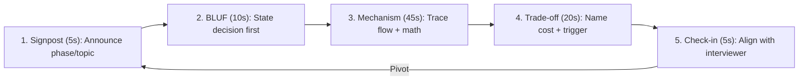
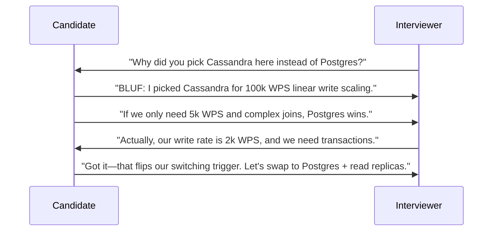

# Communicating Design Decisions Clearly: Signposting and Check-ins

> **Prerequisites:** [Lesson 13: Prioritizing Under Time Pressure in System Design Interviews](../13-prioritizing-under-time-pressure-in-system-design-interviews/README.md).  
> **Estimated Reading Time:** 22–26 minutes  
> **Target Audience:** Engineers who have strong technical instincts but lose interviews because they ramble, jump between topics silently, or treat the interviewer as a passive grader instead of a design partner.  
> **Free PDF Notes:** [Download SD-T-014.pdf](https://backendroadmap.com/notes/system-design/SD-T-014.pdf)

> [!NOTE]
> **In one line:** Clear communication in a system design interview relies on **signposting** (announcing *where* you are going before you speak), **structured check-ins** (verifying alignment every 5–10 minutes), and **layered explanations** (headline first, mechanism second, trade-off third).

> [!TIP]
> **The Golden Rule:** Treat the interviewer like a **principal engineer teammate** in a design review, not an oral exam proctor. Tell them where you are on the map, invite course corrections early, and never go silent for more than 15 seconds without narrating your thought process.

---

## 1. What Signposting & Check-ins Are, and What They Isn't

Two candidates can draw the exact same architecture and receive opposite scores. The difference is **cognitive load on the interviewer**: if the interviewer has to guess *why* you are drawing a Kafka topic or *whether* you are done with requirements, they spend mental energy tracking you instead of checking rubric boxes.

| Term | Precise Meaning | Example |
| :--- | :--- | :--- |
| **Signposting** | Explicitly announcing the current phase or transition | *"Now that we have the write path, let's trace the read path."* |
| **Check-in** | A brief 1-sentence alignment question to the interviewer | *"Does this latency budget match what you had in mind?"* |
| **BLUF (Bottom Line Up Front)** | Stating the decision before the reasoning | *"I'll use Postgres here—let me explain why over Cassandra."* |
| **Thinking aloud** | Narrating assumptions and options as you evaluate | *"I'm weighing a 5s TTL vs event-driven invalidation..."* |
| **Whiteboard hygiene** | Clean, labeled boxes, numbered flows, left-to-right layout | Numbered arrows `1. POST /orders`, `2. Publish` |
| **Monologuing** | Talking for 10 minutes straight without pausing for feedback | Missing the interviewer's subtle redirect cue |
| **Not** | Filler talk or asking permission for every single box | *"Can I draw a load balancer now?"* (too passive) |

### Why It Matters
1. **Rubric calibration:** Interviewers evaluate *"Communication & Collaboration"* explicitly—especially at Senior and Staff levels where influencing without authority is half the job.
2. **Early course correction:** A 5-second check-in at minute 8 prevents spending 15 minutes solving the wrong problem.
3. **Note-taking friendliness:** Interviewers write a detailed debrief packet *while* you talk. Signposting + BLUF gives them clean headings for their notes.

---

## 2. Anatomy: The Signpost $\rightarrow$ Explain $\rightarrow$ Check-in Loop



Every major design block follows this 85-second micro-loop:
1. **Signpost:** *"Let's move from capacity math to the High-Level Design, starting with the write path."*
2. **BLUF:** *"I'll put a Kafka topic between Ingestion and Storage so we can absorb 10x bursts."*
3. **Mechanism:** Trace the numbered arrows on the diagram (`1 -> 2 -> 3`).
4. **Trade-off:** *"We pay ~10 ms publish latency and eventual consistency on dashboards, which we accept for burst resilience."*
5. **Check-in:** *"Before I trace the read path, any questions on ingestion—or should we go deeper on partitioning?"*

| Communication Anti-Pattern | What Interviewer Hears | Signposted Upgrade |
| :--- | :--- | :--- |
| **Silent drawing (45s)** | *"Are they stuck or thinking?"* | *"I'm sketching the 3 core services left-to-right while I organize the write path."* |
| **Bottom-up rambling** | *"Where is this going?"* | *"I recommend Redis Sorted Sets. Here's why: O(log N) updates..."* |
| **Permission-seeking** | *"Too junior / lacks ownership"* | *"I'm going to use consistent hashing here; let me know if you'd like to probe virtual nodes."* |
| **Defensive pushback** | *"Hard to work with"* | *"Great point—if we can't tolerate 1s staleness, let's switch to write-through."* |

> [!WARNING]
> **The #1 communication trap is "The 8-Minute Monologue."** If you talk for more than 2–3 minutes without a pause or check-in, you miss the interviewer's signals that they already have enough on that topic and want to move to the next rubric area.

---

## 3. Mathematical Model: Information Transfer & Cognitive Load

We can model interviewer comprehension as a channel with finite working-memory capacity $W$ (classic Miller's Law: $7 \pm 2$ chunks) and attention decay over uninterrupted monologue length $L$ (in minutes):

$$C(L) = C_0 \cdot e^{-\lambda L}, \qquad \text{Effective Signal} = \int_{0}^{T} R(t) \cdot C(t)\,dt$$

If you speak for $L = 10$ minutes straight with decay $\lambda = 0.15\text{ min}^{-1}$, comprehension drops to $e^{-1.5} = 22\%$ by minute 10. Breaking the same 10 minutes into **five 2-minute segments** separated by 5-second check-ins resets attention at each boundary:

$$\text{Mean Comprehension (10-min monologue)} = \frac{1 - e^{-1.5}}{1.5} = 51.8\%$$
$$\text{Mean Comprehension (2-min chunks)} = \frac{1 - e^{-0.3}}{0.3} = 86.4\%$$

Chunking with check-ins increases retained architectural signal by **+67%** for the exact same technical content.

---

## 4. Metrics & Percentiles (Communication Hygiene)

| Metric | Healthy Target | Warning Sign |
| :--- | :--- | :--- |
| **Monologue Length** | $60$–$120\text{ seconds}$ between check-ins | $> 3\text{ minutes}$ uninterrupted |
| **Dead Air** | $< 10\text{ seconds}$ silent | $> 20\text{ seconds}$ silent drawing/thinking |
| **BLUF Ratio** | $> 80\%$ of answers start with the conclusion | Burying the answer at the end of a 2-min story |
| **Diagram Numbering** | Every flow numbered (`1 -> 2 -> 3`) | Unlabeled arrows crossing each other |
| **Check-in Frequency** | Every $5$–$8\text{ minutes}$ or at phase boundaries | Zero check-ins in 20 minutes |

### Worked Example (Signposting a URL Shortener Write Path)
- **Bad:** *"So the user sends a URL, we have a load balancer, then a service, maybe we hash it with MD5, wait MD5 has collisions or is too long, so Base62, and we put it in Cassandra or Postgres..."*
- **Signposted BLUF:** *"Let's trace the write path—step 1 through 4 on the diagram. For short-code generation, I'm choosing a **pre-allocated counter range from ZooKeeper/etcd encoded in Base62** rather than random hashing, because it guarantees zero collisions without a DB lookup. The trade-off is a small coordination dependency, which we mitigate by caching 10,000 IDs per pod. Should I trace the read/redirect path next?"*

---

## 5. Compounding & Failure Modes of Poor Communication

| Failure Mode | Minute 10 | Minute 25 | Minute 45 Debrief |
| :--- | :--- | :--- | :--- |
| **No Signposting** | Interviewer unsure what phase you're in | Diagram has unlabelled boxes | *"Disorganized, hard to follow"* |
| **No Check-ins** | Wrong assumption on read:write ratio | Built write-heavy system for read-heavy prompt | *"Didn't listen / missed requirements"* |
| **No BLUF** | Long winding explanations | Interviewer interrupts to find the point | *"Verbose; struggled to summarize"* |

Good communication compounds in the opposite direction: clear signposts make the interviewer trust your pacing, so they give you *more* autonomy and *fewer* adversarial interruptions.

---

## 6. Numbers Every Engineer Must Know

| Item | Typical | Implication |
| :--- | :---: | :--- |
| Max silent gap before narrating | $10$–$15\text{ seconds}$ | Say *"Let me think for 10s about..."* |
| Ideal explanation chunk | $60$–$90\text{ seconds}$ | Pause and check in after each chunk |
| Major phase check-ins per 45m | $4$–$5\text{ check-ins}$ | Scope, Math, HLD, Deep Dive, Wrap-up |
| Diagram boxes in HLD | $5$–$8\text{ boxes}$ | Above 10 boxes, the diagram becomes unreadable |
| Arrow labels | Verb + Protocol | e.g., `1. POST /v1/orders (HTTPS)` |

---

## 7. Mechanism Deep Dive: Handling Pushback & Redirects



| Question | Answer |
| :--- | :--- |
| **What if I need 20 seconds to think?** | Say *"Let me take 15 seconds to think through the partitioning key"*—silence is fine *when announced*. |
| **How do I sound confident without sounding arrogant?** | State your recommendation firmly (*"I'll use X because..."*), then pair it with curiosity (*"Does that align, or do you want to explore Y?"*). |
| **What if I realize I made a mistake 10 minutes ago?** | Own it immediately: *"Wait—looking at our 100k WPS requirement, a single primary won't hold. Let's shard by `tenant_id`."* |
| **How do I keep the whiteboard clean?** | Use 3 zones: Left = Requirements/Math, Center = Diagram, Right = Deep Dive / Schemas. |

**When NOT to check in:** Don't ask *"Is that okay?"* after every single box or trivial decision (like adding a load balancer). Save check-ins for **phase transitions** and **one-way-door decisions**.

---

## 8. Hierarchical Budgets & Design Rules

| Slice | Rule | Control |
| :--- | :--- | :--- |
| **Structure** | Use 3 whiteboard zones (Scope/Math, Diagram, Deep Dive) | Never erase requirements; reference them |
| **Signposting** | Announce every phase transition aloud | *"Moving from HLD to Deep Dive #1..."* |
| **BLUF** | State the answer in sentence #1 | Follow with 2–3 supporting reasons |
| **Check-ins** | Pause every 60–120s for alignment | Ask open-ended steering questions |
| **Pushback** | Validate $\rightarrow$ Re-evaluate $\rightarrow$ Adapt | Never argue defensively |
| **Silence** | Narrate pauses $> 10$ seconds | *"Give me 15s to check the math"* |

---

## 9. Top Mitigations

1. **Practice the 5 standard signposts** until they are automatic (Scope, Math, HLD, Deep Dive, Failure Sweep).
2. **Lead every answer with BLUF**—state your choice in the first 10 words, then justify.
3. **Number your diagram arrows** (`1`, `2`, `3`) and read them in order when tracing a flow.
4. **Use the "Yes, and / If-then" pivot** on interviewer pushback instead of defending a broken assumption.
5. **Announce thinking pauses** (*"Let me take 10 seconds to check the failure mode here"*) to eliminate awkward dead air.
6. **Summarize at minute 43** with a 30-second executive recap of what you built, its bottlenecks, and its trade-offs.

---

## 10. Production Reference: Amazon's "6-Pager / BLUF" & Google Design Docs

Top engineering organizations enforce these exact communication patterns in real-world architecture reviews:
- **Amazon's Narrative / BLUF culture:** Design docs state the recommendation and its trade-offs in the first paragraph so leadership doesn't have to hunt through 5 pages to find the decision.
- **Google's Design Doc Template:** Explicitly separates *Context & Scope*, *Goals / Non-Goals*, *High-Level Design*, *Alternatives Considered*, and *Cross-Cutting Concerns (Security, Reliability)*.
- **Interview translation:** Your 45-minute interview is a **live, spoken Google Design Doc**. Signposting provides the section headers; BLUF provides the executive summary; check-ins simulate the design-review Q&A.

---

## 11. Multi-Language Production Code Tabs

A **Communication & Check-in Cadence Analyzer** (models attention retention from chunking vs monologuing and generates structured signpost templates).

````carousel
```go
// Go: Models interviewer attention retention for chunked check-ins vs long monologues.
package main

import (
	"fmt"
	"math"
)

func MeanRetention(chunkMin, decayRate float64) float64 {
	x := decayRate * chunkMin
	return (1.0 - math.Exp(-x)) / x
}

func main() {
	fmt.Printf("10-min monologue retention: %.1f%%\n", MeanRetention(10.0, 0.15)*100)
	fmt.Printf("2-min chunked retention:    %.1f%%\n", MeanRetention(2.0, 0.15)*100)
}
```
<!-- slide -->
```typescript
// TypeScript: Signpost & BLUF Template Generator for interview phases.
type Phase = "Scope" | "Math" | "HLD" | "DeepDive" | "FailureSweep";

const SIGNPOSTS: Record<Phase, { intro: string; checkin: string }> = {
  Scope: {
    intro: "Let's spend 4 minutes locking down core features and NFRs.",
    checkin: "Do these 3 functional flows and latency targets match what you want?",
  },
  Math: {
    intro: "Let's do quick order-of-magnitude math to size QPS and storage.",
    checkin: "With ~50k peak RPS, does this scale profile look right?",
  },
  HLD: {
    intro: "Moving to High-Level Design—I'll trace the primary write path first.",
    checkin: "Before I dive into bottlenecks, any questions on the baseline?",
  },
  DeepDive: {
    intro: "Zooming into our #1 bottleneck: hot-key skew on the counter.",
    checkin: "Does sharded counters resolve the skew, or should we look at Failure modes?",
  },
  FailureSweep: {
    intro: "Let's run a compact 4-minute failure and security sweep across the diagram.",
    checkin: "We've covered SPOFs, retries, and AuthZ—anything else you'd like to probe?",
  },
};

console.log(SIGNPOSTS.HLD);
```
<!-- slide -->
```python
# Python: Computes attention retention and effective rubric signal across chunk sizes.
import math


def mean_retention(chunk_min: float, decay: float = 0.15) -> float:
    x = decay * chunk_min
    return (1.0 - math.exp(-x)) / x


if __name__ == "__main__":
    for mins in (1.5, 2.0, 5.0, 10.0):
        print(f"Chunk {mins:4.1f}m -> Mean Retention: {mean_retention(mins):.1%}")
```
<!-- slide -->
```csharp
// C#: Compares interviewer attention retention across monologue lengths.
using System;

public static class CommunicationModel
{
    public static double MeanRetention(double chunkMinutes, double decay = 0.15)
    {
        double x = decay * chunkMinutes;
        return (1.0 - Math.Exp(-x)) / x;
    }

    public static void Main()
    {
        Console.WriteLine($"2m chunk:  {MeanRetention(2.0):P1}");
        Console.WriteLine($"10m chunk: {MeanRetention(10.0):P1}");
    }
}
```
````

---

## 12. Hands-On CLI Verification Workflows

Verify the attention-retention math in Python 3:

```bash
python3 -c '
import math
ret = lambda m, lam=0.15: (1 - math.exp(-lam*m)) / (lam*m)
for m in [2, 5, 10]:
    print(f"{m:2d}-min uninterrupted chunk -> {ret(m):.1%} retention")
'
```

Expected output:
```text
 2-min uninterrupted chunk -> 86.4% retention
 5-min uninterrupted chunk -> 70.4% retention
10-min uninterrupted chunk -> 51.8% retention
```

---

## 13. Common Mistakes to Avoid

1. **Jumping into drawing without announcing what flow you are tracing.**
2. **Going silent for 30+ seconds** without saying *"Let me think for a moment."*
3. **Burying the conclusion** at the end of a 2-minute explanation instead of using BLUF.
4. **Asking permission for trivial boxes** (*"Is it okay if I add a database?"*).
5. **Ignoring interviewer hints** because you're locked into a memorized script.
6. **Drawing an unlabeled spaghetti diagram** with crossing arrows and no step numbers.
7. **Getting defensive** when the interviewer challenges a bottleneck or assumption.

---

## 14. Key Terms Glossary

| Key Term | Definition |
| :--- | :--- |
| **Signposting** | Explicitly announcing the current phase or topic transition before speaking. |
| **Check-in** | A brief alignment question pausing for interviewer feedback or redirection. |
| **BLUF** | Bottom Line Up Front—stating the decision before the supporting details. |
| **Cognitive Load** | Mental effort required by the interviewer to follow your explanation. |
| **Whiteboard Hygiene** | Keeping the diagram clean, zoned, labeled, and numbered left-to-right. |
| **Active Listening** | Adapting your design immediately when the interviewer introduces a new constraint. |
| **Executive Summary** | A 30-second closing recap of the architecture, bottlenecks, and trade-offs. |

---

## 15. System Design Interview Questions & Answers

### Basic Conceptual Questions

<details>
<summary><strong>Q1: What is signposting in a system design interview? [BASIC]</strong></summary>

**Answer:**
Signposting is announcing where you are going before you start explaining—for example, *"Now that we've sized the traffic, I'm moving to High-Level Design, starting with the write path."* It lowers the interviewer's cognitive load and makes note-taking effortless.
</details>

<details>
<summary><strong>Q2: What does BLUF mean and why does it work? [BASIC]</strong></summary>

**Answer:**
Bottom Line Up Front: state your decision in the first sentence (*"I'll use DynamoDB here because..."*), then give the reasoning and trade-offs. If the interviewer interrupts after 15 seconds, they already have your answer.
</details>

<details>
<summary><strong>Q3: How often should you check in with the interviewer? [BASIC]</strong></summary>

**Answer:**
Roughly every 60–120 seconds on deep dives, and at every major phase transition (after Scope, after Math, after HLD, after Deep Dive #1).
</details>

<details>
<summary><strong>Q4: What should you do if you need 20 seconds to think? [BASIC]</strong></summary>

**Answer:**
Announce it! Say *"Give me 15 seconds to think through the best partition key for this access pattern."* Announced pauses feel deliberate and senior; unannounced silence feels like stalling.
</details>

### Scenario-Based Architecture Questions

<details>
<summary><strong>Q5: How do you transition smoothly from Requirements to High-Level Design? [SCENARIO]</strong></summary>

**Answer:**
Summarize the agreed constraints in one sentence, then signpost: *"We're optimizing for 50k read QPS, <50 ms p99, and eventual consistency. Let's move to the High-Level Design—I'll trace the write path first, then the read path."*
</details>

<details>
<summary><strong>Q6: The interviewer interrupts you mid-sentence to ask about a completely different component. How do you respond? [SCENARIO]</strong></summary>

**Answer:**
Never talk over them or finish a 2-minute tangent. Pivot immediately: *"Sure, let's jump to caching right now."* Answer their question with BLUF, then ask if they want to stay there or return to the previous flow.
</details>

<details>
<summary><strong>Q7: How do you explain a complex distributed flow (e.g., Saga or 2PC) without losing the interviewer? [SCENARIO]</strong></summary>

**Answer:**
Number the steps (`1 -> 2 -> 3 -> 4`) on the diagram as you speak, start with the happy path in 30 seconds, check in, and then trace the single failure/compensation path.
</details>

<details>
<summary><strong>Q8: How do you close the interview in the last 60 seconds? [SCENARIO]</strong></summary>

**Answer:**
Give a crisp 30-second summary: *"To recap, we built a partitioned, cache-aside architecture handling 50k RPS, mitigated hot-key skew with local aggregation, and protected against cascading failures with circuit breakers and rate limiting. The main remaining trade-off is ~500 ms eventual consistency on reads."*
</details>

### Advanced & Tricky Interview Questions

<details>
<summary><strong>Q9: How do you tell the difference between an interviewer who is testing you vs one who is trying to save you? [TRICKY]</strong></summary>

**Answer:**
Either way, the response is the same: treat every question as a valid engineering constraint. Pause, acknowledge the point (*"Right, if that shard fails..."*), evaluate whether it breaks your current assumption, and adapt cleanly.
</details>

<details>
<summary><strong>Q10: What if the interviewer stays completely silent for 15 minutes? [TRICKY]</strong></summary>

**Answer:**
Some interviewers intentionally stay quiet to test Senior/Staff autonomy. Keep running your Signpost $\rightarrow$ BLUF $\rightarrow$ Check-in loop every 2 minutes anyway (*"I'll assume 500 ms staleness is fine unless you want strict consistency—moving on to partitioning..."*).
</details>

<details>
<summary><strong>Q11: How do you handle realizing your earlier DB choice won't scale during the Deep Dive? [TRICKY]</strong></summary>

**Answer:**
Own the discovery aloud as a positive engineering moment: *"Actually, now that we've calculated 100k writes/s with append-only time-series data, a single Postgres primary will bottleneck on IOPS. Let's swap the telemetry store to Cassandra/Timescale and keep Postgres only for metadata."*
</details>

<details>
<summary><strong>Q12: Why is "asking permission" bad, and how do you rephrase it as a peer check-in? [TRICKY]</strong></summary>

**Answer:**
Asking *"Can I draw a cache now?"* sounds passive. Instead, state your intent and invite alignment: *"I'm adding a Redis cache-aside layer here to cut DB read load by 90%—let me know if you'd like to dig into invalidation."*
</details>

---

## 16. One-Page Master Cheat Sheet

```
+---------------------------------------------------------------------------------------------------------+
|            COMMUNICATING DESIGN DECISIONS CLEARLY — MASTER CHEAT SHEET                                  |
+---------------------------------------------------------------------------------------------------------+
| 1. MICRO-LOOP: Signpost (5s) -> BLUF (10s) -> Mechanism (45s) -> Trade-off (20s) -> Check-in (5s).      |
+---------------------------------------------------------------------------------------------------------+
| 2. BLUF RULE: State your decision in the first 10 words; justify second.                                |
+---------------------------------------------------------------------------------------------------------+
| 3. CHUNKING MATH: 2-min chunks = 86% retention vs 10-min monologue = 52% retention (+67% signal).       |
+---------------------------------------------------------------------------------------------------------+
| 4. WHITEBOARD ZONES: Left = Scope & Math | Center = Numbered Diagram (5-8 boxes) | Right = Deep Dive.   |
+---------------------------------------------------------------------------------------------------------+
| 5. SILENCE & PUSHBACK: Narrate pauses >10s. On pushback: Validate -> Re-evaluate trigger -> Adapt.      |
+---------------------------------------------------------------------------------------------------------+
```

---

## Further Reading & Sources

- Google Engineering, *Design Docs at Google* (Malte Ubl).
- Barbara Minto, *The Pyramid Principle* (BLUF / top-down structured communication).
- Tanya Reilly, *The Staff Engineer's Path*, Chapter 5 ("Communication and Alignment").

---

## Free PDF Notes

[SD-T-014.pdf](https://backendroadmap.com/notes/system-design/SD-T-014.pdf)

---

## Next

Continue with [Lesson 15: Senior vs Staff System Design Interviews: What Changes?](../15-senior-vs-staff-system-design-interviews/README.md).
