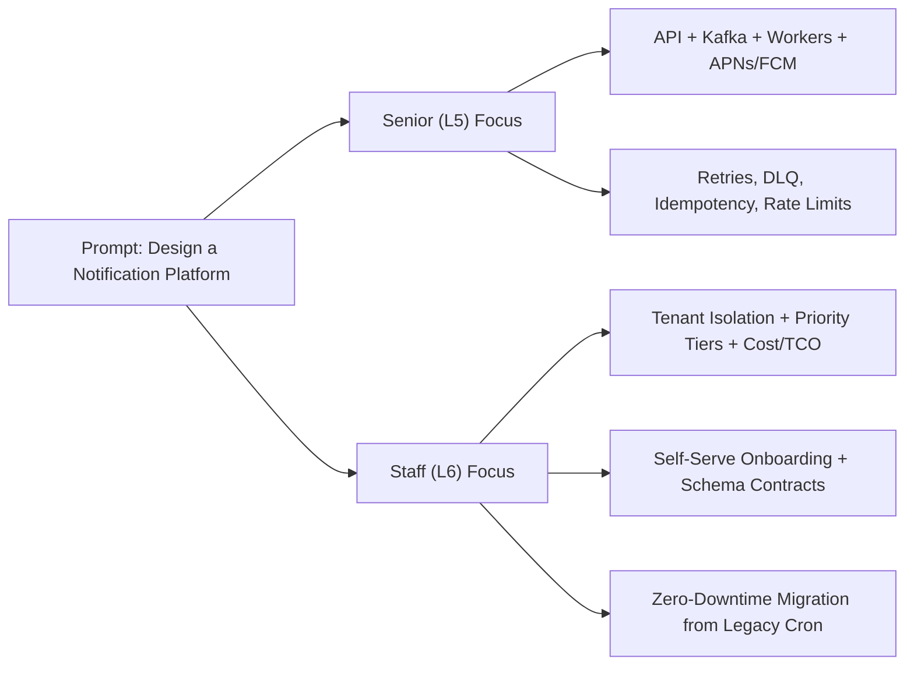
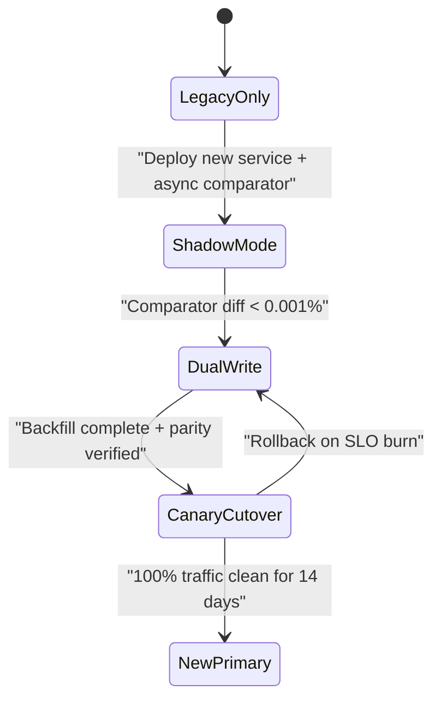

# Senior vs Staff System Design Interviews: What Changes?

> **Prerequisites:** [Lesson 14: Communicating Design Decisions Clearly: Signposting and Check-ins](../14-communicating-design-decisions-clearly/README.md).  
> **Estimated Reading Time:** 24–28 minutes  
> **Target Audience:** Senior (L5) engineers targeting Staff/Principal (L6/L7) loops, and candidates calibrating what interviewers expect at each level on the exact same prompt.  
> **Free PDF Notes:** [Download SD-T-015.pdf](https://backendroadmap.com/notes/system-design/SD-T-015.pdf)

> [!NOTE]
> **In one line:** A **Senior** interview tests whether you can **build a clean, scalable, fault-tolerant system** for a bounded problem; a **Staff** interview tests whether you can **define the ambiguous problem, align cross-team boundaries, design evolutionary migrations, and optimize total cost of ownership (TCO) and organizational leverage**.

> [!TIP]
> **The Golden Rule:** At Senior, you solve the **technical puzzle** on the whiteboard. At Staff, you zoom out to ask *"Should we even build this, how do 5 teams own and evolve it without stepping on each other, and how do we migrate zero-downtime from the legacy system?"*

---

## 1. What Changes Between Senior and Staff, and What Doesn't

Both Senior (L5) and Staff (L6+) interviews often start with the *exact same prompt* (*"Design a notification platform"* or *"Design a distributed metrics pipeline"*). What changes is **ambiguity, scope, and the rubric**: Staff candidates are expected to drive the room with minimal prompting, connect architecture to business/org constraints, and think in multi-quarter evolution rather than greenfield snapshots.

| Dimension | Senior (L5) Expectation | Staff (L6+) Expectation |
| :--- | :--- | :--- |
| **Problem Framing** | Clarifies functional & non-functional reqs | Reframes ambiguous business goals into crisp SLOs, non-goals, and phases |
| **Architecture Focus** | Single system end-to-end (services, DB, cache) | Platform boundaries, multi-team contracts, shared primitives vs team autonomy |
| **Data & Scale** | Sharding, replication, caching, queues | Multi-region topology, tail-latency budgets, cost/TCO, noisy-neighbor isolation |
| **Evolution & Migration** | Greenfield whiteboard design | Strangler-fig migration, dual-writes/backfills, schema evolution, zero-downtime cutover |
| **Failure & Operations** | Identifies SPOFs, retries, circuit breakers | Blast-radius cells, error budgets, observability/SLO alerting, on-call toil |
| **Interviewer Dynamic** | Collaborative peer; responds well to hints | Drives the agenda; treats interviewer as VP/Peer Staff; needs zero hand-holding |
| **Not** | Memorizing more buzzwords (Flink, Istio, Spanner) | Over-engineering when a simpler, cheaper platform design wins |

### Why It Matters
1. **Down-leveling is the #1 L6 outcome:** Strong L5 candidates regularly get *down-leveled* to L5 when interviewing for L6 because they give a great greenfield technical design without addressing org boundaries, TCO, or migration.
2. **Same fundamentals, different altitude:** Staff doesn't abandon QPS math or sharding—it assumes those are fluent and layers *economics, evolution, and cross-team interfaces* on top.
3. **Self-calibration:** Knowing the rubric delta lets you intentionally inject Staff signals when targeting L6+, or keep scope tight when targeting L5.

---

## 2. Anatomy: Senior vs Staff Altitude on the Same Prompt



Notice how **L6 includes L5** (you still need Kafka, DLQ, idempotency, and rate limits), but elevates the conversation to **platform economics, multi-tenancy, and migration**.

| Topic | Senior (L5) Answer | Staff (L6) Upgrade |
| :--- | :--- | :--- |
| **Queues** | *"Use Kafka with 32 partitions and a DLQ."* | *"Separate Kafka topics by priority tier (OTP vs Marketing) so a 10M marketing blast never delays 2FA codes."* |
| **Database** | *"Shard Postgres by `user_id`."* | *"Shard by `tenant_id` with cellular isolation for large enterprise tenants, plus a dual-write + shadow-read cutover plan."* |
| **Cost** | *"Cache hot items in Redis."* | *"Keep hot 7-day metadata in SSD/Redis ($100/TB/mo) and tier >30-day audit logs to S3/Parquet ($23/TB/mo), cutting TCO 70%."* |
| **Org / API** | *"Expose `POST /notify`."* | *"Versioned Protobuf contracts with per-team quotas, self-serve templates, and automated schema compatibility checks."* |

> [!WARNING]
> **The #1 trap for L6 candidates is "Staff-level hand-waving."** Talking about org alignment and TCO *without* proving you can still do the low-level math, partitioning, and failure handling gets you rejected outright. You must clear the L5 technical bar *and* add L6 altitude.

---

## 3. Mathematical Model: TCO, Tail Latency & Migration Risk

Staff engineers quantify **economics (TCO)** and **cross-team tail latency**, not just QPS.

### Model A: Storage & Compute TCO Optimization

Suppose an observability/audit system ingests $\lambda = 50{,}000\text{ events/s}$ at $500\text{ B/event}$ ($25\text{ MB/s} \approx 2.16\text{ TB/day}$), retained for $365\text{ days}$ ($788\text{ TB/year}$ raw, or $\sim 200\text{ TB/year}$ compressed $4\times$):

- **Naive Hot-Only (NVMe / Managed Search):** $200\text{ TB} \times \$150/\text{TB/mo} = \$30{,}000/\text{mo} = \$360{,}000/\text{yr}$.
- **Tiered (7 days NVMe + 358 days Object Storage):**
  - Hot tier ($7/365 \times 200\text{ TB} \approx 3.8\text{ TB}$): $3.8 \times \$150 = \$570/\text{mo}$.
  - Cold tier ($196.2\text{ TB}$ on S3): $196.2 \times \$23 = \$4{,}513/\text{mo}$.
  - **Total:** $\$5{,}083/\text{mo}$ (**83% TCO reduction**, saving $\$299{,}000/\text{yr}$).

### Model B: Fan-out Tail Latency ($p_{99}$ across $N$ Parallel Calls)

In a microservices platform, if a Staff-designed gateway fans out to $N$ independent team services, each with $p_{99}$ latency, the probability that *all* $N$ finish within a single service's $p_{99}$ time is:

$$P(\text{all } N \le t_{99}) = (0.99)^N$$

For $N = 10$ parallel calls, $(0.99)^{10} = 0.904$—meaning **9.6% of user requests hit the tail** ($p_{90}$ of the composite = $p_{99}$ of a leaf)! For $N = 50$, $(0.99)^{50} = 60.5\%$ (**39.5% hit the tail**). Staff engineers mitigate this with **hedged requests**, **budgets**, or **async aggregation**.

---

## 4. Metrics & Percentiles (Senior vs Staff)

| Metric | Senior Focus | Staff Addition |
| :--- | :--- | :--- |
| **Latency** | $p_{50}, p_{99}$ of the service | End-to-end latency budget sliced across owning teams |
| **Availability** | 99.9% uptime, SPOF elimination | Error-budget burn policy + cellular blast-radius cap ($\le 5\%$) |
| **Cost** | Rough server/DB count | Cost per million requests, hot/cold storage tiering, egress |
| **Migration** | N/A (greenfield) | Parity mismatch rate ($< 0.001\%$), rollback time ($< 5\text{ min}$) |
| **Developer Velocity** | Clean service API | Self-serve onboarding time, schema breaking-change rate = 0 |

### Worked Example (Strangler-Fig Migration of a Legacy Billing Monolith)
A Staff candidate asked to replace a legacy billing monolith doesn't say *"We'll swap the DNS on Friday."* They specify a 4-stage zero-downtime migration:
1. **Shadow Read / Dual Write:** New service runs in shadow mode; comparator logs diffs between legacy and new outputs.
2. **Backfill + Verify:** Historical records backfilled with idempotent jobs until parity mismatch $< 0.001\%$.
3. **Canary Cutover:** Route $1\% \rightarrow 10\% \rightarrow 50\% \rightarrow 100\%$ of live writes via feature flags, keeping legacy DB hot for instant rollback.
4. **Decommission:** Freeze legacy writes after 14 clean days and archive.

---

## 5. Compounding & Failure Modes: Greenfield vs Evolutionary Design

| Decision | Day 1 (Greenfield) | Year 2 (10x Scale, 8 Teams) | Staff Mitigation |
| :--- | :--- | :--- | :--- |
| **Shared Database across 5 teams** | Fast to ship | Schema locks, coupled deploys, unclear ownership | Domain-owned APIs + event contracts |
| **Single shared queue for all traffic** | Simple ops | Marketing blast starves critical OTPs | Priority-tiered topics + per-tenant quotas |
| **Big-bang rewrite** | Clean slide deck | 18-month freeze, parity bugs on launch day | Strangler-fig + shadow reads + canary |
| **Unbounded hot storage** | Fast queries | $300k/yr surprise cloud bill | Hot/warm/cold lifecycle tiering |

---

## 6. Numbers Every Engineer Must Know

| Item | Typical | Implication |
| :--- | :---: | :--- |
| Hot NVMe vs Object Storage (S3) | $\sim\$150$ vs $\sim\$23$ per TB/mo | Tier cold data $> 7$–$30$ days |
| Cross-AZ / Cross-Region egress | $\$0.01$–$\$0.09$ per GB | Avoid chatty cross-region sync calls |
| Tail amplification ($N=20$ fanout) | $1 - 0.99^{20} = 18.2\%$ hit $p_{99}$ | Use hedged requests or coarser service boundaries |
| Safe canary rollout stages | $1\% \rightarrow 10\% \rightarrow 50\% \rightarrow 100\%$ | Automated rollback on error-budget burn |
| Prompting needed (L5 vs L6) | Occasional hints (L5) vs Zero (L6) | L6 drives scope, deep dive, and trade-offs autonomously |

---

## 7. Mechanism Deep Dive: The Strangler-Fig Migration State Machine



| Question | Answer |
| :--- | :--- |
| **Should I always bring up migration in an L6 interview?** | Yes, if the prompt implies an existing product, scale-up, or platform replacement—even 90 seconds on strangler-fig + parity verification is huge L6 signal. |
| **How do I show org awareness without sounding non-technical?** | Tie org boundaries directly to technical boundaries (Conway's Law): *"Service A owns the ledger schema; Service B consumes `InvoiceIssued` events—no shared DB tables."* |
| **What if the interviewer asks a basic L5 question in an L6 loop?** | Nail it cleanly in 30 seconds, then bridge to the L6 layer (*"...and at 10x scale across multiple tenants, we also isolate..."*). |

**When NOT to force Staff abstractions:** Don't invent a multi-team platform governance committee for a 100-RPS internal tool. Staff judgment means **knowing when a boring monolith is the right answer**.

---

## 8. Hierarchical Budgets & Design Rules

| Slice | Senior (L5) Rule | Staff (L6+) Rule |
| :--- | :--- | :--- |
| **Autonomy** | Needs light steering on deep dives | Self-drives all 5 phases + checkpoints |
| **Requirements** | Clarifies QPS, latency, consistency | Defines non-goals, TCO constraints, phased MVP $\rightarrow$ V2 |
| **Architecture** | Clean, scalable, zero-SPOF design | Platform contracts, tenant isolation, cellular blast radius |
| **Migration** | Optional | Strangler-fig, dual-write/shadow-read, rollback plan |
| **Economics** | Mentions caching/storage roughly | Quantifies hot/cold tiering, egress, and operational toil |
| **Trade-offs** | Compares technical options | Compares technical + org + build-vs-buy + reversibility |

---

## 9. Top Mitigations (How to Bridge from L5 to L6)

1. **Reframe ambiguity in Minute 1** by proposing phased scope (*"MVP for 10x today, extensible to 100x multi-region"*).
2. **Isolate noisy neighbors** with priority-tiered queues, per-tenant quotas, and cellular architectures.
3. **Include a 90-second TCO / storage-tiering check** on any data-intensive prompt.
4. **Propose a strangler-fig migration + parity verification** whenever replacing or evolving a system.
5. **Define clear team/domain contracts** (APIs, versioned schemas, SLAs) rather than shared databases.
6. **Quantify tail-latency amplification** on fan-out paths and bound it with budgets or hedged requests.
7. **Always evaluate "boring/simple first"**—Staff engineers delete complexity as often as they add it.

---

## 10. Production Reference: Tail at Scale & Cellular Isolation (Google / AWS)

Two foundational Staff-level engineering papers define how L6+ architects think:
- **Jeff Dean & Luiz André Barroso (*The Tail at Scale*, Google):** Demonstrated that at $N=100$ parallel backend calls, even if each leaf is $99\%$ fast, $1 - 0.99^{100} = 63\%$ of composite requests hit the tail! Solutions like **hedged requests** (send a backup request after $p_{95}$ delay) and **canary requests** cut $p_{99}$ latency dramatically without over-provisioning.
- **AWS Builders' Library (*Minimizing blast radius with cells*):** Rather than scaling one giant global cluster where a bad config or poison pill breaks 100% of customers, partition into independent **cells** (e.g., 20 cells $\times$ 5% traffic each) with a thin routing layer.

---

## 11. Multi-Language Production Code Tabs

A **Staff-Level TCO & Tail-Latency Amplification Calculator** comparing Hot-only vs Tiered storage cost and computing composite $P(\text{tail})$ across $N$ parallel microservices.

````carousel
```go
// Go: Computes composite tail-latency probability across N parallel RPCs and TCO savings.
package main

import (
	"fmt"
	"math"
)

func CompositeTailProb(n int, leafPercentile float64) float64 {
	return 1.0 - math.Pow(leafPercentile, float64(n))
}

func AnnualStorageTCO(totalTB, hotDays, totalDays, hotCostPerTBMo, coldCostPerTBMo float64) (naive, tiered float64) {
	naive = totalTB * hotCostPerTBMo * 12
	hotTB := totalTB * (hotDays / totalDays)
	coldTB := totalTB - hotTB
	tiered = (hotTB*hotCostPerTBMo + coldTB*coldCostPerTBMo) * 12
	return naive, tiered
}

func main() {
	fmt.Printf("N=20 parallel calls @ p99 -> %.1f%% hit tail\n", CompositeTailProb(20, 0.99)*100)
	naive, tiered := AnnualStorageTCO(200, 7, 365, 150, 23)
	fmt.Printf("Storage TCO/yr: Naive=$%.0f | Tiered=$%.0f (Saved %.0f%%)\n", naive, tiered, (1-tiered/naive)*100)
}
```
<!-- slide -->
```typescript
// TypeScript: Tail-latency amplification & storage tiering TCO evaluator.
function tailHitProbability(parallelCalls: number, leafP = 0.99): number {
  return Number(((1 - Math.pow(leafP, parallelCalls)) * 100).toFixed(1));
}

function tieredSavings(totalTB: number, hotDays: number, totalDays = 365, hotCost = 150, coldCost = 23) {
  const hotTB = totalTB * (hotDays / totalDays);
  const coldTB = totalTB - hotTB;
  const naiveAnnual = totalTB * hotCost * 12;
  const tieredAnnual = (hotTB * hotCost + coldTB * coldCost) * 12;
  return {
    naiveAnnual: Math.round(naiveAnnual),
    tieredAnnual: Math.round(tieredAnnual),
    savingsPct: Number((((naiveAnnual - tieredAnnual) / naiveAnnual) * 100).toFixed(1)),
  };
}

console.log({ tailPctAt20: tailHitProbability(20), tco: tieredSavings(200, 7) });
```
<!-- slide -->
```python
# Python: Staff-level TCO & Tail-at-Scale calculator.
def tail_hit_prob(n_calls: int, leaf_p: float = 0.99) -> float:
    return 1.0 - (leaf_p ** n_calls)


def storage_tco_annual(
    total_tb: float = 200,
    hot_days: float = 7,
    total_days: float = 365,
    hot_cost_mo: float = 150,
    cold_cost_mo: float = 23,
) -> dict[str, float]:
    hot_tb = total_tb * (hot_days / total_days)
    cold_tb = total_tb - hot_tb
    naive = total_tb * hot_cost_mo * 12
    tiered = (hot_tb * hot_cost_mo + cold_tb * cold_cost_mo) * 12
    return {
        "naive_yr_usd": round(naive),
        "tiered_yr_usd": round(tiered),
        "savings_pct": round((1 - tiered / naive) * 100, 1),
    }


if __name__ == "__main__":
    print(f"N=20 @ p99 -> {tail_hit_prob(20):.1%} hit tail")
    print(storage_tco_annual())
```
<!-- slide -->
```csharp
// C#: Tail-latency amplification & storage tiering TCO calculator.
using System;

public static class StaffMetrics
{
    public static double TailHitProb(int nCalls, double leafP = 0.99) =>
        1.0 - Math.Pow(leafP, nCalls);

    public static (double NaiveYr, double TieredYr) StorageTco(
        double totalTb = 200, double hotDays = 7, double totalDays = 365,
        double hotCostMo = 150, double coldCostMo = 23)
    {
        double hotTb = totalTb * (hotDays / totalDays);
        double coldTb = totalTb - hotTb;
        return (totalTb * hotCostMo * 12, (hotTb * hotCostMo + coldTb * coldCostMo) * 12);
    }

    public static void Main()
    {
        var (naive, tiered) = StorageTco();
        Console.WriteLine($"N=20 tail: {TailHitProb(20):P1} | Naive=${naive:N0}/yr vs Tiered=${tiered:N0}/yr");
    }
}
```
````

---

## 12. Hands-On CLI Verification Workflows

Verify the TCO and tail-at-scale calculations in Python 3:

```bash
python3 -c '
for n in [1, 10, 20, 50, 100]:
    print(f"N={n:3d} parallel calls -> {1 - 0.99**n:5.1%} hit p99 tail")
hot = 200 * (7/365) * 150 * 12
cold = 200 * (358/365) * 23 * 12
print(f"200TB TCO/yr: Hot-only=${200*150*12:,.0f} vs Tiered=${hot+cold:,.0f}")
'
```

Expected output:
```text
N=  1 parallel calls ->  1.0% hit p99 tail
N= 10 parallel calls ->  9.6% hit p99 tail
N= 20 parallel calls -> 18.2% hit p99 tail
N= 50 parallel calls -> 39.5% hit p99 tail
N=100 parallel calls -> 63.4% hit p99 tail
200TB TCO/yr: Hot-only=$360,000 vs Tiered=$61,001
```

---

## 13. Common Mistakes to Avoid

1. **Treating an L6 interview like a harder L5 quiz** instead of owning problem framing, TCO, and evolution.
2. **Hand-waving the L5 fundamentals** (missing QPS math, sharding keys, or failure modes) while talking high-level strategy.
3. **Proposing a big-bang rewrite** instead of a strangler-fig migration with shadow reads and rollback.
4. **Ignoring multi-tenancy and noisy neighbors** in platform prompts.
5. **Sharing a single database across multiple team-owned services** (tight organizational coupling).
6. **Waiting for the interviewer to steer** instead of driving the 45-minute agenda yourself.
7. **Adding distributed complexity for resume-driven design** when a modular monolith or managed service wins on TCO.

---

## 14. Key Terms Glossary

| Key Term | Definition |
| :--- | :--- |
| **TCO (Total Cost of Ownership)** | Full lifecycle cost: compute, storage, egress, licensing, and engineering/on-call toil. |
| **Strangler-Fig Pattern** | Incrementally replacing a legacy system via routing, shadow reads, dual writes, and canary cutover. |
| **Cellular Architecture** | Partitioning a fleet into independent cells to cap blast radius to $1/C$ of users. |
| **Tail Amplification** | Phenomenon where fanning out to $N$ services multiplies the probability of hitting $p_{99}$ latency. |
| **Hedged Request** | Issuing a duplicate request to a replica if the primary hasn't responded by $p_{95}$. |
| **Conway's Law** | System architecture mirrors the communication structure of the organization that builds it. |
| **Noisy Neighbor** | One tenant's traffic spike degrading latency/availability for other tenants on shared infra. |
| **Parity Verification** | Comparing legacy vs new system outputs in shadow mode before cutting over live traffic. |

---

## 15. System Design Interview Questions & Answers

### Basic Conceptual Questions

<details>
<summary><strong>Q1: What is the single biggest difference between a Senior (L5) and Staff (L6) system design interview? [BASIC]</strong></summary>

**Answer:**
Autonomy and scope: an L5 candidate designs a solid, scalable technical solution for a well-scoped problem (often with light interviewer steering). An L6 candidate defines the ambiguous problem, drives the agenda independently, and addresses cross-team contracts, TCO, blast radius, and zero-downtime migration.
</details>

<details>
<summary><strong>Q2: Can you pass an L6 interview with great org/strategy talk if your sharding/caching math is shaky? [BASIC]</strong></summary>

**Answer:**
No. L6 is a *superset* of L5. You must still clear the L5 technical bar (capacity math, data modeling, bottlenecks, failure modes) cleanly before the Staff-level signals (TCO, migration, multi-tenancy) earn you the L6 rating.
</details>

<details>
<summary><strong>Q3: What is the Strangler-Fig pattern? [BASIC]</strong></summary>

**Answer:**
An incremental migration strategy where a new system is built alongside a legacy system, verified via shadow reads and dual writes, and gradually receives traffic ($1\% \rightarrow 10\% \rightarrow 100\%$) behind a router/feature flag with instant rollback capability.
</details>

<details>
<summary><strong>Q4: Why do Staff engineers care about "build vs buy" and TCO in interviews? [BASIC]</strong></summary>

**Answer:**
Because engineering headcount and cloud bills are finite. Saving $300k/year via hot/cold storage tiering or avoiding 6 months of custom infra by adopting a managed queue has more business impact than shaving 2 ms off an internal API.
</details>

### Scenario-Based Architecture Questions

<details>
<summary><strong>Q5: How do you upgrade a "Design a Notification System" answer from Senior to Staff? [SCENARIO]</strong></summary>

**Answer:**
Beyond Kafka + workers + DLQ + idempotency (L5), add: (1) priority-tiered topics so marketing blasts never starve 2FA OTPs, (2) per-tenant rate limits and quotas, (3) self-serve template/schema contracts for product teams, and (4) vendor failover (e.g., Twilio + secondary SMS provider with health-based routing).
</details>

<details>
<summary><strong>Q6: You're asked to migrate a 10M-user monolith's order table to a new Order Service with zero downtime. How? [SCENARIO]</strong></summary>

**Answer:**
(1) Deploy the new service and dual-write (or CDC via Debezium) from the legacy DB, (2) backfill historical rows, (3) run async shadow reads and fix diffs until parity mismatch $< 0.001\%$, (4) canary-cut over live reads then writes ($1\% \rightarrow 100\%$), and (5) keep legacy DB synced in reverse during canary for instant rollback.
</details>

<details>
<summary><strong>Q7: Your service fans out to 25 downstream team APIs and p99 latency is 3x higher than any single team's SLA. Why, and how do you fix it? [SCENARIO]</strong></summary>

**Answer:**
Tail amplification: $1 - 0.99^{25} = 22.2\%$ of requests hit at least one slow leaf! Fix it by: (1) replacing synchronous fan-out with pre-computed/async materialized views where possible, (2) using hedged requests for idempotent reads, and (3) enforcing strict per-leaf deadline budgets with graceful degradation for non-critical leaves.
</details>

<details>
<summary><strong>Q8: How do you design multi-tenancy so one enterprise customer's 100x spike doesn't hurt 10,000 SMB customers? [SCENARIO]</strong></summary>

**Answer:**
Combine per-tenant gateway rate limits, isolated queue partitions/workers, and a **cellular architecture** (or dedicated siloed cells for top enterprise tiers) so noisy neighbors are physically bounded to their own cell.
</details>

### Advanced & Tricky Interview Questions

<details>
<summary><strong>Q9: When should a Staff candidate explicitly recommend a monolith over microservices? [TRICKY]</strong></summary>

**Answer:**
When team size is small ($< 15$–$20$ engineers), domain boundaries are still shifting, or transactional integrity across entities is paramount. Recommending a well-modularized monolith with clear internal module interfaces—and a clean extraction seam if a module hits 10x scale—demonstrates real Staff maturity.
</details>

<details>
<summary><strong>Q10: How do you handle a prompt where the interviewer gives almost zero requirements ("Design a platform for X")? [TRICKY]</strong></summary>

**Answer:**
This is a classic L6 ambiguity test. Propose a crisp problem statement, 3 core user personas/flows, explicit non-goals, and phased SLOs (Phase 1 MVP vs Phase 2 global scale), then check in: *"I'm framing this around these SLOs and non-goals—does that match your intent?"*
</details>

<details>
<summary><strong>Q11: What is the hidden risk of "dual-write" during a zero-downtime migration, and how do you avoid it? [TRICKY]</strong></summary>

**Answer:**
Application-level dual writes (write to Legacy DB, then write to New DB) are not atomic and cause silent data drift on partial failures or out-of-order concurrency. Use **Change Data Capture (CDC)** (e.g., Debezium reading the primary DB WAL) or an outbox table to stream changes reliably in commit order.
</details>

<details>
<summary><strong>Q12: How do you measure whether a platform you designed is actually successful 6 months after launch? [TRICKY]</strong></summary>

**Answer:**
Track both technical SLOs ($p_{99}$ latency, error budget burn, TCO per million ops) and **organizational leverage metrics**: time-to-onboard a new product team, self-serve adoption rate, and reduction in cross-team incident pages.
</details>

---

## 16. One-Page Master Cheat Sheet

```
+---------------------------------------------------------------------------------------------------------+
|               SENIOR VS STAFF SYSTEM DESIGN — MASTER CHEAT SHEET                                        |
+---------------------------------------------------------------------------------------------------------+
| 1. ALTITUDE SHIFT: L5 = clean, scalable single system. L6 = L5 bar + ambiguity, org, TCO, evolution.    |
+---------------------------------------------------------------------------------------------------------+
| 2. STAFF SIGNALS: Priority-tiered isolation · Cellular blast radius · Hot/cold TCO · Team contracts.    |
+---------------------------------------------------------------------------------------------------------+
| 3. MIGRATIONS: Never big-bang. Strangler-fig: CDC/dual-write -> backfill -> shadow parity -> canary.    |
+---------------------------------------------------------------------------------------------------------+
| 4. TAIL AT SCALE: N=20 parallel calls @ p99 => 18.2% hit tail. Mitigate: pre-compute, hedge, degrade.   |
+---------------------------------------------------------------------------------------------------------+
| 5. TCO MATH: Tiering 200 TB (7d NVMe + 358d S3) cuts annual storage bill by 83% ($360k -> $61k/yr).     |
+---------------------------------------------------------------------------------------------------------+
| 6. JUDGMENT: Sometimes the Staff answer is a modular monolith or buying a managed service.              |
+---------------------------------------------------------------------------------------------------------+
```

---

## Further Reading & Sources

- Will Larson, *Staff Engineer: Leadership Beyond the Management Track*.
- Tanya Reilly, *The Staff Engineer's Path*, Chapters 3–6 (Technical Strategy, Big-Picture Thinking).
- Jeff Dean & Luiz André Barroso, *The Tail at Scale* (Communications of the ACM).
- AWS Builders' Library, *Reducing Scope of Impact with Cell-Based Architecture*.

---

## Free PDF Notes

[SD-T-015.pdf](https://backendroadmap.com/notes/system-design/SD-T-015.pdf)

---

## Next

Continue with [Track 22: Interview Design Problems](../../22-interview-design-problems/README.md).
