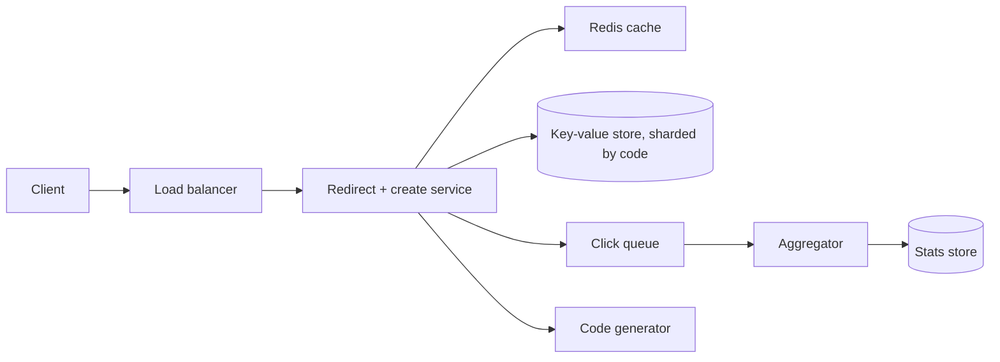

# URL Shortener: Full System Design Mock Interview, All 9 Steps

> **Prerequisites:** [Lesson 15: Senior vs Staff System Design Interviews](../../21-interview-framework/15-senior-vs-staff-system-design-interviews/README.md) and the [Interview Framework track](../../21-interview-framework/README.md).
> **Estimated Reading Time:** 15–20 minutes
> **Target Audience:** Engineers practising the full 9-step system design interview on a classic prompt: turning a long URL into a short one and redirecting at scale.

> [!NOTE]
> **In one line:** A URL shortener is a **read-heavy key-value lookup** (short code to long URL) with one hard design question: how to generate short codes that never collide.

> [!TIP]
> **The Golden Rule:** Redirects are 100x more frequent than creates. Design the read path first (cache plus a key-value store), then make code generation boring and collision-free.

---

## Step 1. Clarify the Problem

Open with questions, not boxes. The problem sounds trivial, so interviewers look for the number you derive: how many characters the code needs, and how you avoid a collision without a global lock.

**Questions to ask the interviewer, and the answer we assume:**

| Question | Assumed answer |
| :--- | :--- |
| Custom aliases? | Yes, optional, must be unique |
| Link expiry? | Optional TTL, default never |
| Analytics? | Click counts only, eventually consistent |
| Redirect type? | 302 when we want every click counted, 301 otherwise |
| Scale? | 100M new URLs per month, 100:1 read to write |

> Say it aloud: *"Before I draw anything, let me confirm the scope and the numbers."* That one sentence earns the first minutes of the interview.

---

## Step 2. Functional and Non-Functional Requirements

**Functional (what the system does):**

- Create a short URL for a long URL (optionally with a custom alias and expiry).
- Redirect a short URL to its long URL.
- Delete or expire a short URL.
- Count clicks per URL (approximate is fine).

**Non-functional (how well it does it):**

| Quality | Target | Why it drives the design |
| :--- | :--- | :--- |
| Availability | 99.99% for redirects | A dead redirect breaks every page that links to it |
| Latency | p99 under 50 ms redirect | Redirect sits in the user's page-load path |
| Durability | No lost mappings | A lost row is a permanently broken link |
| Uniqueness | No two long URLs share a code | Correctness of the whole product |

---

## Step 3. Scope: In and Out

**In scope:** Create, redirect, expire, click counting.

**Out of scope (say it explicitly, then move on):**

- User accounts and billing.
- Malware scanning of target URLs (mention it, then park it).
- A full analytics dashboard.

---

## Step 4. Capacity Estimation

Assumptions: 100M creates per month, a 100:1 read to write ratio, 5 years of retention, 500 bytes per row.

| Quantity | Calculation | Result |
| :--- | :--- | :--- |
| Write QPS | `creates_month / (30*24*3600)` | **38.6 writes/s** |
| Read QPS | `write_qps * read_ratio` | **3.9K reads/s** |
| Rows in 5 years | `creates_month * 12 * years` | **6B rows** |
| Storage | `rows_in_5_years * row_bytes / 1e12` | **3 TB** |
| Codes needed (62^7) | `62**7` | **3.5T codes** |

**What the numbers tell you:** About 40 writes/s is trivial, but about 3,900 reads/s with peaks several times higher needs a cache. 6 billion rows fit one 7-character base62 code space (3.5 trillion) with huge headroom. 3 TB is small enough for a sharded key-value store.

---

## Step 5. API Design

| Endpoint | Purpose | Notes |
| :--- | :--- | :--- |
| `POST /v1/urls` | Create a short URL | Body: `long_url`, optional `alias`, `ttl_days`. Returns `201` with `short_url`. Idempotent on `Idempotency-Key`. |
| `GET /{code}` | Redirect | Returns `302` (or `301`) with `Location`. `404` if unknown, `410` if expired. |
| `DELETE /v1/urls/{code}` | Remove | Owner only. Evict from cache. |
| `GET /v1/urls/{code}/stats` | Click counts | Eventually consistent. |

Use `302` when you need every click to hit your servers for counting; `301` lets browsers cache the redirect and saves load but hides clicks.

---

## Step 6. Data Model

| Entity / Store | Key fields | Why this store |
| :--- | :--- | :--- |
| `urls` (key-value, sharded by `code`) | `code` (PK), `long_url`, `created_at`, `expires_at`, `owner_id` | Pure point lookups by key: DynamoDB, Cassandra or a sharded SQL table |
| `clicks` (append stream) | `code`, `ts`, `country` | Written to a queue, aggregated offline |
| Redis cache | `code` to `long_url` | Hot keys served from memory |

There are no joins and no range scans, which is why a key-value store fits. Shard by the code itself so lookups hit one shard.

---

## Step 7. High-Level Architecture



**Walk the diagram in this order:** client, load balancer, stateless service, then the cache check, then the store on a miss. Draw the click event leaving the redirect path asynchronously so counting never slows a redirect.

---

## Step 8. Deep Dives and Bottlenecks

### 1. Generating the short code

Three options. **Hash and truncate** (MD5 of the URL, first 7 characters) is stateless but collides, so you must check and retry. **Random 7 characters** needs the same check. **A counter encoded in base62** never collides: each id is unique, so its encoding is unique. To avoid one global counter, give each app server a **range** (for example 1,000,000 ids at a time) from a coordinator such as ZooKeeper or a database sequence. Pick the counter approach and say why: uniqueness is guaranteed by construction, not by a retry loop.

### 2. Making redirects fast

Put a cache in front: Redis with an LRU policy and a 24 hour TTL. Real traffic is skewed, so a small cache (the top 20% of codes) serves most reads. Use a CDN or edge redirects for the very hottest links. Negative-cache unknown codes briefly so scanners cannot hammer the database.

### 3. Predictability and abuse

Sequential ids make codes guessable and enumerable. If links must be private, mix the counter through a reversible permutation (or use random codes with a uniqueness check). Rate-limit creation per user and per IP, and check target URLs against a blocklist before storing.

---

## Step 9. Trade-offs, Failures and Security

**Trade-offs to state aloud:**

| Decision | Option A | Option B | Pick and why |
| :--- | :--- | :--- | :--- |
| Code generation | Hash + collision check | Counter in base62 | Counter: unique by construction, no retries |
| Redirect status | 301 permanent | 302 temporary | 302 if you sell click analytics, 301 to cut load |
| Store | SQL | Key-value | Key-value: point lookups only, easy sharding |

**Failure modes and mitigations:**

| Failure | What users see | Mitigation |
| :--- | :--- | :--- |
| Cache down | Slower redirects | Fall through to the store, which is sized for the miss rate; protect it with request coalescing |
| Counter range server down | Cannot create | Servers keep unused ranges; coordinator is replicated |
| Shard lost | Some codes 404 | 3-way replication, so a replica takes over |

**Security and abuse:** Validate and normalise URLs, block `javascript:` and internal addresses (SSRF), rate-limit creation, scan targets, and expire abusive links fast.

---

## Runnable Example: Base62 codes from a counter

This turns a numeric id into a short code and back, and shows how many characters 3 billion ids need.

```python
ALPHABET = "0123456789abcdefghijklmnopqrstuvwxyzABCDEFGHIJKLMNOPQRSTUVWXYZ"

def encode(n):
    if n == 0:
        return ALPHABET[0]
    out = []
    while n:
        n, r = divmod(n, 62)
        out.append(ALPHABET[r])
    return "".join(reversed(out))

def decode(s):
    n = 0
    for ch in s:
        n = n * 62 + ALPHABET.index(ch)
    return n

for n in (1, 61, 62, 125_000_000, 3_000_000_000):
    c = encode(n)
    print(n, "->", c, "->", decode(c))
print("7 chars hold", 62**7)
```

Output (produced by running this exact code):

```text
1 -> 1 -> 1
61 -> Z -> 61
62 -> 10 -> 62
125000000 -> 8sud2 -> 125000000
3000000000 -> 3h1H2M -> 3000000000
7 chars hold 3521614606208
```

Ids up to 3 billion need only 6 characters, and 7 characters give 3.5 trillion codes. Decoding is the exact inverse, so the code is reversible and collision-free.

---

## Common Mistakes

- Hashing the URL and ignoring collisions.
- Using one global counter as a single point of failure and a bottleneck.
- Counting clicks synchronously in the redirect path.
- Forgetting the 301 versus 302 trade-off.
- Skipping abuse controls.

---

## Interview Questions and Answers

<details>
<summary><strong>Q1: Why not just hash the long URL?</strong></summary>

The same URL always hashes the same, which is nice, but truncating to 7 characters causes collisions, so every create needs a check and retry. A counter encoded in base62 is unique by construction.

</details>

<details>
<summary><strong>Q2: How do you avoid a single counter bottleneck?</strong></summary>

Hand each app server a range of ids from a coordinator. The server then issues ids locally with no network call and asks for a new range when it runs low. A crash only wastes the unused part of a range.

</details>

<details>
<summary><strong>Q3: How many characters do you need?</strong></summary>

6 billion rows over 5 years is below 62^6 (56.8 billion), so 6 or 7 characters suffice. 7 gives 3.5 trillion codes and leaves growth room.

</details>

<details>
<summary><strong>Q4: 301 or 302?</strong></summary>

302 keeps every click flowing through your servers so you can count and change targets. 301 is cached by browsers, which cuts load but hides clicks and makes edits slow to take effect.

</details>

<details>
<summary><strong>Q5: How do you scale reads?</strong></summary>

Cache hot codes in Redis, use a CDN for the hottest links, and shard the store by code. Reads are 100 times writes, so the cache hit rate sets your database size.

</details>

---

## One-Page Cheat Sheet

| Step | What to say or draw |
| :--- | :--- |
| Clarify | Aliases, expiry, analytics, 100M/month, 100:1 |
| Capacity | 40 writes/s, 3.9K reads/s, 6B rows, 3 TB |
| API | POST create, GET redirect, DELETE |
| Data | Key-value by code, Redis in front |
| Deep dive | Counter ranges plus base62 |
| Trade-off | 302 for analytics, key-value over SQL |

---

## Further Reading

- Alex Xu, *System Design Interview*, chapter on designing a URL shortener.
- RFC 9110 section 15.4 on redirection status codes (301, 302, 307, 308).

---

## Next

Continue with [Rate Limiter: Full System Design Mock Interview, All 9 Steps](../02-rate-limiter/README.md).
