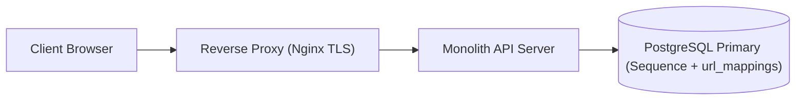
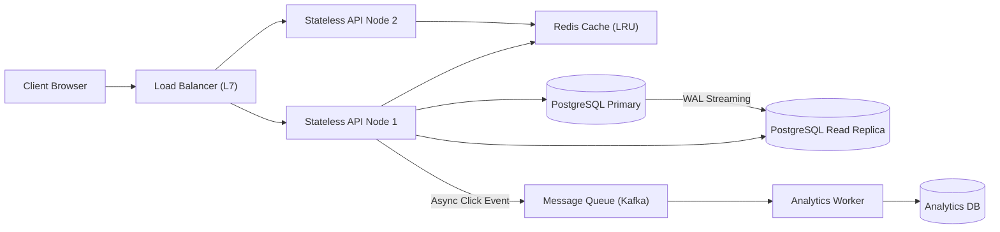
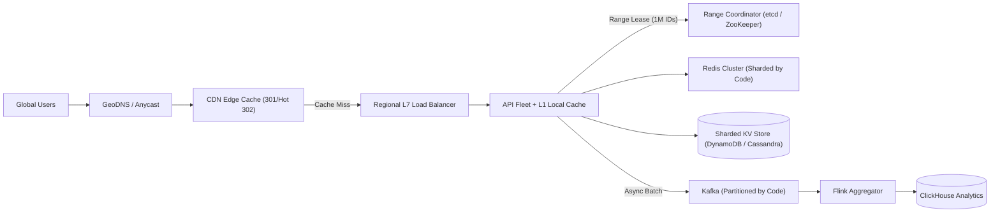
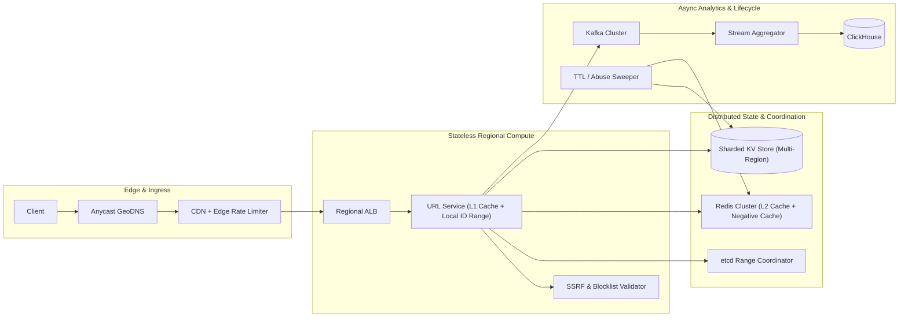
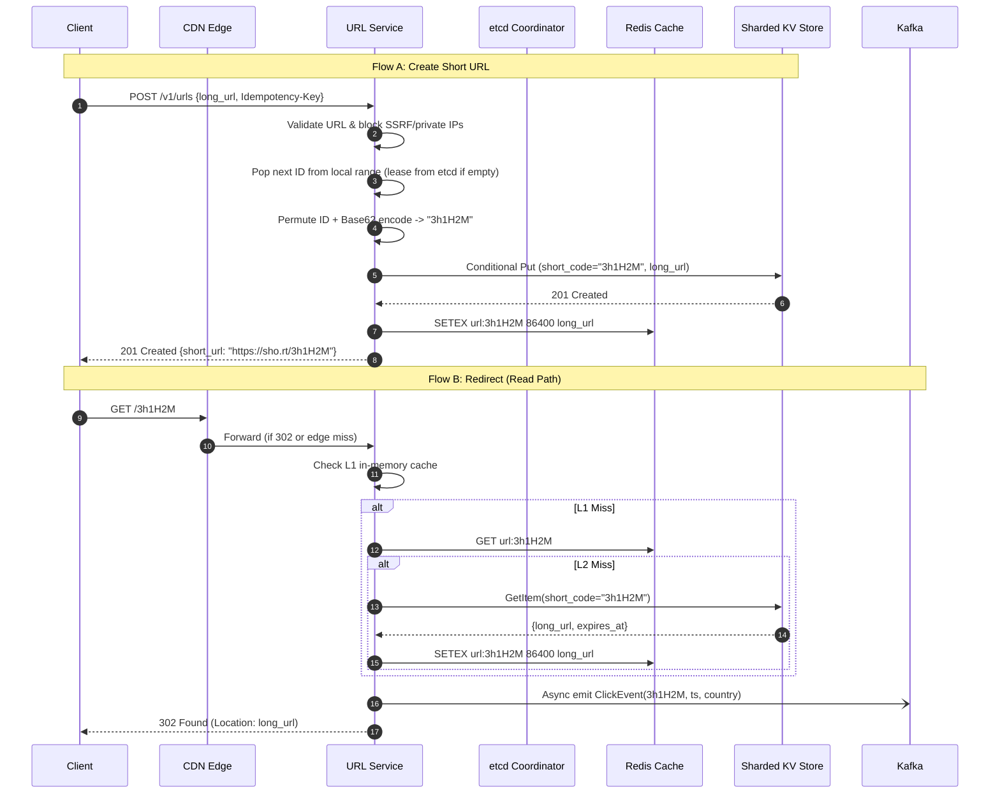

# URL Shortener: Full System Design Mock Interview, All 9 Steps

> **Difficulty:** Medium (L4/L5 Baseline; L6+ with Multi-Region & Hot-Key Extensions)
> **Prerequisites:** [Lesson 15: Senior vs Staff System Design Interviews](../../21-interview-framework/15-senior-vs-staff-system-design-interviews/README.md) and the [Interview Framework track](../../21-interview-framework/README.md).
> **Estimated Reading Time:** 25–30 minutes
> **Target Audience:** Engineers practising the full system design interview on a classic prompt: turning a long URL into a short one and redirecting at global scale.

> [!NOTE]
> **In one line:** A URL shortener is a **read-heavy key-value lookup** (short code to long URL) with two core distributed systems challenges: collision-free short-code generation without a global lock, and sub-50 ms global redirects under heavy Zipfian skew.

> [!TIP]
> **The Golden Rule:** Redirects are 100x more frequent than creates. Design the read path first (CDN + Redis cache + sharded key-value store), decouple click analytics onto an async stream, and make code generation deterministic and lock-free via pre-allocated counter ranges.

---

## 1. Clarifying Questions, Functional & Non-Functional Requirements

Open the interview with targeted clarifying questions, not architecture boxes. A URL shortener sounds deceptively simple, so interviewers evaluate whether you immediately bound the **code space**, **read-to-write ratio**, **redirect semantics (301 vs 302)**, and **uniqueness guarantees**.

### Clarifying Questions & Assumed Answers

| Question | Assumed Answer | Architectural Implication |
| :--- | :--- | :--- |
| **Custom aliases?** | Yes, optional (e.g., `sho.rt/launch26`), max 16 chars, must be globally unique | Separate namespace check or conditional `INSERT` / CAS in the primary KV store |
| **Link expiry (TTL)?** | Optional custom TTL; default 5 years retention | `expires_at` timestamp checked on read + background TTL/lifecycle purge |
| **Analytics?** | Click counts per link + country/referrer breakdown; eventually consistent | Async event pipeline (Kafka + Flink/ClickHouse); never block redirect on DB write |
| **Redirect status code?** | `302 Found` when analytics are required; `301 Moved Permanently` optional | `302` forces browser to hit our edge/origin; `301` caches in browser and hides clicks |
| **Scale & Traffic?** | 100M new URLs/month, 100:1 read-to-write ratio, 5-year retention | ~38.6 writes/sec avg, ~3,860 reads/sec avg, ~6B total rows |
| **Same long URL twice?** | Generate a new short code each time (stateless per request) | Avoids expensive reverse-index lookup (`long_url -> code`) and enables per-campaign tracking |

### Functional Requirements

1. **Shorten URL (`Create`):** Given a valid `long_url`, return a unique, short URL (e.g., `https://sho.rt/3h1H2M`). Support optional `custom_alias` and `expires_at`.
2. **Redirect (`Read`):** Given a `short_code`, redirect the client (`302 Found` or `301 Moved Permanently`) to the original `long_url` with `Location` header. Return `404` if unknown and `410 Gone` if expired.
3. **Delete / Expire (`Delete`):** Allow link owners (or automated abuse/TTL sweepers) to deactivate a short link immediately and purge caches.
4. **Click Analytics (`Stats`):** Track aggregate click counts, time-series buckets, and top geographies with < 1 minute eventual consistency.

### Non-Functional Requirements & SLA Targets

| Quality | Target SLA | Why It Drives the Design |
| :--- | :--- | :--- |
| **Availability** | **99.99%** for redirects (52.6 min/yr downtime) | A dead redirect breaks every website, email, and QR code linking to it |
| **Latency** | **p50 < 10 ms, p99 < 50 ms** for redirects; **p99 < 150 ms** for creates | Redirects sit directly on the critical path of user page loads |
| **Durability** | **99.999999999% (11 nines)** / zero lost active mappings | A lost mapping is a permanently broken hyperlink across the internet |
| **Uniqueness** | **Zero collisions** across all generated codes | Collisions corrupt user trust and cause security/privacy leaks |
| **Throughput** | **20,000+ redirect QPS** at peak; **200+ write QPS** at peak | 100:1 read-to-write skew requires multi-tier caching (CDN + Redis) |

### Scope: In vs Out

- **In Scope:** URL shortening, custom aliases, HTTP redirects (`301`/`302`), link expiration, async click counting, basic SSRF/abuse validation.
- **Out of Scope:** Full user billing/SSO portal, real-time ML malware sandboxing of target pages (mention async webhook integration and park it), rich BI dashboard UI.

---

## 2. Back-of-the-Envelope Capacity Estimation

Let us derive the exact numbers using 100M new URLs/month, 100:1 read-to-write ratio, 5-year retention, 500 bytes per metadata row, and a 5x peak-to-average multiplier.

### 1. Traffic (QPS & Peak QPS)

$$\text{Seconds per month} = 30 \times 24 \times 3600 = 2,592,000 \text{ s}$$

$$\text{Write QPS}_{\text{avg}} = \frac{100 \times 10^6}{2,592,000} \approx 38.6 \text{ writes/s}$$

$$\text{Write QPS}_{\text{peak}} = 38.6 \times 5 \approx 193 \text{ writes/s}$$

$$\text{Read QPS}_{\text{avg}} = 38.6 \times 100 = 3,860 \text{ reads/s}$$

$$\text{Read QPS}_{\text{peak}} = 3,860 \times 5 \approx 19,300 \text{ reads/s}$$

### 2. Code Space Sizing (Base62)

Over 5 years (60 months), total rows stored:

$$\text{Total Rows} = 100 \times 10^6 \times 60 = 6 \times 10^9 \text{ (6 billion URLs)}$$

Using Base62 (`[0-9a-zA-Z]`):
- 6 characters: $62^6 = 56,800,235,584 \approx 56.8 \text{ billion}$ codes (~9.5x headroom).
- 7 characters: $62^7 = 3,521,614,606,208 \approx 3.52 \text{ trillion}$ codes (~586x headroom).

We choose **7-character Base62** codes so we never exhaust the space even if growth accelerates 100x.

### 3. Storage & Bandwidth

Assuming each database row averages **500 bytes** (`short_code` 7B + `long_url` ~200B + `owner_id` 16B + `created_at` 8B + `expires_at` 8B + metadata/overhead ~261B):

$$\text{Raw Storage (5 yr)} = 6 \times 10^9 \times 500 \text{ B} = 3 \times 10^{12} \text{ B} = 3 \text{ TB}$$

With 3x replication factor + 20% index overhead:

$$\text{Total Provisioned Storage} = 3 \text{ TB} \times 3 \times 1.2 = 10.8 \text{ TB}$$

Assuming average redirect HTTP response + headers is **500 bytes** and average write payload is **500 bytes**:

$$\text{Read Bandwidth}_{\text{peak}} = 19,300 \text{ req/s} \times 500 \text{ B} \approx 9.65 \text{ MB/s} \approx 77.2 \text{ Mbps}$$

### 4. Cache Memory (80/20 & Zipfian Working Set)

Caching the hot 20% of daily active reads (assume ~20M unique links accessed per day, 20% = 4M hot keys, ~500B each in Redis including key/pointer overhead):

$$\text{Hot Cache RAM} = 4 \times 10^6 \times 500 \text{ B} = 2 \text{ GB}$$

Even caching 100M hot keys requires only ~50 GB of Redis RAM—easily served by a small 3-shard Redis cluster.

### Capacity Summary Table

| Metric | Average | Peak (5x) | Design Implication |
| :--- | :--- | :--- | :--- |
| **Write QPS** | 38.6 req/s | 193 req/s | Easily handled by a single leader or small range allocator |
| **Read QPS** | 3,860 req/s | 19,300 req/s | Needs Redis cache + CDN edge caching for viral links |
| **Total Rows (5 yr)** | 6 Billion | — | Fits comfortably in 7-char Base62 ($3.52 \times 10^{12}$) |
| **Raw / Replicated DB** | 3 TB | 10.8 TB | Sharded KV store (DynamoDB/Cassandra/Vitess) |
| **Cache RAM (Hot Set)** | 2 GB – 50 GB | — | 3-node Redis cluster with LRU eviction |

---

## 3. Core API Contracts & Data Model

### REST API Contracts

| Endpoint | Method | Request Payload / Headers | Response & Status Codes |
| :--- | :--- | :--- | :--- |
| `/v1/urls` | `POST` | `{"long_url": "https://...", "custom_alias": "launch26", "ttl_seconds": 2592000}` + `Idempotency-Key` | `201 Created`: `{"short_code": "3h1H2M", "short_url": "https://sho.rt/3h1H2M", "expires_at": "..."}` (`409` if alias taken, `400` if invalid/SSRF URL, `429` if rate-limited) |
| `/{short_code}` | `GET` | Standard HTTP request; optional `If-None-Match` | `302 Found` (with `Location: https://...`, `Cache-Control: private, max-age=0`) or `301 Moved Permanently`. `404` if missing, `410 Gone` if expired |
| `/v1/urls/{short_code}` | `DELETE` | `Authorization: Bearer <token>` | `204 No Content` (soft-deletes row + emits cache invalidation event) |
| `/v1/urls/{short_code}/stats` | `GET` | `?window=24h` | `200 OK`: `{"short_code": "3h1H2M", "total_clicks": 148200, "top_countries": [...]}` |

### Database Schema & Indexing

Because redirects are pure **point lookups by `short_code`** with zero joins, a wide-column / key-value store (DynamoDB, Cassandra, or sharded PostgreSQL) is ideal.

```sql
-- Primary URL Mapping Table (Sharded by hash(short_code))
CREATE TABLE url_mappings (
    short_code   VARCHAR(16) PRIMARY KEY,   -- Partition Key: 7-char Base62 or custom alias
    long_url     TEXT NOT NULL,             -- Validated target URL (max 2048 bytes)
    owner_id     BIGINT NOT NULL,           -- For ownership auth & quota enforcement
    redirect_type SMALLINT DEFAULT 302,     -- 301 or 302
    created_at   BIGINT NOT NULL,           -- Unix epoch ms
    expires_at   BIGINT NULL,               -- NULL = never; indexed or native DB TTL
    is_deleted   BOOLEAN DEFAULT FALSE      -- Soft-delete tombstone
);

-- Secondary Index (only needed for user dashboard "my links")
CREATE INDEX idx_owner_created ON url_mappings (owner_id, created_at DESC);
```

**Click Analytics Stream & Rollup Table (ClickHouse / TimescaleDB):**
- **Kafka Topic (`url.clicks.v1`):** Partitioned by `short_code`. Event: `{short_code, clicked_at_ms, country_iso, referrer_domain, user_agent_family}`.
- **Rollup Table (`click_rollups_hourly`):** Partition key `(short_code, bucket_hour)` with pre-aggregated counters (`clicks_count`, `unique_ips_hll`).

---

## 4. Stage 1 (100 - 1K Users): Baseline Monolith & Single Database

At 100–1,000 users (~1–5 QPS), simplicity and shipping speed dominate. We build a single stateless application server behind a TLS-terminating reverse proxy, backed by one PostgreSQL instance with an `auto_increment` / `BIGSERIAL` sequence.



### Component-by-Component Build (Stage 1)
1. **Nginx Reverse Proxy:** Terminates TLS and forwards HTTP to the monolith.
2. **Monolith App Server:** Validates `long_url` (rejects `javascript:`, `file://`, RFC1918 private IPs), grabs `nextval('url_id_seq')` from PostgreSQL, Base62-encodes it, and inserts into `url_mappings`. On `GET /{code}`, queries `SELECT long_url, expires_at FROM url_mappings WHERE short_code = $1`, increments a `clicks` column synchronously, and returns `302`.
3. **Single PostgreSQL Instance:** Holds `url_mappings` and the global sequence.

### What Breaks at 10K Users?
- **Synchronous click counting locks rows:** Updating `clicks = clicks + 1` on every `GET` turns a read into a write transaction, causing row-level lock contention on viral links.
- **Database CPU & IOPS saturation:** Every redirect hits disk/buffer pool on the single Postgres primary.
- **Single Point of Failure (SPOF):** If the Postgres instance reboots or fails, 100% of redirects and creates fail.

---

## 5. Stage 2 (10K - 100K Users): Caching, Read Replicas & Async Offload

At 10K–100K users (~500–2,000 read QPS), we separate the **read path**, **write path**, and **analytics path** so redirects never touch disk or contend on row locks.



### Component-by-Component Additions (Stage 2)
1. **Redis Cache-Aside (LRU, 24h TTL):** Redirects check Redis first (`GET url:{code}`). On a hit (> 95% hit rate), we return `302` in < 2 ms without touching Postgres. Negative caching (`url:{code} -> "__NULL__"`, 60s TTL) prevents 404 scanners from hammering the DB.
2. **PostgreSQL Read Replicas:** Cache misses fall back to read replicas; only `POST /v1/urls` and `DELETE` hit the primary.
3. **Async Click Queue (Kafka):** The API fires a non-blocking click event into a local ring buffer flushed in batches to Kafka. Workers aggregate counts every 10 seconds into the analytics store.

### What Breaks at 1M Users?
- **Single-master ID generation & write bottleneck:** All `nextval()` and `INSERT` queries still hit one Postgres primary.
- **Storage limit on single node:** Approaching billions of rows causes B-tree index bloat (`idx_owner_created` and PK) that no longer fits in Postgres shared buffers, spiking p99 write and miss latencies.
- **Hot-key saturation on Redis:** One viral link (e.g., 50K clicks/sec from a celebrity post) saturates a single Redis shard's network/CPU.

---

## 6. Stage 3 (1M - 10M+ Users): Sharding, Partitioning & Multi-Region Scale

At 1M–10M+ users (20,000+ peak QPS, 6B rows, 3 TB+), we eliminate the single primary database, decouple ID generation into **pre-allocated counter ranges**, shard the KV store by `short_code`, and push hot redirects to **CDN Edge Workers** and **in-process L1 caches**.



### Component-by-Component Additions (Stage 3)
1. **Distributed ID Range Allocator (etcd / ZooKeeper):** Instead of hitting a DB sequence per write, each API instance leases a block of **1,000,000 IDs** (e.g., `[50,000,000 .. 50,999,999]`) in memory. Generating a code is a single atomic CPU `atomic.AddInt64(&counter, 1)`—zero network hops! If a node crashes, unused IDs in its block are simply discarded (acceptable for a $3.52 \times 10^{12}$ code space).
2. **Sharded Key-Value Store (Consistent Hashing by `short_code`):** `url_mappings` is partitioned across N shards by `hash(short_code)`. Every lookup routes directly to 1 shard with 3x replication.
3. **L1 In-Process Cache + CDN Edge:** Each API node keeps a tiny **L1 LRU cache** (e.g., top 10,000 codes, 5-second TTL) to absorb viral hot-key spikes before they even hit Redis. CDN edge nodes cache `301` redirects and optionally evaluate `302` redirects at the edge while beaming async click logs.
4. **Multi-Region Active-Active Replication:** Writes go to the nearest regional KV cluster and replicate asynchronously cross-region (CRDT / Last-Write-Wins, safe because `short_code` ranges are disjoint per region: Region A leases even/prefix-1 ranges, Region B leases prefix-2 ranges).

---

## 7. Final Full Production Architecture & End-to-End Flows

### Complete Production Architecture



### End-to-End Request Flows (Create + Redirect)



---

## 8. Deep-Dive Bottlenecks & Algorithmic Trade-Offs

### Deep Dive 1: Short Code Generation Strategies

| Strategy | Collision Risk | Predictability | Latency / Coordination | Verdict |
| :--- | :--- | :--- | :--- | :--- |
| **MD5/SHA-256 + Truncate (7 chars)** | High (Birthday paradox at ~$\sqrt{62^7} \approx 1.87\text{M}$ links) | Low | Stateless, but requires DB check + retry loop on collision | Reject for primary path |
| **CSPRNG Random 7 chars** | Moderate (requires DB check + retry) | Very Low | Needs conditional `INSERT` + retry on collision | Good only for unlisted/private pastes |
| **Centralized DB Sequence** | Zero | High (sequential) | 1 DB round-trip per write (bottleneck) | Reject at scale |
| **Range-Allocated Counter + Feistel Permutation + Base62** | **Zero** (disjoint ranges) | **Low** (obfuscated via reversible Feistel/XOR) | **0 network hops** per write (in-memory atomic increment) | **Pick this** |

**Why Feistel / Bit-Permutation?** Raw sequential IDs (`1, 2, 3...`) let competitors scrape your entire URL corpus or guess creation volume. Passing the 42-bit counter through a 3-round **Feistel network** (or multiplying by a coprime modulo $62^7$) produces a bijective, 1-to-1 scrambled output before Base62 encoding—preserving **zero collisions** while hiding sequence order.

### Deep Dive 2: 301 Permanent vs 302 Temporary Redirect

| Dimension | `301 Moved Permanently` | `302 Found` (Temporary) |
| :--- | :--- | :--- |
| **Browser Caching** | Cached aggressively by browser & proxies | Not cached by default (`Cache-Control: private, max-age=0`) |
| **Server Load** | Lowest (repeat clicks skip our servers) | Higher (every click hits our edge/origin) |
| **Click Analytics** | **Broken** (under-counts repeat clicks) | **Accurate** (every click is observed) |
| **Mutable Target / Takedown** | Slow (browsers keep old target cached) | Instant (next click sees updated/deleted target) |

**Pick:** Default to `302` for products that sell analytics or require instant takedowns; offer `301` as an opt-in flag for static marketing links.

### Deep Dive 3: Handling Viral Hot Keys & Cache Stampedes

When a single short link goes viral (100,000+ QPS):
1. **L1 In-Process Cache + Request Coalescing (`singleflight`):** On an L1/L2 miss, `singleflight` ensures only **1** goroutine/thread queries Redis or the KV store for `3h1H2M` while 9,999 concurrent requests wait on the same in-memory future.
2. **Hot-Key Replication in Redis:** If a key exceeds a threshold (e.g., 5K QPS on one Redis shard), replicate it across $K$ salted keys (`url:3h1H2M#0` .. `url:3h1H2M#9`) so reads fan out across all Redis shards.

---

## 9. Failure Modes, Reliability & Backpressure Mitigations

| Failure Mode | User Impact | Blast Radius | Mitigation & Recovery |
| :--- | :--- | :--- | :--- |
| **Redis Cluster Outage** | Redirect latency spikes from 5 ms to 30 ms | All cacheable reads fall through to KV store | KV store provisioned for 2x miss burst + `singleflight` coalescing + L1 local cache |
| **etcd Range Coordinator Down** | New API nodes cannot lease fresh ID ranges | Writes only (reads 100% unaffected) | Existing nodes keep serving from remaining 1M-ID local buffers; 3-node Raft quorum recovers in < 5 s |
| **KV Store Shard Unreachable** | `500` on cache miss for 1/N of keyspace | Subset of cold links | Multi-AZ 3-way replication with automatic leader failover; stale-while-error from Redis |
| **404 Scanner / Bot Flood** | Cache miss storm saturating DB | Whole read path | Negative cache missing codes (`"__NULL__"`, 60s TTL) + Bloom filter in API + Edge WAF rate limit |
| **Kafka Analytics Lag / Down** | Click stats delayed | Analytics only | Ring buffer drops/spills oldest click events after memory cap; **never block redirects** |
| **SSRF / Malware Link Abuse** | Service used as open redirector to internal IPs or phishing | Security / domain reputation | Strict scheme allowlist (`http`/`https`), block RFC1918/link-local IPs, async Safe Browsing scan + instant `DELETE` |

---

## 10. Production War Story & Real-World Reference

### Case Study: The "Cache Stampede & 404 Scanner" Outage

- **Context:** A major link-shortening platform serving ~18,000 redirect QPS experienced a sudden 100% CPU spike on its primary database cluster, driving redirect `p99` latency from **18 ms to 4,200 ms** and triggering HTTP `504` timeouts for 12 minutes.
- **Root Cause:** An automated vulnerability scanner swept 2.5 million randomized 6-character codes (`GET /aaaaaa`, `GET /aaaaab`, ...). Because the service only cached **cache hits** in Redis, 100% of the 404 lookups bypassed Redis and hit the database directly. Simultaneously, an expired viral link suffered a **cache stampede** where 1,400 concurrent requests missed Redis and queried the DB simultaneously.
- **The Fix:**
  1. Deployed **Negative Caching** in Redis (`SETEX missing:{code} 60 "1"`) to absorb repeated 404 probes.
  2. Added an in-memory **Counting Bloom Filter** per API node (synced via snapshot) so obviously non-existent codes return `404` in < 0.1 ms without touching Redis or the DB.
  3. Wrapped DB fallback reads in **`singleflight`** request coalescing and added **TTL jitter** ($\pm 10\%$) to prevent synchronized expirations.
  4. **Result:** DB QPS dropped by **94%** during subsequent scanner sweeps, and `p99` redirect latency stabilized at **14 ms**.

---

## 11. Core Component Implementation (4 Languages)

Below is the production-grade core **Feistel-obfuscated Base62 ID Generator & Range Allocator** in Go, TypeScript, Python, and C#.

````carousel
```go
package shortener

import (
	"errors"
	"sync"
	"sync/atomic"
)

const alphabet = "0123456789abcdefghijklmnopqrstuvwxyzABCDEFGHIJKLMNOPQRSTUVWXYZ"

// RangeAllocator leases disjoint blocks of IDs from a coordinator (e.g., etcd)
// and dispenses them lock-free via atomic increments.
type RangeAllocator struct {
	mu      sync.Mutex
	current atomic.Int64
	maxID   atomic.Int64
	leaseFn func() (start, end int64, err error)
}

func NewRangeAllocator(leaseFn func() (int64, int64, error)) (*RangeAllocator, error) {
	ra := &RangeAllocator{leaseFn: leaseFn}
	if err := ra.refill(); err != nil {
		return nil, err
	}
	return ra, nil
}

func (ra *RangeAllocator) refill() error {
	ra.mu.Lock()
	defer ra.mu.Unlock()
	if ra.current.Load() < ra.maxID.Load() {
		return nil // Another goroutine already refilled
	}
	start, end, err := ra.leaseFn()
	if err != nil {
		return err
	}
	ra.current.Store(start)
	ra.maxID.Store(end)
	return nil
}

// NextCode returns a unique, non-predictable 7-char Base62 code.
func (ra *RangeAllocator) NextCode() (string, error) {
	for {
		id := ra.current.Add(1) - 1
		if id < ra.maxID.Load() {
			scrambled := feistelPermute(uint64(id))
			return encodeBase62(scrambled, 7), nil
		}
		if err := ra.refill(); err != nil {
			return "", errors.New("range exhausted and coordinator unreachable")
		}
	}
}

// feistelPermute scrambles a 40-bit integer bijectively (0 collisions).
func feistelPermute(val uint64) uint64 {
	const mask20 = (1 << 20) - 1
	l := (val >> 20) & mask20
	r := val & mask20
	for round := uint64(0); round < 3; round++ {
		f := ((r*0x5bd1e995 + round*0x27d4eb2d) ^ (r >> 7)) & mask20
		l, r = r, l^f
	}
	return (l << 20) | r
}

func encodeBase62(n uint64, minLen int) string {
	buf := make([]byte, 0, 11)
	for n > 0 {
		buf = append(buf, alphabet[n%62])
		n /= 62
	}
	for len(buf) < minLen {
		buf = append(buf, alphabet[0])
	}
	for i, j := 0, len(buf)-1; i < j; i, j = i+1, j-1 {
		buf[i], buf[j] = buf[j], buf[i]
	}
	return string(buf)
}
```
<!-- slide -->
```typescript
const ALPHABET = "0123456789abcdefghijklmnopqrstuvwxyzABCDEFGHIJKLMNOPQRSTUVWXYZ";

export interface RangeLease {
  start: number;
  end: number;
}

export class RangeShortCodeGenerator {
  private current = 0;
  private maxId = 0;
  private inflightRefill: Promise<void> | null = null;

  constructor(private readonly fetchLease: () => Promise<RangeLease>) {}

  async nextCode(): Promise<string> {
    if (this.current >= this.maxId) {
      await this.refill();
    }
    const id = this.current++;
    const scrambled = this.feistelPermute(id);
    return this.encodeBase62(scrambled, 7);
  }

  private async refill(): Promise<void> {
    if (!this.inflightRefill) {
      this.inflightRefill = (async () => {
        const lease = await this.fetchLease();
        this.current = lease.start;
        this.maxId = lease.end;
      })().finally(() => {
        this.inflightRefill = null;
      });
    }
    await this.inflightRefill;
  }

  // Bijective 40-bit Feistel network to prevent sequential code enumeration
  private feistelPermute(val: number): number {
    const mask20 = 0xfffff;
    let l = Math.floor(val / 0x100000) & mask20;
    let r = val & mask20;
    for (let round = 0; round < 3; round++) {
      const f = (Math.imul(r, 0x5bd1e995) + round * 0x27d4eb2d) ^ (r >>> 7);
      const nextR = (l ^ (f & mask20)) >>> 0;
      l = r;
      r = nextR & mask20;
    }
    return l * 0x100000 + r;
  }

  private encodeBase62(n: number, minLen: number): string {
    const out: string[] = [];
    let num = n;
    while (num > 0) {
      out.push(ALPHABET[num % 62]);
      num = Math.floor(num / 62);
    }
    while (out.length < minLen) out.push(ALPHABET[0]);
    return out.reverse().join("");
  }
}
```
<!-- slide -->
```python
import threading
from typing import Callable, Tuple

ALPHABET = "0123456789abcdefghijklmnopqrstuvwxyzABCDEFGHIJKLMNOPQRSTUVWXYZ"
MASK_20 = (1 << 20) - 1


def feistel_permute(val: int) -> int:
    """Bijective 40-bit Feistel permutation: zero collisions, hides sequence."""
    l = (val >> 20) & MASK_20
    r = val & MASK_20
    for rnd in range(3):
        f = ((r * 0x5BD1E995 + rnd * 0x27D4EB2D) ^ (r >> 7)) & MASK_20
        l, r = r, l ^ f
    return (l << 20) | r


def encode_base62(n: int, min_len: int = 7) -> str:
    out = []
    while n > 0:
        n, rem = divmod(n, 62)
        out.append(ALPHABET[rem])
    while len(out) < min_len:
        out.append(ALPHABET[0])
    return "".join(reversed(out))


class RangeShortCodeGenerator:
    def __init__(self, lease_fn: Callable[[], Tuple[int, int]]) -> None:
        self._lease_fn = lease_fn
        self._lock = threading.Lock()
        self._current = 0
        self._max_id = 0

    def next_code(self) -> str:
        with self._lock:
            if self._current >= self._max_id:
                start, end = self._lease_fn()
                self._current = start
                self._max_id = end
            raw_id = self._current
            self._current += 1
        return encode_base62(feistel_permute(raw_id), min_len=7)
```
<!-- slide -->
```csharp
using System;
using System.Threading;

namespace UrlShortener.Core
{
    public sealed class RangeShortCodeGenerator
    {
        private const string Alphabet = "0123456789abcdefghijklmnopqrstuvwxyzABCDEFGHIJKLMNOPQRSTUVWXYZ";
        private readonly Func<(long Start, long End)> _leaseRange;
        private readonly object _refillLock = new();
        private long _current;
        private long _maxId;

        public RangeShortCodeGenerator(Func<(long Start, long End)> leaseRange)
        {
            _leaseRange = leaseRange ?? throw new ArgumentNullException(nameof(leaseRange));
            Refill();
        }

        public string NextCode()
        {
            while (true)
            {
                long id = Interlocked.Increment(ref _current) - 1;
                if (id < Volatile.Read(ref _maxId))
                {
                    ulong scrambled = FeistelPermute((ulong)id);
                    return EncodeBase62(scrambled, 7);
                }
                Refill();
            }
        }

        private void Refill()
        {
            lock (_refillLock)
            {
                if (Volatile.Read(ref _current) < Volatile.Read(ref _maxId)) return;
                var (start, end) = _leaseRange();
                Volatile.Write(ref _current, start);
                Volatile.Write(ref _maxId, end);
            }
        }

        private static ulong FeistelPermute(ulong val)
        {
            const ulong mask20 = (1UL << 20) - 1;
            ulong l = (val >> 20) & mask20;
            ulong r = val & mask20;
            for (ulong round = 0; round < 3; round++)
            {
                ulong f = ((r * 0x5BD1E995UL + round * 0x27D4EB2DUL) ^ (r >> 7)) & mask20;
                (l, r) = (r, l ^ f);
            }
            return (l << 20) | r;
        }

        private static string EncodeBase62(ulong n, int minLen)
        {
            Span<char> buf = stackalloc char[11];
            int idx = buf.Length;
            while (n > 0)
            {
                buf[--idx] = Alphabet[(int)(n % 62)];
                n /= 62;
            }
            while (buf.Length - idx < minLen)
            {
                buf[--idx] = Alphabet[0];
            }
            return new string(buf[idx..]);
        }
    }
}
```
````

---

## 12. Verification, Load Testing & CLI Diagnostics

```bash
# 1. Functional verification: create short URL with idempotency key & verify 302 redirect
curl -i -X POST https://api.sho.rt/v1/urls \
  -H "Content-Type: application/json" \
  -H "Idempotency-Key: 9b1deb4d-3b7d-4bad-9bdd-2b0d7b3dcb6d" \
  -d '{"long_url":"https://example.com/docs/distributed-systems","ttl_seconds":86400}'

# Verify redirect without following (-L omitted) and inspect Location + Cache-Control headers
curl -i https://sho.rt/3h1H2M

# 2. Load test redirect path (20,000 RPS target across 8 threads, 1000 connections)
hey -z 60s -c 1000 -q 20000 https://sho.rt/3h1H2M

# 3. Redis diagnostics: verify cache hit ratio & detect hot keys
redis-cli INFO stats | grep -E "keyspace_hits|keyspace_misses"
redis-cli --hotkeys

# 4. Kafka consumer lag check for click analytics pipeline
kafka-consumer-groups.sh --bootstrap-server kafka:9092 --describe --group url-click-aggregator
```

---

## 13. Common Interview Mistakes & Red Flags

| Common Mistake | Why It's a Red Flag | Staff-Level Answer |
| :--- | :--- | :--- |
| **Hashing `long_url` without collision handling** | Truncating MD5/SHA-256 to 7 chars hits birthday-paradox collisions early | Use pre-allocated counter ranges + Feistel permutation + Base62 for 0-collision construction |
| **Updating click count in DB on every `GET`** | Turns a fast read into a locked write, destroying p99 under viral traffic | Emit click events asynchronously to Kafka and aggregate in batches |
| **Ignoring `301` vs `302` semantics** | Misses how browser caching breaks analytics and link takedowns | Explain `302` for analytics/mutability vs `301` for edge/browser offload |
| **Single global `AUTO_INCREMENT` DB** | Single point of failure and cross-region write bottleneck | Lease 1M-ID blocks from etcd/ZooKeeper per node; disjoint ranges per region |
| **Caching only hits (no negative caching)** | 404 vulnerability scanners bypass Redis and DDoS the KV store | Negative-cache missing keys with short TTL + in-memory Bloom filter |
| **No SSRF / open-redirect validation** | Allows attackers to target internal metadata (`169.254.169.254`) or XSS via `javascript:` | Strict scheme allowlist (`http`/`https`), private IP blocklist, async malware scanning |

---

## 14. Key Terminology & Glossary

| Key Term | Definition |
| :--- | :--- |
| **Base62 Encoding** | Positional numeral system using `[0-9a-zA-Z]` (62 URL-safe characters), giving $62^7 \approx 3.52\text{T}$ codes. |
| **Feistel Permutation** | A reversible cryptographic block structure that scrambles sequential IDs 1-to-1 without collisions. |
| **Range Allocator** | Pattern where a coordinator (etcd/ZooKeeper) leases disjoint numeric blocks (e.g., 1M IDs) to app nodes. |
| **301 vs 302 Redirect** | `301` (Permanent) is cached by browsers; `302` (Found/Temporary) hits the server on every click. |
| **Negative Caching** | Caching the *absence* of a key (`404`) briefly in Redis to shield the database from scanner floods. |
| **Request Coalescing (`singleflight`)** | Deduplicating concurrent identical cache-miss lookups in memory so only one hits the backend. |
| **Zipfian Distribution** | Skewed traffic pattern where the top 1–20% of viral links generate 80–99% of all redirect requests. |
| **SSRF (Server-Side Request Forgery)** | Vulnerability where user-supplied URLs trick a server or fetcher into accessing internal network endpoints. |

---

## 15. Interview Follow-Up Questions (12 Q&As)

<details>
<summary><strong>Q1: [BASIC] Why not just hash the long URL with MD5 and take the first 7 characters?</strong></summary>

Truncating MD5 to 7 Base62 characters (~41.6 bits) triggers birthday-paradox collisions around $\sqrt{2^{41.6}} \approx 1.8\text{M}$ links. Every write would require a read-before-write check and retry loop. Range-allocated counters + Base62 are unique by construction.

</details>

<details>
<summary><strong>Q2: [BASIC] How many characters do we need for 100M URLs/month over 5 years?</strong></summary>

$100\text{M} \times 60 = 6\text{B}$ URLs. $62^6 \approx 56.8\text{B}$ (9.5x headroom), and $62^7 \approx 3.52\text{T}$ (586x headroom). 7 characters is the industry sweet spot.

</details>

<details>
<summary><strong>Q3: [BASIC] When should you return HTTP 301 vs 302?</strong></summary>

Return `302 Found` when you need accurate click analytics or instant target updates/takedowns, because browsers do not cache `302` by default. Return `301` when you want browsers and CDNs to cache the redirect and reduce origin load.

</details>

<details>
<summary><strong>Q4: [BASIC] Why separate the click analytics pipeline from the redirect path?</strong></summary>

Redirects must stay under 50 ms p99. Writing to an analytics DB synchronously adds latency and creates row-lock contention on viral links. Emitting click events to Kafka asynchronously keeps the critical path fast and resilient.

</details>

<details>
<summary><strong>Q5: [SCENARIO] How do you avoid a single-counter bottleneck across 100 API servers?</strong></summary>

Use an etcd/ZooKeeper range coordinator to lease disjoint blocks of 1,000,000 IDs to each API server. Servers dispense IDs locally via an atomic integer increment with zero network hops. A crashed server wastes at most its remaining unused block.

</details>

<details>
<summary><strong>Q6: [SCENARIO] A celebrity tweets a short link and traffic spikes to 100,000 QPS on one key. What breaks and how do you fix it?</strong></summary>

A single Redis shard saturates on that one hot key. Fix it with: (1) an **L1 in-process LRU cache** (5s TTL) on every API server, (2) **`singleflight`** request coalescing on cache miss, and (3) **hot-key salting** (`url:code#0..#9`) across Redis shards or CDN edge caching.

</details>

<details>
<summary><strong>Q7: [SCENARIO] How do you handle custom aliases without colliding with generated codes?</strong></summary>

Either reserve a length/character rule (e.g., generated codes are always 7 chars while custom aliases are 8–16 chars or contain `-`/`_`), or perform a conditional `PutItem (attribute_not_exists(short_code))` in the KV store and skip any generated code that happens to collide.

</details>

<details>
<summary><strong>Q8: [SCENARIO] How do you expire links cleanly without scanning billions of rows?</strong></summary>

Check `expires_at` lazily on every read (returning `410 Gone` if expired—ensuring correctness immediately), and rely on native DB TTL (e.g., DynamoDB TTL) or an indexed `expires_at` partition sweeper to reclaim storage asynchronously.

</details>

<details>
<summary><strong>Q9: [TRICKY] Sequential counters make links predictable and enumerable. How do you prevent scraping without losing collision-free generation?</strong></summary>

Pass the monotonic counter through a reversible, bijective **Feistel network** (or modular multiplication by a coprime) before Base62 encoding. Because it is a bijection over $[0, 2^{40})$, uniqueness is mathematically preserved while consecutive IDs map to pseudorandom codes.

</details>

<details>
<summary><strong>Q10: [TRICKY] How do you defend against 404 scanner floods trying to DDoS your database?</strong></summary>

Combine three layers: (1) **Negative caching** in Redis (`missing:{code}` with 60s TTL), (2) an in-memory **Counting Bloom Filter** on API nodes to reject non-existent codes in < 0.1 ms, and (3) Edge WAF rate limiting on high-404 IPs.

</details>

<details>
<summary><strong>Q11: [TRICKY] How do you run this active-active across 3 continents with zero write coordination?</strong></summary>

Assign each region a disjoint ID namespace (e.g., top 2 bits of the 42-bit ID encode `region_id`: `00` US, `01` EU, `10` APAC). Each region leases ranges from its local etcd cluster and writes locally, replicating asynchronously via multi-region DynamoDB Global Tables or Cassandra.

</details>

<details>
<summary><strong>Q12: [TRICKY] If a user creates a link and immediately clicks it 10 ms later in another region, could they see a 404?</strong></summary>

Yes, under asynchronous cross-region replication. Mitigate by (1) routing the creator's session to the same home region via sticky GeoDNS, or (2) on a `404` miss in a secondary region, doing a single cross-region fallback read to the region encoded in the short code's prefix bits before returning `404`.

</details>

---

## 16. One-Page Master Cheat Sheet

```text
+-----------------------------------------------------------------------------+
| URL SHORTENER: MASTER INTERVIEW CHEAT SHEET                                 |
+-----------------------------------------------------------------------------+
| SCALE: 100M writes/mo (39 QPS avg, 193 peak) | 100:1 R:W (3.9K avg, 19K pk) |
| CODE SPACE: 7-char Base62 = 62^7 = 3.52 Trillion (6B rows in 5 yrs = 3 TB)  |
|-----------------------------------------------------------------------------|
| WRITE PATH: Client -> ALB -> API (SSRF check) -> Local 1M-ID Range (etcd)   |
|             -> 3-round Feistel -> Base62 -> Sharded KV (Conditional Put)    |
| READ PATH:  Client -> CDN -> ALB -> API (L1 LRU) -> Redis L2 (Neg Cache)    |
|             -> Singleflight -> Sharded KV -> Async Kafka Click -> 302/301   |
|-----------------------------------------------------------------------------|
| KEY TRADEOFFS:                                                              |
|  * Code Gen: Range Counter + Feistel (0 collisions, 0 hops) > MD5 truncate  |
|  * Redirect: 302 (analytics + instant delete) vs 301 (browser cache offload)|
|  * Hot Keys: L1 local cache + singleflight + Redis key salting              |
+-----------------------------------------------------------------------------+
```

## Further Reading

- Alex Xu, *System Design Interview*, chapter on designing a URL shortener.
- RFC 9110 section 15.4 on redirection status codes (301, 302, 307, 308).
- Martin Kleppmann, *Designing Data-Intensive Applications*, Chapter 6 (Partitioning).

---

## Next

Continue with [Rate Limiter: Full System Design Mock Interview, All 9 Steps](../02-rate-limiter/README.md).
