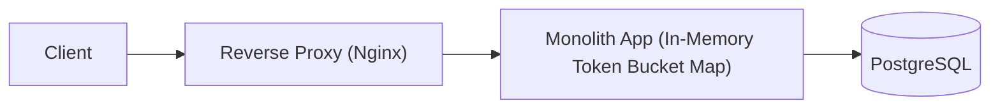
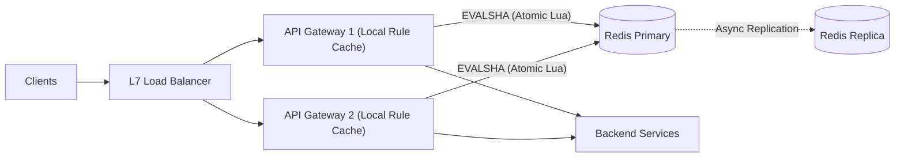
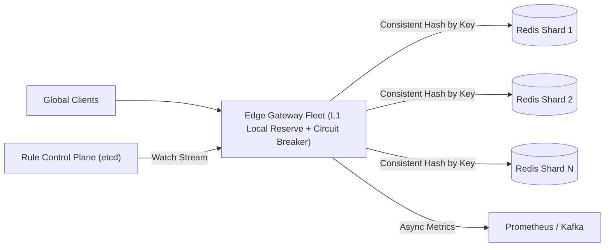
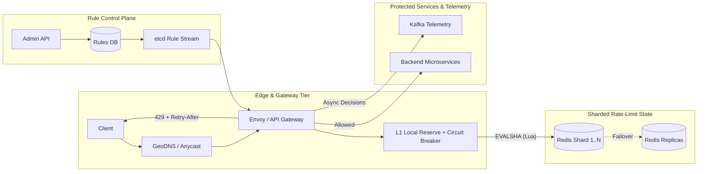
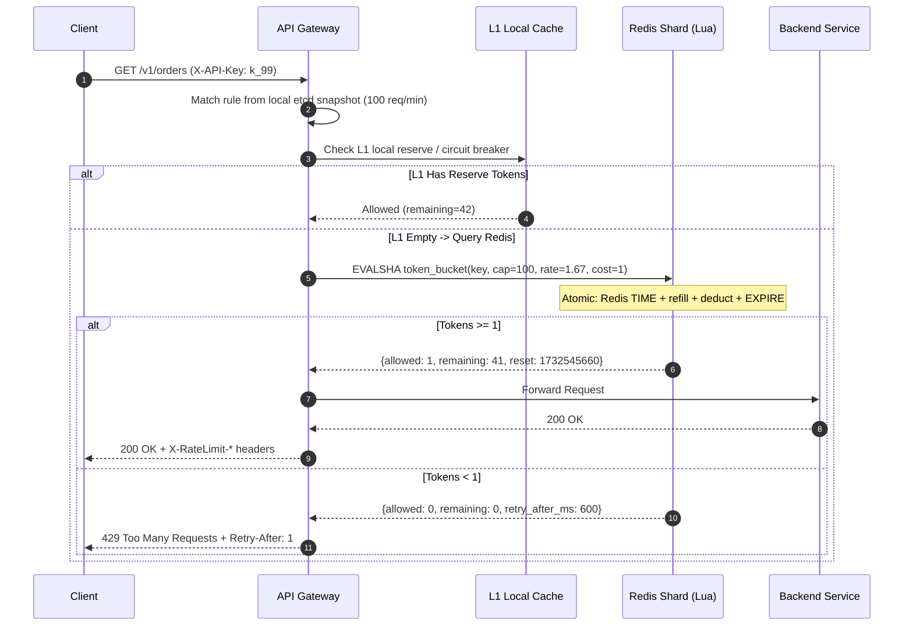

# Rate Limiter: Full System Design Mock Interview, All 9 Steps

> **Difficulty:** Medium-Hard (L4/L5 Baseline; L6+ with Local Token Reserves, Hot-Key Sharding & Failover)
> **Prerequisites:** [Previous lesson: URL Shortener: Full System Design Mock Interview, All 9 Steps](../01-url-shortener/README.md) and the [Interview Framework track](../../21-interview-framework/README.md).
> **Estimated Reading Time:** 25–30 minutes
> **Target Audience:** Engineers practising the full system design interview on a classic prompt: limiting how many requests a client may make across a distributed fleet.

> [!NOTE]
> **In one line:** A distributed rate limiter is a **low-latency atomic counter with a clock** placed in front of your services; the core engineering trade-off is balancing **global accuracy** against **network coordination latency** and **blast-radius isolation**.

> [!TIP]
> **The Golden Rule:** Pick the algorithm from the burst behavior you want (Token Bucket for controlled bursts, Sliding Window Counter for strict rolling quotas), execute the read-modify-write atomically inside Redis via Lua, and explicitly choose **fail-open** vs **fail-closed** per endpoint criticality.

---

## 1. Clarifying Questions, Functional & Non-Functional Requirements

Open with clarifying questions, not architecture boxes. Interviewers want to see you distinguish **gateway-level throttling** from **network DDoS mitigation**, choose an algorithm that solves the **boundary-burst problem**, and handle **multi-node atomicity**.

### Clarifying Questions & Assumed Answers

| Question | Assumed Answer | Architectural Implication |
| :--- | :--- | :--- |
| **What do we limit by?** | Authenticated `api_key` / `user_id`, falling back to `client_ip` | Composite key `rl:{rule_id}:{subject}`; avoid NAT false-positives for auth'd users |
| **Rule granularity?** | Multi-tier rules: e.g., `10 req/s` AND `1,000 req/min` per user/endpoint | Evaluate multiple rules per request; reject if *any* rule fails |
| **Where does it live?** | Distributed API Gateway middleware in front of all microservices | Centralized enforcement + uniform `429` headers |
| **Rejection behavior?** | Return `429 Too Many Requests` with `Retry-After` and `X-RateLimit-*` | Prevents aggressive client retry storms |
| **Scale & Latency?** | 1,000,000 RPS across the fleet, 10M active keys, < 2 ms overhead | Redis cluster sharded by key + local in-memory L1 allowance for hot keys |
| **Failure posture?** | Fail-open for general read APIs; fail-closed for `/login` and `/payments` | Limiter outage must not take down the entire platform |

### Functional Requirements

1. **Allow / Reject Decision:** Evaluate incoming requests against configured rules (`limit`, `window`, `burst_capacity`) in real time.
2. **Dynamic Rule Updates:** Support creating and updating rate-limit rules via an admin control plane without redeploying gateways.
3. **Standard Rate-Limit Headers:** Return `X-RateLimit-Limit`, `X-RateLimit-Remaining`, `X-RateLimit-Reset`, and `Retry-After` (on `429`).
4. **Multi-Dimensional Keys:** Rate limit by `user_id`, `api_key`, `ip_address`, or `(user_id, endpoint)` tuple.

### Non-Functional Requirements & SLA Targets

| Quality | Target SLA | Why It Drives the Design |
| :--- | :--- | :--- |
| **Added Latency** | **p50 < 0.5 ms, p99 < 2 ms** | Sits synchronously on 100% of API requests |
| **Availability** | **99.999%** effective API pass-through | Rate limiter failure must not cause a global API outage |
| **Accuracy** | **Within 1–5%** of exact global limit | Exact global locks at 1M RPS would destroy latency |
| **Throughput** | **1,000,000+ checks/sec** fleet-wide | Requires sharded Redis + local token batching |

### Scope: In vs Out

- **In Scope:** Rate-limiting algorithms, distributed atomic counters, rule distribution, `429` headers, fail-open/closed fallback, hot-key mitigation.
- **Out of Scope:** L3/L4 SYN-flood / volumetric DDoS mitigation (handled by Cloudflare/AWS Shield), usage-based billing, per-query GraphQL complexity estimation (mention as an extension).

---

## 2. Back-of-the-Envelope Capacity Estimation

Assumptions: **1,000,000 RPS** peak fleet traffic, **10,000,000** active rate-limited keys, **64 bytes** per counter state in Redis (key + tokens + timestamp + hash overhead $\approx$ 128 bytes total with Redis dict entry).

### 1. Memory Sizing (Redis State)

$$\text{Raw Counter Memory} = 10 \times 10^6 \text{ keys} \times 128 \text{ B/key} = 1.28 \times 10^9 \text{ B} \approx 1.28 \text{ GB}$$

With 2x replication + 30% fragmentation headroom:

$$\text{Total Redis RAM} = 1.28 \text{ GB} \times 2 \times 1.3 \approx 3.33 \text{ GB}$$

Memory is tiny! The bottleneck is **operations per second (CPU & network I/O)**, not RAM.

### 2. Redis Operations & Shard Count

A single Redis primary handles roughly **100,000 Lua script executions/sec** comfortably at sub-millisecond p99:

$$\text{Redis Shards}_{\text{direct}} = \frac{1,000,000 \text{ ops/s}}{100,000 \text{ ops/shard/s}} = 10 \text{ primary shards (+ 10 replicas)}$$

With **local token batching** (each gateway fetches 10–50 tokens at a time for heavy keys or syncs every 50 ms), remote Redis QPS drops by 5x–20x:

$$\text{Redis QPS}_{\text{batched}} = \frac{1,000,000}{10} = 100,000 \text{ ops/s} \implies 2\text{–}3 \text{ shards suffice}$$

### 3. Network Bandwidth

Each Redis `EVALSHA` call + response is ~150 bytes:

$$\text{Gateway} \leftrightarrow \text{Redis Bandwidth} = 10^6 \text{ ops/s} \times 150 \text{ B} = 150 \text{ MB/s} \approx 1.2 \text{ Gbps}$$

### Capacity Summary Table

| Metric | Direct Redis Check | With Local Batching | Design Implication |
| :--- | :--- | :--- | :--- |
| **Active Keys** | 10M | 10M | Tiny memory footprint (~1.3 GB raw) |
| **Redis Ops/Sec** | 1,000,000 ops/s | ~100,000 ops/s | CPU-bound, not memory-bound |
| **Redis Shards Needed** | 10 Primaries (+10 Replicas) | 3 Primaries (+3 Replicas) | Consistent-hash sharded by `subject_key` |
| **Added p99 Latency** | ~1.5 ms (1 network RTT) | ~0.05 ms (L1 hit) / ~1.5 ms (refill) | Sub-2 ms SLA easily met |

---

## 3. Core API Contracts & Data Model

### Internal Decision Interface & Control Plane API

| Interface / Endpoint | Purpose | Request / Response Contract |
| :--- | :--- | :--- |
| `Allow(ctx, key, rule_id, cost)` | Internal gRPC / Gateway middleware | Input: `{key: "usr_42", rule_id: "api_v1_std", cost: 1}` -> Output: `{allowed: true, remaining: 84, reset_unix: 1732545660, retry_after_ms: 0}` |
| `PUT /v1/admin/rules/{rule_id}` | Create or update rule | Body: `{"match": "tier:pro", "capacity": 100, "refill_per_sec": 20, "fail_mode": "open"}` -> `200 OK` |
| HTTP Response Headers (All) | Client visibility | `X-RateLimit-Limit: 100`, `X-RateLimit-Remaining: 84`, `X-RateLimit-Reset: 1732545660` |
| HTTP `429` Response | Throttled client | `HTTP/1.1 429 Too Many Requests`, `Retry-After: 3`, JSON: `{"error": "rate_limit_exceeded", "retry_after_sec": 3}` |

### Data Model (Redis + Rules Store)

1. **Redis Hash / Key (Token Bucket per key):**
   - Key: `rl:tb:{rule_id}:{subject_key}`
   - Fields: `tokens` (float64), `last_refill_ms` (int64, using **Redis `TIME`**, never gateway wall clock)
   - `EXPIRE` TTL: `ceil(capacity / refill_per_sec) * 2` seconds so idle keys auto-evict.
2. **Rules Config Store (PostgreSQL / etcd):**
   - `rule_id` (PK), `endpoint_pattern`, `key_extractor` (`api_key` | `ip` | `user_id`), `algorithm` (`token_bucket` | `sliding_counter`), `capacity`, `refill_rate`, `fail_mode` (`open` | `closed`), `version`.
   - Cached in-memory on every API Gateway; updated via etcd watch / Redis PubSub within < 1 second.

---

## 4. Stage 1 (100 - 1K Users): Baseline Monolith & In-Memory Limiter

At 100–1,000 users (< 100 RPS), we have a single backend instance (or 2 instances behind a reverse proxy). A local in-memory `sync.Map` or `ConcurrentDictionary` holding a Token Bucket per IP/API key takes 50 lines of code and adds 0.001 ms latency.



### Component-by-Component Build (Stage 1)
1. **In-Memory Limiter Middleware:** Intercepts requests, extracts `X-API-Key` or `RemoteAddr`, locks a per-key mutex, refills tokens based on monotonic clock, and either forwards or returns `429`.
2. **Background Sweeper:** Periodic ticker every 60 seconds evicts stale keys not seen in 10 minutes to prevent unbounded heap growth.

### What Breaks at 10K Users?
- **Horizontal scaling splits the limit:** Adding 5 app servers behind a Load Balancer means a client with a `100 req/min` limit can now send **500 req/min** (100 per server) if traffic round-robins.
- **Sticky sessions are a trap:** Consistent hashing by client IP at the LB breaks when mobile users switch towers or corporate NATs concentrate 10,000 users behind 1 IP.
- **Process restarts wipe state:** Deploying a new version resets all counters to full capacity, letting abusive clients burst during deploys.

---

## 5. Stage 2 (10K - 100K Users): Centralized Redis & Atomic Lua

At 10K–100K users (10K–50K RPS) across dozens of stateless API gateways, we externalize counter state into a **single Redis primary** (with a read/failover replica) and execute the Token Bucket logic inside an **atomic Lua script**.



### Component-by-Component Additions (Stage 2)
1. **Centralized Redis Store:** All gateways share one source of truth per `subject_key`.
2. **Atomic Lua Script (`EVALSHA`):** Combines `TIME`, `HMGET`, token refill math, `HMSET`, and `EXPIRE` into one single-threaded atomic Redis operation—eliminating race conditions where two gateways read `tokens = 1` simultaneously and both allow.
3. **Rule Config Cache + PubSub:** Gateways load rules from Postgres on startup and subscribe to Redis PubSub `rules:updated` for live reload.

### What Breaks at 1M Users?
- **Single Redis primary saturates (~100K–150K ops/sec):** Redis is single-threaded for command execution; at 1M RPS, one Redis instance hits 100% CPU and queues commands, spiking gateway latency to > 50 ms.
- **Single-shard blast radius:** One Redis failure affects 100% of rate-limit checks across the company.
- **Hot-key / Thundering Herd:** A single runaway bot or viral tenant sending 200K RPS saturates the network interface of one Redis node.

---

## 6. Stage 3 (1M - 10M+ Users): Sharded Redis, Local Reserves & Multi-Region

At 1M+ RPS, we shard Redis across N nodes using **consistent hashing** (Redis Cluster with 16,384 hash slots), introduce **local in-memory token batching** for high-throughput keys, and add **adaptive fail-open/closed circuit breakers**.



### Component-by-Component Additions (Stage 3)
1. **Redis Cluster Sharding:** Keys are hashed via CRC16 (`rl:tb:{user_42}`) across 10+ primary shards. Adding shards scales throughput linearly.
2. **L1 Local Token Reserve (Batching):** If a key is configured for 10,000 RPS, the gateway doesn't call Redis 10,000 times/sec. It leases a batch of **100 tokens** from Redis in one `EVALSHA`, serves 100 requests locally in 0.01 ms, and refills asynchronously.
3. **Circuit Breaker + Coarse Local Fallback:** If a Redis shard times out (> 5 ms), the gateway trips its circuit breaker for 5 seconds and switches to a **coarse per-gateway local fallback** (e.g., `limit / gateway_count`) for fail-open endpoints, or rejects immediately (`503`/`429`) for fail-closed endpoints.
4. **Multi-Region Isolation:** Each region runs its own independent Redis Cluster. Global limits are either partitioned by region (`limit / regions`) or synchronized asynchronously via CRDT counter gossip every 1–2 seconds for non-strict quotas.

---

## 7. Final Full Production Architecture & End-to-End Flows

### Complete Production Architecture



### End-to-End Request Flow (Atomic Lua + Fallback)



---

## 8. Deep-Dive Bottlenecks & Algorithmic Trade-Offs

### Deep Dive 1: Rate-Limiting Algorithm Comparison

| Algorithm | Burst Handling | Memory per Key | Accuracy | Best Use Case |
| :--- | :--- | :--- | :--- | :--- |
| **Fixed Window Counter** | **Poor** (allows **2x limit** across boundary, e.g., 100 at `00:59` + 100 at `01:01`) | Tiny (1 int) | Low at edges | Coarse internal quotas only |
| **Sliding Window Log** | **Exact** (zero boundary burst) | **High** (stores every request timestamp in ZSET) | 100% Exact | Low-volume strict security endpoints (`/otp/verify`) |
| **Sliding Window Counter** | **Good** (~0.003% error via weighted overlap) | Tiny (2 ints: `prev` + `curr` window) | ~99.9% | Strict rolling quotas at massive scale |
| **Token Bucket** | **Controlled bursts** up to `capacity`, steady `refill_rate` | Tiny (2 floats: `tokens` + `ts`) | High | **Public APIs (Stripe, AWS, GitHub)** |
| **Leaky Bucket (Queue)** | **Zero burst** (smooths output to constant rate) | Queue buffer | High | Traffic shaping / protecting fragile legacy DBs |

### Deep Dive 2: Sliding Window Counter Math

To avoid the 2x boundary spike without storing millions of timestamps, blend the previous window count $C_{\text{prev}}$ and current window count $C_{\text{curr}}$:

$$\text{Estimated Count} = C_{\text{prev}} \times \left(1 - \frac{t_{\text{elapsed}}}{W}\right) + C_{\text{curr}}$$

For example, with a 60s window ($W=60$), limit 100, $C_{\text{prev}} = 80$, $C_{\text{curr}} = 30$, and $t_{\text{elapsed}} = 15\text{s}$ into the current minute:

$$\text{Estimated Count} = 80 \times \left(1 - \frac{15}{60}\right) + 30 = 60 + 30 = 90 \le 100 \implies \text{Allow}$$

### Deep Dive 3: Clock Skew & Race Conditions

- **Never use Gateway Wall Clock:** If Gateway A's clock is 2 seconds ahead of Gateway B's, refill math goes negative or over-credits tokens. Always call `redis.call('TIME')` inside the Lua script so **one authoritative clock** governs each key.
- **Shadow / Dry-Run Mode:** Before enforcing a new rule on production traffic, run it in `shadow: true` mode (evaluates Redis and logs `would_reject` metrics without returning `429`) to verify false-positive rates.

---

## 9. Failure Modes, Reliability & Backpressure Mitigations

| Failure Mode | User / System Impact | Blast Radius | Mitigation & Recovery |
| :--- | :--- | :--- | :--- |
| **Redis Shard Unreachable** | Cannot check remote counters | $1/N$ of keys | Circuit breaker (trip after 3 timeouts > 5 ms) -> **fail-open** with coarse local limit for general APIs; **fail-closed** for `/login` |
| **Hot Key / Bot Flood** | One Redis shard hits 100% CPU | All keys hashed to that shard | L1 local negative-cache for already-throttled keys (cache `429` locally until `reset_ts`) so blocked bots never hit Redis! |
| **Rule Config Push Bug** | Accidental `limit=0` blocks 100% of users | Global API outage | Schema validation (`limit >= 1`), canary rollout (1% gateways), instant rollback + `shadow_mode` |
| **Client Retry Storm** | Blocked clients immediately retry `429` | Doubles gateway CPU | Return `Retry-After` + jitter; drop connections at Edge WAF if client ignores `429` > 100x/sec |
| **Redis Memory Exhaustion** | Evictions wipe active rate-limit state | Unintended bursts | Strict `EXPIRE` TTL on every key + `volatile-ttl` eviction policy + alert at 75% RAM |

---

## 10. Production War Story & Real-World Reference

### Case Study: Stripe's Load Shedding & Rate-Limiter Architecture

- **Context:** Stripe processes hundreds of thousands of API requests per second across global payment endpoints. In early architectures, a single misbehaving merchant integration (e.g., an infinite retry loop) could saturate shared worker pools and degrade latency for all other merchants.
- **Engineering Reality:**
  1. Stripe runs **4 distinct rate limiters** in layered defense: (1) **Request Rate Limiter** (Token Bucket in Redis), (2) **Concurrent Requests Limiter** (Redis atomic `INCR`/`DECR` with TTL lease so slow endpoints don't exhaust worker threads), (3) **Fleet Usage Load Shedder** (sheds low-priority traffic like dashboard reads when CPU > 80%), and (4) **Worker Utilization Shedder**.
  2. **Key Insight on Blocked Traffic:** When a client is rate-limited (`429`), **do not keep hitting Redis** for their subsequent requests during that second. Stripe/Cloudflare cache the `blocked_until` timestamp in the gateway's local memory so repeat violators are rejected in **10 microseconds** without a single Redis round-trip.

---

## 11. Core Component Implementation (4 Languages)

Below is a production-grade **Token Bucket** implementation (plus the atomic **Redis Lua script** pattern) in Go, TypeScript, Python, and C#.

````carousel
```go
package ratelimit

import (
	"sync"
	"time"
)

// TokenBucket implements a thread-safe, monotonic-clock token bucket.
// In distributed mode, execute the equivalent logic inside a Redis Lua script.
type TokenBucket struct {
	mu         sync.Mutex
	capacity   float64
	refillRate float64 // tokens per second
	tokens     float64
	lastRefill time.Time
}

type Decision struct {
	Allowed    bool
	Remaining  int
	RetryAfter time.Duration
}

func NewTokenBucket(capacity, refillPerSec float64) *TokenBucket {
	return &TokenBucket{
		capacity:   capacity,
		refillRate: refillPerSec,
		tokens:     capacity,
		lastRefill: time.Now(),
	}
}

func (tb *TokenBucket) Allow(cost float64) Decision {
	tb.mu.Lock()
	defer tb.mu.Unlock()

	now := time.Now()
	elapsed := now.Sub(tb.lastRefill).Seconds()
	if elapsed > 0 {
		tb.tokens = min(tb.capacity, tb.tokens+elapsed*tb.refillRate)
		tb.lastRefill = now
	}

	if tb.tokens >= cost {
		tb.tokens -= cost
		return Decision{Allowed: true, Remaining: int(tb.tokens)}
	}

	deficit := cost - tb.tokens
	waitSec := deficit / tb.refillRate
	return Decision{
		Allowed:    false,
		Remaining:  0,
		RetryAfter: time.Duration(waitSec * float64(time.Second)),
	}
}
```
<!-- slide -->
```typescript
export interface RateLimitDecision {
  allowed: boolean;
  remaining: number;
  retryAfterMs: number;
}

export class TokenBucket {
  private tokens: number;
  private lastRefillMs: number;

  constructor(
    private readonly capacity: number,
    private readonly refillPerSec: number,
    nowMs: number = Date.now()
  ) {
    this.tokens = capacity;
    this.lastRefillMs = nowMs;
  }

  allow(cost = 1, nowMs: number = Date.now()): RateLimitDecision {
    const elapsedSec = Math.max(0, (nowMs - this.lastRefillMs) / 1000);
    this.tokens = Math.min(this.capacity, this.tokens + elapsedSec * this.refillPerSec);
    this.lastRefillMs = nowMs;

    if (this.tokens >= cost) {
      this.tokens -= cost;
      return {
        allowed: true,
        remaining: Math.floor(this.tokens),
        retryAfterMs: 0,
      };
    }

    const deficit = cost - this.tokens;
    const retryAfterMs = Math.ceil((deficit / this.refillPerSec) * 1000);
    return {
      allowed: false,
      remaining: 0,
      retryAfterMs,
    };
  }
}

// Atomic Redis Lua script for distributed gateways (uses Redis TIME, not client clock)
export const REDIS_TOKEN_BUCKET_LUA = `
local key = KEYS[1]
local cap = tonumber(ARGV[1])
local rate = tonumber(ARGV[2])
local cost = tonumber(ARGV[3])
local t = redis.call('TIME')
local now = tonumber(t[1]) + tonumber(t[2]) / 1000000
local data = redis.call('HMGET', key, 'tokens', 'ts')
local tokens = tonumber(data[1]) or cap
local ts = tonumber(data[2]) or now
tokens = math.min(cap, tokens + math.max(0, now - ts) * rate)
local allowed = 0
if tokens >= cost then
  tokens = tokens - cost
  allowed = 1
end
redis.call('HMSET', key, 'tokens', tokens, 'ts', now)
redis.call('EXPIRE', key, math.ceil(cap / rate) * 2)
return {allowed, math.floor(tokens)}
`;
```
<!-- slide -->
```python
import threading
import time
from dataclasses import dataclass


@dataclass(frozen=True)
class RateLimitDecision:
    allowed: bool
    remaining: int
    retry_after_sec: float


class TokenBucket:
    """Thread-safe Token Bucket using monotonic time."""

    def __init__(self, capacity: float, refill_per_sec: float) -> None:
        self.capacity = capacity
        self.refill_per_sec = refill_per_sec
        self._tokens = capacity
        self._last_refill = time.monotonic()
        self._lock = threading.Lock()

    def allow(self, cost: float = 1.0) -> RateLimitDecision:
        with self._lock:
            now = time.monotonic()
            elapsed = max(0.0, now - self._last_refill)
            self._tokens = min(
                self.capacity, self._tokens + elapsed * self.refill_per_sec
            )
            self._last_refill = now

            if self._tokens >= cost:
                self._tokens -= cost
                return RateLimitDecision(
                    allowed=True, remaining=int(self._tokens), retry_after_sec=0.0
                )

            deficit = cost - self._tokens
            return RateLimitDecision(
                allowed=False,
                remaining=0,
                retry_after_sec=deficit / self.refill_per_sec,
            )
```
<!-- slide -->
```csharp
using System;
using System.Diagnostics;

namespace RateLimiter.Core
{
    public readonly record struct RateLimitDecision(bool Allowed, int Remaining, double RetryAfterSeconds);

    public sealed class TokenBucket
    {
        private readonly double _capacity;
        private readonly double _refillPerSec;
        private readonly object _lock = new();
        private double _tokens;
        private long _lastTimestamp;

        public TokenBucket(double capacity, double refillPerSec)
        {
            _capacity = capacity;
            _refillPerSec = refillPerSec;
            _tokens = capacity;
            _lastTimestamp = Stopwatch.GetTimestamp();
        }

        public RateLimitDecision Allow(double cost = 1.0)
        {
            lock (_lock)
            {
                long now = Stopwatch.GetTimestamp();
                double elapsedSec = (double)(now - _lastTimestamp) / Stopwatch.Frequency;
                if (elapsedSec > 0)
                {
                    _tokens = Math.Min(_capacity, _tokens + elapsedSec * _refillPerSec);
                    _lastTimestamp = now;
                }

                if (_tokens >= cost)
                {
                    _tokens -= cost;
                    return new RateLimitDecision(true, (int)_tokens, 0.0);
                }

                double deficit = cost - _tokens;
                return new RateLimitDecision(false, 0, deficit / _refillPerSec);
            }
        }
    }
}
```
````

---

## 12. Verification, Load Testing & CLI Diagnostics

```bash
# 1. Verify rate-limit headers & 429 enforcement using curl
for i in $(seq 1 12); do
  curl -s -o /dev/null -w "req=$i status=%{http_code}\n" \
    -H "X-API-Key: test_key_42" https://api.example.com/v1/orders
done

# Inspect Retry-After and X-RateLimit-* headers on a 429 response
curl -i -H "X-API-Key: test_key_42" https://api.example.com/v1/orders

# 2. Load test gateway limiter overhead (verify < 2ms p99 latency)
hey -z 30s -c 200 -q 10000 -H "X-API-Key: load_test_user" https://api.example.com/v1/health

# 3. Redis Lua script & cluster diagnostics
redis-cli -c --latency-history -i 1
redis-cli -c INFO commandstats | grep evalsha
redis-cli -c INFO memory | grep -E "used_memory_human|evicted_keys"
```

---

## 13. Common Interview Mistakes & Red Flags

| Common Mistake | Why It's a Red Flag | Staff-Level Answer |
| :--- | :--- | :--- |
| **Fixed window without mentioning boundary burst** | Allows 2x limit across minute boundaries | Use Token Bucket (controlled bursts) or Sliding Window Counter (weighted overlap) |
| **Non-atomic `GET` then `SET` in Redis** | Race condition under concurrent requests over-admits traffic | Execute refill + deduct inside an atomic Redis **Lua script (`EVALSHA`)** |
| **Using API gateway wall-clock time** | Clock skew across nodes corrupts token math | Use **`redis.call('TIME')`** inside Lua as the single authoritative clock |
| **Fail-closed everywhere** | A Redis hiccup takes down 100% of your company's APIs | **Fail-open** (with coarse local fallback) for normal APIs; **fail-closed** only for auth/payments |
| **No `Retry-After` header on `429`** | Well-behaved SDKs retry immediately in a tight loop | Always return `429` + `Retry-After` + `X-RateLimit-Remaining` |
| **Hitting Redis for already-blocked bots** | Violators DDoS your Redis cluster | Cache `blocked_until` locally in the gateway for 1–5s to drop repeat 429s in memory |

---

## 14. Key Terminology & Glossary

| Key Term | Definition |
| :--- | :--- |
| **Token Bucket** | Algorithm where tokens refill at rate $r$ up to capacity $b$; allows short bursts up to $b$. |
| **Leaky Bucket** | FIFO queue drained at a constant rate $r$; smooths bursts completely. |
| **Sliding Window Counter** | Hybrid counter weighting the previous and current fixed windows to approximate a rolling window in $O(1)$ space. |
| **Boundary Burst Problem** | Flaw in fixed-window limiters where $2\times$ the limit passes across a window edge (e.g., `00:59` + `01:01`). |
| **Atomic Lua (`EVALSHA`)** | Server-side Redis script executed atomically without interleaving other commands. |
| **Fail-Open vs Fail-Closed** | Allowing requests vs rejecting requests when the rate-limiter store is unreachable. |
| **L1 Local Token Reserve** | Batching token leases (e.g., 50 tokens at a time) in gateway memory to cut Redis RTTs. |
| **Concurrency Limiter** | Limiting active in-flight requests (`INCR`/`DECR`) rather than requests per second, protecting slow endpoints. |

---

## 15. Interview Follow-Up Questions (12 Q&As)

<details>
<summary><strong>Q1: [BASIC] Token Bucket vs Sliding Window Counter — when do you pick each?</strong></summary>

Pick **Token Bucket** for most public APIs because it naturally permits short, legitimate user bursts (e.g., loading a dashboard that fires 8 parallel calls) while enforcing a steady long-term rate. Pick **Sliding Window Counter** when you need a strict rolling quota (e.g., max 1,000 emails/hour) with $O(1)$ memory.

</details>

<details>
<summary><strong>Q2: [BASIC] Why return HTTP 429 with Retry-After instead of 503?</strong></summary>

`429 Too Many Requests` (RFC 6585) explicitly signals *client-side* quota exhaustion, whereas `503` indicates server-side overload. `Retry-After` tells SDKs and browsers exactly how long to back off, preventing tight retry loops.

</details>

<details>
<summary><strong>Q3: [BASIC] Why rate limit by API key / user ID before IP address?</strong></summary>

Thousands of legitimate users can share one corporate or mobile carrier NAT IP, causing collateral damage if you limit by IP. Authenticated identity isolates each tenant, while IP fallback protects unauthenticated routes like `/login`.

</details>

<details>
<summary><strong>Q4: [BASIC] Why must the Redis check be a Lua script instead of `GET` + `SET`?</strong></summary>

If two gateways simultaneously `GET tokens = 1`, both see enough tokens, forward the request, and `SET tokens = 0`—letting 2x traffic through. A Lua script runs atomically on Redis's single execution thread.

</details>

<details>
<summary><strong>Q5: [SCENARIO] How do you handle a hot key (one user sending 100K RPS) without melting one Redis shard?</strong></summary>

First, **local L1 negative caching**: once the key hits `429`, cache `blocked_until` in gateway memory so the remaining 99.9K RPS are rejected locally in microseconds without calling Redis. Second, for legitimate high-throughput tenants, use **L1 local token batching** (lease 100 tokens per Redis call).

</details>

<details>
<summary><strong>Q6: [SCENARIO] What happens if a Redis shard crashes during peak traffic?</strong></summary>

Gateways detect timeouts (> 5 ms) via a circuit breaker and switch to a coarse **in-memory fallback limiter** (`limit / N_gateways`) for fail-open endpoints, while Redis Sentinel/Cluster promotes a replica in < 5–10 seconds. Auth/payment endpoints fail closed.

</details>

<details>
<summary><strong>Q7: [SCENARIO] How do you roll out a new strict rate limit without breaking paying customers?</strong></summary>

Deploy the rule in **shadow (dry-run) mode** first: evaluate the Lua script and emit `rate_limit_would_reject` metrics without returning `429`. Audit the top affected tenants, notify them, and only then flip `enforce: true`.

</details>

<details>
<summary><strong>Q8: [SCENARIO] How do you enforce both `10 req/sec` AND `1,000 req/hour` on the same request?</strong></summary>

Pass both rule configs into a single multi-bucket Lua script (`KEYS = [rl:sec:u1, rl:hr:u1]`, using hash tags `{u1}` so both keys live on the same Redis Cluster shard). Only deduct tokens from both buckets if **both** have sufficient tokens—preventing a rejected request from consuming hourly quota.

</details>

<details>
<summary><strong>Q9: [TRICKY] How do you rate-limit expensive endpoints differently from cheap ones (e.g., `/search` vs `/health`)?</strong></summary>

Assign a **cost weight** per endpoint (`cost = 1` for `/users`, `cost = 10` for `/export-csv`). The Token Bucket's `Allow(cost)` deducts `cost` tokens atomically, giving clients a unified compute budget.

</details>

<details>
<summary><strong>Q10: [TRICKY] Rate limiting RPS doesn't stop a slow-query attack where 5 requests/sec each take 30 seconds and exhaust DB connections. How do you fix that?</strong></summary>

Add a **Concurrency Limiter** alongside the RPS limiter: use Redis `INCR` on request start (with a safety `EXPIRE` lease) and `DECR` on response completion. If active in-flight requests for a tenant exceed `max_concurrent`, reject with `429`.

</details>

<details>
<summary><strong>Q11: [TRICKY] How do you enforce a global rate limit across 3 active-active geographic regions without 100 ms cross-region RTTs?</strong></summary>

Avoid synchronous cross-region Redis calls. Either (a) **partition the quota** per region (`limit / 3`, dynamically rebalanced by a control plane every 30s based on regional traffic share), or (b) use **local Redis + async CRDT gossip** every 1–2 seconds for soft global quotas.

</details>

<details>
<summary><strong>Q12: [TRICKY] Why use `redis.call('TIME')` inside Lua instead of passing `now` from the gateway?</strong></summary>

Even 500 ms of NTP clock skew between Gateway A and Gateway B causes Gateway B to compute negative elapsed time or over-credit tokens. Using Redis's local clock guarantees monotonic consistency for every key on that shard.

</details>

---

## 16. One-Page Master Cheat Sheet

```text
+-----------------------------------------------------------------------------+
| DISTRIBUTED RATE LIMITER: MASTER INTERVIEW CHEAT SHEET                      |
+-----------------------------------------------------------------------------+
| SCALE: 1M RPS peak | 10M active keys | ~1.3 GB RAM | < 2 ms p99 overhead    |
|-----------------------------------------------------------------------------|
| ALGORITHM: Token Bucket (controlled bursts) or Sliding Window Counter       |
|            (never naked Fixed Window -> 2x boundary burst!)                 |
| ATOMICITY: Single Redis Lua script (EVALSHA) using Redis TIME (no skew)     |
| HOT KEYS:  1. L1 local negative cache for 429s (drop bots in memory)        |
|            2. L1 local token batching (lease 50-100 tokens per Redis RTT)   |
| RESILIENCE: Circuit breaker -> Fail-OPEN (local fallback) for general APIs, |
|             Fail-CLOSED for /login, /otp, /payments                         |
| HEADERS:   429 Too Many Requests + Retry-After + X-RateLimit-Remaining      |
+-----------------------------------------------------------------------------+
```

## Further Reading

- Stripe engineering blog, *Scaling your API with rate limiters*.
- RFC 6585 section 4 (`429 Too Many Requests`).
- Redis documentation on rate-limiting patterns and Lua scripting.

---

## Next

Continue with [Pastebin: Full System Design Mock Interview, All 9 Steps](../03-pastebin/README.md).
