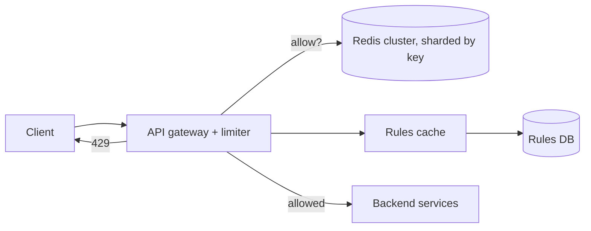

# Rate Limiter: Full System Design Mock Interview, All 9 Steps

> **Prerequisites:** [Previous lesson: URL Shortener: Full System Design Mock Interview, All 9 Steps](../01-url-shortener/README.md) and the [Interview Framework track](../../21-interview-framework/README.md).
> **Estimated Reading Time:** 15–20 minutes
> **Target Audience:** Engineers practising the full 9-step system design interview on a classic prompt: limiting how many requests a client may make, in a distributed fleet.

> [!NOTE]
> **In one line:** A rate limiter is a **counter with a clock** placed in front of your service; the design question is where the counter lives and how precise it must be.

> [!TIP]
> **The Golden Rule:** Decide the algorithm from the behaviour you want on bursts, then make the counter atomic in a shared store. Fail open or closed on purpose.

---

## Step 1. Clarify the Problem

Open with questions, not boxes. Interviewers want you to pick an algorithm, defend it against the boundary-burst problem, and handle many servers sharing one limit.

**Questions to ask the interviewer, and the answer we assume:**

| Question | Assumed answer |
| :--- | :--- |
| What do we limit by? | API key, falling back to IP |
| Which limits? | Per-key rules such as 100/min and 10/s |
| Where does it run? | A gateway in front of all services |
| On exceeding? | Return 429 with `Retry-After` |
| Scale? | 1M requests/s across the fleet, 10M active keys |

> Say it aloud: *"Before I draw anything, let me confirm the scope and the numbers."* That one sentence earns the first minutes of the interview.

---

## Step 2. Functional and Non-Functional Requirements

**Functional (what the system does):**

- Allow or reject each request based on the caller's rule.
- Support different limits per user, endpoint and plan.
- Tell the caller how long to wait (`Retry-After`, `X-RateLimit-*`).
- Change rules without redeploying.

**Non-functional (how well it does it):**

| Quality | Target | Why it drives the design |
| :--- | :--- | :--- |
| Latency | Under 2 ms added | The check is on every request |
| Availability | Limiter failure must not take the API down | Decide fail-open or fail-closed |
| Accuracy | Within a few percent of the limit | Exactness costs coordination |
| Scalability | Linear with keys | Counters shard by key |

---

## Step 3. Scope: In and Out

**In scope:** The decision (allow or reject), rule storage, headers.

**Out of scope (say it explicitly, then move on):**

- Billing for overage.
- DDoS protection at the network layer (a different tool).
- Per-request cost weighting (mention it as an extension).

---

## Step 4. Capacity Estimation

Assumptions: 1M requests/s at peak, 10M active keys, each counter about 64 bytes.

| Quantity | Calculation | Result |
| :--- | :--- | :--- |
| Counter memory | `keys * bytes_per_key / 1e9` | **0.64 GB** |
| Redis checks per second | `rps` | **1M ops/s** |
| Redis nodes needed | `rps / redis_ops` | **10 nodes** |

**What the numbers tell you:** Memory is tiny (under 1 GB), so the constraint is operations per second: about 10 Redis shards each doing 100K ops/s, with keys hashed across them. Add a local in-process allowance to cut remote calls.

---

## Step 5. API Design

| Endpoint | Purpose | Notes |
| :--- | :--- | :--- |
| Middleware `allow(key, rule)` | Returns allow or reject plus remaining | Runs in the gateway, not a public endpoint |
| `PUT /v1/rules/{id}` | Create or change a rule | Admin only, pushed to gateways |
| Response headers | `X-RateLimit-Limit`, `-Remaining`, `Retry-After` | Help well-behaved clients back off |

Reject with `429 Too Many Requests` and always send `Retry-After`; clients that retry immediately make the overload worse.

---

## Step 6. Data Model

| Entity / Store | Key fields | Why this store |
| :--- | :--- | :--- |
| Redis (sharded by key) | `rl:{key}:{window}` counter or token bucket `{tokens, ts}` | Atomic increments, TTL, sub-millisecond |
| Rules store | `rule_id`, `match`, `limit`, `window` | Small, cached in each gateway |
| Metrics | allowed / rejected per rule | Tune the limits |

Keep the rule table in a normal database and cache it in each gateway; only the hot counters live in Redis.

---

## Step 7. High-Level Architecture



**Walk the diagram in this order:** request enters the gateway, the limiter looks up the rule from the local cache, does one atomic check in Redis, then forwards or returns 429.

---

## Step 8. Deep Dives and Bottlenecks

### 1. Choosing the algorithm

**Fixed window** is simplest but lets a client send twice the limit across a window boundary. **Sliding window log** is exact but stores every timestamp. **Sliding window counter** blends the current and previous window (about 1% error) with two counters. **Token bucket** allows bursts up to the bucket size and refills at a steady rate; it is what most public APIs use. Pick the token bucket for APIs and say what burst you allow.

### 2. Making the check atomic across servers

Two gateways reading then writing the same counter will over-admit. Do the read-modify-write inside Redis with a Lua script or `INCR` plus `EXPIRE`, so it is one atomic step. Shard by key so one key always hits one Redis node. Use a hot-key local token reserve for very busy keys.

### 3. When the limiter itself fails

If Redis is down, **fail open** (allow) for a normal API so an outage in the limiter does not become an outage of everything, and **fail closed** only for protection-critical endpoints such as login. Keep a coarse in-memory fallback limit per gateway so a runaway client is still bounded.

---

## Step 9. Trade-offs, Failures and Security

**Trade-offs to state aloud:**

| Decision | Option A | Option B | Pick and why |
| :--- | :--- | :--- | :--- |
| Algorithm | Fixed window | Token bucket | Token bucket: allows controlled bursts, no boundary spike |
| Accuracy | Exact global count | Approximate with local reserves | Approximate: exact needs a network hop on every request |
| Failure | Fail open | Fail closed | Open for general APIs, closed for login and payments |

**Failure modes and mitigations:**

| Failure | What users see | Mitigation |
| :--- | :--- | :--- |
| Redis shard down | Some keys unlimited or blocked | Replicas with failover; fall back to local limits |
| Clock skew across gateways | Windows disagree | Use Redis time, not server time |
| Hot key | One shard saturated | Local token reserves, split by sub-key |

**Security and abuse:** Limit by authenticated identity first and IP second, because attackers rotate IPs and NAT shares them. Return the same response for unknown keys to avoid leaking which keys exist.

---

## Runnable Example: A token bucket

This bucket holds 5 tokens and refills 1 per second. It uses a fake clock so the output is deterministic.

```python
class TokenBucket:
    def __init__(self, capacity, refill_per_sec):
        self.capacity = capacity
        self.rate = refill_per_sec
        self.tokens = capacity
        self.ts = 0.0

    def allow(self, now, cost=1):
        elapsed = now - self.ts
        self.tokens = min(self.capacity, self.tokens + elapsed * self.rate)
        self.ts = now
        if self.tokens >= cost:
            self.tokens -= cost
            return True
        return False

b = TokenBucket(capacity=5, refill_per_sec=1)
print([b.allow(0) for _ in range(7)])
print("after 3 s:", [b.allow(3) for _ in range(4)])
```

Output (produced by running this exact code):

```text
[True, True, True, True, True, False, False]
after 3 s: [True, True, True, False]
```

The first 5 calls spend the burst allowance and the next 2 are rejected. Three seconds later 3 tokens have refilled, so 3 of the next 4 calls pass.

---

## Common Mistakes

- A fixed window with no mention of the boundary burst.
- A read then write on the counter without atomicity.
- Using the server clock instead of a shared clock.
- No `Retry-After`, so clients retry in a tight loop.
- Choosing fail closed everywhere.

---

## Interview Questions and Answers

<details>
<summary><strong>Q1: Token bucket or sliding window?</strong></summary>

Token bucket when you want to allow short bursts and a steady average, which fits most APIs. Sliding window counter when you need a strict count in any rolling interval with low memory.

</details>

<details>
<summary><strong>Q2: How do many gateways share a limit?</strong></summary>

They all call the same Redis shard for a given key, and the check is one atomic Lua script. For very hot keys they keep a small local token reserve.

</details>

<details>
<summary><strong>Q3: What if Redis dies?</strong></summary>

Fail open with a coarse local limit for ordinary traffic, fail closed for sensitive endpoints. Redis replicas and automatic failover make this rare.

</details>

<details>
<summary><strong>Q4: How do you avoid the boundary problem?</strong></summary>

Use a sliding window counter or a token bucket. A fixed window allows up to 2x the limit around a window edge.

</details>

<details>
<summary><strong>Q5: Where do you put the limiter?</strong></summary>

At the API gateway, so every service is protected uniformly. Add finer limits inside services for expensive operations.

</details>

---

## One-Page Cheat Sheet

| Step | What to say or draw |
| :--- | :--- |
| Clarify | Key, rules, gateway, 429, 1M rps |
| Capacity | <1 GB memory, ~10 Redis shards |
| API | allow(key, rule), headers, 429 + Retry-After |
| Data | Redis counters, rules cached |
| Deep dive | Token bucket, atomic Lua, fail open |
| Trade-off | Accuracy vs coordination cost |

---

## Further Reading

- Stripe engineering blog, *Scaling your API with rate limiters*.
- RFC 6585 section 4 (429 Too Many Requests).

---

## Next

Continue with [Pastebin: Full System Design Mock Interview, All 9 Steps](../03-pastebin/README.md).
