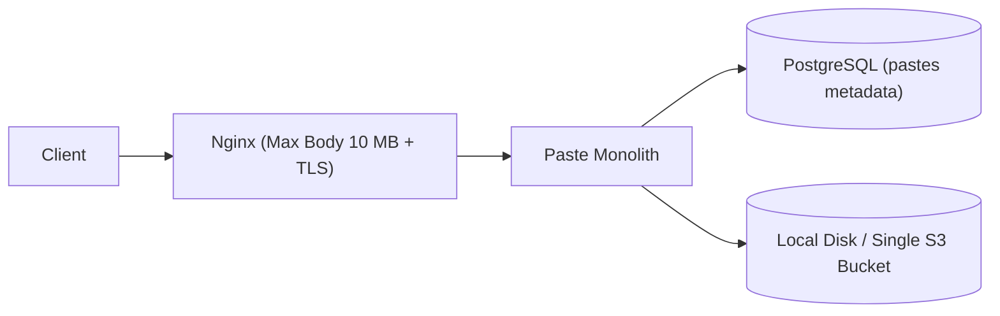
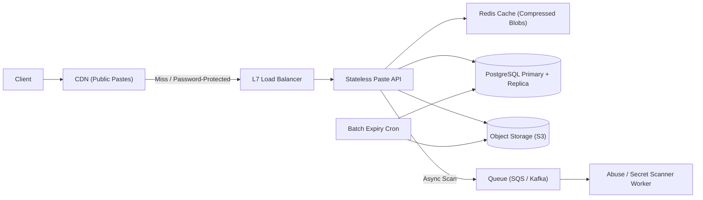
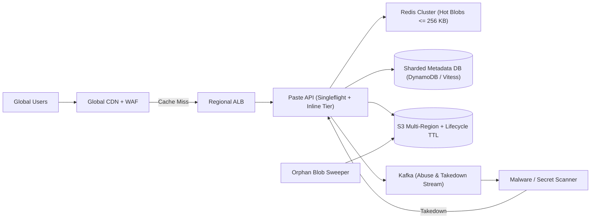
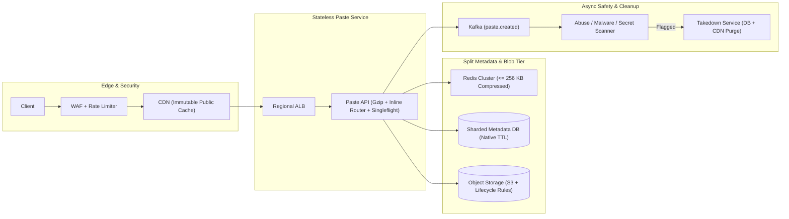
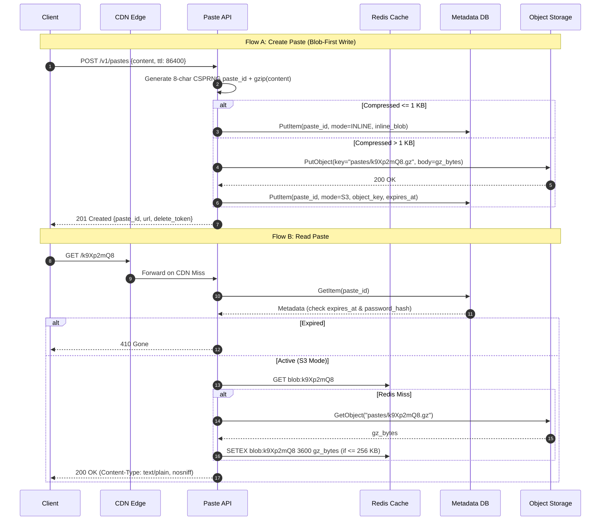

# Pastebin: Full System Design Mock Interview, All 9 Steps

> **Difficulty:** Medium (L4/L5 Baseline; L6+ with Inline Compression Tiering, CDN Edge & Abuse Pipelines)
> **Prerequisites:** [Previous lesson: Rate Limiter: Full System Design Mock Interview, All 9 Steps](../02-rate-limiter/README.md) and the [Interview Framework track](../../21-interview-framework/README.md).
> **Estimated Reading Time:** 25–30 minutes
> **Target Audience:** Engineers practising the full system design interview on a classic prompt: storing and sharing immutable blocks of text by a short link.

> [!NOTE]
> **In one line:** Pastebin is a URL shortener whose values are **variable-sized text blobs** (up to 10 MB), so the defining architectural decision is **decoupling tiny metadata from blob storage** and serving immutable reads through CDN + cache.

> [!TIP]
> **The Golden Rule:** Keep metadata rows small in a sharded DB, store compressed text blobs in Object Storage (or inline tiny `< 1 KB` pastes), write **blob-first then metadata** to prevent dangling pointers, and always serve raw user text with `Content-Type: text/plain` + `X-Content-Type-Options: nosniff` to prevent stored XSS.

---

## 1. Clarifying Questions, Functional & Non-Functional Requirements

Open with clarifying questions, not boxes. Pastebin shares DNA with a URL shortener, so interviewers test whether you immediately address **blob sizing**, **immutability**, **unlisted privacy (unguessable IDs)**, **expiration**, and **XSS/abuse security**.

### Clarifying Questions & Assumed Answers

| Question | Assumed Answer | Architectural Implication |
| :--- | :--- | :--- |
| **Max & typical paste size?** | Max 10 MB, average 10 KB (mostly source code/logs) | Too large for KV/SQL rows -> Object Storage (S3) + gzip compression |
| **Are pastes editable?** | No, immutable once created (fork creates a new paste) | Enables aggressive CDN & Redis caching with zero invalidation on updates |
| **Expiry options?** | Optional (`10m`, `1h`, `1d`, `30d`, `never`); default `never` | Lazy read-time check (`410 Gone`) + background TTL/lifecycle purge |
| **Private / Unlisted pastes?** | Unlisted by default (unguessable ID) + optional password | Must use CSPRNG random IDs (not sequential counters!) + Argon2/bcrypt hash |
| **Syntax highlighting?** | Client-side or pre-tagged `language` field | Never execute or render raw HTML server-side |
| **Scale & Read:Write ratio?** | 1M new pastes/day, 5:1 read-to-write ratio, 5-year retention | ~11.6 writes/s, ~57.9 reads/s, ~3.65 TB/yr raw (~1 TB/yr compressed) |

### Functional Requirements

1. **Create Paste:** Accept text content (up to 10 MB), optional `language`, `ttl_seconds`, `visibility` (`public` | `unlisted`), and optional `password`. Return a short `paste_id`, URL, and a secret `delete_token`.
2. **Read Paste:** Retrieve paste content and metadata by `paste_id`. Enforce password check if protected, return `404` if missing, and `410 Gone` if expired.
3. **Delete Paste:** Allow deletion via `delete_token` (or admin takedown for abuse), immediately purging CDN/Redis caches.
4. **Custom Expiry & Cleanup:** Automatically expire and reclaim storage for TTL-bounded pastes.

### Non-Functional Requirements & SLA Targets

| Quality | Target SLA | Why It Drives the Design |
| :--- | :--- | :--- |
| **Durability** | **99.999999999% (11 nines)** before expiry | Lost pastes violate user trust; S3 provides 11 nines out of the box |
| **Availability** | **99.95%** for reads and writes | Read-mostly immutable workload is easy to cache and replicate |
| **Latency** | **p99 < 150 ms** for cached reads; **p99 < 400 ms** for 10 MB writes | CDN absorbs hot reads; gzip cuts network transfer 3–5x |
| **Security** | **Zero stored XSS** & unguessable unlisted IDs | Pastebin is a prime target for malware, phishing, and secret leaks |
| **Cost Efficiency** | Low $/GB over 5+ years | Compression + S3 Intelligent-Tiering / Glacier for cold pastes |

### Scope: In vs Out

- **In Scope:** Create, read, delete (via token), expiry, password protection, compression, inline vs blob routing, XSS/abuse controls.
- **Out of Scope:** Paste editing/version history, full-text search across all pastes, user accounts/billing, collaborative live editing.

---

## 2. Back-of-the-Envelope Capacity Estimation

Assumptions: **1,000,000** new pastes/day, **10 KB** average uncompressed size, **5:1** read-to-write ratio, **5-year** retention, **4x** gzip compression ratio on text/code, and **10x** peak-to-average burst multiplier.

### 1. Traffic (QPS & Peak QPS)

$$\text{Write QPS}_{\text{avg}} = \frac{1,000,000}{86,400} \approx 11.6 \text{ writes/s}$$

$$\text{Write QPS}_{\text{peak}} = 11.6 \times 10 \approx 116 \text{ writes/s}$$

$$\text{Read QPS}_{\text{avg}} = 11.6 \times 5 = 57.9 \text{ reads/s}$$

$$\text{Read QPS}_{\text{peak}} = 57.9 \times 10 \approx 579 \text{ reads/s}$$

### 2. Storage (Raw vs Compressed)

$$\text{Daily Raw Data} = 10^6 \times 10 \text{ KB} = 10 \text{ GB/day}$$

$$\text{Yearly Raw Data} = 10 \text{ GB/day} \times 365 = 3.65 \text{ TB/year}$$

$$\text{5-Year Raw Data} = 3.65 \text{ TB} \times 5 = 18.25 \text{ TB}$$

With gzip compression (~3.5x average reduction on source code/logs):

$$\text{5-Year Compressed Blob Storage} = \frac{18.25 \text{ TB}}{3.5} \approx 5.21 \text{ TB}$$

Metadata DB (1.825B rows over 5 years, ~250 bytes/row):

$$\text{Metadata Storage (5 yr)} = 1.825 \times 10^9 \times 250 \text{ B} \approx 456 \text{ GB}$$

### 3. Bandwidth & Cache Sizing

$$\text{Peak Ingress Bandwidth} = 116 \text{ writes/s} \times 10 \text{ KB} \approx 1.16 \text{ MB/s}$$

$$\text{Peak Egress Bandwidth} = 579 \text{ reads/s} \times 10 \text{ KB} \approx 5.79 \text{ MB/s}$$

Caching the hot 20% of daily reads (20% of 5M daily reads $\approx$ 1M unique pastes, ~3 KB compressed each):

$$\text{Redis Cache RAM} = 10^6 \times 3 \text{ KB} \approx 3 \text{ GB}$$

### Capacity Summary Table

| Metric | Average | Peak (10x) | Design Implication |
| :--- | :--- | :--- | :--- |
| **Write QPS** | 11.6 req/s | 116 req/s | Modest compute; bottleneck is payload validation & S3 PUTs |
| **Read QPS** | 57.9 req/s | 579 req/s (viral: 50K+) | CDN + Redis easily absorb viral pastes |
| **Blob Storage (5 yr)** | 5.21 TB (compressed) | 18.25 TB (raw) | Object Storage (S3) with gzip & lifecycle tiering |
| **Metadata DB (5 yr)** | 456 GB (1.83B rows) | — | Fits in a small sharded SQL/KV cluster |
| **Cache RAM** | ~3 GB | — | Single Redis primary + replica suffices for Stage 2 |

---

## 3. Core API Contracts & Data Model

### REST API Contracts

| Endpoint | Method | Request Payload / Headers | Response & Status Codes |
| :--- | :--- | :--- | :--- |
| `/v1/pastes` | `POST` | `{"content": "...", "language": "python", "ttl_seconds": 86400, "password": "opt"}` (Max 10 MB enforced at edge) | `201 Created`: `{"paste_id": "k9Xp2mQ8", "url": "https://pb.io/k9Xp2mQ8", "delete_token": "dt_9a8f..."}` (`413` if > 10 MB, `429` if rate-limited) |
| `/{paste_id}` | `GET` | Optional `X-Paste-Password` or `Accept: text/plain` | `200 OK` with `Content-Type: text/plain; charset=utf-8`, `X-Content-Type-Options: nosniff`. `401` if password needed, `404` missing, `410` expired |
| `/v1/pastes/{paste_id}` | `DELETE` | `X-Delete-Token: dt_9a8f...` | `204 No Content` (deletes metadata + queues blob delete + purges CDN/Redis) |

### Database Schema & Object Storage Layout

We separate **Metadata** (small, fast, indexed by `paste_id` and `expires_at`) from **Content Blobs** (immutable compressed objects in S3). Tiny pastes (`compressed_size <= 1024 bytes`) can be **inlined** directly in the metadata row to eliminate an S3 round-trip!

```sql
-- Metadata Table (PostgreSQL / CockroachDB / DynamoDB)
CREATE TABLE pastes (
    paste_id         VARCHAR(12) PRIMARY KEY, -- 8-10 char CSPRNG Base62
    storage_mode     SMALLINT NOT NULL,       -- 0 = inline_content, 1 = s3_blob
    inline_blob      BYTEA NULL,              -- Gzipped bytes if <= 1 KB
    object_key       VARCHAR(64) NULL,        -- e.g. '2026/11/k9Xp2mQ8.gz'
    language         VARCHAR(32) DEFAULT 'text',
    uncompressed_len INT NOT NULL,
    password_hash    VARCHAR(128) NULL,       -- Argon2id hash if protected
    delete_token_hash CHAR(64) NOT NULL,      -- SHA-256 of delete_token
    created_at       BIGINT NOT NULL,
    expires_at       BIGINT NULL,             -- NULL = never
    is_deleted       BOOLEAN DEFAULT FALSE
);

-- Partial index for fast batch expiration without full-table scans
CREATE INDEX idx_pastes_expires ON pastes (expires_at)
WHERE expires_at IS NOT NULL AND is_deleted = FALSE;
```

---

## 4. Stage 1 (100 - 1K Users): Baseline Monolith & Single Database

At 100–1,000 users (< 1 QPS), we store metadata in PostgreSQL and blobs on local disk (or a single S3 bucket), served by one stateless app server behind Nginx.



### Component-by-Component Build (Stage 1)
1. **Nginx Edge Cap:** Enforces `client_max_body_size 10m` so oversized payloads are rejected with `413` before hitting app memory.
2. **Monolith Service:** Generates an 8-char CSPRNG Base62 ID, gzips the text, writes to S3/disk **first**, then inserts the metadata row into Postgres.

### What Breaks at 10K Users?
- **Local disk does not scale horizontally:** Adding a second app server breaks reads if blobs are on Server 1's local disk (requires shared Object Storage).
- **Repeated S3 GETs add latency and egress cost:** Popular pastes hit S3 on every view (~50–100 ms per GET).
- **Synchronous abuse/scanning blocks uploads:** Scanning 10 MB uploads inline for malware/secrets spikes write p99.

---

## 5. Stage 2 (10K - 100K Users): Caching, Object Storage & Async Expiry

At 10K–100K users (~50–500 QPS), we introduce **Object Storage (S3)**, **Redis Cache** for hot paste contents, **CDN** for public pastes, and an **Async Expiry & Abuse Pipeline**.



### Component-by-Component Additions (Stage 2)
1. **CDN + Redis Cache (Compressed):** Public, non-password-protected pastes are immutable, so we cache them at the CDN (`Cache-Control: public, max-age=3600`) and in Redis (storing **gzip-compressed bytes** to save 3–4x RAM).
2. **Inline-vs-Blob Tiering:** Pastes compressing to $\le 1\text{ KB}$ are stored in `inline_blob` inside Postgres, saving an S3 `PUT` and `GET`.
3. **Batch Expiry Worker:** Queries `WHERE expires_at < now() LIMIT 1000` using the partial index, deletes S3 objects in batch, and removes DB rows.

### What Breaks at 1M Users?
- **Single Postgres metadata table hits 1B+ rows:** Vacuuming and maintaining `idx_pastes_expires` on a single 500 GB Postgres primary degrades write throughput.
- **Orphaned S3 objects:** Crashes between S3 `PUT` and DB `INSERT` slowly accumulate unreferenced blobs.
- **Viral paste origin stampede:** A paste shared on Hacker News / Reddit with 50K concurrent hits before CDN warms up can overwhelm API servers fetching 5 MB blobs from S3.

---

## 6. Stage 3 (1M - 10M+ Users): Sharding, Partitioning & Multi-Region Scale

At 1M–10M+ users (1.8B+ rows, viral spikes), we shard metadata by `paste_id`, use **S3 Lifecycle Rules** for zero-scan expiry, and serve large reads via **CDN + Pre-Signed S3 URLs** or **Streaming Proxy**.



### Component-by-Component Additions (Stage 3)
1. **Sharded Metadata Store (by `paste_id`):** Using DynamoDB (with native **TTL** auto-deletion!) or Vitess/Citus sharded by `hash(paste_id)` eliminates single-primary limits and replaces manual expiry cron scans with native partition/TTL drops.
2. **Redis Size Cap ($\le 256\text{ KB}$):** Only cache pastes $\le 256\text{ KB}$ compressed in Redis so a few 10 MB pastes cannot evict 10,000 normal pastes. Larger pastes stream directly from S3 -> CDN.
3. **`singleflight` + S3 Pre-Signed Redirect (Optional for > 1 MB):** Coalesce concurrent misses for the same `paste_id` in memory; for huge raw downloads, optionally issue a short-lived pre-signed S3/CDN URL with `ResponseContentType=text/plain`.

---

## 7. Final Full Production Architecture & End-to-End Flows

### Complete Production Architecture



### End-to-End Create & Read Flow



---

## 8. Deep-Dive Bottlenecks & Algorithmic Trade-Offs

### Deep Dive 1: Write Ordering — Blob First vs Metadata First

| Write Order | Failure Mode if Step 2 Crashes | User Impact | Verdict |
| :--- | :--- | :--- | :--- |
| **Metadata DB -> S3 Blob** | DB row exists pointing to a missing S3 key | **User gets `500` / broken paste** on read | **Reject** |
| **S3 Blob -> Metadata DB** | S3 object exists with no DB row (orphan) | **Zero user impact**; periodic sweeper or S3 lifecycle cleans orphan | **Pick this** |

### Deep Dive 2: Inline Storage vs Object Storage Threshold

- **Why inline tiny pastes?** S3 `PUT`/`GET` requests cost ~$0.005 per 1,000 PUTs and add ~25–50 ms of network RTT. Since **60–70% of real-world pastes** are small snippets (< 2 KB raw, < 600 B gzipped), storing them directly in the metadata row cuts S3 API costs and p99 latency by more than half.
- **Where is the cutoff?** **1 KB compressed** (`inline_blob <= 1024 B`) keeps metadata rows compact (~1.3 KB max) so B-trees / DynamoDB partitions stay fast.

### Deep Dive 3: ID Generation — Counter vs CSPRNG

Unlike a URL shortener, **unlisted Pastebin links are a security boundary** (users paste private logs/configs expecting nobody can guess the URL).
- **Sequential counter:** Fatal privacy flaw—anyone can enumerate `/1`, `/2`, `/3`.
- **8-character CSPRNG Base62:** $62^8 \approx 2.18 \times 10^{14}$ combinations (~47.6 bits of entropy). At 1M pastes/day, collision probability is negligible ($< 10^{-6}$ over years), and a conditional `PutItem (attribute_not_exists(paste_id))` guarantees 0 collisions.

---

## 9. Failure Modes, Reliability & Backpressure Mitigations

| Failure Mode | User Impact | Blast Radius | Mitigation & Recovery |
| :--- | :--- | :--- | :--- |
| **Stored XSS via HTML/JS Paste** | Attacker uploads `<script>` and steals session cookies | All viewers of that paste | Serve raw pastes strictly with `Content-Type: text/plain; charset=utf-8`, `X-Content-Type-Options: nosniff`, and `Content-Security-Policy: default-src 'none'` on a **separate sandbox domain** (e.g., `raw.pbusercontent.com`) |
| **Orphaned S3 Blobs** | Silent storage bloat | Cost only | Tag S3 uploads with `status=pending` or run an async S3 inventory vs DB reconciliation sweeper |
| **10 MB Paste Flood (Cache Eviction)** | Large blobs evict hot small pastes from Redis | Cache hit rate drops | Enforce `MAX_REDIS_BLOB_BYTES = 262144` (256 KB); stream larger blobs directly from S3/CDN |
| **Malware / Phishing Hosting** | Domain blocklisted by Chrome Safe Browsing | Whole site reputation | Rate-limit anonymous creates, async Kafka scanner (YARA + secret regex), instant takedown + CDN purge API |
| **Password Brute-Forcing** | Unauthorized access to protected pastes | Protected pastes | Argon2id hashing + per-`(ip, paste_id)` rate limit (5 attempts/min) |

---

## 10. Production War Story & Real-World Reference

### Case Study: Stored XSS via `Content-Type` Sniffing on User-Generated Text Hosts

- **Context:** Multiple early paste and code-hosting platforms suffered critical **Stored XSS** incidents when users uploaded valid HTML/SVG payloads disguised as `.txt` or `.log` files. Older browsers performed **MIME sniffing** when `Content-Type` was missing or ambiguous, executing embedded `<script>` tags under the main application's origin (`pastebin.com`), allowing attackers to hijack authenticated session cookies.
- **The Fix (Industry Standard used by GitHub Gist & Pastebin):**
  1. Never serve raw user content from the main authenticated domain; serve it from a **cookieless sandbox origin** (`gist.githubusercontent.com` / `raw.pbusercontent.com`).
  2. Always attach three mandatory headers:
     - `Content-Type: text/plain; charset=utf-8`
     - `X-Content-Type-Options: nosniff`
     - `Content-Security-Policy: default-src 'none'; sandbox`
  3. **Result:** Even if an attacker uploads malicious HTML/SVG, the browser refuses to execute scripts and has zero access to main-domain cookies.

---

## 11. Core Component Implementation (4 Languages)

Below is the core **Pastebin Storage Router & CSPRNG ID Generator** (handling gzip compression, inline-vs-S3 placement, and blob-first write ordering) in Go, TypeScript, Python, and C#.

````carousel
```go
package pastebin

import (
	"bytes"
	"compress/gzip"
	"crypto/rand"
	"errors"
	"math/big"
)

const (
	alphabet        = "0123456789abcdefghijklmnopqrstuvwxyzABCDEFGHIJKLMNOPQRSTUVWXYZ"
	inlineLimitByte = 1024
	maxPayloadByte  = 10 * 1024 * 1024
)

type BlobStore interface {
	PutBlob(key string, compressed []byte) error
}

type MetadataStore interface {
	PutMetadata(pasteID string, mode string, inline []byte, objectKey string) error
}

type PasteService struct {
	blobs BlobStore
	meta  MetadataStore
}

func (s *PasteService) CreatePaste(raw []byte) (string, string, error) {
	if len(raw) == 0 || len(raw) > maxPayloadByte {
		return "", "", errors.New("invalid paste size")
	}

	var buf bytes.Buffer
	gz := gzip.NewWriter(&buf)
	if _, err := gz.Write(raw); err != nil {
		return "", "", err
	}
	if err := gz.Close(); err != nil {
		return "", "", err
	}
	compressed := buf.Bytes()

	pasteID, err := generateCSPRNGID(8)
	if err != nil {
		return "", "", err
	}

	if len(compressed) <= inlineLimitByte {
		if err := s.meta.PutMetadata(pasteID, "inline", compressed, ""); err != nil {
			return "", "", err
		}
		return pasteID, "inline", nil
	}

	// Blob-first write: S3 before Metadata DB to avoid dangling pointers
	objKey := "pastes/" + pasteID + ".gz"
	if err := s.blobs.PutBlob(objKey, compressed); err != nil {
		return "", "", err
	}
	if err := s.meta.PutMetadata(pasteID, "s3", nil, objKey); err != nil {
		return "", "", err
	}
	return pasteID, "s3", nil
}

func generateCSPRNGID(length int) (string, error) {
	out := make([]byte, length)
	max := big.NewInt(int64(len(alphabet)))
	for i := range out {
		n, err := rand.Int(rand.Reader, max)
		if err != nil {
			return "", err
		}
		out[i] = alphabet[n.Int64()]
	}
	return string(out), nil
}
```
<!-- slide -->
```typescript
import { randomBytes } from "crypto";
import { gzipSync } from "zlib";

const ALPHABET = "0123456789abcdefghijklmnopqrstuvwxyzABCDEFGHIJKLMNOPQRSTUVWXYZ";
const INLINE_LIMIT_BYTES = 1024;
const MAX_PAYLOAD_BYTES = 10 * 1024 * 1024;

export interface BlobStore {
  putBlob(key: string, data: Buffer): Promise<void>;
}

export interface MetadataStore {
  putMetadata(record: {
    pasteId: string;
    mode: "inline" | "s3";
    inlineBlob?: Buffer;
    objectKey?: string;
  }): Promise<void>;
}

export class PasteService {
  constructor(
    private readonly blobs: BlobStore,
    private readonly meta: MetadataStore
  ) {}

  async createPaste(content: Buffer): Promise<{ pasteId: string; mode: "inline" | "s3" }> {
    if (content.length === 0 || content.length > MAX_PAYLOAD_BYTES) {
      throw new Error("Paste size out of bounds (1B - 10MB)");
    }

    const compressed = gzipSync(content);
    const pasteId = this.generateId(8);

    if (compressed.length <= INLINE_LIMIT_BYTES) {
      await this.meta.putMetadata({ pasteId, mode: "inline", inlineBlob: compressed });
      return { pasteId, mode: "inline" };
    }

    // Blob-first write ordering
    const objectKey = `pastes/${pasteId}.gz`;
    await this.blobs.putBlob(objectKey, compressed);
    await this.meta.putMetadata({ pasteId, mode: "s3", objectKey });
    return { pasteId, mode: "s3" };
  }

  private generateId(length: number): string {
    const bytes = randomBytes(length);
    let id = "";
    for (let i = 0; i < length; i++) {
      id += ALPHABET[bytes[i] % ALPHABET.length];
    }
    return id;
  }
}
```
<!-- slide -->
```python
import gzip
import secrets
from typing import Protocol, Tuple

ALPHABET = "0123456789abcdefghijklmnopqrstuvwxyzABCDEFGHIJKLMNOPQRSTUVWXYZ"
INLINE_LIMIT_BYTES = 1024
MAX_PAYLOAD_BYTES = 10 * 1024 * 1024


class BlobStore(Protocol):
    def put_blob(self, key: str, data: bytes) -> None: ...


class MetadataStore(Protocol):
    def put_metadata(
        self, paste_id: str, mode: str, inline_blob: bytes | None, object_key: str | None
    ) -> None: ...


class PasteService:
    def __init__(self, blobs: BlobStore, meta: MetadataStore) -> None:
        self._blobs = blobs
        self._meta = meta

    def create_paste(self, raw: bytes) -> Tuple[str, str]:
        if not (1 <= len(raw) <= MAX_PAYLOAD_BYTES):
            raise ValueError("Paste size must be between 1 byte and 10 MB")

        compressed = gzip.compress(raw)
        paste_id = "".join(secrets.choice(ALPHABET) for _ in range(8))

        if len(compressed) <= INLINE_LIMIT_BYTES:
            self._meta.put_metadata(paste_id, "inline", compressed, None)
            return paste_id, "inline"

        # Blob-first write: ensure object exists before metadata points to it
        object_key = f"pastes/{paste_id}.gz"
        self._blobs.put_blob(object_key, compressed)
        self._meta.put_metadata(paste_id, "s3", None, object_key)
        return paste_id, "s3"
```
<!-- slide -->
```csharp
using System;
using System.IO;
using System.IO.Compression;
using System.Security.Cryptography;
using System.Threading.Tasks;

namespace Pastebin.Core
{
    public interface IBlobStore
    {
        Task PutBlobAsync(string key, byte[] compressed);
    }

    public interface IMetadataStore
    {
        Task PutMetadataAsync(string pasteId, string mode, byte[]? inlineBlob, string? objectKey);
    }

    public sealed class PasteService
    {
        private const string Alphabet = "0123456789abcdefghijklmnopqrstuvwxyzABCDEFGHIJKLMNOPQRSTUVWXYZ";
        private const int InlineLimitBytes = 1024;
        private const int MaxPayloadBytes = 10 * 1024 * 1024;

        private readonly IBlobStore _blobs;
        private readonly IMetadataStore _meta;

        public PasteService(IBlobStore blobs, IMetadataStore meta)
        {
            _blobs = blobs;
            _meta = meta;
        }

        public async Task<(string PasteId, string Mode)> CreatePasteAsync(byte[] raw)
        {
            if (raw.Length == 0 || raw.Length > MaxPayloadBytes)
                throw new ArgumentOutOfRangeException(nameof(raw), "Size must be 1B - 10MB.");

            byte[] compressed = CompressGzip(raw);
            string pasteId = GenerateCsprngId(8);

            if (compressed.Length <= InlineLimitBytes)
            {
                await _meta.PutMetadataAsync(pasteId, "inline", compressed, null);
                return (pasteId, "inline");
            }

            // Blob-first write ordering
            string objectKey = $"pastes/{pasteId}.gz";
            await _blobs.PutBlobAsync(objectKey, compressed);
            await _meta.PutMetadataAsync(pasteId, "s3", null, objectKey);
            return (pasteId, "s3");
        }

        private static byte[] CompressGzip(byte[] data)
        {
            using var ms = new MemoryStream();
            using (var gz = new GZipStream(ms, CompressionLevel.Fastest, leaveOpen: true))
            {
                gz.Write(data, 0, data.Length);
            }
            return ms.ToArray();
        }

        private static string GenerateCsprngId(int length)
        {
            return RandomNumberGenerator.GetString(Alphabet, length);
        }
    }
}
```
````

---

## 12. Verification, Load Testing & CLI Diagnostics

```bash
# 1. Create a paste and verify safe response headers (nosniff + text/plain)
curl -i -X POST https://api.pb.io/v1/pastes \
  -H "Content-Type: application/json" \
  -d '{"content":"<script>alert(1)</script>","language":"html","ttl_seconds":3600}'

# Verify raw read returns text/plain + X-Content-Type-Options: nosniff
curl -i https://raw.pbusercontent.com/k9Xp2mQ8

# 2. Verify edge 413 payload cap (> 10 MB rejected before app tier)
dd if=/dev/zero bs=1M count=11 | curl -i -X POST --data-binary @- https://api.pb.io/v1/pastes

# 3. Inspect S3 bucket compression & lifecycle rules
aws s3api get-bucket-lifecycle-configuration --bucket pastebin-blobs-prod
aws s3 ls s3://pastebin-blobs-prod/pastes/ --summarize --human-readable | tail -n 5

# 4. Check PostgreSQL partial expiry index usage
psql -c "EXPLAIN ANALYZE SELECT paste_id, object_key FROM pastes WHERE expires_at < extract(epoch from now())*1000 AND is_deleted = FALSE LIMIT 500;"
```

---

## 13. Common Interview Mistakes & Red Flags

| Common Mistake | Why It's a Red Flag | Staff-Level Answer |
| :--- | :--- | :--- |
| **Storing 10 MB blobs inside SQL/KV rows** | Bloats DB memory/backups and ruins query p99 | Split metadata (DB) from content (S3); inline only compressed blobs $\le 1\text{ KB}$ |
| **Writing metadata DB before S3 blob** | Crash leaves a live row pointing to a missing S3 key (`500` errors) | Always write **blob first**, then metadata; sweep orphan blobs asynchronously |
| **Using sequential counters for unlisted pastes** | Anyone can scrape `/1`, `/2`, `/3` and steal private pastes | Use 8+ char **CSPRNG Base62** IDs with conditional `PutItem` |
| **Serving raw pastes as `text/html` on main domain** | Instant Stored XSS stealing user session cookies | Serve on a cookieless sandbox domain with `text/plain`, `nosniff`, and `CSP: default-src 'none'` |
| **Full-table scans to expire pastes** | Table locks and I/O spikes as rows hit billions | Partial index on `expires_at` / native DB TTL + lazy read-time expiry check |
| **Caching 10 MB pastes in Redis** | A few large pastes evict thousands of hot small pastes | Cap Redis blob caching at $\le 256\text{ KB}$ compressed; stream larger files via CDN/S3 |

---

## 14. Key Terminology & Glossary

| Key Term | Definition |
| :--- | :--- |
| **Metadata-Content Split** | Pattern storing small structured attributes in a DB and large binary/text blobs in Object Storage. |
| **Inline Tiering** | Optimization storing tiny compressed blobs ($\le 1\text{ KB}$) directly in the metadata row to skip an S3 RTT. |
| **Blob-First Write** | Writing to Object Storage before committing metadata so crashes never produce dangling DB pointers. |
| **CSPRNG** | Cryptographically Secure Pseudorandom Number Generator (`crypto/rand`, `secrets`), preventing ID guessing. |
| **Stored XSS** | Attack where malicious HTML/JS saved in a DB executes in another viewer's browser. |
| **MIME Sniffing** | Browser behavior of guessing content type; blocked by `X-Content-Type-Options: nosniff`. |
| **Native DB TTL** | Automatic background row deletion (e.g., DynamoDB TTL) avoiding manual `DELETE` table scans. |
| **Lifecycle Policy** | S3 rule that automatically transitions cold objects to Glacier or deletes expired objects. |

---

## 15. Interview Follow-Up Questions (12 Q&As)

<details>
<summary><strong>Q1: [BASIC] Why separate metadata from paste content?</strong></summary>

Metadata rows are ~250 bytes and need fast indexed lookups and TTL queries, whereas content blobs average 10 KB (up to 10 MB) and belong in cheap, durable Object Storage (S3) fronted by a CDN.

</details>

<details>
<summary><strong>Q2: [BASIC] Why write the S3 blob before inserting the metadata row?</strong></summary>

If the process crashes after writing to S3 but before inserting into the DB, you only have an invisible orphan blob that a background sweeper can delete. The reverse order creates a visible metadata row pointing to a non-existent blob, causing `500` errors for users.

</details>

<details>
<summary><strong>Q3: [BASIC] How do you prevent Stored XSS when users paste HTML or JavaScript?</strong></summary>

Serve raw content from a cookieless sandbox domain with `Content-Type: text/plain; charset=utf-8`, `X-Content-Type-Options: nosniff`, and `Content-Security-Policy: default-src 'none'`.

</details>

<details>
<summary><strong>Q4: [BASIC] Why gzip pastes before storing them?</strong></summary>

Source code, JSON, and logs compress 3x–5x with gzip, cutting S3 storage costs, Redis RAM usage, and network egress bandwidth proportionally.

</details>

<details>
<summary><strong>Q5: [SCENARIO] Unlike URL Shortener, why can't we use sequential Base62 counters here?</strong></summary>

Unlisted pastes rely on capability-URL privacy—users expect others cannot guess their link. Sequential counters allow trivial enumeration (`/1`, `/2`, `/3`). An 8-char CSPRNG Base62 ID ($62^8 \approx 2.18 \times 10^{14}$) makes brute-force enumeration infeasible.

</details>

<details>
<summary><strong>Q6: [SCENARIO] A paste goes viral on Reddit with 50,000 reads/sec. What happens?</strong></summary>

Because pastes are **immutable**, public pastes are cached aggressively at the CDN edge (`Cache-Control: public, max-age=3600`). For cache misses before the edge warms up, `singleflight` coalescing in the API ensures only 1 request hits S3/Redis.

</details>

<details>
<summary><strong>Q7: [SCENARIO] How do you handle deletion of an abusive paste that is cached on the CDN?</strong></summary>

Mark `is_deleted = true` in the Metadata DB, delete from Redis and S3, and fire an asynchronous **CDN Purge / Surrogate-Key invalidation** API call. Within 1–5 seconds globally, all edge PoPs stop serving it.

</details>

<details>
<summary><strong>Q8: [SCENARIO] How do you support "burn after reading" (single-use) pastes?</strong></summary>

Disable CDN caching (`Cache-Control: no-store`) for burn-after-read pastes, and perform an **atomic `UpdateItem` / `DELETE ... RETURNING`** in the Metadata DB on the first read (`SET is_deleted = true WHERE paste_id = $1 AND is_deleted = false`). Only the winner of that atomic conditional update receives the content.

</details>

<details>
<summary><strong>Q9: [TRICKY] How do you clean up orphan S3 blobs left behind by crashed writes without scanning billions of objects?</strong></summary>

Write new blobs to a staging prefix or tag them, or use **S3 Inventory Reports** (daily manifest) compared via Spark/Athena against DB exports—or even simpler, write to a `pending/` prefix with a 24-hour S3 Lifecycle expiration, and only copy/promote or rely on S3 `PUT` + DB transaction outbox if strict cleanup is required.

</details>

<details>
<summary><strong>Q10: [TRICKY] How do you prevent someone from uploading 10 MB of random uncompressible bytes repeatedly to exhaust your storage?</strong></summary>

Enforce per-IP and per-account rate limits, cap anonymous paste sizes (e.g., 512 KB anonymous, 10 MB authenticated), and apply a shorter default TTL (e.g., 30 days) for anonymous pastes.

</details>

<details>
<summary><strong>Q11: [TRICKY] Should password-protected pastes be cached in the CDN?</strong></summary>

**Never** cache password-protected pastes at a shared CDN edge, because a cached `200 OK` would bypass the server's password check for subsequent visitors. Always return `Cache-Control: private, no-store` for protected pastes and verify Argon2id hashes at the origin API.

</details>

<details>
<summary><strong>Q12: [TRICKY] What if a user pastes an AWS secret key or PII and asks for immediate removal?</strong></summary>

Our async Kafka `paste.created` pipeline runs regex/entropy secret detection (like TruffleHog rules) to proactively quarantine or warn, and `DELETE /v1/pastes/{id}` with the `delete_token` synchronously deletes the DB row and triggers an immediate Redis + CDN purge.

</details>

---

## 16. One-Page Master Cheat Sheet

```text
+-----------------------------------------------------------------------------+
| PASTEBIN: MASTER INTERVIEW CHEAT SHEET                                      |
+-----------------------------------------------------------------------------+
| SCALE: 1M writes/day (12 QPS, 116 peak) | 5:1 R:W (58 QPS, 579 peak)        |
| STORAGE: 10 KB avg -> 3.65 TB/yr raw -> ~1 TB/yr gzipped (5.2 TB in 5 yrs)  |
|-----------------------------------------------------------------------------|
| WRITE PATH: Client -> Edge (10 MB cap) -> API -> CSPRNG 8-char ID + Gzip    |
|             -> <=1 KB? Inline in DB : >1 KB? S3 Blob FIRST -> Metadata DB   |
| READ PATH:  Client -> CDN (Public Immutable) -> API -> DB (TTL/Auth check)  |
|             -> Redis (<=256 KB gz) -> S3 -> Serve text/plain + nosniff      |
|-----------------------------------------------------------------------------|
| KEY TRADEOFFS:                                                              |
|  * Blob-first write prevents dangling DB pointers on crash                  |
|  * CSPRNG IDs (not counters) protect unlisted paste privacy                 |
|  * Sandbox domain + nosniff + CSP: default-src 'none' blocks Stored XSS     |
+-----------------------------------------------------------------------------+
```

## Further Reading

- Alex Xu, *System Design Interview*, Pastebin chapter.
- OWASP guidance on content-type sniffing and stored XSS.

---

## Next

Continue with [File Storage and Sharing: Full System Design Mock Interview, All 9 Steps](../04-file-storage-and-sharing/README.md).
