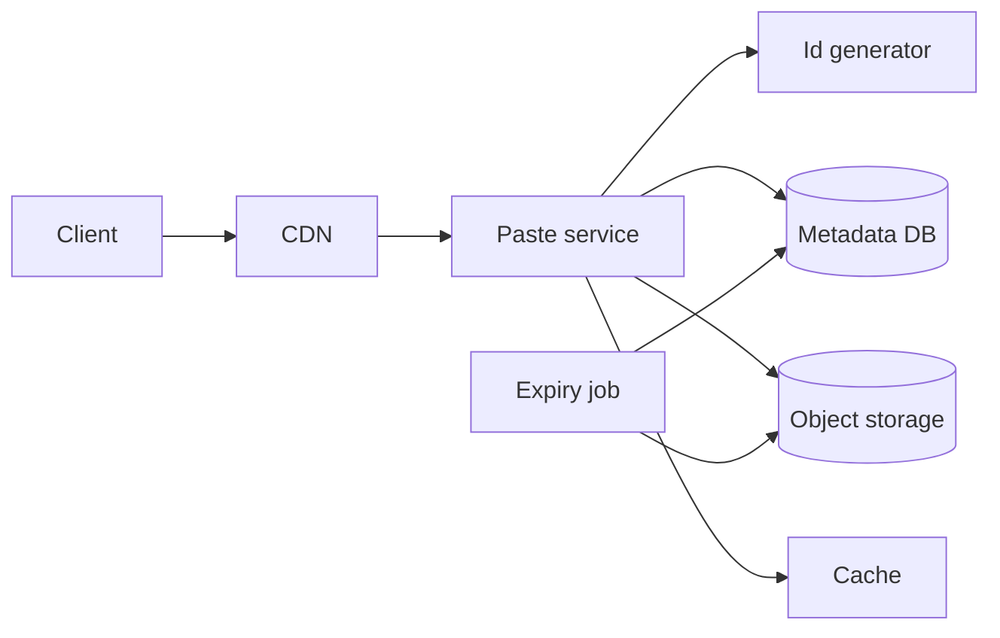

# Pastebin: Full System Design Mock Interview, All 9 Steps

> **Prerequisites:** [Previous lesson: Rate Limiter: Full System Design Mock Interview, All 9 Steps](../02-rate-limiter/README.md) and the [Interview Framework track](../../21-interview-framework/README.md).
> **Estimated Reading Time:** 15–20 minutes
> **Target Audience:** Engineers practising the full 9-step system design interview on a classic prompt: storing and sharing blocks of text by a short link.

> [!NOTE]
> **In one line:** Pastebin is a URL shortener whose values are **large blobs**, so the key new decision is splitting metadata from content.

> [!TIP]
> **The Golden Rule:** Keep small metadata in a database and the text in object storage. Serve reads from a cache and a CDN, and expire pastes with a background job.

---

## Step 1. Clarify the Problem

Open with questions, not boxes. The shape is familiar from the URL shortener; what is new is blob storage, size limits, expiry and syntax highlighting.

**Questions to ask the interviewer, and the answer we assume:**

| Question | Assumed answer |
| :--- | :--- |
| Max paste size? | 10 MB, typical 10 KB |
| Expiry? | Optional, default never, minimum 10 minutes |
| Private pastes? | Unlisted URL, optional password |
| Edit? | No, pastes are immutable |
| Scale? | 1M new pastes per day, 5:1 reads to writes |

> Say it aloud: *"Before I draw anything, let me confirm the scope and the numbers."* That one sentence earns the first minutes of the interview.

---

## Step 2. Functional and Non-Functional Requirements

**Functional (what the system does):**

- Create a paste and get a link.
- Read a paste by link.
- Expire or delete a paste.
- Optionally set language for highlighting and a password.

**Non-functional (how well it does it):**

| Quality | Target | Why it drives the design |
| :--- | :--- | :--- |
| Durability | No lost pastes before expiry | Content is the product |
| Latency | p99 read under 200 ms | Pages load text directly |
| Availability | 99.9% | Read-mostly, easy to replicate |
| Cost | Cheap per GB | Text accumulates for years |

---

## Step 3. Scope: In and Out

**In scope:** Create, read, expire, delete, password.

**Out of scope (say it explicitly, then move on):**

- Editing or versions.
- Full-text search across pastes.
- User profiles and comments.

---

## Step 4. Capacity Estimation

Assumptions: 1M new pastes per day, average 10 KB, 5:1 read to write, 5 year retention.

| Quantity | Calculation | Result |
| :--- | :--- | :--- |
| Write QPS | `per_day / 86400` | **11.6 writes/s** |
| Read QPS | `write_qps * read_ratio` | **57.9 reads/s** |
| Storage per year | `per_day * 365 * kb * 1e3 / 1e12` | **3.65 TB/year** |
| Storage in 5 years | `storage_per_year * years` | **18.2 TB** |

**What the numbers tell you:** 12 writes/s and 58 reads/s are small. The only thing that grows is bytes: 3.65 TB a year, which is object-storage territory, not database territory.

---

## Step 5. API Design

| Endpoint | Purpose | Notes |
| :--- | :--- | :--- |
| `POST /v1/pastes` | Create | Body: `content`, `language`, `ttl`, optional `password`. Returns `201` and `id`. |
| `GET /{id}` | Read | `404` unknown, `410` expired, `401` wrong password. |
| `DELETE /v1/pastes/{id}` | Delete | Needs the delete token returned at creation. |

Return a delete token on create, since there are no accounts. Cap the body size at the edge and reject larger payloads with `413`.

---

## Step 6. Data Model

| Entity / Store | Key fields | Why this store |
| :--- | :--- | :--- |
| Metadata DB (key-value or SQL) | `id`, `object_key`, `language`, `expires_at`, `size`, `pw_hash` | Small rows, point lookups, TTL index |
| Object storage (S3-style) | Key `pastes/{id}`, the text | Cheap, durable, handles large blobs |
| Cache + CDN | `id` to content for hot pastes | Most reads hit a few pastes |

Never store the text in the metadata row. That keeps rows small and fast and lets object storage and the CDN carry the bytes.

---

## Step 7. High-Level Architecture



**Walk the diagram in this order:** create writes the blob to object storage first, then the metadata row; read goes CDN, cache, metadata, then the blob. The expiry job runs on the side.

---

## Step 8. Deep Dives and Bottlenecks

### 1. Metadata versus content

Write the blob to object storage, then insert the metadata row. If the row insert fails you have an orphan blob that a cleanup job can sweep; the opposite order would give a row pointing at nothing, which is worse. Small pastes (under about 1 KB) can be inlined in the row to save a round trip.

### 2. Expiry at scale

Do not scan the table. Index `expires_at` and let a scheduled job delete in batches, or use a store with native TTL. Reads also check `expires_at`, so an expired paste is never served even before the job removes it. Object lifecycle rules delete blobs automatically.

### 3. Abuse and cost

Pastebin is a favourite place to host spam and malware. Rate-limit creation, cap sizes, scan content asynchronously, and add a report-and-takedown path. Compress text (gzip) before storing, which often cuts it by 3 to 5 times.

---

## Step 9. Trade-offs, Failures and Security

**Trade-offs to state aloud:**

| Decision | Option A | Option B | Pick and why |
| :--- | :--- | :--- | :--- |
| Blob location | In the database | Object storage | Object storage: cheaper and keeps rows small |
| Expiry | Delete on read | Background job | Both: job for space, read check for correctness |
| Privacy | Random long id | Password | Long random id by default, password optional |

**Failure modes and mitigations:**

| Failure | What users see | Mitigation |
| :--- | :--- | :--- |
| Orphan blob | None visible | Periodic sweeper compares storage keys and metadata |
| Object storage slow | Slow first read | Cache and CDN absorb repeat reads |
| Expiry job lag | None, reads check expiry | Run it often and alert on backlog |

**Security and abuse:** Serve user text as plain text with a safe content type and `nosniff`, never as HTML, to prevent stored XSS. Hash passwords, rate-limit, and scan for secrets or malware.

---

## Runnable Example: Choosing where a paste lives

This routes a paste to the row or to a blob, and shows what gzip saves on repetitive text.

```python
import gzip

INLINE_LIMIT = 1024

def place(content: bytes):
    packed = gzip.compress(content)
    where = "row" if len(packed) <= INLINE_LIMIT else "object-storage"
    return where, len(content), len(packed)

print(place(b"hello world"))
print(place(b"def f(x):\n    return x * 2\n" * 400))
import random
random.seed(1)
print(place(bytes(random.randrange(256) for _ in range(5000))))
```

Output (produced by running this exact code):

```text
('row', 11, 31)
('row', 10800, 90)
('object-storage', 5000, 5023)
```

Tiny text stays in the metadata row, repetitive source code compresses enormously and may still fit, and random-looking data does not compress and goes to object storage.

---

## Common Mistakes

- Storing large text in the metadata database.
- Serving pastes as HTML.
- Scanning the table for expired pastes.
- No size limit at the edge.
- Using guessable sequential ids for unlisted pastes.

---

## Interview Questions and Answers

<details>
<summary><strong>Q1: Why separate metadata from content?</strong></summary>

Rows stay tiny and fast to query and shard, while object storage handles large blobs cheaply and durably, and the CDN serves bytes without touching your database.

</details>

<details>
<summary><strong>Q2: What do you write first on create?</strong></summary>

The blob, then the row. A failed row insert leaves a harmless orphan blob a sweeper deletes; the reverse order could serve a row with no content.

</details>

<details>
<summary><strong>Q3: How does expiry work?</strong></summary>

An indexed `expires_at`, a batch deletion job, lifecycle rules on the blobs, and a read-time check so expired pastes are never served.

</details>

<details>
<summary><strong>Q4: How do you keep unlisted pastes unlisted?</strong></summary>

Use long random ids (at least 8 base62 characters from a CSPRNG), not a counter, and never expose a listing endpoint.

</details>

<details>
<summary><strong>Q5: How do you handle a viral paste?</strong></summary>

CDN and cache absorb it. Immutable content makes caching trivial, with long TTLs and no invalidation.

</details>

---

## One-Page Cheat Sheet

| Step | What to say or draw |
| :--- | :--- |
| Clarify | 10 MB max, expiry, unlisted, 1M/day |
| Capacity | 12 writes/s, 58 reads/s, 3.6 TB/year |
| API | POST, GET, DELETE with token |
| Data | Metadata DB plus object storage plus cache |
| Deep dive | Blob-first writes, TTL index, takedown |
| Trade-off | Blobs outside the database |

---

## Further Reading

- Alex Xu, *System Design Interview*, Pastebin chapter.
- OWASP guidance on content-type sniffing and stored XSS.

---

## Next

Continue with [File Storage and Sharing: Full System Design Mock Interview, All 9 Steps](../04-file-storage-and-sharing/README.md).
