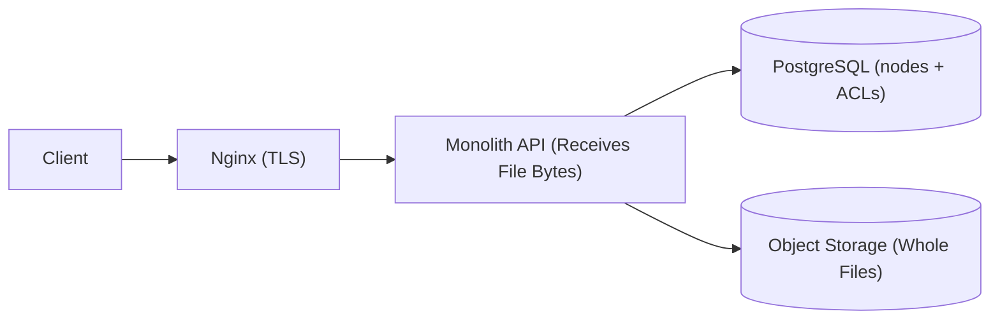
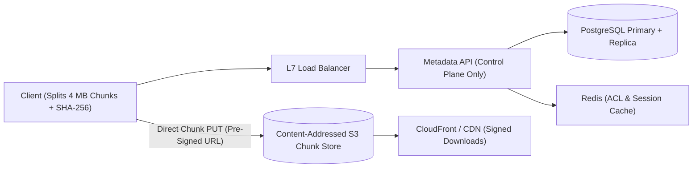
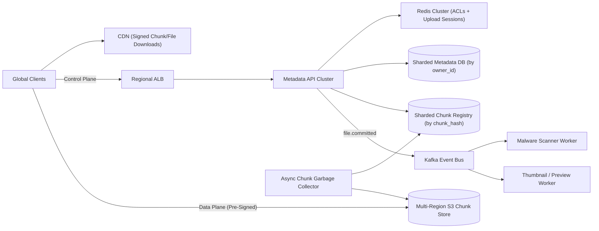
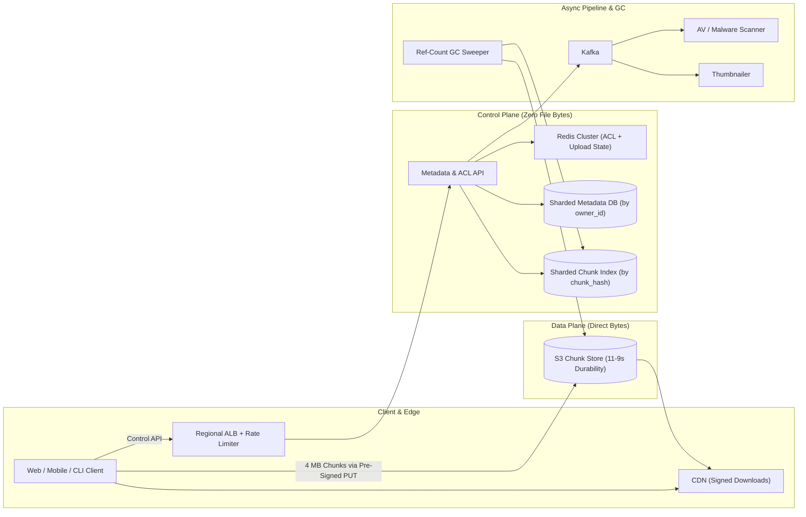
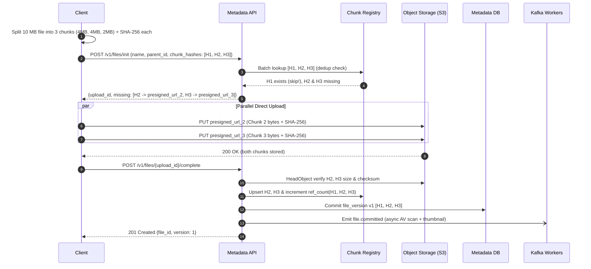

# File Storage and Sharing: Full System Design Mock Interview, All 9 Steps

> **Difficulty:** Hard (L5/L6 Core Prompt: Chunking, Resumable Uploads, Deduplication, ACLs & Control/Data Plane Split)
> **Prerequisites:** [Previous lesson: Pastebin: Full System Design Mock Interview, All 9 Steps](../03-pastebin/README.md) and the [Interview Framework track](../../21-interview-framework/README.md).
> **Estimated Reading Time:** 28–32 minutes
> **Target Audience:** Engineers practising the full system design interview on a classic prompt: uploading, storing, versioning, and sharing large files at petabyte scale.

> [!NOTE]
> **In one line:** A scalable file storage service **separates the control plane (metadata, folders, ACLs) from the data plane (4 MB content-addressed chunks)** so clients stream bytes directly to Object Storage via pre-signed URLs without ever saturating API servers.

> [!TIP]
> **The Golden Rule:** Never proxy file bytes through your application servers. Split large files into fixed or content-defined 4 MB chunks, address them by SHA-256 hash for free versioning and deduplication, upload directly via pre-signed URLs, and commit metadata atomically only when every chunk verifies.

---

## 1. Clarifying Questions, Functional & Non-Functional Requirements

Open with clarifying questions, not boxes. Storing a 1 MB file is trivial; interviewers probe how you handle **5 GB resumable uploads on flaky networks**, **deduplication without cross-tenant oracle attacks**, **hierarchical folder ACLs**, and **versioning**.

### Clarifying Questions & Assumed Answers

| Question | Assumed Answer | Architectural Implication |
| :--- | :--- | :--- |
| **Max file size?** | 5 GB (average 1 MB, skewed) | Cannot upload in one HTTP POST -> 4 MB chunked resumable uploads |
| **Sharing & Permissions?** | Share by link or named user/group (`viewer` / `editor`) | Relational/graph ACL model with folder inheritance + short-lived pre-signed URLs |
| **File Versioning?** | Retain last 30 days of versions; instant restore | Immutable chunk lists per `version_id`; unchanged chunks reused for free |
| **Desktop real-time sync?** | Out of scope for this round (web/API upload & download) | Focus on chunked upload, dedup, ACLs, and CDN/S3 download |
| **Scale & Traffic?** | 10M DAU, 1 upload/user/day, 3:1 download-to-upload ratio | ~116 uploads/s avg, ~347 downloads/s avg, **10 TB/day** (~3.65 PB/yr raw) |

### Functional Requirements

1. **Resumable Chunked Upload:** Upload files up to 5 GB in 4 MB chunks in parallel; resume from the exact missing chunks after a network drop.
2. **Download:** Download files (or specific versions) via high-throughput CDN / pre-signed Object Storage URLs.
3. **Folders & Versioning:** Organize files in hierarchical folders; create immutable versions on re-upload and support one-click version restore.
4. **Sharing & Access Control (ACLs):** Share files or folders with specific users (`viewer`, `editor`) or via revocable share links.

### Non-Functional Requirements & SLA Targets

| Quality | Target SLA | Why It Drives the Design |
| :--- | :--- | :--- |
| **Durability** | **99.999999999% (11 nines)** | Losing customer files is catastrophic; S3 erasure coding + checksums |
| **Availability** | **99.95%** for metadata & downloads | Teams depend on shared files for daily workflows |
| **Upload Reliability** | **Resume within 1 RTT** on drop | Mobile/flaky Wi-Fi must not restart a 4.9 GB upload from byte 0 |
| **Storage Efficiency** | **20–40% savings** via dedup + compression | 3.65 PB/year makes storage the #1 infrastructure bill |
| **Security** | Encryption at rest/transit + **zero unauthorized downloads** | Short-lived pre-signed URLs (5–15 min TTL) + proof-of-possession dedup |

### Scope: In vs Out

- **In Scope:** Chunked resumable upload (`init` -> chunk `PUT` -> `complete`), content-addressed chunk store, deduplication, folder/file ACLs, versioning, garbage collection.
- **Out of Scope:** Real-time operational-transform collaborative editing (Google Docs), desktop OS file-watcher daemon internals, ML malware sandboxing internals.

---

## 2. Back-of-the-Envelope Capacity Estimation

Assumptions: **10,000,000** active users, **1** new file/user/day, **1 MB** average file size, **3:1** read-to-write ratio, **4 MB** max chunk size, **5x** peak-to-average multiplier, and **25%** deduplication savings.

### 1. Traffic (QPS & Chunk Operations)

$$\text{Upload QPS}_{\text{avg}} = \frac{10 \times 10^6}{86,400} \approx 115.7 \text{ files/s}$$

$$\text{Upload QPS}_{\text{peak}} = 115.7 \times 5 \approx 579 \text{ files/s}$$

$$\text{Download QPS}_{\text{avg}} = 115.7 \times 3 \approx 347 \text{ downloads/s}$$

$$\text{Download QPS}_{\text{peak}} = 347 \times 5 \approx 1,735 \text{ downloads/s}$$

### 2. Storage (Raw vs Deduplicated)

$$\text{Daily Raw Ingress} = 10 \times 10^6 \times 1 \text{ MB} = 10 \text{ TB/day}$$

$$\text{Yearly Raw Storage} = 10 \text{ TB/day} \times 365 = 3,650 \text{ TB} = 3.65 \text{ PB/year}$$

With 25% deduplication + gzip compression on compressible documents (~15% extra savings $\approx 36\%$ total reduction):

$$\text{Yearly Net Chunk Storage} \approx 3.65 \text{ PB} \times 0.64 \approx 2.34 \text{ PB/year}$$

### 3. Metadata DB Sizing

10M files/day $\times$ 365 = **3.65B file versions/year**. At ~500 bytes per metadata + chunk-manifest row:

$$\text{Metadata DB Growth/Year} = 3.65 \times 10^9 \times 500 \text{ B} \approx 1.83 \text{ TB/year}$$

### 4. Data-Plane Bandwidth (Client $\leftrightarrow$ S3 Direct)

$$\text{Peak Upload Bandwidth} = 579 \text{ files/s} \times 1 \text{ MB} \approx 579 \text{ MB/s} \approx 4.63 \text{ Gbps}$$

$$\text{Peak Download Bandwidth} = 1,735 \text{ files/s} \times 1 \text{ MB} \approx 1.74 \text{ GB/s} \approx 13.9 \text{ Gbps}$$

Because clients talk **directly to S3 / CDN via pre-signed URLs**, our API servers carry **0 Gbps** of this 18.5 Gbps data-plane traffic!

### Capacity Summary Table

| Metric | Average | Peak (5x) | Design Implication |
| :--- | :--- | :--- | :--- |
| **Upload / Download QPS** | 116 / 347 req/s | 579 / 1,735 req/s | Control plane is lightweight (< 3K RPS total) |
| **Data-Plane Bandwidth** | ~463 MB/s | ~2.3 GB/s (18.5 Gbps) | Must bypass API servers via S3 pre-signed URLs |
| **Net Storage Growth** | ~6.4 TB/day | 2.34 PB/year | Content-addressed S3 + Intelligent-Tiering |
| **Metadata DB Growth** | 5 GB/day | 1.83 TB/year | Sharded PostgreSQL / CockroachDB by `owner_id` |

---

## 3. Core API Contracts & Data Model

### REST API Contracts (Control Plane vs Data Plane)

| Endpoint | Plane | Request / Response Contract |
| :--- | :--- | :--- |
| `POST /v1/files/init` | Control | Body: `{"parent_id": "fld_9", "name": "design.pdf", "size": 10485760, "chunk_hashes": ["sha256_a", "sha256_b", "sha256_c"]}` -> `200 OK`: `{"upload_id": "up_77", "missing_chunks": [{"index": 1, "hash": "sha256_b", "put_url": "https://s3.../presigned"}]}` |
| `PUT {presigned_s3_url}` | **Data** | Client uploads raw 4 MB chunk directly to S3 with `Content-MD5` / SHA-256 checksum header -> `200 OK` |
| `POST /v1/files/{upload_id}/complete` | Control | Verifies all chunks exist in S3, atomically commits new `file_version` row -> `201 Created`: `{"file_id": "f_123", "version": 4}` |
| `GET /v1/files/{file_id}/download` | Control | Checks ACL (`viewer+`), returns `302` or JSON `{download_urls: [...]}` (or S3/CloudFront signed URL for single-object assembly) |
| `POST /v1/files/{file_id}/share` | Control | Body: `{"principal_id": "usr_88", "role": "editor"}` -> `201 Created` |

### Database Schema (Metadata, Chunks & ACLs)

```sql
-- Files & Folders Metadata (Sharded by workspace_id / owner_id)
CREATE TABLE nodes (
    node_id        BIGINT PRIMARY KEY,
    owner_id       BIGINT NOT NULL,
    parent_id      BIGINT NULL,          -- Folder hierarchy
    name           VARCHAR(255) NOT NULL,
    is_folder      BOOLEAN NOT NULL,
    latest_version INT DEFAULT 1,
    created_at     BIGINT NOT NULL,
    deleted_at     BIGINT NULL           -- Soft delete for 30-day trash
);

-- Immutable File Versions
CREATE TABLE file_versions (
    file_id        BIGINT NOT NULL,
    version_num    INT NOT NULL,
    total_size     BIGINT NOT NULL,
    chunk_hashes   JSONB NOT NULL,       -- Ordered list of SHA-256 chunk hashes
    created_at     BIGINT NOT NULL,
    PRIMARY KEY (file_id, version_num)
);

-- Content-Addressed Chunk Registry (for Dedup & Garbage Collection)
CREATE TABLE chunks (
    chunk_hash     CHAR(64) PRIMARY KEY, -- SHA-256 hex
    s3_key         VARCHAR(128) NOT NULL,
    size_bytes     INT NOT NULL,
    ref_count      BIGINT NOT NULL DEFAULT 1
);

-- Sharing / ACLs
CREATE TABLE acls (
    node_id        BIGINT NOT NULL,
    principal_id   BIGINT NOT NULL,      -- User or Group ID
    role           SMALLINT NOT NULL,    -- 1=Viewer, 2=Editor, 3=Owner
    PRIMARY KEY (node_id, principal_id)
);
```

---

## 4. Stage 1 (100 - 1K Users): Baseline Monolith & Proxied Uploads

At 100–1,000 users (< 5 RPS), a single monolith receives multipart file uploads directly, writes them to an S3 bucket (or local NAS), and stores folder/file metadata in PostgreSQL.



### Component-by-Component Build (Stage 1)
1. **Proxied Upload:** Client `POST`s the entire file through Nginx -> Monolith -> S3.
2. **Whole-File Storage:** No chunking yet; each file version is 1 S3 object.

### What Breaks at 10K Users?
- **API server OOM & thread exhaustion:** Proxying 1–5 GB uploads ties up API worker threads/sockets for minutes and blows up memory buffers.
- **No resume on network drop:** A Wi-Fi blip at 98% of a 4 GB upload forces the user to restart from byte 0.
- **Duplicate storage explosion:** Uploading a 2 GB video with a 1-line metadata edit or sharing a 500 MB deck across 100 teammates stores 50 GB instead of 500 MB.

---

## 5. Stage 2 (10K - 100K Users): Pre-Signed Direct Uploads & 4 MB Chunking

At 10K–100K users, we split the **Control Plane** (API servers) from the **Data Plane** (S3 + CDN) using **4 MB chunking** and **pre-signed URLs**.



### Component-by-Component Additions (Stage 2)
1. **4 MB Client-Side Chunking:** The client slices files into 4 MB blocks, computes `SHA-256` per chunk, and calls `/v1/files/init`.
2. **Pre-Signed S3 URLs:** The API returns pre-signed `PUT` URLs *only for chunks that don't already exist* in the user's namespace. Bytes flow **Client $\leftrightarrow$ S3** directly.
3. **Redis ACL Cache:** Caches `(node_id, user_id) -> role` for 60 seconds (invalidated on `POST /share` or `DELETE /share`) to keep folder browsing fast.

### What Breaks at 1M Users?
- **Single Postgres metadata DB bottlenecks:** Billions of `file_versions` and `chunks` rows exceed single-node IOPS, and `ref_count` updates on popular shared chunks create hot-row lock contention.
- **Synchronous post-upload work:** Generating image/PDF thumbnails, running antivirus scans, and updating search indexes cannot happen inline on `/complete`.
- **Orphaned chunks from aborted uploads:** Users who start a 5 GB upload and close their laptop leave unreferenced chunks in S3.

---

## 6. Stage 3 (1M - 10M+ Users): Sharded Metadata, Async Workers & GC

At 1M–10M+ users (3.65B files/yr, petabytes of chunks), we shard metadata by `owner_id`, shard the `chunks` registry by `chunk_hash`, offload post-processing to **Kafka workers**, and run a **Mark-and-Sweep / Ref-Count Garbage Collector**.



### Component-by-Component Additions (Stage 3)
1. **Dual Sharding Strategy:**
   - `nodes` & `file_versions` sharded by `owner_id` (keeps a user's folder tree and versions co-located on 1 shard for fast directory listings).
   - `chunks` registry sharded by `chunk_hash` (distributes deduplication lookups evenly across all shards).
2. **Upload Staging + Atomic Commit:** Uploads live in an `upload_sessions` Redis/DB record until `/complete` verifies all chunk hashes in S3, increments `ref_count` (or inserts into `chunks`), and commits `file_versions` atomically.
3. **Async Kafka Workers:** Virus scanning (ClamAV/YARA), thumbnail generation, and audit logging happen asynchronously after commit; infected files are quarantined immediately.

---

## 7. Final Full Production Architecture & End-to-End Flows

### Complete Production Architecture



### End-to-End Resumable Chunked Upload Flow



---

## 8. Deep-Dive Bottlenecks & Algorithmic Trade-Offs

### Deep Dive 1: Chunk Size Trade-Off (1 MB vs 4 MB vs 16 MB)

| Chunk Size | Metadata Overhead (for 5 GB file) | Retry Cost on Network Drop | Dedup Granularity | Verdict |
| :--- | :--- | :--- | :--- | :--- |
| **256 KB – 1 MB** | High (5,000–20,000 chunk hashes per file) | Low | High | Too much metadata & S3 `PUT` overhead |
| **4 MB (Fixed)** | **Balanced** (1,250 hashes for 5 GB) | **Low** (max 4 MB re-upload) | **Good** | **Pick this** (Dropbox/S3 sweet spot) |
| **16 MB – 64 MB** | Tiny | High on flaky mobile networks | Poor | Bad for mobile/resume UX |

*Extension:* **Content-Defined Chunking (Rabin Fingerprinting)** avoids the "byte-shift problem" where inserting 1 byte at the start of a 1 GB file shifts all fixed 4 MB boundaries and breaks deduplication. Mention Rabin fingerprinting as an L6 optimization for sync/backup heavy workloads.

### Deep Dive 2: Deduplication Security — The "Oracle Attack"

If you allow **cross-user deduplication** purely on client-supplied SHA-256 hashes:
- **The Attack:** An attacker guesses or obtains the SHA-256 of a sensitive leaked document, calls `POST /files/init` with that hash, and if the server says *"chunk already exists, skip upload!"*, the attacker proves another user owns that exact file—and can even trick the server into linking it to their account!
- **The Fix:**
  1. **Per-User / Per-Org Dedup by default** (zero cross-tenant leakage).
  2. If cross-user dedup is required, use **Proof of Ownership (PoW)**: the server challenges the client to hash the chunk concatenated with a random server nonce (`SHA256(nonce + chunk_bytes)`), proving the client actually possesses the raw bytes.

### Deep Dive 3: Garbage Collection of Deleted Versions

When a user deletes a file or a 30-day version expires, we cannot immediately delete chunks from S3 because other files/versions may share those `chunk_hash`es.
- **Deferred Ref-Counting + Grace Period:** Decrement `ref_count` in the `chunks` table. Never delete immediately on `ref_count == 0`; mark `unreferenced_since = now()` and let an async GC worker delete from S3 only after a **24-hour grace period** (avoiding race conditions with concurrent uploads referencing the same hash).

---

## 9. Failure Modes, Reliability & Backpressure Mitigations

| Failure Mode | User Impact | Blast Radius | Mitigation & Recovery |
| :--- | :--- | :--- | :--- |
| **Upload Interrupted Mid-Way** | Progress pauses | Single upload | Client calls `GET /v1/files/{upload_id}/status`, gets remaining missing chunks, uploads only those |
| **Client Crashes Before `/complete`** | Orphaned chunks in S3 | Cost only | Uncommitted chunks written to `staging/` prefix with **7-day S3 Lifecycle auto-delete**, or swept on session expiry |
| **Revoked Share Still Cached** | Ex-collaborator downloads file briefly | Single shared file | ACL cache TTL = 60s + explicit Redis `DEL` on `POST /share/revoke`; pre-signed URLs expire in **5 minutes** |
| **Metadata DB Shard Down** | Cannot browse folders or start uploads | $1/N$ of users | Multi-AZ synchronous standby + automatic failover in < 15s; existing S3 downloads continue via CDN |
| **Malware Uploaded** | Infected file shared | Workspace | Quarantine flag in `nodes` until async Kafka AV worker clears `scan_status = CLEAN` (optional strict mode) |

---

## 10. Production War Story & Real-World Reference

### Case Study: Dropbox's Magic Pocket & Metadata/Block Separation

- **Context:** When Dropbox migrated exabytes of user data off AWS S3 onto its custom **Magic Pocket** storage system, the core invariant remained identical to what we designed above: **strict separation between the Block Server (4 MB encrypted, content-addressed blocks) and the Metadata Server (file trees, versions, ACLs)**.
- **Key Operational Lesson (Ref-Count Race Condition):** Early distributed dedup systems hit a subtle bug when **User A** deleted a file at the exact millisecond **User B** uploaded a file sharing the same block hash `H`. If GC deleted `H` from object storage right as User B's `/complete` committed metadata referencing `H`, User B suffered silent data loss!
- **The Fix:** Two-phase deletion with a **minimum 24-hour tombstone grace period** + verifying `S3 HeadObject` before committing metadata if a chunk was recently marked `ref_count = 0`. Never hard-delete a content-addressed chunk synchronously on `ref_count == 0`.

---

## 11. Core Component Implementation (4 Languages)

Below is the core **Resumable Chunked Upload & Deduplication Coordinator** (`InitUpload` + `CompleteUpload` with chunk verification and ref-counting) in Go, TypeScript, Python, and C#.

````carousel
```go
package filestore

import (
	"errors"
	"sync"
)

type ChunkRegistry interface {
	Exists(hash string) bool
	IncrementRef(hash string) error
	RegisterNew(hash string, s3Key string, size int) error
}

type S3Verifier interface {
	VerifyChunkExists(s3Key string, expectedSize int) bool
	GeneratePresignedPut(s3Key string) string
}

type UploadSession struct {
	UploadID    string
	FileName    string
	ChunkHashes []string
	MissingSet  map[string]bool
}

type UploadCoordinator struct {
	mu       sync.Mutex
	sessions map[string]*UploadSession
	chunks   ChunkRegistry
	s3       S3Verifier
}

func NewUploadCoordinator(chunks ChunkRegistry, s3 S3Verifier) *UploadCoordinator {
	return &UploadCoordinator{
		sessions: make(map[string]*UploadSession),
		chunks:   chunks,
		s3:       s3,
	}
}

// InitUpload deduplicates known chunks and returns pre-signed PUT URLs only for missing ones.
func (uc *UploadCoordinator) InitUpload(uploadID, fileName string, hashes []string) map[string]string {
	uc.mu.Lock()
	defer uc.mu.Unlock()

	missingURLs := make(map[string]string)
	missingSet := make(map[string]bool)

	for _, h := range hashes {
		if !uc.chunks.Exists(h) {
			s3Key := "chunks/" + h[:2] + "/" + h
			missingURLs[h] = uc.s3.GeneratePresignedPut(s3Key)
			missingSet[h] = true
		}
	}

	uc.sessions[uploadID] = &UploadSession{
		UploadID:    uploadID,
		FileName:    fileName,
		ChunkHashes: hashes,
		MissingSet:  missingSet,
	}
	return missingURLs
}

// CompleteUpload verifies all missing chunks landed in S3 before committing metadata.
func (uc *UploadCoordinator) CompleteUpload(uploadID string, chunkSizes map[string]int) error {
	uc.mu.Lock()
	sess, ok := uc.sessions[uploadID]
	uc.mu.Unlock()
	if !ok {
		return errors.New("upload session not found")
	}

	for h := range sess.MissingSet {
		s3Key := "chunks/" + h[:2] + "/" + h
		if !uc.s3.VerifyChunkExists(s3Key, chunkSizes[h]) {
			return errors.New("missing or corrupted chunk in object storage: " + h)
		}
	}

	for _, h := range sess.ChunkHashes {
		if sess.MissingSet[h] {
			_ = uc.chunks.RegisterNew(h, "chunks/"+h[:2]+"/"+h, chunkSizes[h])
		} else {
			_ = uc.chunks.IncrementRef(h)
		}
	}
	return nil
}
```
<!-- slide -->
```typescript
export interface ChunkRegistry {
  exists(hash: string): Promise<boolean>;
  registerNew(hash: string, s3Key: string, size: number): Promise<void>;
  incrementRef(hash: string): Promise<void>;
}

export interface S3Verifier {
  generatePresignedPut(s3Key: string): string;
  verifyChunkExists(s3Key: string, expectedSize: number): Promise<boolean>;
}

interface UploadSession {
  uploadId: string;
  chunkHashes: string[];
  missingHashes: Set<string>;
}

export class UploadCoordinator {
  private sessions = new Map<string, UploadSession>();

  constructor(
    private readonly chunks: ChunkRegistry,
    private readonly s3: S3Verifier
  ) {}

  async initUpload(
    uploadId: string,
    chunkHashes: string[]
  ): Promise<Record<string, string>> {
    const presignedUrls: Record<string, string> = {};
    const missingHashes = new Set<string>();

    for (const h of chunkHashes) {
      if (!(await this.chunks.exists(h))) {
        const s3Key = `chunks/${h.slice(0, 2)}/${h}`;
        presignedUrls[h] = this.s3.generatePresignedPut(s3Key);
        missingHashes.add(h);
      }
    }

    this.sessions.set(uploadId, { uploadId, chunkHashes, missingHashes });
    return presignedUrls;
  }

  async completeUpload(
    uploadId: string,
    chunkSizes: Record<string, number>
  ): Promise<void> {
    const session = this.sessions.get(uploadId);
    if (!session) throw new Error("Upload session not found");

    for (const h of session.missingHashes) {
      const s3Key = `chunks/${h.slice(0, 2)}/${h}`;
      const ok = await this.s3.verifyChunkExists(s3Key, chunkSizes[h]);
      if (!ok) {
        throw new Error(`Chunk verification failed for ${h}`);
      }
    }

    for (const h of session.chunkHashes) {
      if (session.missingHashes.has(h)) {
        await this.chunks.registerNew(h, `chunks/${h.slice(0, 2)}/${h}`, chunkSizes[h]);
      } else {
        await this.chunks.incrementRef(h);
      }
    }
    this.sessions.delete(uploadId);
  }
}
```
<!-- slide -->
```python
from dataclasses import dataclass
from typing import Dict, List, Protocol, Set


class ChunkRegistry(Protocol):
    def exists(self, chunk_hash: str) -> bool: ...
    def register_new(self, chunk_hash: str, s3_key: str, size: int) -> None: ...
    def increment_ref(self, chunk_hash: str) -> None: ...


class S3Verifier(Protocol):
    def generate_presigned_put(self, s3_key: str) -> str: ...
    def verify_chunk_exists(self, s3_key: str, expected_size: int) -> bool: ...


@dataclass
class UploadSession:
    upload_id: str
    chunk_hashes: List[str]
    missing_hashes: Set[str]


class UploadCoordinator:
    def __init__(self, chunks: ChunkRegistry, s3: S3Verifier) -> None:
        self._chunks = chunks
        self._s3 = s3
        self._sessions: Dict[str, UploadSession] = {}

    def init_upload(self, upload_id: str, chunk_hashes: List[str]) -> Dict[str, str]:
        presigned: Dict[str, str] = {}
        missing: Set[str] = set()
        for h in chunk_hashes:
            if not self._chunks.exists(h):
                s3_key = f"chunks/{h[:2]}/{h}"
                presigned[h] = self._s3.generate_presigned_put(s3_key)
                missing.add(h)

        self._sessions[upload_id] = UploadSession(upload_id, chunk_hashes, missing)
        return presigned

    def complete_upload(self, upload_id: str, chunk_sizes: Dict[str, int]) -> None:
        session = self._sessions.get(upload_id)
        if not session:
            raise KeyError(f"Unknown upload session: {upload_id}")

        for h in session.missing_hashes:
            s3_key = f"chunks/{h[:2]}/{h}"
            if not self._s3.verify_chunk_exists(s3_key, chunk_sizes[h]):
                raise ValueError(f"Missing or invalid chunk in S3: {h}")

        for h in session.chunk_hashes:
            if h in session.missing_hashes:
                self._chunks.register_new(h, f"chunks/{h[:2]}/{h}", chunk_sizes[h])
            else:
                self._chunks.increment_ref(h)
        del self._sessions[upload_id]
```
<!-- slide -->
```csharp
using System;
using System.Collections.Concurrent;
using System.Collections.Generic;
using System.Threading.Tasks;

namespace FileStorage.Core
{
    public interface IChunkRegistry
    {
        Task<bool> ExistsAsync(string hash);
        Task RegisterNewAsync(string hash, string s3Key, int size);
        Task IncrementRefAsync(string hash);
    }

    public interface IS3Verifier
    {
        string GeneratePresignedPut(string s3Key);
        Task<bool> VerifyChunkExistsAsync(string s3Key, int expectedSize);
    }

    public sealed class UploadCoordinator
    {
        private sealed record UploadSession(string UploadId, IReadOnlyList<string> Hashes, HashSet<string> Missing);
        private readonly ConcurrentDictionary<string, UploadSession> _sessions = new();
        private readonly IChunkRegistry _chunks;
        private readonly IS3Verifier _s3;

        public UploadCoordinator(IChunkRegistry chunks, IS3Verifier s3)
        {
            _chunks = chunks;
            _s3 = s3;
        }

        public async Task<Dictionary<string, string>> InitUploadAsync(string uploadId, IReadOnlyList<string> chunkHashes)
        {
            var presigned = new Dictionary<string, string>();
            var missing = new HashSet<string>();

            foreach (var h in chunkHashes)
            {
                if (!await _chunks.ExistsAsync(h))
                {
                    string s3Key = $"chunks/{h[..2]}/{h}";
                    presigned[h] = _s3.GeneratePresignedPut(s3Key);
                    missing.Add(h);
                }
            }

            _sessions[uploadId] = new UploadSession(uploadId, chunkHashes, missing);
            return presigned;
        }

        public async Task CompleteUploadAsync(string uploadId, IReadOnlyDictionary<string, int> chunkSizes)
        {
            if (!_sessions.TryGetValue(uploadId, out var session))
                throw new KeyNotFoundException("Upload session not found.");

            foreach (var h in session.Missing)
            {
                string s3Key = $"chunks/{h[..2]}/{h}";
                if (!await _s3.VerifyChunkExistsAsync(s3Key, chunkSizes[h]))
                    throw new InvalidOperationException($"Missing or corrupted chunk: {h}");
            }

            foreach (var h in session.Hashes)
            {
                if (session.Missing.Contains(h))
                    await _chunks.RegisterNewAsync(h, $"chunks/{h[..2]}/{h}", chunkSizes[h]);
                else
                    await _chunks.IncrementRefAsync(h);
            }
            _sessions.TryRemove(uploadId, out _);
        }
    }
}
```
````

---

## 12. Verification, Load Testing & CLI Diagnostics

```bash
# 1. Initialize a chunked upload and inspect returned pre-signed URLs
curl -s -X POST https://api.drive.example.com/v1/files/init \
  -H "Authorization: Bearer $TOKEN" -H "Content-Type: application/json" \
  -d '{"parent_id":"fld_1","name":"archive.tar.gz","size":8388608,"chunk_hashes":["e3b0c442...","9f86d081..."]}' | jq .

# 2. Upload a 4 MB chunk directly to S3 via pre-signed URL (bypassing API servers)
curl -i -X PUT "$PRESIGNED_URL_1" --upload-file chunk_0.bin

# 3. Complete upload and verify metadata commit
curl -s -X POST https://api.drive.example.com/v1/files/up_77/complete \
  -H "Authorization: Bearer $TOKEN" | jq .

# 4. S3 diagnostics: inspect multipart/staging prefixes & lifecycle cleanup
aws s3api list-objects-v2 --bucket drive-chunks-prod --prefix staging/ --max-items 20
aws s3api get-bucket-lifecycle-configuration --bucket drive-chunks-prod
```

---

## 13. Common Interview Mistakes & Red Flags

| Common Mistake | Why It's a Red Flag | Staff-Level Answer |
| :--- | :--- | :--- |
| **Streaming 5 GB files through API servers** | Exhausts API worker threads, memory, and ingress NICs | Use **pre-signed URLs** so file bytes flow `Client <-> S3` directly |
| **Uploading whole files without chunking** | A network drop at 99% restarts a 4.9 GB upload from byte 0 | Split into **4 MB chunks**; resume by uploading only missing chunk indices |
| **Cross-user dedup without Proof of Ownership** | Lets attackers probe if a confidential file exists on the platform | Dedup **per-user/org** by default, or require nonce-challenge Proof of Ownership |
| **Deleting S3 chunks immediately on `ref_count == 0`** | Race condition with concurrent uploads sharing that hash causes data loss | Soft-delete with a **24-hour tombstone grace period** before GC sweeps S3 |
| **Long-lived pre-signed download URLs (24h+)** | Revoking a user's share link doesn't stop them from downloading | Keep pre-signed URLs short (**5–15 minutes**) and check ACLs on every mint |
| **Single-bucket flat keyspace for billions of chunks** | Hot-partition throttling on naive object stores | Prefix keys by hash shards (`chunks/e3/b0/e3b0c4...`) |

---

## 14. Key Terminology & Glossary

| Key Term | Definition |
| :--- | :--- |
| **Control Plane vs Data Plane** | Separating lightweight metadata/ACL APIs (Control) from heavy byte transfers directly to S3/CDN (Data). |
| **Pre-Signed URL** | Time-limited, cryptographically signed S3/CloudFront URL granting direct `PUT`/`GET` access to one object. |
| **Content-Addressed Storage** | Storing chunks keyed by their cryptographic hash (`SHA-256`), enabling automatic deduplication and integrity checks. |
| **Rabin Fingerprinting** | Rolling-hash content-defined chunking that preserves chunk boundaries even after mid-file byte insertions. |
| **Proof of Ownership (PoW)** | Server challenge requiring a client to prove they hold raw chunk bytes before granting a cross-user dedup reference. |
| **Reference Counting (`ref_count`)** | Tracking how many active `file_versions` point to a chunk so shared chunks aren't deleted prematurely. |
| **ACL Inheritance** | Propagating folder permissions (`viewer`/`editor`) down to child files and subfolders. |
| **Tombstone Grace Period** | Waiting 24+ hours after `ref_count` hits 0 before physically deleting a chunk from S3 to prevent races. |

---

## 15. Interview Follow-Up Questions (12 Q&As)

<details>
<summary><strong>Q1: [BASIC] Why use pre-signed URLs instead of uploading through your API servers?</strong></summary>

Streaming 18+ Gbps of file bytes through API servers wastes compute, ties up HTTP worker connections for minutes, and doubles bandwidth bills. Pre-signed URLs offload 100% of byte transfer directly to S3/CDN while keeping API servers lean on the metadata path.

</details>

<details>
<summary><strong>Q2: [BASIC] Why 4 MB chunks instead of 100 KB or 100 MB?</strong></summary>

100 KB chunks create 50,000 metadata entries and 50,000 S3 PUTs for a 5 GB file, blowing up metadata and request costs. 100 MB chunks force huge re-uploads on flaky mobile networks. 4 MB is the sweet spot (~1,250 chunks for 5 GB, fast parallel retries).

</details>

<details>
<summary><strong>Q3: [BASIC] How do file versions work without duplicating the whole file every time?</strong></summary>

Each `file_version` stores an ordered list of chunk hashes. If a user edits 1 MB of a 100 MB file, only the 1–2 modified 4 MB chunks are uploaded; the other 24 unchanged chunk hashes are reused in the new version's manifest.

</details>

<details>
<summary><strong>Q4: [BASIC] How does resumable upload recover from a dropped Wi-Fi connection?</strong></summary>

The client calls `GET /v1/files/{upload_id}/status` (or re-calls `/init`), which returns the list of chunk hashes not yet verified in S3. The client uploads only the missing chunks and then calls `/complete`.

</details>

<details>
<summary><strong>Q5: [SCENARIO] How do you design folder permission inheritance so checking access on a deeply nested file doesn't require 10 recursive SQL queries?</strong></summary>

Either (1) store a **materialized path** (`/root_id/folderA_id/folderB_id/`) on each node so you can check ACLs across all ancestors in a **single `WHERE node_id IN (...)` query**, or (2) cache effective ACLs in Redis and invalidate on folder permission changes.

</details>

<details>
<summary><strong>Q6: [SCENARIO] A user revokes sharing on a confidential file, but the recipient already has a pre-signed download URL. What happens?</strong></summary>

Because pre-signed URLs are stateless bearer tokens, they remain valid until their TTL expires. By keeping pre-signed download URLs short-lived (**5 minutes**), access is revoked within 5 minutes maximum; for stricter enterprise compliance, terminate TLS at an edge proxy (CloudFront Functions / Envoy) that checks a Redis revocation list.

</details>

<details>
<summary><strong>Q7: [SCENARIO] How do you download a 5 GB file stored as 1,250 separate 4 MB chunks in S3?</strong></summary>

For desktop/SDK clients, return the chunk manifest + signed URLs so the client fetches chunks in parallel and reassembles locally (great for resume and range requests). For **browser single-click downloads**, either stream chunks sequentially through a lightweight stateless download-proxy (Edge Worker / Go stream) or use **S3 Multipart Upload Copy** on `/complete` for large non-deduped downloads.

</details>

<details>
<summary><strong>Q8: [SCENARIO] What happens if a client uploads garbage bytes to a pre-signed S3 URL claiming its hash is `abc123`?</strong></summary>

Include `x-amz-checksum-sha256` in the **signed headers** of the pre-signed S3 `PUT` URL. S3 itself rejects the upload with `400 BadDigest` if the uploaded bytes don't match the promised SHA-256 hash—zero server CPU needed!

</details>

<details>
<summary><strong>Q9: [TRICKY] Explain the cross-user deduplication "Oracle Attack" and how to prevent it.</strong></summary>

If User B sends `hash(secret_file)` to `/init` and the server replies *"already exists, skip upload"*, User B learns that someone on the platform owns `secret_file` and could gain access to its chunks. Prevent it by scoping dedup **per-user/organization**, or requiring **Proof of Ownership** (client must return `SHA256(server_nonce + raw_chunk)`).

</details>

<details>
<summary><strong>Q10: [TRICKY] How do you avoid a race condition when User A deletes a shared chunk (`ref_count -> 0`) at the exact moment User B uploads a file referencing the same chunk?</strong></summary>

Never delete from S3 synchronously when `ref_count` hits 0. Mark `unreferenced_since = now()` and wait a **24-hour grace period** before the GC deletes the S3 object. During `/complete`, if `Exists` finds a `ref_count == 0` row, atomically `UPDATE chunks SET ref_count = 1, unreferenced_since = NULL` and verify `S3 HeadObject` still exists.

</details>

<details>
<summary><strong>Q11: [TRICKY] Fixed 4 MB chunking fails to deduplicate if a user inserts 10 bytes at the beginning of a 1 GB file. How do you solve that?</strong></summary>

Use **Content-Defined Chunking (CDC)** via **Rabin Fingerprinting** (or FastCDC). A rolling hash over a 48-byte sliding window cuts chunks wherever `rolling_hash % 4MB == 0`. Inserting 10 bytes at byte 0 only changes the *first* chunk; all subsequent chunk boundaries re-align automatically!

</details>

<details>
<summary><strong>Q12: [TRICKY] How do you prevent a malicious user from exhausting your S3 storage by calling `/init` 100,000 times and uploading chunks without ever calling `/complete`?</strong></summary>

Enforce per-user **pending-upload quotas** (e.g., max 10 active upload sessions or 20 GB pending), rate-limit `/init`, and write unverified chunks to a `staging/` S3 prefix with a **7-day S3 Lifecycle Expiration** rule before promoting or indexing them.

</details>

---

## 16. One-Page Master Cheat Sheet

```text
+-----------------------------------------------------------------------------+
| FILE STORAGE & SHARING: MASTER INTERVIEW CHEAT SHEET                        |
+-----------------------------------------------------------------------------+
| SCALE: 10M DAU | 116 uploads/s (579 peak) | 10 TB/day (3.65 PB/yr raw)      |
| SPLIT: Control Plane (API + Sharded DB) vs Data Plane (Client <-> S3/CDN)   |
|-----------------------------------------------------------------------------|
| UPLOAD: /init (4 MB SHA-256s) -> Dedup check -> Pre-signed S3 PUTs (missing)|
|         -> Client PUTs to S3 (with x-amz-checksum-sha256) -> /complete      |
| SHARD:  nodes/versions by owner_id | chunks registry by chunk_hash          |
| DEDUP:  Per-user/org by default (cross-user needs Proof-of-Ownership nonce)  |
| GC:     Decrement ref_count -> 24h tombstone grace period -> S3 delete      |
| ACLs:   Materialized path + Redis 60s cache + 5-min pre-signed download URLs|
+-----------------------------------------------------------------------------+
```

## Further Reading

- Dropbox engineering blog, *Rewriting the heart of our sync engine*.
- AWS documentation on multipart upload and pre-signed URLs.
- FastCDC / Rabin Fingerprinting papers on content-defined chunking.

---

## Next

Continue with [Notification Service: Full System Design Mock Interview, All 9 Steps](../05-notification-service/README.md).
