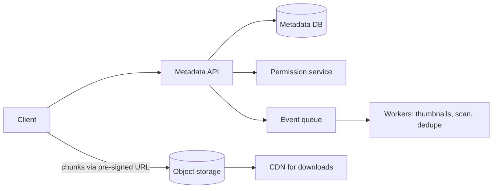

# File Storage and Sharing: Full System Design Mock Interview, All 9 Steps

> **Prerequisites:** [Previous lesson: Pastebin: Full System Design Mock Interview, All 9 Steps](../03-pastebin/README.md) and the [Interview Framework track](../../21-interview-framework/README.md).
> **Estimated Reading Time:** 15–20 minutes
> **Target Audience:** Engineers practising the full 9-step system design interview on a classic prompt: uploading, storing and sharing files with other people.

> [!NOTE]
> **In one line:** A file storage service **splits every file into chunks**, stores chunks in object storage, and keeps a small metadata database that says which chunks make up which file.

> [!TIP]
> **The Golden Rule:** Move bytes directly between the client and object storage with pre-signed URLs, and keep your servers on the metadata path only.

---

## Step 1. Clarify the Problem

Open with questions, not boxes. The interesting part is large files: resumable uploads, deduplication and permissions, not the storing of small ones.

**Questions to ask the interviewer, and the answer we assume:**

| Question | Assumed answer |
| :--- | :--- |
| Max file size? | 5 GB |
| Sharing? | Share by link or with named users, view or edit |
| Versions? | Keep the last 30 days |
| Sync? | Out of scope for this round |
| Scale? | 10M users, 1 file per user per day, 1 MB average |

> Say it aloud: *"Before I draw anything, let me confirm the scope and the numbers."* That one sentence earns the first minutes of the interview.

---

## Step 2. Functional and Non-Functional Requirements

**Functional (what the system does):**

- Upload and download files of any size, resumably.
- Organise files in folders.
- Share a file or folder with specific permissions.
- Keep previous versions and allow restore.

**Non-functional (how well it does it):**

| Quality | Target | Why it drives the design |
| :--- | :--- | :--- |
| Durability | 11 nines | Losing a customer file is the worst failure |
| Availability | 99.9% | Downloads must work |
| Upload reliability | Resume after a network drop | Large files on bad networks |
| Cost | Minimise stored bytes | Storage is the main bill |

---

## Step 3. Scope: In and Out

**In scope:** Chunked upload, download, folders, sharing, versions.

**Out of scope (say it explicitly, then move on):**

- Real-time collaborative editing.
- Desktop sync client details.
- Virus scanning internals.

---

## Step 4. Capacity Estimation

Assumptions: 10M users, 1 new file per user per day, 1 MB average, 3 replicas worth of durability handled by the storage layer.

| Quantity | Calculation | Result |
| :--- | :--- | :--- |
| Uploads per second | `users * files_per_day / 86400` | **116 files/s** |
| New data per day | `users * files_per_day * mb / 1e6` | **10 TB/day** |
| New data per year | `new_data_per_day * 365` | **3.6K TB/year** |

**What the numbers tell you:** About 116 uploads/s is modest. The cost driver is bytes: 10 TB per day is 3.65 PB per year, so deduplication and tiering to cold storage matter.

---

## Step 5. API Design

| Endpoint | Purpose | Notes |
| :--- | :--- | :--- |
| `POST /v1/files/init` | Start an upload | Returns upload id and pre-signed URLs for each chunk. |
| `PUT {presigned-url}` | Upload a chunk | Client talks to object storage directly. |
| `POST /v1/files/{id}/complete` | Finish | Server verifies chunk hashes, commits metadata. |
| `GET /v1/files/{id}/download` | Download | Redirects to a pre-signed or CDN URL. |
| `POST /v1/files/{id}/share` | Share | Body: grantee and role. |

Pre-signed URLs mean file bytes never pass through your API servers, so they stay small and cheap.

---

## Step 6. Data Model

| Entity / Store | Key fields | Why this store |
| :--- | :--- | :--- |
| Metadata DB (sharded by owner) | `file_id`, `parent_id`, `name`, `owner`, `version`, `chunk_list` | Relational for folders and permissions |
| Chunk store (object storage) | Key = SHA-256 of chunk | Content-addressed, deduplicates identical chunks |
| ACL table | `file_id`, `principal`, `role` | Permission checks on every access |

Content-addressing the chunks gives deduplication for free: two files that share a chunk store it once.

---

## Step 7. High-Level Architecture



**Walk the diagram in this order:** the client asks the API to start an upload, sends chunks straight to object storage, then calls complete so the API commits the metadata. Workers handle thumbnails and scanning from the queue.

---

## Step 8. Deep Dives and Bottlenecks

### 1. Chunking and resumable upload

Split files into fixed chunks (4 MB). Upload them in parallel, each with its own hash. If the connection drops, ask the server which chunks it already has and send only the missing ones. The file only becomes visible when `complete` verifies every chunk, so a half-uploaded file never appears.

### 2. Deduplication

Hash each chunk. If the hash already exists, skip the upload and just reference the existing chunk. Doing the hash on the client saves bandwidth but lets an attacker probe whether a file exists; cross-user dedup should require proving possession (hash the chunk with a server challenge).

### 3. Sharing and permissions

Store ACL rows and check them on every metadata call and when minting a download URL. Folder permissions inherit downward. Pre-signed URLs expire in minutes, so a revoked share stops working quickly. Cache permission lookups briefly and invalidate on change.

---

## Step 9. Trade-offs, Failures and Security

**Trade-offs to state aloud:**

| Decision | Option A | Option B | Pick and why |
| :--- | :--- | :--- | :--- |
| Chunk size | Small (1 MB) | Large (16 MB) | 4 MB: balances retry cost and metadata size |
| Dedup scope | Per user | Across all users | Per user by default; cross-user only with proof of possession |
| Upload path | Through our servers | Pre-signed direct | Pre-signed: bytes skip our fleet |

**Failure modes and mitigations:**

| Failure | What users see | Mitigation |
| :--- | :--- | :--- |
| Upload interrupted | Progress bar stops | Resume by listing received chunks |
| Metadata DB shard down | Folders unavailable | Replicas and failover; files in object storage are unaffected |
| Orphan chunks | None | Reference counting and a garbage collector |

**Security and abuse:** Encrypt at rest and in transit, check permissions on every download URL, expire pre-signed links, scan uploads for malware, and rate-limit to stop storage abuse.

---

## Runnable Example: Chunking and deduplication

This splits data into fixed chunks, hashes each, and stores a chunk only once.

```python
import hashlib

CHUNK = 4

def chunks(data: bytes):
    return [data[i:i + CHUNK] for i in range(0, len(data), CHUNK)]

store = {}
def upload(data: bytes):
    ids = []
    for c in chunks(data):
        h = hashlib.sha256(c).hexdigest()[:8]
        store.setdefault(h, c)
        ids.append(h)
    return ids

a = upload(b"AAAABBBBCCCC")
b = upload(b"AAAAXXXXCCCC")
print(len(a), len(b))
print("unique chunks stored:", len(store))
print("shared chunks:", len(set(a) & set(b)))
```

Output (produced by running this exact code):

```text
3 3
unique chunks stored: 4
shared chunks: 2
```

Two files of three chunks each share two identical chunks, so only 4 unique chunks are stored instead of 6.

---

## Common Mistakes

- Streaming file bytes through the API servers.
- Making uploads non-resumable.
- Storing files and metadata in one database.
- Ignoring permission checks on download URLs.
- Cross-user dedup with no proof of possession.

---

## Interview Questions and Answers

<details>
<summary><strong>Q1: Why pre-signed URLs?</strong></summary>

They let the client talk straight to object storage, so your servers handle only small metadata calls and never carry the bytes.

</details>

<details>
<summary><strong>Q2: How is a large upload resumed?</strong></summary>

The client asks which chunks the server has (by index and hash) and uploads the rest. The file commits only when all chunks verify.

</details>

<details>
<summary><strong>Q3: How does deduplication work?</strong></summary>

Chunks are addressed by their content hash. If a hash exists, the new file just references it. Reference counts decide when a chunk can be deleted.

</details>

<details>
<summary><strong>Q4: How do you do permissions?</strong></summary>

An ACL per file or folder, with inheritance, checked on every metadata call and before minting a download URL. Short-lived URLs make revocation fast.

</details>

<details>
<summary><strong>Q5: How do you store versions?</strong></summary>

Each version is a new chunk list in metadata. Unchanged chunks are reused, so a small edit costs only the changed chunks.

</details>

---

## One-Page Cheat Sheet

| Step | What to say or draw |
| :--- | :--- |
| Clarify | 5 GB files, sharing, versions |
| Capacity | 116 uploads/s, 10 TB/day, 3.65 PB/year |
| API | init, chunk PUT, complete, download, share |
| Data | Metadata DB plus content-addressed chunks |
| Deep dive | Chunking, resume, dedup, ACLs |
| Trade-off | Direct uploads, per-user dedup |

---

## Further Reading

- Dropbox engineering blog, *Rewriting the heart of our sync engine*.
- AWS documentation on multipart upload and pre-signed URLs.

---

## Next

Continue with [Notification Service: Full System Design Mock Interview, All 9 Steps](../05-notification-service/README.md).
