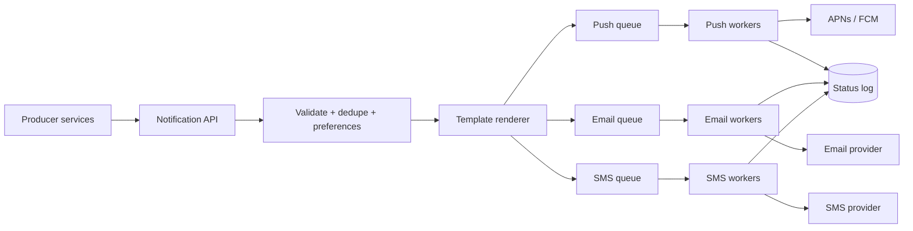

# Notification Service: Full System Design Mock Interview, All 9 Steps

> **Prerequisites:** [Previous lesson: File Storage and Sharing: Full System Design Mock Interview, All 9 Steps](../04-file-storage-and-sharing/README.md) and the [Interview Framework track](../../21-interview-framework/README.md).
> **Estimated Reading Time:** 15–20 minutes
> **Target Audience:** Engineers practising the full 9-step system design interview on a classic prompt: sending push, email and SMS notifications reliably at scale.

> [!NOTE]
> **In one line:** A notification service is a **pipeline of queues**: accept an event, check preferences, render a template, and deliver through a provider, with retries and deduplication at every hop.

> [!TIP]
> **The Golden Rule:** Accept quickly, deliver asynchronously. Put a queue between every stage so a slow provider never blocks the producers, and make every send idempotent.

---

## Step 1. Clarify the Problem

Open with questions, not boxes. Interviewers look for queues per channel, user preferences, rate limits, retries with backoff, and a story for duplicates.

**Questions to ask the interviewer, and the answer we assume:**

| Question | Assumed answer |
| :--- | :--- |
| Channels? | Push, email, SMS |
| Types? | Transactional (must send) and marketing (opt-in) |
| Latency? | Transactional under 5 s, marketing within minutes |
| Scheduling? | Yes, send at a future time |
| Scale? | 10M users, 5 notifications per user per day |

> Say it aloud: *"Before I draw anything, let me confirm the scope and the numbers."* That one sentence earns the first minutes of the interview.

---

## Step 2. Functional and Non-Functional Requirements

**Functional (what the system does):**

- Accept a notification request from internal services.
- Respect each user's channel preferences and quiet hours.
- Render templates per channel and language.
- Deliver through providers with retries and track the status.

**Non-functional (how well it does it):**

| Quality | Target | Why it drives the design |
| :--- | :--- | :--- |
| Reliability | At-least-once delivery | Losing an OTP or receipt is unacceptable |
| Throughput | Burst of 100K/s for campaigns | Marketing floods the system |
| Latency | Transactional under 5 s | OTPs expire |
| No duplicates | Dedup within a window | Users hate double sends |

---

## Step 3. Scope: In and Out

**In scope:** Ingest, preferences, templates, delivery, retries, status.

**Out of scope (say it explicitly, then move on):**

- Building the email or SMS provider itself.
- In-app notification feeds (a different system).
- Campaign authoring UI.

---

## Step 4. Capacity Estimation

Assumptions: 10M users, 5 notifications per user per day, peak 10x the average.

| Quantity | Calculation | Result |
| :--- | :--- | :--- |
| Notifications per day | `users * per_user` | **50M per day** |
| Average rate | `notifications_per_day / 86400` | **579 per second** |
| Peak rate | `average_rate * peak` | **5.8K per second** |

**What the numbers tell you:** About 580 per second on average and 5,800 at peak is easy for queues. The hard parts are not volume but provider rate limits, retries and a campaign burst that must not starve OTPs.

---

## Step 5. API Design

| Endpoint | Purpose | Notes |
| :--- | :--- | :--- |
| `POST /v1/notifications` | Send one | Body: `user_id`, `template`, `data`, `priority`, `idempotency_key`. Returns `202`. |
| `POST /v1/campaigns` | Send many | Audience query plus template, scheduled. |
| `GET /v1/notifications/{id}` | Status | queued, sent, delivered, failed. |
| `PUT /v1/users/{id}/preferences` | Preferences | Channels, quiet hours, opt-outs. |

Return `202 Accepted` immediately. The `idempotency_key` makes a retried request safe.

---

## Step 6. Data Model

| Entity / Store | Key fields | Why this store |
| :--- | :--- | :--- |
| Preferences DB | `user_id`, `channels`, `quiet_hours`, `opt_outs` | Read on every send, cached |
| Templates store | `template_id`, `channel`, `locale`, `body` | Versioned |
| Notification log (wide-column) | `id`, `user_id`, `status`, `attempts`, `ts` | High write volume, queried by id and user |
| Queues | One per channel and priority | Isolate failures and tune throughput |

Separate queues per channel and per priority so a stuck SMS provider or a marketing campaign cannot delay a push OTP.

---

## Step 7. High-Level Architecture



**Walk the diagram in this order:** ingest and validate, check dedupe and preferences, render, enqueue on the channel queue, workers call providers and write status. Provider callbacks update delivery state.

---

## Step 8. Deep Dives and Bottlenecks

### 1. Priority and isolation

Use separate queues (or topics) for priority classes and channels. OTP and security alerts get a high-priority queue with reserved workers; marketing goes to a low-priority queue that is throttled. A campaign of 10M messages then cannot delay a password reset.

### 2. Retries and duplicates

Delivery is at-least-once. Retry transient provider failures with exponential backoff and jitter, and send exhausted messages to a dead-letter queue. Deduplicate on `idempotency_key` plus user and template within a window, stored in Redis with a TTL, so a retry or a producer bug does not send twice.

### 3. Provider limits and fallback

Providers rate-limit you, so workers use a token bucket per provider. Keep a second provider and switch on error rate. Track delivery receipts and bounces, and stop sending to dead addresses and unsubscribed users to protect sender reputation.

---

## Step 9. Trade-offs, Failures and Security

**Trade-offs to state aloud:**

| Decision | Option A | Option B | Pick and why |
| :--- | :--- | :--- | :--- |
| Delivery guarantee | At-most-once | At-least-once | At-least-once plus dedup: losing an OTP is worse than a rare duplicate |
| Rendering | At send time | At enqueue time | At enqueue: workers stay fast and the content is auditable |
| Provider | Single | Multiple with failover | Multiple: one outage should not stop sends |

**Failure modes and mitigations:**

| Failure | What users see | Mitigation |
| :--- | :--- | :--- |
| Provider outage | Delayed or missing sends | Backoff, circuit breaker, failover to a second provider |
| Campaign flood | OTPs delayed | Separate priority queues and throttling |
| Poison message | Worker stuck | Dead-letter queue after N attempts |

**Security and abuse:** Never put secrets or full PII in payloads or logs, honour opt-outs and legal rules (unsubscribe, quiet hours), and authenticate producers so the service cannot be used to spam.

---

## Runnable Example: Retry with exponential backoff

This computes the delay schedule for retries with a cap, and shows a deduplication window.

```python
def backoff(attempt, base=1, cap=60):
    return min(cap, base * 2 ** attempt)

print([backoff(a) for a in range(8)])

seen = {}
def should_send(key, now, window=300):
    last = seen.get(key)
    if last is not None and now - last < window:
        return False
    seen[key] = now
    return True

print(should_send("u1:welcome", 0))
print(should_send("u1:welcome", 100))
print(should_send("u1:welcome", 400))
```

Output (produced by running this exact code):

```text
[1, 2, 4, 8, 16, 32, 60, 60]
True
False
True
```

Delays grow 1, 2, 4, 8, 16, 32 and are then capped at 60 seconds (real systems add random jitter). The duplicate at 100 seconds is suppressed because it falls inside the 300 second window, while the send at 400 seconds is allowed.

---

## Common Mistakes

- Sending synchronously inside the producer's request.
- One shared queue for OTPs and campaigns.
- Retrying forever with no dead-letter queue.
- No idempotency key.
- Ignoring user preferences and quiet hours.

---

## Interview Questions and Answers

<details>
<summary><strong>Q1: Why queues between stages?</strong></summary>

They decouple producers from slow providers, absorb bursts, allow independent scaling and give retry points.

</details>

<details>
<summary><strong>Q2: How do you stop duplicates?</strong></summary>

An idempotency key per logical notification, checked in Redis with a TTL before sending, plus idempotent provider calls where supported.

</details>

<details>
<summary><strong>Q3: How do you protect OTPs from campaigns?</strong></summary>

Separate high-priority queues with reserved workers, and throttle the low-priority queue.

</details>

<details>
<summary><strong>Q4: What if the push provider is down?</strong></summary>

Retry with backoff and jitter, open a circuit breaker, and fall back to another channel such as SMS for critical messages.

</details>

<details>
<summary><strong>Q5: How do you track delivery?</strong></summary>

Write status transitions to a log, and process provider callbacks and receipts to move from sent to delivered or bounced.

</details>

---

## One-Page Cheat Sheet

| Step | What to say or draw |
| :--- | :--- |
| Clarify | Channels, priorities, scheduling, 10M users |
| Capacity | 580/s average, 5.8K/s peak |
| API | POST 202, preferences, status |
| Data | Preferences, templates, log, queues per channel |
| Deep dive | Priority isolation, retries, dedup, provider limits |
| Trade-off | At-least-once plus dedup |

---

## Further Reading

- Uber engineering, *Building a notification platform*.
- Google SRE book chapter on handling overload.

---

## Next

Continue with [Chat Application: Full System Design Mock Interview, All 9 Steps](../06-chat-application/README.md).
