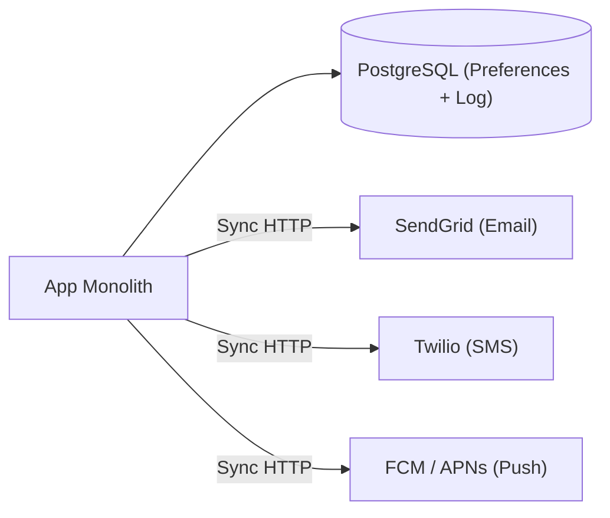
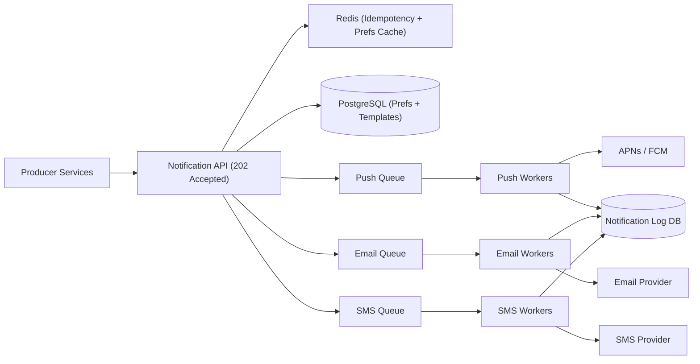
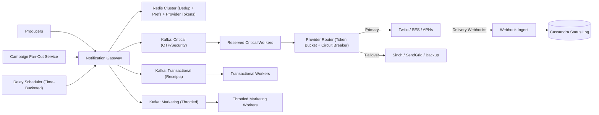
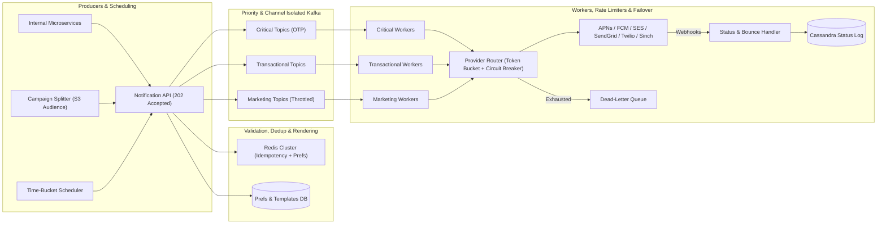
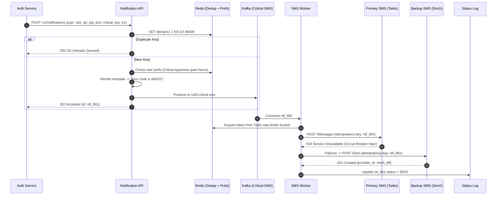

# Notification Service: Full System Design Mock Interview, All 9 Steps

> **Difficulty:** Medium-Hard (L5/L6 Core Prompt: Multi-Channel Queues, Priority Isolation, Idempotency & Provider Failover)
> **Prerequisites:** [Previous lesson: File Storage and Sharing: Full System Design Mock Interview, All 9 Steps](../04-file-storage-and-sharing/README.md) and the [Interview Framework track](../../21-interview-framework/README.md).
> **Estimated Reading Time:** 25–30 minutes
> **Target Audience:** Engineers practising the full system design interview on a classic prompt: delivering push, email, and SMS notifications reliably at massive burst scale.

> [!NOTE]
> **In one line:** A notification service is an **asynchronous, priority-isolated pipeline of queues**—accept events fast (`202 Accepted`), check user preferences and idempotency, render templates, and deliver via rate-limited third-party providers with exponential backoff and dead-letter queues.

> [!TIP]
> **The Golden Rule:** **Never** let a 10-million-message marketing campaign share a queue or worker pool with a 1-second OTP password reset. Isolate queues by **channel** (Push/Email/SMS) and **priority** (Critical/Transactional/Marketing), and make every hop idempotent.

---

## 1. Clarifying Questions, Functional & Non-Functional Requirements

Open with clarifying questions, not boxes. Interviewers want to see you separate **priority classes** (OTP vs marketing), handle **third-party provider rate limits & outages**, enforce **user preferences & quiet hours**, and guarantee **at-least-once delivery with deduplication**.

### Clarifying Questions & Assumed Answers

| Question | Assumed Answer | Architectural Implication |
| :--- | :--- | :--- |
| **Which channels?** | Push (APNs/FCM), Email (SES/SendGrid), SMS (Twilio/Sinch) | Channel-specific adapters, rate limits, and payload formats |
| **Message types & SLAs?** | Critical/Transactional (OTP, fraud alert: < 5s) vs Marketing (< 15 min) | Strict **priority-queue isolation** so campaigns never starve OTPs |
| **User preferences & quiet hours?** | Opt-out per channel/category + timezone-aware quiet hours (e.g., 22:00–08:00) | Preference check before dispatch; marketing deferred, critical bypasses |
| **Scheduled / future sends?** | Yes, send at a future timestamp or delayed campaign | Delay queue / time-bucketed scheduler (DynamoDB/Redis ZSET/Kafka) |
| **Scale & Burst?** | 10M DAU, 5 notifications/user/day; marketing bursts up to 100K msg/s | ~579 msg/s avg, ~5.8K/s normal peak, **100K/s campaign burst** |

### Functional Requirements

1. **Multi-Channel Dispatch:** Accept notification requests from internal services and deliver via Push, Email, or SMS.
2. **Preferences & Quiet Hours:** Enforce per-user channel opt-outs, category subscriptions, and local-timezone quiet hours (except mandatory security/OTP alerts).
3. **Template Rendering & Localization:** Render versioned templates per channel and user locale (`en-US`, `de-DE`, etc.).
4. **Retries, Failover & Delivery Tracking:** Retry transient provider errors with exponential backoff + jitter, fail over to secondary providers, and expose delivery status (`queued`, `sent`, `delivered`, `bounced`, `failed`).

### Non-Functional Requirements & SLA Targets

| Quality | Target SLA | Why It Drives the Design |
| :--- | :--- | :--- |
| **Delivery Guarantee** | **At-least-once** + **deduplication** | Losing an OTP or payment receipt is unacceptable; duplicates irritate users |
| **Critical Latency** | **p99 < 5 seconds** end-to-end for OTPs | Users abandon login if an OTP arrives after 30 seconds |
| **Burst Throughput** | **100,000+ msg/sec** ingest without dropping | Marketing blasts and breaking-news alerts create massive spikes |
| **Availability** | **99.99%** for ingestion API | Producers must never block waiting on slow downstream providers |
| **Compliance** | Instant opt-out & zero PII in logs | GDPR/CAN-SPAM/TCPA legal requirements + sender reputation |

### Scope: In vs Out

- **In Scope:** Ingestion API, deduplication, preferences/quiet hours, template rendering, priority-isolated queues, provider rate limiting & failover, DLQ, delivery webhooks.
- **Out of Scope:** Building an SMTP server or telecom SMSC from scratch, in-app bell-icon activity feeds, marketing campaign segmentation UI.

---

## 2. Back-of-the-Envelope Capacity Estimation

Assumptions: **10,000,000** active users, **5** notifications/user/day (3 Push, 1.5 Email, 0.5 SMS), **10x** normal peak multiplier, **100K/s** campaign fan-out burst, and **500 bytes** average notification log row.

### 1. Traffic (Average, Peak & Campaign Burst)

$$\text{Daily Notifications} = 10 \times 10^6 \times 5 = 50,000,000 \text{ msg/day}$$

$$\text{Average Rate} = \frac{50 \times 10^6}{86,400} \approx 578.7 \text{ msg/s}$$

$$\text{Normal Peak Rate (10x)} \approx 5,787 \text{ msg/s}$$

$$\text{Campaign Fan-Out Burst} = 100,000 \text{ msg/s}$$

### 2. Storage (Notification Log & Templates)

50M notifications/day $\times$ 365 = **18.25 billion log rows/year**. At **500 bytes/row** (ID, user_id, channel, status, attempts, timestamps):

$$\text{Daily Log Storage} = 50 \times 10^6 \times 500 \text{ B} = 25 \text{ GB/day}$$

$$\text{Yearly Log Storage} = 25 \text{ GB/day} \times 365 \approx 9.13 \text{ TB/year}$$

### 3. Deduplication Cache (Redis)

Holding `idempotency_key` hashes for a **24-hour dedup window** (50M keys/day $\times$ 64 bytes per key in Redis):

$$\text{Dedup Redis RAM} = 50 \times 10^6 \times 64 \text{ B} = 3.2 \text{ GB}$$

### 4. Provider Egress & Worker Concurrency

Assuming an external Email/SMS provider HTTP call takes **100 ms** avg latency (`0.1s`), to sustain **5,800 msg/s** peak:

$$\text{Concurrent In-Flight Workers} = \lambda \times W = 5,800 \times 0.1 = 580 \text{ concurrent connections}$$

### Capacity Summary Table

| Metric | Average | Peak / Burst | Design Implication |
| :--- | :--- | :--- | :--- |
| **Message Rate** | 579 msg/s | 5.8K/s (100K/s burst) | Async Kafka/SQS ingestion; auto-scaling worker pools |
| **Dedup Redis RAM** | 3.2 GB (24h TTL) | — | Single small Redis cluster with `SET NX EX 86400` |
| **Status Log Growth** | 25 GB/day | 9.13 TB/year | Wide-column store (Cassandra/DynamoDB) with 90-day TTL |
| **Worker Concurrency** | ~60 connections | 580+ (10K in burst) | Non-blocking async I/O workers + per-provider token buckets |

---

## 3. Core API Contracts & Data Model

### REST / Internal RPC Contracts

| Endpoint | Method | Request Payload / Headers | Response & Status Codes |
| :--- | :--- | :--- | :--- |
| `/v1/notifications` | `POST` | `{"user_id": "u_42", "template_id": "otp_login", "priority": "critical", "channels": ["sms", "push"], "data": {"code": "849201"}, "idempotency_key": "otp_u42_17325456"}` | `202 Accepted`: `{"notification_id": "ntf_991", "status": "queued"}` (`200` if duplicate `idempotency_key`, `429` if tenant quota exceeded) |
| `/v1/campaigns` | `POST` | `{"audience_s3_uri": "s3://...", "template_id": "promo_nov", "priority": "marketing", "send_at": "2026-11-26T09:00:00Z"}` | `202 Accepted`: `{"campaign_id": "cmp_55"}` |
| `/v1/notifications/{id}` | `GET` | `Authorization: Bearer <token>` | `200 OK`: `{"id": "ntf_991", "status": "delivered", "channel": "sms", "attempts": 1}` |
| `/v1/users/{id}/preferences` | `PUT` | `{"email": true, "sms": false, "quiet_hours": {"start": "22:00", "end": "08:00", "tz": "America/New_York"}}` | `200 OK` |
| `/v1/webhooks/{provider}` | `POST` | Provider delivery/bounce callbacks (SendGrid/Twilio signed payload) | `200 OK` (updates `notification_log` + adds hard-bounces to suppression list) |

### Data Model

1. **Preferences DB (PostgreSQL / DynamoDB, cached in Redis):**
   - `user_id` (PK), `channel_opt_ins` (JSON), `quiet_hours_start`, `quiet_hours_end`, `timezone`, `device_tokens` (APNs/FCM), `email_suppressed` (bool for hard bounces).
2. **Templates Store (PostgreSQL + In-Memory CDN/Cache):**
   - `(template_id, channel, locale, version)` -> `subject`, `body_template`, `required_vars`.
3. **Notification Status Log (Cassandra / DynamoDB):**
   - Partition Key: `notification_id` (or `(user_id, bucket_month)` for user history), `channel`, `priority`, `status` (`queued` | `sent` | `delivered` | `bounced` | `dlq`), `attempts`, `provider_msg_id`, `created_at` (with 90-day TTL).

---

## 4. Stage 1 (100 - 1K Users): Baseline Monolith & Direct Provider Calls

At 100–1,000 users (< 1 msg/sec), the monolith calls SendGrid/Twilio/FCM synchronously inside the request handler or via a lightweight background goroutine/thread pool, logging status to PostgreSQL.



### Component-by-Component Build (Stage 1)
1. **Inline Notification Module:** Checks user opt-out in Postgres, formats string template, and calls provider SDK directly.
2. **Basic Try/Catch:** Logs errors to Postgres.

### What Breaks at 10K Users?
- **Slow providers block API threads:** If Twilio takes 3 seconds to respond (or times out at 30s), the producer's `/checkout` or `/signup` HTTP request hangs and fails!
- **No retries or durability:** If the monolith restarts mid-call, the notification is permanently lost.
- **Duplicate sends on producer retry:** If the caller retries a timed-out request, the user receives 2 identical SMS messages.

---

## 5. Stage 2 (10K - 100K Users): Channel Queues, Redis Dedup & Workers

At 10K–100K users (~500–5,000 msg/s), we decouple ingestion from delivery using **per-channel queues**, **Redis idempotency**, and **dedicated retryable workers**.



### Component-by-Component Additions (Stage 2)
1. **Asynchronous Ingestion (`202 Accepted`):** API validates payload, checks Redis `SET idemp:{key} 1 NX EX 86400`, checks cached preferences, renders template, enqueues to channel queue, and returns `202` in < 10 ms.
2. **Per-Channel Queues & Workers:** Email, SMS, and Push each have their own queue so an SMS provider slowdown never delays Push notifications.
3. **Exponential Backoff + DLQ:** Workers retry transient `5xx`/`429` provider errors with backoff (`1s, 2s, 4s, 8s...` + jitter) and move exhausted messages to a Dead-Letter Queue (DLQ).

### What Breaks at 1M Users?
- **Noisy Neighbor / Campaign Starvation:** A 5M-user marketing email blast fills `Email Queue`, delaying a user's `Password Reset` email by 45 minutes!
- **Provider Rate-Limit Violations:** Auto-scaling 200 SMS workers during a burst exceeds Twilio's `500 msg/s` account cap, triggering `429` cascades and wasted retries.
- **Single-provider outages:** If Twilio US-East has a 20-minute outage, 100% of OTP SMS messages fail.

---

## 6. Stage 3 (1M - 10M+ Users): Priority Isolation, Provider Failover & Scheduler

At 1M–10M+ users (100K/s campaign bursts, strict < 5s OTP SLA), we introduce **Priority-Isolated Topics**, **Distributed Provider Rate Limiters**, **Multi-Provider Circuit Breakers**, and a **Campaign Fan-Out & Delay Scheduler**.



### Component-by-Component Additions (Stage 3)
1. **Priority-Isolated Kafka Topics & Worker Pools:**
   - `notif.critical.{channel}` (OTP, 2FA, fraud alerts): Dedicated reserved worker pool, zero throttling, pre-warmed connections.
   - `notif.transactional.{channel}` (order confirmations, shipping): Standard worker pool.
   - `notif.marketing.{channel}` (promos, digests): Strictly rate-limited consumer group so it never saturates provider quotas.
2. **Distributed Provider Token Bucket:** Workers acquire tokens from a shared Redis token bucket per provider (e.g., `twilio_us: 500/s`) *before* calling the provider, preventing `429` storms.
3. **Multi-Provider Circuit Breaker & Failover:** Tracks sliding-window error rates per provider. If Twilio error rate > 15% over 30s, the router automatically shifts traffic to Sinch/MessageBird.
4. **Suppression List & Bounce Feedback Loop:** Hard bounces and spam complaints from provider webhooks automatically set `suppressed = true` in Preferences DB to protect domain/IP sender reputation.

---

## 7. Final Full Production Architecture & End-to-End Flows

### Complete Production Architecture



### End-to-End Critical Notification Flow (with Retry & Failover)



---

## 8. Deep-Dive Bottlenecks & Algorithmic Trade-Offs

### Deep Dive 1: Template Rendering — At Enqueue vs At Worker Send Time

| Approach | Pros | Cons | Verdict |
| :--- | :--- | :--- | :--- |
| **Render at Enqueue (API)** | Workers stay stateless & fast; exact rendered payload is auditable in Kafka/log | Larger Kafka message size; harder to cancel/update if template has a typo mid-campaign | **Pick for Transactional/OTP** |
| **Render at Send Time (Worker)** | Tiny Kafka messages; can fix a typo mid-campaign | Workers must fetch templates + user locale; DB dependency on send path | **Pick for Large Campaigns** |

### Deep Dive 2: Delivery Semantics — At-Most-Once vs At-Least-Once + Dedup

- **At-most-once** risks silently dropping OTPs or fraud alerts on worker crashes—unacceptable.
- **At-least-once + 2-Layer Deduplication:**
  1. **Ingress Dedup:** Redis `SET idemp:{key} 1 NX EX 86400` stops duplicate producer calls.
  2. **Worker / Provider Dedup:** Pass `notification_id` as the provider's idempotency key (where supported) and check `status != SENT/DELIVERED` in the log before retrying after an ambiguous network timeout.

### Deep Dive 3: Scheduled Notifications & Quiet Hours

How do you schedule 5M notifications for `08:00 AM` user local time?
- **Never `SELECT * FROM scheduled WHERE send_at <= now()` every second.**
- **Time-Bucketed Partitions:** Partition scheduled jobs into **1-minute buckets** (`bucket_key = "2026-11-26T08:00"`). A lightweight scheduler polls only the current minute's bucket (e.g., in DynamoDB/Cassandra or Redis ZSET) and pushes ready items into the appropriate Kafka priority topic.

---

## 9. Failure Modes, Reliability & Backpressure Mitigations

| Failure Mode | User Impact | Blast Radius | Mitigation & Recovery |
| :--- | :--- | :--- | :--- |
| **Marketing Blast Floods System** | Potential OTP delay if shared | All users | **Strict topic + worker isolation**; marketing workers capped at 60% of provider quota, reserving 40% for Critical/Transactional |
| **Provider Outage (e.g., Twilio Down)** | Delayed SMS | 1 channel/region | Exponential backoff + jitter, **circuit breaker** auto-failover to backup provider (Sinch), optional channel fallback (Push -> SMS for critical alerts) |
| **Poison Message (Bad JSON/Template)** | Worker crash-loop | 1 Kafka partition | Catch serialization/template errors, retry max 3–5 times, route to **DLQ** with alert for engineering inspection |
| **Hard Bounce / Spam Storm** | Domain/IP blacklisted by Gmail | All email users | Webhook consumer immediately adds hard-bounced/complained addresses to **Suppression List** and pauses offending campaign |
| **Redis Dedup Cluster Down** | Risk of duplicate sends | All channels | Fail-open on dedup for Critical OTPs (prefer rare duplicate over dropped OTP); fall back to DB unique constraint if needed |

---

## 10. Production War Story & Real-World Reference

### Case Study: The Black Friday Campaign Starvation Incident

- **Context:** An e-commerce platform sent **12 million promotional emails and push notifications** simultaneously at 00:00 UTC on Black Friday. Within 90 seconds, checkout confirmation emails and **2FA login OTPs** stopped arriving for over 25 minutes.
- **Root Cause:**
  1. All notifications shared a single RabbitMQ queue (`notifications.outbound`) and a single worker pool.
  2. The 12M marketing messages created a 25-minute queue backlog *ahead* of newly arriving OTPs (head-of-line blocking).
  3. Worse, the burst saturated the company's SendGrid account rate limit (`3,000 req/s`), causing thousands of `429` errors that workers retried immediately *without jitter*, amplifying load 4x.
- **The Fix:**
  1. Split queues into **3 priority tiers** (`critical`, `transactional`, `marketing`) with separate Kafka topics and isolated worker pools.
  2. Added a **Redis Token Bucket** per provider so marketing workers self-throttle below 50% of the SendGrid/Twilio quota, leaving 50% headroom for critical spikes.
  3. Replaced tight retries with **Full Jitter Exponential Backoff** + a backup provider circuit breaker.
  4. **Result:** Subsequent 20M-message holiday blasts maintained **< 1.8 second p99 OTP delivery** with zero head-of-line blocking.

---

## 11. Core Component Implementation (4 Languages)

Below is the core **Idempotent Priority Dispatcher with Full-Jitter Exponential Backoff & Circuit Breaker** in Go, TypeScript, Python, and C#.

````carousel
```go
package notify

import (
	"errors"
	"math"
	"math/rand"
	"sync"
	"time"
)

type Priority int

const (
	PriorityCritical Priority = iota
	PriorityTransactional
	PriorityMarketing
)

type DedupStore interface {
	TryAcquire(key string, ttl time.Duration) bool
}

type Provider interface {
	Name() string
	Send(userID, body string) error
}

type Dispatcher struct {
	mu       sync.Mutex
	dedup    DedupStore
	primary  Provider
	fallback Provider
	failures int
	openTill time.Time
}

// FullJitterBackoff prevents synchronized retry storms across workers.
func FullJitterBackoff(attempt int, base, capDur time.Duration) time.Duration {
	exp := float64(base) * math.Pow(2, float64(attempt))
	maxWait := math.Min(float64(capDur), exp)
	return time.Duration(rand.Float64() * maxWait)
}

func (d *Dispatcher) Dispatch(idempKey, userID, body string, maxRetries int) (string, error) {
	if !d.dedup.TryAcquire(idempKey, 24*time.Hour) {
		return "deduplicated", nil
	}

	provider := d.selectProvider()
	var lastErr error
	for attempt := 0; attempt < maxRetries; attempt++ {
		if err := provider.Send(userID, body); err == nil {
			d.recordSuccess()
			return provider.Name(), nil
		} else {
			lastErr = err
			d.recordFailure()
			provider = d.selectProvider() // Fail over immediately if circuit opened
			time.Sleep(FullJitterBackoff(attempt, 100*time.Millisecond, 10*time.Second))
		}
	}
	return "dlq", errors.New("exhausted retries: " + lastErr.Error())
}

func (d *Dispatcher) selectProvider() Provider {
	d.mu.Lock()
	defer d.mu.Unlock()
	if time.Now().Before(d.openTill) && d.fallback != nil {
		return d.fallback
	}
	return d.primary
}

func (d *Dispatcher) recordFailure() {
	d.mu.Lock()
	defer d.mu.Unlock()
	d.failures++
	if d.failures >= 5 {
		d.openTill = time.Now().Add(30 * time.Second)
	}
}

func (d *Dispatcher) recordSuccess() {
	d.mu.Lock()
	defer d.mu.Unlock()
	d.failures = 0
}
```
<!-- slide -->
```typescript
export interface DedupStore {
  tryAcquire(key: string, ttlSeconds: number): Promise<boolean>;
}

export interface Provider {
  readonly name: string;
  send(userId: string, body: string): Promise<void>;
}

export function fullJitterBackoffMs(attempt: number, baseMs = 100, capMs = 10_000): number {
  const exp = Math.min(capMs, baseMs * Math.pow(2, attempt));
  return Math.floor(Math.random() * exp);
}

export class NotificationDispatcher {
  private failures = 0;
  private openUntilMs = 0;

  constructor(
    private readonly dedup: DedupStore,
    private readonly primary: Provider,
    private readonly fallback?: Provider
  ) {}

  async dispatch(
    idempotencyKey: string,
    userId: string,
    body: string,
    maxRetries = 4
  ): Promise<string> {
    const acquired = await this.dedup.tryAcquire(idempotencyKey, 86400);
    if (!acquired) return "deduplicated";

    for (let attempt = 0; attempt < maxRetries; attempt++) {
      const provider = this.selectProvider();
      try {
        await provider.send(userId, body);
        this.failures = 0;
        return provider.name;
      } catch {
        this.failures++;
        if (this.failures >= 5) {
          this.openUntilMs = Date.now() + 30_000;
        }
        const delay = fullJitterBackoffMs(attempt);
        await new Promise((r) => setTimeout(r, delay));
      }
    }
    throw new Error(`Moved ${idempotencyKey} to DLQ after ${maxRetries} attempts`);
  }

  private selectProvider(): Provider {
    if (Date.now() < this.openUntilMs && this.fallback) {
      return this.fallback;
    }
    return this.primary;
  }
}
```
<!-- slide -->
```python
import random
import time
from typing import Protocol


class DedupStore(Protocol):
    def try_acquire(self, key: str, ttl_seconds: int) -> bool: ...


class Provider(Protocol):
    name: str
    def send(self, user_id: str, body: str) -> None: ...


def full_jitter_backoff(attempt: int, base: float = 0.1, cap: float = 10.0) -> float:
    exp = min(cap, base * (2 ** attempt))
    return random.uniform(0.0, exp)


class NotificationDispatcher:
    def __init__(
        self, dedup: DedupStore, primary: Provider, fallback: Provider | None = None
    ) -> None:
        self._dedup = dedup
        self._primary = primary
        self._fallback = fallback
        self._failures = 0
        self._open_until = 0.0

    def _select_provider(self) -> Provider:
        if time.monotonic() < self._open_until and self._fallback is not None:
            return self._fallback
        return self._primary

    def dispatch(
        self, idempotency_key: str, user_id: str, body: str, max_retries: int = 4
    ) -> str:
        if not self._dedup.try_acquire(idempotency_key, ttl_seconds=86400):
            return "deduplicated"

        for attempt in range(max_retries):
            provider = self._select_provider()
            try:
                provider.send(user_id, body)
                self._failures = 0
                return provider.name
            except Exception:
                self._failures += 1
                if self._failures >= 5:
                    self._open_until = time.monotonic() + 30.0
                time.sleep(full_jitter_backoff(attempt))

        raise RuntimeError(f"Exhausted retries; routed {idempotency_key} to DLQ")
```
<!-- slide -->
```csharp
using System;
using System.Threading.Tasks;

namespace NotificationService.Core
{
    public interface IDedupStore
    {
        Task<bool> TryAcquireAsync(string key, TimeSpan ttl);
    }

    public interface INotificationProvider
    {
        string Name { get; }
        Task SendAsync(string userId, string body);
    }

    public sealed class NotificationDispatcher
    {
        private readonly IDedupStore _dedup;
        private readonly INotificationProvider _primary;
        private readonly INotificationProvider? _fallback;
        private int _failures;
        private DateTimeOffset _openUntil = DateTimeOffset.MinValue;

        public NotificationDispatcher(
            IDedupStore dedup,
            INotificationProvider primary,
            INotificationProvider? fallback = null)
        {
            _dedup = dedup;
            _primary = primary;
            _fallback = fallback;
        }

        public static TimeSpan FullJitterBackoff(int attempt, double baseSec = 0.1, double capSec = 10.0)
        {
            double exp = Math.Min(capSec, baseSec * Math.Pow(2, attempt));
            return TimeSpan.FromSeconds(Random.Shared.NextDouble() * exp);
        }

        public async Task<string> DispatchAsync(
            string idempotencyKey, string userId, string body, int maxRetries = 4)
        {
            if (!await _dedup.TryAcquireAsync(idempotencyKey, TimeSpan.FromHours(24)))
                return "deduplicated";

            for (int attempt = 0; attempt < maxRetries; attempt++)
            {
                var provider = SelectProvider();
                try
                {
                    await provider.SendAsync(userId, body);
                    _failures = 0;
                    return provider.Name;
                }
                catch
                {
                    if (++_failures >= 5)
                        _openUntil = DateTimeOffset.UtcNow.AddSeconds(30);
                    await Task.Delay(FullJitterBackoff(attempt));
                }
            }
            throw new InvalidOperationException($"Routed {idempotencyKey} to DLQ.");
        }

        private INotificationProvider SelectProvider() =>
            DateTimeOffset.UtcNow < _openUntil && _fallback is not null ? _fallback : _primary;
    }
}
```
````

---

## 12. Verification, Load Testing & CLI Diagnostics

```bash
# 1. Enqueue a critical OTP notification with an idempotency key (expect 202)
curl -i -X POST https://api.notify.example.com/v1/notifications \
  -H "Content-Type: application/json" \
  -d '{"user_id":"u_42","template_id":"otp_login","priority":"critical","channels":["sms"],"data":{"code":"849201"},"idempotency_key":"otp_u42_991"}'

# Replay exact same idempotency_key (expect 200 deduplicated, zero double-send)
curl -i -X POST https://api.notify.example.com/v1/notifications \
  -H "Content-Type: application/json" \
  -d '{"user_id":"u_42","template_id":"otp_login","priority":"critical","channels":["sms"],"data":{"code":"849201"},"idempotency_key":"otp_u42_991"}'

# 2. Check Kafka consumer lag separately across priority tiers (critical lag MUST stay ~0)
kafka-consumer-groups.sh --bootstrap-server kafka:9092 --describe --group workers-critical-sms
kafka-consumer-groups.sh --bootstrap-server kafka:9092 --describe --group workers-marketing-email

# 3. Inspect Dead-Letter Queue depth for poison messages
kafka-run-class.sh kafka.tools.GetOffsetShell --broker-list kafka:9092 --topic notif.dlq
```

---

## 13. Common Interview Mistakes & Red Flags

| Common Mistake | Why It's a Red Flag | Staff-Level Answer |
| :--- | :--- | :--- |
| **Sending notifications synchronously in producer API** | Slow Twilio/SES calls hang checkout/login requests | Return **`202 Accepted`** immediately; enqueue to Kafka/SQS |
| **One shared queue for OTPs and marketing blasts** | 10M marketing emails delay OTPs by 30+ minutes | **Priority-isolated topics + reserved worker pools** (`critical`, `transactional`, `marketing`) |
| **Retrying without jitter or a DLQ** | Causes synchronized retry storms and infinite poison-message loops | **Full-jitter exponential backoff** + **DLQ** after $N$ attempts |
| **No idempotency key** | Network retries send users 3 identical OTPs or receipts | **24h Redis `SET NX EX`** dedup + provider-level idempotency keys |
| **Ignoring provider rate limits** | Auto-scaled workers trigger `429` cascades | **Per-provider distributed token bucket** in Redis ahead of external calls |
| **Logging full message bodies / PII** | Leaks OTPs, passwords, and emails into log aggregators | Log only `notification_id`, `template_id`, `status`, and masked recipient |

---

## 14. Key Terminology & Glossary

| Key Term | Definition |
| :--- | :--- |
| **Priority Isolation** | Separating queues and worker pools by urgency (`critical` vs `marketing`) to prevent head-of-line blocking. |
| **Idempotency Key** | Unique client-generated token ensuring retries never trigger duplicate side effects. |
| **Full-Jitter Backoff** | Choosing retry delay randomly in $[0, \min(\text{cap}, \text{base} \cdot 2^{\text{attempt}})]$ to break thundering herds. |
| **Dead-Letter Queue (DLQ)** | Fallback queue capturing messages that fail after max retries for inspection and replay. |
| **Circuit Breaker** | State machine (`Closed` -> `Open` -> `Half-Open`) that fails over to a backup provider when error rates spike. |
| **Suppression List** | Registry of hard-bounced, invalid, or unsubscribed addresses blocked from future sends to protect sender reputation. |
| **Quiet Hours** | User-configured local-timezone window during which non-critical notifications are deferred. |
| **Fan-Out** | Expanding one campaign event into millions of individual user-level notification tasks. |

---

## 15. Interview Follow-Up Questions (12 Q&As)

<details>
<summary><strong>Q1: [BASIC] Why return `202 Accepted` and use queues between stages?</strong></summary>

Third-party providers (APNs, Twilio, SES) have unpredictable latencies (100 ms to 30s timeouts) and strict rate limits. Returning `202` after enqueuing decouples producer latency from provider health, absorbs 100K/s campaign bursts, and provides durable retry checkpoints.

</details>

<details>
<summary><strong>Q2: [BASIC] How do you guarantee a user doesn't receive duplicate notifications on retries?</strong></summary>

Require an `idempotency_key` from producers and perform an atomic `SET idemp:{key} 1 NX EX 86400` in Redis at ingestion. At the worker tier, pass `notification_id` to providers that support idempotency and check the status log before retrying ambiguous timeouts.

</details>

<details>
<summary><strong>Q3: [BASIC] How do you protect OTPs from being delayed by a 10M-user marketing campaign?</strong></summary>

Route them to completely separate Kafka topics (`notif.critical.*` vs `notif.marketing.*`) with separate consumer groups, reserved worker pools, and a provider token bucket that reserves capacity for critical traffic.

</details>

<details>
<summary><strong>Q4: [BASIC] What happens when a message fails 5 times?</strong></summary>

After 5 retries with full-jitter exponential backoff, the worker routes the message to a **Dead-Letter Queue (DLQ)**, marks status `failed` in the log, and fires an alert if DLQ depth spikes.

</details>

<details>
<summary><strong>Q5: [SCENARIO] Twilio US-East goes down completely during peak login traffic. How does your system respond?</strong></summary>

Within ~15–30 seconds of elevated `5xx`/timeout errors, the worker's **circuit breaker** opens for Twilio and routes SMS traffic to the secondary provider (e.g., Sinch). For critical 2FA, you can also offer an automatic channel fallback (e.g., Push -> SMS -> Voice).

</details>

<details>
<summary><strong>Q6: [SCENARIO] How do you implement timezone-aware quiet hours (e.g., 10 PM – 8 AM) without dropping marketing messages?</strong></summary>

Check the user's `timezone` and `quiet_hours` in the Preferences cache. If the message is non-critical and falls inside quiet hours, compute `next_allowed_utc` (8:00 AM local time) and route it to the **1-minute time-bucketed Delay Scheduler** instead of dispatching immediately.

</details>

<details>
<summary><strong>Q7: [SCENARIO] How do you fan out a 10-million-user marketing campaign without overwhelming the API or DB?</strong></summary>

Stream the audience list from S3 in chunks (e.g., 1,000 `user_id`s per batch) via a distributed **Campaign Fan-Out Worker** (Spark/Flink or stateless batch workers). Batch-fetch user preferences (`MGET` / `IN (...)`), render templates at the worker, and trickle-produce into `notif.marketing.*` at a controlled rate (e.g., 10K/s).

</details>

<details>
<summary><strong>Q8: [SCENARIO] How do you track whether an email was actually delivered or bounced?</strong></summary>

Expose a signed webhook endpoint (`POST /v1/webhooks/sendgrid`) that ingests asynchronous delivery receipts, bounces, and spam complaints. Update `notification_log` (`sent` -> `delivered` / `bounced`) and add hard bounces to the **Suppression List**.

</details>

<details>
<summary><strong>Q9: [TRICKY] A user changes their notification preference to `email: false` 2 seconds after a campaign started queuing 5M emails. How do you ensure they don't get emailed?</strong></summary>

Check preferences **both** at ingestion (to skip obvious opt-outs early) **and** right before final dispatch in the worker (or read from a fast Redis preferences cache invalidated immediately on `PUT /preferences`).

</details>

<details>
<summary><strong>Q10: [TRICKY] If Redis deduplication goes down, should you fail-open or fail-closed?</strong></summary>

**Fail-open** for `critical` priority (sending a rare duplicate OTP is far better than blocking a user from logging in), and optionally fail-closed or fall back to a DB `INSERT ... ON CONFLICT DO NOTHING` for `marketing` campaigns where duplicate blasts are costly.

</details>

<details>
<summary><strong>Q11: [TRICKY] A worker sends an SMS to Twilio, Twilio delivers it, and the network drops before the HTTP 201 reaches your worker. What happens?</strong></summary>

This is the classic **ambiguous timeout** in at-least-once delivery. Without provider-side idempotency, retrying sends a second SMS. Mitigate by (1) passing `Idempotency-Key: notification_id` to providers that support it, and (2) querying the provider's status API (`GET /Messages?idempotency_key=...`) before blindly retrying on timeout.

</details>

<details>
<summary><strong>Q12: [TRICKY] How do you prevent a buggy upstream microservice from accidentally spamming 1M users in an infinite loop?</strong></summary>

Enforce **per-producer & per-user frequency caps** (e.g., max 5 marketing notifications per user per day, max 3 identical OTPs per user per 5 minutes) right at the Notification Gateway using a sliding-window rate limiter before enqueuing.

</details>

---

## 16. One-Page Master Cheat Sheet

```text
+-----------------------------------------------------------------------------+
| NOTIFICATION SERVICE: MASTER INTERVIEW CHEAT SHEET                          |
+-----------------------------------------------------------------------------+
| SCALE: 10M DAU | 50M/day (579/s avg, 5.8K/s peak, 100K/s campaign burst)    |
|-----------------------------------------------------------------------------|
| INGEST: Producer -> API (202 Accepted) -> Redis Dedup (SET NX 24h)          |
|         -> Prefs & Quiet Hours -> Template Render -> Priority Kafka Topic   |
| ISOLATION: Separate Topics + Workers for Critical (OTP) vs Marketing        |
| DELIVERY:  Workers -> Redis Provider Token Bucket -> Circuit Breaker        |
|            -> Primary/Backup Provider -> Full-Jitter Backoff -> DLQ         |
| FEEDBACK:  Provider Webhooks -> Cassandra Status Log + Bounce Suppression   |
+-----------------------------------------------------------------------------+
```

## Further Reading

- Uber engineering, *Building a notification platform*.
- Google SRE book chapter on handling overload.
- AWS Architecture Blog on exponential backoff and jitter.

---

## Next

Continue with [Chat Application: Full System Design Mock Interview, All 9 Steps](../06-chat-application/README.md).
