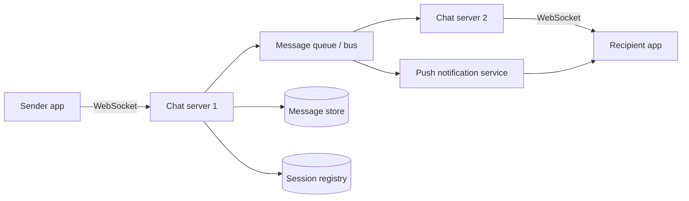

# Chat Application: Full System Design Mock Interview, All 9 Steps

> **Prerequisites:** [Previous lesson: Notification Service: Full System Design Mock Interview, All 9 Steps](../05-notification-service/README.md) and the [Interview Framework track](../../21-interview-framework/README.md).
> **Estimated Reading Time:** 15–20 minutes
> **Target Audience:** Engineers practising the full 9-step system design interview on a classic prompt: one-to-one and group chat with live delivery and history.

> [!NOTE]
> **In one line:** A chat system keeps a **persistent connection per online user** (WebSocket) and routes each message through a chat server that knows which connection the recipient is on.

> [!TIP]
> **The Golden Rule:** Separate the connection layer (stateful, many sockets) from the message layer (durable, ordered per conversation). Store first, then deliver.

---

## Step 1. Clarify the Problem

Open with questions, not boxes. The key question is how a message reaches a user connected to a different server, and how you keep order and history.

**Questions to ask the interviewer, and the answer we assume:**

| Question | Assumed answer |
| :--- | :--- |
| 1:1 and group? | Both, groups up to 500 members |
| Media? | Text now, attachments by link |
| History? | Searchable by scrolling, kept forever |
| Presence and read receipts? | Online status and delivered/read ticks |
| Scale? | 50M DAU, 40 messages per user per day |

> Say it aloud: *"Before I draw anything, let me confirm the scope and the numbers."* That one sentence earns the first minutes of the interview.

---

## Step 2. Functional and Non-Functional Requirements

**Functional (what the system does):**

- Send and receive 1:1 and group messages in real time.
- Deliver messages to users who are offline when they return.
- Show online presence and delivery/read status.
- Load conversation history with pagination.

**Non-functional (how well it does it):**

| Quality | Target | Why it drives the design |
| :--- | :--- | :--- |
| Latency | Delivery under 200 ms when both online | Chat must feel instant |
| Ordering | In order within a conversation | Messages out of order are unreadable |
| Durability | No lost messages | Store before acknowledging |
| Availability | 99.99% | Chat is a primary channel |

---

## Step 3. Scope: In and Out

**In scope:** Messaging, offline delivery, presence, history.

**Out of scope (say it explicitly, then move on):**

- End-to-end encryption (covered in the WhatsApp lesson).
- Voice and video calls.
- Message search internals.

---

## Step 4. Capacity Estimation

Assumptions: 50M DAU, 40 messages sent per user per day, 100 bytes per message, 10% of users online at peak.

| Quantity | Calculation | Result |
| :--- | :--- | :--- |
| Messages per day | `dau * msgs` | **2B messages** |
| Average rate | `messages_per_day / 86400` | **23.1K msgs/s** |
| Peak rate | `average_rate * peak` | **69.4K msgs/s** |
| Concurrent connections | `dau * online` | **5M sockets** |
| Storage per year | `messages_per_day * bytes_ * 365 / 1e12` | **73 TB/year** |

**What the numbers tell you:** 23K messages/s average and 70K at peak is manageable. The hard number is 5M concurrent sockets: at about 100K connections per server that is 50 chat servers, plus headroom. Storage of 73 TB a year fits a wide-column store.

---

## Step 5. API Design

| Endpoint | Purpose | Notes |
| :--- | :--- | :--- |
| `WS /connect` | Open the realtime channel | Authenticated; carries `send`, `ack`, `typing`, `presence`. |
| `POST /v1/messages` | Send (fallback over HTTP) | Body: `conversation_id`, `client_msg_id`, `text`. |
| `GET /v1/conversations/{id}/messages` | History | Cursor pagination by message id. |
| `POST /v1/messages/{id}/read` | Read receipt | Batched by the client. |

The `client_msg_id` makes sends idempotent: a retry after a dropped connection does not create a duplicate message.

---

## Step 6. Data Model

| Entity / Store | Key fields | Why this store |
| :--- | :--- | :--- |
| Messages (wide-column, partition by `conversation_id`) | `conversation_id`, `message_id` (time-ordered), `sender`, `text`, `ts` | Append-heavy, range reads by conversation |
| Conversations / members | `conversation_id`, `members`, `last_message_id` | Relational or key-value |
| Session registry (Redis) | `user_id` to `chat_server_id` | Find the recipient's connection |
| Offline inbox | `user_id`, unread message ids | Drain on reconnect |

Partitioning messages by conversation keeps one chat's history on one partition, so paging is a single range scan and ordering is local.

---

## Step 7. High-Level Architecture



**Walk the diagram in this order:** the sender's server stores the message, looks up the recipient's server in the registry, and routes it over the bus; an offline recipient gets a push notification and the message waits in the inbox.

---

## Step 8. Deep Dives and Bottlenecks

### 1. Routing across servers

Each user holds a socket to exactly one chat server, recorded in a Redis session registry. To deliver, the sender's server looks up the recipient's server and publishes to it (pub/sub per server). If no entry exists the user is offline, so the message goes to the inbox and a push is sent. Groups fan out to each member's server.

### 2. Ordering and ids

Give each message a time-ordered id (a Snowflake-style id or a per-conversation sequence) so history sorts correctly. Order is guaranteed only within a conversation, which is enough. The store write happens before the ack to the sender, so an acknowledged message is never lost.

### 3. Presence and receipts

Presence is a heartbeat every few seconds with a TTL in Redis; the user is offline when the key expires. Do not broadcast every status change to every contact: send presence to a user's open chats and let others fetch it lazily. Batch read receipts to avoid a write per message.

---

## Step 9. Trade-offs, Failures and Security

**Trade-offs to state aloud:**

| Decision | Option A | Option B | Pick and why |
| :--- | :--- | :--- | :--- |
| Transport | Long polling | WebSocket | WebSocket: lower latency and overhead for chat |
| Group fan-out | On write to each member | On read | On write for small groups, on read for huge channels |
| Storage | SQL | Wide-column | Wide-column: append-heavy, partitioned by conversation |

**Failure modes and mitigations:**

| Failure | What users see | Mitigation |
| :--- | :--- | :--- |
| Chat server crash | Users reconnect | Clients auto-reconnect with the last message id and fetch missed messages |
| Registry lost | Delivery misses | Fall back to the inbox plus push; rebuild on reconnect |
| Duplicate send | Double bubble | Idempotent `client_msg_id` |

**Security and abuse:** Authenticate the socket with a token, authorise membership on every send, rate-limit senders, and encrypt in transit. Validate and escape message content on display.

---

## Runnable Example: Time-ordered message ids

A Snowflake-style id packs a timestamp, a worker id and a sequence so ids sort by time without coordination.

```python
def make_id(ts_ms, worker, seq):
    return (ts_ms << 22) | (worker << 12) | seq

ids = [make_id(1_700_000_000_000, 1, 0),
       make_id(1_700_000_000_000, 1, 1),
       make_id(1_700_000_000_001, 2, 0)]
print(ids)
print(ids == sorted(ids))
print("ts of last:", ids[-1] >> 22)
```

Output (produced by running this exact code):

```text
[7130316800000004096, 7130316800000004097, 7130316800004202496]
True
ts of last: 1700000000001
```

The ids are strictly increasing in time order, so sorting by id sorts by send time, and the timestamp can be read back by shifting.

---

## Common Mistakes

- Polling for new messages.
- Acknowledging the sender before storing the message.
- Storing the whole history in a relational table with one global index.
- Broadcasting presence to every contact.
- No idempotency on send.

---

## Interview Questions and Answers

<details>
<summary><strong>Q1: How does a message reach a user on another server?</strong></summary>

A Redis registry maps each user to their chat server. The sender's server publishes to that server, which pushes down the socket.

</details>

<details>
<summary><strong>Q2: How do you handle offline users?</strong></summary>

Store the message, mark it in the user's inbox, send a push notification, and deliver on reconnect from the last seen message id.

</details>

<details>
<summary><strong>Q3: How do you guarantee order?</strong></summary>

Time-ordered message ids and partitioning by conversation, so one partition holds and orders a conversation.

</details>

<details>
<summary><strong>Q4: How do you scale connections?</strong></summary>

Many stateless-ish chat servers, each holding about 100K sockets behind a layer-4 load balancer, with the registry tracking who is where.

</details>

<details>
<summary><strong>Q5: Why not HTTP polling?</strong></summary>

It wastes requests and adds latency. A persistent socket pushes messages the moment they arrive.

</details>

---

## One-Page Cheat Sheet

| Step | What to say or draw |
| :--- | :--- |
| Clarify | 1:1 and groups, history, presence, 50M DAU |
| Capacity | 23K msg/s, 5M sockets, 73 TB/year |
| API | WebSocket plus history GET |
| Data | Messages by conversation, session registry, inbox |
| Deep dive | Cross-server routing, ids, presence |
| Trade-off | WebSocket, wide-column, fan-out on write |

---

## Further Reading

- Alex Xu, *System Design Interview Vol. 1*, chapter on designing a chat system.
- Discord engineering blog, *How Discord stores billions of messages*.

---

## Next

Continue with [WhatsApp-like Messaging: Full System Design Mock Interview, All 9 Steps](../07-whatsapp-like-messaging/README.md).
