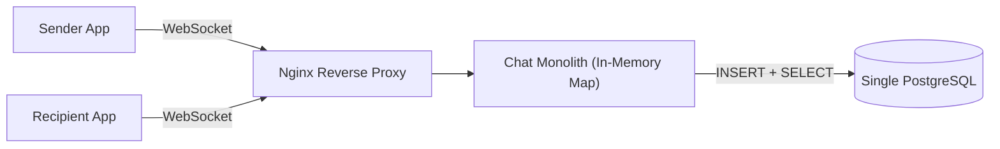
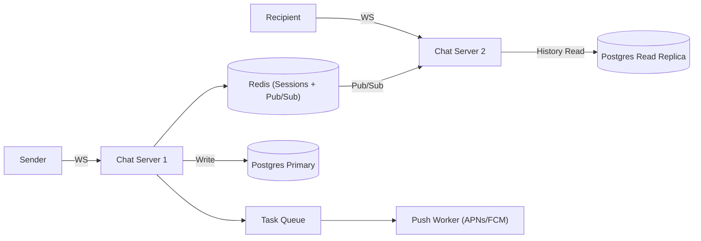
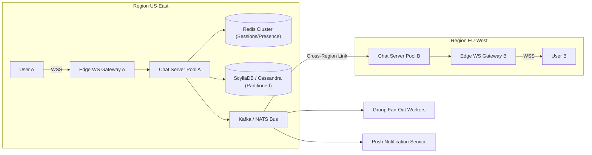
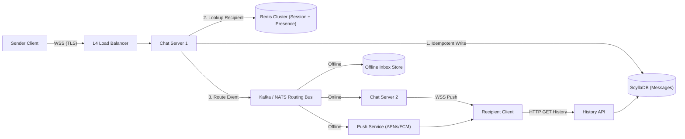
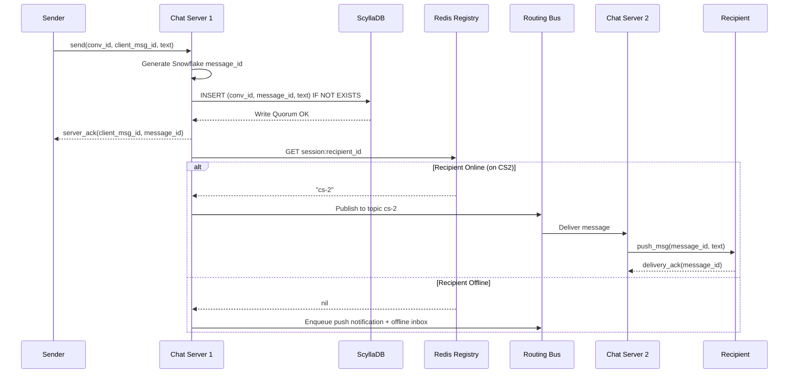
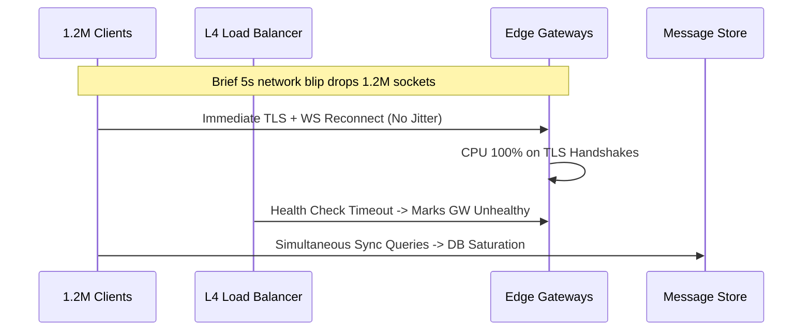

# Chat Application: Full System Design Mock Interview, All 9 Steps

> **Difficulty:** Intermediate to Senior (L5/L6)
> **Prerequisites:** [Previous lesson: Notification Service: Full System Design Mock Interview, All 9 Steps](../05-notification-service/README.md) and the [Interview Framework track](../../21-interview-framework/README.md).
> **Estimated Reading Time:** 25–30 minutes
> **Target Audience:** Engineers practising the full 9-step system design interview on a classic prompt: one-to-one and group chat with live delivery, presence, and searchable history.

> [!NOTE]
> **In one line:** A chat system keeps a **persistent connection per online user** (WebSocket) and routes each message through a chat server that knows which connection the recipient is on, while persisting every message to a partitioned store before acknowledging the sender.

> [!TIP]
> **The Golden Rule:** Separate the **connection layer** (stateful, millions of long-lived sockets) from the **message layer** (durable, ordered per conversation). Store first, then deliver.

---

## 1. Clarifying Questions, Functional & Non-Functional Requirements

Open with questions, not boxes. The interviewer wants to see you nail the two defining problems of real-time chat: **how a message reaches a user connected to a different server**, and **how you guarantee per-conversation ordering and durable history** without a single global bottleneck.

### Clarifying Questions & Assumed Scope

| Question | Assumed Answer | Architectural Impact |
| :--- | :--- | :--- |
| 1:1 and group chat? | Both; groups up to 500 members | Small enough for fan-out-on-write per group |
| Media attachments? | Text now; media via pre-signed URLs | Keeps message payload < 1 KB on the hot path |
| Message history? | Kept forever; cursor-paginated scroll | Drives wide-column / partitioned storage |
| Presence & receipts? | Online/offline status + delivered/read ticks | Requires heartbeats, TTLs, and receipt batching |
| Target scale? | 50M DAU, 40 messages/user/day | ~2B messages/day, ~5M concurrent sockets |

> Say it aloud: *"Before I draw anything, let me confirm the scope, scale, and durability guarantees."* That single sentence buys structure for the entire 45-minute interview.

### Functional Requirements

- **Real-time 1:1 and group messaging:** Send and receive text messages with sub-200 ms delivery when both parties are online.
- **Offline delivery:** Persist messages for offline users and deliver them in order upon reconnect, plus trigger push notifications.
- **Presence & receipts:** Track online/last-seen status and delivered/read receipts without flooding the network.
- **History pagination:** Load older messages in a conversation via cursor-based scrolling.

### Non-Functional Requirements & Scope Boundaries

| Quality | Target | Why It Drives the Design |
| :--- | :--- | :--- |
| Delivery Latency | p99 < 200 ms (online) | Requires persistent WebSockets, not HTTP polling |
| Ordering | Strict per-conversation order | Requires time-ordered IDs + conversation partitioning |
| Durability | Zero acknowledged message loss | Write to durable store before sending `ack` to sender |
| Availability | 99.99% (< 52 min downtime/yr) | Multi-AZ chat gateways + replicated storage |

**Explicitly Out of Scope:** End-to-end encryption (covered in the WhatsApp lesson), WebRTC voice/video calls, and full-text search indexing internals.

---

## 2. Back-of-the-Envelope Capacity Estimation

Let us derive throughput, concurrent socket count, memory for session routing, and annual storage from first principles.

**Baseline Assumptions:**
- $\text{DAU} = 50 \times 10^6$ users
- Average messages sent per user per day = $40$
- Average message payload (text + metadata) = $100\text{ bytes}$
- Peak-to-average traffic multiplier = $3\times$
- Peak concurrent online users = $10\%$ of DAU

### Worked Equations

**1. Message Throughput (QPS):**

$$\text{Messages/day} = 50 \times 10^6 \times 40 = 2 \times 10^9 \text{ messages/day}$$

$$\text{Avg QPS} = \frac{2 \times 10^9}{86{,}400} \approx 23{,}148 \text{ msgs/s}$$

$$\text{Peak QPS} = 23{,}148 \times 3 \approx 69{,}444 \text{ msgs/s}$$

**2. Concurrent WebSocket Connections & Chat Server Count:**

$$\text{Concurrent Sockets} = 50 \times 10^6 \times 0.10 = 5 \times 10^6 \text{ sockets}$$

Assuming each tuned Linux chat server holds $100{,}000$ persistent TLS WebSocket connections (each socket consuming $\sim 30\text{ KB}$ kernel + user-space buffer = $3\text{ GB}$ RAM per 100K connections):

$$\text{Min Chat Servers} = \frac{5 \times 10^6}{100{,}000} = 50 \text{ servers (plus } 2\times \text{ headroom} \approx 100\text{)}$$

**3. Session Registry Memory (Redis):**

Each online user maps `user_id` (8 B) $\rightarrow$ `server_id` (16 B) + Redis hash overhead ($\sim 64\text{ B}$):

$$\text{Registry RAM} = 5 \times 10^6 \times 88\text{ B} \approx 440\text{ MB}$$

**4. Storage & Bandwidth:**

$$\text{Daily Storage} = 2 \times 10^9 \times 100\text{ B} = 200\text{ GB/day}$$

$$\text{Annual Storage} = 200\text{ GB/day} \times 365 = 73\text{ TB/year}$$

With $3\times$ replication factor, raw disk footprint is $\sim 219\text{ TB/year}$.

### Capacity Summary Table

| Metric | Formula | Value | Design Implication |
| :--- | :--- | :--- | :--- |
| Daily Messages | $50\text{M} \times 40$ | $2\text{B msgs/day}$ | Partitioned append-heavy DB |
| Peak Write QPS | $\text{Avg QPS} \times 3$ | $\sim 69.4\text{K msgs/s}$ | Async batching + sharded store |
| Concurrent Sockets | $10\% \times 50\text{M}$ | $5\text{M sockets}$ | $\sim 100$ stateful WebSocket servers |
| Session Registry | $5\text{M} \times 88\text{ B}$ | $\sim 440\text{ MB}$ | Fits easily in a single Redis shard |
| Annual Storage (1x) | $200\text{ GB/d} \times 365$ | $73\text{ TB/year}$ | Wide-column store (Cassandra/ScyllaDB) |

---

## 3. Core API Contracts & Data Model

### Real-Time & REST API Contracts

| Endpoint / Frame | Purpose | Payload / Notes |
| :--- | :--- | :--- |
| `WS /v1/connect` | Persistent bidirectional channel | Auth via JWT; carries `send`, `ack`, `typing`, `presence` frames |
| `POST /v1/messages` | HTTP fallback for flaky networks | Body: `{ conversation_id, client_msg_id, text }` |
| `GET /v1/conversations/{id}/messages` | Fetch paginated history | Query: `?before_msg_id=<snowflake>&limit=50` |
| `POST /v1/conversations/{id}/read` | Advance read watermark | Body: `{ last_read_msg_id }` (batched per conversation) |

**WebSocket Frame Example (`send` and `server_ack`):**

```json
// Client -> Chat Server
{
  "type": "send",
  "client_msg_id": "c9b1d4e2-8a3f-4c1b-9e01-123456789abc",
  "conversation_id": "conv_99812",
  "text": "See you at 6pm!"
}

// Chat Server -> Client (only AFTER durable DB write)
{
  "type": "server_ack",
  "client_msg_id": "c9b1d4e2-8a3f-4c1b-9e01-123456789abc",
  "message_id": 7130316800004202496,
  "ts_ms": 1700000000001
}
```

### Data Model

| Store / Table | Partition Key | Clustering / Sort Key | Why This Store |
| :--- | :--- | :--- | :--- |
| `messages` (Wide-Column) | `conversation_id` (or `(conversation_id, bucket)`) | `message_id DESC` | Append-heavy; single-partition range scan for history |
| `conversations` (SQL / KV) | `conversation_id` | `user_id` | Membership list, muted flags, `last_read_msg_id` |
| `session_registry` (Redis) | `user_id` | — | Maps `user_id -> chat_server_id` with TTL |
| `offline_inbox` (KV / Redis) | `user_id` | `message_id ASC` | Tracks unread pointers for fast reconnect sync |

> [!WARNING]
> **Avoid unbounded partitions:** A hyper-active group chat over 5 years can exceed 100 MB per partition in Cassandra. Bucket the partition key as `(conversation_id, month_bucket)` (e.g., `conv_99812:2026-11`) so partitions stay bounded under 50 MB.

---

## 4. Stage 1 (100 - 1K Users): Baseline Monolith & Single Database

At 100–1,000 users, over-engineering with Kafka and Cassandra is a red flag. Start with the simplest architecture that satisfies real-time delivery and persistence:

1. **Client** opens a WebSocket connection through a **Reverse Proxy (Nginx)** to a **Single Chat Monolith** (holds an in-memory map `user_id -> ws_conn`).
2. **Monolith** writes every incoming message to a **Single PostgreSQL** instance (`messages` table indexed on `(conversation_id, message_id)`).
3. If the recipient is in the local `ws_conn` map, the monolith pushes the message directly down their socket; otherwise, it logs a missed message for their next `GET /messages` fetch.



**What breaks at 10K users:**
- **Single-process socket ceiling:** One monolith node hits memory/file-descriptor limits and becomes a single point of failure; deploying a new build drops all active chats.
- **Presence & DB polling:** Storing `last_seen` updates in PostgreSQL every 5 seconds creates 2,000+ useless `UPDATE`s/sec, saturating disk IOPS.

---

## 5. Stage 2 (10K - 100K Users): Caching, Read Replicas & Async Offload

To scale past 10K–100K users, we decouple **socket state** from **a single server** and offload **slow side effects**:

1. **Horizontal Chat Servers behind L4 LB:** Multiple stateless-ish Chat Servers behind an L4 Load Balancer (NLB/HAProxy) terminate WebSockets.
2. **Redis Session Registry & Pub/Sub:** Each Chat Server registers `SETEX session:{user_id} 60 server_id` in Redis. To route a message to a user on *another* server, Server A looks up `server_id` in Redis and publishes to channel `server:{server_id}` via Redis Pub/Sub.
3. **PostgreSQL Read Replicas + Async Push Worker:** History reads (`GET /messages`) hit Read Replicas. Offline users trigger an async job onto a **Message Queue (RabbitMQ/SQS)** for the **Push Notification Worker** (APNs/FCM).



**What breaks at 1M users:**
- **PostgreSQL write bottleneck:** At 50K+ msgs/sec, single-primary B-tree index maintenance on `messages` stalls under random I/O.
- **Redis Pub/Sub fan-out limit:** Redis Pub/Sub has no persistence; if a Chat Server briefly disconnects or a node restarts, in-flight routed events are dropped, and a single Redis instance saturates network bandwidth.

---

## 6. Stage 3 (1M - 10M+ Users): Sharding, Partitioning & Multi-Region Scale

At 1M–50M+ DAU, we replace the single relational primary and single Redis Pub/Sub with horizontally partitioned, durable infrastructure:

1. **Wide-Column Message Store (Cassandra / ScyllaDB):** Partitioned by `(conversation_id, time_bucket)`. Sequential LSM-tree appends handle 70K+ writes/sec effortlessly with tunable quorum (`QUORUM` writes, `LOCAL_QUORUM` reads).
2. **Clustered Message Bus (Kafka / NATS JetStream):** Replaces raw Redis Pub/Sub for durable cross-server routing and group fan-out. Each Chat Server consumes from a dedicated partition or subject (`chat.server.<id>`), while group messages fan out via a dedicated **Group Fan-Out Service**.
3. **Sharded Redis Cluster:** Session registry and presence TTL keys are sharded across a Redis Cluster by `CRC16(user_id) % 16384`.
4. **Multi-Region Edge Gateways:** GeoDNS routes users to the nearest regional Chat Gateway cluster; cross-region messages traverse a high-speed backbone Kafka MirrorMaker / NATS leaf-node link.



---

## 7. Final Full Production Architecture & End-to-End Flows

### Complete Production Architecture



### End-to-End Message Delivery Sequence



---

## 8. Deep-Dive Bottlenecks & Algorithmic Trade-Offs

### 1. Time-Ordered IDs & Per-Conversation Ordering

Global clocks drift across servers (NTP skew of 10–100 ms). To order messages without a central lock:
- **Snowflake IDs (64-bit):** `41 bits` timestamp (ms since custom epoch) + `10 bits` worker ID + `12 bits` sequence number. Generates 4,096 unique IDs/ms per worker, strictly sortable by time.
- **Per-Conversation Sequence (optional strictness):** If two users send simultaneously within the same millisecond on different workers, Snowflake breaks ties deterministically by `worker_id`. All clients sort by `(message_id)` so every participant sees the exact same canonical order.

### 2. Group Chat Fan-Out (Small vs. Large Groups)

| Strategy | Write Cost (500-member group) | Read Cost | Best For |
| :--- | :--- | :--- | :--- |
| **Fan-out on Write** | 500 routing events + 500 inbox entries | $O(1)$ per user | Groups $\le 500$ members (our scope) |
| **Fan-out on Read** | 1 write to group timeline | Poll/pull on open | Channels $> 10{,}000$ members (Discord/Telegram) |

For groups up to 500 members, fan-out on write is fast: a single Kafka event is consumed by the Group Fan-Out Worker, which batch-queries Redis `MGET` for all 500 members' `server_id`s and sends at most $\le 100$ batch frames (one per unique target Chat Server).

### 3. Presence Storm Prevention

If a user with 2,000 contacts logs in and out on a flaky subway connection, broadcasting `online`/`offline` to all 2,000 contacts triggers a $2{,}000\times$ write amplification storm.
- **Heartbeats with Jitter:** Client sends a tiny `ping` every 25s; server refreshes `SETEX presence:{user_id} 60 1`.
- **Lazy Pull + Active Window Push:** Only push real-time presence changes to users who currently have that chat open; all other contacts fetch presence lazily when opening their chat list.
- **Grace Period:** Wait 10–15 seconds after socket disconnect before marking offline to absorb brief cellular handoffs.

---

## 9. Failure Modes, Reliability & Backpressure Mitigations

| Failure Mode | User Impact | Root Cause | Mitigation |
| :--- | :--- | :--- | :--- |
| **Chat Server Crash** | 100K users drop | Node OOM or kernel panic | Client reconnects with exponential backoff + jitter; syncs missed messages via `GET /messages?after=last_seen_id` |
| **Thundering Herd Reconnect** | Gateway CPU 100% | LB/AZ flap drops 500K sockets | Client jitter (`rand(0, 30s)`), server-side token-bucket handshake rate limit |
| **Duplicate Send** | Double message bubble | Network drop before `server_ack` | Deduplicate using `client_msg_id` in short-lived Redis cache (TTL 5m) + DB `IF NOT EXISTS` |
| **Slow Consumer Socket** | Chat server OOM | Recipient on 2G network | Bounded per-socket send buffer (e.g., 256 msgs); drop slow socket and fall back to offline inbox |
| **Redis Registry Outage** | Real-time routing misses | Redis shard failover | Route via fallback offline inbox + APNs/FCM push; rebuild registry keys on next heartbeat |

---

## 10. Production War Story & Real-World Reference

**Incident Pattern (Inspired by Discord & Slack Gateway Storms):**
During a brief regional network partition, 1.2 million mobile clients lost their WebSocket connections simultaneously. Every client immediately executed `reconnect()` in a tight loop without jitter, while also firing `GET /conversations/sync` to catch up on missed messages. The TLS handshake CPU on the Edge Gateways pinned at 100%, causing health checks to fail, which made the Load Balancer pull healthy nodes out of rotation—creating a **cascading brownout** that lasted 22 minutes.



**Root Cause:**
1. Zero client-side reconnect jitter.
2. Unbounded TLS handshake concurrency on the same event loop as active WebSocket message routing.
3. Missing load shedding on `sync` endpoints during gateway recovery.

**The Fix:**
- Enforced **decorrelated jitter** on client reconnects ($t_{\text{wait}} = \text{rand}(1\text{s}, 30\text{s})$).
- Isolated TLS termination on dedicated Envoy/Nginx edge proxies with a **connection admission rate limiter** (e.g., max 5,000 new handshakes/sec/node).
- Added **sync jitter & priority queuing**: prioritize active open conversation sync over background badge counts.

---

## 11. Core Component Implementation (4 Languages)

Below is a production-style **Chat Message Router & Idempotent Snowflake Dispatcher** implemented in Go, TypeScript, Python, and C#. It demonstrates Snowflake ID generation, `client_msg_id` idempotency, durable store-before-ack, and online/offline routing.

````carousel
```go
package main

import (
	"errors"
	"fmt"
	"sync"
	"time"
)

// SnowflakeGenerator creates 64-bit time-ordered IDs without central coordination.
type SnowflakeGenerator struct {
	mu       sync.Mutex
	epochMs  int64
	workerID int64
	lastMs   int64
	seq      int64
}

func NewSnowflake(workerID int64) *SnowflakeGenerator {
	return &SnowflakeGenerator{epochMs: 1700000000000, workerID: workerID & 0x3FF}
}

func (g *SnowflakeGenerator) NextID() int64 {
	g.mu.Lock()
	defer g.mu.Unlock()
	now := time.Now().UnixMilli()
	if now == g.lastMs {
		g.seq = (g.seq + 1) & 0xFFF
		if g.seq == 0 {
			for now <= g.lastMs {
				now = time.Now().UnixMilli()
			}
		}
	} else {
		g.seq = 0
	}
	g.lastMs = now
	return ((now - g.epochMs) << 22) | (g.workerID << 12) | g.seq
}

type Message struct {
	ID             int64
	ConversationID string
	ClientMsgID    string
	SenderID       string
	Text           string
}

type ChatRouter struct {
	idGen    *SnowflakeGenerator
	dedup    map[string]int64      // client_msg_id -> message_id
	sessions map[string]string     // user_id -> server_id
	store    map[string][]Message  // conv_id -> ordered messages
	mu       sync.RWMutex
}

func NewChatRouter(workerID int64) *ChatRouter {
	return &ChatRouter{
		idGen:    NewSnowflake(workerID),
		dedup:    make(map[string]int64),
		sessions: map[string]string{"user_2": "chat-srv-04"},
		store:    make(map[string][]Message),
	}
}

func (r *ChatRouter) Send(convID, clientMsgID, senderID, recipientID, text string) (int64, string, error) {
	if text == "" {
		return 0, "", errors.New("empty message")
	}
	r.mu.Lock()
	if existingID, ok := r.dedup[clientMsgID]; ok {
		r.mu.Unlock()
		return existingID, "deduplicated_ack", nil
	}
	msgID := r.idGen.NextID()
	r.store[convID] = append(r.store[convID], Message{
		ID: msgID, ConversationID: convID, ClientMsgID: clientMsgID, SenderID: senderID, Text: text,
	})
	r.dedup[clientMsgID] = msgID
	targetSrv, online := r.sessions[recipientID]
	r.mu.Unlock()

	if online {
		return msgID, fmt.Sprintf("routed_to:%s", targetSrv), nil
	}
	return msgID, "queued_offline_push", nil
}

func main() {
	router := NewChatRouter(7)
	id1, route1, _ := router.Send("conv_1", "uuid-101", "user_1", "user_2", "Hello!")
	id2, route2, _ := router.Send("conv_1", "uuid-101", "user_1", "user_2", "Hello!") // Retry
	id3, route3, _ := router.Send("conv_1", "uuid-102", "user_1", "user_3", "Are you there?")
	fmt.Printf("Send 1: id=%d status=%s\n", id1, route1)
	fmt.Printf("Retry : id=%d status=%s\n", id2, route2)
	fmt.Printf("Send 2: id=%d status=%s\n", id3, route3)
}
```
<!-- slide -->
```typescript
class SnowflakeGenerator {
  private readonly epochMs = 1700000000000n;
  private lastMs = -1n;
  private seq = 0n;

  constructor(private readonly workerId: bigint) {}

  nextId(): bigint {
    let now = BigInt(Date.now());
    if (now === this.lastMs) {
      this.seq = (this.seq + 1n) & 0xfffn;
      if (this.seq === 0n) {
        while (now <= this.lastMs) now = BigInt(Date.now());
      }
    } else {
      this.seq = 0n;
    }
    this.lastMs = now;
    return ((now - this.epochMs) << 22n) | ((this.workerId & 0x3ffn) << 12n) | this.seq;
  }
}

interface ChatMessage {
  id: bigint;
  conversationId: string;
  clientMsgId: string;
  senderId: string;
  text: string;
}

class ChatRouter {
  private readonly idGen = new SnowflakeGenerator(7n);
  private readonly dedup = new Map<string, bigint>();
  private readonly sessions = new Map<string, string>([["user_2", "chat-srv-04"]]);
  private readonly store = new Map<string, ChatMessage[]>();

  send(convId: string, clientMsgId: string, senderId: string, recipientId: string, text: string) {
    if (!text) throw new Error("Empty message");

    const existing = this.dedup.get(clientMsgId);
    if (existing !== undefined) {
      return { messageId: existing, delivery: "deduplicated_ack" };
    }

    const messageId = this.idGen.nextId();
    const list = this.store.get(convId) ?? [];
    list.push({ id: messageId, conversationId: convId, clientMsgId, senderId, text });
    this.store.set(convId, list);
    this.dedup.set(clientMsgId, messageId);

    const server = this.sessions.get(recipientId);
    return {
      messageId,
      delivery: server ? `routed_to:${server}` : "queued_offline_push",
    };
  }
}

const router = new ChatRouter();
console.log(router.send("conv_1", "uuid-101", "user_1", "user_2", "Hello!"));
console.log(router.send("conv_1", "uuid-101", "user_1", "user_2", "Hello!"));
console.log(router.send("conv_1", "uuid-102", "user_1", "user_3", "Are you there?"));
```
<!-- slide -->
```python
import threading
import time
from dataclasses import dataclass
from typing import Dict, List, Tuple


class SnowflakeGenerator:
    def __init__(self, worker_id: int, epoch_ms: int = 1_700_000_000_000) -> None:
        self._lock = threading.Lock()
        self._epoch_ms = epoch_ms
        self._worker_id = worker_id & 0x3FF
        self._last_ms = -1
        self._seq = 0

    def next_id(self) -> int:
        with self._lock:
            now = int(time.time() * 1000)
            if now == self._last_ms:
                self._seq = (self._seq + 1) & 0xFFF
                if self._seq == 0:
                    while now <= self._last_ms:
                        now = int(time.time() * 1000)
            else:
                self._seq = 0
            self._last_ms = now
            return ((now - self._epoch_ms) << 22) | (self._worker_id << 12) | self._seq


@dataclass(frozen=True)
class ChatMessage:
    message_id: int
    conversation_id: str
    client_msg_id: str
    sender_id: str
    text: str


class ChatRouter:
    def __init__(self, worker_id: int = 7) -> None:
        self._id_gen = SnowflakeGenerator(worker_id)
        self._dedup: Dict[str, int] = {}
        self._sessions: Dict[str, str] = {"user_2": "chat-srv-04"}
        self._store: Dict[str, List[ChatMessage]] = {}

    def send(
        self, conv_id: str, client_msg_id: str, sender_id: str, recipient_id: str, text: str
    ) -> Tuple[int, str]:
        if not text:
            raise ValueError("Message text cannot be empty")
        if client_msg_id in self._dedup:
            return self._dedup[client_msg_id], "deduplicated_ack"

        msg_id = self._id_gen.next_id()
        # Store before acknowledging or routing
        self._store.setdefault(conv_id, []).append(
            ChatMessage(msg_id, conv_id, client_msg_id, sender_id, text)
        )
        self._dedup[client_msg_id] = msg_id

        target_server = self._sessions.get(recipient_id)
        if target_server:
            return msg_id, f"routed_to:{target_server}"
        return msg_id, "queued_offline_push"


if __name__ == "__main__":
    router = ChatRouter()
    print(router.send("conv_1", "uuid-101", "user_1", "user_2", "Hello!"))
    print(router.send("conv_1", "uuid-101", "user_1", "user_2", "Hello!"))
    print(router.send("conv_1", "uuid-102", "user_1", "user_3", "Are you there?"))
```
<!-- slide -->
```csharp
using System;
using System.Collections.Concurrent;
using System.Collections.Generic;

public sealed class SnowflakeGenerator
{
    private const long EpochMs = 1700000000000L;
    private readonly object _lock = new();
    private readonly long _workerId;
    private long _lastMs = -1;
    private long _seq = 0;

    public SnowflakeGenerator(long workerId) => _workerId = workerId & 0x3FF;

    public long NextId()
    {
        lock (_lock)
        {
            long now = DateTimeOffset.UtcNow.ToUnixTimeMilliseconds();
            if (now == _lastMs)
            {
                _seq = (_seq + 1) & 0xFFF;
                if (_seq == 0)
                {
                    while (now <= _lastMs)
                        now = DateTimeOffset.UtcNow.ToUnixTimeMilliseconds();
                }
            }
            else
            {
                _seq = 0;
            }
            _lastMs = now;
            return ((now - EpochMs) << 22) | (_workerId << 12) | _seq;
        }
    }
}

public record ChatMessage(long Id, string ConversationId, string ClientMsgId, string SenderId, string Text);

public sealed class ChatRouter
{
    private readonly SnowflakeGenerator _idGen = new(7);
    private readonly ConcurrentDictionary<string, long> _dedup = new();
    private readonly Dictionary<string, string> _sessions = new() { ["user_2"] = "chat-srv-04" };
    private readonly ConcurrentDictionary<string, List<ChatMessage>> _store = new();

    public (long MessageId, string Status) Send(
        string convId, string clientMsgId, string senderId, string recipientId, string text)
    {
        if (string.IsNullOrEmpty(text)) throw new ArgumentException("Empty message");
        if (_dedup.TryGetValue(clientMsgId, out long existingId))
            return (existingId, "deduplicated_ack");

        long msgId = _idGen.NextId();
        var list = _store.GetOrAdd(convId, _ => new List<ChatMessage>());
        lock (list) list.Add(new ChatMessage(msgId, convId, clientMsgId, senderId, text));
        _dedup[clientMsgId] = msgId;

        return _sessions.TryGetValue(recipientId, out var srv)
            ? (msgId, $"routed_to:{srv}")
            : (msgId, "queued_offline_push");
    }
}

public static class Program
{
    public static void Main()
    {
        var router = new ChatRouter();
        Console.WriteLine(router.Send("conv_1", "uuid-101", "user_1", "user_2", "Hello!"));
        Console.WriteLine(router.Send("conv_1", "uuid-101", "user_1", "user_2", "Hello!"));
        Console.WriteLine(router.Send("conv_1", "uuid-102", "user_1", "user_3", "Are you there?"));
    }
}
```
````

---

## 12. Verification, Load Testing & CLI Diagnostics

```bash
# 1. Verify WebSocket connection & send/ack latency using websocat
websocat -H="Authorization: Bearer $JWT_TOKEN" wss://chat.example.com/v1/connect << 'EOF'
{"type":"send","client_msg_id":"test-001","conversation_id":"conv_42","text":"ping"}
EOF

# 2. Check open TCP/WebSocket file descriptors & memory per socket on a Chat Server
ss -s
ulimit -n   # Ensure >= 200000 for 100K+ sockets per node

# 3. Inspect Redis session registry & presence TTLs
redis-cli -c GET "session:user_10492"
redis-cli -c TTL "presence:user_10492"

# 4. Verify ScyllaDB partition size & read latency for a hot conversation
nodetool tablestats chat.messages | grep -E "SSTable count|Space used|Partition size"

# 5. Load-test 50,000 concurrent WebSockets with k6
k6 run --vus 50000 --duration 5m ws_chat_loadtest.js
```

---

## 13. Common Interview Mistakes & Red Flags

- **Using HTTP Short/Long Polling:** Wastes bandwidth, burns battery, and fails the `< 200 ms` delivery target.
- **Acknowledging before persisting:** Sending `server_ack` before the database write completes leads to silent message loss on server crash.
- **Single global auto-increment ID:** Creates a central bottleneck; use Snowflake IDs or per-partition sequences.
- **Storing all messages in one unsharded SQL table:** B-tree index writes collapse at 50K+ QPS; partition by `(conversation_id, time_bucket)`.
- **Broadcasting presence to all contacts on every toggle:** Causes $O(N^2)$ notification storms; use lazy pull + open-chat push + disconnect grace periods.
- **Skipping `client_msg_id`:** Retries on mobile networks create duplicate message bubbles.
- **Putting Chat Servers behind an L7 HTTP proxy with short idle timeouts:** Drops idle WebSockets every 60 seconds unless configured for long-lived upgrades or L4 load balancing.

---

## 14. Key Terminology & Glossary

| Key Term | Definition |
| :--- | :--- |
| **WebSocket (WSS)** | Full-duplex persistent TCP/TLS connection upgraded from HTTP for low-latency server push |
| **Session Registry** | In-memory key-value map (`user_id -> chat_server_id`) used to route messages across servers |
| **Snowflake ID** | 64-bit time-ordered unique ID combining timestamp, worker ID, and sequence bits |
| **Store-Before-Ack** | Durability rule requiring persistent DB commit before confirming receipt to the sender |
| **Idempotency Key** | Client-generated UUID (`client_msg_id`) preventing duplicate writes on network retries |
| **Cursor Pagination** | Paging history using `before_msg_id` instead of `OFFSET`, avoiding drift on new inserts |
| **Presence Heartbeat** | Periodic keep-alive ping refreshing a short Redis TTL to track online/offline status |
| **Fan-Out on Write** | Pushing a group message to every member's target server/inbox at send time |
| **Time-Bucketed Partition** | Splitting a conversation's storage by `(conversation_id, month)` to cap partition size |
| **L4 Load Balancer** | Transport-layer balancer forwarding raw TCP connections to stateful Chat Servers |

---

## 15. Interview Follow-Up Questions (12 Q&As)

### Basic Conceptual Questions

<details>
<summary><strong>Q1: How does a message reach a user connected to a different chat server? [BASIC]</strong></summary>

Each online user's `user_id -> chat_server_id` mapping is stored in a Redis Session Registry. Server A looks up the recipient's server ID, publishes the message to Server B's topic on the routing bus (Kafka/NATS), and Server B pushes it down the recipient's active WebSocket.

</details>

<details>
<summary><strong>Q2: Why use WebSockets instead of HTTP long polling? [BASIC]</strong></summary>

HTTP long polling tears down and re-establishes HTTP headers/connections repeatedly, adding latency and server CPU overhead. A persistent WebSocket keeps a single TCP connection open with 2–6 byte framing overhead, achieving sub-200 ms bidirectional delivery.

</details>

<details>
<summary><strong>Q3: How do you handle offline users? [BASIC]</strong></summary>

The message is always persisted to the `messages` store first. When the Session Registry shows no active server for the recipient, the router writes a pointer to the user's `offline_inbox` and enqueues an APNs/FCM push notification. On reconnect, the client fetches missed messages using its `last_seen_message_id`.

</details>

<details>
<summary><strong>Q4: Why use cursor pagination instead of `LIMIT/OFFSET` for chat history? [BASIC]</strong></summary>

In an active chat, new messages are constantly inserted at the top. `OFFSET` shifts as new rows arrive, causing duplicate or skipped messages when scrolling up. Cursor pagination (`WHERE message_id < cursor LIMIT 50`) is immune to new inserts and uses an $O(\log N)$ index/clustering-key seek.

</details>

### Scenario-Based Architecture Questions

<details>
<summary><strong>Q5: How do you guarantee message ordering in a distributed chat system? [SCENARIO]</strong></summary>

Assign a time-ordered 64-bit Snowflake ID on the receiving Chat Server and partition the `messages` table by `(conversation_id, time_bucket)` with `message_id` as the clustering key. All clients render messages sorted by `message_id`, guaranteeing a single canonical order per conversation.

</details>

<details>
<summary><strong>Q6: A user is connected on both phone and laptop simultaneously. How do you sync? [SCENARIO]</strong></summary>

Store a set/list of active `(device_id, server_id)` entries per `user_id` in the Session Registry. When a message arrives, the router fans out to every connected device's Chat Server. Read receipts (`last_read_msg_id`) are also broadcast to the user's other devices so unread badges clear everywhere.

</details>

<details>
<summary><strong>Q7: How do you prevent presence updates from overwhelming the system? [SCENARIO]</strong></summary>

1. Use Redis TTL keys refreshed by 25-second heartbeats (never write presence to the primary DB).
2. Add a 10–15 second disconnect grace period before marking a user offline.
3. Only push presence changes to users actively viewing that conversation; other contacts pull status lazily.

</details>

<details>
<summary><strong>Q8: How do you handle a 500-member group chat without choking the sender's Chat Server? [SCENARIO]</strong></summary>

The Chat Server persists the message once and emits a single `group_message_created` event to Kafka. A dedicated **Group Fan-Out Worker** fetches the 500 member IDs, executes a pipelined `MGET` against Redis to map members to Chat Servers, and sends at most one batched routing payload per target Chat Server.

</details>

### Advanced & Tricky Interview Questions

<details>
<summary><strong>Q9: What happens if a Chat Server dies right after writing to the DB, before sending `server_ack`? [TRICKY]</strong></summary>

The client's ack timer expires and it retries sending the exact same `client_msg_id` over a reconnected socket to a new Chat Server. The new server checks the `client_msg_id` deduplication cache/store, sees it was already committed, skips creating a duplicate row, and returns the original `message_id` in `server_ack`.

</details>

<details>
<summary><strong>Q10: How do you tune a Linux server to hold 100,000+ concurrent WebSockets? [TRICKY]</strong></summary>

Raise `fs.file-max` and `ulimit -n` (e.g., 250K+), tune `net.core.somaxconn`, `net.ipv4.tcp_rmem` / `tcp_wmem` to minimize per-socket kernel buffers (e.g., 4–8 KB), use `epoll`/`kqueue` event-driven I/O (Go netpoller, Netty, or Tokio), and offload TLS termination to edge proxies if CPU-bound.

</details>

<details>
<summary><strong>Q11: What if two users in the same conversation send messages in the exact same millisecond on different servers with 50 ms clock skew? [TRICKY]</strong></summary>

Server B's Snowflake ID will sort slightly ahead of or behind Server A's depending on the skew, which is completely acceptable for human chat (50 ms is imperceptible) as long as **every participant sees the same order** (determined by `message_id`). If strict causal order is required for replies, include `reply_to_msg_id` or use a Hybrid Logical Clock (HLC).

</details>

<details>
<summary><strong>Q12: How do you prevent a single viral group chat from creating a hot partition in Cassandra/ScyllaDB? [TRICKY]</strong></summary>

Bucket partitions by time `(conversation_id, yyyy_mm_dd)` or `(conversation_id, message_bucket)` so writes rotate to fresh partitions, and cache the latest 50 messages of hot conversations in Redis so history reads hit memory instead of disk.

</details>

---

## 16. One-Page Master Cheat Sheet

```text
+-----------------------------------------------------------------------------+
|                    CHAT APPLICATION — MASTER CHEAT SHEET                    |
+-----------------------------------------------------------------------------+
| SCALE       : 50M DAU | 2B msgs/day | 69.4K peak QPS | 5M WS | 73 TB/yr     |
| GOLDEN RULE : Separate stateful WS gateways from durable partitioned store. |
|               Always store-before-ack; deduplicate with client_msg_id.      |
+-----------------------------------------------------------------------------+
| STAGE 1 (1K)   : Nginx -> Single Monolith (in-mem map) -> Single Postgres   |
| STAGE 2 (100K) : L4 LB -> Chat Servers + Redis Pub/Sub + Read Replicas      |
| STAGE 3 (50M)  : Edge WS -> Chat Pool + Redis Cluster + Kafka + ScyllaDB    |
+-----------------------------------------------------------------------------+
| HOT PATH    : WS send -> Snowflake ID -> ScyllaDB quorum -> server_ack ->   |
|               Redis session lookup -> Kafka route -> Target CS -> WS push   |
| BOTTLENECKS : Thundering herd reconnects (jitter!), presence storms (lazy   |
|               pull + grace period), unbounded partitions (time-bucketing).  |
+-----------------------------------------------------------------------------+
```

| Step | Key Decision |
| :--- | :--- |
| **Clarify** | 1:1 + groups $\le 500$, forever history, presence/receipts, 50M DAU |
| **Estimate** | 23K avg / 69K peak QPS, 5M sockets ($\sim 100$ servers), 73 TB/yr |
| **API / Data** | `WS /connect`, `GET /messages?before=`, `(conv_id, bucket)` wide-column |
| **Deep Dives** | Snowflake IDs, cross-server routing bus, presence grace period |
| **Failures** | Reconnect jitter, `client_msg_id` dedup, bounded socket send buffers |

---

## Further Reading

- Alex Xu, *System Design Interview Vol. 1*, Chapter 12: *Design a Chat System*.
- Discord Engineering Blog, *How Discord Stores Trillions of Messages* (ScyllaDB migration & time-bucketed partitions).
- Slack Engineering, *Real-time Messaging at Scale* (Gateway architecture & reconnect storms).

---

## Next

Continue with [WhatsApp-like Messaging: Full System Design Mock Interview, All 9 Steps](../07-whatsapp-like-messaging/README.md).
