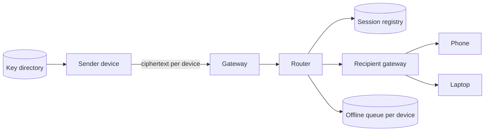

# WhatsApp-like Messaging: Full System Design Mock Interview, All 9 Steps

> **Prerequisites:** [Previous lesson: Chat Application: Full System Design Mock Interview, All 9 Steps](../06-chat-application/README.md) and the [Interview Framework track](../../21-interview-framework/README.md).
> **Estimated Reading Time:** 15–20 minutes
> **Target Audience:** Engineers practising the full 9-step system design interview on a classic prompt: a WhatsApp-like messenger with end-to-end encryption, receipts and multiple devices.

> [!NOTE]
> **In one line:** WhatsApp-style messaging adds three things to chat: **the server cannot read messages (end-to-end encryption)**, **messages wait for offline devices**, and **each user has several devices**.

> [!TIP]
> **The Golden Rule:** The server is a store-and-forward relay of encrypted blobs. It holds a message only until every target device has acknowledged it, then deletes it.

---

## Step 1. Clarify the Problem

Open with questions, not boxes. Start from the chat design, then show what changes when the server must not see plaintext and a user has a phone, a laptop and a tablet.

**Questions to ask the interviewer, and the answer we assume:**

| Question | Assumed answer |
| :--- | :--- |
| E2E encrypted? | Yes, server stores only ciphertext |
| Multi-device? | Up to 4 linked devices |
| Groups? | Up to 1,024 members |
| History on server? | No, only until delivered |
| Scale? | 1B users, 100B messages per day |

> Say it aloud: *"Before I draw anything, let me confirm the scope and the numbers."* That one sentence earns the first minutes of the interview.

---

## Step 2. Functional and Non-Functional Requirements

**Functional (what the system does):**

- Send encrypted messages 1:1 and to groups.
- Deliver to all of a recipient's devices, including ones that are offline.
- Show sent, delivered and read ticks.
- Share media as encrypted blobs.

**Non-functional (how well it does it):**

| Quality | Target | Why it drives the design |
| :--- | :--- | :--- |
| Privacy | Server cannot decrypt | The defining requirement |
| Delivery | At-least-once, exactly-once display | Never lose a message, never show twice |
| Latency | Under 500 ms online | Chat must feel instant |
| Scale | Millions of messages per second | A global user base |

---

## Step 3. Scope: In and Out

**In scope:** Encrypted relay, offline queue, multi-device, receipts.

**Out of scope (say it explicitly, then move on):**

- The cryptographic protocol internals (Signal protocol details).
- Voice and video calls.
- Status and stories.

---

## Step 4. Capacity Estimation

Assumptions: 1B users, 100B messages per day, 2 devices per user on average, average encrypted message 1 KB.

| Quantity | Calculation | Result |
| :--- | :--- | :--- |
| Average rate | `msgs_day / 86400` | **1.2M msgs/s** |
| Peak rate | `average_rate * peak` | **2.3M msgs/s** |
| Device deliveries per second | `average_rate * devices` | **2.3M deliveries/s** |
| Daily ciphertext volume | `msgs_day * kb * 1e3 / 1e15` | **0.1 PB/day** |

**What the numbers tell you:** 1.2M messages per second on average is a very large relay. Because the server only holds messages until acknowledged, storage is a short-lived queue, not a permanent archive, which is what makes the scale affordable.

---

## Step 5. API Design

| Endpoint | Purpose | Notes |
| :--- | :--- | :--- |
| `WS /connect` | Authenticated device socket | Per device, not per user. |
| `send(to, ciphertext_per_device[])` | Send | Client encrypts once per recipient device. |
| `ack(message_id)` | Delivery receipt | Lets the server delete the blob. |
| `GET /v1/keys/{user}` | Fetch public pre-keys | Used to start an encrypted session. |

Because the server cannot read content, the **sender** encrypts a separate copy for each recipient device. The server only sees routing metadata.

---

## Step 6. Data Model

| Entity / Store | Key fields | Why this store |
| :--- | :--- | :--- |
| Key directory | `user`, `device`, `identity_key`, `signed_prekey`, one-time prekeys | Public keys only, used for session setup |
| Offline queue (per device) | `device_id`, `message_id`, `ciphertext`, `ts` | Short-lived, deleted on ack, TTL 30 days |
| Session registry | `device_id` to `gateway` | Route to the connected device |
| Receipts | `message_id`, `state` | Small, ephemeral |

The server's message store is a queue per device with a TTL, not a history table. Backups of history are the user's own (on device or encrypted backup).

---

## Step 7. High-Level Architecture



**Walk the diagram in this order:** the sender fetches the recipient's keys, encrypts one copy per device, and sends; the router delivers to online devices and queues for offline ones; acks delete the stored copy.

---

## Step 8. Deep Dives and Bottlenecks

### 1. Store and forward

A message is written to the per-device queue before the sender is told it was accepted (single tick). When the recipient device receives it, it sends an ack, the server deletes the blob and notifies the sender (double tick). Offline devices get the queue on reconnect, in order. Unacknowledged messages expire after the retention TTL.

### 2. Multi-device and groups

Each device has its own keys. A message to a user is encrypted once per device. For groups, use a sender key: the sender distributes a key to members once, then encrypts each message a single time instead of once per member, which keeps group sends cheap. When membership changes, rotate the key.

### 3. Receipts and metadata

Receipts are small messages in the same pipeline, batched. The server still sees metadata (who, when, size), so minimise it and use padding. Link-preview and media use encrypted blobs in object storage with the key sent inside the encrypted message.

---

## Step 9. Trade-offs, Failures and Security

**Trade-offs to state aloud:**

| Decision | Option A | Option B | Pick and why |
| :--- | :--- | :--- | :--- |
| Group encryption | Per-member pairwise | Sender keys | Sender keys: one encryption per message, rotate on membership change |
| Server storage | Keep history | Delete after delivery | Delete: privacy and cost |
| Transport | WebSocket | Custom binary over TCP | Binary over a persistent connection to save bytes and battery |

**Failure modes and mitigations:**

| Failure | What users see | Mitigation |
| :--- | :--- | :--- |
| Device offline for weeks | Messages expire | 30-day TTL, then the sender sees undelivered |
| Gateway failure | Reconnect | Device reconnects and drains its queue |
| Key change | Safety number warning | Notify and re-establish the session |

**Security and abuse:** End-to-end encryption means a server breach exposes only ciphertext and metadata. Authenticate identity keys, warn on key changes, and use forward secrecy so a stolen key does not reveal old messages.

---

## Runnable Example: Fan-out copies per device

This shows how many ciphertext copies a message costs with pairwise encryption versus a sender key in a group.

```python
def pairwise_copies(members, devices_each):
    return members * devices_each

def sender_key_copies(members, devices_each):
    # one encrypted message body; the key was distributed once earlier
    return 1

for members in (2, 50, 1024):
    print(members, "members:", pairwise_copies(members, 2), "vs", sender_key_copies(members, 2))
```

Output (produced by running this exact code):

```text
2 members: 4 vs 1
50 members: 100 vs 1
1024 members: 2048 vs 1
```

With pairwise encryption a 1,024-member group costs 2,048 ciphertexts per message; a sender key keeps it at one body, paying the key distribution cost only when membership changes.

---

## Common Mistakes

- Storing plaintext or history on the server.
- Encrypting once per user instead of per device.
- Acknowledging before the message is durably queued.
- Keeping delivered messages forever.
- Ignoring metadata leakage.

---

## Interview Questions and Answers

<details>
<summary><strong>Q1: How can the server relay what it cannot read?</strong></summary>

Clients encrypt, so the server sees ciphertext plus routing metadata. It stores and forwards opaque blobs per device.

</details>

<details>
<summary><strong>Q2: How do multiple devices work?</strong></summary>

Each device has its own keys. The sender encrypts a copy for every recipient device, and each device has its own offline queue.

</details>

<details>
<summary><strong>Q3: How do groups scale?</strong></summary>

A sender key per member in the group: encrypt each message once. Rotate the key when members join or leave.

</details>

<details>
<summary><strong>Q4: When is a message deleted from the server?</strong></summary>

On the recipient device's ack, or after the TTL if never delivered.

</details>

<details>
<summary><strong>Q5: What does the server still know?</strong></summary>

Metadata: who talks to whom, when and how big. Reduce it with minimal logging and padding.

</details>

---

## One-Page Cheat Sheet

| Step | What to say or draw |
| :--- | :--- |
| Clarify | E2E, multi-device, groups, 1B users |
| Capacity | 1.2M msg/s, short-lived queue |
| API | send per-device ciphertext, ack, key fetch |
| Data | Key directory, per-device queue with TTL |
| Deep dive | Store-and-forward, sender keys, receipts |
| Trade-off | Delete after delivery, sender keys |

---

## Further Reading

- Signal documentation: the X3DH and Double Ratchet specifications.
- WhatsApp Encryption Overview white paper.

---

## Next

Continue with [News Feed: Full System Design Mock Interview, All 9 Steps](../08-news-feed/README.md).
