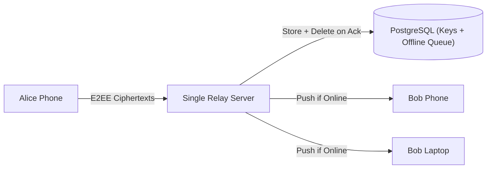
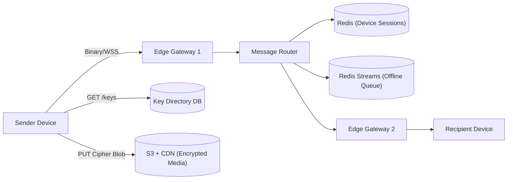
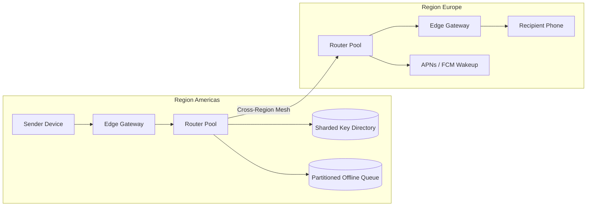
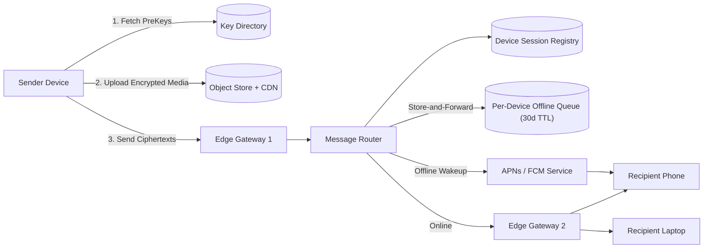
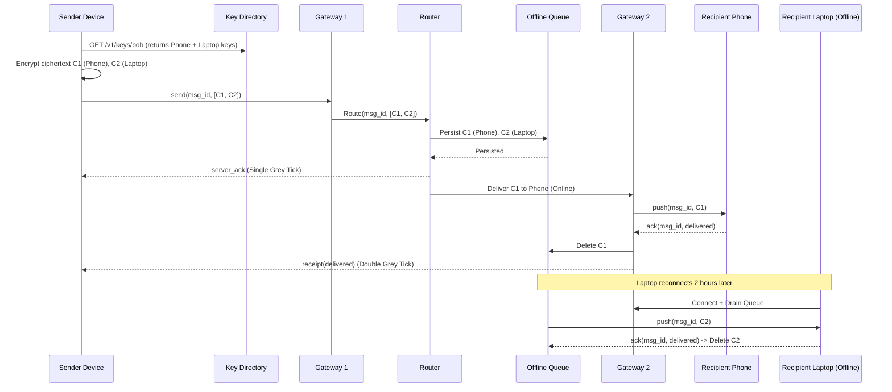

# WhatsApp-like Messaging: Full System Design Mock Interview, All 9 Steps

> **Difficulty:** Senior to Staff (L6+)
> **Prerequisites:** [Previous lesson: Chat Application: Full System Design Mock Interview, All 9 Steps](../06-chat-application/README.md) and the [Interview Framework track](../../21-interview-framework/README.md).
> **Estimated Reading Time:** 25–30 minutes
> **Target Audience:** Engineers practising the full 9-step system design interview on a classic prompt: a WhatsApp-like messenger with end-to-end encryption, delivery receipts, and multi-device sync.

> [!NOTE]
> **In one line:** WhatsApp-style messaging transforms the server from a permanent archive into a **zero-knowledge, store-and-forward relay of encrypted blobs**: the server cannot read messages, holds ciphertexts only until every target device acknowledges receipt, and routes per-device.

> [!TIP]
> **The Golden Rule:** The server is a **blind store-and-forward router**. Encrypt per-device for 1:1 chats, use **Sender Keys** for groups, and delete server-side blobs immediately upon recipient `ack` (or 30-day TTL expiry).

---

## 1. Clarifying Questions, Functional & Non-Functional Requirements

Open with questions, not boxes. Start from the standard chat architecture and immediately highlight the three constraints that make WhatsApp fundamentally different: **end-to-end encryption (E2EE)**, **ephemeral server storage**, and **multi-device fan-out**.

### Clarifying Questions & Assumed Scope

| Question | Assumed Answer | Architectural Impact |
| :--- | :--- | :--- |
| End-to-end encrypted? | Yes; server never sees plaintext | Server relays opaque ciphertext; clients manage keys |
| Multi-device support? | Up to 4 linked devices per user | Session & offline queues must be keyed by `device_id` |
| Group size limit? | Up to 1,024 members | Pairwise encryption explodes; requires Sender Keys |
| Server-side history? | No; deleted once delivered | Short-lived queue with 30-day TTL, not a PB-scale archive |
| Target scale? | 1B DAU, 100B messages/day | ~1.16M avg msgs/s, ~2.3M+ device deliveries/s |

> Say it aloud: *"Before I draw anything, let me confirm the E2EE boundary, multi-device model, and retention TTL."*

### Functional Requirements

- **E2EE 1:1 & Group Messaging:** Encrypt messages on the sender's device so only the intended recipient devices can decrypt them.
- **Multi-Device Delivery:** Deliver messages independently to a user's phone, laptop, and tablet, even when some devices are offline.
- **Sent / Delivered / Read Ticks:** Single grey tick (server accepted), double grey tick (delivered to all target devices), double blue tick (read).
- **Encrypted Media Sharing:** Upload encrypted media blobs to object storage and transmit the decryption key + SHA-256 hash inside the E2EE message.

### Non-Functional Requirements & Scope Boundaries

| Quality | Target | Why It Drives the Design |
| :--- | :--- | :--- |
| Privacy | Zero plaintext access on server | Public key directory + client-side Signal/Double Ratchet |
| Delivery | At-least-once relay, exactly-once display | Per-device `ack` + client-side deduplication |
| Latency | p99 < 500 ms globally | Lightweight binary framing over persistent TCP/WS |
| Availability | 99.99% | Multi-region gateways + replicated per-device queues |

**Explicitly Out of Scope:** Cryptographic proofs of X3DH/Double Ratchet math, WebRTC voice/video calling, and Status/Stories.

---

## 2. Back-of-the-Envelope Capacity Estimation

Let us quantify message QPS, per-device delivery amplification, transient queue storage, and media bandwidth.

**Baseline Assumptions:**
- $\text{DAU} = 1 \times 10^9$ users
- Total messages sent per day = $100 \times 10^9$ messages/day
- Average linked devices per user = $2$
- Average encrypted message envelope = $1\text{ KB}$ (ciphertext + routing metadata)
- Peak-to-average multiplier = $2\times$
- Peak concurrent connected devices = $15\%$ of total devices ($2\text{B} \times 0.15 = 300\text{M}$ sockets)
- Average offline queue dwell time = $1\text{ hour}$ (most devices are online or reconnect quickly; worst-case 5% offline for 24h)

### Worked Equations

**1. Message Ingest & Device Delivery QPS:**

$$\text{Avg Ingest QPS} = \frac{100 \times 10^9}{86{,}400} \approx 1{,}157{,}407 \text{ msgs/s} \approx 1.16\text{M msgs/s}$$

$$\text{Peak Ingest QPS} = 1.16\text{M} \times 2 \approx 2.32\text{M msgs/s}$$

With an average of $2$ recipient devices per message:

$$\text{Peak Device Deliveries/s} = 2.32\text{M} \times 2 \approx 4.64\text{M deliveries/s}$$

**2. Daily Ciphertext Transit & Transient Queue Storage:**

$$\text{Daily Transit Volume} = 100 \times 10^9 \times 1\text{ KB} = 100\text{ TB/day}$$

If $5\%$ of messages wait in the offline queue for up to $24\text{ hours}$ before `ack` and deletion:

$$\text{Steady-State Queue Storage} = 100\text{ TB/day} \times 0.05 \times 2\text{ devices} = 10\text{ TB}$$

Compare $10\text{ TB}$ of transient queue storage against $36.5\text{ PB/year}$ if WhatsApp stored plaintext history forever! Delete-after-ack is the economic superpower of WhatsApp's architecture.

**3. Concurrent Gateway Connections:**

At $250{,}000$ lightweight binary TCP/TLS connections per tuned Erlang/BEAM or Go gateway node:

$$\text{Gateway Nodes} = \frac{300 \times 10^6}{250{,}000} = 1{,}200 \text{ gateway nodes globally}$$

### Capacity Summary Table

| Metric | Formula | Value | Design Implication |
| :--- | :--- | :--- | :--- |
| Avg / Peak Ingest QPS | $100\text{B} / 86{,}400 \times 2$ | $1.16\text{M} / 2.32\text{M msgs/s}$ | Binary protocol + sharded routers |
| Peak Device Deliveries | $\text{Peak QPS} \times 2\text{ devices}$ | $\sim 4.64\text{M/s}$ | Per-device queues & routing |
| Daily Transit Volume | $100\text{B} \times 1\text{ KB}$ | $100\text{ TB/day}$ | High network egress, low disk retention |
| Offline Queue Footprint | $5\% \times 100\text{ TB} \times 2$ | $\sim 10\text{ TB}$ | Fits in NVMe-backed Mnesia/Cassandra with TTL |
| Concurrent Sockets | $15\% \times 2\text{B devices}$ | $300\text{M sockets}$ | $\sim 1{,}200$ edge gateway servers |

---

## 3. Core API Contracts & Data Model

### Protocol & REST API Contracts

| Endpoint / Frame | Purpose | Payload / Notes |
| :--- | :--- | :--- |
| `TCP/WSS /connect` | Persistent binary device socket | Authenticated with `device_id` + Ed25519 device cert |
| `GET /v1/keys/{user_id}` | Fetch recipient's device pre-keys | Returns `identity_key`, `signed_prekey`, and 1 `one_time_prekey` per device |
| `POST /v1/keys/upload` | Replenish one-time pre-keys | Client uploads batch of 100 public pre-keys when low |
| `FRAME send` | Relay per-device ciphertexts | `{ msg_id, recipient_id, payloads: [{ device_id, ciphertext }] }` |
| `FRAME ack` | Confirm device receipt | `{ msg_id, device_id, ack_type: "delivered" \| "read" }` |
| `POST /v1/media/upload` | Upload encrypted media blob | Returns CDN URL; decryption key stays inside E2EE `send` frame |

### Data Model

| Store / Entity | Key Fields | Retention | Why This Store |
| :--- | :--- | :--- | :--- |
| **Key Directory** | `(user_id, device_id)`, `identity_key`, `signed_prekey`, `opk_pool[]` | Persistent | Atomic pop of one-time pre-key (SQL / Spanner / DynamoDB) |
| **Offline Queue** | `(recipient_device_id, msg_id)`, `ciphertext`, `expires_at` | **Delete on `ack`** (max 30d TTL) | Fast append, ordered drain on reconnect, tombstone-aware compaction |
| **Session Registry** | `device_id -> gateway_node_id` | Ephemeral (TTL 60s) | Redis Cluster / in-memory distributed registry |
| **Group Metadata** | `group_id`, `member_devices[]`, `epoch` | Persistent | Tracks membership for Sender Key rotation |
| **Media Blob Store** | `media_id` -> encrypted binary blob | 30-day TTL | S3 / Blob Storage + CDN edge cache |

> [!WARNING]
> **Watch out for Tombstone Storms:** Deleting millions of rows per second from an LSM-tree store (like Cassandra) creates **tombstones** that slow down range scans when a device reconnects. Use **Leveled Compaction** or **Time-Window Compaction** with short `gc_grace_seconds`, or partition per-device queues as ring-buffered logs where `ack` advances a `committed_offset` pointer rather than issuing per-message `DELETE`s.

---

## 4. Stage 1 (100 - 1K Users): Baseline Monolith & Single Database

At 100–1,000 users, focus on proving the **zero-knowledge relay** and **store-and-forward** contract:

1. **Client Devices** register their public `identity_key` and `prekeys` into a **Single PostgreSQL** instance.
2. **Single Relay Server** holds persistent WebSocket connections keyed by `device_id`.
3. When Alice sends to Bob (who has 2 devices), Alice encrypts 2 separate ciphertexts and sends them in one frame. The Relay inserts them into `offline_queue` in PostgreSQL, returns a **single grey tick** to Alice, pushes to any online Bob device, and deletes each row when that device sends `ack`.



**What breaks at 10K users:**
- **PostgreSQL `DELETE` churn:** High-frequency `INSERT` followed milliseconds later by `DELETE` bloats PostgreSQL tables and triggers aggressive `AUTOVACUUM` CPU spikes.
- **Single-node socket limit:** One relay process cannot survive deployments without disconnecting all active devices.

---

## 5. Stage 2 (10K - 100K Users): Caching, Read Replicas & Async Offload

At 10K–100K users, we split connection termination from routing and move transient queues off the relational primary:

1. **Stateless Edge Gateways** terminate persistent binary/WebSocket connections for each `device_id` and register `device_id -> gateway_id` in **Redis**.
2. **Key Directory** stays in **PostgreSQL** (with Read Replicas for `GET /keys`, though `one_time_prekey` consumption must still hit Primary/atomic pop so two senders never get the same OPK).
3. **Offline Queue** moves to **Redis Streams / RabbitMQ** (per-device queue or partitioned queue) so fast `enqueue` and `ack`-delete happen in memory/append-log without relational vacuum overhead.
4. **Encrypted Media** is offloaded to **S3 + CDN** via pre-signed upload URLs.



**What breaks at 1M users:**
- **In-memory queue RAM limit:** Holding 30 days of offline messages for millions of devices purely in Redis RAM becomes prohibitively expensive.
- **Group pairwise explosion:** Encrypting 1,000-member group messages $1{,}000 \times 2 = 2{,}000$ times on the sender's phone drains battery and saturates upload bandwidth.

---

## 6. Stage 3 (1M - 10M+ Users): Sharding, Partitioning & Multi-Region Scale

At 1M–1B DAU, we introduce disk-backed partitioned queues, **Sender Keys** for groups, and multi-region edge routing:

1. **Partitioned Offline Queue (Mnesia / ScyllaDB / Kafka-backed Log):** Sharded by `hash(recipient_device_id)`. Messages are appended sequentially and cleaned up via offset advancement or TTL compaction.
2. **Group Fan-Out with Sender Keys:** Instead of $N \times D$ pairwise encryptions, the sender encrypts the message **once** using a group Sender Key, and the **Group Router** fans out that single ciphertext blob to all member devices.
3. **Multi-Region Edge Gateways:** GeoDNS connects devices to the nearest regional Gateway. A global **Device Session Mesh** routes ciphertexts across regions over persistent inter-DC links.
4. **Push Wakeup Bridge (APNs/FCM):** When a mobile OS suspends the background socket, the router sends a silent/encrypted push notification so the OS wakes the app to drain its offline queue.



---

## 7. Final Full Production Architecture & End-to-End Flows

### Complete Production Architecture



### End-to-End E2EE Store-and-Forward Sequence



---

## 8. Deep-Dive Bottlenecks & Algorithmic Trade-Offs

### 1. Pairwise Encryption vs. Sender Keys (Group Scaling)

| Approach | Sender Upload Cost (1,024-member group, 2 devices each) | Key Rotation Trigger | Best For |
| :--- | :--- | :--- | :--- |
| **Pairwise E2EE** | $2{,}048$ ciphertexts encrypted & uploaded | Per message (Double Ratchet) | 1:1 chats |
| **Sender Keys** | **1 ciphertext** uploaded; server fans out | Only when a member joins or leaves | Group chats (up to 1,024+) |

**How Sender Keys work:** When Alice joins a group, she generates a random 32-byte `ChainKey`, encrypts it *pairwise* once to each member device, and distributes it. For every subsequent message, Alice steps her symmetric `ChainKey` forward (`HMAC-SHA256`), encrypts the message **once**, and sends a single ciphertext to the server. When any member leaves, all members rotate their Sender Keys so the removed member cannot decrypt future messages.

### 2. Multi-Device Fan-Out & History Sync

- **Independent Device Queues:** The server never merges devices; `bob_phone` and `bob_laptop` are distinct endpoints with separate `device_id`s, separate Double Ratchet sessions, and separate offline queues.
- **Self-Device Sync:** Alice also encrypts a copy of her *own* sent message for her *other* linked devices (`alice_laptop`) so her Sent items stay in sync across devices.
- **Linked Device Removal:** If `bob_laptop` is revoked, the server invalidates its device cert and stops routing to it; clients drop its public key on next key refresh.

### 3. Metadata Minimization

Even with E2EE, the server must see `(sender, recipient, timestamp, packet_size)` to route. Mitigations:
- **Sealed Sender:** Encrypt the sender's identity inside the envelope using a short-lived delivery certificate so the server only sees the recipient.
- **PKCS#7 / Random Padding:** Pad ciphertexts to fixed bucket sizes (e.g., multiples of 256 bytes) so an eavesdropper cannot guess message length ("yes" vs. a paragraph).
- **Zero-Log Routing:** Never log message IDs alongside IP addresses in persistent analytics.

---

## 9. Failure Modes, Reliability & Backpressure Mitigations

| Failure Mode | User Impact | Root Cause | Mitigation |
| :--- | :--- | :--- | :--- |
| **One-Time Pre-Key Exhaustion** | New sessions fall back to signed pre-key | Burst of new contacts messaging a celebrity | Replenish OPK pool proactively; fall back gracefully to `signed_prekey` (still E2EE, slightly weaker initial forward secrecy) |
| **Device Offline > 30 Days** | Undelivered messages expire | Unbounded storage risk if kept forever | Enforce 30-day TTL on `offline_queue`; notify sender or expire silently |
| **Safety Number / Key Change** | Potential MITM or device reinstall | User reinstalled app or swapped phone | Server notifies active chat partners of `identity_key` change; client displays "Security code changed" warning |
| **Media Upload Succeeds, Send Fails** | Orphaned encrypted blob in S3 | Client crashed before `send` frame | Apply 30-day S3 lifecycle expiration rule on all media objects |
| **Slow Draining Queue on Reconnect** | Gateway memory spike | User returns after 2 weeks with 5,000 queued messages | Stream offline queue in paginated batches of 50 messages, waiting for client `ack` before pushing the next batch (windowed flow control) |

---

## 10. Production War Story & Real-World Reference

**Reference Architecture: WhatsApp's Erlang/BEAM & Multi-Device Evolution**
Historically, WhatsApp scaled to **2+ million concurrent TCP connections per single server** using a heavily tuned FreeBSD kernel and the Erlang/OTP (BEAM) runtime, where each connected device is a lightweight ~2 KB Erlang process. Originally, WhatsApp's desktop client proxied through the user's phone (the phone was the sole cryptographic endpoint). When WhatsApp introduced **true Multi-Device** in 2021, the core challenge was **avoiding server-side state explosion**:

1. Every user's phone no longer needed to be online for the laptop to receive messages.
2. The server had to maintain **per-device** message queues and **Automatic Key Verification** (using auditable key-transparency logs so the server cannot silently inject a rogue device key into a user's `device_list`).

**Lesson for Interviews:** Always state that **client-side key transparency / identity verification** is required in multi-device E2EE; otherwise, a compromised server could secretly add a 5th "ghost device" to a victim's account and receive copies of all future messages.

---

## 11. Core Component Implementation (4 Languages)

Below is a **Multi-Device E2EE Store-and-Forward Relay** in Go, TypeScript, Python, and C#. It models per-device ciphertext routing, store-before-ack, `ack`-driven deletion, and Sender Key vs. pairwise fan-out cost.

````carousel
```go
package main

import (
	"fmt"
	"sync"
	"time"
)

type Envelope struct {
	MsgID     string
	DeviceID  string
	Cipher    []byte
	ExpiresAt time.Time
}

type StoreAndForwardRelay struct {
	mu           sync.Mutex
	userDevices  map[string][]string          // user_id -> []device_id
	onlineGw     map[string]string            // device_id -> gateway_id
	offlineQueue map[string][]Envelope        // device_id -> pending envelopes
}

func NewRelay() *StoreAndForwardRelay {
	return &StoreAndForwardRelay{
		userDevices: map[string][]string{
			"bob": {"bob-phone", "bob-laptop"},
		},
		onlineGw: map[string]string{
			"bob-phone": "gw-eu-01", // bob-laptop is offline
		},
		offlineQueue: make(map[string][]Envelope),
	}
}

// Relay accepts one ciphertext per recipient device, persists it, and delivers or queues.
func (r *StoreAndForwardRelay) Relay(msgID string, perDeviceCipher map[string][]byte) map[string]string {
	r.mu.Lock()
	defer r.mu.Unlock()

	results := make(map[string]string)
	ttl := time.Now().Add(30 * 24 * time.Hour)

	for deviceID, cipher := range perDeviceCipher {
		env := Envelope{MsgID: msgID, DeviceID: deviceID, Cipher: cipher, ExpiresAt: ttl}
		r.offlineQueue[deviceID] = append(r.offlineQueue[deviceID], env)

		if gw, ok := r.onlineGw[deviceID]; ok {
			results[deviceID] = "pushed_via:" + gw
		} else {
			results[deviceID] = "queued_offline"
		}
	}
	return results
}

// Ack deletes the persisted ciphertext once the target device confirms receipt.
func (r *StoreAndForwardRelay) Ack(deviceID, msgID string) bool {
	r.mu.Lock()
	defer r.mu.Unlock()
	q := r.offlineQueue[deviceID]
	for i, env := range q {
		if env.MsgID == msgID {
			r.offlineQueue[deviceID] = append(q[:i], q[i+1:]...)
			return true
		}
	}
	return false
}

func main() {
	relay := NewRelay()
	status := relay.Relay("msg-901", map[string][]byte{
		"bob-phone":  []byte("0xA1B2_ENC_PHONE"),
		"bob-laptop": []byte("0xC3D4_ENC_LAPTOP"),
	})
	fmt.Println("Relay status:", status)
	fmt.Println("Phone ack deleted:", relay.Ack("bob-phone", "msg-901"))
	fmt.Println("Laptop pending count:", len(relay.offlineQueue["bob-laptop"]))
}
```
<!-- slide -->
```typescript
interface Envelope {
  msgId: string;
  deviceId: string;
  ciphertext: string;
  expiresAtMs: number;
}

class StoreAndForwardRelay {
  private readonly onlineGw = new Map<string, string>([["bob-phone", "gw-eu-01"]]);
  private readonly offlineQueue = new Map<string, Envelope[]>();

  relay(msgId: string, perDeviceCipher: Record<string, string>): Record<string, string> {
    const results: Record<string, string> = {};
    const expiresAtMs = Date.now() + 30 * 24 * 3600 * 1000;

    for (const [deviceId, ciphertext] of Object.entries(perDeviceCipher)) {
      const queue = this.offlineQueue.get(deviceId) ?? [];
      queue.push({ msgId, deviceId, ciphertext, expiresAtMs });
      this.offlineQueue.set(deviceId, queue);

      const gw = this.onlineGw.get(deviceId);
      results[deviceId] = gw ? `pushed_via:${gw}` : "queued_offline";
    }
    return results;
  }

  ack(deviceId: string, msgId: string): boolean {
    const queue = this.offlineQueue.get(deviceId);
    if (!queue) return false;
    const idx = queue.findIndex((e) => e.msgId === msgId);
    if (idx === -1) return false;
    queue.splice(idx, 1);
    return true;
  }

  pendingCount(deviceId: string): number {
    return (this.offlineQueue.get(deviceId) ?? []).length;
  }
}

const relay = new StoreAndForwardRelay();
console.log("Relay:", relay.relay("msg-901", {
  "bob-phone": "0xA1B2_ENC_PHONE",
  "bob-laptop": "0xC3D4_ENC_LAPTOP",
}));
console.log("Phone ack:", relay.ack("bob-phone", "msg-901"));
console.log("Laptop pending:", relay.pendingCount("bob-laptop"));
```
<!-- slide -->
```python
import time
from dataclasses import dataclass
from typing import Dict, List


@dataclass
class Envelope:
    msg_id: str
    device_id: str
    ciphertext: bytes
    expires_at: float


class StoreAndForwardRelay:
    def __init__(self) -> None:
        self.online_gw: Dict[str, str] = {"bob-phone": "gw-eu-01"}
        self.offline_queue: Dict[str, List[Envelope]] = {}

    def relay(self, msg_id: str, per_device_cipher: Dict[str, bytes]) -> Dict[str, str]:
        results: Dict[str, str] = {}
        expires_at = time.time() + 30 * 86400

        for device_id, ciphertext in per_device_cipher.items():
            env = Envelope(msg_id, device_id, ciphertext, expires_at)
            self.offline_queue.setdefault(device_id, []).append(env)

            gw = self.online_gw.get(device_id)
            results[device_id] = f"pushed_via:{gw}" if gw else "queued_offline"
        return results

    def ack(self, device_id: str, msg_id: str) -> bool:
        queue = self.offline_queue.get(device_id, [])
        for i, env in enumerate(queue):
            if env.msg_id == msg_id:
                queue.pop(i)
                return True
        return False


if __name__ == "__main__":
    relay = StoreAndForwardRelay()
    print("Relay:", relay.relay("msg-901", {
        "bob-phone": b"0xA1B2_ENC_PHONE",
        "bob-laptop": b"0xC3D4_ENC_LAPTOP",
    }))
    print("Phone ack deleted:", relay.ack("bob-phone", "msg-901"))
    print("Laptop pending:", len(relay.offline_queue.get("bob-laptop", [])))
```
<!-- slide -->
```csharp
using System;
using System.Collections.Concurrent;
using System.Collections.Generic;

public record Envelope(string MsgId, string DeviceId, byte[] Ciphertext, DateTimeOffset ExpiresAt);

public sealed class StoreAndForwardRelay
{
    private readonly Dictionary<string, string> _onlineGw = new() { ["bob-phone"] = "gw-eu-01" };
    private readonly ConcurrentDictionary<string, List<Envelope>> _offlineQueue = new();

    public Dictionary<string, string> Relay(string msgId, Dictionary<string, byte[]> perDeviceCipher)
    {
        var results = new Dictionary<string, string>();
        var ttl = DateTimeOffset.UtcNow.AddDays(30);

        foreach (var (deviceId, cipher) in perDeviceCipher)
        {
            var queue = _offlineQueue.GetOrAdd(deviceId, _ => new List<Envelope>());
            lock (queue) queue.Add(new Envelope(msgId, deviceId, cipher, ttl));

            results[deviceId] = _onlineGw.TryGetValue(deviceId, out var gw)
                ? $"pushed_via:{gw}"
                : "queued_offline";
        }
        return results;
    }

    public bool Ack(string deviceId, string msgId)
    {
        if (!_offlineQueue.TryGetValue(deviceId, out var queue)) return false;
        lock (queue)
        {
            int idx = queue.FindIndex(e => e.MsgId == msgId);
            if (idx < 0) return false;
            queue.RemoveAt(idx);
            return true;
        }
    }

    public int PendingCount(string deviceId) =>
        _offlineQueue.TryGetValue(deviceId, out var q) ? q.Count : 0;
}

public static class Program
{
    public static void Main()
    {
        var relay = new StoreAndForwardRelay();
        var res = relay.Relay("msg-901", new Dictionary<string, byte[]>
        {
            ["bob-phone"] = new byte[] { 0xA1, 0xB2 },
            ["bob-laptop"] = new byte[] { 0xC3, 0xD4 }
        });
        foreach (var kv in res) Console.WriteLine($"{kv.Key}: {kv.Value}");
        Console.WriteLine($"Phone ack deleted: {relay.Ack("bob-phone", "msg-901")}");
        Console.WriteLine($"Laptop pending: {relay.PendingCount("bob-laptop")}");
    }
}
```
````

---

## 12. Verification, Load Testing & CLI Diagnostics

```bash
# 1. Inspect public pre-key bundle for a recipient's devices
curl -s https://keys.example.com/v1/keys/bob | jq '.devices[] | {device_id, signed_prekey}'

# 2. Verify S3 lifecycle expiration rule on encrypted media bucket (30-day TTL)
aws s3api get-bucket-lifecycle-configuration --bucket whatsapp-encrypted-media

# 3. Check per-device offline queue depth & tombstone ratio in ScyllaDB
nodetool cfstats relay.offline_queue | grep -E "Tombstone|Pending|Space used"

# 4. Monitor Erlang/Go gateway socket count & memory per connection
ss -tan | awk '{print $1}' | sort | uniq -c

# 5. Simulate Sender Key vs Pairwise ciphertext amplification in Python
python3 -c '
for m in (2, 50, 1024):
    print(f"members={m}: pairwise={m*2} ciphertexts vs sender_key=1 ciphertext")
'
```

---

## 13. Common Interview Mistakes & Red Flags

- **Storing plaintext or permanent chat history on the server:** Violates the core E2EE privacy & zero-knowledge guarantee.
- **Encrypting once per `user_id` instead of per `device_id`:** Breaks multi-device because each linked device holds its own private key.
- **Using pairwise encryption for 1,000-member groups:** Forces the sender's phone to encrypt and upload 2,000+ ciphertexts per message.
- **Deleting rows carelessly in an LSM-tree DB without compaction tuning:** Triggers tombstone storms that degrade offline queue drain latency.
- **Allowing the server to silently add a new device key:** Without Key Transparency / safety number alerts, a compromised server could MITM users.
- **Uploading unencrypted media to S3:** Even if text is E2EE, plaintext photos in S3 leak user content; encrypt media client-side with a random AES key and send the key inside the E2EE message.

---

## 14. Key Terminology & Glossary

| Key Term | Definition |
| :--- | :--- |
| **End-to-End Encryption (E2EE)** | Encryption where only communicating endpoints hold keys; the relay server sees only ciphertext |
| **Store-and-Forward** | Messaging model where the server persists blobs temporarily until acknowledged, then deletes them |
| **One-Time Pre-Key (OPK)** | Single-use public key popped from the Key Directory to establish an asynchronous X3DH session |
| **Double Ratchet** | Cryptographic protocol advancing symmetric keys per message for forward secrecy and break-in recovery |
| **Sender Key** | Shared symmetric chain key distributed once to group members so group messages are encrypted once |
| **Tombstone** | Deletion marker in LSM-tree databases that accumulates if rows are rapidly inserted and deleted |
| **Sealed Sender** | Technique hiding the sender's identity from the relay server inside the encrypted envelope |
| **Key Transparency** | Auditable append-only log preventing a server from silently substituting a user's public identity key |
| **Windowed Drain** | Streaming queued offline messages in bounded batches (`N=50`) gated by client `ack`s |
| **Silent Push Wakeup** | OS-level APNs/FCM notification waking a suspended mobile app to open its socket and drain its queue |

---

## 15. Interview Follow-Up Questions (12 Q&As)

### Basic Conceptual Questions

<details>
<summary><strong>Q1: How can the server route messages it cannot decrypt? [BASIC]</strong></summary>

The server routes using unencrypted envelope metadata (`recipient_id`, `device_id`, `msg_id`) while the message body remains opaque ciphertext. It looks up the `device_id` in the Session Registry and forwards the blob.

</details>

<details>
<summary><strong>Q2: When does the server delete a message from its storage? [BASIC]</strong></summary>

Immediately after the specific target `device_id` sends a delivery `ack`, or when the 30-day TTL expires for a device that never came back online.

</details>

<details>
<summary><strong>Q3: How does a user's chat history survive if they lose their phone? [BASIC]</strong></summary>

Because the server deletes messages after delivery, history lives locally on the user's devices. Users can opt into **end-to-end encrypted cloud backups** (e.g., iCloud/Google Drive encrypted with a user-held passphrase or 64-digit recovery key).

</details>

<details>
<summary><strong>Q4: How do "single tick", "double grey tick", and "double blue tick" work? [BASIC]</strong></summary>

- **Single grey tick:** Server persisted the ciphertext in the recipient's per-device queue (`server_ack`).
- **Double grey tick:** Recipient device(s) received the ciphertext and sent a delivery `ack` back to the sender.
- **Double blue tick:** Recipient opened the chat and sent a read receipt (if read receipts are enabled).

</details>

### Scenario-Based Architecture Questions

<details>
<summary><strong>Q5: How do you support up to 4 linked devices without sharing private keys across them? [SCENARIO]</strong></summary>

Each linked device generates its own keypair and registers a unique `device_id` in the Key Directory. The sender fetches the recipient's device list, encrypts a separate ciphertext for each `device_id`, and the server maintains an independent offline queue per `device_id`.

</details>

<details>
<summary><strong>Q6: How do you scale E2EE to a 1,024-member group chat? [SCENARIO]</strong></summary>

Use **Sender Keys**. Each sender generates a group `ChainKey`, distributes it once via pairwise E2EE to all member devices, and then encrypts each group message **once** with that key. The server fans out the single ciphertext blob to all member devices. Keys rotate whenever a member joins or leaves.

</details>

<details>
<summary><strong>Q7: How are images and videos shared securely in an E2EE messenger? [SCENARIO]</strong></summary>

The sender generates a random 256-bit AES key, encrypts the media file locally, uploads the encrypted blob to S3/CDN, and sends the CDN URL + AES key + SHA-256 hash inside the E2EE text message. The recipient downloads the blob from the CDN and decrypts it locally.

</details>

<details>
<summary><strong>Q8: What happens if two senders try to start an E2EE session with Bob at the exact same time? [SCENARIO]</strong></summary>

The Key Directory pops a `one_time_prekey` atomically (e.g., `DELETE ... RETURNING` or Redis `SPOP`), ensuring Alice and Charlie never receive the same OPK. If Bob's OPK pool is temporarily empty, the server falls back to Bob's `signed_prekey`.

</details>

### Advanced & Tricky Interview Questions

<details>
<summary><strong>Q9: How do you prevent tombstone storms in the offline queue database? [TRICKY]</strong></summary>

Instead of issuing individual `DELETE` statements for every `ack` in Cassandra/ScyllaDB, model each device's offline queue as an append-only ring/log segment with a `last_acked_msg_id` watermark, and drop entire expired/drained segments via TTL or compaction—or use a queue engine designed for fast delete (e.g., Mnesia/RocksDB with short `gc_grace_seconds`).

</details>

<details>
<summary><strong>Q10: A user's laptop was offline for 3 weeks and now has 20,000 queued messages. How do you drain them safely? [TRICKY]</strong></summary>

Use **windowed flow control**: on reconnect, the gateway streams batches of 50 envelopes at a time and waits for the client's batch `ack` before fetching the next 50 from the offline queue, preventing gateway OOM and mobile/desktop UI freeze.

</details>

<details>
<summary><strong>Q11: How do you stop a compromised server from adding a secret 5th device to a user's account? [TRICKY]</strong></summary>

Pair the Key Directory with **Key Transparency** (an auditable Merkle-tree log of device identity changes) and **primary-device-signed device lists**: only the user's primary phone can cryptographically sign a new `device_list` certificate, which other senders verify before encrypting.

</details>

<details>
<summary><strong>Q12: What metadata does the server still learn, and how can you minimize it? [TRICKY]</strong></summary>

The server learns who talks to whom, timestamps, and message sizes. Minimize it via **Sealed Sender** (hiding the sender inside the ciphertext), **message padding** (bucketing sizes to hide text length), and **ephemeral routing logs** that scrub IP/user mappings immediately after delivery.

</details>

---

## 16. One-Page Master Cheat Sheet

```text
+-----------------------------------------------------------------------------+
|                WHATSAPP-LIKE MESSAGING — MASTER CHEAT SHEET                 |
+-----------------------------------------------------------------------------+
| SCALE       : 1B DAU | 100B msgs/day | 2.3M peak QPS | 10 TB transient Q    |
| GOLDEN RULE : Server is a blind store-and-forward relay. Encrypt per-device |
|               (1:1) or with Sender Keys (groups). Delete immediately on ack.|
+-----------------------------------------------------------------------------+
| STAGE 1 (1K)   : Single Relay -> Postgres (Keys + Offline Queue)            |
| STAGE 2 (100K) : Edge Gateways + Redis Sessions/Streams + S3 Encrypted Media|
| STAGE 3 (1B)   : Multi-Region Gateways + Partitioned Disk Queues + Mesh     |
+-----------------------------------------------------------------------------+
| HOT PATH    : Fetch PreKeys -> Client Encrypt -> Gateway -> Persist Queue ->|
|               Single Tick -> Push Online Device -> Ack -> Delete Blob       |
| BOTTLENECKS : Pairwise group explosion (Sender Keys!), LSM tombstones       |
|               (watermarks/compaction), reconnect drain (windowed batching). |
+-----------------------------------------------------------------------------+
```

| Step | Key Decision |
| :--- | :--- |
| **Clarify** | E2EE, $\le 4$ devices, groups $\le 1{,}024$, no server history, 1B DAU |
| **Estimate** | 1.16M avg / 2.32M peak QPS, ~10 TB offline queue (vs 36.5 PB/yr archive) |
| **API / Data** | Key Directory (atomic OPK pop), per-device Offline Queue (30d TTL) |
| **Deep Dives** | Sender Keys, multi-device sync, metadata minimization, Key Transparency |
| **Failures** | Tombstone storms, OPK exhaustion fallback, windowed reconnect drain |

---

## Further Reading

- Signal Documentation: *The X3DH Key Agreement Protocol* & *The Double Ratchet Algorithm*.
- WhatsApp Engineering Whitepaper: *WhatsApp Encryption Overview* (Sender Keys & Multi-Device architecture).
- Meta Engineering Blog: *How WhatsApp Scales Multi-Device End-to-End Encryption*.

---

## Next

Continue with [News Feed: Full System Design Mock Interview, All 9 Steps](../08-news-feed/README.md).
