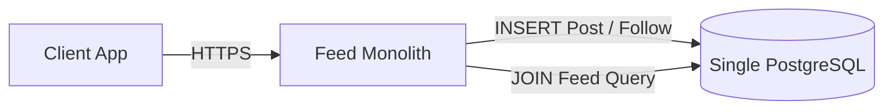
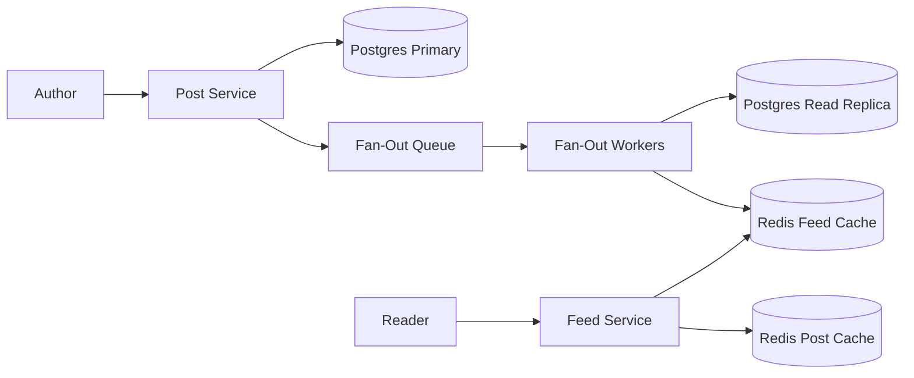
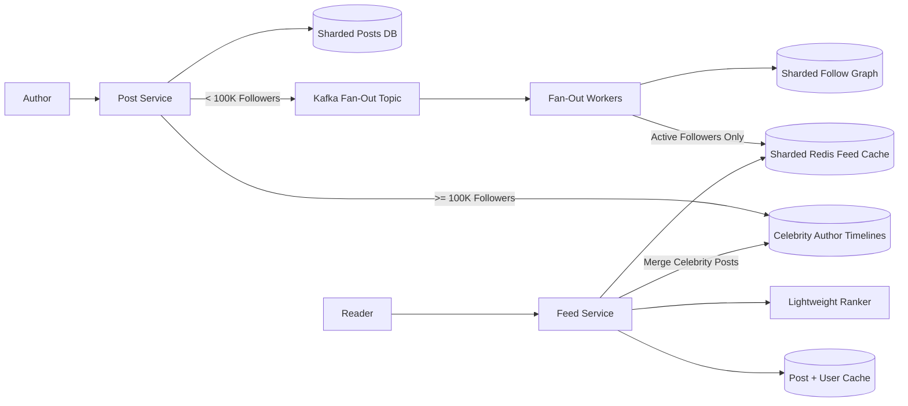
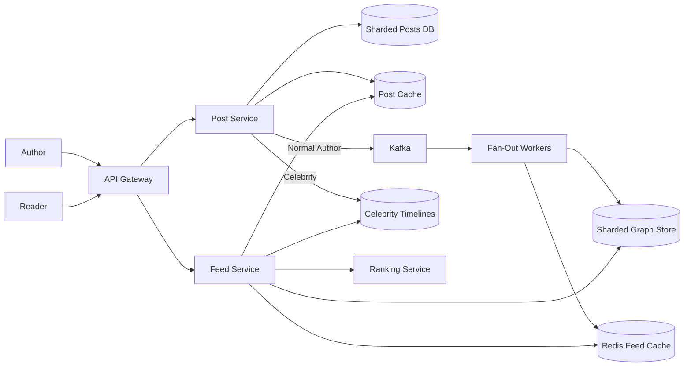
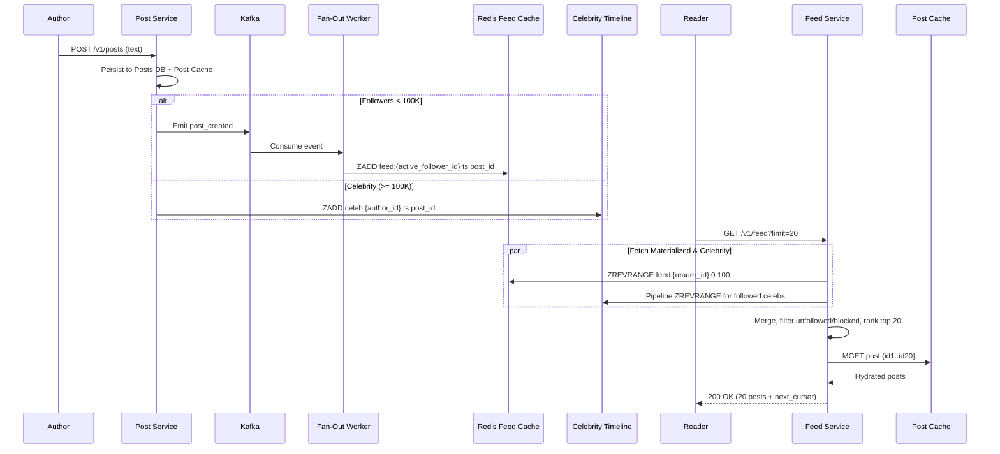

# News Feed: Full System Design Mock Interview, All 9 Steps

> **Difficulty:** Intermediate to Senior (L5/L6)
> **Prerequisites:** [Previous lesson: WhatsApp-like Messaging: Full System Design Mock Interview, All 9 Steps](../07-whatsapp-like-messaging/README.md) and the [Interview Framework track](../../21-interview-framework/README.md).
> **Estimated Reading Time:** 25–30 minutes
> **Target Audience:** Engineers practising the full 9-step system design interview on a classic prompt: a home timeline that merges and ranks posts from followed accounts at sub-200 ms latency.

> [!NOTE]
> **In one line:** A news feed is a **read-optimized materialized view** of a social graph: the defining architectural trade-off is choosing **fan-out on write** for ordinary authors (fast reads) and **fan-out on read** for celebrities (no write amplification storms).

> [!TIP]
> **The Golden Rule:** **Hybrid Fan-Out**—push post IDs into followers' Redis feed caches at write time for normal users, skip the push for celebrity accounts ($> 100\text{K}$ followers), and merge celebrity posts at read time before hydrating.

---

## 1. Clarifying Questions, Functional & Non-Functional Requirements

Open with questions, not boxes. This is the canonical **read-heavy fan-out** interview problem. Show that you understand both pure push and pure pull extremes, why each breaks at scale, and how a hybrid model combines their strengths.

### Clarifying Questions & Assumed Scope

| Question | Assumed Answer | Architectural Impact |
| :--- | :--- | :--- |
| What goes in the feed? | Posts from followed accounts, ranked by recency + light engagement | Needs candidate generation + lightweight ranking |
| Follow graph shape? | Asymmetric follow; max 5,000 following; celebrities up to 100M followers | Drives the hybrid fan-out threshold |
| Post content types? | Text + image/video CDN URLs | Feed cache stores compact `post_id`s, not full payloads |
| Freshness SLA? | New posts visible within 2–5 seconds | Async fan-out queue with fast worker SLA |
| Target scale? | 300M DAU, 10 feed loads/user/day | ~34.7K avg feed reads/s (~104K peak) |

> Say it aloud: *"Before I draw anything, let me confirm the follower asymmetry, freshness SLA, and read-to-write ratio."*

### Functional Requirements

- **Publish a post:** Authors create text/media posts that appear in followers' feeds within seconds.
- **Read home feed:** Users scroll a cursor-paginated home timeline without duplicates or skipped posts.
- **Follow / Unfollow:** Users follow or unfollow accounts, immediately affecting future feed reads.

### Non-Functional Requirements & Scope Boundaries

| Quality | Target | Why It Drives the Design |
| :--- | :--- | :--- |
| Read Latency | p99 < 200 ms | Home screen must load instantaneously |
| Freshness | < 5 seconds | Stale feeds hurt engagement |
| Availability | 99.99% | Core revenue-generating surface |
| Read/Write Bias | ~50:1 reads to posts | Optimize aggressively for the read path |

**Explicitly Out of Scope:** Ad auction insertion, deep ML feature-store training pipelines, and nested comment/like sub-systems (covered in the Social Media Platform lesson).

---

## 2. Back-of-the-Envelope Capacity Estimation

Let us derive feed read QPS, post write QPS, fan-out write amplification, and Redis feed cache RAM.

**Baseline Assumptions:**
- $\text{DAU} = 300 \times 10^6$ users
- Feed loads per user per day = $10$
- Active posters = $10\%$ of DAU, posting $2$ posts/day on average
- Average followers per normal user = $200$ (active followers = $40\%$, or $80$)
- Peak-to-average multiplier = $3\times$
- Feed cache size per active user = $800$ `post_id`s $\times 8\text{ bytes} = 6.4\text{ KB}$ (plus Redis ZSET overhead $\approx 16\text{ KB/user}$)

### Worked Equations

**1. Feed Read QPS vs. Post Write QPS:**

$$\text{Feed Reads/day} = 300 \times 10^6 \times 10 = 3 \times 10^9 \text{ reads/day}$$

$$\text{Avg Read QPS} = \frac{3 \times 10^9}{86{,}400} \approx 34{,}722 \text{ reads/s}, \quad \text{Peak Read QPS} \approx 104{,}166 \text{ reads/s}$$

$$\text{Posts/day} = (300 \times 10^6 \times 0.10) \times 2 = 60 \times 10^6 \text{ posts/day}$$

$$\text{Avg Post QPS} = \frac{60 \times 10^6}{86{,}400} \approx 694 \text{ posts/s}, \quad \text{Peak Post QPS} \approx 2{,}083 \text{ posts/s}$$

**2. Fan-Out Write Amplification:**

If we push to all $200$ followers on average:

$$\text{Avg Fan-Out Writes/s} = 694 \times 200 \approx 138{,}889 \text{ writes/s}$$

$$\text{Peak Fan-Out Writes/s} = 2{,}083 \times 200 \approx 416{,}667 \text{ writes/s}$$

Skipping inactive users (60% of followers) drops peak fan-out writes to $\sim 166{,}667\text{ writes/s}$. Contrast this with a single celebrity with $50\text{M}$ followers: one post would inject **$50\text{M}$ writes** into the queue, stalling normal users for minutes!

**3. Redis Feed Cache Memory:**

$$\text{Feed Cache RAM} = 300 \times 10^6 \times 16\text{ KB} = 4.8\text{ TB}$$

At 64 GB usable RAM per Redis node, $4.8\text{ TB} / 64\text{ GB} = 75$ Redis shards (or $\sim 150$ nodes with primary-replica pairs).

### Capacity Summary Table

| Metric | Formula | Value | Design Implication |
| :--- | :--- | :--- | :--- |
| Avg / Peak Feed Reads | $3\text{B} / 86{,}400 \times 3$ | $34.7\text{K} / 104.2\text{K reads/s}$ | Must serve from pre-computed Redis cache |
| Avg / Peak Post Writes | $60\text{M} / 86{,}400 \times 3$ | $694 / 2{,}083\text{ posts/s}$ | Very low write rate before fan-out |
| Peak Fan-Out Writes | $2{,}083 \times 200$ (or $\times 80$ active) | $416\text{K}$ ($167\text{K}$ active) writes/s | Async Kafka workers + Redis pipelining |
| Feed Cache RAM | $300\text{M} \times 16\text{ KB}$ | $4.8\text{ TB}$ | Sharded Redis Cluster (~75–150 nodes) |

---

## 3. Core API Contracts & Data Model

### REST API Contracts

| Endpoint | Purpose | Request / Response Notes |
| :--- | :--- | :--- |
| `POST /v1/posts` | Publish a new post | Body: `{ text, media_ids[] }` $\rightarrow$ Returns `{ post_id, created_at }` |
| `GET /v1/feed` | Fetch home timeline | Query: `?cursor=<encoded_ts_id>&limit=20` $\rightarrow$ Returns hydrated posts + `next_cursor` |
| `POST /v1/users/{id}/follow` | Follow an account | Updates graph & backfills recent posts into caller's feed cache |
| `DELETE /v1/users/{id}/follow` | Unfollow an account | Updates graph; posts filtered lazily at read time |

**Cursor Pagination Payload:**
`cursor = base64("1700000000001_7130316800004202496")`. Using `(score, post_id)` avoids row-shift bugs when new posts arrive while the user scrolls.

### Data Model

| Store / Table | Key Schema | Value / Columns | Why This Store |
| :--- | :--- | :--- | :--- |
| **Posts DB** | `post_id` (Snowflake) | `author_id`, `text`, `media_urls[]`, `created_at` | Sharded KV / Wide-column; immutable writes |
| **Author Timeline** | `author_id` | `ZSET(score=ts, member=post_id)` | Enables fast fan-out-on-read for celebrities |
| **Follow Graph** | `follower_id` / `followee_id` | `target_id`, `created_at` | Bidirectional adjacency lists (KV / Graph DB) |
| **Feed Cache (Redis)** | `feed:{user_id}` | `ZSET` of up to `800` `post_id`s | $O(\log N + K)$ range slice per feed load |
| **Post & User Cache** | `post:{post_id}`, `user:{user_id}` | Serialized JSON/Protobuf | Batch `MGET` hydration without DB hits |

> [!WARNING]
> **Never store full post JSON inside every follower's `feed:{user_id}` list:** Storing a 2 KB post across 200 followers wastes $400\text{ KB}$ per post, and edits/deletes become impossible to propagate. Store **only 8-byte `post_id`s** in `feed:{user_id}` and hydrate from a single shared `Post Cache` at read time.

---

## 4. Stage 1 (100 - 1K Users): Baseline Monolith & Single Database

At 100–1,000 users, **fan-out on read** via a simple SQL `JOIN` is fast, bug-free, and requires zero extra infrastructure:

1. **Web/API Monolith** handles `POST /posts`, `POST /follow`, and `GET /feed`.
2. **Single PostgreSQL** stores `users`, `follows(follower_id, followee_id)`, and `posts(post_id, author_id, body, created_at)`.
3. `GET /feed` executes:
   `SELECT p.* FROM posts p JOIN follows f ON p.author_id = f.followee_id WHERE f.follower_id = $1 ORDER BY p.created_at DESC LIMIT 20`.



**What breaks at 10K users:**
- **The `JOIN` + `ORDER BY` cliff:** As `posts` grows to millions of rows and a user follows 500 accounts, PostgreSQL must merge-sort 500 index ranges per feed load, spiking read p99 latency past 1–2 seconds.

---

## 5. Stage 2 (10K - 100K Users): Caching, Read Replicas & Async Offload

To drop feed read latency under 100 ms at 10K–100K users, we introduce **materialized feed caches** and **async fan-out**:

1. **Post Service** writes new posts to **PostgreSQL Primary** and pushes a `post_created` job to a **Task Queue (RabbitMQ/SQS)**.
2. **Fan-Out Workers** read the author's followers from a **Postgres Read Replica**, then `ZADD` the `post_id` into each follower's **Redis Feed Cache** (`ZREMRANGEBYRANK` to keep top 800).
3. **Feed Service** reads `ZREVRANGE feed:{user_id} 0 19` from Redis and hydrates `post_id`s from a **Redis Post Cache** (falling back to Read Replicas on cache miss).



**What breaks at 1M users:**
- **The Celebrity Thundering Herd:** When an account with 5M followers posts, a single fan-out job blocks the queue for minutes, delaying posts from normal users.
- **Inactive User Waste:** Pushing into Redis for 70% of followers who haven't opened the app in 30 days wastes RAM and Redis write IOPS.

---

## 6. Stage 3 (1M - 10M+ Users): Sharding, Partitioning & Multi-Region Scale

At 1M–300M+ DAU, we implement **Hybrid Fan-Out**, **Active-User Filtering**, and **Sharded Storage**:

1. **Celebrity Threshold Routing:** Authors with $\ge 100{,}000$ followers (or flagged `is_celebrity = true`) bypass the fan-out queue; their `post_id` is written only to their **Author Timeline** (`ZSET` in Redis).
2. **Kafka Partitioned Fan-Out + Priority Lanes:** Normal authors' fan-out jobs go to Kafka, partitioned by `author_id`, with active followers prioritized ahead of dormant ones.
3. **Sharded Graph & Post Stores:** Follow graph and Posts DB are sharded (e.g., Cassandra/DynamoDB/Vitess) by `user_id` and `post_id`.
4. **Multi-Region Read Replicas & Edge Hydration:** Read-only Feed Services and Redis Feed Caches are deployed per region; new posts replicate asynchronously across regions within 1–2 seconds.



---

## 7. Final Full Production Architecture & End-to-End Flows

### Complete Production Architecture



### End-to-End Hybrid Read & Write Sequence



---

## 8. Deep-Dive Bottlenecks & Algorithmic Trade-Offs

### 1. Fan-Out on Write vs. Fan-Out on Read vs. Hybrid

| Dimension | Pure Fan-Out on Write | Pure Fan-Out on Read | Hybrid (Threshold = 100K) |
| :--- | :--- | :--- | :--- |
| **Read Latency** | $O(1)$ cache slice (~5 ms) | $O(F \log N)$ merge across $F$ followed accounts (slow) | $O(1)$ cache + small $O(C)$ celeb merge (~25 ms) |
| **Celebrity Post Cost** | $50\text{M}$ writes $\rightarrow$ queue meltdown | $1$ write | $1$ write |
| **Inactive User Waste** | High unless filtered | Zero | Low (skip users inactive $> 14\text{ days}$) |

### 2. Active-User Cache Eviction & Cold-Start Backfill

- **Skip Dormant Users:** Maintain a `last_active_ts` bitmap or Redis key. Fan-out workers skip any follower inactive for $> 14\text{ days}$, cutting fan-out writes by $50\text{–}65\%$.
- **On-Demand Rebuild:** When a dormant user returns, `feed:{user_id}` is empty (cache miss). The Feed Service falls back to querying the user's top followed accounts' `Author Timelines`, rebuilds `feed:{user_id}` asynchronously, and serves the first page immediately.

### 3. Ranking & Graceful Degradation

1. **Candidate Retrieval:** Pull top 200 `post_id`s from `feed:{user_id}` + top 50 recent `post_id`s from followed celebrities.
2. **Scoring:** Lightweight linear/GBDT ranker scores candidates using `(recency_decay, author_affinity, engagement_velocity)`.
3. **Circuit-Breaker Fallback:** If the Ranking Service exceeds a 40 ms timeout, the Feed Service degrades gracefully to **pure reverse-chronological order** (`ZREVRANGE` sort) so the home screen never fails.

---

## 9. Failure Modes, Reliability & Backpressure Mitigations

| Failure Mode | User Impact | Root Cause | Mitigation |
| :--- | :--- | :--- | :--- |
| **Fan-Out Queue Backlog** | New posts take minutes to appear | Viral burst or worker crash | Autoscale Kafka consumers; separate priority topic for VIP/high-engagement authors |
| **Redis Feed Cache Shard Down** | Empty or slow feed for 1% of users | Redis node failure | Promote replica automatically; on total shard loss, fall back to read-time `Author Timeline` merge |
| **Hot Celebrity Post Hydration** | Post Cache shard CPU 100% | 10M users hydrating same `post_id` | Local in-process LRU cache (L1, 5s TTL) inside Feed Service pods + key replication (`post:{id}#1..N`) |
| **Stale Unfollow / Block Leak** | Deleted/blocked user's post appears | Post was pushed before unfollow | Filter `author_id` against current `follow_set` & `block_list` at **read time** before returning |
| **Ranking Service Timeout** | Feed endpoint 504 errors | ML model inference latency spike | 40 ms deadline + circuit breaker falling back to reverse-chronological feed |

---

## 10. Production War Story & Real-World Reference

**Real-World Reference: Twitter's Early Fan-Out Bottleneck (Justin Bieber / Lady Gaga Problem)**
In Twitter's early architecture (circa 2012, documented by Raffi Krikorian in *Timelines at Scale*), Twitter used **pure fan-out on write** into Redis timeline caches. Whenever a mega-celebrity with 30M+ followers tweeted, fan-out workers had to execute 30M Redis `LPUSH` operations. Worse, followers who replied within 5 seconds of the tweet saw the reply *before* the original tweet because the fan-out queue for the celebrity took 3–5 minutes to drain!

**The Architectural Fix:**
1. Twitter moved to **Hybrid Fan-Out**: accounts above a high-follower threshold were excluded from write-time fan-out and merged at read time from an in-memory tweet index.
2. Added **L1 in-process caching** on timeline hydration nodes so millions of concurrent reads for the same viral tweet never hit the same Redis shard.
3. Switched from pure Redis lists to **compressed `post_id` arrays** with aggressive eviction of inactive users' timelines.

---

## 11. Core Component Implementation (4 Languages)

Below is a **Hybrid Fan-Out & Read-Time Feed Merger** implemented in Go, TypeScript, Python, and C#. It demonstrates the celebrity threshold split, Redis-style ZSET feed storage, read-time celebrity merging, and lazy unfollow filtering.

````carousel
```go
package main

import (
	"fmt"
	"sort"
)

const CelebrityThreshold = 100_000

type Post struct {
	ID        int64
	AuthorID  string
	Timestamp int64
	Text      string
}

type HybridFeedEngine struct {
	followers        map[string][]string // author -> active followers
	following        map[string][]string // reader -> followed accounts
	followerCounts   map[string]int
	feedCache        map[string][]int64  // reader -> pushed post IDs
	celebTimelines   map[string][]int64  // celeb -> post IDs
	posts            map[int64]Post
}

func NewHybridFeedEngine() *HybridFeedEngine {
	return &HybridFeedEngine{
		followers:      map[string][]string{"alice": {"bob"}, "celeb1": {"bob"}},
		following:      map[string][]string{"bob": {"alice", "celeb1"}},
		followerCounts: map[string]int{"alice": 250, "celeb1": 5_000_000},
		feedCache:      make(map[string][]int64),
		celebTimelines: make(map[string][]int64),
		posts:          make(map[int64]Post),
	}
}

func (e *HybridFeedEngine) Publish(p Post) string {
	e.posts[p.ID] = p
	if e.followerCounts[p.AuthorID] >= CelebrityThreshold {
		e.celebTimelines[p.AuthorID] = append(e.celebTimelines[p.AuthorID], p.ID)
		return "fanout_on_read_celeb"
	}
	for _, f := range e.followers[p.AuthorID] {
		e.feedCache[f] = append(e.feedCache[f], p.ID)
	}
	return "fanout_on_write"
}

func (e *HybridFeedEngine) GetFeed(reader string, limit int) []Post {
	allowed := make(map[string]bool)
	var celebIDs []int64
	for _, author := range e.following[reader] {
		allowed[author] = true
		if e.followerCounts[author] >= CelebrityThreshold {
			celebIDs = append(celebIDs, e.celebTimelines[author]...)
		}
	}

	candidates := append([]int64{}, e.feedCache[reader]...)
	candidates = append(candidates, celebIDs...)

	var hydrated []Post
	for _, id := range candidates {
		if p, ok := e.posts[id]; ok && allowed[p.AuthorID] {
			hydrated = append(hydrated, p)
		}
	}
	sort.Slice(hydrated, func(i, j int) bool { return hydrated[i].Timestamp > hydrated[j].Timestamp })
	if len(hydrated) > limit {
		hydrated = hydrated[:limit]
	}
	return hydrated
}

func main() {
	eng := NewHybridFeedEngine()
	fmt.Println("Alice post:", eng.Publish(Post{101, "alice", 1000, "Coffee time"}))
	fmt.Println("Celeb post:", eng.Publish(Post{102, "celeb1", 1005, "World tour!"}))
	for _, p := range eng.GetFeed("bob", 10) {
		fmt.Printf("Feed item: id=%d author=%s text=%q\n", p.ID, p.AuthorID, p.Text)
	}
}
```
<!-- slide -->
```typescript
const CELEBRITY_THRESHOLD = 100_000;

interface Post {
  id: number;
  authorId: string;
  ts: number;
  text: string;
}

class HybridFeedEngine {
  private readonly followers = new Map<string, string[]>([["alice", ["bob"]], ["celeb1", ["bob"]]]);
  private readonly following = new Map<string, string[]>([["bob", ["alice", "celeb1"]]]);
  private readonly followerCounts = new Map<string, number>([["alice", 250], ["celeb1", 5_000_000]]);
  private readonly feedCache = new Map<string, number[]>();
  private readonly celebTimelines = new Map<string, number[]>();
  private readonly posts = new Map<number, Post>();

  publish(post: Post): string {
    this.posts.set(post.id, post);
    if ((this.followerCounts.get(post.authorId) ?? 0) >= CELEBRITY_THRESHOLD) {
      const list = this.celebTimelines.get(post.authorId) ?? [];
      list.push(post.id);
      this.celebTimelines.set(post.authorId, list);
      return "fanout_on_read_celeb";
    }
    for (const f of this.followers.get(post.authorId) ?? []) {
      const list = this.feedCache.get(f) ?? [];
      list.push(post.id);
      this.feedCache.set(f, list);
    }
    return "fanout_on_write";
  }

  getFeed(reader: string, limit = 10): Post[] {
    const followed = new Set(this.following.get(reader) ?? []);
    const candidates = [...(this.feedCache.get(reader) ?? [])];
    for (const author of followed) {
      if ((this.followerCounts.get(author) ?? 0) >= CELEBRITY_THRESHOLD) {
        candidates.push(...(this.celebTimelines.get(author) ?? []));
      }
    }
    return candidates
      .map((id) => this.posts.get(id))
      .filter((p): p is Post => p !== undefined && followed.has(p.authorId))
      .sort((a, b) => b.ts - a.ts)
      .slice(0, limit);
  }
}

const eng = new HybridFeedEngine();
console.log("Alice:", eng.publish({ id: 101, authorId: "alice", ts: 1000, text: "Coffee time" }));
console.log("Celeb:", eng.publish({ id: 102, authorId: "celeb1", ts: 1005, text: "World tour!" }));
console.log("Bob feed:", eng.getFeed("bob"));
```
<!-- slide -->
```python
from dataclasses import dataclass
from typing import Dict, List

CELEBRITY_THRESHOLD = 100_000


@dataclass(frozen=True)
class Post:
    post_id: int
    author_id: str
    ts: int
    text: str


class HybridFeedEngine:
    def __init__(self) -> None:
        self.followers: Dict[str, List[str]] = {"alice": ["bob"], "celeb1": ["bob"]}
        self.following: Dict[str, List[str]] = {"bob": ["alice", "celeb1"]}
        self.follower_counts: Dict[str, int] = {"alice": 250, "celeb1": 5_000_000}
        self.feed_cache: Dict[str, List[int]] = {}
        self.celeb_timelines: Dict[str, List[int]] = {}
        self.posts: Dict[int, Post] = {}

    def publish(self, post: Post) -> str:
        self.posts[post.post_id] = post
        if self.follower_counts.get(post.author_id, 0) >= CELEBRITY_THRESHOLD:
            self.celeb_timelines.setdefault(post.author_id, []).append(post.post_id)
            return "fanout_on_read_celeb"
        for follower in self.followers.get(post.author_id, []):
            self.feed_cache.setdefault(follower, []).append(post.post_id)
        return "fanout_on_write"

    def get_feed(self, reader: str, limit: int = 10) -> List[Post]:
        followed = set(self.following.get(reader, []))
        candidates = list(self.feed_cache.get(reader, []))
        for author in followed:
            if self.follower_counts.get(author, 0) >= CELEBRITY_THRESHOLD:
                candidates.extend(self.celeb_timelines.get(author, []))

        hydrated = [
            self.posts[pid]
            for pid in candidates
            if pid in self.posts and self.posts[pid].author_id in followed
        ]
        hydrated.sort(key=lambda p: p.ts, reverse=True)
        return hydrated[:limit]


if __name__ == "__main__":
    eng = HybridFeedEngine()
    print("Alice:", eng.publish(Post(101, "alice", 1000, "Coffee time")))
    print("Celeb:", eng.publish(Post(102, "celeb1", 1005, "World tour!")))
    for item in eng.get_feed("bob"):
        print(item)
```
<!-- slide -->
```csharp
using System;
using System.Collections.Generic;
using System.Linq;

public record Post(long Id, string AuthorId, long Ts, string Text);

public sealed class HybridFeedEngine
{
    private const int CelebrityThreshold = 100_000;
    private readonly Dictionary<string, List<string>> _followers = new() { ["alice"] = new() { "bob" }, ["celeb1"] = new() { "bob" } };
    private readonly Dictionary<string, List<string>> _following = new() { ["bob"] = new() { "alice", "celeb1" } };
    private readonly Dictionary<string, int> _followerCounts = new() { ["alice"] = 250, ["celeb1"] = 5_000_000 };
    private readonly Dictionary<string, List<long>> _feedCache = new();
    private readonly Dictionary<string, List<long>> _celebTimelines = new();
    private readonly Dictionary<long, Post> _posts = new();

    public string Publish(Post post)
    {
        _posts[post.Id] = post;
        if (_followerCounts.GetValueOrDefault(post.AuthorId) >= CelebrityThreshold)
        {
            if (!_celebTimelines.TryGetValue(post.AuthorId, out var cList))
                _celebTimelines[post.AuthorId] = cList = new List<long>();
            cList.Add(post.Id);
            return "fanout_on_read_celeb";
        }
        foreach (var f in _followers.GetValueOrDefault(post.AuthorId, new()))
        {
            if (!_feedCache.TryGetValue(f, out var fList))
                _feedCache[f] = fList = new List<long>();
            fList.Add(post.Id);
        }
        return "fanout_on_write";
    }

    public List<Post> GetFeed(string reader, int limit = 10)
    {
        var followed = new HashSet<string>(_following.GetValueOrDefault(reader, new()));
        var candidates = new List<long>(_feedCache.GetValueOrDefault(reader, new()));
        foreach (var author in followed)
        {
            if (_followerCounts.GetValueOrDefault(author) >= CelebrityThreshold)
                candidates.AddRange(_celebTimelines.GetValueOrDefault(author, new()));
        }
        return candidates
            .Where(id => _posts.TryGetValue(id, out var p) && followed.Contains(p.AuthorId))
            .Select(id => _posts[id])
            .OrderByDescending(p => p.Ts)
            .Take(limit)
            .ToList();
    }
}

public static class Program
{
    public static void Main()
    {
        var eng = new HybridFeedEngine();
        Console.WriteLine(eng.Publish(new Post(101, "alice", 1000, "Coffee time")));
        Console.WriteLine(eng.Publish(new Post(102, "celeb1", 1005, "World tour!")));
        foreach (var p in eng.GetFeed("bob"))
            Console.WriteLine($"Feed: {p.Id} by {p.AuthorId} -> {p.Text}");
    }
}
```
````

---

## 12. Verification, Load Testing & CLI Diagnostics

```bash
# 1. Inspect a user's Redis ZSET feed cache (newest 10 post IDs with timestamps)
redis-cli -c ZREVRANGE "feed:user_10492" 0 9 WITHSCORES

# 2. Check Kafka fan-out consumer group lag to ensure < 5s freshness SLA
kafka-consumer-groups.sh --bootstrap-server kafka:9092 --describe --group feed-fanout-workers

# 3. Verify cursor pagination returns zero duplicates across page boundaries
CURSOR=$(curl -s "https://api.example.com/v1/feed?limit=20" | jq -r '.next_cursor')
curl -s "https://api.example.com/v1/feed?limit=20&cursor=$CURSOR" | jq '.posts | length'

# 4. Benchmark 50K RPS read load against Feed Service with wrk
wrk -t12 -c400 -d60s -H "Authorization: Bearer $TOKEN" "https://api.example.com/v1/feed?limit=20"
```

---

## 13. Common Interview Mistakes & Red Flags

- **Proposing pure fan-out on write for everyone:** Collapses immediately when a celebrity with 50M followers posts.
- **Proposing pure fan-out on read for everyone:** Forces $O(F)$ scatter-gather DB queries on every home-screen load, blowing the 200 ms p99 budget.
- **Caching full post objects inside every user's feed list:** Multiplies memory usage by $200\times$ and makes post edits/deletes stale.
- **Using `OFFSET` pagination on a live feed:** New posts shift offsets, causing duplicate items across page boundaries.
- **Pushing to inactive users:** Wastes 50%+ of Redis RAM and fan-out worker CPU on users who haven't logged in for months.
- **Forgetting read-time privacy/unfollow filtering:** A user who unfollows or blocks an author will still see their previously pushed posts unless filtered at read time.

---

## 14. Key Terminology & Glossary

| Key Term | Definition |
| :--- | :--- |
| **Fan-Out on Write (Push)** | Pre-computing a user's feed by pushing `post_id`s to followers' caches when a post is created |
| **Fan-Out on Read (Pull)** | Dynamically querying and merging followed authors' timelines when the reader loads their feed |
| **Hybrid Fan-Out** | Pushing for normal authors ($< 100\text{K}$ followers) and pulling/merging for celebrities at read time |
| **Feed Hydration** | Resolving compact `post_id`s from the feed cache into full post + author objects via batch `MGET` |
| **Redis ZSET** | Sorted set storing `(score=timestamp, member=post_id)` for $O(\log N + K)$ reverse-chronological slicing |
| **Cursor Pagination** | Stateless paging using an opaque `(timestamp, post_id)` token instead of mutable integer offsets |
| **Hot Key Replication** | Duplicating a viral `post:{id}` key across $N$ cache suffixes to spread read QPS |
| **Active-User Filtering** | Skipping write-time fan-out for dormant users and rebuilding their feed on demand when they return |
| **Candidate Generation** | Gathering the top $N$ unranked `post_id`s from cache + celebrity timelines before scoring |
| **Graceful Degradation** | Falling back to reverse-chronological order if the ML Ranking Service breaches its latency budget |

---

## 15. Interview Follow-Up Questions (12 Q&As)

### Basic Conceptual Questions

<details>
<summary><strong>Q1: Why is Hybrid Fan-Out better than pure Push or pure Pull? [BASIC]</strong></summary>

Pure Push gives $O(1)$ reads but melts down on celebrity posts. Pure Pull has zero write amplification but slow reads ($O(F)$ scatter-gather). Hybrid Push+Pull gives $O(1)$ cache reads for 99.9% of followed accounts while keeping celebrity writes at $O(1)$.

</details>

<details>
<summary><strong>Q2: What should be stored inside each user's Redis feed cache? [BASIC]</strong></summary>

Only compact 8-byte `post_id`s (and optionally `author_id` + `timestamp` score in a Redis ZSET), capped at ~800 items. Full post text, media URLs, and author avatars are hydrated at read time from a shared Post/User Cache.

</details>

<details>
<summary><strong>Q3: How do you handle unfollowing someone? [BASIC]</strong></summary>

Remove the edge from the Follow Graph immediately. At read time, the Feed Service checks candidate `post_id`s against the reader's current follow/block set and filters out unfollowed authors lazily—avoiding an expensive scan-and-delete across Redis feed caches.

</details>

<details>
<summary><strong>Q4: Why use cursor pagination instead of page numbers? [BASIC]</strong></summary>

Because new posts are constantly inserted at the top of the feed. With `OFFSET 20`, 5 new posts arriving while the user reads page 1 would cause the last 5 posts of page 1 to reappear at the top of page 2. A `(ts, post_id)` cursor anchors the exact position.

</details>

### Scenario-Based Architecture Questions

<details>
<summary><strong>Q5: How do you handle a user who returns after 6 months of inactivity? [SCENARIO]</strong></summary>

Because we skipped fan-out writes while they were dormant, their `feed:{user_id}` cache is empty. On cache miss, the Feed Service pulls the last 20–50 posts from each of their followed accounts' `Author Timelines`, merges and ranks them for an immediate response, and asynchronously warms `feed:{user_id}`.

</details>

<details>
<summary><strong>Q6: When a user follows a new account, should their old posts appear in the feed? [SCENARIO]</strong></summary>

Yes—on `POST /follow`, enqueue a lightweight backfill job that fetches the followee's latest 20 `post_id`s from their `Author Timeline` and `ZADD`s them into the follower's `feed:{user_id}` cache (if the followee is not a celebrity).

</details>

<details>
<summary><strong>Q7: How do you keep a viral celebrity post from overloading the Post Cache? [SCENARIO]</strong></summary>

Use an **L1 in-process LRU cache** (e.g., 5-second TTL) inside each Feed Service pod so hot posts are served from local RAM, and replicate ultra-hot keys across $N$ Redis shards (`post:{id}#0..9`) with random read selection.

</details>

<details>
<summary><strong>Q8: How do you integrate ML ranking without breaking the 200 ms p99 latency SLA? [SCENARIO]</strong></summary>

Retrieve a bounded candidate window (e.g., top 200 items from cache + celeb merge), send only lightweight feature IDs to the Ranking Service with a strict 40 ms timeout, and attach a circuit breaker that falls back to reverse-chronological sorting if the ranker times out.

</details>

### Advanced & Tricky Interview Questions

<details>
<summary><strong>Q9: What happens if a user follows 500 celebrities? Doesn't fan-out-on-read get slow? [TRICKY]</strong></summary>

Yes—if a reader follows 500 celebrities, merging 500 `Author Timelines` at read time increases tail latency. Mitigate by: (1) pipelining all 500 `ZREVRANGE 0 5` calls in parallel batches across Redis shards, (2) caching the merged celebrity slice per reader for 30 seconds, or (3) prioritizing the top 50 most-interacted celebrities first.

</details>

<details>
<summary><strong>Q10: How do you handle post deletions and edits across 10M cached feeds? [TRICKY]</strong></summary>

Because `feed:{user_id}` only stores `post_id`s, an edit to `post_id` is updated once in the Posts DB and Post Cache—every feed automatically hydrates the updated text. For deletions, mark the post `deleted=true` in Post Cache (or delete it so hydration returns `nil` and the Feed Service skips it).

</details>

<details>
<summary><strong>Q11: How do you prevent a single Kafka consumer group from stalling when a medium-sized user (90K followers) posts right before a normal user (50 followers)? [TRICKY]</strong></summary>

Split fan-out into **tiered Kafka topics** (`fanout.small` for $< 1\text{K}$ followers, `fanout.medium` for $1\text{K–}100\text{K}$ followers) with dedicated worker pools, or chunk large fan-outs into sub-batches of 500 followers each so no single message blocks a partition.

</details>

<details>
<summary><strong>Q12: How do you deduplicate posts if a user both follows an author and sees their post via a repost/retweet? [TRICKY]</strong></summary>

Use `post_id` as the unique member in the Redis `ZSET` (so `ZADD` naturally deduplicates identical `post_id`s) and perform a final `seen_root_post_ids` hash-set pass during candidate merging in the Feed Service before hydration.

</details>

---

## 16. One-Page Master Cheat Sheet

```text
+-----------------------------------------------------------------------------+
|                      NEWS FEED — MASTER CHEAT SHEET                         |
+-----------------------------------------------------------------------------+
| SCALE       : 300M DAU | 34.7K avg / 104K peak reads/s | 694 posts/s | 4.8TB|
| GOLDEN RULE : Hybrid Fan-Out: Push for normal authors (<100K followers),    |
|               Pull/Merge at read time for celebrities. Cache IDs, not JSON! |
+-----------------------------------------------------------------------------+
| STAGE 1 (1K)   : API Monolith -> Single Postgres (SQL JOIN on follows+posts)|
| STAGE 2 (100K) : Post Service + Queue + Fan-Out Workers -> Redis Feed Cache |
| STAGE 3 (300M) : Sharded DBs + Kafka Tiered Fan-Out + Celeb Merge + Ranker  |
+-----------------------------------------------------------------------------+
| HOT PATH    : GET /feed -> ZREVRANGE feed:{uid} + Celeb Timelines -> Filter |
|               Unfollowed/Blocked -> Rank (40ms cap) -> MGET Post Cache      |
| BOTTLENECKS : Celebrity write storms (hybrid!), inactive user waste (skip > |
|               14d), viral hydration hot keys (L1 local cache), page drift.  |
+-----------------------------------------------------------------------------+
```

| Step | Key Decision |
| :--- | :--- |
| **Clarify** | Asymmetric follow, 5K max following, 100M celebs, < 5s freshness, 300M DAU |
| **Estimate** | ~50:1 read/write ratio, 104K peak reads/s, 4.8 TB Redis feed cache |
| **API / Data** | `GET /v1/feed?cursor=`, Redis `ZSET` of `post_id`s (cap 800), sharded Posts/Graph |
| **Deep Dives** | Hybrid fan-out threshold, active-user filtering, L1 hydration cache, ranker fallback |
| **Failures** | Lazy unfollow filter at read time, tiered Kafka topics, cold-start backfill |

---

## Further Reading

- Twitter Engineering: *Timelines at Scale* (InfoQ talk by Raffi Krikorian).
- Meta Engineering: *Scaling the News Feed* & *Multifeed Architecture*.
- Alex Xu, *System Design Interview Vol. 1*, Chapter 11: *Design a News Feed System*.

---

## Next

Continue with [Social Media Platform: Full System Design Mock Interview, All 9 Steps](../09-social-media-platform/README.md).
