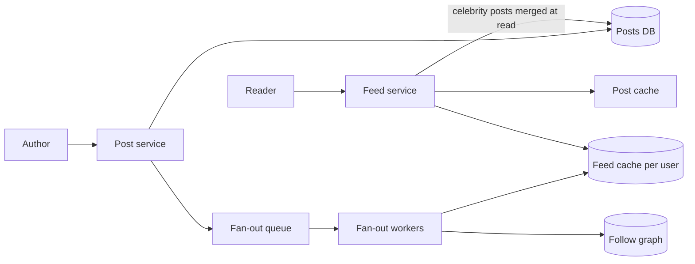

# News Feed: Full System Design Mock Interview, All 9 Steps

> **Prerequisites:** [Previous lesson: WhatsApp-like Messaging: Full System Design Mock Interview, All 9 Steps](../07-whatsapp-like-messaging/README.md) and the [Interview Framework track](../../21-interview-framework/README.md).
> **Estimated Reading Time:** 15–20 minutes
> **Target Audience:** Engineers practising the full 9-step system design interview on a classic prompt: a home timeline that merges posts from the accounts you follow.

> [!NOTE]
> **In one line:** A news feed is a **read-optimised materialised view**: the key choice is whether to build each user's feed when someone posts (fan-out on write) or when the user opens the app (fan-out on read).

> [!TIP]
> **The Golden Rule:** Fan out on write for ordinary users so reads are one cache lookup, and fan out on read for celebrities so one post does not trigger millions of writes.

---

## Step 1. Clarify the Problem

Open with questions, not boxes. This is the classic hybrid fan-out question. Show both extremes, then combine them.

**Questions to ask the interviewer, and the answer we assume:**

| Question | Assumed answer |
| :--- | :--- |
| What goes in the feed? | Posts from followed accounts, newest first plus light ranking |
| Follow limits? | Up to 5,000 followed, accounts with up to 100M followers |
| Media? | Text and image URLs |
| Freshness? | New posts visible within seconds |
| Scale? | 300M DAU, each opens the feed 10 times a day |

> Say it aloud: *"Before I draw anything, let me confirm the scope and the numbers."* That one sentence earns the first minutes of the interview.

---

## Step 2. Functional and Non-Functional Requirements

**Functional (what the system does):**

- Publish a post.
- Show a user their feed, paginated.
- Follow and unfollow accounts.
- Show new posts promptly.

**Non-functional (how well it does it):**

| Quality | Target | Why it drives the design |
| :--- | :--- | :--- |
| Read latency | p99 under 200 ms | The feed is the home screen |
| Freshness | Seconds | Stale feeds feel broken |
| Availability | 99.99% | Core surface |
| Scalability | Reads dominate by 100x | Optimise the read path |

---

## Step 3. Scope: In and Out

**In scope:** Post, feed read, follow graph, fan-out.

**Out of scope (say it explicitly, then move on):**

- Ads insertion.
- The ML ranking model itself.
- Comments and likes internals.

---

## Step 4. Capacity Estimation

Assumptions: 300M DAU, 10 feed loads per user per day, 2 posts per user per day from 10% of users, average 200 followers.

| Quantity | Calculation | Result |
| :--- | :--- | :--- |
| Feed reads per second | `dau * loads / 86400` | **34.7K reads/s** |
| Posts per second | `dau * posters * posts / 86400` | **694 posts/s** |
| Fan-out writes per second | `posts_per_second * followers` | **138.9K writes/s** |

**What the numbers tell you:** 35K feed reads per second against 700 posts per second shows a 50 to 1 read bias. Fan-out on write turns each post into about 200 cache writes (140K per second), which is fine; but one celebrity with 100M followers would be 100M writes, which is why celebrities are handled differently.

---

## Step 5. API Design

| Endpoint | Purpose | Notes |
| :--- | :--- | :--- |
| `POST /v1/posts` | Publish | Body: text, media ids. Returns post id. |
| `GET /v1/feed?cursor=` | Home feed | Cursor pagination, returns post ids hydrated into posts. |
| `POST /v1/users/{id}/follow` | Follow | Updates the graph and backfills the feed. |
| `DELETE /v1/users/{id}/follow` | Unfollow | Removes their posts from the feed lazily. |

Use cursor pagination (post id or timestamp), not page numbers, because the feed changes while the user scrolls.

---

## Step 6. Data Model

| Entity / Store | Key fields | Why this store |
| :--- | :--- | :--- |
| Posts store (partition by post id) | `post_id`, `author`, `text`, `media`, `ts` | Immutable, hot ones cached |
| Follow graph | `follower`, `followee` | Adjacency lists in a key-value or graph store |
| Feed cache (Redis list per user) | `user_id` to list of post ids | The materialised view, trimmed to about 800 items |
| User/post caches | Hydration data | Avoid database hits per item |

The feed cache stores only post ids; the service hydrates them from a post cache. That keeps the per-user list small.

---

## Step 7. High-Level Architecture



**Walk the diagram in this order:** a post is stored, then workers push its id into each follower's feed cache; a read fetches the cached ids, merges in recent celebrity posts, and hydrates them.

---

## Step 8. Deep Dives and Bottlenecks

### 1. Fan-out on write versus read

On write: reads are a single cache read, but a celebrity post costs millions of writes and most go to inactive users. On read: writes are cheap but each feed load queries every followed account, which is slow. **Hybrid**: push for normal authors, and for accounts above a follower threshold (say 100K) skip the push and merge their recent posts at read time.

### 2. Skipping inactive users

Do not fan out to users who have not opened the app recently; build their feed on demand when they return. This often cuts fan-out writes by more than half. Cap each cached feed at a few hundred ids.

### 3. Ranking and pagination

Fetch a candidate window, score by recency plus engagement, and return a page with a cursor. Cache the ranked page briefly. Keep a feature flag to fall back to pure reverse-chronological order if ranking is slow.

---

## Step 9. Trade-offs, Failures and Security

**Trade-offs to state aloud:**

| Decision | Option A | Option B | Pick and why |
| :--- | :--- | :--- | :--- |
| Fan-out | On write | On read | Hybrid: write for normal users, read for celebrities |
| Feed cache content | Full posts | Post ids only | Ids: small, and hydration stays fresh |
| Consistency | Strong | Eventual | Eventual: seconds of lag is acceptable |

**Failure modes and mitigations:**

| Failure | What users see | Mitigation |
| :--- | :--- | :--- |
| Fan-out queue backlog | Delayed posts | Autoscale workers, prioritise active users |
| Cache loss | Empty feed | Rebuild from the graph and recent posts on demand |
| Hot celebrity post | Read spike | Cache the post and CDN media |

**Security and abuse:** Respect blocks and private accounts at read time, not only at fan-out, because relationships change after a post is pushed. Rate-limit posting and follows.

---

## Runnable Example: Push or pull by follower count

This hybrid rule decides how a post is distributed and counts the writes it costs.

```python
THRESHOLD = 100_000

def distribute(author_followers, active_ratio=0.4):
    if author_followers >= THRESHOLD:
        return "pull at read time", 0
    return "push to feeds", int(author_followers * active_ratio)

for f in (200, 50_000, 5_000_000):
    print(f, distribute(f))
```

Output (produced by running this exact code):

```text
200 ('push to feeds', 80)
50000 ('push to feeds', 20000)
5000000 ('pull at read time', 0)
```

Normal authors cost one cache write per active follower; the 5M-follower account costs zero writes at post time and is merged when a follower reads.

---

## Common Mistakes

- Pure fan-out on write for celebrities.
- Pure fan-out on read for everyone.
- Caching full post bodies in every feed.
- Page-number pagination on a moving list.
- Pushing to inactive users.

---

## Interview Questions and Answers

<details>
<summary><strong>Q1: Fan-out on write or read?</strong></summary>

Both. Push for typical authors so reads are cheap, pull for very popular authors to avoid millions of writes, and merge at read time.

</details>

<details>
<summary><strong>Q2: What lives in the feed cache?</strong></summary>

A capped list of post ids per user, hydrated from a post cache at read time.

</details>

<details>
<summary><strong>Q3: How do you handle unfollow?</strong></summary>

Filter by the current follow set at read time; clean the cached list lazily.

</details>

<details>
<summary><strong>Q4: How do you keep it fresh?</strong></summary>

Fan-out workers consume a queue within seconds; a pull for celebrity posts always sees the latest.

</details>

<details>
<summary><strong>Q5: How do you paginate?</strong></summary>

A cursor of the last seen post id or timestamp, so inserts do not shift pages.

</details>

---

## One-Page Cheat Sheet

| Step | What to say or draw |
| :--- | :--- |
| Clarify | Follow graph, ranking, 300M DAU |
| Capacity | 35K reads/s, 700 posts/s, 140K fan-out writes/s |
| API | post, feed with cursor, follow |
| Data | Posts, graph, per-user feed cache of ids |
| Deep dive | Hybrid fan-out, skip inactive, ranking |
| Trade-off | Eventual consistency for speed |

---

## Further Reading

- Twitter engineering, *Timelines at scale* (InfoQ talk by Raffi Krikorian).
- Facebook, *Scaling the News Feed* talks.

---

## Next

Continue with [Social Media Platform: Full System Design Mock Interview, All 9 Steps](../09-social-media-platform/README.md).
