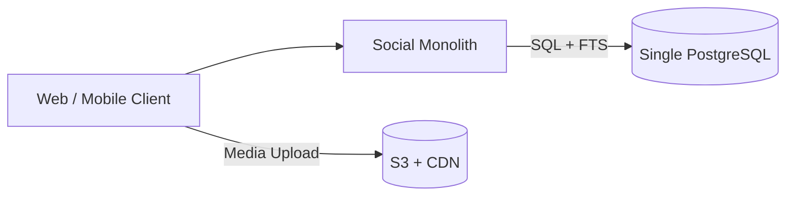
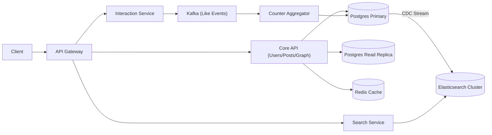
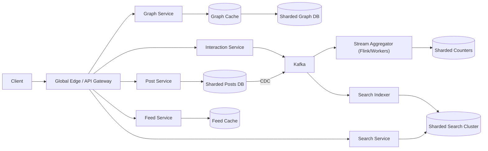
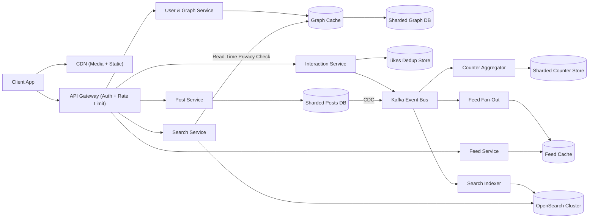
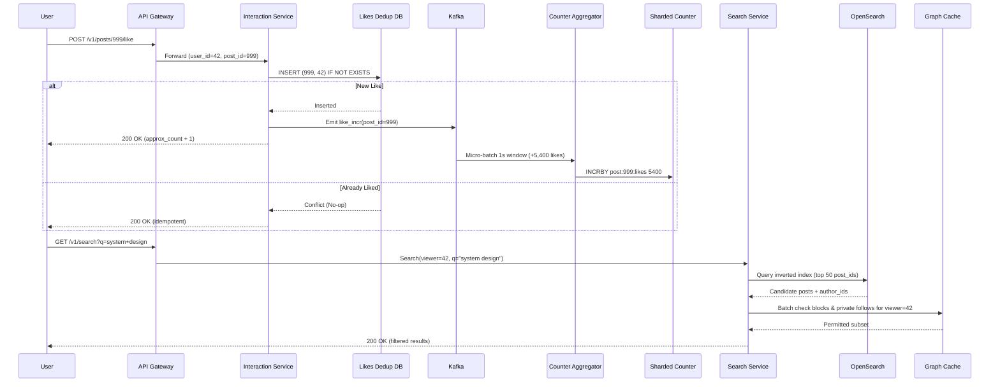

# Social Media Platform: Full System Design Mock Interview, All 9 Steps

> **Difficulty:** Senior to Staff (L6+)
> **Prerequisites:** [Previous lesson: News Feed: Full System Design Mock Interview, All 9 Steps](../08-news-feed/README.md) and the [Interview Framework track](../../21-interview-framework/README.md).
> **Estimated Reading Time:** 25–30 minutes
> **Target Audience:** Engineers practising the full 9-step system design interview on a broad platform prompt: a complete social network combining profiles, a follow graph, posts, likes/comments, feeds, and search.

> [!NOTE]
> **In one line:** A social media platform is **several distinct data systems orchestrated around one social graph**—user/graph, posts, interactions/counters, feeds, and search—where each subsystem chooses the weakest consistency model it can safely tolerate.

> [!TIP]
> **The Golden Rule:** Decompose by **access pattern and consistency tier**. Keep follows, blocks, and privacy settings strongly consistent; make feeds, like counts, and search indexes eventually consistent via event logs and CDC streams.

---

## 1. Clarifying Questions, Functional & Non-Functional Requirements

Open with questions, not boxes. After the News Feed lesson, the interviewer widens the aperture: they want to see how you prevent one giant monolithic database from collapsing under conflicting workloads (graph traversals, hot viral counters, full-text search, and feed reads).

### Clarifying Questions & Assumed Scope

| Question | Assumed Answer | Architectural Impact |
| :--- | :--- | :--- |
| Core user actions? | Profiles, follow, post, like, comment, home feed, search | Requires 5 specialized subsystems |
| Relationship model? | Directed asymmetric follow (Twitter/Instagram style) | Bidirectional adjacency lists (`following` + `followers`) |
| Privacy model? | Public & private accounts + user blocks | Must enforce permissions at **read time** across all surfaces |
| Content types? | Text, images, short video URLs | Media offloaded to S3 + CDN |
| Target scale? | 500M DAU, 1B posts/day, 10 likes/post avg | ~11.6K posts/s, ~116K likes/s, ~5 TB/day post data |

> Say it aloud: *"Before I draw anything, let me confirm the consistency requirements across follows, counters, and search."*

### Functional Requirements

- **Identity & Follow Graph:** Create/update profiles, follow/unfollow users, block accounts, and toggle private mode.
- **Posts & Media:** Publish posts with text and media attachments; view user profile timelines.
- **Interactions:** Idempotent like/unlike and nested comments with fast displayed counts.
- **Discovery & Feed:** Personalized home feed plus keyword/username search.

### Non-Functional Requirements & Scope Boundaries

| Quality | Target | Why It Drives the Design |
| :--- | :--- | :--- |
| Availability | 99.99% for reads/feeds | Social apps must remain responsive during viral events |
| Latency | p99 < 300 ms (feed & search) | Sub-second UX drives daily engagement |
| Consistency | Strong for follows/privacy; eventual for counts/search | Prevents security leaks while scaling hot counters |
| Scale | Billions of graph edges & 1.8 PB/yr posts | Demands sharded storage + tiered archiving |

**Explicitly Out of Scope:** Ad targeting/bidding, ML content moderation classifiers, and 1:1 direct messaging (covered in the Chat lesson).

---

## 2. Back-of-the-Envelope Capacity Estimation

Let us derive write QPS for posts and interactions, viral hot-key contention, and annual storage.

**Baseline Assumptions:**
- $\text{DAU} = 500 \times 10^6$ users
- Posts per day = $1 \times 10^9$ posts/day
- Average likes per post = $10$ (total $10 \times 10^9$ likes/day)
- Average comments per post = $1$ ($1 \times 10^9$ comments/day)
- Average post payload + metadata = $5\text{ KB}$ (excluding media blobs on CDN)
- Peak-to-average multiplier = $3\times$
- Average follows per user = $250$ ($125\text{B}$ graph edges for 500M DAU)

### Worked Equations

**1. Post & Interaction Throughput (QPS):**

$$\text{Avg Post QPS} = \frac{1 \times 10^9}{86{,}400} \approx 11{,}574 \text{ posts/s}, \quad \text{Peak} \approx 34{,}722 \text{ posts/s}$$

$$\text{Avg Like QPS} = \frac{10 \times 10^9}{86{,}400} \approx 115{,}740 \text{ likes/s}, \quad \text{Peak} \approx 347{,}222 \text{ likes/s}$$

Notice that interactions outnumber posts by **$10\times$**, and on a viral celebrity post, $50{,}000+\text{ likes/s}$ can hit a **single `post_id`**!

**2. Post Storage & Graph Edge Storage:**

$$\text{Daily Post Storage} = 1 \times 10^9 \times 5\text{ KB} = 5\text{ TB/day}$$

$$\text{Annual Post Storage (1x)} = 5\text{ TB/day} \times 365 \approx 1.825\text{ PB/year}$$

With $3\times$ replication, raw post storage grows by $\sim 5.5\text{ PB/year}$, requiring sharded storage and cold-tier compression/archiving.

$$\text{Graph Edges (bidirectional)} = 500 \times 10^6 \times 250 \times 2 = 250 \times 10^9 \text{ edge rows}$$

At $32\text{ bytes/edge}$ (`(u1, u2, ts)`), raw graph size is $250 \times 10^9 \times 32\text{ B} = 8\text{ TB}$—small enough to cache hot adjacency lists in RAM!

### Capacity Summary Table

| Metric | Formula | Value | Design Implication |
| :--- | :--- | :--- | :--- |
| Avg / Peak Posts | $1\text{B} / 86{,}400 \times 3$ | $11.6\text{K} / 34.7\text{K posts/s}$ | Sharded wide-column / Vitess DB |
| Avg / Peak Likes | $10\text{B} / 86{,}400 \times 3$ | $115.7\text{K} / 347.2\text{K likes/s}$ | Event log + micro-batch / sharded counters |
| Annual Post Storage | $5\text{ TB/d} \times 365$ | $1.825\text{ PB/year}$ (1x) | Sharded by `post_id` + cold S3 tiering |
| Bidirectional Graph | $500\text{M} \times 250 \times 2 \times 32\text{ B}$ | $\sim 8\text{ TB}$ | Sharded KV adjacency lists + TAO-style cache |

---

## 3. Core API Contracts & Data Model

### REST / GraphQL API Contracts

| Endpoint | Purpose | Consistency & Idempotency Notes |
| :--- | :--- | :--- |
| `POST /v1/users/{id}/follow` | Follow a user | Strongly consistent graph write; checks block list |
| `POST /v1/posts` | Create post | Returns `post_id` (Snowflake); emits CDC event |
| `POST /v1/posts/{id}/like` | Like a post | **Idempotent** on `(post_id, user_id)`; returns approx count |
| `POST /v1/posts/{id}/comments` | Add comment | Cursor-paginated on `GET /v1/posts/{id}/comments` |
| `GET /v1/feed` | Home timeline | Hydrated from Feed Service (see Lesson 08) |
| `GET /v1/search?q=...&type=posts` | Search users & posts | Backed by Elasticsearch/OpenSearch + read-time privacy filter |

### Data Model Across Subsystems

| Subsystem | Store | Key / Partitioning | Consistency Model |
| :--- | :--- | :--- | :--- |
| **User & Graph** | Sharded KV / MySQL (Vitess) + TAO Cache | `following:{u1}` & `followers:{u2}` | **Strong** on write; cached reads |
| **Posts** | Sharded Wide-Column / SQL | Partition by `post_id` (or `author_id` for profile) | Write quorum; immutable body |
| **Like Set (Idempotency)** | Sharded KV / Cassandra | `(post_id, user_id)` | Prevents double-liking |
| **Like Counters** | Sharded Counter / Redis + DB | `(post_id, shard_0..15)` | **Eventual** (micro-batched every 1–2s) |
| **Search Index** | Elasticsearch / OpenSearch | Inverted index on `text`, `username`, `hashtags` | **Eventual** (via Kafka CDC stream) |

> [!WARNING]
> **Never combine the idempotency check and the counter increment into a single hot SQL row transaction:** `BEGIN; INSERT INTO likes...; UPDATE posts SET like_count = like_count + 1 WHERE id = 999; COMMIT;` acquires an exclusive row lock on `post 999`. Under 50K likes/sec, lock contention queues up all DB connections and crashes the database.

---

## 4. Stage 1 (100 - 1K Users): Baseline Monolith & Single Database

At 100–1,000 users, a modular monolith backed by a single PostgreSQL instance is clean and sufficient:

1. **Social Monolith** exposes `/users`, `/follow`, `/posts`, `/like`, `/feed`, and `/search`.
2. **Single PostgreSQL** stores all tables (`users`, `follows`, `posts`, `likes`, `comments`), using `ILIKE '%query%'` or a basic `GIN` full-text index for search.
3. **Media files** are uploaded directly to **S3** via pre-signed URLs.



**What breaks at 10K users:**
- **Row lock contention on viral posts:** `UPDATE posts SET like_count = like_count + 1` serializes concurrent likes on a popular post.
- **Full-text search I/O:** PostgreSQL `GIN` index updates and `ILIKE` scans compete for buffer pool RAM with transactional writes.

---

## 5. Stage 2 (10K - 100K Users): Caching, Read Replicas & Async Offload

At 10K–100K users, we split the monolith's hottest bottlenecks—**search**, **counters**, and **graph reads**:

1. **Read Replicas + Redis Cache:** Profile lookups and hot adjacency lists (`followers`/`following`) are cached in **Redis**; read traffic routes to **Postgres Read Replicas**.
2. **Async Like Counter Pipeline:** `POST /like` writes `(post_id, user_id)` to the `likes` store/log and pushes a `+1` event to **RabbitMQ/Kafka**. A **Counter Aggregator** flushes summed increments every 1 second.
3. **Dedicated Search Cluster:** A **Change Data Capture (CDC)** / Debezium worker streams new `posts` and `users` into **Elasticsearch** so search queries never touch PostgreSQL.



**What breaks at 1M users:**
- **Single-primary write ceiling:** At 10K+ posts/sec and 100K+ likes/sec, a single PostgreSQL primary runs out of write IOPS for `posts`, `follows`, and `likes` dedup sets.
- **Asymmetric graph hotspots:** A celebrity with 50M followers creates a 50M-edge partition on one shard if `followers:{user_id}` is not sub-sharded.

---

## 6. Stage 3 (1M - 10M+ Users): Sharding, Partitioning & Multi-Region Scale

At 1M–500M+ DAU, we decompose into independent domain services, each with sharded storage tuned to its access pattern:

1. **Service Decomposition:** `User & Graph Service`, `Post Service`, `Interaction Service`, `Feed Service`, and `Search Service` deploy and scale independently.
2. **Sharded Graph Store + TAO-Style Write-Through Cache:** Graph edges are sharded by `user_id` across MySQL/Vitess or KV shards, fronted by a distributed graph cache. Celebrity `followers` lists are sub-sharded (`followers:{celeb_id}#0..99`).
3. **Sharded Posts & Likes Stores:** `posts` and `(post_id, user_id)` like-dedup sets are sharded across Cassandra/ScyllaDB or Vitess. Hot like counters use **16-way sharded counters** in Redis + periodic DB flush.
4. **Multi-Region Read-Local / Write-Routed:** Users read feeds, profiles, and search from their nearest region; strongly consistent graph writes (`follow`/`block`) route to the home shard's primary region.



---

## 7. Final Full Production Architecture & End-to-End Flows

### Complete Production Architecture



### End-to-End Interaction & Search Flow Sequence



---

## 8. Deep-Dive Bottlenecks & Algorithmic Trade-Offs

### 1. Sharded & Batched Counters for Viral Posts

Updating a single row `post:999:likes` at 50,000 likes/sec causes severe lock/key contention. Two complementary solutions:
- **Write-Side Micro-Batching:** Append every unique like to Kafka, aggregate in memory over a 1–2 second tumbling window (e.g., Flink or lightweight Go workers), and issue a single `INCRBY post:999:likes 50000` per second.
- **Sharded Counters (Scatter-Gather):** Split a hot post's counter into $K$ shards (`post:999:likes:0..15`). Writes pick a random shard `rand(0, 15)` (reducing per-key contention by $16\times$); reads sum all 16 shards (cached for 5 seconds).

### 2. Bidirectional Graph & Privacy Enforcement at Read Time

- **Adjacency Storage:** Store every follow twice: `following:{follower_id} -> {followee_id}` (powers "who do I follow?") and `followers:{followee_id} -> {follower_id}` (powers fan-out and follower lists).
- **Why Read-Time Privacy Is Mandatory:** Suppose Alice is public when she posts, then switches her account to **Private** (or blocks Bob) an hour later. If privacy were only checked at write/index time, Bob would still see Alice's old post in his feed and search results! Therefore, **every read surface** (Feed, Search, Profile, Direct Link) must verify `(viewer_id, author_id)` against the strongly consistent `Graph/Block` cache before returning data.

### 3. Asynchronous Search Indexing via CDC

Never dual-write from `Post Service` to both `Posts DB` and `OpenSearch`—if one fails, the search index permanently drifts. Instead, stream `Posts DB` commits via **Change Data Capture (CDC)** (or transactional outbox) into Kafka, and let Search Indexers consume and bulk-upsert (`_bulk` API) into OpenSearch every 1–2 seconds.

---

## 9. Failure Modes, Reliability & Backpressure Mitigations

| Failure Mode | User Impact | Root Cause | Mitigation |
| :--- | :--- | :--- | :--- |
| **Viral Post Counter Contention** | Like API latency spikes to 5s+ | 50K+ writes/sec on one `post_id` | Micro-batching in Kafka + 16-way sharded counters + approximate UI display (`1.2M`) |
| **Search Cluster Lag / Outage** | New posts unsearchable for 30s | Bulk indexing queue backlog | Decoupled via Kafka CDC; serve stale index with circuit breaker on search timeouts |
| **Graph Cache Stale After Block** | Blocked user's post briefly visible | Cache invalidation race | Synchronous cache-invalidate on `POST /block` + short TTL (30s) on block lists |
| **Bot Like/Follow Storm** | Inflated counts & DB load | Compromised botnet accounts | Sliding-window rate limits per `user_id`/IP + async fraud scoring before counting |
| **Celebrity Graph Partition Skew** | One shard hits 100% CPU | 100M followers on one `followee_id` | Sub-shard `followers:{id}` into 100 buckets by `hash(follower_id) % 100` |

---

## 10. Production War Story & Real-World Reference

**Real-World Reference: Facebook's TAO (The Associations and Objects) & Instagram Sharding**
At Facebook scale, querying a MySQL-backed social graph directly for every feed, profile, and privacy check caused massive read amplification and cache-stampede ("thundering herd") failures when hot celebrity objects expired. Facebook built **TAO**, a geographically distributed, write-through graph cache sitting in front of sharded MySQL:

1. **Two-tier caching:** Local follower caches absorb massive read QPS; a leader cache serializes writes to the DB shard and broadcasts invalidations.
2. **Negative caching:** Caching "Bob does *not* follow Alice" prevents repeated DB misses on privacy checks.
3. **Instagram's ID Sharding:** Instagram embedded the `shard_id` directly inside its 64-bit Snowflake-style `post_id` (`41 bits` timestamp + `13 bits` logical shard + `10 bits` sequence), allowing any service to route a `post_id` to the exact database shard with zero directory lookup!

---

## 11. Core Component Implementation (4 Languages)

Below is an **Idempotent Interaction & Sharded Counter Engine** in Go, TypeScript, Python, and C#. It models `(post_id, user_id)` deduplication, 8-way sharded counters to eliminate hot-key contention, and read-time privacy/block filtering.

````carousel
```go
package main

import (
	"fmt"
	"math/rand"
	"sync"
	"sync/atomic"
)

type ShardedCounter struct {
	cells []atomic.Int64
}

func NewShardedCounter(shards int) *ShardedCounter {
	return &ShardedCounter{cells: make([]atomic.Int64, shards)}
}

func (c *ShardedCounter) Incr() {
	idx := rand.Intn(len(c.cells))
	c.cells[idx].Add(1)
}

func (c *ShardedCounter) Total() int64 {
	var sum int64
	for i := range c.cells {
		sum += c.cells[i].Load()
	}
	return sum
}

type InteractionService struct {
	mu       sync.Mutex
	likeSet  map[string]bool            // "post_id:user_id" -> liked
	counters map[string]*ShardedCounter // post_id -> sharded counter
	blocks   map[string]map[string]bool // author_id -> blocked viewer_ids
}

func NewInteractionService() *InteractionService {
	return &InteractionService{
		likeSet:  make(map[string]bool),
		counters: make(map[string]*ShardedCounter),
		blocks:   map[string]map[string]bool{"author_1": {"troll_9": true}},
	}
}

func (s *InteractionService) Like(postID, authorID, userID string) (int64, string) {
	if s.blocks[authorID][userID] {
		return 0, "forbidden_blocked"
	}
	key := postID + ":" + userID
	s.mu.Lock()
	if s.likeSet[key] {
		cnt := s.counters[postID]
		s.mu.Unlock()
		return cnt.Total(), "idempotent_already_liked"
	}
	s.likeSet[key] = true
	cnt, ok := s.counters[postID]
	if !ok {
		cnt = NewShardedCounter(8)
		s.counters[postID] = cnt
	}
	s.mu.Unlock()

	cnt.Incr()
	return cnt.Total(), "liked"
}

func main() {
	svc := NewInteractionService()
	fmt.Println(svc.Like("post_999", "author_1", "user_42"))
	fmt.Println(svc.Like("post_999", "author_1", "user_42")) // Idempotent retry
	fmt.Println(svc.Like("post_999", "author_1", "troll_9")) // Blocked
}
```
<!-- slide -->
```typescript
class ShardedCounter {
  private readonly cells: number[];

  constructor(shards = 8) {
    this.cells = new Array(shards).fill(0);
  }

  incr(): void {
    const idx = Math.floor(Math.random() * this.cells.length);
    this.cells[idx] += 1;
  }

  total(): number {
    return this.cells.reduce((acc, v) => acc + v, 0);
  }
}

class InteractionService {
  private readonly likeSet = new Set<string>();
  private readonly counters = new Map<string, ShardedCounter>();
  private readonly blocks = new Map<string, Set<string>>([["author_1", new Set(["troll_9"])]]);

  like(postId: string, authorId: string, userId: string): { count: number; status: string } {
    if (this.blocks.get(authorId)?.has(userId)) {
      return { count: 0, status: "forbidden_blocked" };
    }
    const key = `${postId}:${userId}`;
    let counter = this.counters.get(postId);
    if (!counter) {
      counter = new ShardedCounter(8);
      this.counters.set(postId, counter);
    }
    if (this.likeSet.has(key)) {
      return { count: counter.total(), status: "idempotent_already_liked" };
    }
    this.likeSet.add(key);
    counter.incr();
    return { count: counter.total(), status: "liked" };
  }
}

const svc = new InteractionService();
console.log(svc.like("post_999", "author_1", "user_42"));
console.log(svc.like("post_999", "author_1", "user_42"));
console.log(svc.like("post_999", "author_1", "troll_9"));
```
<!-- slide -->
```python
import random
import threading
from typing import Dict, Set, Tuple


class ShardedCounter:
    def __init__(self, shards: int = 8) -> None:
        self._cells = [0] * shards
        self._lock = threading.Lock()

    def incr(self) -> None:
        idx = random.randrange(len(self._cells))
        with self._lock:
            self._cells[idx] += 1

    def total(self) -> int:
        with self._lock:
            return sum(self._cells)


class InteractionService:
    def __init__(self) -> None:
        self._like_set: Set[Tuple[str, str]] = set()
        self._counters: Dict[str, ShardedCounter] = {}
        self._blocks: Dict[str, Set[str]] = {"author_1": {"troll_9"}}

    def like(self, post_id: str, author_id: str, user_id: str) -> Tuple[int, str]:
        if user_id in self._blocks.get(author_id, set()):
            return 0, "forbidden_blocked"

        counter = self._counters.setdefault(post_id, ShardedCounter(8))
        key = (post_id, user_id)
        if key in self._like_set:
            return counter.total(), "idempotent_already_liked"

        self._like_set.add(key)
        counter.incr()
        return counter.total(), "liked"


if __name__ == "__main__":
    svc = InteractionService()
    print(svc.like("post_999", "author_1", "user_42"))
    print(svc.like("post_999", "author_1", "user_42"))
    print(svc.like("post_999", "author_1", "troll_9"))
```
<!-- slide -->
```csharp
using System;
using System.Collections.Concurrent;
using System.Collections.Generic;
using System.Threading;

public sealed class ShardedCounter
{
    private readonly long[] _cells;

    public ShardedCounter(int shards = 8) => _cells = new long[shards];

    public void Incr()
    {
        int idx = Random.Shared.Next(_cells.Length);
        Interlocked.Increment(ref _cells[idx]);
    }

    public long Total()
    {
        long sum = 0;
        for (int i = 0; i < _cells.Length; i++) sum += Interlocked.Read(ref _cells[i]);
        return sum;
    }
}

public sealed class InteractionService
{
    private readonly ConcurrentDictionary<string, byte> _likeSet = new();
    private readonly ConcurrentDictionary<string, ShardedCounter> _counters = new();
    private readonly Dictionary<string, HashSet<string>> _blocks = new()
    {
        ["author_1"] = new HashSet<string> { "troll_9" }
    };

    public (long Count, string Status) Like(string postId, string authorId, string userId)
    {
        if (_blocks.TryGetValue(authorId, out var blocked) && blocked.Contains(userId))
            return (0, "forbidden_blocked");

        var counter = _counters.GetOrAdd(postId, _ => new ShardedCounter(8));
        var key = $"{postId}:{userId}";
        if (!_likeSet.TryAdd(key, 1))
            return (counter.Total(), "idempotent_already_liked");

        counter.Incr();
        return (counter.Total(), "liked");
    }
}

public static class Program
{
    public static void Main()
    {
        var svc = new InteractionService();
        Console.WriteLine(svc.Like("post_999", "author_1", "user_42"));
        Console.WriteLine(svc.Like("post_999", "author_1", "user_42"));
        Console.WriteLine(svc.Like("post_999", "author_1", "troll_9"));
    }
}
```
````

---

## 12. Verification, Load Testing & CLI Diagnostics

```bash
# 1. Verify sharded like counter keys in Redis Cluster
redis-cli -c MGET "post:999:likes:0" "post:999:likes:1" "post:999:likes:2"

# 2. Check CDC -> OpenSearch indexing lag
curl -s "https://search.internal:9200/_cat/indices/posts*?v&h=index,docs.count,store.size"

# 3. Verify idempotency of POST /like under concurrent duplicate requests
seq 1 10 | xargs -P10 -I{} curl -s -X POST "https://api.example.com/v1/posts/999/like" \
  -H "Authorization: Bearer $USER_42_TOKEN"

# 4. Inspect Kafka counter-aggregator consumer lag
kafka-consumer-groups.sh --bootstrap-server kafka:9092 --describe --group like-counter-aggregator
```

---

## 13. Common Interview Mistakes & Red Flags

- **Putting everything in one database:** Graph queries, hot counters, and full-text search have incompatible I/O profiles and will starve each other.
- **Updating a single `like_count` row on every like:** Causes severe row-lock contention on viral posts.
- **Querying the primary Post DB for search (`LIKE '%term%'`):** Full-table scans kill transactional latency; stream via CDC to an inverted index.
- **Enforcing privacy only at write/fan-out time:** Account privacy changes and user blocks happen *after* posts are created; always enforce permissions at read time.
- **Forgetting idempotency on `POST /like`:** Retries allow a single user to inflate like counts multiple times.
- **Storing only unidirectional graph edges:** Storing only `follower -> followee` makes fan-out (`who follows Alice?`) require a full table scan.

---

## 14. Key Terminology & Glossary

| Key Term | Definition |
| :--- | :--- |
| **Bidirectional Adjacency List** | Storing both `following:{u}` and `followers:{u}` so both graph directions are $O(1)$ partition reads |
| **Sharded Counter** | Splitting a single hot counter across $N$ keys (`0..N-1`) to distribute write contention |
| **Micro-Batch Aggregation** | Accumulating interaction events in a 1–2s window before issuing one bulk DB increment |
| **Change Data Capture (CDC)** | Streaming committed DB row changes into Kafka to keep derived search/cache stores in sync |
| **Read-Time Privacy Check** | Filtering feed, search, and profile results against current block/private rules on every read |
| **TAO Cache** | Facebook's distributed write-through graph cache optimized for high-fan-out social reads |
| **Sub-Sharding** | Splitting a celebrity's massive `followers` list across $K$ buckets to avoid single-shard hot spots |
| **Idempotent Like Set** | Unique `(post_id, user_id)` store guaranteeing one like per user per post |
| **Embedded Shard ID** | Encoding the storage shard ID inside a 64-bit Snowflake ID for zero-lookup routing |
| **Eventual Consistency** | Consistency model where counters and search indexes converge within seconds of a write |

---

## 15. Interview Follow-Up Questions (12 Q&As)

### Basic Conceptual Questions

<details>
<summary><strong>Q1: Why not use one relational database for the entire social media platform? [BASIC]</strong></summary>

Each subsystem has a radically different access pattern: the graph needs low-latency adjacency traversals, posts need PB-scale append storage, counters need high-concurrency increments, and search needs an inverted index. Splitting them lets each store scale independently.

</details>

<details>
<summary><strong>Q2: How do you store the follow graph to support both "who I follow" and "my followers"? [BASIC]</strong></summary>

Store edges in **both directions** in a sharded key-value or SQL store: `following:{user_id}` and `followers:{user_id}`. Writes update both (via a saga or distributed transaction), making both read patterns single-partition lookups.

</details>

<details>
<summary><strong>Q3: How do you ensure a user can only like a post once? [BASIC]</strong></summary>

Maintain a separate **Likes Dedup Set** keyed by `(post_id, user_id)` with a unique constraint / `IF NOT EXISTS` check, decoupled from the aggregated `like_count` display store.

</details>

<details>
<summary><strong>Q4: How does the Search Index stay updated when posts are created or deleted? [BASIC]</strong></summary>

A Change Data Capture (CDC) pipeline streams inserts, updates, and deletes from the Posts DB into Kafka, and Search Indexers bulk-apply those changes to Elasticsearch/OpenSearch within seconds.

</details>

### Scenario-Based Architecture Questions

<details>
<summary><strong>Q5: A celebrity posts and receives 100,000 likes in 2 seconds. How do you prevent DB meltdown? [SCENARIO]</strong></summary>

Append each unique like to a Kafka log and use a stream aggregator (Flink/workers) to micro-batch increments over 1-second windows, or use a **16-way sharded counter** in Redis so writes scatter across 16 keys instead of locking 1 row.

</details>

<details>
<summary><strong>Q6: Alice blocks Bob. How do you ensure Bob immediately stops seeing Alice's posts in Search and Feeds? [SCENARIO]</strong></summary>

Never rely solely on async deletion from caches/indexes. Enforce privacy and block checks at **read time**: the Search Service and Feed Service batch-check `(viewer_id, author_id)` against the strongly consistent Graph/Block cache before returning any post.

</details>

<details>
<summary><strong>Q7: How do you implement "People You May Know" (friend/follow recommendations)? [SCENARIO]</strong></summary>

Do not compute 2-hop graph traversals (`friends-of-friends`) on the live OLTP graph store. Run periodic offline batch jobs (Spark GraphX / Giraph) on a graph snapshot to pre-compute top-20 suggestions per user and store them in a fast KV cache.

</details>

<details>
<summary><strong>Q8: How do you handle a user changing their account from Public to Private? [SCENARIO]</strong></summary>

Update `is_private = true` in the strongly consistent User/Graph store and synchronously invalidate the user's profile cache. All read surfaces (Feed, Search, Profile) check `is_private` + `is_following(viewer, author)` at read time, so unauthorized viewers are blocked immediately.

</details>

### Advanced & Tricky Interview Questions

<details>
<summary><strong>Q9: How do you keep `following:{A}` and `followers:{B}` consistent if a cross-shard write fails halfway? [TRICKY]</strong></summary>

Use a **transactional outbox / durable saga**: write the primary edge `following:{A} -> B` along with an outbox event on A's shard, then asynchronously and idempotently apply `followers:{B} <- A` on B's shard with retries, plus a periodic reconciliation job for rare edge drift.

</details>

<details>
<summary><strong>Q10: How do you store 1.8 PB/year of posts cost-effectively? [TRICKY]</strong></summary>

Shard posts by `post_id` (or `(author_id, time_bucket)`), keep only the hottest 30–90 days of posts on fast NVMe SSDs/caches, and tier older posts to compressed cold storage (e.g., S3/Iceberg or HDD-backed warm shards) since > 90% of reads target recent content.

</details>

<details>
<summary><strong>Q11: A search query for `#WorldCup` returns 10M matching posts. How do you paginate and rank fast? [TRICKY]</strong></summary>

Use OpenSearch's **early termination / top-K time-partitioned indices** (query recent daily/weekly shards first), rank by a lightweight BM25 + recency + engagement score, and paginate with `search_after` (cursor) rather than deep `from/size` offsets.

</details>

<details>
<summary><strong>Q12: How do you prevent a botnet from artificially inflating a post's like count? [TRICKY]</strong></summary>

Apply sliding-window rate limits per `user_id` and IP at the API Gateway, and route like events through an async **anti-abuse stream** that scores account reputation/velocity before committing increments to the public counter (shadow-banning suspicious likes).

</details>

---

## 16. One-Page Master Cheat Sheet

```text
+-----------------------------------------------------------------------------+
|                SOCIAL MEDIA PLATFORM — MASTER CHEAT SHEET                   |
+-----------------------------------------------------------------------------+
| SCALE       : 500M DAU | 1B posts/day (11.6K/s) | 10B likes/day (116K/s)    |
| GOLDEN RULE : Split by access pattern & consistency tier. Strong for graph/ |
|               privacy; eventual for counters, feeds, and search indexes.    |
+-----------------------------------------------------------------------------+
| STAGE 1 (1K)   : Social Monolith -> Single Postgres + S3 Media              |
| STAGE 2 (100K) : Core API + Redis + Kafka Counter Aggregator + Elasticsearch|
| STAGE 3 (500M) : Graph(TAO) + Sharded Posts + Sharded Counters + CDC Search |
+-----------------------------------------------------------------------------+
| HOT PATHS   : Like -> Dedup DB (p_id, u_id) -> Kafka -> 1s Micro-Batch Agg  |
|               Search -> OpenSearch -> Read-Time Block/Privacy Check         |
| BOTTLENECKS : Viral post row locks (sharded/batched counters!), stale       |
|               privacy in search/feed (read-time check!), celebrity edges.   |
+-----------------------------------------------------------------------------+
```

| Step | Key Decision |
| :--- | :--- |
| **Clarify** | Profiles, directed follow, posts, likes/comments, feed, search; 500M DAU |
| **Estimate** | 34.7K peak posts/s, 347K peak likes/s, 1.8 PB/yr posts, 8 TB graph |
| **API / Data** | Bidirectional graph, `(post_id, user_id)` dedup + sharded counter, CDC search |
| **Deep Dives** | TAO graph cache, micro-batched counters, read-time privacy enforcement |
| **Failures** | Viral key contention, CDC lag, bot rate limiting, celebrity sub-sharding |

---

## Further Reading

- Facebook Engineering: *TAO: Facebook's Distributed Data Store for the Social Graph* (USENIX ATC).
- Instagram Engineering Blog: *Sharding & IDs at Instagram*.
- Martin Kleppmann, *Designing Data-Intensive Applications*, Chapter 11 (Stream Processing & CDC).

---

## Next

Continue with [Video Streaming Platform: Full System Design Mock Interview, All 9 Steps](../10-video-streaming-platform/README.md).
