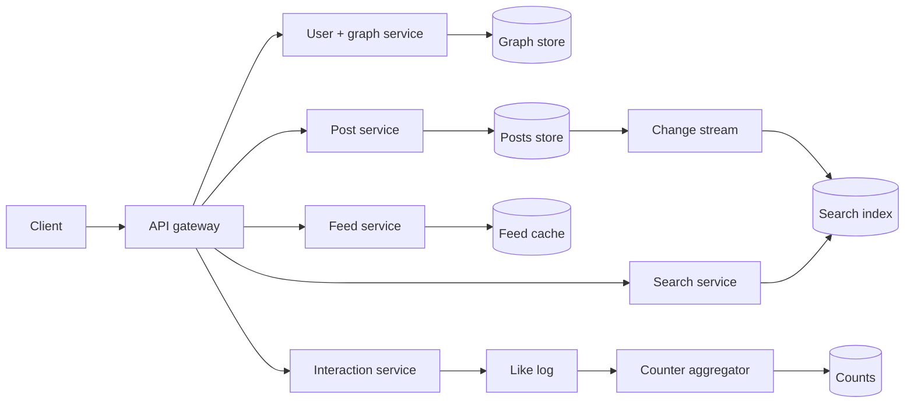

# Social Media Platform: Full System Design Mock Interview, All 9 Steps

> **Prerequisites:** [Previous lesson: News Feed: Full System Design Mock Interview, All 9 Steps](../08-news-feed/README.md) and the [Interview Framework track](../../21-interview-framework/README.md).
> **Estimated Reading Time:** 15–20 minutes
> **Target Audience:** Engineers practising the full 9-step system design interview on a classic prompt: a full social network with posts, a graph, interactions and search.

> [!NOTE]
> **In one line:** A social platform is **several systems around one graph**: the follow graph, a post store, a feed, counters for likes and a search index, each with different consistency needs.

> [!TIP]
> **The Golden Rule:** Split the platform into services by access pattern and pick the weakest consistency each can live with. Counters and feeds can be eventual; identity and permissions cannot.

---

## Step 1. Clarify the Problem

Open with questions, not boxes. After the feed lesson, widen the scope: show how the graph, posts, interactions, notifications and search fit together without one giant database.

**Questions to ask the interviewer, and the answer we assume:**

| Question | Assumed answer |
| :--- | :--- |
| Core features? | Profiles, follow, post, like, comment, feed, search |
| Friendship model? | Directed follow (asymmetric) |
| Content? | Text, images, short video links |
| Privacy? | Public and private accounts |
| Scale? | 500M DAU, 1B posts per day |

> Say it aloud: *"Before I draw anything, let me confirm the scope and the numbers."* That one sentence earns the first minutes of the interview.

---

## Step 2. Functional and Non-Functional Requirements

**Functional (what the system does):**

- Create profiles and follow other users.
- Post content and view a feed.
- Like and comment on posts with counts.
- Search for users and posts.

**Non-functional (how well it does it):**

| Quality | Target | Why it drives the design |
| :--- | :--- | :--- |
| Availability | 99.99% for reads | Social apps are habit-forming |
| Latency | Feed under 300 ms | Responsiveness drives engagement |
| Consistency | Eventual for counts and feeds, strong for follows and privacy | Different data, different needs |
| Scale | Billions of edges and posts | Graph and content both huge |

---

## Step 3. Scope: In and Out

**In scope:** Graph, posts, interactions, feed, search at architecture level.

**Out of scope (say it explicitly, then move on):**

- Ads.
- Content moderation ML.
- Messaging (a separate system).

---

## Step 4. Capacity Estimation

Assumptions: 500M DAU, 1B posts per day, 10 likes per post on average, 5 KB average post with metadata.

| Quantity | Calculation | Result |
| :--- | :--- | :--- |
| Posts per second | `posts_day / 86400` | **11.6K posts/s** |
| Likes per second | `posts_per_second * likes` | **115.7K likes/s** |
| Post storage per day | `posts_day * kb * 1e3 / 1e12` | **5 TB/day** |

**What the numbers tell you:** 12K posts per second and 120K likes per second show interactions dominate writes, so counters must be aggregated, not updated row by row. 5 TB of posts per day is 1.8 PB per year, which needs sharded storage and tiering.

---

## Step 5. API Design

| Endpoint | Purpose | Notes |
| :--- | :--- | :--- |
| `POST /v1/posts` | Publish | Returns post id. |
| `POST /v1/posts/{id}/like` | Like | Idempotent per user and post. |
| `GET /v1/feed` | Home feed | From the feed service. |
| `GET /v1/search?q=` | Search users/posts | Backed by a search index. |
| `POST /v1/users/{id}/follow` | Follow | Graph write, strongly consistent. |

Likes are idempotent: liking twice leaves one like. Return the new count approximately, not by re-reading a hot row.

---

## Step 6. Data Model

| Entity / Store | Key fields | Why this store |
| :--- | :--- | :--- |
| Graph store | `follower`, `followee`, `ts` | Sharded adjacency lists, both directions |
| Posts (sharded by post id) | `post_id`, `author`, `body`, `ts` | Wide-column or sharded SQL |
| Likes | `(post_id, user_id)` set plus an aggregated counter | Set for idempotency, counter for display |
| Search index | Inverted index of posts and users | Built from a change stream |

Write likes to a log, aggregate counts in batches, and store the displayed count separately from the set that enforces one-like-per-user.

---

## Step 7. High-Level Architecture



**Walk the diagram in this order:** a gateway routes to focused services; posts feed the feed service and the search index through a change stream; likes go to a log and an aggregator.

---

## Step 8. Deep Dives and Bottlenecks

### 1. The follow graph

Store edges in both directions (who I follow, who follows me) so both queries are single-partition scans. Follow and unfollow are strongly consistent writes. Cache hot adjacency lists. For "people you may know", run offline jobs on the graph rather than querying it live.

### 2. Counters at scale

A viral post gets thousands of likes per second on one key. Do not update one row. Append to a log, aggregate per post in micro-batches, and write the count; or shard the counter across N cells and sum on read. Show approximate counts (for example "1.2M") and reconcile exactly in the background.

### 3. Search

Do not query the primary store. Stream post and profile changes into a search cluster (inverted index). Rank by relevance and recency, and filter results by the viewer's permissions at query time.

---

## Step 9. Trade-offs, Failures and Security

**Trade-offs to state aloud:**

| Decision | Option A | Option B | Pick and why |
| :--- | :--- | :--- | :--- |
| Graph store | Relational | Specialised graph or key-value | Sharded key-value adjacency lists cover the two hot queries |
| Counts | Exact | Approximate and batched | Approximate: exactness on hot keys is not worth the cost |
| Search | In the main DB | Separate index | Separate index from a change stream |

**Failure modes and mitigations:**

| Failure | What users see | Mitigation |
| :--- | :--- | :--- |
| Hot post | Slow likes | Sharded counters and batching |
| Search cluster lag | New posts not searchable for a few seconds | Accept eventual consistency |
| Graph shard down | Follows fail | Replicas, fail over, retry |

**Security and abuse:** Enforce privacy at read time on every surface (feed, search, profile), rate-limit follows and likes to fight bots, and keep moderation hooks in the post pipeline.

---

## Runnable Example: A sharded counter

Spreading one hot counter across several cells removes the contention, and reads add the cells.

```python
import random
random.seed(7)

class ShardedCounter:
    def __init__(self, shards=8):
        self.cells = [0] * shards

    def incr(self):
        self.cells[random.randrange(len(self.cells))] += 1

    def total(self):
        return sum(self.cells)

c = ShardedCounter()
for _ in range(1000):
    c.incr()
print(c.total())
print("max cell:", max(c.cells), "min cell:", min(c.cells))
```

Output (produced by running this exact code):

```text
1000
max cell: 135 min cell: 111
```

A thousand likes land spread across 8 cells, so no single row takes all the writes, and the total is still exactly 1000.

---

## Common Mistakes

- One giant database for everything.
- Updating a like count row per like.
- Querying the primary store for search.
- Checking privacy only when writing, not reading.
- No idempotency on like.

---

## Interview Questions and Answers

<details>
<summary><strong>Q1: How do you design the follow graph?</strong></summary>

Sharded adjacency lists in both directions in a key-value store, with strongly consistent writes and cached hot lists.

</details>

<details>
<summary><strong>Q2: How do you count likes on a viral post?</strong></summary>

Append likes to a log, aggregate in micro-batches or use sharded counters, and display an approximate count.

</details>

<details>
<summary><strong>Q3: How does search stay in sync?</strong></summary>

A change stream from the post store feeds an indexer; it is eventually consistent by seconds.

</details>

<details>
<summary><strong>Q4: Where do you enforce privacy?</strong></summary>

At read time in every surface, because relationships and settings change after content is created.

</details>

<details>
<summary><strong>Q5: How do you split the system?</strong></summary>

By access pattern: graph, posts, interactions, feed and search are separate services with their own stores.

</details>

---

## One-Page Cheat Sheet

| Step | What to say or draw |
| :--- | :--- |
| Clarify | Follow, post, like, comment, feed, search; 500M DAU |
| Capacity | 12K posts/s, 120K likes/s, 5 TB/day |
| API | post, like, feed, search, follow |
| Data | Graph, posts, likes log + counters, search index |
| Deep dive | Graph, counters, search |
| Trade-off | Eventual for counts, strong for follows |

---

## Further Reading

- Facebook engineering, *TAO: Facebook's distributed data store for the social graph*.
- Instagram engineering blog, *Sharding & IDs at Instagram*.

---

## Next

Continue with [Video Streaming Platform: Full System Design Mock Interview, All 9 Steps](../10-video-streaming-platform/README.md).
