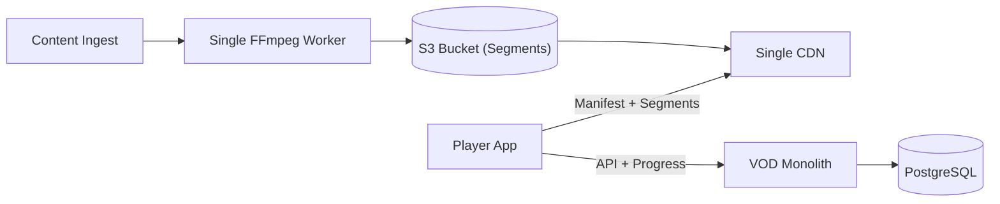
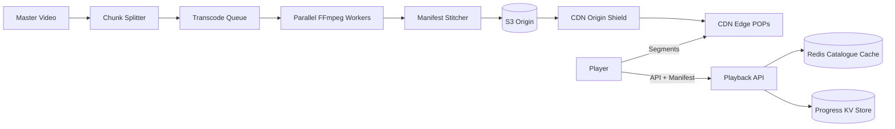
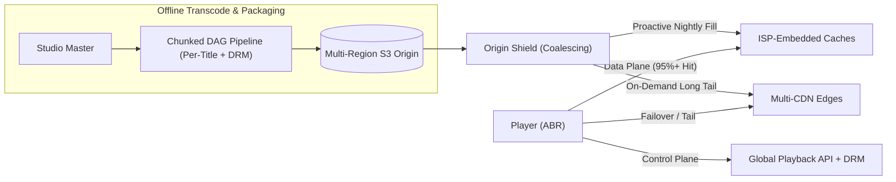
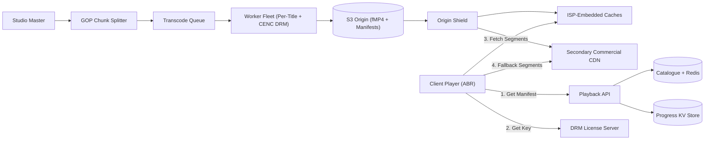
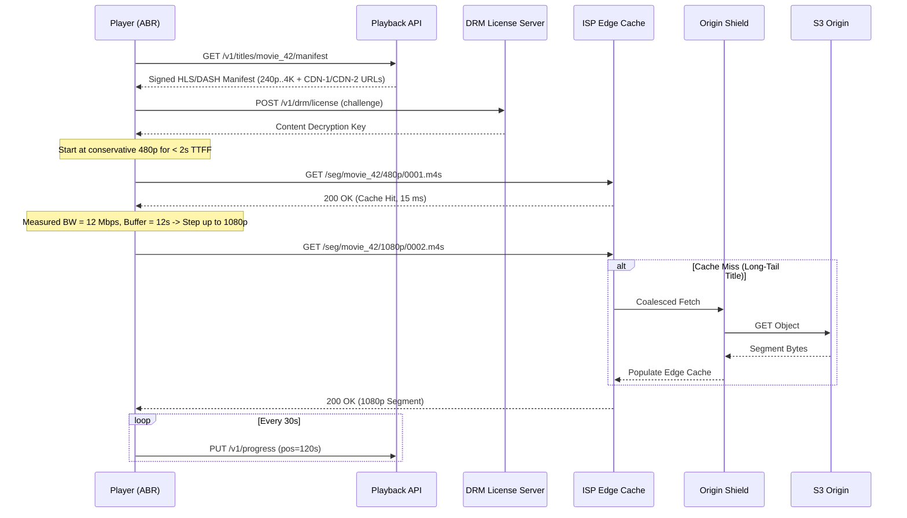

# Video Streaming Platform: Full System Design Mock Interview, All 9 Steps

> **Difficulty:** Senior to Staff (L6+)
> **Prerequisites:** [Previous lesson: Social Media Platform: Full System Design Mock Interview, All 9 Steps](../09-social-media-platform/README.md) and the [Interview Framework track](../../21-interview-framework/README.md).
> **Estimated Reading Time:** 25–30 minutes
> **Target Audience:** Engineers practising the full 9-step system design interview on a classic prompt: delivering smooth, adaptive-bitrate video-on-demand (Netflix/Disney+ style) to tens of millions of concurrent viewers.

> [!NOTE]
> **In one line:** Video streaming is **a global CDN & ISP-edge caching problem wrapped around an offline chunked transcoding pipeline**: pre-encode every title into a bitrate ladder of 2–6 second immutable segments so the player can adapt quality seamlessly on every chunk.

> [!TIP]
> **The Golden Rule:** **Never serve video bytes from application servers or origin.** Pre-transcode into HLS/DASH segments, push popular titles proactively to ISP-embedded CDN edges, and protect origin with an origin shield + request coalescing.

---

## 1. Clarifying Questions, Functional & Non-Functional Requirements

Open with questions, not boxes. The interviewer is testing whether you immediately recognize that **45+ Tbps of egress bandwidth** cannot be served by cloud origin servers—the entire architecture revolves around **Adaptive Bitrate (ABR) segmentation**, **parallel chunk transcoding**, and **CDN edge/ISP cache hit ratios**.

### Clarifying Questions & Assumed Scope

| Question | Assumed Answer | Architectural Impact |
| :--- | :--- | :--- |
| Live streaming or VOD? | Video-on-Demand (VOD) | Allows offline chunked transcoding & proactive CDN fill |
| Supported devices? | Mobile, Web, Smart TV | Requires both HLS (Apple) and MPEG-DASH (Android/Web/TV) |
| Catalogue size? | 100K titles, multi-audio + subtitles | Predictable storage; Zipfian popularity distribution |
| Content protection? | DRM required for licensed titles | CENC (Widevine/FairPlay/PlayReady) + signed URLs |
| Target scale? | 50M DAU, 1 hour watch time/day/user | ~15M peak concurrent viewers, ~45 Tbps peak egress |

> Say it aloud: *"Before I draw anything, let me confirm VOD vs. live, DRM requirements, and peak concurrent viewers."*

### Functional Requirements

- **Browse & Search Catalogue:** View title metadata, artwork, and available audio/subtitle tracks.
- **Instant ABR Playback:** Start playback in under 2 seconds and dynamically switch resolution (240p–4K) based on network throughput.
- **Resume Playback:** Save viewer playback position every 30 seconds across devices.
- **Ingest & Transcode:** Accept studio master files, split into chunks, encode into a multi-bitrate ladder, and package with DRM.

### Non-Functional Requirements & Scope Boundaries

| Quality | Target | Why It Drives the Design |
| :--- | :--- | :--- |
| Start-up Time | < 2 seconds (TTFF) | Low initial segment bitrate + pre-fetched manifest |
| Rebuffering Ratio | < 1% of playback time | Short 4s segments + buffer-aware ABR controller |
| Availability | 99.99% during evening peak | Multi-CDN failover embedded in manifest |
| Egress Cost | Maximize ISP/edge cache hit rate (> 95%) | Bandwidth is the #1 operating expense |

**Explicitly Out of Scope:** Personalized ML recommendation engine, subscription billing, and ultra-low-latency live sports streaming.

---

## 2. Back-of-the-Envelope Capacity Estimation

Let us derive peak concurrent viewers, peak egress bandwidth in Tbps, daily data egress, and transcoding storage.

**Baseline Assumptions:**
- $\text{DAU} = 50 \times 10^6$ viewers
- Average watch time = $1\text{ hour/user/day}$
- Average streamed bitrate = $3\text{ Mbps}$ (weighted mix of 720p/1080p/4K)
- Peak concurrency factor = $30\%$ of DAU watching simultaneously during prime time
- Catalogue = $100{,}000$ titles, average duration = $1\text{ hour}$ ($3{,}600\text{ s}$)
- Bitrate ladder total across 6 renditions (240p to 4K + audio) $\approx 25\text{ Mbps}$ combined

### Worked Equations

**1. Peak Concurrent Viewers & Peak Bandwidth:**

$$\text{Peak Concurrent Viewers} = 50 \times 10^6 \times 0.30 = 15 \times 10^6 \text{ viewers}$$

$$\text{Peak Bandwidth} = 15 \times 10^6 \times 3\text{ Mbps} = 45 \times 10^6\text{ Mbps} = 45\text{ Tbps}$$

To put $45\text{ Tbps}$ in perspective: a single 100 Gbps NIC saturates at $33{,}333$ streams. Serving $45\text{ Tbps}$ from one data center is impossible—it **must** be distributed across thousands of CDN edge nodes inside ISPs.

**2. Daily Egress Volume:**

$$\text{Daily Egress} = 50 \times 10^6 \times \frac{3{,}600\text{ s} \times 3\text{ Mbps}}{8\text{ bits/byte}} = 67.5\text{ PB/day}$$

**3. Origin Storage for 100K Titles:**

$$\text{Per Title Size (all renditions)} = \frac{3{,}600\text{ s} \times 25\text{ Mbps}}{8} = 11.25\text{ GB/title}$$

$$\text{Total Catalogue Storage (1x)} = 100{,}000 \times 11.25\text{ GB} = 1.125\text{ PB}$$

### Capacity Summary Table

| Metric | Formula | Value | Design Implication |
| :--- | :--- | :--- | :--- |
| Peak Concurrent Viewers | $30\% \times 50\text{M DAU}$ | $15\text{M viewers}$ | Control plane must handle millions of heartbeats |
| Peak Egress Bandwidth | $15\text{M} \times 3\text{ Mbps}$ | $45\text{ Tbps}$ | Requires ISP-embedded CDN caches (Open Connect) |
| Daily Egress Volume | $50\text{M} \times 1\text{h} \times 3\text{ Mbps}/8$ | $67.5\text{ PB/day}$ | Cache hit ratio > 95% is critical for unit economics |
| Origin Catalogue (1x) | $100\text{K} \times 11.25\text{ GB}$ | $1.125\text{ PB}$ | Cheap object storage (S3) + Origin Shield |

---

## 3. Core API Contracts & Data Model

### Control Plane & Data Plane APIs

| Endpoint | Plane | Purpose & Notes |
| :--- | :--- | :--- |
| `GET /v1/catalogue?genre=sci-fi` | Control | Browse/search titles; heavily cached at API edge |
| `GET /v1/titles/{id}/manifest` | Control | Verifies entitlement, returns **signed HLS/DASH manifest** with multi-CDN URLs |
| `POST /v1/drm/license` | Control | Validates user session and issues Widevine/FairPlay decryption license |
| `PUT /v1/progress` | Control | Saves `(user_id, title_id, position_sec)` every 30s (last-write-wins) |
| `GET {cdn_edge}/seg/{id}/{rendition}/{n}.m4s` | **Data** | Fetches immutable 4-second video segment directly from CDN edge |

### Data Model

| Store / Entity | Key Schema | Value / Purpose | Why This Store |
| :--- | :--- | :--- | :--- |
| **Catalogue DB** | `title_id` | Metadata, duration, audio/sub tracks, DRM `key_id` | Relational (PostgreSQL) + Redis cache |
| **Playback Progress** | `(user_id, title_id)` | `position_sec`, `updated_at` | High-write KV store (DynamoDB/Cassandra) |
| **Transcode Jobs DB** | `(title_id, chunk_id, rendition)` | `status`, `checksum`, `s3_key` | Tracks idempotent chunk retries in DAG |
| **Origin Object Store** | `titles/{id}/{rendition}/{seg}.m4s` | Immutable fragmented MP4 (fMP4) segments & manifests | S3 / GCS with 99.999999999% durability |
| **CDN Edge Cache** | Signed/Canonical URL | Hot `.m4s` segments (TTL: 30–365 days) | NVMe-backed edge & ISP appliances |

> [!WARNING]
> **Strip query-string auth tokens from CDN cache keys:** If every user gets a unique `?token=xyz&exp=123` on segment URLs and the CDN includes query strings in its cache key, **cache hit rate drops to 0%**! Configure CDN cache keys to use only `(path)` after validating the HMAC signature at the edge.

---

## 4. Stage 1 (100 - 1K Users): Baseline Monolith & Single Database

At 100–1,000 users, avoid building a custom distributed transcoder or multi-CDN router. Use managed primitives:

1. **API Monolith** handles catalogue browsing, user auth, and playback progress in a **Single PostgreSQL** instance.
2. **Managed Transcoder (or single FFmpeg worker)** converts uploaded videos into a 3-tier HLS ladder (480p, 720p, 1080p) and writes `.m3u8` manifests + `.ts`/`.m4s` segments to **S3**.
3. **Single Cloud CDN (CloudFront/Cloudflare)** fronts the S3 bucket so viewers never pull video bytes through the API monolith.



**What breaks at 10K users:**
- **Single-node FFmpeg bottleneck:** Transcoding a 2-hour 4K movie sequentially on one server takes 6–10 hours; a failed encode at 95% restarts from scratch.
- **Progress write load:** `PUT /v1/progress` every 30s from 10K+ concurrent viewers saturates single-Postgres row updates.

---

## 5. Stage 2 (10K - 100K Users): Caching, Read Replicas & Async Offload

At 10K–100K users, we parallelize transcoding, protect S3 origin, and offload progress writes:

1. **Chunked Transcoding Pipeline:** A **Splitter** chops incoming 1-hour master videos into 30-second GOP-aligned chunks and enqueues them onto **Kafka/SQS**. A **Worker Fleet** transcodes chunks in parallel, then a **Stitcher** builds the HLS/DASH manifests.
2. **Origin Shield:** Sits between CDN edge POPs and S3 so concurrent cache misses across 50 edge locations coalesce into **one** S3 fetch.
3. **Catalogue Cache + Progress KV Store:** **Redis** caches catalogue metadata; `PUT /progress` moves to **DynamoDB/Cassandra** (or batched Redis-to-Postgres flushes).



**What breaks at 1M users:**
- **Public internet transit bottlenecks & cost:** Pulling 10+ Tbps across third-party CDN transit links during prime time causes ISP peering congestion and massive egress bills.
- **Single-CDN outage risk:** If your single CDN provider suffers a BGP/DNS outage, 100% of viewers lose playback.

---

## 6. Stage 3 (1M - 10M+ Users): Sharding, Partitioning & Multi-Region Scale

At 1M–50M+ DAU, we move video bytes **inside ISP networks**, add **Multi-CDN failover**, and optimize encoding per title:

1. **ISP-Embedded Edge Caches (Open Connect model):** Place custom NVMe cache appliances directly inside regional ISPs. Popular titles (top 5% of catalogue = 80%+ of views) are **proactively pushed overnight** during off-peak hours.
2. **Multi-CDN Manifest Steering:** The Playback API dynamically embeds primary and fallback CDN base URLs in the manifest based on real-time client QoE telemetry (e.g., CDN-A 70%, CDN-B 30%, automatic switch on 5xx/stall).
3. **Per-Title Bitrate Optimization:** Simple animated shows need far lower bitrates for crisp 1080p than grainy action movies. A **Per-Title Encoder** computes custom bitrate ladders per title, cutting bandwidth by 20–30%.
4. **Global Control Plane:** Geo-distributed Playback APIs + multi-region DynamoDB/Cassandra for playback progress and DRM licensing.



---

## 7. Final Full Production Architecture & End-to-End Flows

### Complete Production Architecture



### End-to-End Playback & ABR Switching Sequence



---

## 8. Deep-Dive Bottlenecks & Algorithmic Trade-Offs

### 1. Segment Duration & Bitrate Ladder Trade-Off

| Segment Length | Adaptation Speed | HTTP Request Overhead | Compression Efficiency | Pick |
| :--- | :--- | :--- | :--- | :--- |
| **2 seconds** | Very fast (reacts in 2s) | High (1,800 reqs/hour) | Lower (more keyframes/IDR) | Live / low-latency |
| **4–6 seconds** | Balanced | Moderate (600–900 reqs/hr) | High (fewer keyframes) | **VOD Sweet Spot** |
| **10+ seconds** | Slow (risks stall on drop) | Low | Highest | Legacy / poor mobile UX |

### 2. Client-Side ABR Algorithm (Throughput + Buffer Hybrid)

Pure throughput-based ABR oscillates wildly on cellular networks. Production players (like Netflix/Dash.js BOLA) use a **hybrid buffer + throughput** rule:
- **Start-up:** Always pick a low-to-mid rung (e.g., 480p) for the first 1–2 segments so playback starts in $< 1\text{ s}$.
- **Steady State:** Pick the highest rendition whose bitrate is $\le 0.80 \times \text{EWMA\_Throughput}$ (20% safety margin), **unless** the local playback buffer drops below 8 seconds—in which case step down aggressively to prevent rebuffering.

### 3. Proactive Cache Fill vs. On-Demand Caching

Video popularity follows a steep **Zipf distribution**: the top 5% of titles generate 80%+ of evening peak traffic.
- **Proactive Fill:** Push new releases and trending titles to ISP-embedded caches at 3:00 AM local time when ISP transit links are idle.
- **On-Demand Pull:** Long-tail titles (remaining 95%) are fetched lazily through the **Origin Shield** only when requested.

---

## 9. Failure Modes, Reliability & Backpressure Mitigations

| Failure Mode | User Impact | Root Cause | Mitigation |
| :--- | :--- | :--- | :--- |
| **Edge Cache Miss Storm** | Slow starts, S3 503s | 100K users start a new release at once | **Origin Shield** with **request coalescing** (collapse 1,000 identical misses into 1 S3 read) |
| **Single CDN Regional Outage** | Playback stalls/errors | ISP peering cut or CDN BGP failure | Manifest lists **Multi-CDN** endpoints; player fails over to CDN-2 on next segment |
| **Corrupt Transcoded Chunk** | Video freeze or green frames | Worker OOM or bit-flip | Compute SHA-256 + VMAF quality check per chunk before stitching manifest; auto-retry failed chunk |
| **Progress DB Saturation** | "Resume" position lost | 15M users writing every 5s | Increase client heartbeat to 30s + jitter; write to async Kafka buffer or KV store |
| **URL Sharing / Hotlinking** | Unauthorized egress bill | Leaked segment URLs | Short-lived HMAC-signed URLs (bound to user/session/prefix) + CENC DRM encryption |

---

## 10. Production War Story & Real-World Reference

**Real-World Reference: Netflix Open Connect & Per-Title Encoding**
At peak evening hours, Netflix accounts for a massive share of global downstream internet traffic. Relying on commercial transit CDNs alone proved both too expensive and prone to ISP peering bottlenecks. Netflix built **Open Connect**:

1. **Free Appliances Inside ISPs:** Netflix provides custom NVMe/SSD server appliances (**Open Connect Appliances / OCAs**) directly inside local ISP data centers at zero hardware cost to the ISP, keeping 95%+ of video traffic off public transit backbones.
2. **Proactive Off-Peak Fill:** OCAs download predicted popular titles overnight so prime-time streams are served purely from local ISP LANs.
3. **Per-Title Encoding:** By analyzing each title's visual complexity (e.g., *BoJack Horseman* vs. *Stranger Things*), Netflix reduced average bitrate by **~20%+** at identical perceptual quality (VMAF), saving petabytes of daily egress.

---

## 11. Core Component Implementation (4 Languages)

Below is a **Buffer-Aware ABR Rendition Selector & Signed Segment URL Generator** in Go, TypeScript, Python, and C#. It demonstrates throughput EWMA safety margins, buffer-starvation step-down, and CDN cache-key-friendly HMAC URL signing.

````carousel
```go
package main

import (
	"crypto/hmac"
	"crypto/sha256"
	"encoding/hex"
	"fmt"
)

type Rendition struct {
	Name    string
	Bitrate float64 // Mbps
}

var Ladder = []Rendition{
	{"240p", 0.4}, {"480p", 1.0}, {"720p", 2.5}, {"1080p", 5.0}, {"4K", 15.0},
}

// PickRendition uses throughput with a 20% safety factor and buffer-level guardrails.
func PickRendition(measuredMbps, bufferSec float64) string {
	if bufferSec < 6.0 {
		return Ladder[0].Name // Panic step-down to prevent rebuffering
	}
	budget := measuredMbps * 0.80
	if bufferSec < 12.0 {
		budget *= 0.75 // Conservative cap while buffer is rebuilding
	}
	best := Ladder[0].Name
	for _, r := range Ladder {
		if r.Bitrate <= budget {
			best = r.Name
		}
	}
	return best
}

func SignSegmentURL(base, path string, exp int64, secret string) string {
	msg := fmt.Sprintf("%s:%d", path, exp)
	mac := hmac.New(sha256.New, []byte(secret))
	mac.Write([]byte(msg))
	sig := hex.EncodeToString(mac.Sum(nil))[:16]
	return fmt.Sprintf("%s%s?exp=%d&sig=%s", base, path, exp, sig)
}

func main() {
	fmt.Println("10 Mbps, 20s buf ->", PickRendition(10.0, 20.0))
	fmt.Println("10 Mbps,  4s buf ->", PickRendition(10.0, 4.0))
	fmt.Println("Signed URL:", SignSegmentURL("https://edge1.cdn.net", "/seg/m42/1080p/001.m4s", 1700003600, "super-secret"))
}
```
<!-- slide -->
```typescript
import { createHmac } from "crypto";

interface Rendition {
  name: string;
  bitrateMbps: number;
}

const LADDER: Rendition[] = [
  { name: "240p", bitrateMbps: 0.4 },
  { name: "480p", bitrateMbps: 1.0 },
  { name: "720p", bitrateMbps: 2.5 },
  { name: "1080p", bitrateMbps: 5.0 },
  { name: "4K", bitrateMbps: 15.0 },
];

function pickRendition(measuredMbps: number, bufferSec: number): string {
  if (bufferSec < 6.0) return LADDER[0].name;
  let budget = measuredMbps * 0.8;
  if (bufferSec < 12.0) budget *= 0.75;

  let best = LADDER[0].name;
  for (const r of LADDER) {
    if (r.bitrateMbps <= budget) best = r.name;
  }
  return best;
}

function signSegmentUrl(base: string, path: string, exp: number, secret: string): string {
  const sig = createHmac("sha256", secret).update(`${path}:${exp}`).digest("hex").slice(0, 16);
  return `${base}${path}?exp=${exp}&sig=${sig}`;
}

console.log("10 Mbps, 20s buf ->", pickRendition(10.0, 20.0));
console.log("10 Mbps,  4s buf ->", pickRendition(10.0, 4.0));
console.log("Signed URL:", signSegmentUrl("https://edge1.cdn.net", "/seg/m42/1080p/001.m4s", 1700003600, "super-secret"));
```
<!-- slide -->
```python
import hashlib
import hmac
from typing import List, Tuple

LADDER: List[Tuple[str, float]] = [
    ("240p", 0.4),
    ("480p", 1.0),
    ("720p", 2.5),
    ("1080p", 5.0),
    ("4K", 15.0),
]


def pick_rendition(measured_mbps: float, buffer_sec: float) -> str:
    if buffer_sec < 6.0:
        return LADDER[0][0]
    budget = measured_mbps * 0.80
    if buffer_sec < 12.0:
        budget *= 0.75

    best = LADDER[0][0]
    for name, bitrate in LADDER:
        if bitrate <= budget:
            best = name
    return best


def sign_segment_url(base: str, path: str, exp: int, secret: str) -> str:
    msg = f"{path}:{exp}".encode()
    sig = hmac.new(secret.encode(), msg, hashlib.sha256).hexdigest()[:16]
    return f"{base}{path}?exp={exp}&sig={sig}"


if __name__ == "__main__":
    print("10 Mbps, 20s buf ->", pick_rendition(10.0, 20.0))
    print("10 Mbps,  4s buf ->", pick_rendition(10.0, 4.0))
    print("Signed URL:", sign_segment_url("https://edge1.cdn.net", "/seg/m42/1080p/001.m4s", 1700003600, "super-secret"))
```
<!-- slide -->
```csharp
using System;
using System.Security.Cryptography;
using System.Text;

public static class AbrController
{
    private static readonly (string Name, double Mbps)[] Ladder =
    {
        ("240p", 0.4), ("480p", 1.0), ("720p", 2.5), ("1080p", 5.0), ("4K", 15.0)
    };

    public static string PickRendition(double measuredMbps, double bufferSec)
    {
        if (bufferSec < 6.0) return Ladder[0].Name;
        double budget = measuredMbps * 0.80;
        if (bufferSec < 12.0) budget *= 0.75;

        string best = Ladder[0].Name;
        foreach (var (name, mbps) in Ladder)
        {
            if (mbps <= budget) best = name;
        }
        return best;
    }

    public static string SignSegmentUrl(string baseUrl, string path, long exp, string secret)
    {
        using var hmac = new HMACSHA256(Encoding.UTF8.GetBytes(secret));
        byte[] hash = hmac.ComputeHash(Encoding.UTF8.GetBytes($"{path}:{exp}"));
        string sig = Convert.ToHexString(hash).ToLowerInvariant()[..16];
        return $"{baseUrl}{path}?exp={exp}&sig={sig}";
    }

    public static void Main()
    {
        Console.WriteLine("10 Mbps, 20s buf -> " + PickRendition(10.0, 20.0));
        Console.WriteLine("10 Mbps,  4s buf -> " + PickRendition(10.0, 4.0));
        Console.WriteLine("Signed URL: " + SignSegmentUrl("https://edge1.cdn.net", "/seg/m42/1080p/001.m4s", 1700003600, "super-secret"));
    }
}
```
````

---

## 12. Verification, Load Testing & CLI Diagnostics

```bash
# 1. Transcode & segment a video into HLS/fMP4 4-second chunks using FFmpeg
ffmpeg -i master.mp4 -c:v libx264 -b:v 2500k -g 96 -keyint_min 96 \
  -hls_time 4 -hls_segment_type fmp4 -hls_playlist_type vod out_720p.m3u8

# 2. Verify CDN edge cache hit/miss headers and TTFB on a segment
curl -sI "https://edge1.cdn.net/seg/m42/1080p/0001.m4s" | grep -iE "x-cache|cf-cache-status|age"

# 3. Inspect HLS master manifest renditions & codecs
curl -s "https://api.example.com/v1/titles/m42/manifest" | head -n 20

# 4. Validate GOP alignment across renditions with ffprobe (must match for seamless ABR switch)
ffprobe -v error -select_streams v:0 -show_entries frame=pts_time,pict_type -of csv=p=0 seg_0001.m4s | grep ",I"
```

---

## 13. Common Interview Mistakes & Red Flags

- **Serving video streams through your application servers:** Even 100K concurrent 3 Mbps streams (300 Gbps) will immediately saturate app servers and VPC NAT gateways.
- **Transcoding on the fly at playback time:** Real-time 4K transcoding per viewer is prohibitively expensive and breaks CDN caching.
- **Serving one monolithic `.mp4` file instead of 4-second segments:** Prevents adaptive bitrate switching and wastes egress when a user abandons playback after 2 minutes.
- **Including per-user auth tokens in the CDN cache key:** Destroys CDN cache hit ratios (drops from 98% to 0%).
- **Ignoring GOP/keyframe alignment across renditions:** If 720p and 1080p segments do not start on exact IDR keyframes, switching renditions causes visual glitches or stalls.
- **Relying on a single CDN without manifest-level failover:** Leaves you helpless during regional CDN outages.

---

## 14. Key Terminology & Glossary

| Key Term | Definition |
| :--- | :--- |
| **Adaptive Bitrate (ABR)** | Technique where the player dynamically selects segment quality (240p–4K) based on bandwidth and buffer |
| **HLS / MPEG-DASH** | Industry-standard HTTP streaming protocols using `.m3u8` (Apple) or `.mpd` (open) manifests |
| **Bitrate Ladder** | Set of encoded renditions (resolution + bitrate) available for a single video title |
| **fMP4 Segment (`.m4s`)** | Short (2–6s) immutable fragmented MP4 chunk aligned to an IDR keyframe |
| **Origin Shield** | Intermediate CDN cache layer that coalesces edge misses into a single origin S3 request |
| **Request Coalescing** | Collapsing hundreds of simultaneous cache-miss requests for the same segment into one origin fetch |
| **Open Connect (ISP Cache)** | Placing CDN cache appliances directly inside ISP networks to eliminate public transit egress |
| **Per-Title Encoding** | Customizing the bitrate ladder per video based on visual complexity (VMAF) to save bandwidth |
| **CENC DRM** | Common Encryption standard allowing one encrypted fMP4 file to work with Widevine, FairPlay, and PlayReady |
| **TTFF (Time To First Frame)** | Startup latency from pressing Play until the first video frame renders (target < 2s) |

---

## 15. Interview Follow-Up Questions (12 Q&As)

### Basic Conceptual Questions

<details>
<summary><strong>Q1: How does Adaptive Bitrate (ABR) streaming work? [BASIC]</strong></summary>

Each video is pre-encoded at multiple bitrates/resolutions and split into 4-second keyframe-aligned segments. The player downloads a manifest listing all renditions, measures its download speed and buffer depth after each segment, and requests the next segment from the highest rendition it can safely sustain.

</details>

<details>
<summary><strong>Q2: Why can't you serve video from your own backend API servers? [BASIC]</strong></summary>

At 15M concurrent viewers averaging 3 Mbps, peak egress is 45 Tbps. Backend servers cannot sustain that network throughput or transit cost; video bytes must be served from CDN edges and ISP-embedded caches near viewers.

</details>

<details>
<summary><strong>Q3: Why support both HLS and MPEG-DASH? [BASIC]</strong></summary>

Apple devices (iOS, Safari, tvOS) natively require HLS, while Android, Smart TVs, and Chrome/Firefox commonly use MPEG-DASH. Using fragmented MP4 (`.m4s`) segments under Common Encryption (CENC) lets you share the exact same encoded video segments for both HLS and DASH manifests!

</details>

<details>
<summary><strong>Q4: How do you achieve sub-2-second video startup time (TTFF)? [BASIC]</strong></summary>

Start playback on a low/mid rendition (e.g., 480p) so the first segment downloads in < 200 ms, pre-fetch the manifest and DRM license when the user hovers/opens the title page, and ensure popular titles are pre-warmed on ISP edges.

</details>

### Scenario-Based Architecture Questions

<details>
<summary><strong>Q5: How do you transcode a 2-hour 4K movie in minutes instead of 10 hours? [SCENARIO]</strong></summary>

Split the source master file at scene/GOP boundaries into hundreds of independent 30-second chunks, push them to a queue, and transcode all chunks in parallel across an autoscaling fleet of stateless worker nodes. A stitcher then assembles the final segments and manifest.

</details>

<details>
<summary><strong>Q6: How do you prevent a thundering herd on S3 when a blockbuster show drops at midnight? [SCENARIO]</strong></summary>

1. **Proactively push** the blockbuster's segments to ISP caches and CDN POPs hours before release (encrypted with DRM so it cannot be played early).
2. Place an **Origin Shield** with **request coalescing** in front of S3 so any remaining edge misses collapse into one origin fetch.

</details>

<details>
<summary><strong>Q7: How do you handle a sudden CDN outage in Europe during prime time? [SCENARIO]</strong></summary>

Include multiple CDN base URLs (`cdn1`, `cdn2`) in the playback manifest returned by the Playback API. When the player's telemetry detects 5xx errors or timeouts from `cdn1`, it seamlessly switches to `cdn2` on the very next 4-second segment without interrupting playback.

</details>

<details>
<summary><strong>Q8: How do you store and sync "Continue Watching" progress for 50M viewers? [SCENARIO]</strong></summary>

The player sends `PUT /v1/progress` every 30 seconds (with random jitter to avoid synchronized spikes) to a high-write KV store (DynamoDB/Cassandra) keyed by `(user_id, title_id)` using last-write-wins semantics.

</details>

### Advanced & Tricky Interview Questions

<details>
<summary><strong>Q9: If segments are protected by per-user signed URLs, why doesn't CDN caching break? [TRICKY]</strong></summary>

The CDN edge validates the HMAC signature and expiration query parameters (`?exp=...&sig=...`) first, then **strips all query parameters** before computing the cache key (`/seg/movie_42/1080p/0001.m4s`). That way every authorized user hits the exact same cached object.

</details>

<details>
<summary><strong>Q10: Why is 4–6 seconds the sweet spot for segment length instead of 1 second or 30 seconds? [TRICKY]</strong></summary>

Each segment must start with an IDR keyframe, which is much larger than delta frames. 1-second segments inflate file size by 20–30% and multiply HTTP request overhead. 30-second segments trap the player in a high bitrate for 30 seconds if bandwidth suddenly drops, causing rebuffering stalls. 4–6 seconds balances compression and responsiveness.

</details>

<details>
<summary><strong>Q11: How does Per-Title Encoding save 20%+ bandwidth without hurting quality? [TRICKY]</strong></summary>

A fixed bitrate ladder wastes bits on simple cartoons (which look great at 1.5 Mbps 1080p) and starves complex action scenes. Per-title encoding runs fast test encodes across a convex hull of `(resolution, bitrate)` pairs and measures perceptual quality (VMAF) to pick the minimum bitrate needed per title.

</details>

<details>
<summary><strong>Q12: How do you prevent a player from oscillating between 720p and 1080p every 4 seconds? [TRICKY]</strong></summary>

Apply **hysteresis** and **EWMA smoothing** on throughput measurements: require bandwidth to exceed the next rung by a safety margin (e.g., $1.25\times$ or $0.80$ utilization cap) and require a healthy buffer ($> 12\text{ s}$) before stepping up, while stepping down immediately if buffer drops below $6\text{ s}$.

</details>

---

## 16. One-Page Master Cheat Sheet

```text
+-----------------------------------------------------------------------------+
|                VIDEO STREAMING PLATFORM — MASTER CHEAT SHEET                |
+-----------------------------------------------------------------------------+
| SCALE       : 50M DAU | 15M peak concurrent | 45 Tbps egress | 67.5 PB/day  |
| GOLDEN RULE : Never serve video from origin/app servers. Pre-transcode into |
|               4s fMP4 segments, push to ISP/CDN edges, use ABR + OriginShld.|
+-----------------------------------------------------------------------------+
| STAGE 1 (1K)   : Monolith + Single FFmpeg -> S3 -> Single CDN               |
| STAGE 2 (100K) : Chunked Transcode Fleet + Origin Shield + Progress KV      |
| STAGE 3 (50M)  : Per-Title DAG + ISP-Embedded Caches + Multi-CDN Steering   |
+-----------------------------------------------------------------------------+
| HOT PATH    : Play -> Manifest (CDN list) -> DRM Key -> 480p start -> ABR   |
|               loop (EWMA BW + Buffer check) -> ISP Edge (95%+ hit)          |
| BOTTLENECKS : Thundering herd misses (Origin Shield coalescing!), token in  |
|               cache key (strip query params!), single CDN outage (multi-CDN)|
+-----------------------------------------------------------------------------+
```

| Step | Key Decision |
| :--- | :--- |
| **Clarify** | VOD, Mobile/Web/TV (HLS+DASH), 100K titles, DRM, 50M DAU |
| **Estimate** | 15M concurrent, 45 Tbps peak egress, 67.5 PB/day, 1.125 PB origin |
| **API / Data** | Signed manifest, immutable `.m4s` segments on CDN, KV progress store |
| **Deep Dives** | Chunked DAG transcoding, ABR hysteresis, ISP caches, Origin Shield |
| **Failures** | Cache miss coalescing, Multi-CDN manifest failover, GOP alignment |

---

## Further Reading

- Netflix Tech Blog: *Open Connect Overview* & *Per-Title Encode Optimization*.
- Apple HLS Authoring Specification & DASH-IF Implementation Guidelines.
- *BOLA: Near-Optimal Bitrate Adaptation for Online Videos* (IEEE/ACM Transactions on Networking).

---

## Next

Continue with [YouTube-like Service: Full System Design Mock Interview, All 9 Steps](../11-youtube-like-service/README.md).
