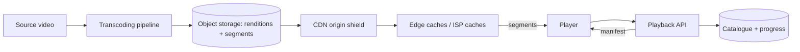

# Video Streaming Platform: Full System Design Mock Interview, All 9 Steps

> **Prerequisites:** [Previous lesson: Social Media Platform: Full System Design Mock Interview, All 9 Steps](../09-social-media-platform/README.md) and the [Interview Framework track](../../21-interview-framework/README.md).
> **Estimated Reading Time:** 15–20 minutes
> **Target Audience:** Engineers practising the full 9-step system design interview on a classic prompt: playing video smoothly to millions of viewers on any network.

> [!NOTE]
> **In one line:** Video streaming is **a CDN problem wrapped around a transcoding pipeline**: store many renditions of each video as small segments and let the player pick the best one every few seconds.

> [!TIP]
> **The Golden Rule:** Never serve video from your origin servers. Pre-transcode into a bitrate ladder, cut it into segments, and let a CDN and adaptive bitrate do the work.

---

## Step 1. Clarify the Problem

Open with questions, not boxes. The interviewer wants adaptive bitrate, CDN placement and the numbers on bandwidth, not an upload form.

**Questions to ask the interviewer, and the answer we assume:**

| Question | Assumed answer |
| :--- | :--- |
| Live or on-demand? | On demand |
| Devices? | Mobile, web, TV |
| Catalogue size? | 100K titles, subtitles, multiple audio tracks |
| DRM? | Yes, for licensed content |
| Scale? | 50M DAU, 1 hour per user per day |

> Say it aloud: *"Before I draw anything, let me confirm the scope and the numbers."* That one sentence earns the first minutes of the interview.

---

## Step 2. Functional and Non-Functional Requirements

**Functional (what the system does):**

- Play any title with start-up under 2 seconds.
- Adapt quality to the viewer's bandwidth.
- Resume where the viewer stopped.
- Browse and search the catalogue.

**Non-functional (how well it does it):**

| Quality | Target | Why it drives the design |
| :--- | :--- | :--- |
| Start-up time | Under 2 s | Viewers abandon slow starts |
| Rebuffering | Under 1% of playback time | The main quality metric |
| Availability | 99.99% | Peak evening traffic |
| Cost | Minimise egress | Bandwidth is the dominant bill |

---

## Step 3. Scope: In and Out

**In scope:** Ingest, transcode, CDN delivery, ABR playback, resume.

**Out of scope (say it explicitly, then move on):**

- Recommendations.
- Billing and subscriptions.
- Live streaming (a different latency model).

---

## Step 4. Capacity Estimation

Assumptions: 50M DAU, 1 hour per user per day, average stream 3 Mbps.

| Quantity | Calculation | Result |
| :--- | :--- | :--- |
| Peak concurrent viewers | `dau * concurrency` | **15M viewers** |
| Peak bandwidth | `peak_concurrent_viewers * mbps / 1e6` | **45 Tbps** |
| Daily egress | `dau * hours * 3600 * mbps / 8 / 1e9` | **67.5 PB/day** |

**What the numbers tell you:** 15M concurrent viewers at 3 Mbps is 45 Tbps: no origin can serve that. It must come from CDN edges, mostly from caches inside ISP networks. Daily egress near 70 PB makes bandwidth cost the central business constraint.

---

## Step 5. API Design

| Endpoint | Purpose | Notes |
| :--- | :--- | :--- |
| `GET /v1/titles/{id}/manifest` | Get the playlist | Returns an HLS or DASH manifest listing renditions and segment URLs. |
| `GET {cdn}/seg/{id}/{rendition}/{n}.m4s` | Fetch a segment | Served by the CDN, 2 to 6 seconds long. |
| `PUT /v1/progress` | Save position | Sent every 30 seconds, last write wins. |
| `GET /v1/catalogue` | Browse | Cached heavily. |

The player downloads the manifest, then segments one by one, choosing the rendition for each from its measured bandwidth.

---

## Step 6. Data Model

| Entity / Store | Key fields | Why this store |
| :--- | :--- | :--- |
| Catalogue DB | `title_id`, metadata, renditions, DRM keys ref | Read-mostly, cached |
| Object storage | Segments and manifests per rendition | Cheap, durable origin |
| Progress store (key-value) | `user, title` to position | Tiny frequent writes |
| CDN | Segments at the edge | Where the bytes are served |

Segments are immutable and keyed by content, so they cache perfectly with very long TTLs.

---

## Step 7. High-Level Architecture



**Walk the diagram in this order:** ingest and transcode once into many renditions, store segments, push popular ones to the CDN, and the player fetches a manifest then segments from the nearest edge.

---

## Step 8. Deep Dives and Bottlenecks

### 1. Adaptive bitrate and the ladder

Encode each title at several resolutions and bitrates (for example 240p to 4K) and cut each into 2 to 6 second segments. The player measures throughput and buffer, and switches rendition at segment boundaries, so a drop in bandwidth lowers quality instead of stalling. Per-title encoding saves bitrate on simple content.

### 2. CDN strategy

Cache segments at the edge with long TTLs. Fill popular titles ahead of time overnight (proactive caching) and use an origin shield so many edges share one fetch. Place appliances inside ISPs to keep traffic off the public internet. Cache hit rate, not origin capacity, decides cost.

### 3. Transcoding pipeline

Split a source file into chunks, transcode them in parallel on a worker fleet from a queue, then stitch the manifest. It is idempotent per chunk, so a failed worker retries only its chunk. Add DRM packaging (for example CENC) and subtitles as separate tracks.

---

## Step 9. Trade-offs, Failures and Security

**Trade-offs to state aloud:**

| Decision | Option A | Option B | Pick and why |
| :--- | :--- | :--- | :--- |
| Protocol | HLS | DASH | Support both: Apple devices need HLS, others use DASH |
| Segment length | 2 s | 10 s | 4 to 6 s: fewer requests versus faster adaptation |
| Cache fill | On demand | Proactive | Proactive for popular titles, on demand for the long tail |

**Failure modes and mitigations:**

| Failure | What users see | Mitigation |
| :--- | :--- | :--- |
| Edge miss storm | Slow starts | Origin shield and request coalescing |
| Region outage | Playback fails there | Multi-CDN failover in the manifest |
| Bad transcode | Corrupt segment | Checksums and automatic re-encode |

**Security and abuse:** Protect content with DRM and signed, expiring URLs so segments cannot be shared, and rate-limit manifest requests to block scraping.

---

## Runnable Example: Picking a rendition from bandwidth

A simple ABR rule picks the highest rendition that fits within 80% of the measured bandwidth.

```python
LADDER = [("240p", 0.4), ("480p", 1.0), ("720p", 2.5), ("1080p", 5.0), ("4K", 15.0)]

def pick(mbps, safety=0.8):
    best = LADDER[0][0]
    for name, need in LADDER:
        if need <= mbps * safety:
            best = name
    return best

for bw in (0.3, 1.5, 4.0, 8.0, 40.0):
    print(bw, "Mbps ->", pick(bw))
```

Output (produced by running this exact code):

```text
0.3 Mbps -> 240p
1.5 Mbps -> 480p
4.0 Mbps -> 720p
8.0 Mbps -> 1080p
40.0 Mbps -> 4K
```

Low bandwidth falls back to the lowest rendition rather than stalling, and each step up needs more headroom, which keeps playback smooth.

---

## Common Mistakes

- Serving video from application servers.
- Transcoding on demand at play time.
- One huge file instead of segments.
- Ignoring the egress bill.
- No DRM or signed URLs for licensed content.

---

## Interview Questions and Answers

<details>
<summary><strong>Q1: How does adaptive bitrate work?</strong></summary>

Every title is encoded at several bitrates and split into short segments; the player picks the rendition for the next segment from its throughput and buffer.

</details>

<details>
<summary><strong>Q2: Why can't you serve it from your servers?</strong></summary>

Peak demand is tens of Tbps. Only a CDN with edges near viewers, often inside ISPs, can supply that.

</details>

<details>
<summary><strong>Q3: How do you speed up the start?</strong></summary>

Short first segments, a low starting rendition, preloaded manifests, and edge caches.

</details>

<details>
<summary><strong>Q4: How do you transcode at scale?</strong></summary>

Split into chunks, process them in parallel from a queue, and stitch the result; each chunk retries independently.

</details>

<details>
<summary><strong>Q5: How do you reduce cost?</strong></summary>

A higher cache hit rate, per-title encoding, ISP-embedded caches, and proactive fill for popular titles.

</details>

---

## One-Page Cheat Sheet

| Step | What to say or draw |
| :--- | :--- |
| Clarify | VOD, devices, DRM, 50M DAU |
| Capacity | 15M concurrent, 45 Tbps, ~70 PB/day |
| API | manifest, segments from CDN, progress |
| Data | Catalogue, object storage segments, CDN |
| Deep dive | ABR ladder, CDN fill, transcoding |
| Trade-off | Segment size, proactive caching |

---

## Further Reading

- Netflix Tech Blog, *Open Connect* and *Per-Title Encode Optimization*.
- Apple HLS authoring specification; the DASH-IF guidelines.

---

## Next

Continue with [YouTube-like Service: Full System Design Mock Interview, All 9 Steps](../11-youtube-like-service/README.md).
