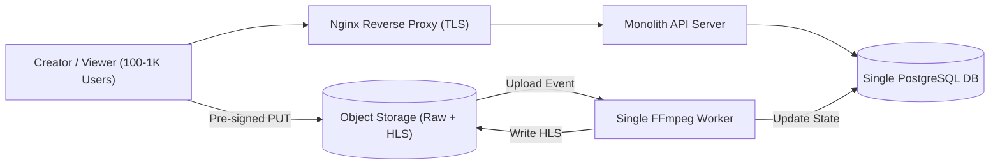
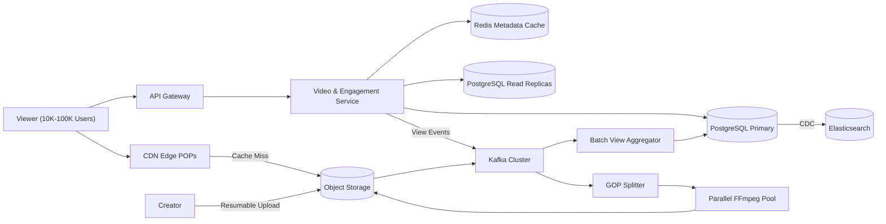
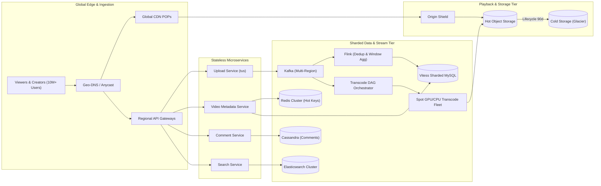
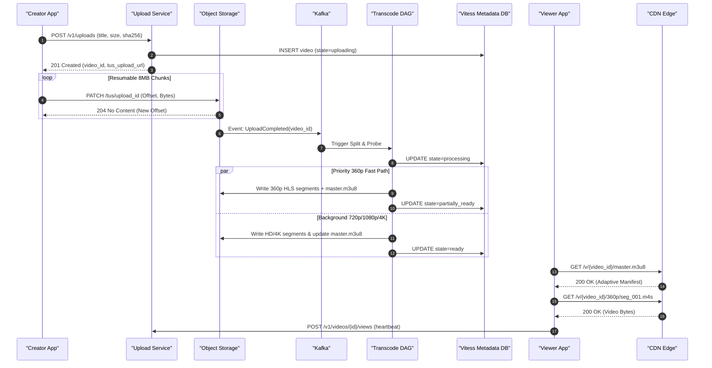

# YouTube-like Service: Full System Design Mock Interview, All 9 Steps

> **Difficulty:** Hard (Senior / Staff)
> **Prerequisites:** [Previous lesson: Video Streaming Platform: Full System Design Mock Interview, All 9 Steps](../10-video-streaming-platform/README.md) and the [Interview Framework track](../../21-interview-framework/README.md).
> **Estimated Reading Time:** 25–30 minutes
> **Target Audience:** Engineers practising the full 9-step system design interview on a classic prompt: a user-upload video platform covering resumable upload, DAG transcoding, adaptive playback, view-count aggregation, search, and comments.

> [!NOTE]
> **In one line:** A YouTube-like service extends a video streaming CDN with an **asynchronous resumable upload and DAG transcoding pipeline**, a **sharded metadata and search layer**, and **stream-aggregated write-heavy counters** for views, likes, and comments.

> [!TIP]
> **The Golden Rule:** Never transcode synchronously on the upload path, never serve video bytes through your API servers, and never execute `UPDATE videos SET views = views + 1` per view—aggregate view events in stream windows and flush batched deltas.

---

## 1. Clarifying Questions, Functional & Non-Functional Requirements

Open the interview by scoping what differs from pure VOD streaming (like Netflix). In Netflix, a small studio team uploads curated titles; in YouTube, millions of creators upload arbitrary codecs, resolutions, and durations concurrently while billions of viewers watch and interact.

**Clarifying Questions & Assumed Answers:**

| Question | Assumed Answer | Architectural Impact |
| :--- | :--- | :--- |
| **Max upload size & length?** | Up to 256 GB / 12 hours per video | Requires resumable, chunked direct-to-object-storage uploads (`tus` / S3 multipart). |
| **Time-to-playable?** | Low-res (360p) playable within 2–5 min; 4K later | Progressive DAG transcoding: split by GOP chunks, publish 360p first. |
| **Scale (DAU, uploads, views)?** | 2B MAU, 500 hours uploaded/min, 5B views/day | ~720 TB/day raw ingest; ~58K views/s average (~175K/s peak). |
| **Live streaming / Ads / ML recs?** | Out of scope for this 45-min design | Explicitly defer RTMP ingest, ad-insertion, and two-tower rec models. |
| **Consistency for views/comments?** | Eventual consistency (few seconds lag) | Enables Kafka stream aggregation and read-replica fan-out. |

### Functional Requirements

1. **Resumable Video Upload:** Creators upload large videos over flaky networks, pause/resume, and inspect processing states (`uploading`, `processing`, `partially_ready`, `ready`, `failed`).
2. **Adaptive Bitrate Playback:** Viewers stream HLS/DASH segments (`360p`, `720p`, `1080p`, `4K`) via CDN with fast startup (< 1.5 s TTFF).
3. **Engagement (Views, Likes, Comments):** Deduplicated view counting, like/dislike toggles, and paginated comment threads.
4. **Search & Discovery:** Full-text search by title, description, and tags with near-real-time indexing (< 10 s after publish).

### Non-Functional Requirements

| Quality | Target | Why It Drives the Design |
| :--- | :--- | :--- |
| **Upload Durability** | 99.999999999% (11 nines) | Losing a creator's raw upload destroys trust; store in multi-AZ object storage. |
| **Playback Availability** | 99.99% | CDN edge caching decouples playback from origin/DB outages. |
| **Startup Latency (TTFF)** | < 1.5 s p95 globally | Requires edge POPs, pre-fetched manifests, and low-bitrate initial segments. |
| **Metadata Read Latency** | < 100 ms p99 | Watch page metadata, view counts, and top comments must feel instant. |
| **Storage Efficiency** | Long-tail cost control | 90% of videos receive < 100 views/year; cold tiering & rendition pruning are mandatory. |

---

## 2. Back-of-the-Envelope Capacity Estimation

Let's derive every number from first principles so our storage, bandwidth, and compute sizing is defensible.

**Base Assumptions:**
- **Upload rate:** $R_{\text{up}} = 500\text{ hours/min}$
- **Raw bitrate:** Average source is 1080p/4K mix at $\approx 1.5\text{ GB/hour}$ ($\approx 3.3\text{ Mbps}$)
- **Transcoded ladder:** 5 renditions (`360p`, `480p`, `720p`, `1080p`, `4K`) whose combined size is $2.5\times$ the raw upload
- **Daily views:** $V_{\text{day}} = 5 \times 10^9\text{ views/day}$, average watch time $5\text{ min}$ at $2.5\text{ Mbps}$ average bitrate
- **Peak-to-average ratio:** $3\times$

### Worked Equations

**1. Daily Raw & Transcoded Storage:**
$$\text{Hours/day} = 500 \times 60 \times 24 = 720,000\text{ hours/day}$$
$$\text{Raw Storage/day} = 720,000\text{ h} \times 1.5\text{ GB/h} = 1,080\text{ TB/day} \approx 1.08\text{ PB/day}$$
$$\text{Total Stored/day (Raw + 2.5x Renditions)} = 1.08 \times 3.5 = 3.78\text{ PB/day} \approx 1.38\text{ EB/year}$$

**2. View Event & Egress Bandwidth:**
$$\text{Average Views/s} = \frac{5 \times 10^9}{86,400} \approx 57,870\text{ views/s}, \quad \text{Peak Views/s} \approx 173,600\text{ views/s}$$
$$\text{Daily Egress} = 5 \times 10^9 \times (300\text{ s} \times \frac{2.5\text{ Mbps}}{8}) = 5 \times 10^9 \times 93.75\text{ MB} \approx 468.75\text{ PB/day}$$
$$\text{Average Egress Bandwidth} = \frac{468.75\text{ PB} \times 8}{86,400\text{ s}} \approx 43.4\text{ Tbps}, \quad \text{Peak} \approx 130\text{ Tbps}$$

**3. Transcoding Compute Sizing:**
Suppose 1 vCPU transcodes 1080p H.264/VP9 at $0.5\times$ real-time (1 hour of video takes 2 CPU-hours across the ladder, or ~6 CPU-hours for all 5 renditions):
$$\text{CPU-hours/day} = 720,000 \times 6 = 4,320,000\text{ CPU-hours/day}$$
$$\text{Concurrent vCPUs needed} = \frac{4,320,000}{24} = 180,000\text{ vCPUs (average)}, \quad \approx 350,000\text{ vCPUs (peak)}$$

### Capacity Summary Table

| Metric | Average | Peak (3x) | Design Implication |
| :--- | :--- | :--- | :--- |
| **Raw Upload Volume** | 1.08 PB/day | 3.24 PB/day | Direct-to-S3/GCS multipart upload; never proxy through API servers. |
| **Total New Storage/Year** | 1.38 EB/year | — | Aggressive lifecycle tiering (Glacier/Coldline) + prune 4K on cold videos. |
| **Playback Egress** | 43.4 Tbps | 130 Tbps | 95%+ must hit CDN edge POPs; origin shield absorbs cache misses. |
| **View Events/sec** | 57.9K/s | 173.6K/s | Stream via Kafka + Flink tumbling windows; never row-lock a DB counter. |
| **Transcode Fleet** | 180K vCPUs | 350K vCPUs | Spot/preemptible GPU/CPU worker pools with GOP-level chunk parallelism. |

---

## 3. Core API Contracts & Data Model

### REST / gRPC API Contracts

| Endpoint | Method | Purpose | Key Request / Response Semantics |
| :--- | :--- | :--- | :--- |
| `/v1/uploads` | `POST` | Initiate resumable upload | Req: `{title, size_bytes, sha256}`; Resp: `{upload_id, video_id, tus_upload_url}` |
| `/v1/uploads/{id}` | `PATCH` | Upload chunk (resumable) | Headers: `Upload-Offset`, `Content-Type: application/offset+octet-stream` -> `204 No Content` |
| `/v1/videos/{id}` | `GET` | Fetch watch-page metadata | Resp: `{video_id, state, title, views, likes, manifest_url, captions[]}` |
| `/v1/videos/{id}/views` | `POST` | Emit playback heartbeat | Req: `{session_id, watch_ms, client_ts}` -> `202 Accepted` (async Kafka ingest) |
| `/v1/videos/{id}/comments` | `GET / POST` | Paginated comments | Keyset cursor pagination (`?cursor=ts_id&limit=20`); idempotency key on POST |
| `/v1/search` | `GET` | Full-text video search | `?q=distributed+systems&sort=relevance&page_token=...` |

### Core Data Model & Storage Engine Choice

| Entity / Store | Storage Engine | Partition / Shard Key | Key Columns & Rationale |
| :--- | :--- | :--- | :--- |
| **Video Metadata** | Sharded MySQL / Vitess | `video_id` | `video_id (PK), creator_id, title, state, duration_ms, created_at`. Strong ACID for state transitions. |
| **View Counts** | Redis + Sharded Counter DB | `video_id` | `video_id, view_count, like_count`. Redis serves hot reads; Flink flushes deltas every 5s. |
| **Comments** | Cassandra / ScyllaDB | `(video_id, bucket_id)` | Clustering key: `(top_level_id, comment_id DESC)`. High write throughput & fast range scans. |
| **Raw & Renditions** | Object Storage (S3/GCS) | `video_id/rendition/seg` | Immutable content-addressed HLS/DASH `.ts`/`.m4s` segments + `.m3u8`/`.mpd` manifests. |
| **Search Index** | Elasticsearch / OpenSearch | `video_id` | Inverted index on `title, description, tags, transcript`, updated via Debezium CDC. |

---

## 4. Stage 1 (100 - 1K Users): Baseline Monolith & Single Database

At 100–1,000 users, optimize for shipping speed and operational simplicity. A single stateless API monolith behind a reverse proxy, one PostgreSQL instance, local/single-bucket object storage, and an in-process worker queue (or single Celery/BullMQ worker) handle everything cleanly.

**Component-by-Component Build:**
1. **Reverse Proxy (Nginx):** Terminates TLS and routes `/api/*` to the monolith.
2. **Monolith App Server:** Handles auth, upload pre-signed URL generation, video metadata CRUD, comments, and naive SQL `LIKE` search.
3. **Single PostgreSQL DB:** Stores `users`, `videos`, `comments`, and `view_count`.
4. **Object Storage (S3) + Single FFmpeg Worker:** Creator uploads directly via pre-signed URL; S3 event triggers one FFmpeg worker to produce 360p and 720p MP4/HLS files.



**What Breaks at 10K Users?**
- **SQL `UPDATE videos SET views = views + 1`:** Row-level lock contention stalls watch-page writes on any viral video.
- **Sequential FFmpeg transcoding:** A single 2-hour 4K upload blocks the worker for hours, starving 30-second clips from other creators.
- **Origin bandwidth bill & latency:** Serving HLS segments directly from S3 to global users yields > 500 ms TTFF and huge egress costs.
- **`ILIKE '%query%'` on PostgreSQL:** Full table scans spike CPU to 100% as the catalog crosses 100K videos.

---

## 5. Stage 2 (10K - 100K Users): Caching, Read Replicas & Async Offload

At 10K–100K users, we decouple **playback**, **transcoding**, **search**, and **view counting** from the primary transactional database.

**Component-by-Component Additions:**
1. **CDN (CloudFront / Cloudflare):** Sits in front of Object Storage for all `.m3u8` manifests and `.m4s` segments, absorbing 90%+ of egress traffic.
2. **Redis Cache + PostgreSQL Read Replicas:** Watch-page metadata (`GET /v1/videos/{id}`) hits Redis first (TTL 60s); cache misses fall back to Read Replicas.
3. **Kafka + DAG Transcode Worker Pool:** Uploads emit to Kafka; a splitter breaks video into 10-second GOP chunks so 20 workers transcode chunks in parallel, prioritizing `360p` first.
4. **Elasticsearch via CDC:** Debezium/outbox streams metadata changes to Elasticsearch so search never touches PostgreSQL.
5. **Buffered View Counter:** API pushes view events to Kafka; a lightweight consumer batches increments in Redis (`INCRBY`) and flushes to PostgreSQL every 10 seconds.



**What Breaks at 1M+ Users?**
- **Single PostgreSQL Primary:** Write IOPS saturate from new uploads, comment threads, and batched view flushes.
- **Hot Key on Redis & DB:** A single viral video (e.g., 50K concurrent viewers) hammers one Redis shard and one DB row.
- **Single-Region Origin:** Trans-continental cache misses incur 200+ ms RTT; object storage single-bucket prefixes hit request rate limits.

---

## 6. Stage 3 (1M - 10M+ Users): Sharding, Partitioning & Multi-Region Scale

At 1M–10M+ users (and YouTube scale of 2B MAU), every stateful layer must be horizontally partitioned and geo-distributed.

**Component-by-Component Additions:**
1. **Vitess / Sharded MySQL:** Metadata is sharded by `video_id` across 64+ shards with automated failover and online schema migrations.
2. **Cassandra / ScyllaDB for Comments:** Partitioned by `(video_id, time_bucket)` to prevent unbounded wide partitions on viral videos with 5M+ comments.
3. **Apache Flink Stream Pipeline:** Replaces simple batch consumers; performs 30-second tumbling-window bot deduplication `(video_id, user_or_ip_hash, window_id)` and outputs pre-aggregated deltas to Sharded Counters.
4. **Multi-Tier CDN + Origin Shield:** Edge POPs -> Regional Mid-Tier Cache -> Origin Shield -> Multi-region Object Storage (with lifecycle rules moving cold long-tail renditions to Glacier).
5. **Microservices Split:** Dedicated Upload Service, Transcode Orchestrator (DAG), Playback/Manifest Service, Engagement Service, and Search Service.



---

## 7. Final Full Production Architecture & End-to-End Flows

### End-to-End Upload-to-Playback Sequence

Notice how **upload**, **progressive transcoding**, and **playback** are completely decoupled. A creator gets a playable 360p link while 1080p/4K chunks are still encoding.



---

## 8. Deep-Dive Bottlenecks & Algorithmic Trade-Offs

### 1. Progressive GOP-Split Transcoding vs. Monolithic Encoding
If a creator uploads a 4-hour 4K video (60 GB), encoding it on a single machine takes 8+ hours. Instead, the **Splitter** inspects the container index (MP4 `moov` atom) and splits the video on **keyframe (IDR / GOP) boundaries** into 10-second chunks.
- **Parallelism:** 1,440 chunks are dispatched to a spot GPU/CPU worker pool simultaneously, reducing wall-clock time from 8 hours to ~4 minutes.
- **Priority Queueing:** `360p` and `audio` jobs enter a high-priority queue so the video becomes `partially_ready` in < 2 minutes; `4K` VP9/AV1 jobs run on low-priority preemptible spot instances.

### 2. View Counting: Exact Locks vs. Stream-Aggregated Windows
- **Naive `UPDATE`:** Fails above ~1,000 views/sec on a single row due to InnoDB row lock contention.
- **Stream Aggregation + Bot Dedup:** View heartbeats (sent after 30s of playback or 10% watch) flow into Kafka partitioned by `video_id`. Flink maintains a **30-second tumbling window** keyed by `(video_id, user_id_or_ip_ua_hash)` using a Bloom filter or HyperLogLog/Set per window. Only unique views increment the window counter, which flushes a single `UPDATE ... SET views = views + delta` every 5–10 seconds.

### 3. Long-Tail Storage Economics (Zipf Distribution)
Video popularity follows a steep Zipf/power-law distribution: ~5% of videos generate ~95% of views.
- **Hot Tier (NVMe CDN + S3 Standard):** All renditions (`360p` to `4K`, AV1 + H.264) cached at edge and origin.
- **Cold Tier (S3 Glacier / Deep Archive):** Videos with zero views in 90 days have their `1080p`/`4K` renditions **deleted** (re-transcoded on demand from raw source if they ever go viral again), saving ~70% of total storage cost.

| Trade-Off | Option A | Option B | Production Choice & Rationale |
| :--- | :--- | :--- | :--- |
| **Upload Path** | Proxy through API server | Direct-to-Object-Storage (`tus`) | **Direct-to-S3:** Saves API bandwidth and supports chunked resume natively. |
| **Transcoding** | Full encode before publish | Progressive (`360p` first) | **Progressive:** Creators share links within minutes; HD upgrades seamlessly. |
| **View Counts** | Synchronous DB increment | Kafka + Flink tumbling window | **Stream Window:** Eliminates hot-row locks and filters refresh-bot spam. |
| **Comment Partition** | `(video_id)` only | `(video_id, bucket_id)` | **Bucketed:** Prevents > 100 MB wide partitions on viral videos with millions of comments. |

---

## 9. Failure Modes, Reliability & Backpressure Mitigations

1. **Transcode Worker Crash (Spot Preemption):** Spot instances are reclaimed with a 2-minute warning. Each GOP chunk job is **idempotent** and writes to a temporary key (`tmp/{video_id}/{chunk_id}`) before atomic rename; Kafka consumer group rebalances and retries unacked chunks on another worker.
2. **Corrupt / Malicious Upload (Zip Bomb or Invalid Codec):** The Probe stage runs `ffprobe` in a sandboxed gVisor/Firecracker container with strict CPU/RAM/time cgroups before any transcoding begins, rejecting malformed headers immediately.
3. **Viral Video Hot-Key on Redis Metadata:** When a celebrity drops a video, 200K req/s hit one Redis key (`meta:{video_id}`). Mitigate with **local in-process L1 LRU cache** (2–5s TTL) on API servers + **key salting** (`meta:{video_id}#0..9`) across Redis shards.
4. **View Event Kafka Lag Spike:** If Flink falls behind during a global event, the UI continues serving the last flushed count from Redis (graceful staleness) while Flink auto-scales task managers from Kafka consumer lag metrics.
5. **CDN Origin Shield Thundering Herd:** Use **request coalescing (collapsed forwarding)** at the Origin Shield so 10,000 simultaneous edge misses for a newly published segment trigger only 1 read from S3.

---

## 10. Production War Story & Real-World Reference

### Incident Pattern: The "Midnight Premier" Hot-Row & Comment Fan-Out Meltdown
- **Context:** A major gaming trailer premiered at 00:00 UTC with 1.2M concurrent viewers waiting on the watch page.
- **Root Cause:** Two subtle bugs collided: (1) The client SDK fired view-count heartbeats every 5 seconds with a random jitter bug that bypassed the 30s dedup window, sending 240K view events/sec to the legacy synchronous counter fallback path; (2) A single `video_id` comment partition in Cassandra exceeded 2 GB because all top-level comments landed in one partition without time-bucketing, causing GC pauses and read timeouts across the entire Cassandra node.
- **Impact:** Watch-page API p99 latency spiked from 45 ms to 12 s; comment threads returned HTTP 503 for 18 minutes while video playback (served by CDN) remained 100% healthy.
- **Fix:**
  1. Removed the synchronous DB fallback on view counting—view ingestion now sheds load to Kafka/disk buffer and never touches Vitess directly.
  2. Migrated comments to time-bucketed partitions `(video_id, month_bucket)` with a Redis top-100 hot-comments cache.
  3. Added L1 in-memory caching (3s TTL) on all API pods for `GET /v1/videos/{id}`.

---

## 11. Core Component Implementation (4 Languages)

Below is a production-style **Sliding/Tumbling Window View-Count Deduplicator & Batch Flusher** that prevents bot/refresh inflation and batches DB writes, implemented across Go, TypeScript, Python, and C#.

````carousel
```go
package main

import (
	"fmt"
	"sync"
	"time"
)

type ViewEvent struct {
	VideoID   string
	ViewerKey string // user_id or hashed(ip + user_agent)
	Timestamp time.Time
}

type ViewAggregator struct {
	mu         sync.Mutex
	windowSize time.Duration
	seen       map[string]struct{}
	deltas     map[string]int64
}

func NewViewAggregator(windowSize time.Duration) *ViewAggregator {
	return &ViewAggregator{
		windowSize: windowSize,
		seen:       make(map[string]struct{}),
		deltas:     make(map[string]int64),
	}
}

// Ingest deduplicates (video, viewer, window_bucket) and buffers delta.
func (a *ViewAggregator) Ingest(ev ViewEvent) bool {
	bucket := ev.Timestamp.Unix() / int64(a.windowSize.Seconds())
	dedupKey := fmt.Sprintf("%s:%s:%d", ev.VideoID, ev.ViewerKey, bucket)

	a.mu.Lock()
	defer a.mu.Unlock()

	if _, exists := a.seen[dedupKey]; exists {
		return false // Duplicate within window
	}
	a.seen[dedupKey] = struct{}{}
	a.deltas[ev.VideoID]++
	return true
}

// FlushDeltas returns accumulated counts and resets the buffer for DB batch write.
func (a *ViewAggregator) FlushDeltas() map[string]int64 {
	a.mu.Lock()
	defer a.mu.Unlock()

	out := a.deltas
	a.deltas = make(map[string]int64)
	// Periodically prune old window keys in production via ring buffer of buckets
	return out
}

func main() {
	agg := NewViewAggregator(30 * time.Second)
	t0 := time.Unix(1700000000, 0)
	agg.Ingest(ViewEvent{"vid_1", "user_a", t0})
	agg.Ingest(ViewEvent{"vid_1", "user_a", t0.Add(10 * time.Second)}) // deduped
	agg.Ingest(ViewEvent{"vid_1", "user_a", t0.Add(35 * time.Second)}) // new window
	agg.Ingest(ViewEvent{"vid_1", "user_b", t0.Add(5 * time.Second)})
	fmt.Println("Flushed deltas:", agg.FlushDeltas()) // map[vid_1:3]
}
```
<!-- slide -->
```typescript
interface ViewEvent {
  videoId: string;
  viewerKey: string; // user_id or hashed(ip + ua)
  timestampMs: number;
}

export class ViewAggregator {
  private readonly windowMs: number;
  private seen = new Set<string>();
  private deltas = new Map<string, number>();

  constructor(windowSeconds = 30) {
    this.windowMs = windowSeconds * 1000;
  }

  ingest(ev: ViewEvent): boolean {
    const bucket = Math.floor(ev.timestampMs / this.windowMs);
    const dedupKey = `${ev.videoId}:${ev.viewerKey}:${bucket}`;

    if (this.seen.has(dedupKey)) {
      return false;
    }
    this.seen.add(dedupKey);
    this.deltas.set(ev.videoId, (this.deltas.get(ev.videoId) ?? 0) + 1);
    return true;
  }

  flushDeltas(): Record<string, number> {
    const batch: Record<string, number> = {};
    for (const [videoId, count] of this.deltas.entries()) {
      batch[videoId] = count;
    }
    this.deltas.clear();
    return batch;
  }
}

// Smoke test
const agg = new ViewAggregator(30);
const base = 1_700_000_000_000;
agg.ingest({ videoId: "vid_1", viewerKey: "u1", timestampMs: base });
agg.ingest({ videoId: "vid_1", viewerKey: "u1", timestampMs: base + 12_000 });
agg.ingest({ videoId: "vid_1", viewerKey: "u1", timestampMs: base + 35_000 });
agg.ingest({ videoId: "vid_1", viewerKey: "u2", timestampMs: base + 4_000 });
console.log("Flushed:", agg.flushDeltas()); // { vid_1: 3 }
```
<!-- slide -->
```python
from dataclasses import dataclass
from typing import Dict, Set
import threading


@dataclass(frozen=True)
class ViewEvent:
    video_id: str
    viewer_key: str
    timestamp_sec: int


class ViewAggregator:
    def __init__(self, window_sec: int = 30) -> None:
        self._window_sec = window_sec
        self._lock = threading.Lock()
        self._seen: Set[str] = set()
        self._deltas: Dict[str, int] = {}

    def ingest(self, ev: ViewEvent) -> bool:
        bucket = ev.timestamp_sec // self._window_sec
        dedup_key = f"{ev.video_id}:{ev.viewer_key}:{bucket}"
        with self._lock:
            if dedup_key in self._seen:
                return False
            self._seen.add(dedup_key)
            self._deltas[ev.video_id] = self._deltas.get(ev.video_id, 0) + 1
            return True

    def flush_deltas(self) -> Dict[str, int]:
        with self._lock:
            batch = dict(self._deltas)
            self._deltas.clear()
            return batch


if __name__ == "__main__":
    agg = ViewAggregator(window_sec=30)
    t0 = 1_700_000_000
    agg.ingest(ViewEvent("vid_1", "alice", t0))
    agg.ingest(ViewEvent("vid_1", "alice", t0 + 10))  # deduped
    agg.ingest(ViewEvent("vid_1", "alice", t0 + 45))  # new window
    agg.ingest(ViewEvent("vid_1", "bob", t0 + 5))
    print("Flushed:", agg.flush_deltas())  # {'vid_1': 3}
```
<!-- slide -->
```csharp
using System;
using System.Collections.Concurrent;
using System.Collections.Generic;

public record ViewEvent(string VideoId, string ViewerKey, long TimestampSec);

public sealed class ViewAggregator
{
    private readonly long _windowSec;
    private readonly object _lock = new();
    private readonly HashSet<string> _seen = new();
    private readonly Dictionary<string, long> _deltas = new();

    public ViewAggregator(long windowSec = 30) => _windowSec = windowSec;

    public bool Ingest(ViewEvent ev)
    {
        long bucket = ev.TimestampSec / _windowSec;
        string dedupKey = $"{ev.VideoId}:{ev.ViewerKey}:{bucket}";

        lock (_lock)
        {
            if (!_seen.Add(dedupKey)) return false;
            _deltas[ev.VideoId] = _deltas.TryGetValue(ev.VideoId, out var c) ? c + 1 : 1;
            return true;
        }
    }

    public Dictionary<string, long> FlushDeltas()
    {
        lock (_lock)
        {
            var batch = new Dictionary<string, long>(_deltas);
            _deltas.Clear();
            return batch;
        }
    }
}
```
````

---

## 12. Verification, Load Testing & CLI Diagnostics

```bash
# 1. Inspect GOP/keyframe intervals of an uploaded source before splitting
ffprobe -v error -select_streams v:0 -show_entries frame=pkt_pts_time,pict_type \
  -of csv=p=0 sample_1080p.mp4 | grep ",I" | head -n 10

# 2. Verify HLS adaptive manifest and CDN cache-hit headers
curl -sI https://cdn.example.com/v/vid_123/master.m3u8 | grep -iE "http/|x-cache|cache-control"

# 3. Check Kafka consumer lag for the transcode and view-aggregator groups
kafka-consumer-groups.sh --bootstrap-server kafka-1:9092 \
  --describe --group view-aggregator-flink

# 4. Load-test watch-page metadata and view-heartbeat ingestion with k6
k6 run --vus 500 --duration 60s -e VIDEO_ID=vid_123 watch_page_load.js
```

---

## 13. Common Interview Mistakes & Red Flags

1. **Proxying 50 GB video uploads through API servers:** Exhausts API worker memory/sockets; always use direct-to-object-storage resumable URLs (`tus` or S3 multipart).
2. **Synchronous transcoding:** Making the creator wait 3 hours for an HTTP `POST` response will time out and fail.
3. **Row-level `UPDATE videos SET views = views + 1`:** Causes catastrophic lock contention on viral videos.
4. **No progressive publishing:** Waiting for `4K` AV1 encoding before publishing `360p` hurts creator time-to-share.
5. **Ignoring the long tail:** Storing 5 renditions in hot S3 Standard forever wastes hundreds of millions of dollars on unwatched videos.
6. **Unbounded comment partitions:** Partitioning Cassandra solely by `video_id` breaks when a single video gets 5M+ comments.

---

## 14. Key Terminology & Glossary

| Term | Definition |
| :--- | :--- |
| **GOP (Group of Pictures)** | A sequence of video frames starting with an independent keyframe (I-frame), used as the unit of parallel transcode splitting. |
| **HLS / MPEG-DASH** | Adaptive bitrate streaming protocols splitting video into short (2–6 s) HTTP-cacheable segments indexed by a manifest. |
| **Resumable Upload (`tus`)** | Open protocol allowing chunked uploads to resume from the exact byte offset after network drops. |
| **Tumbling Window** | Fixed-size, non-overlapping time interval (e.g., 30 s) used in stream processors like Flink to deduplicate and aggregate events. |
| **Origin Shield** | An intermediate caching layer between CDN edge POPs and object storage that collapses duplicate cache-miss requests. |
| **Zipf Distribution** | Power-law popularity curve where a tiny fraction of hot videos accounts for the vast majority of egress bandwidth. |
| **CDC (Change Data Capture)** | Streaming committed DB row changes (e.g., Debezium) to keep search indexes and caches eventually consistent. |
| **Time-Bucketing** | Adding a time slice (e.g., `YYYY-MM`) to a NoSQL partition key to bound partition size on hot entities. |

---

## 15. Interview Follow-Up Questions (12 Q&As)

### Basic Conceptual Questions

<details>
<summary><strong>Q1: How does resumable chunked upload work end-to-end? [BASIC]</strong></summary>

The client calls `POST /v1/uploads` to register metadata and receive a signed `tus` / multipart upload URL. It uploads 8 MB chunks directly to object storage with `Upload-Offset` headers. If Wi-Fi drops at 45%, the client issues a `HEAD` request to query the persisted offset and resumes from byte 45% without re-uploading.

</details>

<details>
<summary><strong>Q2: Why do we use HLS/DASH instead of serving a single MP4 file? [BASIC]</strong></summary>

A single 4K MP4 cannot adapt mid-playback when a mobile user enters an elevator. HLS/DASH splits each rendition into 4-second segments so the player's ABR (Adaptive Bitrate) algorithm can switch from 1080p to 360p on the next segment boundary without rebuffering.

</details>

<details>
<summary><strong>Q3: How do you make a newly uploaded video playable within minutes? [BASIC]</strong></summary>

Use progressive DAG transcoding: split the raw file on GOP boundaries and route the `360p` and audio chunks to a high-priority worker queue. As soon as `360p` segments finish, write `master.m3u8` and flip state to `partially_ready`. Higher renditions (`1080p`, `4K`) append to the manifest asynchronously.

</details>

<details>
<summary><strong>Q4: Why is search served from Elasticsearch via CDC instead of PostgreSQL/Vitess? [BASIC]</strong></summary>

Transactional databases are optimized for point lookups and ACID writes, not inverted-index tokenization, typo tolerance, or BM25 relevance scoring across billions of titles and transcripts. Decoupling via Debezium CDC keeps search queries off the primary DB.

</details>

### Scenario-Based Architecture Questions

<details>
<summary><strong>Q5: A creator uploads a 10-hour 4K video (200 GB). How do you prevent it from blocking other creators? [SCENARIO]</strong></summary>

Never encode a full file on one worker. The Splitter reads the MP4 index and emits 3,600 independent 10-second GOP chunk tasks into Kafka, tagged with a fair-scheduling tenant/duration priority. Short clips and `360p` jobs get priority lanes while the 10-hour `4K` chunks fan out across spot workers.

</details>

<details>
<summary><strong>Q6: A celebrity drops a music video and 500K users hit the watch page simultaneously. What breaks and how do you survive it? [SCENARIO]</strong></summary>

Two things break: (1) Edge CDN cache misses create a thundering herd on S3—solved by Origin Shield request coalescing; (2) Metadata `GET /v1/videos/{id}` hammers one Redis shard—solved by a 3-second L1 in-memory cache on API pods plus salted Redis keys (`#0..#9`).

</details>

<details>
<summary><strong>Q7: How do you prevent bots from inflating view counts by refreshing the page? [SCENARIO]</strong></summary>

First, require a playback heartbeat after ≥ 30 seconds of watch time (or 10% duration) with a signed playback token. Second, in the Flink stream processor, deduplicate events per `(video_id, viewer_key, 30s_window)` and apply anomaly/IP-reputation filtering before flushing deltas.

</details>

<details>
<summary><strong>Q8: Storage costs are growing at 1 EB/year. How do you cut storage spend by 60%+ without hurting UX? [SCENARIO]</strong></summary>

Exploit the Zipf long tail: keep raw source + `360p` in Glacier/Coldline for videos with zero views in 90 days, and delete `720p`/`1080p`/`4K` renditions on cold videos. If an old video suddenly goes viral, re-transcode the HD renditions on demand from the preserved raw source.

</details>

### Advanced & Tricky Interview Questions

<details>
<summary><strong>Q9: How do you handle live view counts vs. creator analytics accuracy? [TRICKY]</strong></summary>

Run a **Lambda/Kappa dual-output** from Kafka: the fast Flink tumbling-window path updates Redis/Vitess every 5 seconds for the public counter (low latency, approximate), while a batch/Spark reconciliation job reads the immutable Kafka/Iceberg log hourly to compute exact audited counts for creator monetization.

</details>

<details>
<summary><strong>Q10: How do you support private/unlisted videos when segments are cached on a public CDN? [TRICKY]</strong></summary>

Never cache private video segments with public `Cache-Control` without access checks. Use **CDN Signed URLs / Signed Cookies** with short TTLs (e.g., 15 minutes) generated by the API only after verifying ACLs, and validate the HMAC signature at the CDN edge before serving bytes.

</details>

<details>
<summary><strong>Q11: What happens if a spot transcode worker dies halfway through a 10-second chunk? [TRICKY]</strong></summary>

Each chunk task is stateless and idempotent: the worker writes output to a temp object path and only commits its Kafka offset after the segment is durably written to S3. On worker preemption, Kafka's consumer group rebalances and another worker re-processes the unacked chunk cleanly.

</details>

<details>
<summary><strong>Q12: How do you design the comment system so pinned/top comments load fast even on a video with 10M comments? [TRICKY]</strong></summary>

Partition Cassandra by `(video_id, month_bucket)` to bound partition size, and maintain a separate materialized top-comments cache in Redis (sorted by engagement score, updated asynchronously). Watch-page load reads the top 20 from Redis in < 5 ms and paginates older buckets via keyset cursors.

</details>

---

## 16. One-Page Master Cheat Sheet

```text
+------------------------------------------------------------------------------+
|                YOUTUBE-LIKE SERVICE — SYSTEM DESIGN CHEAT SHEET              |
+------------------------------------------------------------------------------+
| SCALE: 500 hrs/min upload -> 1.08 PB/day raw (~3.8 PB/day w/ renditions)     |
|        5B views/day -> 58K views/s avg (174K peak) | 43 Tbps avg CDN egress  |
+------------------------------------------------------------------------------+
| 4 GOLDEN RULES:                                                              |
|  1. Upload: Direct-to-S3 resumable (tus) -> never proxy through API pods.    |
|  2. Transcode: GOP-split parallel DAG; publish 360p fast, 4K asynchronously. |
|  3. Playback: CDN Edge + Origin Shield (95%+ hit rate); signed URLs if priv. |
|  4. Views: Kafka -> Flink 30s dedup window -> batched delta flushes to DB.   |
+------------------------------------------------------------------------------+
| STORAGE TIERS:                                                               |
|  Metadata: Vitess (sharded by video_id)  | Comments: Cassandra (vid, bucket) |
|  Search: Elasticsearch via Debezium CDC  | Media: S3 Hot -> Glacier (90d)    |
+------------------------------------------------------------------------------+
```

| Step | Key Decision | Primary Bottleneck Solved |
| :--- | :--- | :--- |
| **Upload** | `tus` chunked direct-to-S3 | API memory/bandwidth exhaustion & flaky mobile networks |
| **Transcode** | GOP-split DAG, 360p priority | Multi-hour encoding latency on long 4K uploads |
| **Playback** | CDN + Origin Shield coalescing | 130 Tbps peak egress & thundering herd on premieres |
| **Views** | Kafka + Flink tumbling window | Hot-row lock contention & refresh-bot inflation |

---

## Further Reading

- YouTube engineering and Google Research publications on video serving.
- Netflix Tech Blog on encoding pipelines (the ideas carry over).
- Martin Kleppmann, *Designing Data-Intensive Applications*, Chapter 11 (Stream Processing).

---

## Next

Continue with [Ride-Hailing Platform: Full System Design Mock Interview, All 9 Steps](../12-ride-hailing-platform/README.md).
