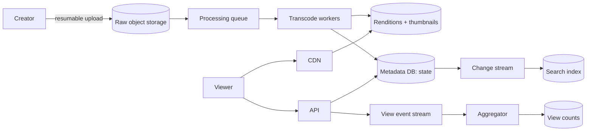

# YouTube-like Service: Full System Design Mock Interview, All 9 Steps

> **Prerequisites:** [Previous lesson: Video Streaming Platform: Full System Design Mock Interview, All 9 Steps](../10-video-streaming-platform/README.md) and the [Interview Framework track](../../21-interview-framework/README.md).
> **Estimated Reading Time:** 15–20 minutes
> **Target Audience:** Engineers practising the full 9-step system design interview on a classic prompt: a user-upload video platform: upload, process, watch, count views, comment.

> [!NOTE]
> **In one line:** YouTube adds to streaming a **user upload pipeline**, a metadata and search layer, and write-heavy features such as view counts and comments.

> [!TIP]
> **The Golden Rule:** Make upload an asynchronous pipeline (store raw, then process), serve playback through the CDN, and treat view counts as an aggregated stream, not row updates.

---

## Step 1. Clarify the Problem

Open with questions, not boxes. Reuse the streaming design for playback and spend the time on what is new: user uploads, processing states, counting views and a long tail catalogue.

**Questions to ask the interviewer, and the answer we assume:**

| Question | Assumed answer |
| :--- | :--- |
| Upload limits? | Up to 12 hours, 256 GB |
| Processing time? | Playable low quality within minutes |
| Features? | Search, comments, likes, view counts, recommendations (out of scope) |
| Live? | Out of scope |
| Scale? | 2B users, 500 hours of video uploaded per minute |

> Say it aloud: *"Before I draw anything, let me confirm the scope and the numbers."* That one sentence earns the first minutes of the interview.

---

## Step 2. Functional and Non-Functional Requirements

**Functional (what the system does):**

- Upload a video and see its processing state.
- Watch videos with adaptive quality.
- Search by title and description.
- View counts, likes and comments.

**Non-functional (how well it does it):**

| Quality | Target | Why it drives the design |
| :--- | :--- | :--- |
| Durability | Never lose an upload | Creators' work |
| Availability | 99.99% playback | Mass audience |
| Freshness | Playable within minutes of upload | Creator experience |
| Cost | Long tail dominates storage | Most videos are rarely watched |

---

## Step 3. Scope: In and Out

**In scope:** Upload, transcoding states, playback, search, view counts, comments.

**Out of scope (say it explicitly, then move on):**

- The recommendation algorithm.
- Monetisation and ads.
- Copyright matching internals.

---

## Step 4. Capacity Estimation

Assumptions: 500 hours uploaded per minute, 1 GB per hour of source video, 5 renditions averaging a combined 2x the source size, 1B views per day.

| Quantity | Calculation | Result |
| :--- | :--- | :--- |
| Hours per day | `hours_per_min * 60 * 24` | **720K hours** |
| Raw upload per day | `hours_per_day * gb_per_hour / 1e3` | **720 TB/day** |
| Stored per day with renditions | `raw_upload_per_day * factor` | **2.2K TB/day** |
| View events per second | `views / 86400` | **11.6K views/s** |

**What the numbers tell you:** 720,000 hours a day is 720 TB raw, and about 2 PB with renditions: storage grows by roughly 800 PB a year, so cold tiering and deleting unused renditions matter. 11.6K view events per second is small if aggregated, but impossible as row updates on hot videos.

---

## Step 5. API Design

| Endpoint | Purpose | Notes |
| :--- | :--- | :--- |
| `POST /v1/uploads` | Start a resumable upload | Returns an upload URL; client sends chunks to object storage. |
| `GET /v1/videos/{id}` | Metadata and state | `processing`, `ready`, `failed`. |
| `GET {cdn}/...` | Playback | As in the streaming lesson. |
| `POST /v1/videos/{id}/view` | Count a view | Fire-and-forget to a stream. |
| `GET /v1/search?q=` | Search | Search index. |

Playback and processing are decoupled: a video can be watchable at 360p within minutes while the 4K rendition is still encoding.

---

## Step 6. Data Model

| Entity / Store | Key fields | Why this store |
| :--- | :--- | :--- |
| Video metadata DB | `video_id`, `owner`, `title`, `state`, `renditions` | Sharded by video id |
| Object storage | Raw upload, renditions, thumbnails | Durable, tiered |
| View event stream | `video_id`, `ts`, `user` | Kafka, aggregated in windows |
| Search index | Title, description, tags | From a change stream |
| Comments | `video_id`, `comment_id`, `text` | Wide-column partitioned by video |

View counts are derived data: the stream is the source of truth, and the displayed number is an aggregate that lags by a few seconds.

---

## Step 7. High-Level Architecture



**Walk the diagram in this order:** upload to raw storage, queue processing, publish renditions and flip state to ready; viewers stream from the CDN while view events flow to an aggregator.

---

## Step 8. Deep Dives and Bottlenecks

### 1. Upload and processing pipeline

Uploads are resumable and chunked straight to object storage. A message starts processing: validate, transcode the lowest rendition first so the video is playable quickly, then higher ones, generate thumbnails and captions. State moves `uploaded`, `processing`, `ready` in the metadata DB, and each step is idempotent so retries are safe.

### 2. Counting views

Send view events to a stream, deduplicate by user and time window to resist bots, aggregate per video in tumbling windows, and update a count store. The player shows the last aggregate. A hot video gets many events per second, so the aggregator pre-combines before touching the store.

### 3. The long tail

Most storage holds videos almost nobody watches. Move old renditions to cold storage, drop high-bitrate renditions nobody requests, and keep only the source plus a low rendition for the long tail. Popular videos stay on CDN and warm storage.

---

## Step 9. Trade-offs, Failures and Security

**Trade-offs to state aloud:**

| Decision | Option A | Option B | Pick and why |
| :--- | :--- | :--- | :--- |
| Processing | Fully before publish | Progressive | Progressive: playable at low quality fast, better creator experience |
| View counts | Exact, synchronous | Aggregated stream | Aggregated: scale and bot resistance |
| Storage | All renditions forever | Tiered and pruned | Tiered: the long tail dominates cost |

**Failure modes and mitigations:**

| Failure | What users see | Mitigation |
| :--- | :--- | :--- |
| Transcode worker dies | Processing delayed | Queue redelivers; steps are idempotent |
| Upload interrupted | Partial upload | Resumable chunks |
| Count store lag | Stale count | Acceptable; reconcile from the stream |

**Security and abuse:** Scan uploads for malware and policy violations, fingerprint for copyright, signed playback URLs for private videos, and bot filtering on views and comments.

---

## Runnable Example: Deduplicating view events in a window

Count one view per user per video per 30 second window, which resists a refresh loop.

```python
events = [("v1", "alice", 0), ("v1", "alice", 10), ("v1", "alice", 45),
          ("v1", "bob", 5), ("v2", "alice", 3)]

def count_views(events, window=30):
    seen, counts = set(), {}
    for video, user, t in events:
        key = (video, user, t // window)
        if key in seen:
            continue
        seen.add(key)
        counts[video] = counts.get(video, 0) + 1
    return counts

print(count_views(events))
```

Output (produced by running this exact code):

```text
{'v1': 3, 'v2': 1}
```

Alice's second event at 10 seconds is dropped (same window), her event at 45 seconds counts again, so v1 has 3 views and v2 has 1.

---

## Common Mistakes

- Making the creator wait for full transcoding.
- Updating a view-count row per view.
- Keeping every rendition of every video forever.
- Processing synchronously in the upload request.
- No bot or duplicate filtering.

---

## Interview Questions and Answers

<details>
<summary><strong>Q1: How does upload to playback work?</strong></summary>

Resumable chunked upload to object storage, a queue triggers transcoding workers, renditions are written back, and state flips to ready.

</details>

<details>
<summary><strong>Q2: How do you count views?</strong></summary>

Events to a stream, deduplicate by window, aggregate per video, and store the count. The UI reads the aggregate.

</details>

<details>
<summary><strong>Q3: How do you handle storage growth?</strong></summary>

Tier old and rarely watched videos to cold storage, prune unused renditions and compress aggressively.

</details>

<details>
<summary><strong>Q4: How do you make a video available fast?</strong></summary>

Transcode a low rendition first and publish it, then add higher ones.

</details>

<details>
<summary><strong>Q5: How does search work?</strong></summary>

A change stream from metadata feeds an inverted index; rank by relevance and engagement.

</details>

---

## One-Page Cheat Sheet

| Step | What to say or draw |
| :--- | :--- |
| Clarify | Uploads, processing, search, views; 500 hours/min |
| Capacity | 720K hours/day, ~2 PB/day with renditions, 11.6K views/s |
| API | resumable upload, metadata, playback, view, search |
| Data | Metadata, object storage, view stream, search |
| Deep dive | Pipeline, view counting, long tail |
| Trade-off | Progressive processing, aggregated counts |

---

## Further Reading

- YouTube engineering and Google Research publications on video serving.
- Netflix Tech Blog on encoding pipelines (the ideas carry over).

---

## Next

Continue with [Ride-Hailing Platform: Full System Design Mock Interview, All 9 Steps](../12-ride-hailing-platform/README.md).
