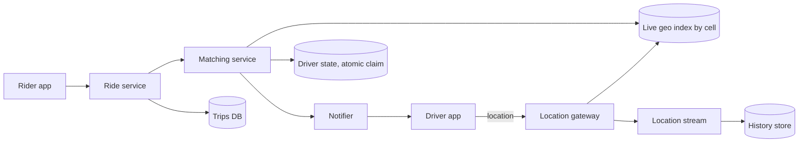

# Ride-Hailing Platform: Full System Design Mock Interview, All 9 Steps

> **Prerequisites:** [Previous lesson: YouTube-like Service: Full System Design Mock Interview, All 9 Steps](../11-youtube-like-service/README.md) and the [Interview Framework track](../../21-interview-framework/README.md).
> **Estimated Reading Time:** 15–20 minutes
> **Target Audience:** Engineers practising the full 9-step system design interview on a classic prompt: matching riders with nearby drivers in real time.

> [!NOTE]
> **In one line:** Ride hailing is a **geospatial matching system**: ingest a stream of driver locations, find nearby candidates fast, and assign each ride to exactly one driver.

> [!TIP]
> **The Golden Rule:** Index live locations by geographic cell in memory, match against that index, and make the assignment a single atomic step so a driver is never promised twice.

---

## Step 1. Clarify the Problem

Open with questions, not boxes. The interesting parts are the location firehose, the nearest-driver query and the double-booking problem, not the map UI.

**Questions to ask the interviewer, and the answer we assume:**

| Question | Assumed answer |
| :--- | :--- |
| Ride types? | One standard type for now |
| Matching rule? | Nearest available driver by ETA |
| Location update rate? | Every 4 seconds while online |
| Pricing? | Out of scope except a fare estimate |
| Scale? | 1M drivers online, 500K ride requests per hour at peak |

> Say it aloud: *"Before I draw anything, let me confirm the scope and the numbers."* That one sentence earns the first minutes of the interview.

---

## Step 2. Functional and Non-Functional Requirements

**Functional (what the system does):**

- Drivers send their location and go online or offline.
- A rider requests a ride from a pickup point.
- The system matches an available driver and both see live progress.
- Trip state is tracked from request to completion.

**Non-functional (how well it does it):**

| Quality | Target | Why it drives the design |
| :--- | :--- | :--- |
| Match latency | Under 5 s | Riders abandon long waits |
| Location write rate | Hundreds of thousands per second | The firehose dominates traffic |
| Correctness | One driver per ride | Double booking breaks trust |
| Availability | 99.99% | Money and safety depend on it |

---

## Step 3. Scope: In and Out

**In scope:** Location ingest, nearby search, matching, trip state.

**Out of scope (say it explicitly, then move on):**

- Surge pricing models.
- Payments (a separate lesson).
- Route and ETA machine learning.

---

## Step 4. Capacity Estimation

Assumptions: 1M drivers online sending a location every 4 seconds, 500K requests per hour at peak, 100 bytes per location.

| Quantity | Calculation | Result |
| :--- | :--- | :--- |
| Location writes per second | `drivers / interval` | **250K writes/s** |
| Ride requests per second | `requests_hour / 3600` | **139 req/s** |
| Location bandwidth | `location_writes_per_second * bytes_ / 1e6` | **25 MB/s** |

**What the numbers tell you:** 250K location writes per second is the hard number, but it is small data (25 MB/s) and only the latest position matters, so it belongs in memory, not a disk database. Only 139 ride requests per second need matching.

---

## Step 5. API Design

| Endpoint | Purpose | Notes |
| :--- | :--- | :--- |
| `POST /v1/drivers/location` | Update position | Batched or over a socket, includes status. |
| `POST /v1/rides` | Request a ride | Pickup and destination. Returns `ride_id`, `202`. |
| `GET /v1/rides/{id}` | Trip state | requested, matched, arriving, in-trip, done. |
| `POST /v1/rides/{id}/accept` | Driver accepts | Atomic assignment. |

Push trip updates over a WebSocket or push notification rather than letting apps poll.

---

## Step 6. Data Model

| Entity / Store | Key fields | Why this store |
| :--- | :--- | :--- |
| Live location index (in-memory, sharded by cell) | `cell_id` to driver ids with last position and status | Only the latest position, high write rate |
| Trips DB | `ride_id`, `rider`, `driver`, `state`, `fare` | Relational, strong consistency |
| Location history (stream to cold store) | `driver`, `ts`, `lat`, `lng` | Analytics, disputes |
| Driver state (Redis) | `driver_id`, `status`, `ride_id` | Atomic claim |

Do not write every ping to the trips database. Keep the live index in memory and stream the history to a log for later.

---

## Step 7. High-Level Architecture



**Walk the diagram in this order:** driver pings update the in-memory index; a ride request asks the matcher for nearby cells, ranks candidates, claims one atomically, and notifies both apps.

---

## Step 8. Deep Dives and Bottlenecks

### 1. Geospatial index

Divide the map into cells (geohash, S2 or H3 hexagons). Store each online driver under its current cell. To find candidates, look up the rider's cell and its neighbours, then rank by road ETA. Cells are the shard key, so a busy city is spread across many nodes and a nearby query touches only a few.

### 2. Matching without double booking

Never read a driver's status then write it. Use an atomic compare-and-set (a Redis Lua script or conditional write) that flips a driver from `available` to `offered` for this ride. If it fails, try the next candidate. Offers have a timeout (say 10 seconds), after which the driver returns to `available` and the next candidate is tried.

### 3. Surges and failures

Requests spike when it rains. Queue requests per region, widen the search radius gradually, and degrade gracefully (longer ETAs) rather than fail. If a matching node dies, the driver state in Redis and the trips DB let another node resume the ride.

---

## Step 9. Trade-offs, Failures and Security

**Trade-offs to state aloud:**

| Decision | Option A | Option B | Pick and why |
| :--- | :--- | :--- | :--- |
| Index | Geohash grid | H3 hexagons | Either: hexagons give uniform neighbour distance, geohash is simpler |
| Matching | Nearest first | Batch optimise | Nearest for latency, batched assignment in dense areas for overall wait |
| Location storage | Database row | In-memory latest | In-memory: only the current position matters |

**Failure modes and mitigations:**

| Failure | What users see | Mitigation |
| :--- | :--- | :--- |
| Matching node crash | Request stalls | State in Redis and the trips DB; another node retries |
| Driver goes offline mid-offer | Offer lost | Offer timeout and next candidate |
| Location gap | Driver appears stale | Drop drivers with no ping for 30 s |

**Security and abuse:** Authenticate location updates, share rider details with the driver only after matching, validate GPS plausibility to detect spoofing, and keep location history access-controlled and time-limited.

---

## Runnable Example: Grid cells and nearby lookup

A simple grid index shows the idea: drivers are bucketed by cell, and a query reads the 3 by 3 block around the rider.

```python
CELL = 0.01  # about 1 km

def cell(lat, lng):
    return (int(lat / CELL), int(lng / CELL))

drivers = {"d1": (12.971, 77.594), "d2": (12.975, 77.601), "d3": (13.100, 77.700)}
index = {}
for d, (la, lo) in drivers.items():
    index.setdefault(cell(la, lo), []).append(d)

def nearby(lat, lng):
    cx, cy = cell(lat, lng)
    found = []
    for dx in (-1, 0, 1):
        for dy in (-1, 0, 1):
            found += index.get((cx + dx, cy + dy), [])
    return found

print(nearby(12.972, 77.596))
```

Output (produced by running this exact code):

```text
['d1', 'd2']
```

The rider finds the two drivers in the surrounding cells and never scans the far-away third driver, which is the whole point of the index.

---

## Common Mistakes

- Writing every ping to a relational database.
- Reading then writing driver status (double booking).
- Scanning all drivers per request.
- Polling for trip state.
- No offer timeout.

---

## Interview Questions and Answers

<details>
<summary><strong>Q1: How do you find nearby drivers?</strong></summary>

A cell-based index (geohash, S2 or H3). Look up the rider's cell and its neighbours and rank the candidates by ETA.

</details>

<details>
<summary><strong>Q2: How do you stop double booking?</strong></summary>

An atomic compare-and-set on driver state so only one ride can claim a driver; failures move to the next candidate.

</details>

<details>
<summary><strong>Q3: Where do locations live?</strong></summary>

In an in-memory index sharded by cell, with only the latest position, plus a stream to cold storage for history.

</details>

<details>
<summary><strong>Q4: What if no driver accepts?</strong></summary>

Offer timeouts return the driver to the pool and the next candidate is tried; widen the radius over time.

</details>

<details>
<summary><strong>Q5: How do you handle a demand spike?</strong></summary>

Queue per region, widen search, degrade ETAs, and scale matching workers.

</details>

---

## One-Page Cheat Sheet

| Step | What to say or draw |
| :--- | :--- |
| Clarify | One ride type, nearest driver, 1M drivers online |
| Capacity | 250K location writes/s, 139 requests/s |
| API | location, request ride, state, accept |
| Data | In-memory cell index, trips DB, history stream |
| Deep dive | Cells, atomic claim, spikes |
| Trade-off | H3 vs geohash, nearest vs batch |

---

## Further Reading

- Uber engineering, *H3: Uber's hexagonal hierarchical spatial index*.
- Uber engineering, *Scaling Uber's real-time market platform*.

---

## Next

Continue with [Food Delivery Platform: Full System Design Mock Interview, All 9 Steps](../13-food-delivery-platform/README.md).
