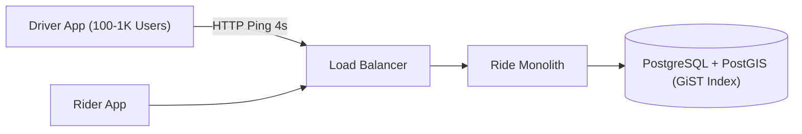
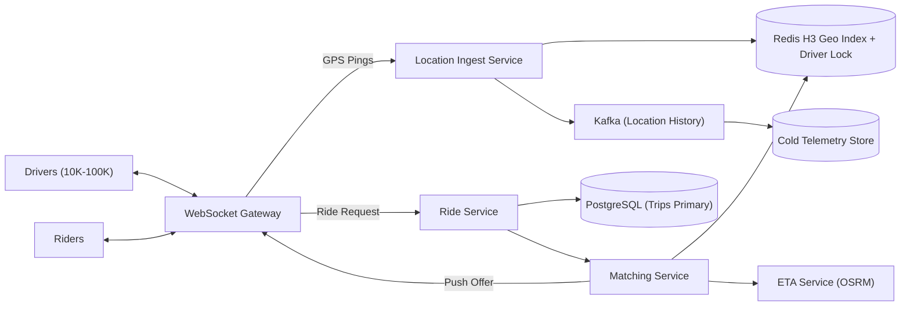
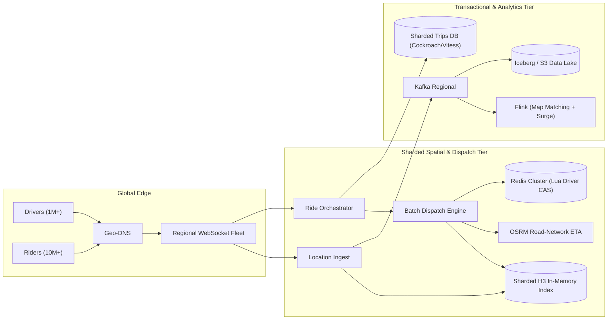
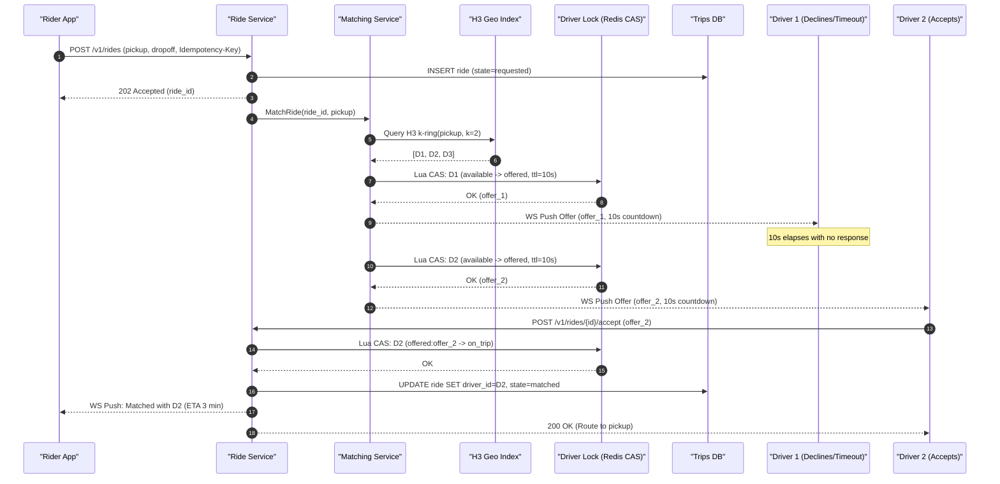

# Ride-Hailing Platform: Full System Design Mock Interview, All 9 Steps

> **Difficulty:** Hard (Senior / Staff)
> **Prerequisites:** [Previous lesson: YouTube-like Service: Full System Design Mock Interview, All 9 Steps](../11-youtube-like-service/README.md) and the [Interview Framework track](../../21-interview-framework/README.md).
> **Estimated Reading Time:** 25–30 minutes
> **Target Audience:** Engineers practising the full 9-step system design interview on a classic prompt: matching riders with nearby drivers in real time at global scale.

> [!NOTE]
> **In one line:** Ride hailing is a **high-throughput geospatial matching engine**: ingest a firehose of live driver coordinates into an in-memory spatial index, rank nearby candidates by road ETA, and atomically assign each trip to **at most one** driver.

> [!TIP]
> **The Golden Rule:** Keep ephemeral live driver positions in an in-memory cell-sharded index (never a disk SQL DB), and make the driver offer/claim an atomic Compare-And-Set (CAS) with a strict TTL so no driver is ever double-booked.

---

## 1. Clarifying Questions, Functional & Non-Functional Requirements

Open the interview by separating the **location firehose** (high write rate, ephemeral) from **trip state** (low write rate, strongly consistent ACID).

**Clarifying Questions & Assumed Answers:**

| Question | Assumed Answer | Architectural Impact |
| :--- | :--- | :--- |
| **Scale (online drivers & trips)?** | 1M concurrent online drivers; 500K ride requests/hr peak | ~250K location pings/s; ~139 ride match requests/s (420/s burst). |
| **Location ping interval?** | Every 4 seconds while online | Only latest `(lat, lng, bearing)` matters for matching; history goes to cold log. |
| **Matching criteria?** | Nearest available driver by road-network ETA | Spatial cell lookup (H3) followed by OSRM/Valhalla ETA matrix ranking. |
| **Offer & acceptance model?** | Sequential or batched offer with 10s driver timeout | Requires atomic `available -> offered -> matched` state transitions + TTL. |
| **Out of scope?** | Surge ML pricing, payment gateway internals, driver onboarding | Explicitly scope out to focus on geo-indexing, dispatch, and trip state. |

### Functional Requirements

1. **Driver Presence & Telemetry:** Drivers go online/offline and stream GPS coordinates every 4 seconds.
2. **Ride Request & Matching:** Riders request a trip from `(pickup_lat, pickup_lng)` to `(dropoff_lat, dropoff_lng)` and receive an ETA + driver match.
3. **Atomic Offer & Acceptance:** System offers the ride to a candidate driver; driver accepts or declines within 10s, or offer auto-expires and cascades.
4. **Live Trip Tracking:** Both rider and driver receive real-time state transitions (`requested`, `matched`, `arriving`, `in_trip`, `completed`, `cancelled`) and live driver position.

### Non-Functional Requirements

| Quality | Target | Why It Drives the Design |
| :--- | :--- | :--- |
| **Location Write Throughput** | 250K–500K writes/s | Cannot write to disk B-trees per ping; requires in-memory sharded spatial store. |
| **Match Latency** | < 3 s p95 (search < 50 ms) | Riders abandon if matching spins; spatial lookup + ETA must be sub-second. |
| **Correctness (No Double Booking)** | 100% (Linearizable per driver) | Two riders cannot be promised the same driver simultaneously. |
| **Availability** | 99.99% | Outages directly halt marketplace revenue and strand riders. |

---

## 2. Back-of-the-Envelope Capacity Estimation

**Base Assumptions:**
- **Online Drivers:** $D = 1,000,000$ concurrent drivers
- **Ping Interval:** $\Delta t = 4\text{ seconds}$
- **Payload per Ping:** $B_{\text{ping}} = 128\text{ bytes}$ (`driver_id`, `lat`, `lng`, `bearing`, `speed`, `ts`, `status`)
- **Peak Ride Requests:** $R_{\text{hr}} = 500,000\text{ requests/hour}$ (burst factor $3\times$ during rain/rush hour)
- **Active Riders Viewing Map:** $2,000,000$ concurrent riders polling/subscribing every 4s

### Worked Equations

**1. Location Ingest Write Rate & Bandwidth:**
$$\text{Write QPS} = \frac{1,000,000\text{ drivers}}{4\text{ s}} = 250,000\text{ writes/s}$$
$$\text{Ingest Bandwidth} = 250,000 \times 128\text{ bytes} = 32\text{ MB/s} \approx 256\text{ Mbps}$$

**2. In-Memory Spatial Index Footprint:**
Each online driver entry in the in-memory spatial index (cell pointer + `driver_id` + coordinates + status + timestamp) takes $\approx 150\text{ bytes}$ with hash-table overhead:
$$\text{RAM for 1M drivers} = 1,000,000 \times 150\text{ B} = 150\text{ MB}$$
Even at $10\times$ scale (10M drivers globally), the entire live world index fits in **1.5 GB of RAM**—easily held in a small sharded Redis/in-memory cluster!

**3. Ride Match QPS & Location History Storage:**
$$\text{Avg Match QPS} = \frac{500,000}{3,600} \approx 139\text{ req/s}, \quad \text{Burst Match QPS} (3\times) \approx 417\text{ req/s}$$
$$\text{Daily Location History} = 250,000\text{ writes/s} \times 86,400\text{ s} \times 128\text{ B} \approx 2.76\text{ TB/day}$$

### Capacity Summary Table

| Metric | Average / Nominal | Peak / Burst | Design Implication |
| :--- | :--- | :--- | :--- |
| **Driver Location Pings** | 250K writes/s | 500K writes/s | In-memory cell-sharded index + async Kafka stream to cold store. |
| **Live Index RAM** | 150 MB (1M drivers) | 1.5 GB (10M drivers) | Fits entirely in memory; shard by H3 cell/region for CPU, not RAM. |
| **Ride Match Requests** | 139 req/s | 417 req/s | Low QPS compared to pings; can afford OSRM road-ETA matrix calls. |
| **Daily Telemetry Log** | 2.76 TB/day | — | Write to Kafka -> Parquet/Iceberg on S3 for ML & dispute replay. |

---

## 3. Core API Contracts & Data Model

### API Contracts (REST + WebSocket/gRPC)

| Endpoint / Channel | Protocol | Purpose | Key Payload & Semantics |
| :--- | :--- | :--- | :--- |
| `WS /v1/drivers/stream` | WebSocket | Bidirectional telemetry & offers | Driver sends `{lat, lng, speed, ts}` every 4s; receives `{offer_id, ride_id, pickup, ttl_s}`. |
| `POST /v1/rides` | REST | Request a ride | Header: `Idempotency-Key`; Body: `{pickup, dropoff, ride_type}` -> `202 Accepted {ride_id}`. |
| `POST /v1/rides/{id}/accept` | REST | Driver accepts offer | Body: `{offer_id, driver_id}` -> atomic CAS; returns `200 OK` or `409 Conflict` if expired. |
| `POST /v1/rides/{id}/status` | REST | Advance trip state | `{status: "arriving" | "in_trip" | "completed"}` with conditional version check. |
| `WS /v1/riders/stream` | WebSocket | Live trip & driver ETA push | Server pushes `{ride_status, driver_lat, driver_lng, eta_sec}`. |

### Data Model & Storage Engine Choice

| Store | Engine | Shard / Partition Key | Schema & Rationale |
| :--- | :--- | :--- | :--- |
| **Live Geo Index** | Redis Cluster / In-Memory RingPOP | `h3_res7_cell_id` | Maps `cell_id -> Set<driver_id>` + latest `(lat, lng, updated_at)`. Ephemeral, 30s TTL. |
| **Driver State Lock** | Redis (Lua CAS) | `driver_id` | `status: available | offered | on_trip`, `offer_id`, `ride_id`, `expires_at`. Atomic claim. |
| **Trips DB** | Sharded PostgreSQL (Citus) / CockroachDB | `city_id` / `ride_id` | `ride_id (PK), rider_id, driver_id, state, pickup, dropoff, fare_cents, version`. ACID. |
| **Location History** | Kafka -> S3 / ClickHouse | `(driver_id, date)` | Append-only GPS trail for route reconstruction, fraud detection, and ETA ML. |

---

## 4. Stage 1 (100 - 1K Users): Baseline Monolith & Single Database

At 100–1,000 users in a single city, a single monolith + PostgreSQL with the **PostGIS** extension is fast, simple, and strongly consistent.

**Component-by-Component Build:**
1. **API Monolith:** Handles rider requests, driver pings, and HTTP polling/WebSockets.
2. **PostgreSQL + PostGIS:** Stores `drivers (driver_id, geom POINT, status)` with a GiST spatial index and `trips`.
3. **Matching Loop:** On `POST /v1/rides`, runs `ST_DWithin(geom, pickup, 5000)` inside a `SELECT ... FOR UPDATE SKIP LOCKED` transaction to claim a driver.



**What Breaks at 10K+ Drivers?**
- **PostGIS GiST Index Write Amplification:** Updating `geom` 2,500+ times/sec causes constant B-tree/GiST page splits, vacuum bloat, and disk IOPS saturation.
- **Row Lock Contention:** Concurrent `SELECT ... FOR UPDATE` queries in dense downtown areas contend on the same spatial pages.
- **Polling Storm:** Riders polling `GET /v1/rides/{id}` every 2 seconds overwhelm monolith worker threads.

---

## 5. Stage 2 (10K - 100K Users): Caching, Read Replicas & Async Offload

At 10K–100K users, we evict live GPS pings from PostgreSQL entirely, move spatial indexing into **Redis Geo / H3 cells**, and introduce **WebSocket Gateways** + **Kafka**.

**Component-by-Component Additions:**
1. **WebSocket Gateway:** Maintains persistent connections to drivers and riders, eliminating HTTP polling and pushing ride offers in < 50 ms.
2. **Location Ingest Service + Redis Geo/H3 Index:** Pings update Redis in memory (30s TTL) and fire-and-forget to Kafka for history. PostgreSQL never sees raw GPS pings.
3. **Matching Service + Atomic Redis Lua CAS:** Queries H3 k-ring cells in Redis, calls an **ETA Service (OSRM)** to rank the top 5 candidates by road time, and executes a Redis Lua script to atomically flip `available -> offered`.
4. **PostgreSQL Read Replicas:** Serve trip history and receipts while the primary handles only trip state transitions.



**What Breaks at 1M+ Drivers?**
- **Single-City / Single-Redis-Cluster Bottleneck:** A mega-city (e.g., Tokyo, NYC) puts 100K+ drivers on a few hot Redis keys if cell resolution is too coarse.
- **Single PostgreSQL Primary:** Cross-city writes and trip state updates hit write ceiling; multi-region users suffer 200+ ms cross-ocean latency.

---

## 6. Stage 3 (1M - 10M+ Users): Sharding, Partitioning & Multi-Region Scale

At 1M–10M+ users, we shard everything by **Geographic Region / City Cell** using Uber's **H3 Hexagonal Hierarchical Spatial Index** and consistent hashing (Ringpop / Redis Cluster).

**Component-by-Component Additions:**
1. **Regional Cell-Based Deployment:** Traffic is routed via Geo-DNS to the nearest regional cluster (US-East, EU-West, APAC).
2. **H3 Resolution-7 / Resolution-8 Sharded Spatial Index:** Each H3 cell (`~5 km²` at Res 7) hashes to a specific in-memory shard. A busy city is spread across dozens of shards, eliminating single-node hot spots.
3. **Sharded Trips DB (Vitess / CockroachDB):** Partitioned by `city_id` / `ride_id` with multi-AZ synchronous Raft/Paxos replication.
4. **Batched Bipartite Matching Engine (Dispatch Optimizer):** In dense areas, instead of greedy nearest-first, a 2-second batch window solves minimum-total-ETA bipartite matching (Hungarian / Min-Cost Max-Flow) across N riders and M drivers.



---

## 7. Final Full Production Architecture & End-to-End Flows

### End-to-End Ride Request, Atomic Offer & Cascading Timeout Flow



---

## 8. Deep-Dive Bottlenecks & Algorithmic Trade-Offs

### 1. H3 Hexagons vs. Geohash vs. QuadTree
- **Geohash (Squares):** Suffers from edge-distortion and 8 non-uniform neighbors (diagonal neighbors are $\sqrt{2}\times$ farther than orthogonal ones).
- **QuadTree:** Great for static POI data, poor for 250K writes/s because continuous driver movement triggers frequent tree rebalancing/splits.
- **Uber H3 (Hexagons):** Every cell has **6 equidistant neighbors** (`k-ring`), smooth hierarchical parent-child containment, and zero rebalancing overhead—just compute `h3.latLngToCell(lat, lng, 7)` in $O(1)$ time!

### 2. Atomic Double-Booking Prevention (Redis Lua CAS)
Never do `GET driver_status` -> check `if available` -> `SET driver_status = offered`. Under concurrent matchers, two riders will both read `available` and claim the same driver. Instead, execute an **atomic single-threaded Redis Lua script** (or Etcd/Spanner conditional write) that verifies `status == 'available'` (or expired `offer_ttl`) and transitions to `offered` in one indivisible step.

### 3. Greedy Nearest-First vs. Batched Bipartite Matching
If Rider A requests 100 ms before Rider B, greedy matching might assign Driver 1 (2 min from A, 1 min from B) to A, forcing B to wait 12 minutes for Driver 2. Accumulating requests in a **2-second city-cell batch window** and running a **Min-Cost Max-Flow** solver minimizes global wait time across all riders without hurting p95 latency.

| Trade-Off | Option A | Option B | Production Choice & Rationale |
| :--- | :--- | :--- | :--- |
| **Spatial Index** | Geohash / QuadTree | Uber H3 Hexagons | **H3:** Uniform 6-neighbor distance, $O(1)$ cell computation, zero tree rebalancing. |
| **Driver Claim** | Distributed 2PC lock | Redis Lua CAS + TTL | **Lua CAS + TTL:** Sub-millisecond atomicity and automatic deadlock recovery on crash. |
| **Ranking** | Haversine straight-line | Road-network ETA (OSRM) | **Two-stage:** H3 k-ring filters to ~20 candidates; OSRM ranks top 20 by actual road ETA. |
| **Telemetry Store** | Relational DB rows | In-memory latest + Kafka log | **In-memory + Kafka:** 250K writes/s never touches disk B-trees. |

---

## 9. Failure Modes, Reliability & Backpressure Mitigations

1. **Driver App Crashes or Loses Signal Mid-Offer:** The Redis offer lock carries a strict `10s` TTL (`PX 10000`). If the driver neither accepts nor declines, the key expires/reverts to `available` and the Matching Service immediately cascades to the next candidate.
2. **Stale "Ghost" Drivers in Geo Index:** If a driver kills the app without going offline, their H3 cell entry expires automatically via a **30-second sliding TTL** refreshed only by active GPS pings.
3. **Rain / Concert Surge Storm (10x Demand):** Matching queues are partitioned by `city_id` with **load shedding / progressive search widening**: widen H3 `k-ring` from `k=1` to `k=3`, increase batch window from `2s` to `5s`, and surface dynamic surge ETA rather than timing out.
4. **GPS Spoofing / Tunnel Jumps:** Ingest service runs a **kinematic plausibility filter** (rejecting instantaneous jumps > 150 km/h) and snaps noisy urban-canyon GPS points to the road graph via Hidden Markov Model (HMM) map-matching.
5. **Redis Shard Failover:** If an H3 shard fails over to its replica (losing < 1s of pings), drivers automatically re-populate the new primary on their very next 4-second ping—self-healing in ≤ 4 seconds!

---

## 10. Production War Story & Real-World Reference

### Incident Pattern: The New Year's Eve "Sticky Offer" Cascade
- **Context:** At 00:15 on Jan 1, ride requests spiked $8\times$ in major metro areas.
- **Root Cause:** A bug in the Matching Service set the offer TTL in Redis to 60 seconds instead of 10 seconds, and did not track a per-ride `rejected_drivers` set. When drivers declined offers (hoping for higher surge), the matcher re-queried H3, found the same drivers again after expiry, and re-offered the same undesirable ride in a loop—while holding drivers locked in `offered` state for 60s.
- **Impact:** Marketplace liquidity collapsed; 40% of online drivers were stuck in `offered` limbo while riders saw "No drivers available" despite cars sitting nearby.
- **Fix:**
  1. Enforced a hard **10-second TTL** inside the Lua CAS script itself (server-side clock, not caller-supplied).
  2. Added a per-ride `excluded_drivers` Bloom/Set (TTL 5 min) so declined drivers are skipped on subsequent match attempts.
  3. Switched dense zones to **batched bipartite dispatch** with multi-offer fallback.

---

## 11. Core Component Implementation (4 Languages)

Below is a production-style **H3-style Grid Spatial Index + Atomic CAS Driver Claim Manager** with TTL expiry, implemented in Go, TypeScript, Python, and C#.

````carousel
```go
package main

import (
	"fmt"
	"math"
	"sync"
	"time"
)

type DriverStatus string

const (
	StatusAvailable DriverStatus = "available"
	StatusOffered   DriverStatus = "offered"
	StatusOnTrip    DriverStatus = "on_trip"
)

type DriverState struct {
	DriverID   string
	Lat, Lng   float64
	Status     DriverStatus
	OfferID    string
	OfferUntil time.Time
	UpdatedAt  time.Time
}

type DispatchEngine struct {
	mu       sync.Mutex
	cellSize float64
	cells    map[string]map[string]struct{} // cellKey -> set of driverIDs
	drivers  map[string]*DriverState
}

func NewDispatchEngine(cellSizeDeg float64) *DispatchEngine {
	return &DispatchEngine{
		cellSize: cellSizeDeg,
		cells:    make(map[string]map[string]struct{}),
		drivers:  make(map[string]*DriverState),
	}
}

func (e *DispatchEngine) cellKey(lat, lng float64) string {
	return fmt.Sprintf("%d:%d", int(math.Floor(lat/e.cellSize)), int(math.Floor(lng/e.cellSize)))
}

func (e *DispatchEngine) UpdateLocation(driverID string, lat, lng float64, now time.Time) {
	e.mu.Lock()
	defer e.mu.Unlock()

	newCell := e.cellKey(lat, lng)
	if st, ok := e.drivers[driverID]; ok {
		oldCell := e.cellKey(st.Lat, st.Lng)
		if oldCell != newCell {
			delete(e.cells[oldCell], driverID)
		}
		st.Lat, st.Lng, st.UpdatedAt = lat, lng, now
	} else {
		e.drivers[driverID] = &DriverState{
			DriverID: driverID, Lat: lat, Lng: lng,
			Status: StatusAvailable, UpdatedAt: now,
		}
	}
	if e.cells[newCell] == nil {
		e.cells[newCell] = make(map[string]struct{})
	}
	e.cells[newCell][driverID] = struct{}{}
}

// AtomicOffer performs CAS: available (or expired offer) -> offered.
func (e *DispatchEngine) AtomicOffer(driverID, offerID string, ttl, staleAfter time.Duration, now time.Time) bool {
	e.mu.Lock()
	defer e.mu.Unlock()

	st, ok := e.drivers[driverID]
	if !ok || now.Sub(st.UpdatedAt) > staleAfter {
		return false
	}
	if st.Status == StatusAvailable || (st.Status == StatusOffered && now.After(st.OfferUntil)) {
		st.Status = StatusOffered
		st.OfferID = offerID
		st.OfferUntil = now.Add(ttl)
		return true
	}
	return false
}

// AtomicAccept transitions offered(offerID) -> on_trip only if unexpired.
func (e *DispatchEngine) AtomicAccept(driverID, offerID string, now time.Time) bool {
	e.mu.Lock()
	defer e.mu.Unlock()

	st, ok := e.drivers[driverID]
	if !ok || st.Status != StatusOffered || st.OfferID != offerID || now.After(st.OfferUntil) {
		return false
	}
	st.Status = StatusOnTrip
	return true
}

func main() {
	eng := NewDispatchEngine(0.01)
	t0 := time.Now()
	eng.UpdateLocation("d1", 37.7749, -122.4194, t0)
	fmt.Println("Offer 1:", eng.AtomicOffer("d1", "off_1", 10*time.Second, 30*time.Second, t0))
	fmt.Println("Offer 2 (race):", eng.AtomicOffer("d1", "off_2", 10*time.Second, 30*time.Second, t0.Add(time.Second)))
	fmt.Println("Accept 1:", eng.AtomicAccept("d1", "off_1", t0.Add(2*time.Second)))
}
```
<!-- slide -->
```typescript
type DriverStatus = "available" | "offered" | "on_trip";

interface DriverState {
  driverId: string;
  lat: number;
  lng: number;
  status: DriverStatus;
  offerId?: string;
  offerUntilMs: number;
  updatedAtMs: number;
}

export class DispatchEngine {
  private cells = new Map<string, Set<string>>();
  private drivers = new Map<string, DriverState>();

  constructor(private readonly cellSizeDeg = 0.01) {}

  private cellKey(lat: number, lng: number): string {
    return `${Math.floor(lat / this.cellSizeDeg)}:${Math.floor(lng / this.cellSizeDeg)}`;
  }

  updateLocation(driverId: string, lat: number, lng: number, nowMs: number): void {
    const newCell = this.cellKey(lat, lng);
    const existing = this.drivers.get(driverId);

    if (existing) {
      const oldCell = this.cellKey(existing.lat, existing.lng);
      if (oldCell !== newCell) this.cells.get(oldCell)?.delete(driverId);
      existing.lat = lat;
      existing.lng = lng;
      existing.updatedAtMs = nowMs;
    } else {
      this.drivers.set(driverId, {
        driverId, lat, lng, status: "available", offerUntilMs: 0, updatedAtMs: nowMs,
      });
    }
    if (!this.cells.has(newCell)) this.cells.set(newCell, new Set());
    this.cells.get(newCell)!.add(driverId);
  }

  atomicOffer(driverId: string, offerId: string, ttlMs: number, nowMs: number): boolean {
    const st = this.drivers.get(driverId);
    if (!st || nowMs - st.updatedAtMs > 30_000) return false;
    if (st.status === "available" || (st.status === "offered" && nowMs > st.offerUntilMs)) {
      st.status = "offered";
      st.offerId = offerId;
      st.offerUntilMs = nowMs + ttlMs;
      return true;
    }
    return false;
  }

  atomicAccept(driverId: string, offerId: string, nowMs: number): boolean {
    const st = this.drivers.get(driverId);
    if (!st || st.status !== "offered" || st.offerId !== offerId || nowMs > st.offerUntilMs) {
      return false;
    }
    st.status = "on_trip";
    return true;
  }
}
```
<!-- slide -->
```python
from dataclasses import dataclass
from typing import Dict, Optional, Set
import math
import threading


@dataclass
class DriverState:
    driver_id: str
    lat: float
    lng: float
    status: str = "available"  # available | offered | on_trip
    offer_id: Optional[str] = None
    offer_until: float = 0.0
    updated_at: float = 0.0


class DispatchEngine:
    def __init__(self, cell_size_deg: float = 0.01) -> None:
        self._cell_size = cell_size_deg
        self._lock = threading.Lock()
        self._cells: Dict[str, Set[str]] = {}
        self._drivers: Dict[str, DriverState] = {}

    def _cell_key(self, lat: float, lng: float) -> str:
        return f"{math.floor(lat / self._cell_size)}:{math.floor(lng / self._cell_size)}"

    def update_location(self, driver_id: str, lat: float, lng: float, now: float) -> None:
        new_cell = self._cell_key(lat, lng)
        with self._lock:
            if driver_id in self._drivers:
                st = self._drivers[driver_id]
                old_cell = self._cell_key(st.lat, st.lng)
                if old_cell != new_cell:
                    self._cells.get(old_cell, set()).discard(driver_id)
                st.lat, st.lng, st.updated_at = lat, lng, now
            else:
                self._drivers[driver_id] = DriverState(driver_id, lat, lng, updated_at=now)
            self._cells.setdefault(new_cell, set()).add(driver_id)

    def atomic_offer(self, driver_id: str, offer_id: str, ttl_s: float, now: float) -> bool:
        with self._lock:
            st = self._drivers.get(driver_id)
            if not st or (now - st.updated_at) > 30.0:
                return False
            if st.status == "available" or (st.status == "offered" and now > st.offer_until):
                st.status = "offered"
                st.offer_id = offer_id
                st.offer_until = now + ttl_s
                return True
            return False

    def atomic_accept(self, driver_id: str, offer_id: str, now: float) -> bool:
        with self._lock:
            st = self._drivers.get(driver_id)
            if not st or st.status != "offered" or st.offer_id != offer_id or now > st.offer_until:
                return False
            st.status = "on_trip"
            return True
```
<!-- slide -->
```csharp
using System;
using System.Collections.Generic;

public sealed class DriverState
{
    public string DriverId { get; init; } = "";
    public double Lat { get; set; }
    public double Lng { get; set; }
    public string Status { get; set; } = "available";
    public string? OfferId { get; set; }
    public long OfferUntilMs { get; set; }
    public long UpdatedAtMs { get; set; }
}

public sealed class DispatchEngine
{
    private readonly double _cellSize;
    private readonly object _lock = new();
    private readonly Dictionary<string, HashSet<string>> _cells = new();
    private readonly Dictionary<string, DriverState> _drivers = new();

    public DispatchEngine(double cellSizeDeg = 0.01) => _cellSize = cellSizeDeg;

    private string CellKey(double lat, double lng) =>
        $"{Math.Floor(lat / _cellSize)}:{Math.Floor(lng / _cellSize)}";

    public void UpdateLocation(string driverId, double lat, double lng, long nowMs)
    {
        var newCell = CellKey(lat, lng);
        lock (_lock)
        {
            if (_drivers.TryGetValue(driverId, out var st))
            {
                var oldCell = CellKey(st.Lat, st.Lng);
                if (oldCell != newCell && _cells.TryGetValue(oldCell, out var oldSet))
                    oldSet.Remove(driverId);
                st.Lat = lat; st.Lng = lng; st.UpdatedAtMs = nowMs;
            }
            else
            {
                _drivers[driverId] = new DriverState { DriverId = driverId, Lat = lat, Lng = lng, UpdatedAtMs = nowMs };
            }
            if (!_cells.TryGetValue(newCell, out var set))
                _cells[newCell] = set = new HashSet<string>();
            set.Add(driverId);
        }
    }

    public bool AtomicOffer(string driverId, string offerId, long ttlMs, long nowMs)
    {
        lock (_lock)
        {
            if (!_drivers.TryGetValue(driverId, out var st) || (nowMs - st.UpdatedAtMs) > 30_000)
                return false;
            if (st.Status == "available" || (st.Status == "offered" && nowMs > st.OfferUntilMs))
            {
                st.Status = "offered";
                st.OfferId = offerId;
                st.OfferUntilMs = nowMs + ttlMs;
                return true;
            }
            return false;
        }
    }
}
```
````

---

## 12. Verification, Load Testing & CLI Diagnostics

```bash
# 1. Test atomic Redis Lua CAS for driver offer claiming
redis-cli EVAL "
  local s = redis.call('HGET', KEYS[1], 'status')
  local exp = tonumber(redis.call('HGET', KEYS[1], 'offer_until') or '0')
  if s == 'available' or (s == 'offered' and tonumber(ARGV[2]) > exp) then
    redis.call('HSET', KEYS[1], 'status', 'offered', 'offer_id', ARGV[1], 'offer_until', tonumber(ARGV[2]) + 10000)
    return 1
  end
  return 0
" 1 driver:d_42 offer_99 1700000000000

# 2. Verify H3 cell driver membership and TTL expiry in Redis
redis-cli SMEMBERS h3:res7:872830828ffffff
redis-cli TTL driver:d_42:heartbeat

# 3. Load-test 250K/s WebSocket GPS ping ingestion with k6
k6 run --vus 2000 --duration 60s ws_driver_ping_load.js
```

---

## 13. Common Interview Mistakes & Red Flags

1. **Writing every 4-second GPS ping to PostgreSQL/MySQL:** Saturates disk IOPS and causes massive vacuum/B-tree bloat.
2. **Read-then-write driver locking:** Checking `status == available` in application code before updating creates classic double-booking race conditions.
3. **Full-table geo-scans:** Computing Haversine distance against all 1M drivers instead of filtering via spatial cell (`H3` / `S2` / `Geohash`) first.
4. **No offer TTL or stale driver eviction:** Leaves offline drivers stuck in `offered` or `available` forever.
5. **HTTP polling for trip updates:** Drains mobile batteries and wastes 95% of API capacity on empty `200 OK` responses.

---

## 14. Key Terminology & Glossary

| Term | Definition |
| :--- | :--- |
| **H3 Spatial Index** | Uber's hexagonal hierarchical grid system dividing the Earth into cells with 6 equidistant neighbors. |
| **k-Ring Query** | Fetching a target H3 cell plus `k` concentric rings of neighboring hexagons around a pickup point. |
| **Compare-And-Set (CAS)** | Atomic conditional update (`if current == expected then new`) preventing concurrent double-booking. |
| **OSRM / Valhalla** | High-performance road-network routing engines computing actual driving ETA rather than straight-line distance. |
| **Bipartite Matching** | Batch optimization pairing $N$ riders with $M$ drivers to minimize total system wait time. |
| **Map Matching** | Snapping noisy raw GPS coordinates onto the most likely road segment using a Hidden Markov Model. |
| **Ghost Driver** | A driver whose app crashed without logging off, mitigated via a 30-second heartbeat TTL. |

---

## 15. Interview Follow-Up Questions (12 Q&As)

### Basic Conceptual Questions

<details>
<summary><strong>Q1: Why keep live driver locations in memory instead of PostgreSQL + PostGIS? [BASIC]</strong></summary>

At 250K+ writes/sec, only the *latest* coordinate matters for matching. Updating disk-backed B-tree/GiST indexes 250K times/sec causes severe IOPS saturation and bloat. An in-memory cell-sharded index holds 1M drivers in ~150 MB of RAM with sub-millisecond reads/writes, while Kafka persists history asynchronously.

</details>

<details>
<summary><strong>Q2: Why does Uber use H3 hexagons instead of square Geohash grids? [BASIC]</strong></summary>

Squares have two neighbor distances (orthogonal vs. $\sqrt{2}$ diagonal) and suffer from edge distortion. Hexagons have 6 equidistant neighbors, making radius expansion (`k-ring`) uniform and simplifying ETA and surge-pricing boundaries.

</details>

<details>
<summary><strong>Q3: How do you prevent two riders from being matched to the same driver? [BASIC]</strong></summary>

Use an atomic Compare-And-Set (e.g., Redis Lua script or conditional DB write) keyed by `driver_id` that transitions `available -> offered` with a 10-second TTL. If two matchers race, one succeeds and the loser immediately tries the next candidate.

</details>

<details>
<summary><strong>Q4: Why push updates over WebSockets instead of HTTP polling? [BASIC]</strong></summary>

Offers have a 10-second timeout—pushing over a persistent WebSocket delivers the offer in < 50 ms without 2-second polling delays, and eliminates millions of wasted empty poll requests per minute.

</details>

### Scenario-Based Architecture Questions

<details>
<summary><strong>Q5: A driver enters a tunnel and stops sending GPS pings for 45 seconds. How do you handle it? [SCENARIO]</strong></summary>

The driver's live geo-index entry has a 30-second TTL, so they are temporarily excluded from new matches ("ghost driver" protection). If they are already on an active trip, the trip remains in `in_trip` in the Trips DB; when they exit the tunnel, pings resume and re-index them immediately.

</details>

<details>
<summary><strong>Q6: How do you rank nearby drivers when 20 drivers are within 1 km? [SCENARIO]</strong></summary>

Straight-line (Haversine) distance fails across rivers, highways, and one-way streets. First use H3 `k-ring` to fetch ~20 nearby candidates in < 2 ms, then call an in-memory road-graph ETA engine (OSRM/Valhalla) to compute actual driving time and pick the lowest ETA.

</details>

<details>
<summary><strong>Q7: It starts pouring rain in Manhattan and ride requests jump 10x. How does the system degrade gracefully? [SCENARIO]</strong></summary>

Requests are queued per city/region. The matcher widens the H3 `k-ring` radius, switches to a 5-second batch matching window for higher utilization, triggers surge pricing to attract drivers, and sheds excess non-critical telemetry before dropping trip creation.

</details>

<details>
<summary><strong>Q8: What happens if a driver accepts an offer at 9.9s, right as the 10s TTL expires? [SCENARIO]</strong></summary>

The Redis Lua CAS script on `accept` checks `status == 'offered' AND offer_id == expected AND now <= offer_until` atomically. If it expired 10 ms earlier and was re-offered to another rider, the accept returns `409 Conflict` ("Offer expired") cleanly with zero double-booking.

</details>

### Advanced & Tricky Interview Questions

<details>
<summary><strong>Q9: How do you shard the live geo-index when one mega-city (Tokyo) has 100x more drivers than a small town? [TRICKY]</strong></summary>

Shard by **H3 cell ID** (consistent hashing) rather than `city_id`. A dense city spans hundreds of Resolution-7 H3 cells, distributing its 200K drivers evenly across all Redis/Ringpop shards, while a `k-ring` query fans out to at most 7 cells in parallel.

</details>

<details>
<summary><strong>Q10: Why can greedy nearest-first matching hurt overall marketplace wait times? [TRICKY]</strong></summary>

Greedy matching optimizes locally for one rider at a time, often sending a driver across a river while another rider right next to that driver waits 10 minutes. Batching requests over a 2–5 second window and solving **bipartite min-cost matching** minimizes global ETA across all riders.

</details>

<details>
<summary><strong>Q11: A Redis geo-index shard crashes and restarts empty. How long does recovery take? [TRICKY]</strong></summary>

Even without AOF/RDB persistence, every online driver sends a GPS ping every 4 seconds. As soon as the shard comes up (or fails over to a replica), the live index **self-heals completely within 4 seconds** from incoming pings.

</details>

<details>
<summary><strong>Q12: How do you detect GPS spoofing by drivers trying to game airport queues or surge zones? [TRICKY]</strong></summary>

Run a Flink stream check comparing consecutive `(lat, lng, ts)` pings for impossible velocity/acceleration, verify against cell-tower/Wi-Fi triangulation metadata, and cross-check road-snapped map-matching continuity.

</details>

---

## 16. One-Page Master Cheat Sheet

```text
+------------------------------------------------------------------------------+
|                RIDE-HAILING PLATFORM — SYSTEM DESIGN CHEAT SHEET             |
+------------------------------------------------------------------------------+
| SCALE: 1M online drivers / 4s ping -> 250K writes/s (32 MB/s, ~150 MB RAM)   |
|        500K rides/hr peak -> 139 req/s avg (417 req/s burst)                 |
+------------------------------------------------------------------------------+
| 4 GOLDEN RULES:                                                              |
|  1. Never write GPS pings to SQL DB -> in-memory H3 cell index + Kafka log.  |
|  2. Use H3 hexagons (6 equidistant neighbors) + OSRM road-ETA ranking.       |
|  3. Atomic Redis Lua CAS (available -> offered + 10s TTL) prevents 2x book.  |
|  4. WebSocket Gateway pushes offers & live ETAs; 30s TTL evicts ghost cars.  |
+------------------------------------------------------------------------------+
| DATA STORES:                                                                 |
|  Geo Index: Sharded In-Memory H3  | Driver Lock: Redis Cluster (Lua CAS)     |
|  Trips DB: Sharded Postgres/Vitess| History: Kafka -> Parquet/Iceberg on S3  |
+------------------------------------------------------------------------------+
```

| Step | Key Decision | Primary Bottleneck Solved |
| :--- | :--- | :--- |
| **Location Ingest** | In-memory H3 cell index + 30s TTL | 250K writes/s disk IOPS & ghost drivers |
| **Candidate Search** | H3 `k-ring` + OSRM road-ETA | $O(N)$ full-fleet scans & straight-line inaccuracies |
| **Assignment** | Redis Lua CAS + 10s offer TTL | Double-booking race conditions |
| **Dense Dispatch** | 2s–5s Bipartite batch matching | Sub-optimal global wait times during rush hour |

---

## Further Reading

- Uber engineering, *H3: Uber's hexagonal hierarchical spatial index*.
- Uber engineering, *Scaling Uber's real-time market platform*.
- Martin Kleppmann, *Designing Data-Intensive Applications*, Chapter 7 & 9 (Transactions & Consensus).

---

## Next

Continue with [Food Delivery Platform: Full System Design Mock Interview, All 9 Steps](../13-food-delivery-platform/README.md).
