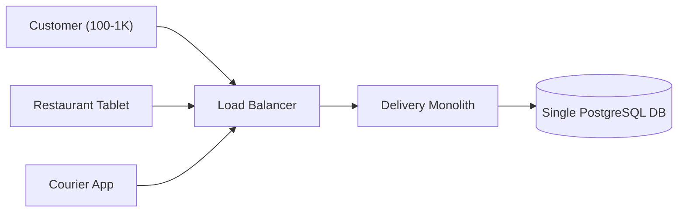
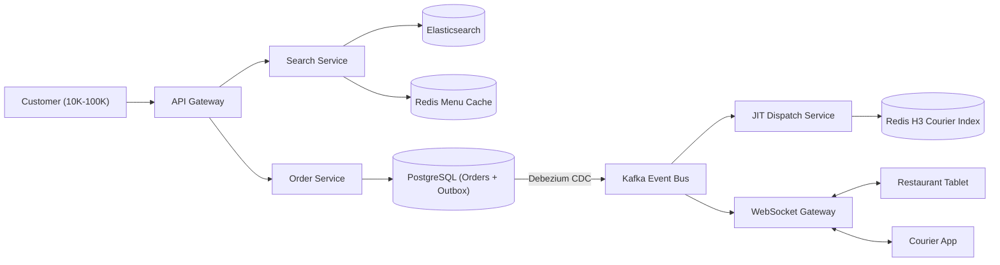
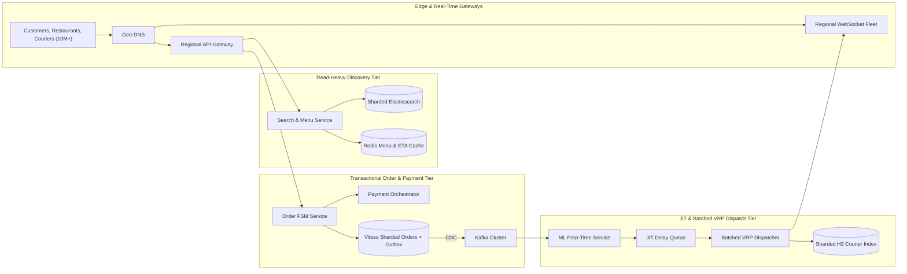
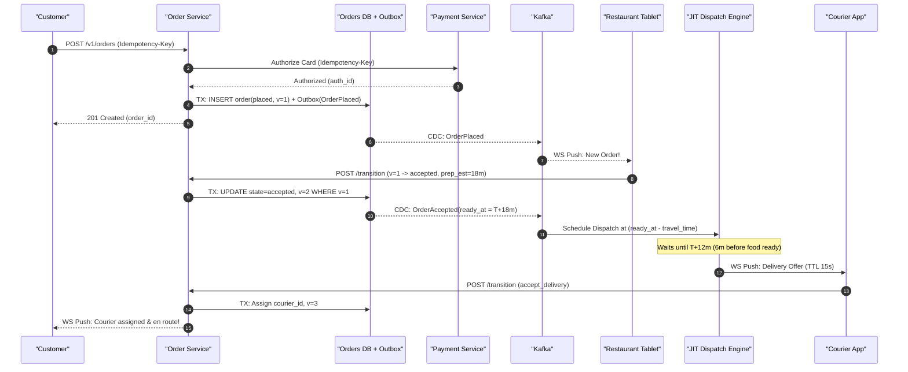

# Food Delivery Platform: Full System Design Mock Interview, All 9 Steps

> **Difficulty:** Hard (Senior / Staff)
> **Prerequisites:** [Previous lesson: Ride-Hailing Platform: Full System Design Mock Interview, All 9 Steps](../12-ride-hailing-platform/README.md) and the [Interview Framework track](../../21-interview-framework/README.md).
> **Estimated Reading Time:** 25–30 minutes
> **Target Audience:** Engineers practising the full 9-step system design interview on a classic three-sided marketplace prompt: customers, restaurants, and couriers.

> [!NOTE]
> **In one line:** A food delivery platform is an **idempotent order state machine** paired with a **Just-in-Time (JIT) courier dispatch engine** and a **geo-filtered, availability-aware menu search index**.

> [!TIP]
> **The Golden Rule:** Model every order as a versioned, conditional state machine (`WHERE state = expected AND version = v`) with outbox events, and dispatch couriers **just-in-time** around predicted food-ready time—not at order creation.

---

## 1. Clarifying Questions, Functional & Non-Functional Requirements

Open by highlighting what makes food delivery distinct from ride-hailing: instead of 2 actors (rider + driver), you have **3 actors** (customer + restaurant + courier) plus a **physical preparation delay** (10–35 minutes) that turns dispatch into a synchronization problem.

**Clarifying Questions & Assumed Answers:**

| Question | Assumed Answer | Architectural Impact |
| :--- | :--- | :--- |
| **Scale (orders/day & dinner peak)?** | 20M orders/day; dinner rush $3\times$–$5\times$ average | ~231 orders/s avg; ~1,155 orders/s at dinner peak; ~35K search QPS. |
| **Discovery & Menu Freshness?** | Geo-search by radius, cuisine, open hours, sold-out items | Dedicated geo-search index + Redis menu cache invalidated via CDC/events. |
| **Courier Dispatch Timing?** | Courier arrives as food finishes cooking | Requires ML prep-time estimation + delayed JIT dispatch queue. |
| **Order Batching?** | Up to 2 nearby orders per courier | VRP (Vehicle Routing Problem) / batching solver with freshness SLA cap. |
| **Out of scope?** | Ad-tech ranking, payment processor internals, onboarding | Explicitly defer to focus on order FSM, JIT dispatch, and geo-search. |

### Functional Requirements

1. **Restaurant & Menu Discovery:** Customers search nearby open restaurants, view live menus, and see accurate ETAs.
2. **Order Placement & Payment:** Customers place orders with idempotency keys; payments authorize/capture cleanly without double-charging.
3. **Restaurant Lifecycle:** Restaurants accept/reject orders, update prep-time estimates, and mark items sold out in real time.
4. **JIT Courier Dispatch & Live Tracking:** Couriers are dispatched near `ready_at - travel_time` and tracked live by customers.

### Non-Functional Requirements

| Quality | Target | Why It Drives the Design |
| :--- | :--- | :--- |
| **Order Correctness** | Zero lost orders, zero double charges | Requires idempotency keys, optimistic locking, and transactional outbox. |
| **Search Latency** | < 200 ms p95 | Discovery is the top-of-funnel; slow search kills conversion. |
| **Dispatch Synchronization** | Courier wait < 3 min; food wait < 4 min | Early dispatch wastes courier supply; late dispatch delivers cold food. |
| **Peak Resilience** | Handle $5\times$ dinner rush (18:00–20:30) | Traffic is heavily diurnal and geographically clustered. |

---

## 2. Back-of-the-Envelope Capacity Estimation

**Base Assumptions:**
- **Daily Orders:** $O_{\text{day}} = 20,000,000\text{ orders/day}$
- **Dinner Peak Multiplier:** $5\times$ average rate
- **Browse-to-Order Ratio:** $40$ search/menu views per placed order
- **Courier Fleet:** $1,500,000$ active couriers during dinner peak, pinging GPS every 5 seconds
- **Average Order Record + Items + Events:** $4\text{ KB}$

### Worked Equations

**1. Order & Search QPS:**
$$\text{Avg Orders/s} = \frac{20,000,000}{86,400} \approx 231\text{ orders/s}$$
$$\text{Dinner Peak Orders/s} = 231 \times 5 \approx 1,155\text{ orders/s}$$
$$\text{Dinner Peak Search/Menu QPS} = 1,155 \times 40 = 46,200\text{ req/s}$$

**2. Courier Location Telemetry QPS:**
$$\text{Courier Pings/s} = \frac{1,500,000}{5\text{ s}} = 300,000\text{ writes/s}$$

**3. Daily Transactional Storage:**
$$\text{Daily Order Storage} = 20,000,000 \times 4\text{ KB} = 80\text{ GB/day} \approx 29.2\text{ TB/year}$$

### Capacity Summary Table

| Metric | Average | Dinner Peak (5x) | Design Implication |
| :--- | :--- | :--- | :--- |
| **Orders Created/sec** | 231/s | 1,155/s | Modest write QPS; prioritize ACID correctness & outbox over raw write speed. |
| **Search & Menu Reads** | 9,240/s | 46,200/s | Serve exclusively from Elasticsearch + Redis menu cache, never Orders DB. |
| **Courier GPS Pings** | — | 300,000/s | In-memory H3 geo-index + Kafka telemetry stream (same pattern as Ride-Hailing). |
| **Order Storage Growth** | 80 GB/day | — | Easily fits on sharded PostgreSQL/Vitess with 90-day archival to cold store. |

---

## 3. Core API Contracts & Data Model

### REST & WebSocket API Contracts

| Endpoint | Method | Actor | Purpose & Idempotency |
| :--- | :--- | :--- | :--- |
| `/v1/restaurants/search` | `GET` | Customer | `?lat=&lng=&cuisine=&open_now=true` -> geo-filtered Elasticsearch + cached ETA. |
| `/v1/orders` | `POST` | Customer | Header: `Idempotency-Key`; creates order + payment auth -> `201 Created`. |
| `/v1/orders/{id}/transition` | `POST` | Restaurant / Courier | Body: `{expected_version, target_state, reason}` -> conditional CAS update. |
| `/v1/restaurants/{id}/items/{sku}` | `PATCH` | Restaurant | `{available: false}` -> updates DB + emits CDC event to invalidate search/cache. |
| `WS /v1/stream` | `WebSocket` | All 3 Actors | Pushes order state changes, dispatch offers, and live courier coordinates. |

### Data Model & Storage Engine Choice

| Entity / Store | Storage Engine | Shard Key | Key Columns & Rationale |
| :--- | :--- | :--- | :--- |
| **Orders & Outbox** | Sharded PostgreSQL / Vitess | `order_id` | `order_id, customer_id, restaurant_id, courier_id, state, version, ready_at_est`. |
| **Restaurant & Menus** | PostgreSQL + Redis Cache | `restaurant_id` | Relational catalog; serialized menu JSON cached in Redis with versioned keys. |
| **Geo-Search Index** | Elasticsearch | `geo_tile` | `location (geo_point), open_hours, delivery_polygon, prep_time_avg, sold_out_skus`. |
| **Courier Geo Index** | Redis Cluster (H3) | `h3_cell_id` | Live courier `(lat, lng, status, active_orders_count)` with 30s TTL. |

---

## 4. Stage 1 (100 - 1K Users): Baseline Monolith & Single Database

At 100–1,000 users in a single neighborhood, a monolith + PostgreSQL handles discovery, orders, and naive dispatch.

**Component-by-Component Build:**
1. **API Monolith:** Serves restaurant search, order placement, and status transitions.
2. **Single PostgreSQL DB:** Holds `restaurants`, `menu_items`, `orders`, and `couriers`.
3. **Cron Polling Dispatcher:** Every 10 seconds, queries `orders WHERE state = 'accepted'` and assigns the closest courier via PostGIS.



**What Breaks at 10K+ Users?**
- **Search queries hammer PostgreSQL:** `ST_DWithin` + `JOIN menu_items` across 4,000+ req/s saturates DB CPU.
- **Polling & Cron Dispatch Lag:** 10-second cron sweeps lock rows and dispatch couriers too early (when food takes 25 min to cook).
- **Non-idempotent retries:** Mobile network retries on `POST /v1/orders` create duplicate orders and double charges.

---

## 5. Stage 2 (10K - 100K Users): Caching, Read Replicas & Async Offload

At 10K–100K users, we isolate **discovery reads** from **order writes**, introduce **Kafka + Transactional Outbox**, and move courier telemetry into **Redis H3**.

**Component-by-Component Additions:**
1. **Elasticsearch + Redis Menu Cache:** Absorbs 95% of read traffic (`GET /v1/restaurants/search` and menu loads).
2. **Transactional Outbox + Debezium CDC:** Every order state transition writes to `orders` and `outbox_events` in the same ACID transaction; Debezium streams events to Kafka reliably.
3. **Just-in-Time (JIT) Dispatch Scheduler:** Consumes `OrderAccepted` events, computes `dispatch_at = ready_at_est - travel_time_est`, and schedules a delayed trigger.
4. **WebSocket Gateway:** Replaces polling for restaurant tablets, courier offers, and customer tracking.



**What Breaks at 1M+ Users?**
- **Single PostgreSQL Orders Primary:** 1,155+ orders/sec at dinner peak plus 5–6 state transitions per order (~7,000 write tx/sec) + outbox writes saturate a single primary.
- **Unbatched Dispatch:** Assigning 1 courier per order during dinner rush causes courier shortages and surging delivery fees.

---

## 6. Stage 3 (1M - 10M+ Users): Sharding, Partitioning & Multi-Region Scale

At 1M–10M+ users (20M orders/day), we shard transactional stores by `order_id` / `city_id`, run a **Rolling-Horizon Batch Dispatcher**, and deploy **ML Prep-Time Estimation**.

**Component-by-Component Additions:**
1. **Sharded Orders DB (Vitess / Citus):** Partitioned by `order_id` (64+ shards) so every order's state machine + outbox is strictly linearizable on one shard.
2. **ML Prep-Time Predictor:** Predicts `ready_at` using restaurant historical prep curves, current kitchen load (active orders at that restaurant), and item complexity.
3. **Batched VRP Dispatch Engine:** Solves a 15-second rolling-horizon Vehicle Routing Problem (VRP) per city zone, batching 2 orders for one courier when pickup/dropoff vectors align within a 5-minute freshness budget.
4. **Regional Multi-AZ Clusters:** Geo-DNS routes each city to its regional stack; restaurant availability updates propagate to Elasticsearch in < 2 seconds.



---

## 7. Final Full Production Architecture & End-to-End Flows

### End-to-End Order Lifecycle & JIT Dispatch Sequence



---

## 8. Deep-Dive Bottlenecks & Algorithmic Trade-Offs

### 1. Just-in-Time (JIT) Dispatch vs. Immediate Dispatch
- **Immediate Dispatch (at `placed`):** If a pizza takes 25 minutes to bake and you assign a courier at `t=0`, the courier arrives at `t=5` and sits idle for 20 minutes—destroying fleet utilization.
- **JIT Dispatch:** Predict `ready_at = t_accept + prep_time_ml(restaurant, items, kitchen_queue)`. Schedule the dispatch job for `t_dispatch = ready_at - travel_time_to_restaurant - buffer(2m)`. If the restaurant marks `ready` early, trigger dispatch immediately!

### 2. Idempotent Order State Machine (Optimistic Locking + Outbox)
Network retries from restaurant tablets on weak kitchen Wi-Fi will send duplicate `accept` or `ready` calls. Every transition requires `(expected_version, target_state)`:
- If `current_state == target_state`, return `200 OK` (idempotent no-op).
- If `current_version != expected_version` or transition is illegal (e.g., `delivered -> cancelled`), return `409 Conflict`.
- Emit the state-change event into an `outbox` table in the **same local DB transaction** so state and events never diverge.

### 3. Order Batching (Doubles) Without Cold Food
Batching two orders from the same restaurant (or nearby restaurants) to one courier boosts couriers' orders-per-hour by 25–35%. Enforce a **hard freshness constraint**: only batch Order B with Order A if `added_detour_time <= 6 min` AND `total_delivery_time_A <= SLA_max`.

| Trade-Off | Option A | Option B | Production Choice & Rationale |
| :--- | :--- | :--- | :--- |
| **Dispatch Timing** | At order creation | Just-in-Time (JIT) | **JIT:** Maximizes courier utilization and keeps food hot. |
| **Concurrency Control** | Pessimistic `FOR UPDATE` | Optimistic `version` CAS | **Optimistic CAS:** Zero long-held locks; clean idempotent retries. |
| **Event Publishing** | Dual-write (DB + Kafka) | Transactional Outbox + CDC | **Outbox + CDC:** Guarantees zero lost notifications on pod crash. |
| **Menu Availability** | Check at checkout only | Push invalidation to Redis/ES | **Push + Checkout Re-check:** Prevents frustrating late cancellations. |

---

## 9. Failure Modes, Reliability & Backpressure Mitigations

1. **Restaurant Ignores Order (Tablet Offline):** If no `accepted` transition occurs within 3 minutes, trigger an automated **IVR phone call** to the restaurant; at 5 minutes, auto-transition to `cancelled_timeout`, void the payment authorization, and notify the customer with instant credit.
2. **Payment Authorized, Order DB Write Fails:** Because `POST /v1/orders` uses an `Idempotency-Key` and records a `pending_payment` intent *before* calling the payment gateway, a background **Payment Reconciliation Job** voids any orphaned authorizations older than 10 minutes.
3. **No Courier Available (Dinner Rainstorm):** Widen H3 search radius progressively, increase courier bonus incentive dynamically, un-batch/re-batch routes, and temporarily throttle delivery radius for far-away restaurants in Elasticsearch to protect SLAs.
4. **Courier GPS Fraud ("Delivered" from 2 km away):** Server validates that the courier's last verified GPS ping is within 150 meters of the dropoff polygon (or requires a customer 4-digit PIN / photo proof) before permitting `picked_up -> delivered`.

---

## 10. Production War Story & Real-World Reference

### Incident Pattern: The Friday Night "Dual-Write Phantom Order" Outage
- **Context:** During a Friday 19:00 dinner peak, a legacy Order Service wrote `INSERT INTO orders` to PostgreSQL and then called `kafka.Produce("OrderPlaced")` directly in application code (dual-write without Transactional Outbox).
- **Root Cause:** A 45-second Kafka broker leader election caused `kafka.Produce` to time out on ~12,000 orders. The Order Service caught the error and returned `500` to the customer—even though the PostgreSQL transaction and Stripe payment capture had already committed!
- **Impact:** Customers saw an error screen and retried (creating duplicate orders), restaurants never received the tablet notification for the 12,000 committed orders, and support was flooded with double-charge tickets.
- **Fix:**
  1. Implemented the **Transactional Outbox Pattern** with Debezium CDC so DB commit and event publication are atomic.
  2. Enforced mandatory client-generated `Idempotency-Key` (stored in a unique DB index) on `POST /v1/orders` so retries return the original `201 Created` response without re-charging.

---

## 11. Core Component Implementation (4 Languages)

Below is a production-style **Optimistic-Versioned, Idempotent Order State Machine** with allowed transition guards, implemented in Go, TypeScript, Python, and C#.

````carousel
```go
package main

import (
	"errors"
	"fmt"
	"sync"
)

type OrderState string

const (
	Placed    OrderState = "placed"
	Accepted  OrderState = "accepted"
	Preparing OrderState = "preparing"
	Ready     OrderState = "ready"
	PickedUp  OrderState = "picked_up"
	Delivered OrderState = "delivered"
	Cancelled OrderState = "cancelled"
)

var allowedTransitions = map[OrderState]map[OrderState]bool{
	Placed:    {Accepted: true, Cancelled: true},
	Accepted:  {Preparing: true, Cancelled: true},
	Preparing: {Ready: true, Cancelled: true},
	Ready:     {PickedUp: true},
	PickedUp:  {Delivered: true},
}

type Order struct {
	ID      string
	State   OrderState
	Version int64
}

type OrderStore struct {
	mu     sync.Mutex
	orders map[string]*Order
}

func NewOrderStore() *OrderStore {
	return &OrderStore{orders: make(map[string]*Order)}
}

func (s *OrderStore) Create(id string) *Order {
	s.mu.Lock()
	defer s.mu.Unlock()
	o := &Order{ID: id, State: Placed, Version: 1}
	s.orders[id] = o
	return o
}

// Transition enforces optimistic concurrency (expectedVersion) and idempotency.
func (s *OrderStore) Transition(id string, target OrderState, expectedVersion int64) (string, error) {
	s.mu.Lock()
	defer s.mu.Unlock()

	o, ok := s.orders[id]
	if !ok {
		return "", errors.New("order not found")
	}
	if o.State == target {
		return "idempotent_noop", nil
	}
	if o.Version != expectedVersion {
		return "", fmt.Errorf("version conflict: expected %d, actual %d", expectedVersion, o.Version)
	}
	if !allowedTransitions[o.State][target] {
		return "", fmt.Errorf("illegal transition: %s -> %s", o.State, target)
	}
	o.State = target
	o.Version++
	return "transitioned", nil
}

func main() {
	store := NewOrderStore()
	store.Create("ord_1")
	fmt.Println(store.Transition("ord_1", Accepted, 1))  // transitioned
	fmt.Println(store.Transition("ord_1", Accepted, 1))  // idempotent_noop
	fmt.Println(store.Transition("ord_1", Delivered, 2)) // illegal transition
}
```
<!-- slide -->
```typescript
type OrderState =
  | "placed"
  | "accepted"
  | "preparing"
  | "ready"
  | "picked_up"
  | "delivered"
  | "cancelled";

const ALLOWED: Record<OrderState, Set<OrderState>> = {
  placed: new Set(["accepted", "cancelled"]),
  accepted: new Set(["preparing", "cancelled"]),
  preparing: new Set(["ready", "cancelled"]),
  ready: new Set(["picked_up"]),
  picked_up: new Set(["delivered"]),
  delivered: new Set(),
  cancelled: new Set(),
};

export interface Order {
  id: string;
  state: OrderState;
  version: number;
}

export class OrderStateMachine {
  private orders = new Map<string, Order>();

  create(id: string): Order {
    const order: Order = { id, state: "placed", version: 1 };
    this.orders.set(id, order);
    return order;
  }

  transition(id: string, target: OrderState, expectedVersion: number): "ok" | "noop" {
    const order = this.orders.get(id);
    if (!order) throw new Error("Order not found");
    if (order.state === target) return "noop";
    if (order.version !== expectedVersion) {
      throw new Error(`Version conflict: expected ${expectedVersion}, got ${order.version}`);
    }
    if (!ALLOWED[order.state].has(target)) {
      throw new Error(`Illegal transition: ${order.state} -> ${target}`);
    }
    order.state = target;
    order.version += 1;
    return "ok";
  }
}
```
<!-- slide -->
```python
from dataclasses import dataclass
from typing import Dict, Set
import threading

ALLOWED_TRANSITIONS: Dict[str, Set[str]] = {
    "placed": {"accepted", "cancelled"},
    "accepted": {"preparing", "cancelled"},
    "preparing": {"ready", "cancelled"},
    "ready": {"picked_up"},
    "picked_up": {"delivered"},
}


@dataclass
class Order:
    order_id: str
    state: str = "placed"
    version: int = 1


class OrderStateMachine:
    def __init__(self) -> None:
        self._lock = threading.Lock()
        self._orders: Dict[str, Order] = {}

    def create(self, order_id: str) -> Order:
        with self._lock:
            order = Order(order_id=order_id)
            self._orders[order_id] = order
            return order

    def transition(self, order_id: str, target: str, expected_version: int) -> str:
        with self._lock:
            order = self._orders.get(order_id)
            if not order:
                raise KeyError("Order not found")
            if order.state == target:
                return "idempotent_noop"
            if order.version != expected_version:
                raise ValueError(f"Version conflict: expected {expected_version}, got {order.version}")
            if target not in ALLOWED_TRANSITIONS.get(order.state, set()):
                raise ValueError(f"Illegal transition: {order.state} -> {target}")
            order.state = target
            order.version += 1
            return "transitioned"
```
<!-- slide -->
```csharp
using System;
using System.Collections.Generic;

public sealed class Order
{
    public string Id { get; init; } = "";
    public string State { get; set; } = "placed";
    public long Version { get; set; } = 1;
}

public sealed class OrderStateMachine
{
    private static readonly Dictionary<string, HashSet<string>> Allowed = new()
    {
        ["placed"] = new() { "accepted", "cancelled" },
        ["accepted"] = new() { "preparing", "cancelled" },
        ["preparing"] = new() { "ready", "cancelled" },
        ["ready"] = new() { "picked_up" },
        ["picked_up"] = new() { "delivered" }
    };

    private readonly object _lock = new();
    private readonly Dictionary<string, Order> _orders = new();

    public Order Create(string id)
    {
        lock (_lock)
        {
            var o = new Order { Id = id };
            _orders[id] = o;
            return o;
        }
    }

    public string Transition(string id, string target, long expectedVersion)
    {
        lock (_lock)
        {
            if (!_orders.TryGetValue(id, out var order))
                throw new KeyNotFoundException("Order not found");
            if (order.State == target)
                return "idempotent_noop";
            if (order.Version != expectedVersion)
                throw new InvalidOperationException($"Version conflict: {expectedVersion} != {order.Version}");
            if (!Allowed.TryGetValue(order.State, out var next) || !next.Contains(target))
                throw new InvalidOperationException($"Illegal transition: {order.State} -> {target}");

            order.State = target;
            order.Version++;
            return "transitioned";
        }
    }
}
```
````

---

## 12. Verification, Load Testing & CLI Diagnostics

```bash
# 1. Verify optimistic conditional update in PostgreSQL (0 rows updated on stale version)
psql -d delivery -c "
  UPDATE orders SET state = 'accepted', version = version + 1
  WHERE order_id = 'ord_123' AND state = 'placed' AND version = 1
  RETURNING order_id, state, version;
"

# 2. Inspect Debezium Outbox CDC connector lag
curl -s http://kafka-connect:8083/connectors/orders-outbox-cdc/status | jq .

# 3. Verify Elasticsearch geo_distance restaurant search latency
curl -s -X GET "http://es-1:9200/restaurants/_search" -H 'Content-Type: application/json' -d '{
  "query": { "bool": { "filter": { "geo_distance": { "distance": "5km", "location": { "lat": 37.77, "lon": -122.41 } } } } }
}' | jq '.took'
```

---

## 13. Common Interview Mistakes & Red Flags

1. **Dispatching a courier the instant the order is placed:** Wastes 15–25 minutes of courier time while food is still being cooked.
2. **Dual-writing to DB and Kafka without an Outbox:** Causes silent "phantom orders" when Kafka or the network blips.
3. **Serving restaurant search from the Orders PostgreSQL DB:** Dinner-rush search QPS (46K/s) will crush transactional order processing.
4. **Unchecked state transitions:** Allowing `cancelled` after `picked_up`, or allowing duplicate `accept` calls to corrupt state.
5. **No restaurant acceptance timeout:** Leaves customers waiting indefinitely when a tablet runs out of battery.

---

## 14. Key Terminology & Glossary

| Term | Definition |
| :--- | :--- |
| **Order State Machine (FSM)** | Explicit directed graph of legal order states (`placed -> accepted -> preparing -> ready -> picked_up -> delivered`) guarded by optimistic versioning. |
| **JIT (Just-in-Time) Dispatch** | Delaying courier assignment until `predicted_ready_at - courier_travel_time` so courier and food arrive together. |
| **Transactional Outbox** | Writing domain state and an outbox event row in the same local ACID transaction, then streaming via CDC. |
| **VRP (Vehicle Routing Problem)** | Combinatorial optimization for batching multiple pickups/dropoffs onto one courier route under time constraints. |
| **Prep-Time Estimation** | Predicting kitchen cooking duration using historical restaurant curves, item complexity, and live kitchen load. |
| **Idempotency Key** | Client-generated UUID ensuring retried order/payment requests execute at most once. |

---

## 15. Interview Follow-Up Questions (12 Q&As)

### Basic Conceptual Questions

<details>
<summary><strong>Q1: Why is food delivery harder than ride-hailing in terms of timing? [BASIC]</strong></summary>

Ride-hailing has two actors (rider + driver) and matching happens immediately. Food delivery has three actors plus a 10–35 minute **kitchen preparation phase**, requiring ML prep-time prediction and Just-in-Time dispatch so neither the courier nor the hot food waits.

</details>

<details>
<summary><strong>Q2: How do you guarantee an order state transition happens at most once? [BASIC]</strong></summary>

Use an optimistic conditional SQL update: `UPDATE orders SET state = $next, version = version + 1 WHERE order_id = $id AND state = $expected AND version = $v`. If `current_state == target`, return `200 OK` (idempotent no-op); if `version` mismatches, return `409 Conflict`.

</details>

<details>
<summary><strong>Q3: Why use the Transactional Outbox pattern instead of publishing to Kafka directly? [BASIC]</strong></summary>

Publishing to Kafka after a DB commit is a dual-write: if the pod crashes or Kafka times out between commit and publish, the order is saved in Postgres but the restaurant is never notified. Writing to an `outbox` table in the same ACID transaction guarantees at-least-once delivery via Debezium CDC.

</details>

<details>
<summary><strong>Q4: Why separate the Restaurant Search Index from the Orders DB? [BASIC]</strong></summary>

Dinner-rush search generates ~46K geo-filtered read QPS with complex filters (open hours, cuisine, delivery polygons, ratings), whereas order writes are ~1.1K/s ACID transactions. Isolating reads in Elasticsearch + Redis protects checkout availability.

</details>

### Scenario-Based Architecture Questions

<details>
<summary><strong>Q5: A restaurant runs out of Pad Thai right after a customer orders it. How does the system handle this? [SCENARIO]</strong></summary>

The restaurant marks Pad Thai sold out on their tablet (`PATCH /items/{sku}`), which emits an event to invalidate the Redis menu cache and Elasticsearch index within 2 seconds. For the in-flight order, the restaurant uses a "Substitute or Partial Refund" flow that adjusts the final capture amount (since we authorized, not captured, at checkout).

</details>

<details>
<summary><strong>Q6: A restaurant's tablet is unplugged and never accepts an order. What happens? [SCENARIO]</strong></summary>

A delayed timer/watchdog fires at `T+3 min` to place an automated IVR voice call to the restaurant's phone. If still unaccepted at `T+5 min`, the system transitions the order to `cancelled_timeout`, voids the payment authorization, and notifies the customer immediately.

</details>

<details>
<summary><strong>Q7: How do you decide whether to batch two orders onto one courier? [SCENARIO]</strong></summary>

The VRP Batch Dispatcher evaluates candidate pairs within a 15-second rolling window. It batches Order B with Order A only if their pickup/dropoff vectors align, `added_detour <= 6 min`, and Order A's projected delivery remains within its promised freshness SLA.

</details>

<details>
<summary><strong>Q8: How do you prevent a courier from marking an order "delivered" from 3 km away? [SCENARIO]</strong></summary>

The `/transition` endpoint verifies the courier's latest authenticated GPS ping is within a 150-meter geofence of the customer's dropoff coordinates, and for high-value orders requires a 4-digit customer PIN or timestamped delivery photo.

</details>

### Advanced & Tricky Interview Questions

<details>
<summary><strong>Q9: How do you handle payment authorization vs. capture when tips or item substitutions change the final total? [TRICKY]</strong></summary>

At `POST /v1/orders`, place an **authorization hold** (with a small buffer if substitutions are allowed), and only **capture** the final settled amount after `picked_up` or `delivered`. If the order is cancelled before pickup, simply void the authorization—avoiding slow 5-day refund cycles.

</details>

<details>
<summary><strong>Q10: A restaurant is slammed with 40 walk-in customers, so their actual prep time jumps from 15 min to 45 min. How does JIT dispatch adapt? [TRICKY]</strong></summary>

The Prep-Time ML model ingests real-time signals (current active tablet orders, recent `accepted -> ready` actuals, and explicit "+15 min delay" taps from the kitchen). When `ready_at_est` shifts out, the JIT scheduler **reschedules or un-assigns** the courier before they arrive and wait idly.

</details>

<details>
<summary><strong>Q11: How do you model delivery zones (polygons) efficiently in search for 500K restaurants? [TRICKY]</strong></summary>

Pre-index each restaurant's delivery polygon into **H3 cells** (or Elasticsearch `geo_shape` inverted index). At query time, convert the customer's `(lat, lng)` to an H3 cell ID and perform an $O(1)$ set-intersection lookup instead of running 500K point-in-polygon ray-casting checks.

</details>

<details>
<summary><strong>Q12: During a city-wide storm, courier supply drops 50% while demand jumps 3x. How do you protect the marketplace? [TRICKY]</strong></summary>

Apply **dynamic radius throttling** (temporarily shrink restaurant delivery radii in Elasticsearch from 8 km to 3 km), increase courier boost pay, prioritize batched orders, and display honest inflated ETAs at discovery time to naturally dampen excess demand.

</details>

---

## 16. One-Page Master Cheat Sheet

```text
+------------------------------------------------------------------------------+
|               FOOD DELIVERY PLATFORM — SYSTEM DESIGN CHEAT SHEET             |
+------------------------------------------------------------------------------+
| SCALE: 20M orders/day -> 231/s avg, 1,155/s dinner peak (5x)                 |
|        46K search/menu QPS | 300K courier GPS pings/s                        |
+------------------------------------------------------------------------------+
| 4 GOLDEN RULES:                                                              |
|  1. Order FSM: Versioned optimistic CAS + Transactional Outbox + CDC.        |
|  2. JIT Dispatch: Assign courier at (ready_at_est - travel_time), not t=0.   |
|  3. Discovery: Elasticsearch (H3 polygons) + Redis menu cache; never DB.     |
|  4. Payments: Idempotency-Key + Auth at checkout, Capture after pickup.      |
+------------------------------------------------------------------------------+
| DATA STORES:                                                                 |
|  Orders: Vitess/Sharded Postgres | Search: Elasticsearch + Redis Menu Cache  |
|  Couriers: Sharded Redis H3 Geo  | Events: Debezium CDC -> Kafka -> JIT/WS   |
+------------------------------------------------------------------------------+
```

| Step | Key Decision | Primary Bottleneck Solved |
| :--- | :--- | :--- |
| **Discovery** | Elasticsearch + H3 polygons + Redis | 46K/s read QPS & point-in-polygon CPU |
| **Order FSM** | Versioned CAS + Transactional Outbox | Duplicate transitions & dual-write phantom orders |
| **Dispatch** | JIT scheduler + 15s VRP batching | Idle courier wait time & cold food |
| **Reliability** | 5-min tablet timeout + auth/capture | Stuck orders & slow refund UX |

---

## Further Reading

- DoorDash engineering blog, *Building a better dispatch system*.
- Uber Eats engineering blog on marketplace dispatch.
- Chris Richardson, *Microservices Patterns* (Transactional Outbox & Saga patterns).

---

## Next

Continue with [Ticket Booking System: Full System Design Mock Interview, All 9 Steps](../14-ticket-booking-system/README.md).
