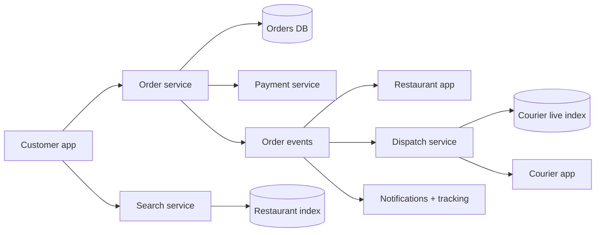

# Food Delivery Platform: Full System Design Mock Interview, All 9 Steps

> **Prerequisites:** [Previous lesson: Ride-Hailing Platform: Full System Design Mock Interview, All 9 Steps](../12-ride-hailing-platform/README.md) and the [Interview Framework track](../../21-interview-framework/README.md).
> **Estimated Reading Time:** 15–20 minutes
> **Target Audience:** Engineers practising the full 9-step system design interview on a classic prompt: a three-sided marketplace of customers, restaurants and couriers.

> [!NOTE]
> **In one line:** Food delivery is **an order state machine plus a dispatch problem**: restaurants prepare, couriers deliver, and the system must keep all three parties' views consistent.

> [!TIP]
> **The Golden Rule:** Model the order as an explicit state machine with idempotent transitions, and let each party see a projection of it. Dispatch couriers when food is nearly ready, not when it is ordered.

---

## Step 1. Clarify the Problem

Open with questions, not boxes. Three actors and a timing problem: when to assign the courier so the food is neither cold nor waiting.

**Questions to ask the interviewer, and the answer we assume:**

| Question | Assumed answer |
| :--- | :--- |
| Parties? | Customers, restaurants, couriers |
| Search? | By location, cuisine and open now |
| Payments? | Card at order time, out of scope inside |
| Tracking? | Live courier position |
| Scale? | 20M orders per day, peaks at dinner |

> Say it aloud: *"Before I draw anything, let me confirm the scope and the numbers."* That one sentence earns the first minutes of the interview.

---

## Step 2. Functional and Non-Functional Requirements

**Functional (what the system does):**

- Browse nearby open restaurants and menus.
- Place and pay for an order.
- The restaurant accepts and prepares it.
- A courier is assigned and delivers it, tracked live.

**Non-functional (how well it does it):**

| Quality | Target | Why it drives the design |
| :--- | :--- | :--- |
| Order correctness | Never lose or double charge | Money and trust |
| Search latency | Under 300 ms | Discovery is the front door |
| Dispatch | Courier arrives as food is ready | Quality and cost |
| Peak load | Dinner rush 5x average | Demand is concentrated |

---

## Step 3. Scope: In and Out

**In scope:** Discovery, order lifecycle, dispatch, tracking.

**Out of scope (say it explicitly, then move on):**

- Recommendation ML.
- Restaurant onboarding.
- Payment processor internals.

---

## Step 4. Capacity Estimation

Assumptions: 20M orders per day, dinner peak is 3x the average rate, 40 menu searches per order.

| Quantity | Calculation | Result |
| :--- | :--- | :--- |
| Average orders per second | `orders_day / 86400` | **231 orders/s** |
| Peak orders per second | `average_orders_per_second * peak` | **694 orders/s** |
| Search queries per second at peak | `peak_orders_per_second * searches` | **27.8K queries/s** |

**What the numbers tell you:** About 700 orders per second at peak is modest. Search at about 28K queries per second is the larger load, and it is read-only, so it is served from a search index and cache, not the order database.

---

## Step 5. API Design

| Endpoint | Purpose | Notes |
| :--- | :--- | :--- |
| `GET /v1/restaurants?lat=&lng=` | Discover | Search index, filtered by open status and radius. |
| `POST /v1/orders` | Place order | Idempotency key; returns order id. |
| `POST /v1/orders/{id}/accept` | Restaurant accepts | Moves state forward. |
| `GET /v1/orders/{id}` | Status and courier position | Pushed over a socket. |
| `POST /v1/orders/{id}/delivered` | Courier confirms | Completes the order. |

Every transition is idempotent: accepting twice, or a courier retry, leaves the order in the same state.

---

## Step 6. Data Model

| Entity / Store | Key fields | Why this store |
| :--- | :--- | :--- |
| Orders DB (sharded by order id) | `order_id`, `customer`, `restaurant`, `items`, `state`, `version` | Strong consistency and transitions |
| Restaurant/menu search index | Location, cuisine, hours, rating | Fast read queries |
| Courier live index | Cell to available couriers | As in ride hailing |
| Event log | State changes | Drives notifications and analytics |

The state column plus a version number makes transitions conditional: update only if the order is still in the expected state.

---

## Step 7. High-Level Architecture



**Walk the diagram in this order:** an order is created and paid, an event notifies the restaurant, dispatch assigns a courier near the food's ready time, and tracking updates stream back to the customer.

---

## Step 8. Deep Dives and Bottlenecks

### 1. The order state machine

States: `placed`, `accepted`, `preparing`, `ready`, `picked_up`, `delivered`, plus `cancelled`. A transition is a conditional update (`WHERE state = expected`), so concurrent or repeated requests cannot move an order twice. Each transition emits an event consumed by notifications, dispatch and analytics.

### 2. When to dispatch

Estimate the preparation time and dispatch the courier so they arrive just as the order is ready. Too early wastes courier time, too late makes food cold. Use the restaurant's historic prep times and update with real signals. Batch two nearby orders to one courier when it saves cost without hurting freshness.

### 3. Search and menus

Index restaurants by location with open hours and delivery radius. Serve menus from a cache that the restaurant updates. A menu item sold out should disappear quickly, so push availability changes into the index.

---

## Step 9. Trade-offs, Failures and Security

**Trade-offs to state aloud:**

| Decision | Option A | Option B | Pick and why |
| :--- | :--- | :--- | :--- |
| Dispatch timing | At order time | Near ready time | Near ready time: fresher food and less courier waiting |
| Order storage | One global DB | Sharded by order id | Sharded, with strong consistency per order |
| Batching | One order per courier | Batch when nearby | Batch with a freshness limit |

**Failure modes and mitigations:**

| Failure | What users see | Mitigation |
| :--- | :--- | :--- |
| Restaurant does not respond | Order stuck | Timeout, auto-cancel and refund, or call fallback |
| No courier available | Delay | Widen radius, raise courier incentive, tell the customer |
| Payment succeeded, order write failed | Charge without order | Idempotency key and a reconciliation job |

**Security and abuse:** Authenticate each party and show each only its own data, mask phone numbers between customer and courier, and use signed state transitions to prevent a courier marking delivered from afar.

---

## Runnable Example: A guarded order state machine

Transitions are only legal from the right state, and repeating one is harmless.

```python
ALLOWED = {
    "placed": {"accepted", "cancelled"},
    "accepted": {"preparing", "cancelled"},
    "preparing": {"ready"},
    "ready": {"picked_up"},
    "picked_up": {"delivered"},
}

class Order:
    def __init__(self):
        self.state = "placed"

    def move(self, new):
        if new == self.state:
            return "no-op"
        if new not in ALLOWED.get(self.state, set()):
            return f"rejected {self.state}->{new}"
        self.state = new
        return "ok"

o = Order()
print(o.move("accepted"), o.move("accepted"), o.move("delivered"), o.move("preparing"))
print(o.state)
```

Output (produced by running this exact code):

```text
ok no-op rejected accepted->delivered ok
preparing
```

The second accept is a no-op, jumping to delivered is rejected, and the legal step to preparing works, so duplicates and out-of-order requests cannot corrupt the order.

---

## Common Mistakes

- Dispatching a courier at order time.
- Letting transitions run without checking the current state.
- Serving search from the order database.
- Charging before the order is durably created.
- No timeout when a restaurant ignores the order.

---

## Interview Questions and Answers

<details>
<summary><strong>Q1: How do you model an order?</strong></summary>

An explicit state machine with conditional, idempotent transitions and an event on each change.

</details>

<details>
<summary><strong>Q2: When do you assign a courier?</strong></summary>

Near the estimated ready time, using prep-time estimates, so they arrive as the food does.

</details>

<details>
<summary><strong>Q3: How do you prevent double charges?</strong></summary>

An idempotency key on order creation and a reconciliation job comparing payments and orders.

</details>

<details>
<summary><strong>Q4: How does search scale?</strong></summary>

A geo-aware search index with cached menus, updated by events when availability changes.

</details>

<details>
<summary><strong>Q5: What if the restaurant never accepts?</strong></summary>

A timeout moves the order to cancelled and triggers a refund and a message to the customer.

</details>

---

## One-Page Cheat Sheet

| Step | What to say or draw |
| :--- | :--- |
| Clarify | Customer, restaurant, courier; 20M orders/day |
| Capacity | 700 orders/s peak, 28K searches/s |
| API | discover, order, accept, status, delivered |
| Data | Orders DB with state, search index, courier index |
| Deep dive | State machine, dispatch timing, search |
| Trade-off | Late dispatch, batching |

---

## Further Reading

- DoorDash engineering blog, *Building a better dispatch system*.
- Uber Eats engineering blog on marketplace dispatch.

---

## Next

Continue with [Ticket Booking System: Full System Design Mock Interview, All 9 Steps](../14-ticket-booking-system/README.md).
