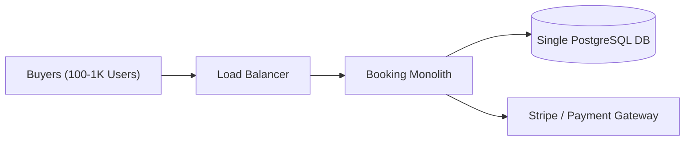
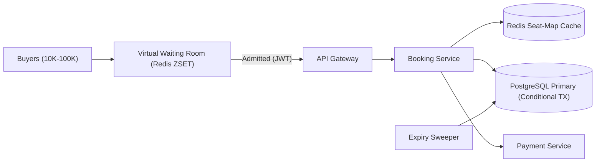
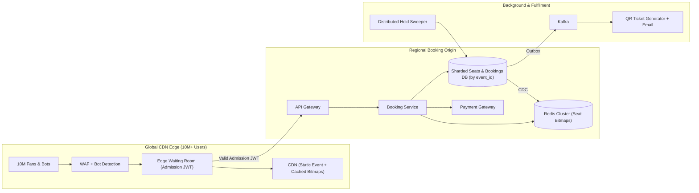
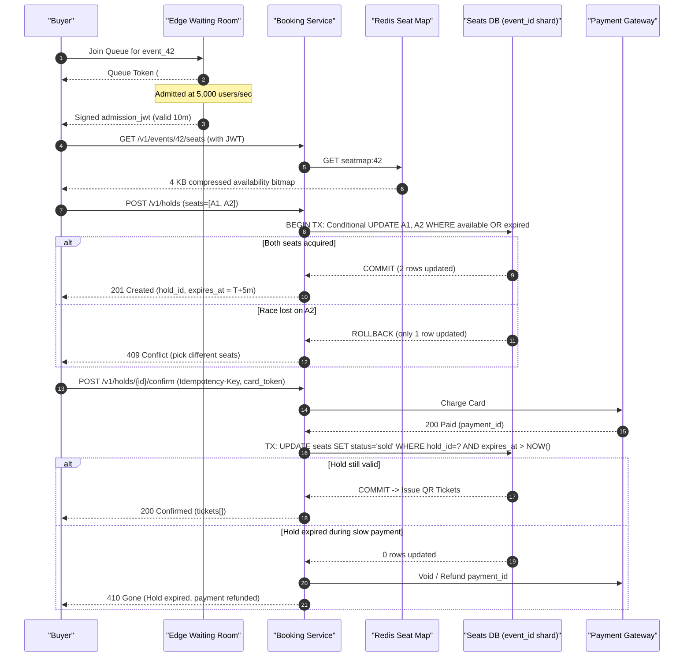

# Ticket Booking System: Full System Design Mock Interview, All 9 Steps

> **Difficulty:** Hard (Senior / Staff)
> **Prerequisites:** [Previous lesson: Food Delivery Platform: Full System Design Mock Interview, All 9 Steps](../13-food-delivery-platform/README.md) and the [Interview Framework track](../../21-interview-framework/README.md).
> **Estimated Reading Time:** 25–30 minutes
> **Target Audience:** Engineers practising the full 9-step system design interview on a high-contention flash-sale prompt: selling numbered stadium/concert seats without ever double-selling a single seat.

> [!NOTE]
> **In one line:** A ticket booking system is an **extreme-contention inventory problem**: millions of buyers compete for tens of thousands of numbered seats in seconds, solved via a **virtual waiting room**, **cached seat-map bitmaps**, and **atomic TTL-bounded seat holds**.

> [!TIP]
> **The Golden Rule:** Never let the full 10M flash-sale crowd hit your transactional database—use a token-gated **Virtual Waiting Room** to cap admission to DB write capacity, and reserve seats using **atomic conditional writes** with a strict 5-minute TTL.

---

## 1. Clarifying Questions, Functional & Non-Functional Requirements

Open by framing the asymmetry: unlike normal e-commerce, **every seat is unique** (Row A, Seat 12), **supply is tiny** (50K seats), and **demand is instantaneous** (10M users arriving at 10:00:00 AM sharp).

**Clarifying Questions & Assumed Answers:**

| Question | Assumed Answer | Architectural Impact |
| :--- | :--- | :--- |
| **Inventory model?** | Numbered seats in venues (up to 80K seats/event) | Cannot use generic `quantity - 1` counters; must lock specific `seat_id`s. |
| **Group seating?** | Up to 6 seats held together atomically | Shard all seats of an `event_id` on the same DB shard for single-shard ACID TX. |
| **Hold duration?** | 5 minutes (300s) to complete checkout/payment | Server-enforced `hold_expires_at` + background sweeper + read-time expiry check. |
| **Flash-sale spike?** | 10M users arrive in 10 minutes for a 50K-seat concert | ~16.7K arrivals/s; ~83K seat-map reads/s; requires Virtual Waiting Room. |
| **Out of scope?** | Secondary resale marketplace, dynamic pricing ML | Explicitly defer to focus on contention, waiting room, and payment safety. |

### Functional Requirements

1. **Browse Events & Seat Maps:** View live seat availability (`available`, `held`, `sold`) and pricing tiers for an event.
2. **Atomic Seat Hold:** Select 1–6 seats and place a 5-minute temporary hold (all-or-nothing).
3. **Payment & Confirmation:** Complete payment within the 5-minute window to transition seats to `sold` and issue signed QR tickets.
4. **Hold Release & Expiry:** Manually release holds or auto-expire abandoned holds so seats return to `available`.

### Non-Functional Requirements

| Quality | Target | Why It Drives the Design |
| :--- | :--- | :--- |
| **Zero Double-Booking** | 100% linearizable per seat | Selling Seat A12 twice is a catastrophic legal and trust failure. |
| **Spike Survival** | Survive $100\times$ flash-sale bursts | Waiting room + edge caching absorb the thundering herd before it hits DB. |
| **Seat-Map Read Latency** | < 150 ms p95 | Users refresh constantly; serve compressed bitmaps from Redis/CDN. |
| **Fairness** | FIFO / Randomized queue admission | Prevents bots and fast-refreshers from starving normal fans. |

---

## 2. Back-of-the-Envelope Capacity Estimation

**Base Assumptions:**
- **Flash-Sale Crowd:** $U = 10,000,000\text{ users}$ arriving over a $10\text{-minute}$ ($600\text{ s}$) on-sale window
- **Venue Size:** $S = 50,000\text{ seats}$
- **Seat-Map Refreshes:** Each admitted user refreshes the seat map $5\times$ on average
- **Waiting Room Admission Rate:** Capped at $W_{\text{admit}} = 5,000\text{ users/s}$ (sustainable DB/checkout capacity)
- **Seat-Map Payload:** $50,000\text{ seats} \times 2\text{ bits/seat (4 states)} = 12.5\text{ KB}$ raw (~4 KB gzipped)

### Worked Equations

**1. Peak Arrival & Seat-Map Read QPS:**
$$\text{Arrival Rate} = \frac{10,000,000}{600\text{ s}} \approx 16,667\text{ users/s (burst up to } 100\text{K/s at 10:00:00)}$$
$$\text{Unthrottled Seat-Map Read QPS} = 16,667 \times 5 \approx 83,335\text{ reads/s}$$
$$\text{Seat-Map Egress (at 4 KB gzipped)} = 83,335 \times 4\text{ KB} \approx 333\text{ MB/s} \approx 2.67\text{ Gbps}$$

**2. Contention Ratio & DB Write Sizing:**
$$\text{Contention Ratio} = \frac{10,000,000\text{ users}}{50,000\text{ seats}} = 200:1\text{ (only 0.5\% of users get a seat)}$$
With the Waiting Room admitting $5,000\text{ users/s}$ and 20% attempting holds:
$$\text{Hold Write QPS} \approx 1,000\text{ TX/s (easily handled by 1–4 PostgreSQL/Vitess shards)}$$

**3. Seat Table Storage (10,000 active events):**
$$10,000\text{ events} \times 50,000\text{ seats} \times 128\text{ bytes/row} = 64\text{ GB total}$$

### Capacity Summary Table

| Metric | Unthrottled Flash Sale | With Waiting Room | Design Implication |
| :--- | :--- | :--- | :--- |
| **Edge / Queue Arrivals** | 100K/s burst | 100K/s at Edge | Waiting room runs on Edge Workers / Redis; never touches Postgres. |
| **Seat-Map Reads** | 83.3K reads/s | ~25K reads/s | Serve 4 KB bitmap from CDN/Redis (1s–2s TTL); zero DB reads. |
| **Hold Write TXs** | 50K+/s (DB crash) | ~1,000 TX/s | Single-shard ACID conditional writes per `event_id`. |
| **Total Seat Data** | 64 GB | 64 GB | Fits comfortably in RAM/NVMe on sharded PostgreSQL. |

---

## 3. Core API Contracts & Data Model

### REST API Contracts

| Endpoint | Method | Purpose | Key Request / Response Semantics |
| :--- | :--- | :--- | :--- |
| `/v1/events/{id}/queue` | `POST` | Enter Virtual Waiting Room | Returns `{queue_token, position, est_wait_s}` (or `admission_jwt` when ready). |
| `/v1/events/{id}/seats` | `GET` | Fetch compressed seat map | Requires `admission_jwt`; returns 4 KB bitset/JSON from Redis cache. |
| `/v1/holds` | `POST` | Hold 1–6 seats atomically | Body: `{event_id, seat_ids[]}`; returns `201 {hold_id, expires_at}` or `409 Conflict`. |
| `/v1/holds/{id}/confirm` | `POST` | Confirm hold after payment | Header: `Idempotency-Key`; Body: `{payment_token}` -> `200 {ticket_ids[]}`. |
| `/v1/holds/{id}` | `DELETE` | Release held seats early | Frees seats immediately and invalidates seat-map cache. |

### Data Model & Storage Engine Choice

| Entity / Store | Storage Engine | Shard Key | Key Columns & Rationale |
| :--- | :--- | :--- | :--- |
| **Seats Table** | Sharded PostgreSQL / CockroachDB | `event_id` | `(event_id, seat_id) PK, status, hold_id, user_id, hold_expires_at, version`. Single-shard multi-seat TX! |
| **Bookings / Orders** | Sharded PostgreSQL | `event_id` | `booking_id (PK), event_id, hold_id, user_id, payment_id, state, idempotency_key`. |
| **Seat Map Bitmap** | Redis Cluster + CDN | `event_id` | `seatmap:{event_id}` compressed 2-bit-per-seat array, rebuilt on state change / 1s TTL. |
| **Waiting Room Queue** | Redis Sorted Set (`ZSET`) / Edge KV | `event_id` | `ZADD queue:{event_id} <seq_or_rand> <user_id>` + signed `admission_jwt` (HMAC). |

---

## 4. Stage 1 (100 - 1K Users): Baseline Monolith & Single Database

At 100–1,000 users for small local theater events, a single monolith + PostgreSQL handles seat maps and bookings without a waiting room.

**Component-by-Component Build:**
1. **API Monolith:** Serves event pages, seat maps, holds, and Stripe checkout callbacks.
2. **Single PostgreSQL DB:** Holds `events`, `seats`, and `bookings`.
3. **Conditional SQL Hold:** `UPDATE seats SET status = 'held', hold_id = $1, hold_expires_at = NOW() + INTERVAL '5 min' WHERE event_id = $2 AND seat_id = ANY($3) AND (status = 'available' OR (status = 'held' AND hold_expires_at < NOW())) RETURNING seat_id;` — if `len(returned) != len(requested)`, `ROLLBACK`!



**What Breaks at 10K+ Flash-Sale Users?**
- **Seat-Map Read Storm:** 10,000 users hitting F5 every 2 seconds execute `SELECT * FROM seats WHERE event_id = X` (50K rows) -> PostgreSQL CPU hits 100% instantly.
- **Lock Contention on Hot Seats:** Thousands of concurrent `UPDATE seats` transactions fighting over Front Row Seat A1 create massive row-lock queues and connection-pool exhaustion.

---

## 5. Stage 2 (10K - 100K Users): Caching, Read Replicas & Async Offload

At 10K–100K users, we shield PostgreSQL from **all seat-map reads** using Redis bitmaps, add a **Redis Waiting Room**, and run an **Expiry Sweeper**.

**Component-by-Component Additions:**
1. **Redis Seat-Map Cache:** Stores the 4 KB compressed seat availability map per event (TTL 1–2s, or invalidated via Debezium CDC on seat changes).
2. **Virtual Waiting Room (Redis ZSET):** Users enter a queue before reaching the Booking API; an Admission Worker pops $N$ users/sec and mints a short-lived signed `admission_jwt`.
3. **Hold Expiry Sweeper + Outbox:** Background worker cleans up expired holds every 10s so the seat-map cache reflects newly freed seats, while read-time conditional SQL treats `hold_expires_at < NOW()` as already available.



**What Breaks at 1M–10M+ Flash-Sale Users?**
- **Single Waiting Room / API Origin:** 10M users hitting `POST /queue` at 10:00:00 AM (100K+ req/s) overwhelms a single-region API gateway and single Redis ZSET.
- **Multiple Simultaneous Mega-Concerts:** Two stadium tours going on sale at 10:00 AM saturate one PostgreSQL primary's IOPS.

---

## 6. Stage 3 (1M - 10M+ Users): Sharding, Partitioning & Multi-Region Scale

At 1M–10M+ users, we push the **Waiting Room to the CDN Edge**, shard the **Seats DB by `event_id`**, and decouple payment confirmation with idempotent sagas.

**Component-by-Component Additions:**
1. **Edge Waiting Room (Cloudflare Workers / Fastly Compute):** Absorbs 100K+ req/s globally at the CDN edge, assigns a cryptographic queue position, and only forwards requests carrying a valid `admission_jwt` to the origin.
2. **Event-Sharded Seats DB (Vitess / Citus):** Sharded by `event_id` across 32+ shards. Every seat for a single concert lives on **one shard**, enabling fast single-shard ACID multi-seat holds (`A1, A2, A3, A4`) with zero cross-shard 2PC!
3. **Bot Mitigation & Turnstile/Proof-of-Work:** Edge layer enforces per-account, per-device, and IP-reputation rate limits before issuing queue tokens.
4. **Async Ticket Generation:** After `confirm` commits in Postgres, an Outbox event triggers PDF/QR-code generation and email/push delivery asynchronously.



---

## 7. Final Full Production Architecture & End-to-End Flows

### End-to-End Flash-Sale Hold, Expiry & Payment Confirmation Sequence



---

## 8. Deep-Dive Bottlenecks & Algorithmic Trade-Offs

### 1. Optimistic Conditional Write vs. Pessimistic `SELECT FOR UPDATE` vs. Redis Locks
- **Pessimistic `SELECT ... FOR UPDATE`:** Holds DB row locks across network round-trips; under 10K concurrent buyers, lock queues exhaust DB connections.
- **Redis-Only Lock (`SETNX`):** Fast, but if Redis fails over before syncing to Postgres, two buyers can hold the same seat (split-brain) or paid bookings can be lost.
- **PostgreSQL Atomic Conditional `UPDATE`:** Executes in microseconds inside a single SQL statement (`WHERE (status = 'available' OR hold_expires_at < NOW())`). Zero long-held locks, 100% ACID durability, and clean `ROLLBACK` for multi-seat all-or-nothing holds.

### 2. Sharding by `event_id` vs. `seat_id`
If you shard by `seat_id`, holding 4 adjacent seats (`A1, A2, A3, A4`) requires a distributed 2-Phase Commit across 4 shards. Sharding by `event_id` keeps all 50,000 seats of a concert on **one shard**, so multi-seat atomic holds are a fast local ACID transaction! (Only if one venue has > 1M seats would you sub-shard by `section_id`).

### 3. Virtual Waiting Room: FIFO vs. Randomized Lottery
- **Pure FIFO:** Rewards automated bots that connect at `09:59:59.999` with sub-millisecond scripts.
- **Pre-Sale Lobby + Randomized Shuffle at 10:00:00 (Ticketmaster model):** Everyone in the lobby before 10:00:00 gets a fair random queue position; arrivals *after* 10:00:00 append FIFO behind them.

| Trade-Off | Option A | Option B | Production Choice & Rationale |
| :--- | :--- | :--- | :--- |
| **Seat Reservation** | Redis `SETNX` only | Postgres conditional `UPDATE` | **Postgres conditional `UPDATE`:** ACID durability + zero split-brain. |
| **DB Shard Key** | `seat_id` | `event_id` | **`event_id`:** Enables single-shard ACID transactions for 1–6 group seats. |
| **Seat Map Consistency** | Strong (query DB) | Cached bitmap (1–2s lag) | **Cached bitmap:** Absorbs 83K reads/s; the `POST /holds` DB write is the authority. |
| **Spike Protection** | Rate-limit 429 errors | Edge Virtual Waiting Room | **Edge Waiting Room:** Smooths 100K/s bursts into a predictable 5K/s stream. |

---

## 9. Failure Modes, Reliability & Backpressure Mitigations

1. **Payment Succeeds After 5-Minute Hold Expired:** The `confirm` transaction checks `WHERE hold_id = $1 AND status = 'held' AND hold_expires_at > NOW()`. If `0 rows` update (someone else grabbed the seat at `T+5:01`), the service **immediately voids/refunds** the payment and returns `410 Gone`. A reconciliation job also sweeps orphaned payments every 5 minutes.
2. **User Closes Browser Without Releasing Hold:** Read-time queries treat `status = 'held' AND hold_expires_at < NOW()` as `available`, so another buyer can claim the seat the instant it expires—even before the background sweeper runs!
3. **Seat-Map Cache Shows Stale "Available" Seat:** Expected by design! When the user clicks "Hold", `POST /v1/holds` hits Postgres, returns `409 Conflict`, and triggers an immediate seat-map refresh.
4. **Bot Floods at On-Sale:** Edge Waiting Room requires an authenticated account + Cloudflare Turnstile/CAPTCHA + max 6 tickets per account/card fingerprint before issuing an `admission_jwt`.

---

## 10. Production War Story & Real-World Reference

### Incident Pattern: The Stadium Tour "Phantom Hold & Cache Stampede"
- **Context:** A global stadium tour went on sale to 4M queued fans at 10:00 AM local time.
- **Root Cause:** The Seat-Map Cache was configured with event-driven invalidation *only* (no jittered TTL) and **no singleflight/request coalescing** on cache miss. Every time a seat was held or expired (~800 times/sec), the cache key `seatmap:event_99` was deleted—causing 20,000 concurrent seat-map readers to miss Redis simultaneously and slam PostgreSQL with `SELECT * FROM seats WHERE event_id = 99`.
- **Impact:** PostgreSQL CPU pinned at 100% from read queries, starving `POST /v1/holds` write transactions and causing checkout timeouts for 22 minutes.
- **Fix:**
  1. Switched seat-map caching to **background-refreshed 1-second snapshots** (never delete the key on write; a single background worker rebuilds the 4 KB bitmap every 1s and overwrites Redis atomically).
  2. Added **CDN/Redis singleflight coalescing** so only 1 DB read ever executes per event per second regardless of reader count.

---

## 11. Core Component Implementation (4 Languages)

Below is a production-style **Atomic Multi-Seat Hold & Expiry Manager** supporting all-or-nothing group holds, read-time expiry reclamation, and idempotent confirmation in Go, TypeScript, Python, and C#.

````carousel
```go
package main

import (
	"fmt"
	"sync"
	"time"
)

type SeatStatus string

const (
	SeatAvailable SeatStatus = "available"
	SeatHeld      SeatStatus = "held"
	SeatSold      SeatStatus = "sold"
)

type Seat struct {
	ID            string
	Status        SeatStatus
	HoldID        string
	UserID        string
	HoldExpiresAt time.Time
}

type BookingEngine struct {
	mu    sync.Mutex
	seats map[string]*Seat
}

func NewBookingEngine(seatIDs []string) *BookingEngine {
	m := make(map[string]*Seat, len(seatIDs))
	for _, id := range seatIDs {
		m[id] = &Seat{ID: id, Status: SeatAvailable}
	}
	return &BookingEngine{seats: m}
}

// HoldSeats atomically reserves all requested seats or rolls back (all-or-nothing).
func (b *BookingEngine) HoldSeats(userID, holdID string, seatIDs []string, ttl, now time.Duration) bool {
	b.mu.Lock()
	defer b.mu.Unlock()

	tNow := time.Unix(0, int64(now))
	// Phase 1: Verify all seats are available or have expired holds
	for _, id := range seatIDs {
		s, ok := b.seats[id]
		if !ok || s.Status == SeatSold {
			return false
		}
		if s.Status == SeatHeld && s.HoldExpiresAt.After(tNow) {
			return false
		}
	}
	// Phase 2: Commit hold atomically
	exp := tNow.Add(ttl)
	for _, id := range seatIDs {
		s := b.seats[id]
		s.Status = SeatHeld
		s.HoldID = holdID
		s.UserID = userID
		s.HoldExpiresAt = exp
	}
	return true
}

// ConfirmHold transitions held seats to sold only if hold is still valid & owned.
func (b *BookingEngine) ConfirmHold(userID, holdID string, seatIDs []string, now time.Duration) bool {
	b.mu.Lock()
	defer b.mu.Unlock()

	tNow := time.Unix(0, int64(now))
	for _, id := range seatIDs {
		s, ok := b.seats[id]
		if !ok || s.Status != SeatHeld || s.HoldID != holdID || s.UserID != userID || !s.HoldExpiresAt.After(tNow) {
			return false
		}
	}
	for _, id := range seatIDs {
		b.seats[id].Status = SeatSold
	}
	return true
}

func main() {
	eng := NewBookingEngine([]string{"A1", "A2", "A3"})
	fmt.Println("Alice holds A1,A2:", eng.HoldSeats("alice", "h1", []string{"A1", "A2"}, 300*time.Second, 0))
	fmt.Println("Bob holds A2,A3 (conflict):", eng.HoldSeats("bob", "h2", []string{"A2", "A3"}, 300*time.Second, 10*time.Second))
	fmt.Println("Bob holds A2,A3 after expiry:", eng.HoldSeats("bob", "h2", []string{"A2", "A3"}, 300*time.Second, 305*time.Second))
	fmt.Println("Alice confirms expired hold:", eng.ConfirmHold("alice", "h1", []string{"A1", "A2"}, 306*time.Second))
	fmt.Println("Bob confirms valid hold:", eng.ConfirmHold("bob", "h2", []string{"A2", "A3"}, 306*time.Second))
}
```
<!-- slide -->
```typescript
type SeatStatus = "available" | "held" | "sold";

interface Seat {
  id: string;
  status: SeatStatus;
  holdId?: string;
  userId?: string;
  holdExpiresAtMs: number;
}

export class BookingEngine {
  private seats = new Map<string, Seat>();

  constructor(seatIds: string[]) {
    for (const id of seatIds) {
      this.seats.set(id, { id, status: "available", holdExpiresAtMs: 0 });
    }
  }

  holdSeats(userId: string, holdId: string, seatIds: string[], ttlMs: number, nowMs: number): boolean {
    for (const id of seatIds) {
      const s = this.seats.get(id);
      if (!s || s.status === "sold") return false;
      if (s.status === "held" && s.holdExpiresAtMs > nowMs) return false;
    }
    const exp = nowMs + ttlMs;
    for (const id of seatIds) {
      const s = this.seats.get(id)!;
      s.status = "held";
      s.holdId = holdId;
      s.userId = userId;
      s.holdExpiresAtMs = exp;
    }
    return true;
  }

  confirmHold(userId: string, holdId: string, seatIds: string[], nowMs: number): boolean {
    for (const id of seatIds) {
      const s = this.seats.get(id);
      if (!s || s.status !== "held" || s.holdId !== holdId || s.userId !== userId || s.holdExpiresAtMs <= nowMs) {
        return false;
      }
    }
    for (const id of seatIds) {
      this.seats.get(id)!.status = "sold";
    }
    return true;
  }
}
```
<!-- slide -->
```python
from dataclasses import dataclass
from typing import Dict, List, Optional
import threading


@dataclass
class Seat:
    seat_id: str
    status: str = "available"  # available | held | sold
    hold_id: Optional[str] = None
    user_id: Optional[str] = None
    hold_expires_at: float = 0.0


class BookingEngine:
    def __init__(self, seat_ids: List[str]) -> None:
        self._lock = threading.Lock()
        self._seats: Dict[str, Seat] = {sid: Seat(sid) for sid in seat_ids}

    def hold_seats(self, user_id: str, hold_id: str, seat_ids: List[str], ttl_s: float, now: float) -> bool:
        with self._lock:
            for sid in seat_ids:
                s = self._seats.get(sid)
                if not s or s.status == "sold":
                    return False
                if s.status == "held" and s.hold_expires_at > now:
                    return False
            exp = now + ttl_s
            for sid in seat_ids:
                s = self._seats[sid]
                s.status, s.hold_id, s.user_id, s.hold_expires_at = "held", hold_id, user_id, exp
            return True

    def confirm_hold(self, user_id: str, hold_id: str, seat_ids: List[str], now: float) -> bool:
        with self._lock:
            for sid in seat_ids:
                s = self._seats.get(sid)
                if (
                    not s
                    or s.status != "held"
                    or s.hold_id != hold_id
                    or s.user_id != user_id
                    or s.hold_expires_at <= now
                ):
                    return False
            for sid in seat_ids:
                self._seats[sid].status = "sold"
            return True
```
<!-- slide -->
```csharp
using System;
using System.Collections.Generic;

public sealed class Seat
{
    public string Id { get; init; } = "";
    public string Status { get; set; } = "available";
    public string? HoldId { get; set; }
    public string? UserId { get; set; }
    public long HoldExpiresAtMs { get; set; }
}

public sealed class BookingEngine
{
    private readonly object _lock = new();
    private readonly Dictionary<string, Seat> _seats = new();

    public BookingEngine(IEnumerable<string> seatIds)
    {
        foreach (var id in seatIds) _seats[id] = new Seat { Id = id };
    }

    public bool HoldSeats(string userId, string holdId, IReadOnlyList<string> seatIds, long ttlMs, long nowMs)
    {
        lock (_lock)
        {
            foreach (var id in seatIds)
            {
                if (!_seats.TryGetValue(id, out var s) || s.Status == "sold") return false;
                if (s.Status == "held" && s.HoldExpiresAtMs > nowMs) return false;
            }
            var exp = nowMs + ttlMs;
            foreach (var id in seatIds)
            {
                var s = _seats[id];
                s.Status = "held";
                s.HoldId = holdId;
                s.UserId = userId;
                s.HoldExpiresAtMs = exp;
            }
            return true;
        }
    }

    public bool ConfirmHold(string userId, string holdId, IReadOnlyList<string> seatIds, long nowMs)
    {
        lock (_lock)
        {
            foreach (var id in seatIds)
            {
                if (!_seats.TryGetValue(id, out var s) || s.Status != "held" ||
                    s.HoldId != holdId || s.UserId != userId || s.HoldExpiresAtMs <= nowMs)
                    return false;
            }
            foreach (var id in seatIds) _seats[id].Status = "sold";
            return true;
        }
    }
}
```
````

---

## 12. Verification, Load Testing & CLI Diagnostics

```bash
# 1. Verify atomic multi-seat conditional hold in PostgreSQL (all-or-nothing)
psql -d tickets -c "
  WITH held AS (
    UPDATE seats SET status = 'held', hold_id = 'h_99', hold_expires_at = NOW() + INTERVAL '5 min'
    WHERE event_id = 'ev_42' AND seat_id IN ('A1', 'A2')
      AND (status = 'available' OR (status = 'held' AND hold_expires_at < NOW()))
    RETURNING seat_id
  )
  SELECT COUNT(*) AS acquired FROM held;
"

# 2. Check Virtual Waiting Room queue depth in Redis
redis-cli ZCARD queue:event:ev_42

# 3. Stress-test 5,000 concurrent buyers racing for the same 10 seats
hey -n 5000 -c 500 -m POST -H "Content-Type: application/json" \
  -d '{"event_id":"ev_42","seat_ids":["A1"]}' http://localhost:8080/v1/holds
```

---

## 13. Common Interview Mistakes & Red Flags

1. **Check-then-update without atomicity:** Reading `status == 'available'` in app code before `UPDATE` guarantees double-selling during a flash sale.
2. **Letting all 10M users hit the DB simultaneously:** Without an Edge Virtual Waiting Room, the DB crashes before the first 1,000 tickets are sold.
3. **Sharding seats by `seat_id` instead of `event_id`:** Forces slow distributed 2PC transactions just to buy 4 adjacent seats together.
4. **Trusting client-side countdown timers:** Always validate `hold_expires_at > NOW()` server-side on `confirm`.
5. **Deleting the seat-map cache on every hold:** Causes a cache stampede; use a 1-second background snapshot + singleflight instead.

---

## 14. Key Terminology & Glossary

| Term | Definition |
| :--- | :--- |
| **Virtual Waiting Room** | Edge-hosted queue that buffers flash-sale traffic and admits users at a controlled rate via signed JWTs. |
| **Conditional Write** | Atomic DB `UPDATE ... WHERE (available OR expired)` ensuring at most one concurrent buyer wins a seat. |
| **Seat Hold TTL** | Time-bounded (e.g., 5-minute) temporary reservation while the buyer completes third-party payment. |
| **Seat-Map Bitmap** | Compact 2-bit-per-seat representation (~12.5 KB raw for 50K seats) served from Redis/CDN. |
| **Singleflight (Request Coalescing)** | Deduplicating thousands of concurrent cache-miss DB queries into a single backend fetch. |
| **Idempotent Confirmation** | Ensuring retried `/confirm` calls with the same `Idempotency-Key` never double-charge or error out. |

---

## 15. Interview Follow-Up Questions (12 Q&As)

### Basic Conceptual Questions

<details>
<summary><strong>Q1: How do you guarantee two users never buy the same seat? [BASIC]</strong></summary>

Execute an atomic conditional `UPDATE` on the `seats` table: `WHERE event_id = $1 AND seat_id = $2 AND (status = 'available' OR (status = 'held' AND hold_expires_at < NOW()))`. Row-level locking inside PostgreSQL/Vitess guarantees exactly one transaction acquires the seat; all others get 0 rows updated and return `409 Conflict`.

</details>

<details>
<summary><strong>Q2: Why do we need a temporary hold instead of reserving only after payment succeeds? [BASIC]</strong></summary>

Card payment + 3D-Secure verification takes 15–120 seconds. Without a hold, two users could enter card details for Seat A1 simultaneously, both get charged, and one would have to be refunded. A 5-minute hold locks the seat during checkout.

</details>

<details>
<summary><strong>Q3: Why put a Virtual Waiting Room in front of the Booking API? [BASIC]</strong></summary>

10M users arriving in 10 minutes generate 100K+ req/s for only 50K seats. The Waiting Room absorbs that burst at the CDN edge (Redis/KV) and admits users at a steady, sustainable rate (e.g., 5,000/s) via signed `admission_jwt` tokens.

</details>

<details>
<summary><strong>Q4: Why is the seat map allowed to be 1–2 seconds stale? [BASIC]</strong></summary>

Serving 83K seat-map reads/sec directly from the DB would crash it. Serving a 1-second cached bitmap from Redis/CDN absorbs 99.9% of read load, while the `POST /v1/holds` conditional write in Postgres remains the strict source of truth.

</details>

### Scenario-Based Architecture Questions

<details>
<summary><strong>Q5: A buyer selects 4 adjacent seats (`A1-A4`). How do you ensure they get all 4 or none? [SCENARIO]</strong></summary>

Shard the `seats` table by `event_id` so all seats for an event live on one DB shard. Run the conditional `UPDATE` for all 4 `seat_id`s inside a single local ACID transaction (`ORDER BY seat_id` to prevent deadlocks); if `COUNT(updated) < 4`, `ROLLBACK` and return `409 Conflict`.

</details>

<details>
<summary><strong>Q6: A buyer's payment succeeds at `T+5:02`, two seconds after their 5-minute hold expired. What happens? [SCENARIO]</strong></summary>

The `confirm` transaction checks `WHERE hold_id = $1 AND hold_expires_at > NOW()`. If another user already claimed the seat (`0 rows updated`), the Booking Service immediately triggers an automated **void/refund** via the payment gateway and returns `410 Gone` to the buyer.

</details>

<details>
<summary><strong>Q7: How do you prevent deadlocks when User X holds `(A1, A2)` and User Y concurrently holds `(A2, A1)`? [SCENARIO]</strong></summary>

Always **sort `seat_ids` lexicographically** before executing the multi-row `UPDATE` inside the transaction. Canonical lock ordering eliminates circular wait conditions and prevents SQL deadlocks.

</details>

<details>
<summary><strong>Q8: How do you stop scalper bots from buying out a concert in 10 seconds? [SCENARIO]</strong></summary>

Layer defenses at the edge: (1) Randomized shuffle for pre-sale lobby users so bots joining 1 ms early gain no advantage; (2) Turnstile/CAPTCHA + device fingerprinting before queue admission; (3) Hard per-account, per-phone, and per-credit-card ticket caps (max 4–6 seats).

</details>

### Advanced & Tricky Interview Questions

<details>
<summary><strong>Q9: How do you handle General Admission (standing room, 20,000 unnumbered tickets) vs. Seated events? [TRICKY]</strong></summary>

For General Admission, you don't have 20,000 unique `seat_id`s—if you put `available_count = 20000` on one row, 5,000 buyers/sec will contend on that single row! Instead, **shard the counter into 100 buckets** (`bucket_0..99`, 200 tickets each) and pick a random bucket on hold, reducing row contention by $100\times$.

</details>

<details>
<summary><strong>Q10: Why can't you just use `SETNX` in Redis for seat holds without a relational DB? [TRICKY]</strong></summary>

Redis replication is asynchronous: if a Redis primary crashes 5 ms after acknowledging a hold and before replicating to its standby, the new primary lacks the key—allowing a second buyer to hold and buy the exact same seat. Relational ACID with synchronous/Raft replication prevents split-brain double-selling.

</details>

<details>
<summary><strong>Q11: How do you scale the Waiting Room when 10M users all hit `ZADD` on one Redis key? [TRICKY]</strong></summary>

Don't use a single Redis `ZSET` for 10M users. Assign each user an incrementing sequence number (via sharded atomic counters or Snowflake-style ticket IDs) at the CDN Edge, and broadcast a monotonic `now_serving_seq` watermark globally via Edge KV/CDN every second—zero central queue bottleneck!

</details>

<details>
<summary><strong>Q12: What if a user's browser crashes after holding 4 seats—how fast do those seats become available again? [TRICKY]</strong></summary>

Instantly upon `hold_expires_at` (5 minutes), even if the background sweeper hasn't run yet, because the conditional `UPDATE` checks `hold_expires_at < NOW()` at read/write time. The sweeper's job is purely to refresh the cached seat-map bitmap.

</details>

---

## 16. One-Page Master Cheat Sheet

```text
+------------------------------------------------------------------------------+
|               TICKET BOOKING SYSTEM — SYSTEM DESIGN CHEAT SHEET              |
+------------------------------------------------------------------------------+
| SCALE: 10M users in 10 min -> 16.7K arrivals/s (100K burst), 83K map reads/s |
|        50K seats (200:1 contention) | Waiting room caps DB writes to ~1K TX/s|
+------------------------------------------------------------------------------+
| 4 GOLDEN RULES:                                                              |
|  1. Edge Virtual Waiting Room + Admission JWT shields DB from 100K/s spikes. |
|  2. Shard Seats DB by event_id -> multi-seat holds (A1-A4) in 1 ACID TX.     |
|  3. Conditional UPDATE (available OR expired) + sorted seat_ids (no deadlock)|
|  4. 1-second background-refreshed seat bitmap in Redis/CDN (no stampedes).   |
+------------------------------------------------------------------------------+
| EDGE CASES:                                                                  |
|  Late payment after TTL -> 0 rows updated -> auto-refund + 410 Gone.         |
|  General Admission (no seat IDs) -> shard inventory into 100 counter buckets.|
+------------------------------------------------------------------------------+
```

| Step | Key Decision | Primary Bottleneck Solved |
| :--- | :--- | :--- |
| **Spike Control** | Edge Waiting Room + `now_serving_seq` | 100K/s flash-sale DB collapse |
| **Seat-Map Reads** | 4 KB Redis/CDN bitmap (1s snapshot) | 83K/s `SELECT * FROM seats` storm |
| **Double-Booking** | Conditional `UPDATE` + sorted `seat_ids` | Race conditions & SQL deadlocks |
| **Group Seats** | Shard `seats` by `event_id` | Cross-shard 2PC latency |

---

## Further Reading

- Ticketmaster engineering talks on virtual queues.
- Martin Kleppmann, *Designing Data-Intensive Applications*, Chapter 7 (Transactions).
- Cloudflare Workers blog on Waiting Room architectures.

---

## Next

Continue with [E-Commerce Platform: Full System Design Mock Interview, All 9 Steps](../15-e-commerce-platform/README.md).
