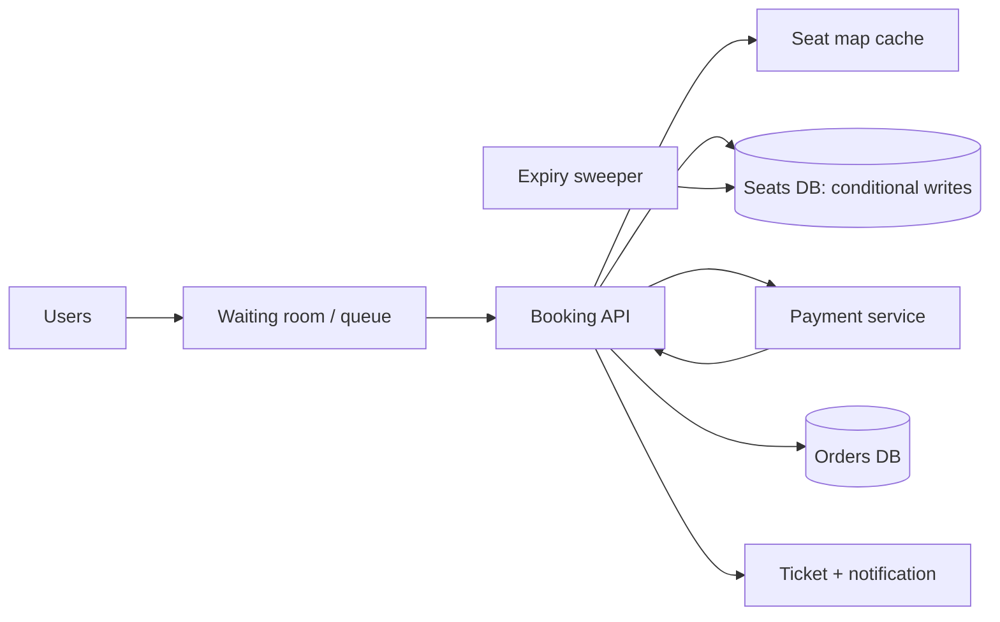

# Ticket Booking System: Full System Design Mock Interview, All 9 Steps

> **Prerequisites:** [Previous lesson: Food Delivery Platform: Full System Design Mock Interview, All 9 Steps](../13-food-delivery-platform/README.md) and the [Interview Framework track](../../21-interview-framework/README.md).
> **Estimated Reading Time:** 15–20 minutes
> **Target Audience:** Engineers practising the full 9-step system design interview on a classic prompt: selling limited seats without ever selling the same seat twice.

> [!NOTE]
> **In one line:** Ticket booking is a **contention problem**: many buyers want the same few seats at the same instant, so correctness comes from short seat holds and atomic reservation, not from raw speed.

> [!TIP]
> **The Golden Rule:** Hold a seat for a few minutes with an atomic conditional write, confirm it only after payment, and release it on timeout. Put a queue in front of the on-sale spike.

---

## Step 1. Clarify the Problem

Open with questions, not boxes. The interviewer wants to hear about double booking, temporary holds and what happens when a million people hit one concert at 10:00.

**Questions to ask the interviewer, and the answer we assume:**

| Question | Assumed answer |
| :--- | :--- |
| What is sold? | Seated events with numbered seats |
| Hold time? | 5 minutes to pay |
| Peak? | Popular concerts sell out in minutes |
| Payments? | Third-party processor |
| Scale? | 10M users on a flash sale, 50K seats |

> Say it aloud: *"Before I draw anything, let me confirm the scope and the numbers."* That one sentence earns the first minutes of the interview.

---

## Step 2. Functional and Non-Functional Requirements

**Functional (what the system does):**

- Browse events and see seat availability.
- Select seats and hold them temporarily.
- Pay to confirm, or let the hold expire.
- Receive the ticket.

**Non-functional (how well it does it):**

| Quality | Target | Why it drives the design |
| :--- | :--- | :--- |
| Correctness | A seat is sold at most once | The core guarantee |
| Fairness | First come first served | Public trust during sell-outs |
| Availability under spike | Survive 100x traffic | Flash sales are the normal case |
| Latency | Seat map under 500 ms | Users refresh constantly |

---

## Step 3. Scope: In and Out

**In scope:** Seat map, hold, pay, confirm, expire, spike protection.

**Out of scope (say it explicitly, then move on):**

- Resale marketplace.
- Dynamic pricing.
- Fraud scoring.

---

## Step 4. Capacity Estimation

Assumptions: 10M users arrive within 10 minutes for 50K seats, each views the seat map 5 times.

| Quantity | Calculation | Result |
| :--- | :--- | :--- |
| Arrival rate | `users / window` | **16.7K users/s** |
| Seat map reads | `users * views / window` | **83.3K reads/s** |
| Seats per 100 users | `seats / users * 100` | **0.5 seats** |

**What the numbers tell you:** 17K arrivals per second and 83K seat-map reads per second against only 50K seats show the contrast: reads must be cached and the writes (holds) are limited by the seat count, so a waiting room admits only as many buyers as the system can serve.

---

## Step 5. API Design

| Endpoint | Purpose | Notes |
| :--- | :--- | :--- |
| `GET /v1/events/{id}/seats` | Seat map | Cached, eventually consistent availability. |
| `POST /v1/holds` | Hold seats | Body: seat ids. Atomic; returns hold id and expiry. |
| `POST /v1/holds/{id}/confirm` | Pay and book | Idempotent, requires a payment id. |
| `DELETE /v1/holds/{id}` | Release | Frees the seats early. |

A hold returns an expiry time. The client shows a countdown, but the server is the authority on whether the hold is still valid.

---

## Step 6. Data Model

| Entity / Store | Key fields | Why this store |
| :--- | :--- | :--- |
| Seats table (sharded by event) | `event_id`, `seat_id`, `status` (available, held, sold), `hold_id`, `hold_expires_at`, `version` | Strong consistency, conditional writes |
| Orders DB | `order_id`, `seats`, `payment` | Relational, transactional |
| Seat map cache | Availability bitmap per event | Absorbs read traffic |
| Waiting room (queue) | Position per user | Controls admission |

A hold is a conditional write: set the seat to held only if it is currently available or its previous hold has expired.

---

## Step 7. High-Level Architecture



**Walk the diagram in this order:** users enter through a waiting room, view a cached seat map, hold seats with a conditional write, pay, and the booking is confirmed; a sweeper frees expired holds.

---

## Step 8. Deep Dives and Bottlenecks

### 1. Preventing double booking

Use a conditional update: `UPDATE seats SET status='held', hold_id=? WHERE seat_id=? AND (status='available' OR hold_expires_at < now())`. The row-level atomicity means exactly one concurrent request wins. Holding several seats must be all-or-nothing, so do it in a single transaction on the same shard (shard seats by event).

### 2. Holds and expiry

A hold carries an expiry timestamp. Treat an expired hold as available at read time, and run a sweeper to clean up and notify. Confirm checks the hold is still valid and owned by the caller, then marks sold in the same transaction as recording the payment.

### 3. Surviving the on-sale spike

A virtual waiting room admits users at a controlled rate, in random or arrival order, with a token for each admitted user. Serve the seat map from a cache with a short TTL so refreshes do not hit the database. Rate-limit per user and detect bots, which dominate real on-sales.

---

## Step 9. Trade-offs, Failures and Security

**Trade-offs to state aloud:**

| Decision | Option A | Option B | Pick and why |
| :--- | :--- | :--- | :--- |
| Locking | Pessimistic row lock | Optimistic conditional write | Conditional write: no long locks, retry on conflict |
| Seat map | Always consistent | Cached and slightly stale | Cached: the hold step is the authority |
| Admission | Everyone at once | Waiting room | Waiting room: protects correctness and the database |

**Failure modes and mitigations:**

| Failure | What users see | Mitigation |
| :--- | :--- | :--- |
| Payment times out | Seat in limbo | Hold expires; reconcile late payments and refund |
| Database shard down | Event unavailable | Replicas with failover, keep other events running |
| Bot flood | Real users shut out | Waiting room, CAPTCHA, per-account limits |

**Security and abuse:** Bind holds to an authenticated session, limit seats per account, verify payment server-side, and sign tickets (QR codes) to prevent forgery.

---

## Runnable Example: Atomic hold with expiry

This models the conditional write: a seat can be held only if it is free or its old hold has expired.

```python
class Seat:
    def __init__(self):
        self.status = "available"
        self.holder = None
        self.expires = 0

    def hold(self, user, now, ttl=300):
        if self.status == "sold":
            return False
        if self.status == "held" and self.expires > now:
            return False
        self.status, self.holder, self.expires = "held", user, now + ttl
        return True

    def confirm(self, user, now):
        if self.status == "held" and self.holder == user and self.expires > now:
            self.status = "sold"
            return True
        return False

s = Seat()
print(s.hold("alice", 0), s.hold("bob", 10))
print(s.hold("bob", 301))
print(s.confirm("alice", 305), s.confirm("bob", 305))
```

Output (produced by running this exact code):

```text
True False
True
False True
```

Bob is refused while Alice's hold is live, succeeds after it expires, and then Alice cannot confirm a seat she no longer holds, while Bob can.

---

## Common Mistakes

- Check-then-update without an atomic condition.
- Holding seats forever.
- Letting the whole crowd hit the database.
- Trusting the client's countdown.
- Selling seats individually when the user picked a group.

---

## Interview Questions and Answers

<details>
<summary><strong>Q1: How do you stop two people buying one seat?</strong></summary>

A conditional write on the seat row, so only one of any set of concurrent requests succeeds. The others get a conflict and choose another seat.

</details>

<details>
<summary><strong>Q2: Why holds?</strong></summary>

Payment takes minutes. A hold reserves the seat during payment and expires automatically if abandoned.

</details>

<details>
<summary><strong>Q3: How do you handle a sell-out spike?</strong></summary>

A waiting room admits users at a sustainable rate, the seat map is cached, and bots are filtered.

</details>

<details>
<summary><strong>Q4: What if payment succeeds after the hold expired?</strong></summary>

Detect it on confirm, refund the payment, and tell the user. Reconcile payments against orders to catch gaps.

</details>

<details>
<summary><strong>Q5: How do you hold several seats together?</strong></summary>

Shard seats by event so all seats are on one shard and reserve them in one transaction, all or nothing.

</details>

---

## One-Page Cheat Sheet

| Step | What to say or draw |
| :--- | :--- |
| Clarify | Numbered seats, 5-minute hold, flash sales |
| Capacity | 17K arrivals/s, 83K map reads/s, 50K seats |
| API | seat map, hold, confirm, release |
| Data | Seats with status and expiry, orders, cache |
| Deep dive | Conditional writes, holds, waiting room |
| Trade-off | Optimistic writes, cached map |

---

## Further Reading

- Ticketmaster engineering talks on virtual queues.
- Martin Kleppmann, *Designing Data-Intensive Applications*, chapter 7 on transactions.

---

## Next

Continue with [E-Commerce Platform: Full System Design Mock Interview, All 9 Steps](../15-e-commerce-platform/README.md).
