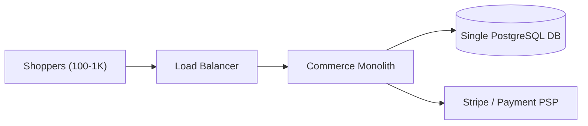
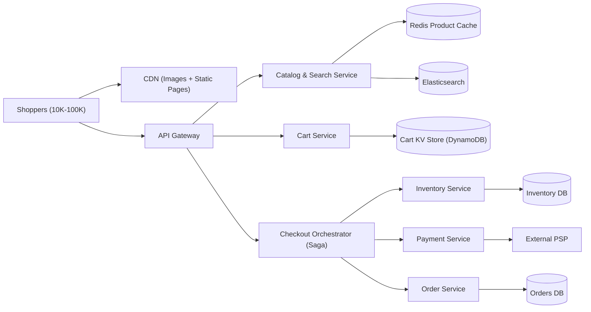
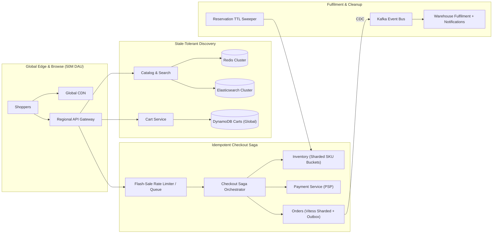
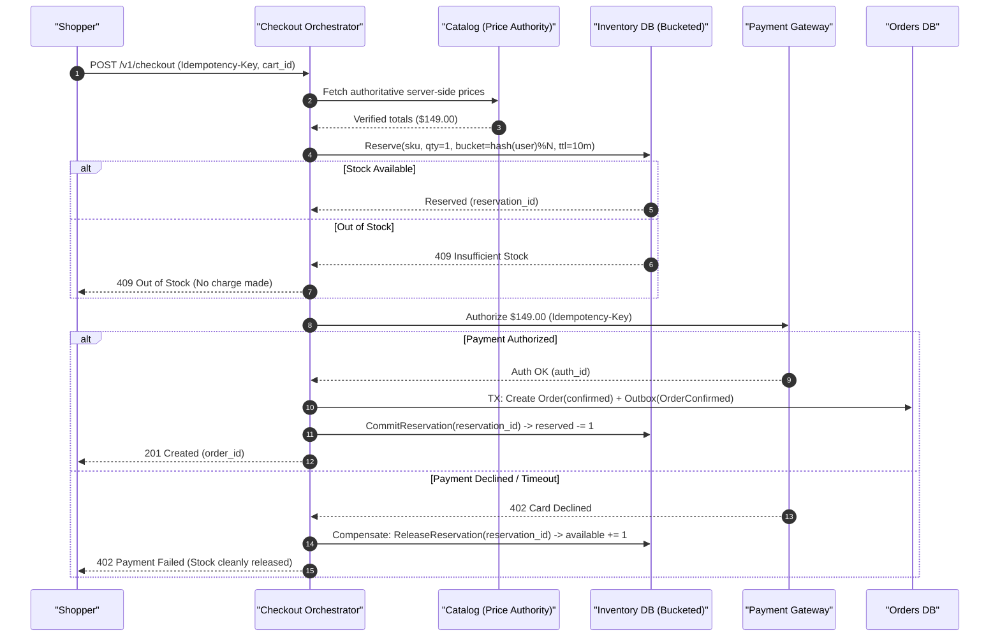

# E-Commerce Platform: Full System Design Mock Interview, All 9 Steps

> **Difficulty:** Hard (Senior / Staff)
> **Prerequisites:** [Previous lesson: Ticket Booking System: Full System Design Mock Interview, All 9 Steps](../14-ticket-booking-system/README.md) and the [Interview Framework track](../../21-interview-framework/README.md).
> **Estimated Reading Time:** 25–30 minutes
> **Target Audience:** Engineers practising the full 9-step system design interview on a classic large-scale commerce prompt: product catalog, search, shopping cart, inventory reservation, and checkout saga.

> [!NOTE]
> **In one line:** An e-commerce platform splits cleanly along **consistency boundaries**: product browsing and search are heavily cached and eventually consistent, while checkout is an **idempotent orchestrated Saga** across inventory, payment, and orders.

> [!TIP]
> **The Golden Rule:** Never use distributed 2-Phase Commit (2PC) across checkout microservices, never trust client-submitted prices, and never charge a card before atomically reserving inventory with a timed TTL.

---

## 1. Clarifying Questions, Functional & Non-Functional Requirements

Open the interview by partitioning the system into two distinct halves: **Read-Heavy Discovery** (99% of traffic, stale-tolerant) and **Write-Critical Checkout** (1% of traffic, strict correctness).

**Clarifying Questions & Assumed Answers:**

| Question | Assumed Answer | Architectural Impact |
| :--- | :--- | :--- |
| **Scale (DAU, orders/day, flash sales)?** | 50M DAU, 1M orders/day avg, $10\times$ on Black Friday | ~5.8K product views/s avg (58K/s peak); ~12 orders/s avg (~116/s peak, 5K/s flash drop). |
| **Catalog size?** | 50M SKUs across 5,000 categories | Requires Elasticsearch faceted search + CDN/Redis product-page caching. |
| **Inventory model?** | Limited stock; must not oversell on flash sales | Atomic conditional decrement (`available >= qty`) + 10-min timed reservations + sharded hot counters. |
| **Payment integration?** | Third-party PSP (Stripe/Adyen) with async webhooks | Checkout returns `pending`; Saga handles auth, capture, and reverse compensations. |
| **Out of scope?** | Seller onboarding, ML recommendations, warehouse robotics | Explicitly defer to focus on catalog, cart, inventory, and checkout saga. |

### Functional Requirements

1. **Browse & Faceted Search:** Search products by keyword, category, price range, and brand with < 200 ms latency.
2. **Shopping Cart:** Add, update, and merge cart items across devices (logged-out -> logged-in).
3. **Checkout & Order Placement:** Re-validate server-side prices, reserve inventory, authorize payment, and create the durable order.
4. **Order Tracking & Cancellation:** View order lifecycle (`pending`, `confirmed`, `shipped`, `delivered`, `cancelled`) and cancel before shipment.

### Non-Functional Requirements

| Quality | Target | Why It Drives the Design |
| :--- | :--- | :--- |
| **Browse Availability** | 99.99% | Every 100 ms of browse latency drops conversion; cache aggressively at CDN/Redis. |
| **No Overselling / Double Charge** | Strict correctness | Inventory reservation + idempotency keys + Saga compensations. |
| **Cart Availability** | Always writable (AP) | Amazon Dynamo lesson: never reject an "Add to Cart" even during partial partition. |
| **Flash-Sale Resilience** | Survive $10\times$–$50\times$ SKU spikes | Sharded hot-SKU inventory buckets + checkout rate-limiting/queueing. |

---

## 2. Back-of-the-Envelope Capacity Estimation

**Base Assumptions:**
- **Daily Active Users:** $50,000,000\text{ DAU}$
- **Product Views / Session:** $10\text{ views/day}$ -> $500,000,000\text{ views/day}$
- **Daily Orders:** $1,000,000\text{ orders/day}$ (average $10\times$ spike on Black Friday / Prime Day)
- **Catalog Size:** $50,000,000\text{ SKUs}$, $5\text{ KB}$ JSON metadata + $500\text{ KB}$ images per SKU

### Worked Equations

**1. Browse & Checkout QPS:**
$$\text{Avg Product Views/s} = \frac{500,000,000}{86,400} \approx 5,787\text{ views/s}, \quad \text{Peak } (10\times) \approx 57,870\text{ views/s}$$
$$\text{Avg Orders/s} = \frac{1,000,000}{86,400} \approx 11.6\text{ orders/s}, \quad \text{Sale Peak } (10\times) \approx 116\text{ orders/s}$$

**2. Catalog & Order Storage:**
$$\text{Catalog Metadata} = 50,000,000 \times 5\text{ KB} = 250\text{ GB (fits easily in RAM/Redis + Postgres)}$$
$$\text{Catalog Media (S3/CDN)} = 50,000,000 \times 500\text{ KB} = 25\text{ TB}$$
$$\text{Daily Orders (at 4 KB/order)} = 1,000,000 \times 4\text{ KB} = 4\text{ GB/day} \approx 1.46\text{ TB/year}$$

### Capacity Summary Table

| Metric | Average Day | Sale Peak (10x) | Design Implication |
| :--- | :--- | :--- | :--- |
| **Product Views/sec** | 5.8K/s | 57.9K/s | Serve from CDN + Redis; never hit Catalog DB on browse. |
| **Search Queries/sec** | ~2K/s | ~20K/s | Dedicated Elasticsearch cluster fed by Debezium CDC. |
| **Checkout Orders/sec** | 11.6/s | 116/s (5K/s flash drop) | Low avg QPS -> optimize for ACID/Saga correctness; shard hot SKUs for drops. |
| **Catalog Metadata** | 250 GB | 250 GB | Entire hot catalog fits in a modest Redis Cluster. |

---

## 3. Core API Contracts & Data Model

### REST API Contracts

| Endpoint | Method | Purpose | Key Request / Response Semantics |
| :--- | :--- | :--- | :--- |
| `/v1/products/search` | `GET` | Faceted catalog search | `?q=headphones&cat=audio&min=50&max=200` -> cached Elasticsearch response. |
| `/v1/cart/items` | `PUT` | Upsert cart line item | `{sku, qty}` -> fast KV store write (returns updated cart). |
| `/v1/checkout` | `POST` | Execute checkout Saga | Header: `Idempotency-Key`; Body: `{cart_id, shipping_addr, payment_token}` -> `202 {order_id}`. |
| `/v1/orders/{id}` | `GET` | Poll/read order status | `{order_id, state, items[], total_cents, tracking_url}`. |
| `/v1/orders/{id}/cancel` | `POST` | Pre-shipment cancel | Triggers compensation Saga (void/refund + release inventory). |

### Data Model & Storage Engine Choice

| Entity / Store | Storage Engine | Shard Key | Key Columns & Rationale |
| :--- | :--- | :--- | :--- |
| **Catalog** | PostgreSQL + Redis + ES | `product_id` | `product_id, title, price_cents, attrs_jsonb`. Postgres is source of truth; ES & Redis read-only. |
| **Shopping Cart** | DynamoDB / Redis Cluster | `user_or_anon_id` | Key-value / document with 30-day TTL; high availability, last-write-wins or CRDT merge. |
| **Inventory** | Sharded Postgres / Redis | `(sku, bucket_id)` | `sku, bucket_id, available, reserved`. Separate `available` & `reserved` for clean TTL release. |
| **Orders & Saga Log** | Sharded PostgreSQL | `order_id` | `order_id, user_id, state, saga_step, total_cents, idempotency_key (UNIQUE)`. |

---

## 4. Stage 1 (100 - 1K Users): Baseline Monolith & Single Database

At 100–1,000 users, a single monolith + PostgreSQL wraps inventory decrement, order creation, and cart storage in simple local ACID transactions.

**Component-by-Component Build:**
1. **API Monolith:** Serves product pages, cart, and checkout.
2. **Single PostgreSQL DB:** Holds `products`, `cart_items`, `inventory`, and `orders`.
3. **Synchronous Checkout TX:** Begins a DB transaction, `UPDATE inventory SET available = available - qty WHERE sku = $1 AND available >= qty`, calls Stripe, and commits `orders`.



**What Breaks at 10K+ Users?**
- **Holding DB Transactions Open Across HTTP Calls:** Calling Stripe (500 ms–2 s) *inside* a PostgreSQL transaction holds row locks on `inventory`, exhausting the DB connection pool and blocking other buyers.
- **Catalog Browse Contention:** `SELECT * FROM products WHERE title ILIKE '%shoe%'` scans tables and competes with checkout writes.

---

## 5. Stage 2 (10K - 100K Users): Caching, Read Replicas & Async Offload

At 10K–100K users, we decouple **browse/search** into Redis + Elasticsearch, move **carts** to a KV store, and replace the long-held DB transaction with a **Timed Reservation + Checkout Saga**.

**Component-by-Component Additions:**
1. **CDN + Redis Product Cache + Elasticsearch:** Absorbs 95%+ of product-page and search traffic; Debezium CDC syncs catalog/price updates from Postgres to ES/Redis.
2. **DynamoDB / Redis Cart Store:** Removes cart churn from PostgreSQL and supports seamless anonymous-to-authenticated cart merging.
3. **Checkout Orchestrator (Saga):**
   - Step 1: **Reserve Inventory** (`available -= qty, reserved += qty`, 10-min TTL) in a fast 5 ms DB TX—no external HTTP calls inside the lock!
   - Step 2: **Authorize Payment** with PSP (outside DB TX, using `Idempotency-Key`).
   - Step 3: **Confirm Order & Commit Stock** (`reserved -= qty`, `order.state = confirmed`) or **Compensate** (`available += qty, reserved -= qty`) if payment fails.



**What Breaks at 1M–50M+ Users (Flash Sales)?**
- **Hot-SKU Row Lock Contention:** On a limited-edition sneaker drop (10,000 pairs, 500K buyers), `UPDATE inventory WHERE sku = 'YEEZY_1'` serializes 50K req/s onto **one single database row**—crashing the Inventory DB.
- **Single Inventory / Orders Primary:** Cross-region shoppers hit high checkout latency and single-primary write limits.

---

## 6. Stage 3 (1M - 10M+ Users): Sharding, Partitioning & Multi-Region Scale

At 1M–50M+ DAU and Black Friday flash sales, we introduce **Sharded Hot-SKU Inventory Buckets**, **Checkout Rate-Limiting / Queues**, and **Event-Driven Fulfilment**.

**Component-by-Component Additions:**
1. **Sharded Inventory Counters (Bucket Splitting):** For hot SKUs, split `available = 10,000` across $B = 100$ sub-rows (`(sku, bucket_0..99)`, 100 units each). Checkout hashes `user_id % 100` (with fallback probing if a bucket hits 0), increasing write concurrency by $100\times$!
2. **Flash-Sale Queue / Token Bucket:** Protects the Checkout Orchestrator and Payment PSP from thundering herds during hyped drops.
3. **Sharded Orders DB (Vitess) + Transactional Outbox:** Orders are sharded by `order_id`; confirmed orders emit events via Outbox/Kafka to Warehouse Fulfilment, Email/SMS, and Fraud/Analytics.
4. **Reservation Expiry Sweeper:** Releases `reserved` stock back to `available` if a buyer abandons checkout after 10 minutes.



---

## 7. Final Full Production Architecture & End-to-End Flows

### End-to-End Checkout Saga & Compensation Sequence



---

## 8. Deep-Dive Bottlenecks & Algorithmic Trade-Offs

### 1. Checkout Consistency: 2-Phase Commit (2PC) vs. Orchestrated Saga
- **Distributed 2PC (XA Transactions):** Locks Inventory, Orders, and Payment resources simultaneously across network calls. If the Payment PSP takes 3 seconds or goes down, locks stay wedged and throughput collapses.
- **Orchestrated Saga:** Breaks checkout into **local ACID steps** (`ReserveInventory -> AuthorizePayment -> CreateOrder -> CommitInventory`) with explicit **compensating actions** (`ReleaseInventory`, `VoidPayment`) executed in reverse order on failure. Every step is **idempotent** and persisted in a Saga state log so a crashed orchestrator can resume seamlessly.

### 2. Hot-SKU Inventory Contention: Single Row vs. Sharded Buckets vs. Redis Lua
- **Single SQL Row:** Maxes out at ~1,500–3,000 updates/sec before row lock contention spikes p99 latency to seconds.
- **Sharded SQL Buckets (`(sku, bucket_0..99)`):** Distributes locks across 100 rows (100K+ updates/sec) while preserving full SQL ACID durability. If `bucket_k` runs empty while `bucket_m` has stock, the service probes a neighbor bucket.

### 3. Price & Stock Validation at Checkout
Product pages and search results are cached in CDN/Redis and may be 30–60 seconds stale. **Never trust prices sent by the client!** The Checkout Orchestrator always fetches authoritative prices from the Catalog Service and verifies stock atomically at reservation time, surfacing any price/stock delta clearly before charging.

| Trade-Off | Option A | Option B | Production Choice & Rationale |
| :--- | :--- | :--- | :--- |
| **Cross-Service TX** | Distributed 2PC | Orchestrated Saga | **Saga:** Keeps services decoupled, available, and resilient to slow PSPs. |
| **Hot-SKU Stock** | Single `sku` row lock | Sharded `sku + bucket` rows | **Sharded Buckets:** $100\times$ write concurrency on flash sales with ACID safety. |
| **Cart Storage** | PostgreSQL `cart_items` | DynamoDB / Redis KV | **DynamoDB KV:** High write availability (AP) and effortless TTL cleanup. |
| **Browse vs. Checkout** | Strong consistency everywhere | Eventual browse, strict checkout | **Split Consistency:** 99% browse traffic stays fast; 1% checkout stays exact. |

---

## 9. Failure Modes, Reliability & Backpressure Mitigations

1. **Double-Click / Mobile Retry on Checkout:** Enforce a mandatory client-generated `Idempotency-Key` stored in a unique index on `orders`. Retries return the cached outcome of the original Saga execution—zero double orders or double charges.
2. **Checkout Orchestrator Crashes Mid-Saga:** The Orchestrator persists each step (`RESERVE_OK`, `PAY_OK`) to its Saga log *before* advancing. On restart, a recovery worker replays/compensates any `IN_PROGRESS` sagas older than 30 seconds.
3. **Payment Gateway (PSP) Outage:** Circuit breaker opens on PSP 5xx/timeouts; Inventory Reservations are immediately compensated (`available += qty`) rather than holding stock hostage, and users see a clean retry message.
4. **Carding / Bot Attacks on Checkout:** Rate-limit `/v1/checkout` per user, IP, and card BIN; require step-up 3DS/CAPTCHA on anomalous velocity.

---

## 10. Production War Story & Real-World Reference

### Incident Pattern: The Black Friday "Stuck Reservation" Inventory Starvation
- **Context:** During a Black Friday doorbuster sale (5,000 discounted TVs), traffic jumped $15\times$.
- **Root Cause:** The Checkout Service reserved inventory in Postgres (`available -= 1, reserved += 1`), then called the external Payment PSP synchronously without a strict HTTP timeout. When the PSP degraded to 45-second latencies, 4,800 checkout workers hung waiting on sockets—leaving 4,800 TVs stuck in `reserved` state while the Reservation Expiry Sweeper had been accidentally disabled during a deploy!
- **Impact:** The site showed "Out of Stock" for 40 minutes even though only 600 TVs had actually been paid for, costing millions in lost GMV.
- **Fix:**
  1. Enforced strict **3-second timeouts + circuit breakers** on all external PSP calls.
  2. Made reservation expiry **read-time enforceable** (storing `reservations` with `expires_at` so expired holds are reclaimable even if the background sweeper lags).
  3. Added automated **Saga Recovery & Reconciliation** alerts on `reserved / total_stock > 20%`.

---

## 11. Core Component Implementation (4 Languages)

Below is a production-style **Idempotent Checkout Saga Orchestrator with Reverse Compensations** (Inventory Reservation -> Payment Authorization -> Order Creation), implemented in Go, TypeScript, Python, and C#.

````carousel
```go
package main

import (
	"errors"
	"fmt"
)

type SagaStep struct {
	Name       string
	Execute    func() error
	Compensate func() error
}

type SagaOrchestrator struct {
	results map[string]string // idempotencyKey -> final status
}

func NewSagaOrchestrator() *SagaOrchestrator {
	return &SagaOrchestrator{results: make(map[string]string)}
}

func (s *SagaOrchestrator) Run(idempotencyKey string, steps []SagaStep) (string, error) {
	if cached, exists := s.results[idempotencyKey]; exists {
		return "idempotent_replay:" + cached, nil
	}

	var completed []SagaStep
	for _, step := range steps {
		if err := step.Execute(); err != nil {
			// Reverse-order compensation of all completed steps
			for i := len(completed) - 1; i >= 0; i-- {
				_ = completed[i].Compensate()
			}
			s.results[idempotencyKey] = "compensated_failed"
			return "compensated_failed", fmt.Errorf("step %s failed: %w", step.Name, err)
		}
		completed = append(completed, step)
	}

	s.results[idempotencyKey] = "confirmed"
	return "confirmed", nil
}

func main() {
	orch := NewSagaOrchestrator()
	steps := []SagaStep{
		{
			Name:       "reserve_inventory",
			Execute:    func() error { fmt.Println("-> Reserved SKU_42"); return nil },
			Compensate: func() error { fmt.Println("<- Released SKU_42"); return nil },
		},
		{
			Name:       "authorize_payment",
			Execute:    func() error { return errors.New("card declined") },
			Compensate: func() error { fmt.Println("<- Voided payment"); return nil },
		},
		{
			Name:       "create_order",
			Execute:    func() error { fmt.Println("-> Created order"); return nil },
			Compensate: func() error { fmt.Println("<- Cancelled order"); return nil },
		},
	}

	status, err := orch.Run("idem_checkout_001", steps)
	fmt.Println("Result:", status, "Err:", err)
	status2, _ := orch.Run("idem_checkout_001", steps)
	fmt.Println("Retry Result:", status2)
}
```
<!-- slide -->
```typescript
interface SagaStep {
  name: string;
  execute: () => Promise<void>;
  compensate: () => Promise<void>;
}

export class SagaOrchestrator {
  private results = new Map<string, string>();

  async run(idempotencyKey: string, steps: SagaStep[]): Promise<string> {
    const cached = this.results.get(idempotencyKey);
    if (cached) return `idempotent_replay:${cached}`;

    const completed: SagaStep[] = [];
    for (const step of steps) {
      try {
        await step.execute();
        completed.push(step);
      } catch (err) {
        for (let i = completed.length - 1; i >= 0; i--) {
          await completed[i].compensate();
        }
        this.results.set(idempotencyKey, "compensated_failed");
        throw new Error(`Saga failed at ${step.name}: ${(err as Error).message}`);
      }
    }

    this.results.set(idempotencyKey, "confirmed");
    return "confirmed";
  }
}
```
<!-- slide -->
```python
from dataclasses import dataclass
from typing import Callable, Dict, List


@dataclass
class SagaStep:
    name: str
    execute: Callable[[], None]
    compensate: Callable[[], None]


class SagaOrchestrator:
    def __init__(self) -> None:
        self._results: Dict[str, str] = {}

    def run(self, idempotency_key: str, steps: List[SagaStep]) -> str:
        if idempotency_key in self._results:
            return f"idempotent_replay:{self._results[idempotency_key]}"

        completed: List[SagaStep] = []
        for step in steps:
            try:
                step.execute()
                completed.append(step)
            except Exception as exc:
                for done in reversed(completed):
                    done.compensate()
                self._results[idempotency_key] = "compensated_failed"
                raise RuntimeError(f"Saga failed at {step.name}: {exc}") from exc

        self._results[idempotency_key] = "confirmed"
        return "confirmed"
```
<!-- slide -->
```csharp
using System;
using System.Collections.Generic;

public sealed record SagaStep(string Name, Action Execute, Action Compensate);

public sealed class SagaOrchestrator
{
    private readonly Dictionary<string, string> _results = new();

    public string Run(string idempotencyKey, IReadOnlyList<SagaStep> steps)
    {
        if (_results.TryGetValue(idempotencyKey, out var cached))
            return $"idempotent_replay:{cached}";

        var completed = new List<SagaStep>();
        foreach (var step in steps)
        {
            try
            {
                step.Execute();
                completed.Add(step);
            }
            catch (Exception ex)
            {
                for (int i = completed.Count - 1; i >= 0; i--)
                    completed[i].Compensate();
                _results[idempotencyKey] = "compensated_failed";
                throw new InvalidOperationException($"Saga failed at {step.Name}: {ex.Message}", ex);
            }
        }

        _results[idempotencyKey] = "confirmed";
        return "confirmed";
    }
}
```
````

---

## 12. Verification, Load Testing & CLI Diagnostics

```bash
# 1. Test atomic bucketed inventory reservation in PostgreSQL
psql -d ecommerce -c "
  UPDATE inventory_buckets
  SET available = available - 1, reserved = reserved + 1
  WHERE sku = 'SKU_HOT_1' AND bucket_id = 7 AND available >= 1
  RETURNING sku, bucket_id, available, reserved;
"

# 2. Verify Redis product cache hit ratio and memory usage
redis-cli INFO stats | grep -E "keyspace_hits|keyspace_misses"

# 3. Load-test idempotent checkout retries under concurrency
hey -n 1000 -c 50 -m POST -H "Idempotency-Key: idem-test-99" \
  -H "Content-Type: application/json" -d '{"cart_id":"c_1"}' http://localhost:8080/v1/checkout
```

---

## 13. Common Interview Mistakes & Red Flags

1. **Using a distributed 2-Phase Commit (2PC) across microservices:** Couples availability to the slowest service and locks DB rows across network calls.
2. **Trusting prices or totals sent by the client:** Trivially exploited via browser DevTools (`price: 0.01`); always recompute totals server-side from the Catalog Service.
3. **Charging the customer before reserving inventory:** Leads to "sorry, out of stock" refunds and angry customers on flash sales.
4. **No `Idempotency-Key` on `/checkout`:** Double-taps or mobile network retries create duplicate orders and double charges.
5. **Single-row inventory counter for flash-sale SKUs:** Serializes all buyers onto one DB row lock.

---

## 14. Key Terminology & Glossary

| Term | Definition |
| :--- | :--- |
| **Checkout Saga** | Sequence of local ACID transactions (`reserve -> pay -> order`) paired with reverse compensating actions on failure. |
| **Compensating Transaction** | Semantic undo operation (e.g., `release_inventory`, `void_payment`) executed when a downstream Saga step fails. |
| **Bucket-Sharded Counter** | Splitting a hot SKU's stock across $N$ sub-rows `(sku, bucket_id)` to multiply write concurrency by $N$. |
| **Authoritative Price Re-check** | Re-fetching catalog prices server-side during checkout so stale caches or tampered clients cannot alter totals. |
| **Idempotency Key** | Unique client-generated token ensuring retried checkout/payment requests execute at most once. |
| **Split Consistency** | Designing browse/search as eventually consistent (AP/cached) while keeping inventory/orders strongly consistent. |

---

## 15. Interview Follow-Up Questions (12 Q&As)

### Basic Conceptual Questions

<details>
<summary><strong>Q1: Why use a Saga instead of a distributed 2-Phase Commit (2PC) for checkout? [BASIC]</strong></summary>

2PC requires all participants (Inventory DB, Orders DB, and external Payment PSP) to hold locks until a global coordinator commits. External PSPs don't support XA/2PC, and holding DB locks across 1–2s HTTP calls destroys throughput. A Saga uses fast local transactions with explicit compensations.

</details>

<details>
<summary><strong>Q2: Why separate `available` and `reserved` columns in the Inventory table? [BASIC]</strong></summary>

Separating `available` and `reserved` lets us reserve stock atomically (`available -= qty, reserved += qty`) during checkout, commit it on order confirmation (`reserved -= qty`), or release it cleanly on timeout/failure (`available += qty, reserved -= qty`) without ever recounting warehouse totals.

</details>

<details>
<summary><strong>Q3: Which parts of an e-commerce site can be eventually consistent? [BASIC]</strong></summary>

Product descriptions, reviews, search results, and displayed "In Stock" badges can lag by seconds to minutes (served via CDN/Redis/Elasticsearch). Only inventory reservation, final price calculation, and payment/order creation require strong consistency.

</details>

<details>
<summary><strong>Q4: Why store shopping carts in DynamoDB or Redis instead of the Orders PostgreSQL DB? [BASIC]</strong></summary>

Cart traffic is high-volume, ephemeral, and often anonymous (browsing without buying). Keeping carts in a fast AP key-value store with a 30-day TTL isolates checkout Postgres from cart churn and ensures "Add to Cart" stays available even during partial DB maintenance.

</details>

### Scenario-Based Architecture Questions

<details>
<summary><strong>Q5: A shopper adds a $200 jacket to their cart, waits 2 days, and checks out after the price changed to $240. What happens? [SCENARIO]</strong></summary>

Checkout never trusts the cart's cached price. The Checkout Orchestrator queries the Catalog Service for the authoritative current price ($240), detects the mismatch against the cart snapshot, and returns `409 PriceChanged` prompting the user to confirm the new total before charging.

</details>

<details>
<summary><strong>Q6: A limited-edition sneaker (5,000 pairs) drops and 200K users click Checkout at once. How do you prevent DB lock collapse? [SCENARIO]</strong></summary>

Split the sneaker's 5,000 units across 100 inventory buckets (`50 pairs/bucket`), route checkout through a token-bucket queue/waiting room, and probe buckets by `hash(user_id) % 100` (falling back to adjacent buckets if empty). This increases DB write concurrency $100\times$.

</details>

<details>
<summary><strong>Q7: The Checkout Orchestrator crashes right after authorizing the customer's card, before creating the order. How do you recover? [SCENARIO]</strong></summary>

The Orchestrator writes each Saga step's state (`RESERVE_OK`, `PAY_AUTH_OK`) to a durable Saga state log before moving to the next step. A background recovery sweeper detects stuck sagas older than 30s and either finishes creating the order idempotently or runs reverse compensations (voids payment + releases stock).

</details>

<details>
<summary><strong>Q8: How do you merge an anonymous user's cart when they log in on checkout? [SCENARIO]</strong></summary>

On login, the Cart Service reads `cart:anon:{device_id}` and `cart:user:{user_id}` from DynamoDB, merges line items (taking `max(qty)` or summing quantities per SKU), writes the merged cart to `cart:user:{user_id}`, and deletes the anonymous key.

</details>

### Advanced & Tricky Interview Questions

<details>
<summary><strong>Q9: A user buys 3 items in one cart, but Item 3 is out of stock when reserving. How do you handle partial availability? [TRICKY]</strong></summary>

Run the multi-SKU reservation inside a single local transaction (if on the same shard) or Saga: if Item 3 fails, compensate Items 1 & 2 immediately and return `409 Conflict` listing which SKU is out of stock so the user can choose to remove it or wait.

</details>

<details>
<summary><strong>Q10: What if a third-party Payment PSP times out—did the charge succeed or fail? [TRICKY]</strong></summary>

A network timeout is **ambiguous** (the PSP may have charged the card before the response dropped). Always pass the `Idempotency-Key` to the PSP, mark the Saga `PENDING_RECONCILIATION`, and either poll the PSP's `/charges?idempotency_key=...` endpoint or wait for its async webhook before releasing stock or confirming the order.

</details>

<details>
<summary><strong>Q11: How do you prevent "ghost inventory" when a warehouse physically damages or loses 10 units? [TRICKY]</strong></summary>

Run a periodic **WMS-to-Inventory Reconciliation** job comparing the physical Warehouse Management System (WMS) counts against `available + reserved`. If drift causes a rare oversell, trigger an automated apology + instant refund + coupon workflow.

</details>

<details>
<summary><strong>Q12: How do you invalidate CDN and Redis product caches when a merchant updates a price? [TRICKY]</strong></summary>

Use Debezium CDC on the Catalog DB: every committed price change emits a `ProductUpdated` event to Kafka, which triggers an immediate Redis key overwrite/invalidation and a CDN surrogate-key purge within 1–2 seconds—and checkout still re-validates price authoritatively.

</details>

---

## 16. One-Page Master Cheat Sheet

```text
+------------------------------------------------------------------------------+
|                E-COMMERCE PLATFORM — SYSTEM DESIGN CHEAT SHEET               |
+------------------------------------------------------------------------------+
| SCALE: 50M DAU, 1M orders/day -> 5.8K views/s avg (58K peak), 116 orders/s   |
|        50M SKUs (~250 GB catalog metadata, ~25 TB product media on S3/CDN)   |
+------------------------------------------------------------------------------+
| 4 GOLDEN RULES:                                                              |
|  1. Split Consistency: Browse/Search = cached (AP); Checkout = strict Saga.  |
|  2. Orchestrated Saga (Reserve -> Pay -> Order) with reverse compensations.  |
|  3. Never trust client prices; re-validate authoritatively at checkout.      |
|  4. Bucket-shard hot SKUs (sku, 0..99) to survive flash-sale row contention. |
+------------------------------------------------------------------------------+
| DATA STORES:                                                                 |
|  Catalog: Postgres + Redis + ES (CDC) | Cart: DynamoDB KV (30d TTL)          |
|  Inventory: Sharded Postgres (buckets)| Orders: Vitess Sharded + Outbox      |
+------------------------------------------------------------------------------+
```

| Step | Key Decision | Primary Bottleneck Solved |
| :--- | :--- | :--- |
| **Browse & Search** | CDN + Redis + Elasticsearch (CDC) | 58K/s read QPS isolating Catalog DB |
| **Cart** | DynamoDB KV with 30d TTL | High-availability writes & anonymous merge |
| **Checkout** | Idempotent Orchestrated Saga | Cross-service 2PC locks & double charges |
| **Flash Sales** | Bucket-sharded `inventory` + queue | Single-row lock contention on hot SKUs |

---

## Further Reading

- Chris Richardson, *Microservices Patterns*, Chapter 4 (Sagas).
- Amazon's *Dynamo* paper (DeCandia et al., 2007) for the shopping cart availability motivation.
- Martin Kleppmann, *Designing Data-Intensive Applications*, Chapter 7 & 9.

---

## Next

Continue with [Payment Processing System: Full System Design Mock Interview, 9 Steps](../16-payment-processing-system/README.md).
