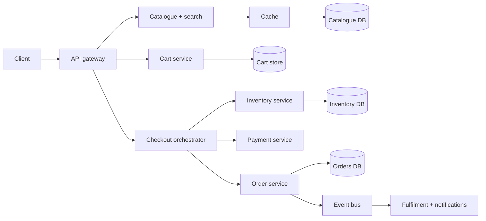

# E-Commerce Platform: Full System Design Mock Interview, All 9 Steps

> **Prerequisites:** [Previous lesson: Ticket Booking System: Full System Design Mock Interview, All 9 Steps](../14-ticket-booking-system/README.md) and the [Interview Framework track](../../21-interview-framework/README.md).
> **Estimated Reading Time:** 15–20 minutes
> **Target Audience:** Engineers practising the full 9-step system design interview on a classic prompt: a shopping site with catalogue, cart, checkout and orders.

> [!NOTE]
> **In one line:** An e-commerce platform is **a catalogue that must be fast and an order flow that must be correct**: reads are cached and eventually consistent, but inventory and payment need transactions or compensations.

> [!TIP]
> **The Golden Rule:** Make browsing cheap and stale-tolerant, and make checkout a saga with idempotent steps. Decrement inventory carefully and never charge without an order.

---

## Step 1. Clarify the Problem

Open with questions, not boxes. Split the system by consistency need: catalogue and search can lag, cart is a convenience, checkout is where correctness lives.

**Questions to ask the interviewer, and the answer we assume:**

| Question | Assumed answer |
| :--- | :--- |
| Scope? | Catalogue, search, cart, checkout, orders |
| Sellers? | Single retailer, many products |
| Inventory? | Limited stock, flash sales happen |
| Payments? | Third party, async confirmation |
| Scale? | 50M DAU, 1M orders per day, 10x on sale days |

> Say it aloud: *"Before I draw anything, let me confirm the scope and the numbers."* That one sentence earns the first minutes of the interview.

---

## Step 2. Functional and Non-Functional Requirements

**Functional (what the system does):**

- Browse and search products.
- Add items to a cart.
- Check out with address and payment.
- Track orders and cancel before shipping.

**Non-functional (how well it does it):**

| Quality | Target | Why it drives the design |
| :--- | :--- | :--- |
| Browse latency | Under 200 ms | Revenue follows speed |
| Order correctness | No oversell, no double charge | Trust and cost |
| Availability | 99.99% on browse | Downtime loses sales |
| Peak | 10x on sale days | Planned spikes |

---

## Step 3. Scope: In and Out

**In scope:** Catalogue, search, cart, checkout saga, order status.

**Out of scope (say it explicitly, then move on):**

- Seller marketplace.
- Recommendations.
- Returns and customer support.

---

## Step 4. Capacity Estimation

Assumptions: 50M DAU, 1M orders per day, 10 product views per session, sale day is 10x.

| Quantity | Calculation | Result |
| :--- | :--- | :--- |
| Product views per second | `dau * views / 86400` | **5.8K views/s** |
| Orders per second | `orders / 86400` | **11.6 orders/s** |
| Peak orders per second | `orders_per_second * peak` | **116 orders/s** |

**What the numbers tell you:** 5.8K product views per second is easy with caching. Orders at about 12 per second (116 on a sale day) are low volume but high value, so correctness rather than throughput drives the checkout design.

---

## Step 5. API Design

| Endpoint | Purpose | Notes |
| :--- | :--- | :--- |
| `GET /v1/products?q=&category=` | Search and browse | Search index plus cache. |
| `PUT /v1/cart/items` | Update cart | Per-user cart store. |
| `POST /v1/checkout` | Start checkout | Idempotency key; reserves inventory, begins payment. |
| `GET /v1/orders/{id}` | Order status | Reads the order record. |

Checkout returns quickly with an order id and a pending state; the result of payment arrives by callback and moves the order forward.

---

## Step 6. Data Model

| Entity / Store | Key fields | Why this store |
| :--- | :--- | :--- |
| Catalogue DB + cache + search index | `product_id`, title, price, attributes | Read-mostly, heavily cached |
| Cart store (key-value) | `user_id` to items | Fast, can expire |
| Inventory DB | `sku`, `available`, `reserved` | Strongly consistent counters |
| Orders DB | `order_id`, items, totals, state, payment_id | Relational transactions |
| Event bus | Order events | Drives fulfilment and notifications |

Keep available and reserved quantities separate so a reservation can be released without recounting.

---

## Step 7. High-Level Architecture



**Walk the diagram in this order:** browse reads from cache and search, cart is a simple store, and checkout is an orchestrated saga across inventory, payment and order services, ending in an event.

---

## Step 8. Deep Dives and Bottlenecks

### 1. Checkout as a saga

Steps: reserve inventory, authorise payment, create the order, confirm. Each step has a compensation (release inventory, void payment). The orchestrator records its progress, and every step is idempotent so retries are safe. If payment fails, run the compensations in reverse. This avoids a distributed transaction across services.

### 2. Inventory and flash sales

Reserve stock with an atomic conditional decrement (`available >= qty`). For a hot item, shard the counter into buckets or use a Redis counter that is reconciled with the database. Release reservations after a timeout. Overselling a little and cancelling is sometimes cheaper than strict locking, so state the policy.

### 3. Catalogue and search at scale

Product pages are cached at the CDN and in Redis with invalidation on price or stock changes. Search uses an inverted index fed by a change stream, with facets for category and price. Prices and stock shown in lists may lag; the checkout step re-validates both.

---

## Step 9. Trade-offs, Failures and Security

**Trade-offs to state aloud:**

| Decision | Option A | Option B | Pick and why |
| :--- | :--- | :--- | :--- |
| Cross-service consistency | Distributed transaction | Saga with compensations | Saga: services stay independent and available |
| Inventory | Strict lock | Conditional decrement plus reservation | Reservation with expiry |
| Product data | Always fresh | Cached | Cached, re-validated at checkout |

**Failure modes and mitigations:**

| Failure | What users see | Mitigation |
| :--- | :--- | :--- |
| Payment service down | Cannot pay | Keep order pending with a timeout; retry; release stock |
| Duplicate checkout click | Two orders | Idempotency key on checkout |
| Inventory drift | Oversell | Reconcile against warehouse counts and cancel with apology |

**Security and abuse:** Never trust client prices (recompute server-side), tokenise cards through the payment provider, protect carts and orders by user, and rate-limit checkout to stop carding attacks.

---

## Runnable Example: Saga with compensation

Each step has an undo. If a later step fails, the earlier ones are compensated in reverse order.

```python
def run_saga(steps):
    done = []
    for name, action, undo in steps:
        try:
            action()
            done.append((name, undo))
        except Exception as e:
            print("failed at", name, "-", e)
            for n, u in reversed(done):
                u()
                print("compensated", n)
            return False
    return True

def ok(): pass
def pay_fail(): raise RuntimeError("card declined")
log = lambda m: (lambda: print("  undo", m))

steps = [("reserve stock", ok, log("release stock")),
         ("authorise payment", pay_fail, log("void payment")),
         ("create order", ok, log("cancel order"))]
print(run_saga(steps))
```

Output (produced by running this exact code):

```text
failed at authorise payment - card declined
  undo release stock
compensated reserve stock
False
```

The payment step fails, so the saga compensates the one step that had completed (reserving stock) and never reaches order creation.

---

## Common Mistakes

- One distributed transaction across services.
- Charging before reserving stock.
- Trusting prices sent by the client.
- No idempotency on checkout.
- Serving browse traffic from the orders database.

---

## Interview Questions and Answers

<details>
<summary><strong>Q1: How do you keep checkout correct across services?</strong></summary>

A saga: ordered steps with compensations, every step idempotent, progress recorded by an orchestrator.

</details>

<details>
<summary><strong>Q2: How do you avoid overselling?</strong></summary>

An atomic conditional decrement on inventory with timed reservations, and reconciliation against real stock.

</details>

<details>
<summary><strong>Q3: How do you handle a flash sale?</strong></summary>

Cache and CDN the pages, a waiting room if needed, sharded stock counters, and a queue in front of checkout.

</details>

<details>
<summary><strong>Q4: What is eventually consistent here?</strong></summary>

Catalogue, search, cart contents and displayed stock; checkout re-validates price and availability.

</details>

<details>
<summary><strong>Q5: How do you prevent a double charge?</strong></summary>

An idempotency key on checkout and on the payment call, plus reconciliation between payments and orders.

</details>

---

## One-Page Cheat Sheet

| Step | What to say or draw |
| :--- | :--- |
| Clarify | Catalogue, cart, checkout, orders; 1M orders/day |
| Capacity | 5.8K views/s, 12 orders/s (116 on sales) |
| API | search, cart, checkout, order status |
| Data | Catalogue, cart, inventory, orders, event bus |
| Deep dive | Saga, inventory reservation, caching |
| Trade-off | Saga over distributed transaction |

---

## Further Reading

- Chris Richardson, *Microservices Patterns*, chapter on sagas.
- Amazon's Dynamo paper for the shopping cart motivation.

---

## Next

Continue with [Payment Processing System: Full System Design Mock Interview, 9 Steps](../16-payment-processing-system/README.md).
