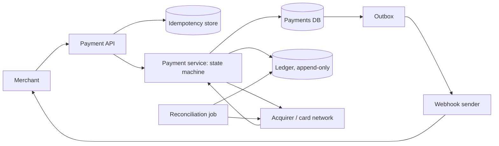

# Payment Processing System: Full System Design Mock Interview, 9 Steps

> **Prerequisites:** [Previous lesson: E-Commerce Platform: Full System Design Mock Interview, All 9 Steps](../15-e-commerce-platform/README.md) and the [Interview Framework track](../../21-interview-framework/README.md).
> **Estimated Reading Time:** 15–20 minutes
> **Target Audience:** Engineers practising the full 9-step system design interview on a classic prompt: accepting card payments reliably, never charging twice and never losing money.

> [!NOTE]
> **In one line:** A payment system is **a ledger with a retry-safe API**: every request is idempotent, every money movement is recorded as double-entry, and every external call is reconciled.

> [!TIP]
> **The Golden Rule:** Idempotency keys on every mutation, an append-only ledger as the source of truth, and daily reconciliation against the bank. Never delete or update money records.

---

## Step 1. Clarify the Problem

Open with questions, not boxes. Correctness over speed: the interviewer wants idempotency, state machines, the ledger and how you handle an unknown outcome from the card network.

**Questions to ask the interviewer, and the answer we assume:**

| Question | Assumed answer |
| :--- | :--- |
| Role? | A payment service provider used by merchants |
| Methods? | Cards through an acquiring bank |
| Flow? | Authorise then capture, plus refunds |
| Consistency? | Never charge twice, never lose a payment |
| Scale? | 1,000 payments per second, 10x on holidays |

> Say it aloud: *"Before I draw anything, let me confirm the scope and the numbers."* That one sentence earns the first minutes of the interview.

---

## Step 2. Functional and Non-Functional Requirements

**Functional (what the system does):**

- Create a payment (authorise) and capture it.
- Refund fully or partially.
- Notify merchants of the result by webhook.
- Provide a ledger and settlement reports.

**Non-functional (how well it does it):**

| Quality | Target | Why it drives the design |
| :--- | :--- | :--- |
| Correctness | Exactly-once effect | Money |
| Durability | No lost records | Audit and regulation |
| Availability | 99.99% | Merchants lose sales when down |
| Latency | Under 2 s for authorisation | Checkout conversion |

---

## Step 3. Scope: In and Out

**In scope:** Idempotent payment API, state machine, ledger, webhooks, reconciliation.

**Out of scope (say it explicitly, then move on):**

- Fraud model internals.
- PCI infrastructure details beyond tokenisation.
- Currency exchange.

---

## Step 4. Capacity Estimation

Assumptions: 1,000 payments per second on average, 10x holiday peak, 2 ledger entries per payment, 200 bytes per entry.

| Quantity | Calculation | Result |
| :--- | :--- | :--- |
| Peak payments per second | `tps * peak` | **10K payments/s** |
| Ledger rows per day | `tps * 86400 * entries` | **172.8M rows** |
| Ledger storage per year | `ledger_rows_per_day * bytes_ * 365 / 1e12` | **12.6 TB/year** |

**What the numbers tell you:** 10,000 payments per second at peak is moderate for a sharded relational database, since each is a short transaction. Ledger growth of about 13 TB a year is manageable with partitioning by date.

---

## Step 5. API Design

| Endpoint | Purpose | Notes |
| :--- | :--- | :--- |
| `POST /v1/payments` | Create and authorise | Header `Idempotency-Key` required. Returns payment id and state. |
| `POST /v1/payments/{id}/capture` | Capture funds | Idempotent. |
| `POST /v1/payments/{id}/refund` | Refund | Amount up to the captured total. |
| `GET /v1/payments/{id}` | State | Reads current state. |
| Webhook `payment.updated` | Notify merchant | Signed, retried with backoff. |

The same idempotency key with the same body returns the original result; with a different body it returns an error. Keys are stored for at least 24 hours.

---

## Step 6. Data Model

| Entity / Store | Key fields | Why this store |
| :--- | :--- | :--- |
| Payments DB (relational, sharded by merchant) | `payment_id`, `merchant`, `amount`, `state`, `idempotency_key`, `version` | ACID transactions |
| Ledger (append-only) | `entry_id`, `account`, `debit`, `credit`, `payment_id` | Double-entry: every payment sums to zero |
| Idempotency store | `key` to stored response | Replay the same answer |
| Outbox | Pending events | Reliable webhooks |

Never update a balance in place. The balance is the sum of ledger entries, and corrections are new entries.

---

## Step 7. High-Level Architecture



**Walk the diagram in this order:** the API checks the idempotency key, the payment service moves a state machine and calls the acquirer, writes ledger entries in the same transaction, and an outbox sends the webhook.

---

## Step 8. Deep Dives and Bottlenecks

### 1. Idempotency

The client sends a unique key per logical payment. The server stores the key with the request hash and the response, atomically with the payment creation. A retry after a timeout returns the stored response instead of charging again. This is essential because the network can fail after the charge succeeded.

### 2. The unknown outcome

If the call to the acquirer times out, you do not know whether the charge happened. Mark the payment `pending_unknown`, then query the acquirer by your reference or wait for its webhook, and resolve to success or failure. Never retry the charge blindly; retry the status lookup.

### 3. Ledger and reconciliation

Record each money movement as balanced debit and credit rows in the same database transaction as the state change. A nightly job compares your ledger with the acquirer's settlement file and flags mismatches for investigation. The ledger is the audit trail, so it is append-only.

---

## Step 9. Trade-offs, Failures and Security

**Trade-offs to state aloud:**

| Decision | Option A | Option B | Pick and why |
| :--- | :--- | :--- | :--- |
| Source of truth | Mutable balance | Append-only ledger | Ledger: auditable and recoverable |
| Retries | Retry the charge | Retry the status check | Status check: avoids double charges |
| Webhooks | Fire and forget | Outbox with retries | Outbox: no lost notifications |

**Failure modes and mitigations:**

| Failure | What users see | Mitigation |
| :--- | :--- | :--- |
| Acquirer timeout | Payment unknown | pending_unknown plus status lookup and reconciliation |
| Duplicate request | Possible double charge | Idempotency key returns the first result |
| DB failover mid-transaction | Partial state | Single transaction for state and ledger |

**Security and abuse:** Never store raw card numbers: tokenise through a PCI-compliant vault. Encrypt data, sign webhooks, restrict access, use 3-D Secure where required and log every change for audit.

---

## Runnable Example: Idempotent payment creation

A retry with the same key returns the first result; the same key with a different amount is rejected.

```python
store = {}
charges = []

def create_payment(key, amount):
    if key in store:
        saved_amount, result = store[key]
        if saved_amount != amount:
            return "error: key reused with different amount"
        return result
    charges.append(amount)
    result = f"paid {amount}"
    store[key] = (amount, result)
    return result

print(create_payment("k1", 50))
print(create_payment("k1", 50))
print(create_payment("k1", 75))
print("charges made:", charges)
```

Output (produced by running this exact code):

```text
paid 50
paid 50
error: key reused with different amount
charges made: [50]
```

The retry returns the original result without a second charge, the mismatched reuse is rejected, and only one charge was ever made.

---

## Common Mistakes

- Retrying a charge after a timeout.
- Updating balances in place.
- Storing raw card numbers.
- Sending webhooks outside the transaction (lost events).
- Skipping reconciliation.

---

## Interview Questions and Answers

<details>
<summary><strong>Q1: How do you prevent double charges?</strong></summary>

Idempotency keys stored atomically with the payment, so a retry returns the first result.

</details>

<details>
<summary><strong>Q2: What happens if the acquirer times out?</strong></summary>

Mark the payment unknown, then look up its status or wait for the callback. Do not retry the charge.

</details>

<details>
<summary><strong>Q3: Why a ledger?</strong></summary>

Double-entry append-only rows give an audit trail and make balances derivable and verifiable.

</details>

<details>
<summary><strong>Q4: How do you send webhooks reliably?</strong></summary>

An outbox written in the same transaction, a sender that retries with backoff, signed payloads, and merchant-side idempotency.

</details>

<details>
<summary><strong>Q5: How do you detect errors?</strong></summary>

Reconcile the ledger with the acquirer's settlement files daily and alert on any mismatch.

</details>

---

## One-Page Cheat Sheet

| Step | What to say or draw |
| :--- | :--- |
| Clarify | PSP, cards, authorise/capture/refund |
| Capacity | 10K payments/s peak, ~13 TB ledger/year |
| API | create with Idempotency-Key, capture, refund, webhook |
| Data | Payments DB, append-only ledger, idempotency store |
| Deep dive | Idempotency, unknown outcome, reconciliation |
| Trade-off | Ledger over balances, status checks over retries |

---

## Further Reading

- Stripe engineering blog, *Designing robust and predictable APIs with idempotency*.
- Square Engineering, *Books, an immutable double-entry accounting database service*.

---

## Next

Continue with [Banking Transaction System: Full System Design Mock Interview, 9 Steps](../17-banking-transaction-system/README.md).
