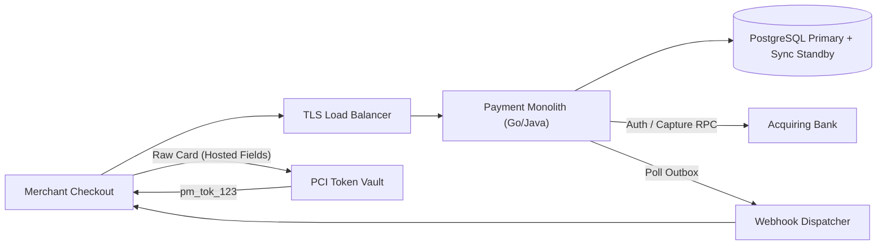
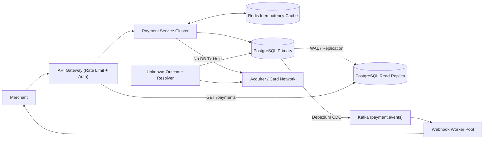
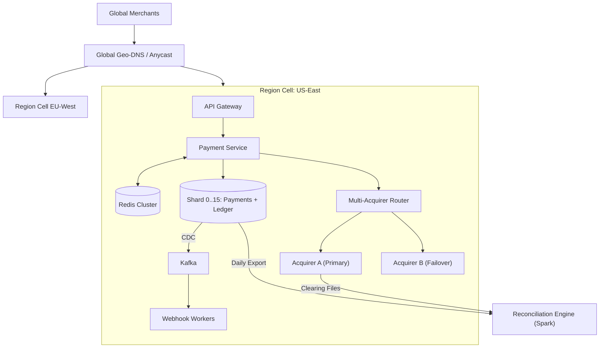
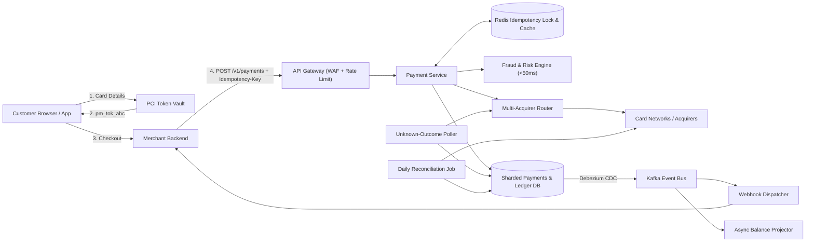

# Payment Processing System: Full System Design Mock Interview, 9 Steps

> **Difficulty:** Senior / Staff (L5–L6) — Distributed Correctness, Idempotency & Financial Ledgers
> **Prerequisites:** [Previous lesson: E-Commerce Platform: Full System Design Mock Interview, 9 Steps](../15-e-commerce-platform/README.md) and the [Interview Framework track](../../21-interview-framework/README.md).
> **Estimated Reading Time:** 25–30 minutes
> **Target Audience:** Engineers practising the full 9-step system design interview on a classic prompt: accepting card payments reliably, never charging twice and never losing money.

> [!NOTE]
> **In one line:** A payment system is **a ledger with a retry-safe API**: every request is idempotent, every money movement is recorded as double-entry, and every external call is reconciled.

> [!TIP]
> **The Golden Rule:** Idempotency keys on every mutation, an append-only ledger as the source of truth, and daily reconciliation against the bank. Never delete or update money records.

---

## 1. Clarifying Questions, Functional & Non-Functional Requirements

Open with questions, not boxes. In a payment processing interview, correctness beats raw throughput: the interviewer is testing idempotency, finite state machines, double-entry ledgers, PCI scope minimization, and how you handle an unknown outcome from an external acquiring bank or card network.

> Say it aloud: *"Before I draw anything, let me confirm the scope, the money-movement invariants, and the scale numbers."*

### Clarifying Questions & Assumed Scope

| Question | Assumed Answer | Architectural Impact |
| :--- | :--- | :--- |
| **What is our role?** | Payment Service Provider (PSP) serving merchants | Multi-tenant isolation, merchant payouts, webhooks |
| **Payment methods?** | Credit/debit cards via acquiring banks & card networks | Two-step auth + capture, PCI-DSS tokenization vault |
| **Supported flows?** | Authorize, capture (full/partial), void, refund (full/partial) | Explicit finite state machine per `payment_id` |
| **Consistency guarantee?** | Never double-charge, never lose a committed payment | Strict idempotency + ACID state/ledger + reconciliation |
| **Scale target?** | 1,000 payments/sec average, 10x holiday peak (10,000 TPS) | Sharded relational DB, partitioned outbox & ledger |
| **Out of scope?** | ML fraud model internals, FX conversion, raw PCI HSM hardware | Mention clean interfaces (Fraud RPC, Vault token, FX quote) |

### Functional Requirements

1. **Authorize & Capture:** Merchants submit a payment intent with a tokenized card (`pm_tok_...`); the PSP authorizes funds via an acquirer and either captures immediately or captures later.
2. **Refund & Void:** Support full or partial refunds on captured payments and voids on uncaptured authorizations, enforcing `sum(refunds) <= captured_amount`.
3. **Merchant Webhooks:** Deliver signed, ordered-per-payment status notifications (`payment.authorized`, `payment.captured`, `payment.failed`, `refund.succeeded`) with exponential backoff retries.
4. **Immutable Ledger & Reconciliation:** Maintain an append-only double-entry ledger for every money movement and reconcile daily against acquirer settlement files (EPA/clearing reports).

### Non-Functional Requirements

| Quality | Target | Why It Drives the Design |
| :--- | :--- | :--- |
| **Correctness** | Exactly-once financial effect | Double-charges destroy merchant trust and trigger chargebacks |
| **Durability** | Zero lost committed records ($RPO = 0$) | Regulatory auditability (SOX, PCI-DSS) and financial integrity |
| **Availability** | 99.99% (< 52.6 min downtime/year) | Checkout downtime directly equals lost merchant revenue |
| **Latency** | $p_{95} < 1.5\text{ s}$, $p_{99} < 2.5\text{ s}$ for auth | External acquirer network RTT is ~300–800 ms |
| **Auditability** | 7–10 years immutable retention | Chargeback disputes, tax, and financial audits |

---

## 2. Back-of-the-Envelope Capacity Estimation

Let us derive throughput, storage, network bandwidth, and connection pool requirements from first principles.

### Assumptions

- Average throughput: $\lambda_{\text{avg}} = 1{,}000\text{ payments/s}$
- Holiday peak multiplier: $M_{\text{peak}} = 10\times \implies \lambda_{\text{peak}} = 10{,}000\text{ payments/s}$
- Average lifecycle events per payment: $2.5$ (authorize + capture + occasional refund/webhook)
- Double-entry ledger rows per money movement: $2$ rows (1 debit, 1 credit) on auth/capture/refund $\implies 4$ ledger rows per standard auth+capture payment
- Average row sizes: Payment row $= 512\text{ B}$, Ledger entry $= 200\text{ B}$, Idempotency record $= 1{,}500\text{ B}$ (includes cached JSON response)
- Acquirer external call latency: $T_{\text{acq}} = 400\text{ ms}$ average ($0.4\text{ s}$)

### Worked Equations

**1. Daily & Annual Ledger Row Growth:**

$$
R_{\text{day}} = \lambda_{\text{avg}} \times 86{,}400\text{ s/day} \times 4\text{ rows/payment} = 1{,}000 \times 86{,}400 \times 4 = 345{,}600{,}000\text{ rows/day} \approx 345.6\text{M rows/day}
$$

**2. Annual Ledger Storage (Raw + 1.5x Index Overhead):**

$$
S_{\text{ledger/year}} = 345.6 \times 10^6\text{ rows/day} \times 200\text{ B} \times 365\text{ days} \times 1.5 = 37.84 \times 10^{12}\text{ B} \approx 37.8\text{ TB/year}
$$

**3. Idempotency Cache Working Set (24-Hour Hot Window at Peak-Weighted Mix, ~2,000 TPS avg):**

$$
S_{\text{idem,24h}} = 2{,}000\text{ req/s} \times 86{,}400\text{ s} \times 1{,}500\text{ B} = 259.2 \times 10^9\text{ B} \approx 259.2\text{ GB}
$$

**4. Concurrent In-Flight Acquirer Connections at Peak (Little's Law $L = \lambda \cdot W$):**

$$
L_{\text{acq}} = \lambda_{\text{peak}} \times T_{\text{acq}} = 10{,}000\text{ req/s} \times 0.4\text{ s} = 4{,}000\text{ concurrent in-flight HTTP/ISO-8583 calls}
$$

> [!IMPORTANT]
> **Critical Insight from Little's Law:** If you hold a database transaction or DB connection open while waiting 400 ms for the acquirer, you need $>4{,}000$ active DB connections at peak—which exhausts PostgreSQL connection limits and locks rows. **Never hold a DB transaction open across an external acquirer network call.**

### Capacity Summary Table

| Metric | Formula / Basis | Result | Architectural Implication |
| :--- | :--- | :--- | :--- |
| **Peak Payment TPS** | $1{,}000 \times 10$ | **10,000 TPS** | Sharded OLTP DB (e.g., 16–32 shards by `merchant_id`) |
| **Peak DB Write Ops** | Payments + Outbox + Ledger | **~50,000 writes/s** | Partitioned tables + batched/async ledger projection or sharded writes |
| **Ledger Growth / Year** | $345.6\text{M rows/day} \times 200\text{ B} \times 1.5 \times 365$ | **~37.8 TB/year** | Time-range partitioning (daily/monthly) + cold S3/Parquet archival |
| **Idempotency Store (24h)** | $2{,}000 \times 86{,}400 \times 1.5\text{ KB}$ | **~259 GB** | Distributed Redis cluster (hot 24h) + DB unique constraint fallback |
| **In-Flight Acquirer Calls** | $10{,}000 \times 0.4\text{ s}$ | **4,000 concurrent** | Split DB tx into `INITIATED` -> Acquirer RPC -> `AUTHORIZED` |

---

## 3. Core API Contracts & Data Model

### REST API Contracts

| Endpoint | Method | Required Headers | Request / Response Contract |
| :--- | :--- | :--- | :--- |
| `/v1/payments` | `POST` | `Idempotency-Key: <uuid>`, `Authorization: Bearer <key>` | Body: `{amount_minor, currency, payment_method_token, capture_method, merchant_ref}`. Returns `201` (or cached response) with `{payment_id, state}`. |
| `/v1/payments/{id}/capture` | `POST` | `Idempotency-Key: <uuid>` | Body: `{amount_minor}` (optional for full capture). Transitions `AUTHORIZED` $\to$ `CAPTURED`. |
| `/v1/payments/{id}/refund` | `POST` | `Idempotency-Key: <uuid>` | Body: `{amount_minor, reason}`. Enforces `refunded + amount <= captured`. |
| `/v1/payments/{id}` | `GET` | `Authorization: Bearer <key>` | Returns current payment state, authorized/captured/refunded minor units. |
| Webhook `payment.updated` | `POST` (outbound) | `X-Signature-256: t=...,v1=...` | Signed JSON event delivered to merchant URL with exponential backoff. |

> All monetary values MUST be transmitted and stored as **64-bit integers in minor units** (e.g., `1099` for `$10.99 USD`, `1000` for `¥1000 JPY`) alongside an ISO-4217 `currency` code. Never use IEEE-754 floating-point numbers.

### Core Relational Data Model (PostgreSQL)

```sql
-- 1. Payments (Sharded by merchant_id)
CREATE TABLE payments (
    payment_id          UUID PRIMARY KEY,
    merchant_id         UUID NOT NULL,
    idempotency_key     VARCHAR(128) NOT NULL,
    request_hash        CHAR(64) NOT NULL,
    amount_minor        BIGINT NOT NULL CHECK (amount_minor > 0),
    captured_minor      BIGINT NOT NULL DEFAULT 0,
    refunded_minor      BIGINT NOT NULL DEFAULT 0,
    currency            CHAR(3) NOT NULL,
    state               VARCHAR(32) NOT NULL, -- INITIATED, AUTH_PENDING, AUTHORIZED, CAPTURED, FAILED, UNKNOWN
    acquirer_ref        VARCHAR(128),
    version             INT NOT NULL DEFAULT 1,
    created_at          TIMESTAMPTZ NOT NULL DEFAULT now(),
    updated_at          TIMESTAMPTZ NOT NULL DEFAULT now(),
    UNIQUE (merchant_id, idempotency_key)
);

-- 2. Double-Entry Ledger (Append-Only, Partitioned by created_at)
CREATE TABLE ledger_entries (
    entry_id            UUID NOT NULL,
    tx_id               UUID NOT NULL,          -- Groups balanced debit + credit
    account_id          UUID NOT NULL,          -- e.g., merchant_receivable, clearing_acquirer
    direction           SMALLINT NOT NULL,      -- +1 (DEBIT) or -1 (CREDIT)
    amount_minor        BIGINT NOT NULL CHECK (amount_minor > 0),
    currency            CHAR(3) NOT NULL,
    payment_id          UUID NOT NULL,
    created_at          TIMESTAMPTZ NOT NULL DEFAULT now(),
    PRIMARY KEY (entry_id, created_at)
) PARTITION BY RANGE (created_at);

-- 3. Transactional Outbox (Reliable Webhooks & Async Events)
CREATE TABLE outbox_events (
    event_id            UUID PRIMARY KEY,
    aggregate_id        UUID NOT NULL,
    event_type          VARCHAR(64) NOT NULL,
    payload             JSONB NOT NULL,
    status              VARCHAR(16) NOT NULL DEFAULT 'PENDING',
    next_attempt_at     TIMESTAMPTZ NOT NULL DEFAULT now(),
    attempts            INT NOT NULL DEFAULT 0
);
```

---

## 4. Stage 1 (100 - 1K Users): Baseline Monolith & Single Database

At 100 to 1,000 merchants (10–50 TPS), premature distribution is the enemy. Start with a clean, modular monolith backed by a single primary PostgreSQL instance (with a synchronous standby for durability) and a PCI tokenization proxy.

### Component-by-Component Build

1. **TLS Load Balancer + API Monolith:** Terminates TLS, authenticates merchant API keys, validates request schemas, and enforces `Idempotency-Key`.
2. **PCI Vault Proxy:** Intercepts raw PAN/CVV at the edge (or via hosted iframe/SDK) and exchanges it for a `pm_tok_...` token so raw card data never touches the payment monolith or database.
3. **Single PostgreSQL Instance (Primary + Sync Standby):** Hosts `payments`, `ledger_entries`, `idempotency_keys`, and `outbox_events` in one ACID boundary.
4. **Acquirer Adapter:** Translates internal requests to the acquiring bank's REST/ISO-8583 API with strict connect/read timeouts.
5. **In-Process Outbox Poller:** A background goroutine/worker polls `outbox_events` every 500 ms and dispatches signed webhooks to merchants.



### What Breaks at 10K Users (1,000+ TPS)?

- **DB Connection Exhaustion:** If each request holds a DB transaction while waiting 400 ms for the acquirer, 1,000 TPS requires 400+ active connections, causing lock contention and connection pool starvation.
- **Single-Node Write Saturation:** `ledger_entries` and `outbox_events` bloat the single primary's WAL and B-tree indexes, degrading `VACUUM` and increasing $p_{99}$ write latency.
- **Synchronous Webhook/Reconciliation Contention:** Outbox polling (`SELECT ... FOR UPDATE SKIP LOCKED`) competes with live checkout transactions for IOPS.

---

## 5. Stage 2 (10K - 100K Users): Caching, Read Replicas & Async Offload

To scale from 100 TPS to 2,000–3,000 TPS, we decouple external network I/O from database transactions, offload idempotency hot-path lookups to Redis, and move webhook delivery and reconciliation to dedicated asynchronous pipelines.

### Component-by-Component Additions

1. **Split-Transaction State Machine:** The Payment Service commits `INITIATED` in < 5 ms, releases the DB connection, calls the Acquirer, and then opens a second short transaction to commit `AUTHORIZED` (or `UNKNOWN` on timeout) + `ledger_entries` + `outbox_events`.
2. **Redis Idempotency Cache (Hot 24h):** Fast `SET key LOCK NX PX 30000` prevents concurrent duplicate retries from hitting the DB or acquirer; completed responses are cached in Redis with DB `UNIQUE (merchant_id, idempotency_key)` as the durable fallback.
3. **CDC / Debezium + Kafka Outbox Relay:** Replaces polling `outbox_events` with Change Data Capture (Debezium) streaming committed outbox rows into Kafka (`payment.events`), feeding independent Webhook Workers.
4. **Read Replicas for Merchant Dashboards:** `GET /v1/payments/{id}` and merchant reporting queries route to async read replicas, isolating OLTP checkout from analytical reads.
5. **Status Poller / Unknown-Outcome Resolver:** Dedicated worker pool queries the acquirer for any payment stuck in `AUTH_PENDING` or `UNKNOWN` beyond 5 seconds.



### What Breaks at 1M Users (10,000+ TPS Peak)?

- **Single Primary Write Ceiling:** Even with split transactions, 10,000 TPS $\times$ 5 writes/payment = 50,000 writes/sec saturates a single PostgreSQL primary's CPU, WAL fsync bandwidth, and lock manager.
- **Hot Merchant Contention:** A flash-sale merchant (e.g., ticketing or Black Friday) updating a single `merchant_balance` row serializes all concurrent checkouts on that row lock.
- **Single-Acquirer Outage:** Relying on one acquiring bank means a bank outage drops checkout availability to 0%.

---

## 6. Stage 3 (1M - 10M+ Users): Sharding, Partitioning & Multi-Region Scale

At 10,000+ TPS peak and 37.8 TB/year ledger growth, we shard the OLTP database, eliminate mutable balance contention, add multi-acquirer smart routing, and deploy active-active regional cells.

### Component-by-Component Additions

1. **Merchant-Sharded OLTP Cluster (16–32 Shards):** Shard `payments`, `outbox_events`, and `idempotency_keys` by `hash(merchant_id)` (using Vitess, Citus, or application-level shard routing). Every query for a payment or merchant stays single-shard.
2. **Append-Only Sharded Ledger + Sub-Account Sharding:** Never update a merchant balance row on the checkout hot path. Write immutable `ledger_entries` partitioned by `(shard_id, created_at)` and materialize balances asynchronously—or use $N$ sub-accounts (`merchant_123#0..15`) to eliminate hot-row locks.
3. **Multi-Acquirer Smart Router & Circuit Breakers:** Routes transactions across multiple acquiring banks (Adyen, Chase, Worldpay) by BIN, currency, cost, and real-time health; trips a circuit breaker if an acquirer's error rate exceeds 5%.
4. **Daily Settlement & Reconciliation Engine (Spark/Flink):** Joins internal `ledger_entries` against external acquirer clearing files (SFTP/S3) to detect missing captures, orphan charges, or fee mismatches.
5. **Active-Active Multi-Region Cells:** Regional cells (`us-east`, `eu-west`) home specific merchants to their nearest compliant region (GDPR data residency) with synchronous cross-AZ replication within each cell.



---

## 7. Final Full Production Architecture & End-to-End Flows

### Complete Production Architecture



### End-to-End Payment Authorization Sequence (Including Timeout Recovery)

```mermaid
sequenceDiagram
  autonumber
  participant M as Merchant
  participant API as Payment API
  participant RD as Redis Idempotency
  participant DB as Sharded Postgres
  participant ACQ as Acquiring Bank

  M->>API: POST /v1/payments (Idempotency-Key: k1, $50)
  API->>RD: SET lock:k1 NX PX 30000
  RD-->>API: OK (acquired)
  API->>DB: BEGIN; INSERT payments (state=INITIATED); COMMIT
  API->>ACQ: Authorize $50 (ref=pay_99, timeout=3s)

  alt Acquirer Responds 200 OK
    ACQ-->>API: Approved (auth_code=A123)
    API->>DB: BEGIN; UPDATE state=AUTHORIZED; INSERT 2 ledger_entries + outbox; COMMIT
    API->>RD: SET resp:k1 = 201 {AUTHORIZED} EX 86400
    API-->>M: 201 Created {state: AUTHORIZED}
  else Acquirer Times Out (Unknown Outcome)
    ACQ--xAPI: Read Timeout after 3s
    API->>DB: BEGIN; UPDATE state=UNKNOWN; COMMIT
    API-->>M: 202 Accepted {state: UNKNOWN}
    Note over API,ACQ: Background Resolver queries GET /acquirer/tx/pay_99
    ACQ-->>API: Status = Approved
    API->>DB: BEGIN; UPDATE state=AUTHORIZED; INSERT 2 ledger_entries + outbox; COMMIT
  end
```

---

## 8. Deep-Dive Bottlenecks & Algorithmic Trade-Offs

### 1. Idempotency State Machine & Concurrent Retries

A naive `SELECT` followed by `INSERT` has a classic TOCTOU race when a client fires two identical requests 2 ms apart.
- **Three-State Idempotency Protocol:**
  1. Acquire a short-lived distributed lock in Redis (`SET idem:{merchant}:{key} IN_PROGRESS NX EX 30`).
  2. If `IN_PROGRESS` already exists, return `409 Conflict (Retry-After: 1)` so the client backs off instead of triggering a second charge.
  3. Validate `SHA256(request_body)` against the stored `request_hash`. If the same `Idempotency-Key` is reused with a different amount or currency, return `422 Unprocessable Entity` immediately.
  4. Once the terminal/accepted response is committed to the DB, write the response JSON to Redis (`EX 86400`) and release the lock.

### 2. Double-Entry Ledger & Eliminating Hot-Row Contention

In double-entry bookkeeping, every transaction creates at least two balanced entries whose signed sum is zero:

$$
\sum_{e \in \text{tx}} \text{direction}(e) \times \text{amount}(e) = 0
$$

- **Why never update `merchant_balance` synchronously?** For a major merchant processing 2,000 TPS, updating a single balance row acquires an exclusive row lock (`FOR UPDATE`) 2,000 times/sec. At 2 ms per lock hold, max theoretical throughput caps at $1 / 0.002 = 500\text{ TPS}$, causing queue collapse.
- **Solution:** Append-only `ledger_entries` (zero row-level update locks) for checkout, paired with either **sub-account sharding** (split hot merchant into 32 sub-accounts, sum on payout) or **async Kafka balance projection**.

### 3. The Unknown Outcome Problem

When an acquirer call times out, the money may or may not have moved.
- **Rule:** Never retry a `charge` / `authorize` call after a network timeout unless the acquirer explicitly guarantees idempotent `merchant_ref` deduplication—and even then, prefer **status polling** (`GET /tx/{ref}`).
- Transition the payment to `UNKNOWN` (or `AUTH_PENDING`), return `202 Accepted` (or poll briefly for 1–2 s), and let the **Unknown-Outcome Resolver** query the acquirer with exponential backoff until resolved to `AUTHORIZED` or `FAILED`.

### Architectural Trade-Offs Summary

| Decision | Option A | Option B | Chosen & Rationale |
| :--- | :--- | :--- | :--- |
| **Source of Truth** | Mutable `balance` column | Append-only double-entry ledger | **Ledger:** Full auditability, zero lost updates, verifiable invariant ($\sum = 0$) |
| **DB Tx vs Acquirer** | Single long DB transaction | Split tx (`INITIATED` $\to$ RPC $\to$ `AUTHORIZED`) | **Split tx:** Prevents DB connection pool exhaustion under 400 ms RPCs |
| **Timeout Handling** | Blindly retry charge | Mark `UNKNOWN` + poll status | **Status poll:** Eliminates network-induced double charges |
| **Webhook Delivery** | Direct HTTP call in request | Transactional Outbox + CDC + Kafka | **Outbox + CDC:** Guarantees at-least-once delivery without blocking checkout |

---

## 9. Failure Modes, Reliability & Backpressure Mitigations

| Failure Mode | Blast Radius | Detection | Mitigation |
| :--- | :--- | :--- | :--- |
| **Acquirer 5xx / Latency Spike** | Checkout $p_{99} > 5\text{ s}$, thread pool exhaustion | Error rate $> 5\%$ or $p_{95} > 2\text{ s}$ | Per-acquirer circuit breaker trips in 10 s; Multi-Acquirer Router fails over to secondary acquirer |
| **DB Primary Failover** | 5–15 s write unavailability | Patroni/RDS health check | Synchronous standby promotes with $RPO = 0$; API returns `503 Retry-After` for new writes |
| **Webhook Consumer Storm** | Slow merchant endpoints back up workers | Webhook queue lag > 60 s | Per-merchant token-bucket rate limiter + separate retry topics (1m, 5m, 1h) + DLQ |
| **Duplicate Client Retries** | Risk of double authorization | Redis lock hit rate spike | Atomic Redis `NX` lock + DB `UNIQUE(merchant_id, idempotency_key)` constraint |
| **Reconciliation Drift** | Silent missing capture or fee mismatch | Daily Spark job mismatch alert | Automated PagerDuty alert on any $> \$0.01$ delta; freeze automated payout for affected batch |

---

## 10. Production War Story & Real-World Reference

**Reference Pattern:** Stripe's *Designing Robust and Predictable APIs with Idempotency* & Square's *Books* immutable double-entry ledger.

### SEV-1 Incident: The Black Friday Connection Pool Collapse

- **Symptom:** At 00:05 UTC on Black Friday, checkout error rates spiked to 42% with `504 Gateway Timeout`, even though PostgreSQL CPU was only at 35% and Acquirer A was healthy.
- **Root Cause:** A secondary acquirer (Acquirer B) degraded from 350 ms to 8,000 ms latency. Because the Payment Service opened a PostgreSQL transaction *before* calling Acquirer B, 500 concurrent requests held all 500 HikariCP DB connections open for 8 seconds each. Even merchants routed to healthy Acquirer A could not acquire a DB connection.
- **The Fix:**
  1. **Refactored to Split-State Transactions:** Committed `INITIATED` in 3 ms, closed the DB transaction, executed the acquirer HTTP call with a strict 3-second timeout, and opened a fresh 3 ms transaction for the result.
  2. **Bulkhead Isolation:** Allocated separate HTTP connection pools and circuit breakers per acquirer so a slow Acquirer B cannot starve Acquirer A's threads.

---

## 11. Core Component Implementation (4 Languages)

Below is a production-grade **Idempotent Payment State Machine & Double-Entry Ledger Recorder** implementing request-hash verification, optimistic/atomic state transitions, and zero-sum ledger invariant enforcement.

````carousel
```go
package payments

import (
	"crypto/sha256"
	"encoding/hex"
	"errors"
	"fmt"
	"sync"
)

type State string

const (
	StateInitiated State = "INITIATED"
	StateAuthorized State = "AUTHORIZED"
	StateUnknown    State = "UNKNOWN"
	StateFailed     State = "FAILED"
)

type LedgerEntry struct {
	TxID        string
	AccountID   string
	Direction   int64 // +1 Debit, -1 Credit
	AmountMinor int64
}

type Payment struct {
	ID          string
	MerchantID  string
	AmountMinor int64
	Currency    string
	State       State
	ReqHash     string
}

type IdemRecord struct {
	ReqHash string
	Payment Payment
}

type PaymentEngine struct {
	mu      sync.Mutex
	idem    map[string]IdemRecord
	ledger  []LedgerEntry
	acqCall func(ref string, amt int64) (bool, error)
}

func NewPaymentEngine(acq func(string, int64) (bool, error)) *PaymentEngine {
	return &PaymentEngine{idem: make(map[string]IdemRecord), acqCall: acq}
}

func hashReq(merchantID string, amt int64, cur string) string {
	sum := sha256.Sum256([]byte(fmt.Sprintf("%s:%d:%s", merchantID, amt, cur)))
	return hex.EncodeToString(sum[:])
}

func (e *PaymentEngine) CreateAndAuthorize(idemKey, merchantID string, amt int64, cur string) (Payment, error) {
	if amt <= 0 {
		return Payment{}, errors.New("amount must be positive minor units")
	}
	rHash := hashReq(merchantID, amt, cur)
	compositeKey := merchantID + ":" + idemKey

	e.mu.Lock()
	if rec, ok := e.idem[compositeKey]; ok {
		e.mu.Unlock()
		if rec.ReqHash != rHash {
			return Payment{}, errors.New("422: idempotency key reused with different payload")
		}
		return rec.Payment, nil
	}
	p := Payment{ID: "pay_" + idemKey, MerchantID: merchantID, AmountMinor: amt, Currency: cur, State: StateInitiated, ReqHash: rHash}
	e.mu.Unlock()

	// External acquirer call OUTSIDE DB transaction / lock
	ok, err := e.acqCall(p.ID, amt)

	e.mu.Lock()
	defer e.mu.Unlock()
	if err != nil {
		p.State = StateUnknown
	} else if ok {
		p.State = StateAuthorized
		e.ledger = append(e.ledger,
			LedgerEntry{TxID: p.ID, AccountID: "acquirer_clearing", Direction: 1, AmountMinor: amt},
			LedgerEntry{TxID: p.ID, AccountID: "merchant_" + merchantID, Direction: -1, AmountMinor: amt},
		)
	} else {
		p.State = StateFailed
	}
	e.idem[compositeKey] = IdemRecord{ReqHash: rHash, Payment: p}
	return p, nil
}
```
<!-- slide -->
```typescript
import { createHash } from "crypto";

type PaymentState = "INITIATED" | "AUTHORIZED" | "UNKNOWN" | "FAILED";

interface LedgerEntry {
  txId: string;
  accountId: string;
  direction: 1 | -1;
  amountMinor: number;
}

interface Payment {
  id: string;
  merchantId: string;
  amountMinor: number;
  currency: string;
  state: PaymentState;
}

export class PaymentEngine {
  private idem = new Map<string, { reqHash: string; payment: Payment }>();
  private inFlight = new Set<string>();
  public ledger: LedgerEntry[] = [];

  constructor(private acquirerAuth: (ref: string, amt: number) => Promise<boolean>) {}

  private hashPayload(merchantId: string, amountMinor: number, currency: string): string {
    return createHash("sha256").update(`${merchantId}:${amountMinor}:${currency}`).digest("hex");
  }

  async createAndAuthorize(
    idemKey: string,
    merchantId: string,
    amountMinor: number,
    currency: string
  ): Promise<Payment> {
    if (!Number.isInteger(amountMinor) || amountMinor <= 0) {
      throw new Error("amountMinor must be a positive integer");
    }
    const compositeKey = `${merchantId}:${idemKey}`;
    const reqHash = this.hashPayload(merchantId, amountMinor, currency);

    const existing = this.idem.get(compositeKey);
    if (existing) {
      if (existing.reqHash !== reqHash) throw new Error("422: Idempotency key payload mismatch");
      return existing.payment;
    }
    if (this.inFlight.has(compositeKey)) throw new Error("409: Request currently in progress");

    this.inFlight.add(compositeKey);
    const payment: Payment = { id: `pay_${idemKey}`, merchantId, amountMinor, currency, state: "INITIATED" };

    try {
      const approved = await this.acquirerAuth(payment.id, amountMinor);
      payment.state = approved ? "AUTHORIZED" : "FAILED";
      if (approved) {
        this.ledger.push(
          { txId: payment.id, accountId: "acquirer_clearing", direction: 1, amountMinor },
          { txId: payment.id, accountId: `merchant_${merchantId}`, direction: -1, amountMinor }
        );
      }
    } catch {
      payment.state = "UNKNOWN"; // Timeout: never blindly retry charge
    } finally {
      this.inFlight.delete(compositeKey);
      this.idem.set(compositeKey, { reqHash, payment });
    }
    return payment;
  }
}
```
<!-- slide -->
```python
import hashlib
from dataclasses import dataclass
from typing import Callable, Dict, List, Set, Tuple

@dataclass
class Payment:
    payment_id: str
    merchant_id: str
    amount_minor: int
    currency: str
    state: str  # INITIATED | AUTHORIZED | UNKNOWN | FAILED

@dataclass(frozen=True)
class LedgerEntry:
    tx_id: str
    account_id: str
    direction: int  # +1 debit, -1 credit
    amount_minor: int

class PaymentEngine:
    def __init__(self, acquirer_auth: Callable[[str, int], bool]) -> None:
        self._idem: Dict[str, Tuple[str, Payment]] = {}
        self._in_flight: Set[str] = set()
        self.ledger: List[LedgerEntry] = []
        self._acquirer_auth = acquirer_auth

    @staticmethod
    def _hash_req(merchant_id: str, amount_minor: int, currency: str) -> str:
        raw = f"{merchant_id}:{amount_minor}:{currency}".encode()
        return hashlib.sha256(raw).hexdigest()

    def create_and_authorize(self, idem_key: str, merchant_id: str, amount_minor: int, currency: str) -> Payment:
        if amount_minor <= 0:
            raise ValueError("amount_minor must be positive")
        key = f"{merchant_id}:{idem_key}"
        req_hash = self._hash_req(merchant_id, amount_minor, currency)

        if key in self._idem:
            saved_hash, saved_payment = self._idem[key]
            if saved_hash != req_hash:
                raise ValueError("422: Idempotency key reused with different payload")
            return saved_payment
        if key in self._in_flight:
            raise RuntimeError("409: Concurrent request in progress")

        self._in_flight.add(key)
        payment = Payment(f"pay_{idem_key}", merchant_id, amount_minor, currency, "INITIATED")
        try:
            approved = self._acquirer_auth(payment.payment_id, amount_minor)
            payment.state = "AUTHORIZED" if approved else "FAILED"
            if approved:
                self.ledger.append(LedgerEntry(payment.payment_id, "acquirer_clearing", +1, amount_minor))
                self.ledger.append(LedgerEntry(payment.payment_id, f"merchant_{merchant_id}", -1, amount_minor))
        except TimeoutError:
            payment.state = "UNKNOWN"
        finally:
            self._in_flight.remove(key)
            self._idem[key] = (req_hash, payment)
        return payment
```
<!-- slide -->
```csharp
using System;
using System.Collections.Concurrent;
using System.Collections.Generic;
using System.Security.Cryptography;
using System.Text;
using System.Threading.Tasks;

public enum PaymentState { Initiated, Authorized, Unknown, Failed }

public record LedgerEntry(string TxId, string AccountId, int Direction, long AmountMinor);
public record Payment(string Id, string MerchantId, long AmountMinor, string Currency, PaymentState State);

public class PaymentEngine
{
    private readonly ConcurrentDictionary<string, (string Hash, Payment Payment)> _idem = new();
    private readonly ConcurrentDictionary<string, byte> _inFlight = new();
    private readonly List<LedgerEntry> _ledger = new();
    private readonly Func<string, long, Task<bool>> _acquirerAuth;

    public PaymentEngine(Func<string, long, Task<bool>> acquirerAuth) => _acquirerAuth = acquirerAuth;

    private static string HashReq(string merchantId, long amountMinor, string currency)
    {
        var bytes = SHA256.HashData(Encoding.UTF8.GetBytes($"{merchantId}:{amountMinor}:{currency}"));
        return Convert.ToHexString(bytes);
    }

    public async Task<Payment> CreateAndAuthorizeAsync(string idemKey, string merchantId, long amountMinor, string currency)
    {
        if (amountMinor <= 0) throw new ArgumentException("Amount must be positive minor units.");
        var key = $"{merchantId}:{idemKey}";
        var reqHash = HashReq(merchantId, amountMinor, currency);

        if (_idem.TryGetValue(key, out var existing))
        {
            if (existing.Hash != reqHash) throw new InvalidOperationException("422: Idempotency key mismatch.");
            return existing.Payment;
        }
        if (!_inFlight.TryAdd(key, 1)) throw new InvalidOperationException("409: Request in progress.");

        var state = PaymentState.Initiated;
        var payId = $"pay_{idemKey}";
        try
        {
            var approved = await _acquirerAuth(payId, amountMinor);
            state = approved ? PaymentState.Authorized : PaymentState.Failed;
            if (approved)
            {
                lock (_ledger)
                {
                    _ledger.Add(new LedgerEntry(payId, "acquirer_clearing", 1, amountMinor));
                    _ledger.Add(new LedgerEntry(payId, $"merchant_{merchantId}", -1, amountMinor));
                }
            }
        }
        catch (TimeoutException)
        {
            state = PaymentState.Unknown;
        }
        finally
        {
            var finalPayment = new Payment(payId, merchantId, amountMinor, currency, state);
            _idem[key] = (reqHash, finalPayment);
            _inFlight.TryRemove(key, out _);
        }
        return _idem[key].Payment;
    }
}
```
````

---

## 12. Verification, Load Testing & CLI Diagnostics

```bash
# 1. Verify idempotency replay & payload mismatch protection
IDEM_KEY=$(uuidgen)
curl -s -X POST https://api.psp.local/v1/payments \
  -H "Idempotency-Key: $IDEM_KEY" -H "Content-Type: application/json" \
  -d '{"amount_minor": 5000, "currency": "USD", "payment_method_token": "pm_tok_1"}'

# Replay with same key & body -> must return identical payment_id without charging twice
curl -s -X POST https://api.psp.local/v1/payments \
  -H "Idempotency-Key: $IDEM_KEY" -H "Content-Type: application/json" \
  -d '{"amount_minor": 5000, "currency": "USD", "payment_method_token": "pm_tok_1"}'

# 2. Verify double-entry ledger zero-sum invariant in PostgreSQL
psql "$DB_URL" -c "
  SELECT tx_id, SUM(direction * amount_minor) AS net_balance
  FROM ledger_entries
  GROUP BY tx_id
  HAVING SUM(direction * amount_minor) <> 0;
"

# 3. Check stuck UNKNOWN payments awaiting resolver
psql "$DB_URL" -c "
  SELECT state, COUNT(*), MIN(created_at)
  FROM payments
  WHERE state IN ('INITIATED', 'UNKNOWN') AND created_at < now() - interval '30 seconds'
  GROUP BY state;
"

# 4. Load test 10,000 TPS checkout path with k6 (unique Idempotency-Key per VU iteration)
k6 run --vus 500 --duration 60s checkout_load.js
```

---

## 13. Common Interview Mistakes & Red Flags

1. **Retrying a timed-out acquirer call blindly:** Causes silent double charges when the first request actually succeeded on the bank's side. Always mark `UNKNOWN` and query status.
2. **Holding a PostgreSQL transaction open during the acquirer HTTP call:** Exhausts DB connection pools at moderate concurrency (Little's Law).
3. **Using `FLOAT` or `DOUBLE` for money:** Introduces IEEE-754 rounding drift (`0.1 + 0.2 != 0.3`). Always use 64-bit integer minor units.
4. **Updating a mutable `balance` column in place:** Destroys auditability and creates hot-row lock contention for popular merchants.
5. **Forgetting payload-hash validation on `Idempotency-Key`:** Allows a buggy client to accidentally reuse an old key for a different `$500` charge and silently receive the old `$50` response.
6. **Storing raw PAN/CVV in the payments DB:** Pulls the entire backend into full PCI-DSS Level 1 audit scope instead of isolating card data in a token vault.
7. **Sending webhooks inside the HTTP request or outside the DB transaction:** Leads to lost merchant notifications on crash (dual-write problem). Use the Transactional Outbox pattern.

---

## 14. Key Terminology & Glossary

| Key Term | Definition |
| :--- | :--- |
| **Idempotency Key** | Client-generated unique token ensuring repeated identical requests produce the exact same side effect and response. |
| **Double-Entry Ledger** | Accounting model where every financial event creates balanced debit ($+1$) and credit ($-1$) rows summing to zero. |
| **Authorize vs. Capture** | Authorization places a hold on cardholder funds; Capture triggers actual clearing and settlement of those funds. |
| **Acquiring Bank (Acquirer)** | Financial institution that processes card transactions on behalf of a merchant via Visa/Mastercard networks. |
| **PCI-DSS Tokenization** | Replacing sensitive Primary Account Numbers (PAN) with non-sensitive surrogate tokens (`pm_tok_...`). |
| **Transactional Outbox** | Writing domain state and outbound events in the same ACID database transaction so events are never lost. |
| **Unknown Outcome** | Ambiguous state when an external network call times out; resolved via status lookup or settlement reconciliation. |
| **Reconciliation** | Periodic job comparing internal ledger entries against external acquirer settlement files to catch discrepancies. |
| **Minor Units** | Smallest indivisible unit of a currency (e.g., cents for USD, yen for JPY) stored as integers. |
| **Chargeback** | Forced transaction reversal initiated by the cardholder's issuing bank, requiring auditable ledger evidence. |

---

## 15. Interview Follow-Up Questions (12 Q&As)

### Basic Conceptual Questions

<details>
<summary><strong>Q1: How do you prevent double charges when a client retries a timed-out request? [BASIC]</strong></summary>

Require a client-generated `Idempotency-Key` header on every mutating endpoint. Store `(merchant_id, idempotency_key, request_hash, response)` atomically. On retry, if the request hash matches, return the stored response without calling the acquirer again; if the hash differs, return `422 Unprocessable Entity`.

</details>

<details>
<summary><strong>Q2: Why store an append-only double-entry ledger instead of just updating a balance column? [BASIC]</strong></summary>

An append-only ledger provides an immutable audit trail for regulations and chargebacks, guarantees every money movement sums to zero ($\sum = 0$), allows point-in-time balance reconstruction, and never loses history. Corrections are recorded as explicit reversal entries rather than destructive `UPDATE`s.

</details>

<details>
<summary><strong>Q3: What is the difference between Authorization and Capture? [BASIC]</strong></summary>

Authorization verifies the card and places a temporary hold on the cardholder's funds (usually valid for 7 days). Capture actually transfers the authorized funds during settlement. Separating them lets merchants authorize at checkout and capture only when goods ship.

</details>

<details>
<summary><strong>Q4: Why must monetary amounts be stored as integer minor units instead of decimals or floats? [BASIC]</strong></summary>

Binary floating-point (`float`/`double`) cannot represent base-10 fractions like `0.10` exactly, causing rounding errors over millions of transactions. Storing `BIGINT` minor units (e.g., `1099` cents) with an explicit ISO-4217 currency code guarantees exact integer arithmetic.

</details>

### Scenario-Based Architecture Questions

<details>
<summary><strong>Q5: The acquiring bank times out after 3 seconds. What does your system do? [SCENARIO]</strong></summary>

Never retry the charge blindly. Transition the payment to `UNKNOWN` in the database, return `202 Accepted` (or a pending state) to the merchant, and enqueue the payment into an **Unknown-Outcome Resolver**. The resolver polls the acquirer's status endpoint (`GET /tx/{ref}`) with exponential backoff or awaits the acquirer's webhook, then finalizes the state and ledger.

</details>

<details>
<summary><strong>Q6: A flash-sale merchant is processing 3,000 checkouts/sec and hitting row-lock contention on their balance. How do you fix it? [SCENARIO]</strong></summary>

Remove synchronous balance updates from the checkout hot path. Write only append-only `ledger_entries` during checkout (which has zero row-level update locks), and compute balances asynchronously via Kafka stream aggregation or shard the merchant's receivable account into $N$ sub-accounts (`merchant_X#0..31`) summed only at payout time.

</details>

<details>
<summary><strong>Q7: How do you guarantee merchant webhooks are never lost even if the Payment Service crashes right after committing? [SCENARIO]</strong></summary>

Use the **Transactional Outbox** pattern: insert the `payment.authorized` event into `outbox_events` in the exact same ACID database transaction as the payment state update and ledger entries. A Debezium CDC connector streams committed outbox rows to Kafka, and stateless Webhook Workers deliver signed payloads with exponential backoff and a DLQ.

</details>

<details>
<summary><strong>Q8: Your primary acquiring bank goes down during peak traffic. How do you maintain 99.99% availability? [SCENARIO]</strong></summary>

Deploy a **Multi-Acquirer Smart Router** with per-acquirer circuit breakers and bulkhead connection pools. When Acquirer A's error rate exceeds 5% or $p_{95}$ latency breaches 2 s, the circuit breaker trips and automatically routes new authorizations to Acquirer B (while keeping existing `acquirer_ref` captures/refunds pinned to the original acquirer).

</details>

### Advanced & Tricky Interview Questions

<details>
<summary><strong>Q9: Two identical checkout requests arrive 1 millisecond apart with the same Idempotency-Key. How do you handle the race? [TRICKY]</strong></summary>

Use a distributed atomic lock in Redis (`SET idem:{key} IN_PROGRESS NX EX 30`) backed by a DB `UNIQUE(merchant_id, idempotency_key)` constraint. The first request acquires the lock and proceeds; the second sees `IN_PROGRESS` and immediately receives `409 Conflict` with `Retry-After: 1`, preventing duplicate acquirer calls.

</details>

<details>
<summary><strong>Q10: How do you handle a partial capture followed by multiple partial refunds without race conditions? [TRICKY]</strong></summary>

Enforce invariants atomically inside a single-shard row lock (`SELECT ... FOR UPDATE` on `payments` or optimistic `version` check): `captured_minor + delta <= amount_minor` for captures, and `refunded_minor + delta <= captured_minor` for refunds. Record each capture and refund as distinct balanced ledger transactions linked to `payment_id`.

</details>

<details>
<summary><strong>Q11: Why can't you rely solely on real-time API responses and skip daily settlement reconciliation? [TRICKY]</strong></summary>

Card networks operate asynchronously during clearing and settlement. Acquirers can settle a different amount (FX, partial clearing), drop a transaction due to batch file corruption, or apply chargebacks/fees out-of-band. Daily 3-way reconciliation (PSP ledger vs. Acquirer settlement file vs. Bank statement) is the only way to catch silent financial drift.

</details>

<details>
<summary><strong>Q12: How do you keep PostgreSQL fast when `ledger_entries` grows by 37.8 TB/year? [TRICKY]</strong></summary>

Shard by `merchant_id` across 16–32 nodes and **range-partition** `ledger_entries` by `created_at` (daily or monthly). Active hot partitions fit in NVMe/RAM for fast inserts, while partitions older than 90 days are detached (`ALTER TABLE DETACH PARTITION`), exported to immutable Parquet on S3/Glacier with object-lock for 7-year compliance, and dropped from primary OLTP storage.

</details>

---

## 16. One-Page Master Cheat Sheet

```text
+-----------------------------------------------------------------------------+
|                PAYMENT PROCESSING SYSTEM — MASTER CHEAT SHEET               |
+-----------------------------------------------------------------------------+
| 1. INVARIANTS    : Integer minor units | Double-entry sum=0 | No raw PAN    |
| 2. CAPACITY      : 10K TPS peak | 345.6M ledger rows/day | ~37.8 TB/year    |
| 3. IDEMPOTENCY   : Redis NX lock (409) + SHA256 hash check (422) + 24h TTL  |
| 4. SPLIT-TX RULE : Tx1(INITIATED) -> [No Lock: Acquirer RPC] -> Tx2(FINAL)  |
| 5. TIMEOUT RULE  : Never retry charge! Mark UNKNOWN -> Status Poll / Recon  |
| 6. WEBHOOKS      : Transactional Outbox -> CDC -> Kafka -> Signed Retries   |
| 7. SCALE         : Shard by merchant_id | Partition ledger by created_at    |
+-----------------------------------------------------------------------------+
```

| Step | Key Decision to State Aloud |
| :--- | :--- |
| **Clarify** | PSP role, auth+capture+refund, never double-charge, 10K TPS peak |
| **Estimate** | 345.6M ledger rows/day, 4,000 in-flight acquirer calls (Little's Law) |
| **Data Model** | Sharded `payments`, append-only partitioned `ledger_entries`, `outbox_events` |
| **Deep Dive** | Split-transaction state machine, 3-state idempotency, unknown-outcome resolver |
| **Reliability** | Multi-acquirer circuit breakers, CDC outbox webhooks, daily 3-way reconciliation |

---

## Further Reading

- Stripe engineering blog, *Designing robust and predictable APIs with idempotency*.
- Square Engineering, *Books, an immutable double-entry accounting database service*.
- Martin Kleppmann, *Designing Data-Intensive Applications*, Chapter 7 (Transactions) & Chapter 11 (Stream Processing / CDC).

---

## Next

Continue with [Banking Transaction System: Full System Design Mock Interview, 9 Steps](../17-banking-transaction-system/README.md).
