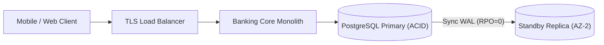
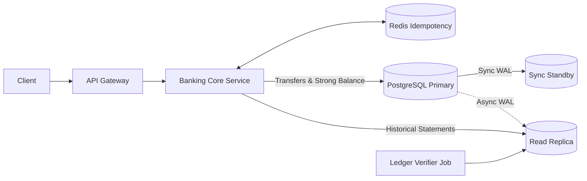
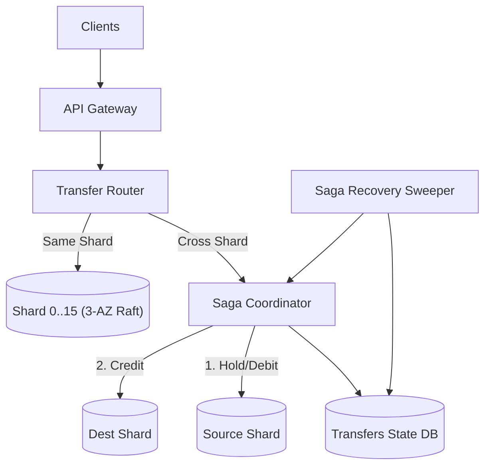
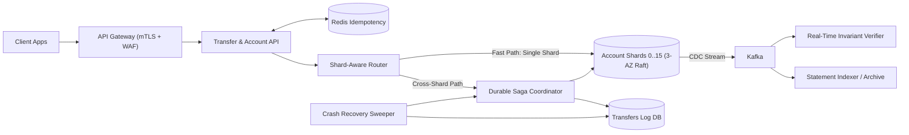
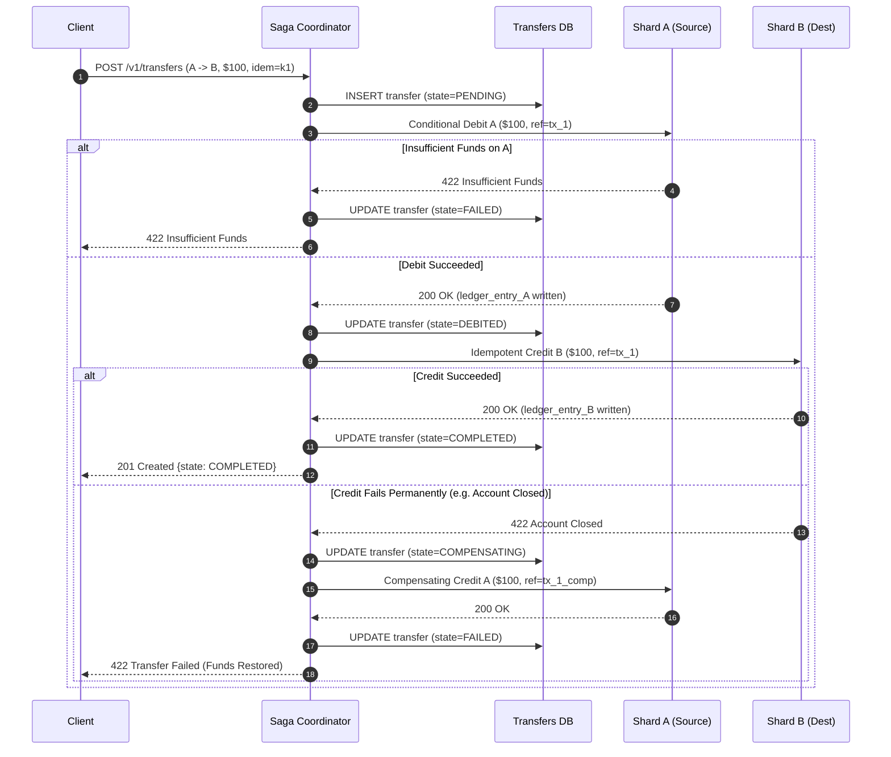

# Banking Transaction System: Full System Design Mock Interview, 9 Steps

> **Difficulty:** Senior / Staff (L5–L6) — Distributed Transactions, Sagas, 2PC & Strict Consistency
> **Prerequisites:** [Previous lesson: Payment Processing System: Full System Design Mock Interview, 9 Steps](../16-payment-processing-system/README.md) and the [Interview Framework track](../../21-interview-framework/README.md).
> **Estimated Reading Time:** 25–30 minutes
> **Target Audience:** Engineers practising the full 9-step system design interview on a classic prompt: moving money between accounts with strict correctness.

> [!NOTE]
> **In one line:** A banking core is **a transactional ledger**: transfers are atomic debit-credit pairs, balances are derived from immutable entries, and strict consistency beats availability when they conflict.

> [!TIP]
> **The Golden Rule:** One transaction moves money or it does not. Use double-entry bookkeeping, conditional atomic updates (or serializable isolation) for balance checks, idempotent requests, and partition so most transfers stay on one shard.

---

## 1. Clarifying Questions, Functional & Non-Functional Requirements

Open with questions, not boxes. A banking core is the strict-consistency cousin of a payment processor: the interviewer is testing atomic balance updates, overdraft prevention under concurrency, cross-shard transfer coordination (Saga vs. 2PC), and zero-loss durability across datacenter failures.

> Say it aloud: *"Before I draw anything, let me confirm the consistency guarantees, account scale, and cross-shard boundaries."*

### Clarifying Questions & Assumed Scope

| Question | Assumed Answer | Architectural Impact |
| :--- | :--- | :--- |
| **Core operations?** | Deposit, withdraw, internal transfer, balance read, statement | Single-shard ACID vs. cross-shard Saga/2PC |
| **Consistency model?** | Strict consistency (CP); never allow unapproved negative balance | Synchronous replication, conditional updates, no stale reads |
| **External rails?** | Out of scope (internal accounts only; no SWIFT/ACH/FedNow) | Keeps focus on distributed ledger & shard coordination |
| **Audit & compliance?** | Immutable permanent history; balances must be verifiable | Append-only double-entry ledger + continuous invariant verifier |
| **Scale target?** | 100M accounts, 5,000 transfers/sec peak (500 avg) | Sharded relational cluster (~10–16 shards) |

### Functional Requirements

1. **Atomic Internal Transfers:** Transfer funds from `from_account_id` to `to_account_id` atomically—either both debit and credit succeed, or neither does.
2. **Overdraft Prevention:** Reject any debit/transfer where `available_balance < amount_minor` (unless an explicit overdraft limit applies), even under concurrent requests.
3. **Strongly Consistent Balance & Paged Statements:** Return real-time authoritative balance and paginated, chronologically ordered ledger statements.
4. **Continuous Audit Trail:** Record every balance mutation as immutable double-entry rows and periodically verify `account.balance == SUM(ledger_entries)`.

### Non-Functional Requirements

| Quality | Target | Why It Drives the Design |
| :--- | :--- | :--- |
| **Correctness** | Linearizable / Serializable money movement | Conservation of money: no funds created or destroyed |
| **Durability** | $RPO = 0$ (zero lost committed transfers) | Synchronous quorum replication across Availability Zones |
| **Availability** | 99.99% (CP during network partitions) | Refuse transfers rather than risk double-spending during split-brain |
| **Latency** | $p_{95} < 150\text{ ms}$ (same-shard), $< 400\text{ ms}$ (cross-shard) | Interactive mobile/web banking transfers |
| **Auditability** | Immutable append-only ledger | Regulatory compliance and point-in-time reconstruction |

---

## 2. Back-of-the-Envelope Capacity Estimation

Let us size throughput, shard count, storage, and replication bandwidth.

### Assumptions

- Total accounts: $N_{\text{acct}} = 100{,}000{,}000$ ($100\text{M}$)
- Peak transfer rate: $\lambda_{\text{peak}} = 5{,}000\text{ transfers/s}$
- Average transfer rate: $\lambda_{\text{avg}} = 500\text{ transfers/s}$ ($10\%$ of peak)
- Balance read-to-write ratio: $10:1 \implies \lambda_{\text{read,peak}} = 50{,}000\text{ reads/s}$
- Ledger entries per transfer: $2$ rows (1 debit, 1 credit), $150\text{ B/row}$
- Account row size: $256\text{ B}$

### Worked Equations

**1. Total Account Table Footprint:**

$$
S_{\text{accounts}} = 100 \times 10^6 \times 256\text{ B} = 25.6 \times 10^9\text{ B} \approx 25.6\text{ GB (plus indexes } \approx 50\text{ GB)}
$$

**2. Peak Ledger Write Throughput:**

$$
\lambda_{\text{ledger,peak}} = 5{,}000\text{ transfers/s} \times 2\text{ entries/transfer} = 10{,}000\text{ ledger inserts/s}
$$

**3. Annual Ledger Storage Growth (at 500 TPS Average, 1.5x Index Overhead):**

$$
S_{\text{ledger/year}} = 500 \times 2 \times 86{,}400 \times 365 \times 150\text{ B} \times 1.5 = 7.095 \times 10^{12}\text{ B} \approx 7.1\text{ TB/year}
$$

**4. Minimum Shards Required at Peak:**
Assuming each PostgreSQL/Spanner-style OLTP shard comfortably sustains $500\text{ serializable transfers/s}$ with synchronous cross-AZ replication:

$$
N_{\text{shards}} = \frac{\lambda_{\text{peak}}}{\text{TPS}_{\text{shard}}} = \frac{5{,}000}{500} = 10\text{ shards} \quad (\text{provision } 16\text{ shards for } 37\%\text{ headroom})
$$

### Capacity Summary Table

| Metric | Formula / Basis | Result | Architectural Implication |
| :--- | :--- | :--- | :--- |
| **Account Storage** | $100\text{M} \times 256\text{ B} \times 2$ | **~50 GB** | Fits easily in RAM/NVMe across 16 shards (~3.1 GB/shard) |
| **Peak Transfers** | Given | **5,000 TPS** | 16 shards $\times$ ~312 TPS/shard average |
| **Peak Balance Reads** | $10 \times 5{,}000$ | **50,000 QPS** | Served from shard leaders (linearizable) or sync-commit replicas |
| **Ledger Growth / Year** | $1{,}000\text{ entries/s} \times 150\text{ B} \times 1.5 \times 3.15\times 10^7$ | **~7.1 TB/year** | Range-partition `ledger_entries` by `created_at` per shard |

---

## 3. Core API Contracts & Data Model

### REST / gRPC API Contracts

| Endpoint | Method | Headers / Consistency | Contract & Invariants |
| :--- | :--- | :--- | :--- |
| `/v1/transfers` | `POST` | `Idempotency-Key: <uuid>` | Body: `{from_account_id, to_account_id, amount_minor, currency}`. Returns `201` `{transfer_id, state}`. |
| `/v1/accounts/{id}/balance` | `GET` | `X-Read-Consistency: strong` | Returns `{account_id, available_minor, pending_hold_minor, currency, as_of_seq}`. |
| `/v1/accounts/{id}/statement` | `GET` | Cursor pagination (`?cursor=...&limit=50`) | Returns ordered `ledger_entries` for the account. |

### Core Relational Data Model

```sql
-- 1. Accounts (Sharded by account_id)
CREATE TABLE accounts (
    account_id          UUID PRIMARY KEY,
    owner_id            UUID NOT NULL,
    currency            CHAR(3) NOT NULL,
    balance_minor       BIGINT NOT NULL DEFAULT 0 CHECK (balance_minor >= 0),
    hold_minor          BIGINT NOT NULL DEFAULT 0 CHECK (hold_minor >= 0),
    version             BIGINT NOT NULL DEFAULT 1,
    updated_at          TIMESTAMPTZ NOT NULL DEFAULT now()
);

-- 2. Transfers (Coordinator state machine for cross-shard sagas)
CREATE TABLE transfers (
    transfer_id         UUID PRIMARY KEY,
    idempotency_key     VARCHAR(128) UNIQUE NOT NULL,
    from_account_id     UUID NOT NULL,
    to_account_id       UUID NOT NULL,
    amount_minor        BIGINT NOT NULL CHECK (amount_minor > 0),
    currency            CHAR(3) NOT NULL,
    state               VARCHAR(32) NOT NULL, -- PENDING, DEBITED, COMPLETED, COMPENSATING, FAILED
    created_at          TIMESTAMPTZ NOT NULL DEFAULT now()
);

-- 3. Immutable Double-Entry Ledger (Sharded by account_id, Partitioned by created_at)
CREATE TABLE ledger_entries (
    entry_id            UUID NOT NULL,
    transfer_id         UUID NOT NULL,
    account_id          UUID NOT NULL,
    delta_minor         BIGINT NOT NULL, -- Negative for debit, Positive for credit
    balance_after_minor BIGINT NOT NULL,
    created_at          TIMESTAMPTZ NOT NULL DEFAULT now(),
    PRIMARY KEY (account_id, created_at, entry_id)
) PARTITION BY RANGE (created_at);
```

---

## 4. Stage 1 (100 - 1K Users): Baseline Monolith & Single Database

At 100 to 1,000 users (< 50 TPS), all accounts live in a single PostgreSQL primary with synchronous replication to a standby in another Availability Zone.

### Component-by-Component Build

1. **TLS Load Balancer + Banking Core Monolith:** Authenticates users, validates `amount_minor > 0` and currency match, and enforces `Idempotency-Key`.
2. **Single PostgreSQL Primary + Sync Standby:** Executes every transfer inside one local ACID transaction.
3. **Deadlock-Free Lock Ordering:** When locking two accounts (`from` and `to`) in the same transaction, always acquire row locks in deterministic sorted order (`MIN(from, to)` then `MAX(from, to)`) so concurrent `A -> B` and `B -> A` transfers never deadlock!



### What Breaks at 10K Users (1,000+ TPS)?

- **Hot-Account Lock Contention:** A popular merchant or payroll disbursement account receiving/sending 500+ transfers/sec serializes on its single `accounts` row lock (`SELECT ... FOR UPDATE`).
- **Statement Read Interference:** Heavy `GET /statement` range scans pollute the PostgreSQL buffer pool and compete for IOPS with live transfers.
- **Single-Node Write Ceiling:** Synchronous replication adds 1–3 ms per commit, capping single-primary throughput around ~2,000–3,000 TPS.

---

## 5. Stage 2 (10K - 100K Users): Caching, Read Replicas & Async Offload

To scale to 100K+ users (~1,500 TPS), we separate statement reads from the primary, add Redis idempotency fast-path, and introduce sub-account partitioning for hot accounts.

### Component-by-Component Additions

1. **Redis Idempotency & Rate-Limit Layer:** Deduplicates client retries in < 1 ms before hitting PostgreSQL.
2. **Read Replicas for Historical Statements:** `GET /statement` (historical pages older than 5 seconds) routes to async read replicas, while `GET /balance` stays on the primary for linearizable reads.
3. **Sub-Account Sharding for Hot Accounts:** System/treasury/payroll accounts are split into $K = 16$ internal buckets (`treasury#0..15`), distributing row locks across 16 rows.
4. **Continuous Ledger Verifier Worker:** Runs off-peak/streaming checks on read replicas to verify `account.balance_minor == SUM(ledger_entries.delta_minor)`.



### What Breaks at 1M Users (5,000+ TPS Peak)?

- **Single Primary Saturation:** 10,000 ledger inserts/sec + 5,000 account updates/sec + synchronous WAL replication saturates one PostgreSQL primary.
- **Cross-Shard Transfers Required:** Once accounts are sharded across 16 database nodes, a transfer from `Account A (Shard 2)` to `Account B (Shard 9)` can no longer use a single local ACID transaction.

---

## 6. Stage 3 (1M - 10M+ Users): Sharding, Partitioning & Multi-Region Scale

At 100M accounts and 5,000+ TPS peak, we shard `accounts` and `ledger_entries` by `account_id` across 16 Raft/Paxos-replicated shard groups (or Vitess/CockroachDB/Spanner-style consensus shards) and introduce a **Durable Saga Coordinator** for cross-shard transfers.

### Component-by-Component Additions

1. **16 Consensus-Replicated Shards (Shard 0..15):** Each shard is a 3-node Raft group across 3 Availability Zones (`AZ1`, `AZ2`, `AZ3`). A commit requires 2-of-3 quorum, guaranteeing $RPO = 0$ even if an entire AZ dies.
2. **Smart Transfer Router:** Checks if `shard(from) == shard(to)`. If equal (~6–10% or higher if co-located by `tenant_id`), executes a **single-shard ACID transaction**. Otherwise, delegates to the **Saga Coordinator**.
3. **Durable Saga Coordinator + Recovery Sweeper:** Persists transfer state (`PENDING` $\to$ `DEBITED` $\to$ `COMPLETED` or `COMPENSATING` $\to$ `FAILED`) before each remote shard RPC. A background sweeper resumes stuck sagas if a coordinator pod crashes mid-flight.
4. **Time-Partitioned Ledger & Cold Archive:** Each shard partitions `ledger_entries` monthly by `created_at` and archives partitions $> 1\text{ year}$ to immutable object storage.



---

## 7. Final Full Production Architecture & End-to-End Flows

### Complete Production Architecture



### Cross-Shard Saga Sequence (Including Crash Recovery)



---

## 8. Deep-Dive Bottlenecks & Algorithmic Trade-Offs

### 1. Conditional Atomic Update vs. Read-Then-Write

Never implement a withdrawal as `bal = SELECT balance; if bal >= amt: UPDATE balance = bal - amt`. Under `READ COMMITTED` or even `REPEATABLE READ`, two concurrent `$70` withdrawals on a `$100` account both read `$100` and both succeed, leaving `-$40`!
- **Fix:** Use a single atomic conditional update inside the shard transaction:

```sql
UPDATE accounts
SET balance_minor = balance_minor - $1, version = version + 1
WHERE account_id = $2 AND balance_minor >= $1
RETURNING balance_minor;
```

If `0 rows` are returned, reject with `InsufficientFunds`. This works safely even at `READ COMMITTED` because PostgreSQL acquires a row-level write lock and re-evaluates the `WHERE` predicate against the latest committed tuple.

### 2. Cross-Shard Transfers: 2PC vs. Durable Saga

| Dimension | Two-Phase Commit (2PC) | Durable Saga (Forward-Recovery + Compensation) |
| :--- | :--- | :--- |
| **Atomicity** | Strict ACID across shards; intermediate state invisible | Eventual atomicity; source debited before dest credited |
| **Availability on Crash** | **Blocks** if coordinator crashes after `PREPARE` (holds locks!) | **Non-blocking;** sweeper resumes `DEBITED` $\to$ `CREDIT` or compensates |
| **Throughput & Tail Latency** | Lower throughput; locks held for $2 \times \text{RTT}$ | Higher throughput; each shard transaction commits immediately |
| **Best Fit** | Homogeneous Raft-backed NewSQL (Spanner, CockroachDB) | Independently sharded PostgreSQL/MySQL clusters |

### 3. Deadlock Prevention on Single-Shard Multi-Account Transfers

If Thread 1 runs `transfer(A -> B)` and Thread 2 runs `transfer(B -> A)` concurrently on the same shard, locking `A` then `B` vs. `B` then `A` causes a classic AB-BA deadlock.
- **Fix:** Always sort account IDs lexicographically (`first, second = min(src, dst), max(src, dst)`) before acquiring locks or issuing conditional `UPDATE`s. Total ordering makes lock-wait cycles mathematically impossible.

---

## 9. Failure Modes, Reliability & Backpressure Mitigations

| Failure Mode | Impact | Detection | Mitigation |
| :--- | :--- | :--- | :--- |
| **Saga Coordinator Crash After Debit** | Source debited, destination not yet credited | `transfers` stuck in `DEBITED` $> 5\text{ s}$ | Recovery Sweeper reads `transfers` log and retries idempotent `Credit(ref=tx_1)` |
| **Availability Zone Outage** | 1 of 3 Raft replicas lost | Raft leader heartbeat timeout (< 2 s) | Remaining 2-of-3 quorum elects new leader with $RPO = 0$ |
| **Network Partition (Split-Brain)** | Minority partition cannot reach quorum | Quorum write timeout | Minority nodes reject writes (CP behavior), preventing double-spend |
| **Hot Treasury / Payroll Account** | Lock queue backup on 1 shard | Lock wait time $p_{99} > 50\text{ ms}$ | Split hot account into 16–32 sub-accounts; aggregate asynchronously |
| **Duplicate Idempotent Retry** | Risk of double transfer | Redis/DB unique key hit | Return cached terminal state; shard `ledger_entries` enforces `UNIQUE(transfer_id, account_id, delta_type)` |

---

## 10. Production War Story & Real-World Reference

**Reference Pattern:** Pat Helland's *Life Beyond Distributed Transactions* & Martin Kleppmann's *Designing Data-Intensive Applications* (Ch. 7 & 9).

### SEV-1 Incident: The Compensating-Credit Double Refund

- **Symptom:** During a partial network outage between Shard A and Shard B, 140 cross-shard transfers resulted in customers receiving *both* the destination credit and a compensating refund on the source account—creating money out of thin air.
- **Root Cause:** The Saga Coordinator set a 500 ms RPC timeout on `Credit(Shard B)`. When Shard B was slow (took 800 ms to commit), the coordinator timed out, assumed `Credit` failed, and issued a compensating credit to `Shard A`. Meanwhile, Shard B actually committed the credit!
- **The Fix:**
  1. **Never compensate on a timeout!** A timeout is an *unknown outcome*, not a definitive failure.
  2. Implemented **Forward Recovery:** On timeout, the coordinator keeps the saga in `DEBITED` and retries `Credit(Shard B, ref=tx_1)` idempotently until Shard B returns either `200 OK` (committed) or a definitive `4xx` rejection (e.g., `AccountClosed`). Only a definitive `4xx` triggers compensation.

---

## 11. Core Component Implementation (4 Languages)

Below is a production-grade **Atomic Transfer & Deadlock-Free Double-Entry Engine** demonstrating sorted lock ordering, conditional overdraft prevention, idempotency, and zero-sum ledger verification.

````carousel
```go
package banking

import (
	"errors"
	"sync"
)

type Account struct {
	ID           string
	BalanceMinor int64
	mu           sync.Mutex
}

type LedgerEntry struct {
	TransferID  string
	AccountID   string
	DeltaMinor  int64
	BalanceAfter int64
}

type BankCore struct {
	accounts map[string]*Account
	idem     map[string]string
	idemMu   sync.Mutex
	ledger   []LedgerEntry
	ledgerMu sync.Mutex
}

func NewBankCore(initial map[string]int64) *BankCore {
	accts := make(map[string]*Account, len(initial))
	for id, bal := range initial {
		accts[id] = &Account{ID: id, BalanceMinor: bal}
	}
	return &BankCore{accounts: accts, idem: make(map[string]string)}
}

func (b *BankCore) Transfer(idemKey, fromID, toID string, amountMinor int64) (string, error) {
	if amountMinor <= 0 || fromID == toID {
		return "", errors.New("invalid transfer parameters")
	}
	b.idemMu.Lock()
	if res, ok := b.idem[idemKey]; ok {
		b.idemMu.Unlock()
		return res, nil
	}
	b.idemMu.Unlock()

	src, ok1 := b.accounts[fromID]
	dst, ok2 := b.accounts[toID]
	if !ok1 || !ok2 {
		return "", errors.New("account not found")
	}

	// Deterministic lock ordering prevents AB-BA deadlocks
	if fromID < toID {
		src.mu.Lock()
		dst.mu.Lock()
	} else {
		dst.mu.Lock()
		src.mu.Lock()
	}
	defer src.mu.Unlock()
	defer dst.mu.Unlock()

	if src.BalanceMinor < amountMinor {
		return "REJECTED_INSUFFICIENT_FUNDS", errors.New("insufficient funds")
	}
	src.BalanceMinor -= amountMinor
	dst.BalanceMinor += amountMinor

	b.ledgerMu.Lock()
	b.ledger = append(b.ledger,
		LedgerEntry{TransferID: idemKey, AccountID: fromID, DeltaMinor: -amountMinor, BalanceAfter: src.BalanceMinor},
		LedgerEntry{TransferID: idemKey, AccountID: toID, DeltaMinor: +amountMinor, BalanceAfter: dst.BalanceMinor},
	)
	b.ledgerMu.Unlock()

	b.idemMu.Lock()
	b.idem[idemKey] = "COMPLETED"
	b.idemMu.Unlock()
	return "COMPLETED", nil
}
```
<!-- slide -->
```typescript
interface LedgerEntry {
  transferId: string;
  accountId: string;
  deltaMinor: number;
  balanceAfter: number;
}

export class BankCore {
  private balances = new Map<string, number>();
  private idem = new Map<string, string>();
  public ledger: LedgerEntry[] = [];

  constructor(initial: Record<string, number>) {
    for (const [id, bal] of Object.entries(initial)) {
      this.balances.set(id, bal);
    }
  }

  transfer(idemKey: string, fromId: string, toId: string, amountMinor: number): string {
    if (!Number.isInteger(amountMinor) || amountMinor <= 0 || fromId === toId) {
      throw new Error("Invalid transfer parameters");
    }
    const cached = this.idem.get(idemKey);
    if (cached) return cached;

    const srcBal = this.balances.get(fromId);
    const dstBal = this.balances.get(toId);
    if (srcBal === undefined || dstBal === undefined) {
      throw new Error("Account not found");
    }
    if (srcBal < amountMinor) {
      throw new Error("Insufficient funds");
    }

    // Atomic state + double-entry ledger update (single-threaded event loop / DB tx)
    const newSrc = srcBal - amountMinor;
    const newDst = dstBal + amountMinor;
    this.balances.set(fromId, newSrc);
    this.balances.set(toId, newDst);

    this.ledger.push(
      { transferId: idemKey, accountId: fromId, deltaMinor: -amountMinor, balanceAfter: newSrc },
      { transferId: idemKey, accountId: toId, deltaMinor: +amountMinor, balanceAfter: newDst }
    );
    this.idem.set(idemKey, "COMPLETED");
    return "COMPLETED";
  }

  verifyInvariant(): boolean {
    return this.ledger.reduce((acc, e) => acc + e.deltaMinor, 0) === 0;
  }
}
```
<!-- slide -->
```python
import threading
from dataclasses import dataclass
from typing import Dict, List

@dataclass(frozen=True)
class LedgerEntry:
    transfer_id: str
    account_id: str
    delta_minor: int
    balance_after: int

class BankCore:
    def __init__(self, initial_balances: Dict[str, int]) -> None:
        self._balances = dict(initial_balances)
        self._locks = {aid: threading.Lock() for aid in initial_balances}
        self._idem: Dict[str, str] = {}
        self._idem_lock = threading.Lock()
        self.ledger: List[LedgerEntry] = []

    def transfer(self, idem_key: str, from_id: str, to_id: str, amount_minor: int) -> str:
        if amount_minor <= 0 or from_id == to_id:
            raise ValueError("Invalid transfer parameters")

        with self._idem_lock:
            if idem_key in self._idem:
                return self._idem[idem_key]

        if from_id not in self._balances or to_id not in self._balances:
            raise KeyError("Account not found")

        # Total lock ordering prevents deadlocks across concurrent transfers
        first, second = (from_id, to_id) if from_id < to_id else (to_id, from_id)
        with self._locks[first], self._locks[second]:
            if self._balances[from_id] < amount_minor:
                raise ValueError("Insufficient funds")
            self._balances[from_id] -= amount_minor
            self._balances[to_id] += amount_minor
            self.ledger.append(LedgerEntry(idem_key, from_id, -amount_minor, self._balances[from_id]))
            self.ledger.append(LedgerEntry(idem_key, to_id, +amount_minor, self._balances[to_id]))

        with self._idem_lock:
            self._idem[idem_key] = "COMPLETED"
        return "COMPLETED"
```
<!-- slide -->
```csharp
using System;
using System.Collections.Concurrent;
using System.Collections.Generic;

public record LedgerEntry(string TransferId, string AccountId, long DeltaMinor, long BalanceAfter);

public class BankCore
{
    private class AccountState
    {
        public long BalanceMinor;
        public readonly object LockObj = new();
    }

    private readonly Dictionary<string, AccountState> _accounts = new();
    private readonly ConcurrentDictionary<string, string> _idem = new();
    private readonly List<LedgerEntry> _ledger = new();
    private readonly object _ledgerLock = new();

    public BankCore(Dictionary<string, long> initial)
    {
        foreach (var kv in initial) _accounts[kv.Key] = new AccountState { BalanceMinor = kv.Value };
    }

    public string Transfer(string idemKey, string fromId, string toId, long amountMinor)
    {
        if (amountMinor <= 0 || fromId == toId) throw new ArgumentException("Invalid transfer.");
        if (_idem.TryGetValue(idemKey, out var cached)) return cached;

        if (!_accounts.TryGetValue(fromId, out var src) || !_accounts.TryGetValue(toId, out var dst))
            throw new KeyNotFoundException("Account not found.");

        var first = string.CompareOrdinal(fromId, toId) < 0 ? src : dst;
        var second = ReferenceEquals(first, src) ? dst : src;

        lock (first.LockObj)
        lock (second.LockObj)
        {
            if (src.BalanceMinor < amountMinor) throw new InvalidOperationException("Insufficient funds.");
            src.BalanceMinor -= amountMinor;
            dst.BalanceMinor += amountMinor;

            lock (_ledgerLock)
            {
                _ledger.Add(new LedgerEntry(idemKey, fromId, -amountMinor, src.BalanceMinor));
                _ledger.Add(new LedgerEntry(idemKey, toId, +amountMinor, dst.BalanceMinor));
            }
        }
        _idem[idemKey] = "COMPLETED";
        return "COMPLETED";
    }
}
```
````

---

## 12. Verification, Load Testing & CLI Diagnostics

```bash
# 1. Verify global conservation-of-money invariant across all shards
psql "$SHARD_DB_URL" -c "
  SELECT a.account_id, a.balance_minor, COALESCE(SUM(l.delta_minor), 0) AS ledger_sum
  FROM accounts a
  LEFT JOIN ledger_entries l ON a.account_id = l.account_id
  GROUP BY a.account_id, a.balance_minor
  HAVING a.balance_minor <> COALESCE(SUM(l.delta_minor), 0);
"

# 2. Detect stuck cross-shard sagas awaiting forward recovery
psql "$TRANSFERS_DB_URL" -c "
  SELECT state, COUNT(*), MIN(created_at)
  FROM transfers
  WHERE state IN ('PENDING', 'DEBITED', 'COMPENSATING')
    AND created_at < now() - interval '10 seconds'
  GROUP BY state;
"

# 3. Verify synchronous replication status (RPO = 0 check in PostgreSQL)
psql "$SHARD_DB_URL" -c "
  SELECT application_name, state, sync_state, write_lag, flush_lag
  FROM pg_stat_replication;
"

# 4. Run concurrency stress test (100 concurrent transfers between A <-> B)
python3 -c '
import concurrent.futures, uuid
# Assert final sum(A, B) == initial sum(A, B) and zero negative balances
print("Run bank_concurrency_test.py with 100 threads verifying sum invariance")
'
```

---

## 13. Common Interview Mistakes & Red Flags

1. **Read-then-write balance check:** Reading `balance` in application code and updating in a second query allows concurrent overdrafts. Use conditional `UPDATE ... WHERE balance_minor >= amount`.
2. **Using eventual consistency (AP) for account balances:** Allows double-spending during network partitions. Banking cores must be **CP**.
3. **Compensating a Saga on a network timeout:** Causes double-refunds if the remote credit actually succeeded. Always forward-recover on timeout; compensate only on definitive rejection.
4. **Ignoring AB-BA deadlocks on single-shard transfers:** Locking `from` then `to` without sorting account IDs deadlocks under bidirectional traffic.
5. **Updating or deleting ledger rows:** Destroys the audit trail. All adjustments must be new reversing entries.
6. **Using floating-point arithmetic:** Causes cent-level drift across millions of transfers.

---

## 14. Key Terminology & Glossary

| Key Term | Definition |
| :--- | :--- |
| **Conservation of Money** | Global invariant that $\sum \text{delta\_minor} = 0$ across all internal ledger entries. |
| **Conditional Update** | Atomic SQL `UPDATE ... WHERE balance >= amount` preventing overdrafts without prior reads. |
| **Saga Pattern** | Sequence of local shard transactions coordinated via durable state and compensating/forward recovery. |
| **Two-Phase Commit (2PC)** | Atomic commitment protocol (`PREPARE` + `COMMIT`) that blocks if the coordinator fails mid-protocol. |
| **Forward Recovery** | Retrying an idempotent Saga step after a timeout until a definitive outcome is received. |
| **CP System** | System choosing Consistency over Availability during network partitions (refuses writes without quorum). |
| **Synchronous Quorum Replication** | Waiting for a majority of replicas (e.g., 2 of 3 AZs) to fsync before acknowledging a commit ($RPO = 0$). |
| **Sub-Account Sharding** | Splitting a high-throughput hot account into $N$ buckets to eliminate single-row lock contention. |
| **AB-BA Deadlock** | Cycle where Tx 1 locks A waiting for B while Tx 2 locks B waiting for A; solved by sorted lock ordering. |
| **Linearizability** | Strongest single-object consistency guarantee: every read sees the latest completed write. |

---

## 15. Interview Follow-Up Questions (12 Q&As)

### Basic Conceptual Questions

<details>
<summary><strong>Q1: How do you prevent overdrafts under concurrent transfers? [BASIC]</strong></summary>

Use an atomic conditional update (`UPDATE accounts SET balance_minor = balance_minor - $1 WHERE account_id = $2 AND balance_minor >= $1`) inside the transaction, or `SERIALIZABLE` isolation. If zero rows are updated, reject the transfer.

</details>

<details>
<summary><strong>Q2: Why does a banking core choose CP over AP in the CAP theorem? [BASIC]</strong></summary>

In an AP system, a network partition allows two sides to accept conflicting withdrawals against the same balance, creating a double-spend. A banking core must choose CP: refuse transfers on the minority side without quorum rather than corrupt balances.

</details>

<details>
<summary><strong>Q3: Why keep both a cached `balance_minor` on `accounts` and an immutable `ledger_entries` table? [BASIC]</strong></summary>

Computing `SUM(delta_minor)` over years of ledger rows on every transfer would be too slow. Keeping `balance_minor` on the `accounts` row gives $O(1)$ conditional overdraft checks, while `ledger_entries` remains the immutable source of truth verified continuously by a background job.

</details>

<details>
<summary><strong>Q4: How do you survive an entire Availability Zone failure without losing a single committed transfer? [BASIC]</strong></summary>

Use synchronous quorum replication (e.g., 3-node Raft across 3 AZs, or PostgreSQL `synchronous_commit = remote_apply` across AZs). A transfer is only acknowledged to the client after at least 2 AZs have durably written the WAL, ensuring $RPO = 0$.

</details>

### Scenario-Based Architecture Questions

<details>
<summary><strong>Q5: How do you execute a transfer when Account A is on Shard 1 and Account B is on Shard 9? [SCENARIO]</strong></summary>

Use a **Durable Saga** backed by a `transfers` state table: (1) persist `PENDING`, (2) execute conditional debit on Shard 1, (3) persist `DEBITED`, (4) execute idempotent credit on Shard 9, (5) persist `COMPLETED`. If step 4 returns a definitive business error, run a compensating credit on Shard 1.

</details>

<details>
<summary><strong>Q6: The Saga Coordinator crashes right after debiting Shard 1, before crediting Shard 9. What happens? [SCENARIO]</strong></summary>

Because the coordinator persisted `state = DEBITED` before/after Shard 1 committed, a background **Recovery Sweeper** finds all transfers stuck in `DEBITED` past a 5-second threshold and resumes the idempotent `Credit(Shard 9, ref=transfer_id)` call.

</details>

<details>
<summary><strong>Q7: A large payroll run credits 100,000 employees from one corporate account in 10 seconds. How do you avoid hot-row lock contention? [SCENARIO]</strong></summary>

Shard the corporate treasury account into $K = 32$ internal sub-accounts (`corp#0..31`), pre-funded before payroll, and distribute the 100,000 debits across the 32 sub-accounts in parallel—reducing lock contention by $32\times$.

</details>

<details>
<summary><strong>Q8: Users complain that `GET /statement` is slowing down live transfers on the same database. How do you fix it? [SCENARIO]</strong></summary>

Route historical `GET /statement` queries to asynchronous read replicas (or a dedicated statement projection store fed by CDC), while keeping `POST /transfers` and strong `GET /balance` reads on the shard leaders.

</details>

### Advanced & Tricky Interview Questions

<details>
<summary><strong>Q9: Two users transfer money simultaneously: A sends $50 to B, and B sends $50 to A. How do you prevent deadlocks? [TRICKY]</strong></summary>

Enforce a **canonical lock acquisition order** by sorting the account IDs (`min(from, to)` first, `max(from, to)` second) before locking or updating rows on a single shard. Both transactions try to lock `A` first, so one waits cleanly and no cycle can form.

</details>

<details>
<summary><strong>Q10: In a cross-shard Saga, the credit call to Shard B times out. Should you immediately refund Shard A? [TRICKY]</strong></summary>

**No!** A network timeout is an unknown outcome—Shard B may have committed the credit right before the response dropped. Refunding Shard A immediately would create money. Always use **forward recovery** (retry the idempotent credit to Shard B) and only compensate if Shard B returns a definitive rejection.

</details>

<details>
<summary><strong>Q11: Why might you still choose 2PC (e.g., Spanner/CockroachDB) over Sagas? [TRICKY]</strong></summary>

Sagas expose an intermediate state where money has left Account A but not yet arrived in Account B (broken read-isolation across accounts). If strict external consistency / serializable cross-shard reads are required (e.g., real-time global balance auditing) and you control the storage engine with Raft + TrueTime/HLC, 2PC over Raft avoids blocking on single-node coordinator crashes.

</details>

<details>
<summary><strong>Q12: How do you guarantee `Credit(Shard B)` is idempotent if retried 5 times by the Recovery Sweeper? [TRICKY]</strong></summary>

Include a unique constraint `UNIQUE(transfer_id, account_id, delta_type)` on `ledger_entries` in Shard B. The credit transaction inserts into `ledger_entries` and updates `accounts.balance_minor` atomically; if a retry hits the unique constraint violation, Shard B knows the credit already committed and returns `200 OK`.

</details>

---

## 16. One-Page Master Cheat Sheet

```text
+-----------------------------------------------------------------------------+
|               BANKING TRANSACTION SYSTEM — MASTER CHEAT SHEET               |
+-----------------------------------------------------------------------------+
| 1. CAP / CONSISTENCY : Strict CP (refuse on partition; RPO=0 via 3-AZ Raft) |
| 2. OVERDRAFT GUARD   : UPDATE accounts SET bal=bal-amt WHERE bal>=amt       |
| 3. DEADLOCK GUARD    : Always lock accounts in sorted ID order (min -> max) |
| 4. CROSS-SHARD       : Durable Saga (PENDING -> DEBITED -> COMPLETED)       |
| 5. TIMEOUT RULE      : Forward-recover on timeout; compensate only on 4xx   |
| 6. SCALE (100M ACCT) : 16 shards by account_id | Sub-accounts for hot rows  |
| 7. AUDIT INVARIANT   : SUM(ledger.delta_minor) == 0 & == accounts.balance   |
+-----------------------------------------------------------------------------+
```

| Step | Key Decision to State Aloud |
| :--- | :--- |
| **Clarify** | Internal transfers, strict CP consistency, overdraft guard, 100M accounts, 5K TPS |
| **Estimate** | ~50 GB accounts, 10K ledger inserts/s peak, 7.1 TB/year, 16 shards |
| **Data Model** | `accounts` (with `CHECK balance >= 0`), `transfers` (Saga log), `ledger_entries` |
| **Deep Dive** | Conditional updates, sorted lock order, Durable Saga vs. 2PC, forward recovery |
| **Reliability** | 3-AZ Raft quorum ($RPO=0$), sweeper for stuck sagas, continuous ledger verifier |

---

## Further Reading

- Martin Kleppmann, *Designing Data-Intensive Applications*, Chapters 7 (Transactions) and 9 (Consistency and Consensus).
- Pat Helland, *Life Beyond Distributed Transactions: An Apostate's Opinion*.
- Google Cloud Architecture, *Spanner: TrueTime and External Consistency for Financial Ledgers*.

---

## Next

Continue with [Distributed Task Scheduler: Full System Design Mock Interview, 9 Steps](../18-distributed-task-scheduler/README.md).
