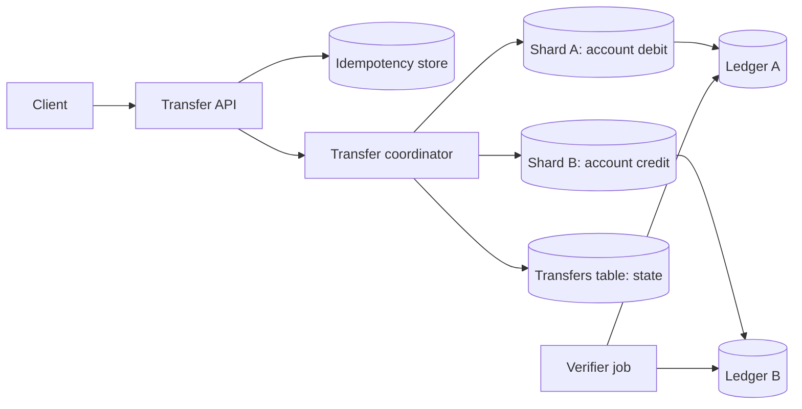

# Banking Transaction System: Full System Design Mock Interview, 9 Steps

> **Prerequisites:** [Previous lesson: Payment Processing System: Full System Design Mock Interview, 9 Steps](../16-payment-processing-system/README.md) and the [Interview Framework track](../../21-interview-framework/README.md).
> **Estimated Reading Time:** 15–20 minutes
> **Target Audience:** Engineers practising the full 9-step system design interview on a classic prompt: moving money between accounts with strict correctness.

> [!NOTE]
> **In one line:** A banking core is **a transactional ledger**: transfers are atomic debit-credit pairs, balances are derived from immutable entries, and strict consistency beats availability when they conflict.

> [!TIP]
> **The Golden Rule:** One transaction moves money or it does not. Use double-entry bookkeeping, serialisable isolation for balance checks, and idempotent requests, and partition so a transfer touches as few shards as possible.

---

## Step 1. Clarify the Problem

Open with questions, not boxes. This is a payments cousin where consistency is paramount. Focus on atomic transfers, overdraft checks and what to do when two accounts live on different shards.

**Questions to ask the interviewer, and the answer we assume:**

| Question | Assumed answer |
| :--- | :--- |
| Operations? | Deposit, withdraw, transfer, balance, statement |
| Consistency? | Strong; no negative balance unless allowed |
| Cross-bank? | Out of scope, internal accounts only |
| Audit? | Every change recorded forever |
| Scale? | 100M accounts, 5,000 transfers per second peak |

> Say it aloud: *"Before I draw anything, let me confirm the scope and the numbers."* That one sentence earns the first minutes of the interview.

---

## Step 2. Functional and Non-Functional Requirements

**Functional (what the system does):**

- Transfer money between two accounts atomically.
- Read an account balance and statement.
- Reject transfers that would overdraw.
- Keep a permanent audit trail.

**Non-functional (how well it does it):**

| Quality | Target | Why it drives the design |
| :--- | :--- | :--- |
| Correctness | ACID, no lost or created money | The product |
| Durability | Synchronous replication | Never lose a committed transfer |
| Auditability | Immutable history | Regulation |
| Latency | Under 500 ms | Interactive use |

---

## Step 3. Scope: In and Out

**In scope:** Atomic transfer, balance checks, ledger, cross-shard handling.

**Out of scope (say it explicitly, then move on):**

- Interest, loans and cards.
- Inter-bank messaging (SWIFT).
- Fraud detection internals.

---

## Step 4. Capacity Estimation

Assumptions: 100M accounts, 5,000 transfers per second at peak, each transfer writes 2 ledger entries, 150 bytes each.

| Quantity | Calculation | Result |
| :--- | :--- | :--- |
| Ledger entries per second | `tps * entries` | **10K entries/s** |
| Ledger growth per year | `tps * 86400 * 365 * entries * bytes_ / 1e12 / 10` | **4.73 TB/year (at 10% average load)** |
| Shards for peak | `tps / shard_tps` | **10 shards** |

**What the numbers tell you:** A sharded relational cluster handling about 500 transfers per second per shard needs around 10 shards at peak. Ledger growth is modest in bytes, so the design effort goes into consistency, not storage.

---

## Step 5. API Design

| Endpoint | Purpose | Notes |
| :--- | :--- | :--- |
| `POST /v1/transfers` | Transfer | Header `Idempotency-Key`. Body: from, to, amount. Returns transfer id and state. |
| `GET /v1/accounts/{id}/balance` | Balance | Strongly consistent read. |
| `GET /v1/accounts/{id}/statement` | Statement | Paged ledger entries. |

Amounts are integers in the smallest unit (cents), never floating point.

---

## Step 6. Data Model

| Entity / Store | Key fields | Why this store |
| :--- | :--- | :--- |
| Accounts (sharded by account id) | `account_id`, `balance`, `version` | Strongly consistent row |
| Ledger entries (append-only) | `entry_id`, `account_id`, `amount`, `transfer_id`, `ts` | Immutable audit |
| Transfers | `transfer_id`, `from`, `to`, `amount`, `state` | Drives cross-shard coordination |
| Idempotency store | Key to result | Safe retries |

Keep a cached balance on the account row for fast checks, but the ledger is the source of truth and a job verifies that the sum matches.

---

## Step 7. High-Level Architecture



**Walk the diagram in this order:** the API checks idempotency, the coordinator debits the source with a balance check, credits the destination, records both ledger entries, and marks the transfer complete.

---

## Step 8. Deep Dives and Bottlenecks

### 1. Atomic transfer on one shard

When both accounts are on the same shard, one database transaction does it: `UPDATE accounts SET balance = balance - ? WHERE id = ? AND balance >= ?` then the credit and two ledger inserts, all committed together. The conditional update prevents overdraft without a separate read.

### 2. Transfers across shards

Use a saga or two-phase commit. A saga debits the source (with a hold), credits the destination, then finalises; a failure triggers a compensating credit back. Persist the transfer state before each step so a crashed coordinator resumes. Two-phase commit gives atomicity but blocks if the coordinator dies, so many systems prefer sagas with reconciliation.

### 3. Audit and verification

Ledger entries are never updated or deleted; a correction is a new entry. A verifier recomputes balances from the ledger and compares them with the account rows, alerting on any difference. Replicate synchronously to a second zone so a committed transfer survives a zone loss.

---

## Step 9. Trade-offs, Failures and Security

**Trade-offs to state aloud:**

| Decision | Option A | Option B | Pick and why |
| :--- | :--- | :--- | :--- |
| Cross-shard | Two-phase commit | Saga with compensation | Saga with durable state: no blocking coordinator |
| Consistency vs availability | Always available | Strongly consistent | Consistent: refuse rather than risk wrong balances |
| Balance | Compute from ledger | Cached on account row | Cached, verified against the ledger |

**Failure modes and mitigations:**

| Failure | What users see | Mitigation |
| :--- | :--- | :--- |
| Coordinator crash mid-transfer | Money debited, not credited | Durable transfer state; recovery resumes or compensates |
| Zone failure | Brief unavailability | Synchronous replication: no committed loss |
| Duplicate request | Double transfer | Idempotency key |

**Security and abuse:** Strong authentication and authorisation, signed requests, limits and step-up checks for large transfers, encrypted storage, separation of duties and full audit logging.

---

## Runnable Example: Atomic transfer with overdraft check

Both balances change together or not at all, and an overdraft is rejected with nothing changed.

```python
accounts = {"A": 100, "B": 20}
ledger = []

def transfer(src, dst, amount, tid):
    if accounts[src] < amount:
        return "rejected: insufficient funds"
    snapshot = dict(accounts)
    try:
        accounts[src] -= amount
        accounts[dst] += amount
        ledger.append((tid, src, -amount))
        ledger.append((tid, dst, +amount))
    except Exception:
        accounts.clear(); accounts.update(snapshot)
        raise
    return "ok"

print(transfer("A", "B", 70, "t1"), accounts)
print(transfer("A", "B", 70, "t2"), accounts)
print("ledger sums to zero:", sum(e[2] for e in ledger) == 0)
```

Output (produced by running this exact code):

```text
ok {'A': 30, 'B': 90}
rejected: insufficient funds {'A': 30, 'B': 90}
ledger sums to zero: True
```

The first transfer succeeds, the second is rejected without changing anything, and the ledger entries net to zero, which is the double-entry invariant.

---

## Common Mistakes

- Read the balance then update it in a separate step.
- Using floating point for money.
- Updating or deleting ledger rows.
- Ignoring cross-shard transfers.
- Eventual consistency for balances.

---

## Interview Questions and Answers

<details>
<summary><strong>Q1: How do you prevent overdrafts under concurrency?</strong></summary>

A conditional update (`balance >= amount`) inside the transaction, so concurrent transfers cannot both succeed on the same funds.

</details>

<details>
<summary><strong>Q2: How do you transfer across shards?</strong></summary>

A saga with durable transfer state and compensating credits, or two-phase commit when blocking is acceptable.

</details>

<details>
<summary><strong>Q3: Why an immutable ledger?</strong></summary>

It is the audit trail and the source of truth; corrections are new entries, and balances can be recomputed.

</details>

<details>
<summary><strong>Q4: CP or AP?</strong></summary>

CP: refuse during partitions rather than risk incorrect balances.

</details>

<details>
<summary><strong>Q5: How do you survive a datacentre loss?</strong></summary>

Synchronous replication across zones so no committed transfer is lost, and failover to a replica.

</details>

---

## One-Page Cheat Sheet

| Step | What to say or draw |
| :--- | :--- |
| Clarify | Transfer, balance, statement, strict consistency |
| Capacity | 10K ledger entries/s, ~10 shards |
| API | transfer with Idempotency-Key, balance, statement |
| Data | Accounts, immutable ledger, transfers, idempotency |
| Deep dive | Atomic transfer, cross-shard saga, verification |
| Trade-off | CP, saga over 2PC |

---

## Further Reading

- Martin Kleppmann, *Designing Data-Intensive Applications*, chapters 7 and 9.
- Pat Helland, *Life beyond distributed transactions*.

---

## Next

Continue with [Distributed Task Scheduler: Full System Design Mock Interview, 9 Steps](../18-distributed-task-scheduler/README.md).
