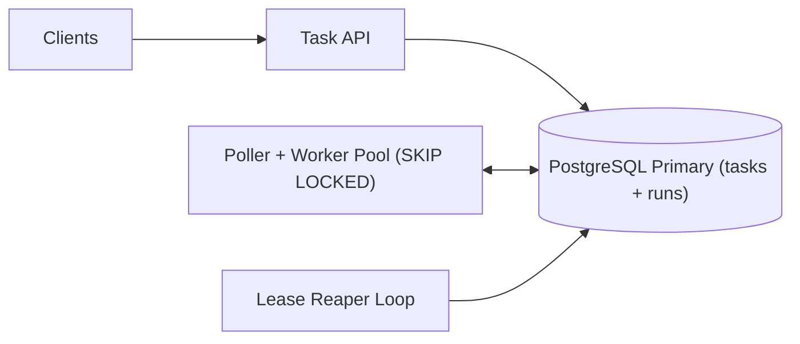
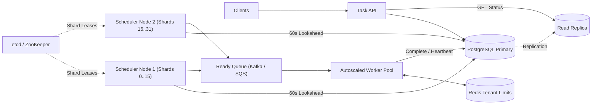
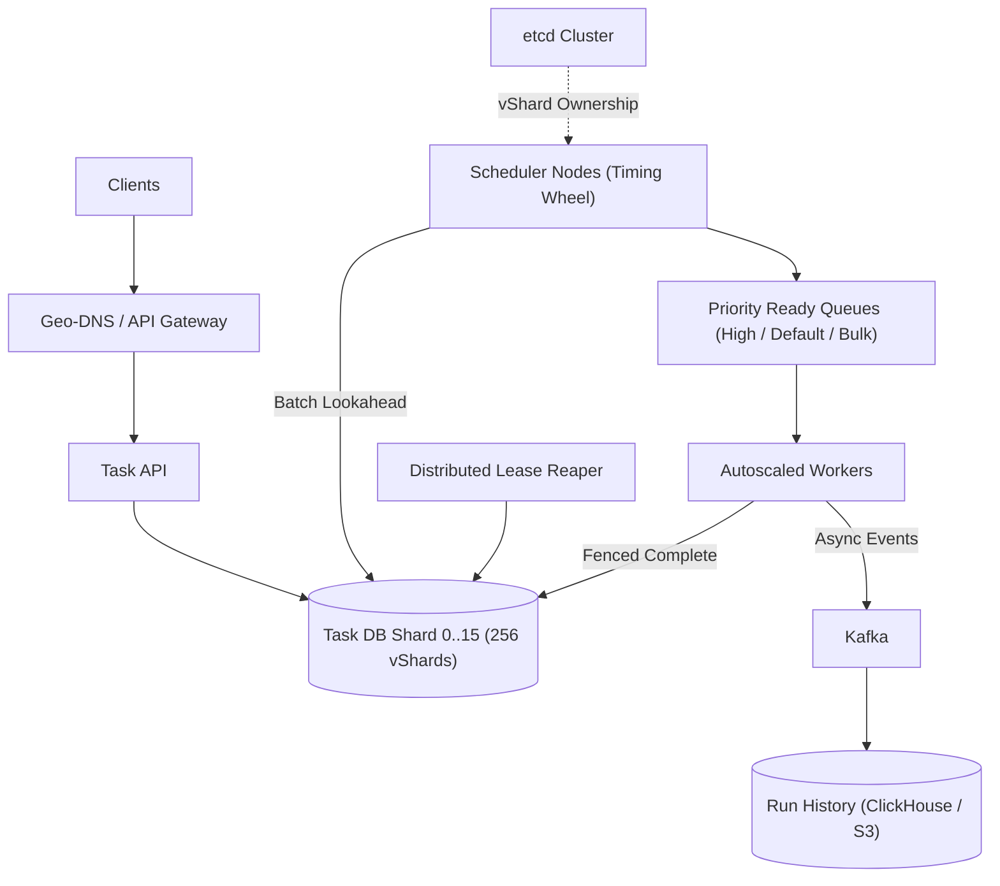
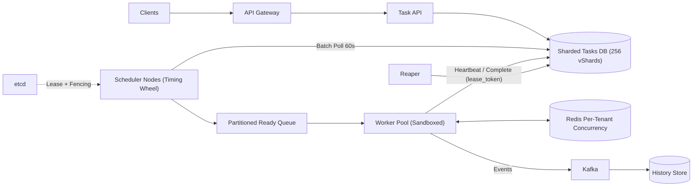
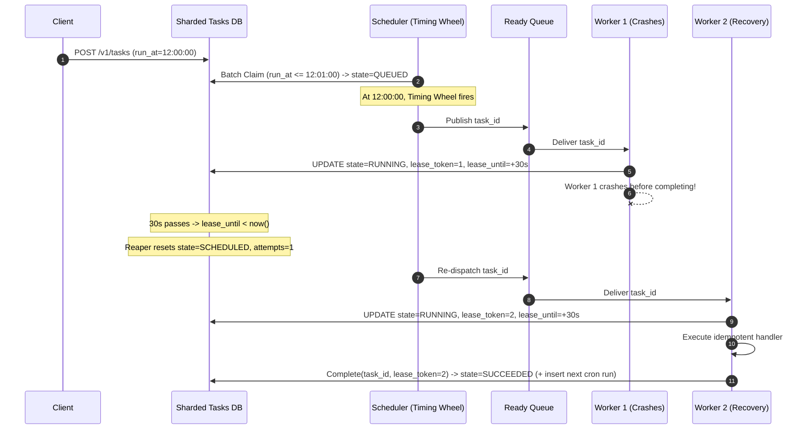

# Distributed Task Scheduler: Full System Design Mock Interview, 9 Steps

> **Difficulty:** Senior / Staff (L5–L6) — Distributed Coordination, Timing Wheels, Leases & Thundering Herds
> **Prerequisites:** [Previous lesson: Banking Transaction System: Full System Design Mock Interview, 9 Steps](../17-banking-transaction-system/README.md) and the [Interview Framework track](../../21-interview-framework/README.md).
> **Estimated Reading Time:** 25–30 minutes
> **Target Audience:** Engineers practising the full 9-step system design interview on a classic prompt: running jobs at a given time or on a schedule across many machines.

> [!NOTE]
> **In one line:** A distributed task scheduler is **a durable timetable plus a leased worker pool**: persist when each job is due, partition the schedule so no single node is a bottleneck, claim due jobs atomically with leases, and execute at-least-once.

> [!TIP]
> **The Golden Rule:** Persist schedules durably, claim due tasks with fencing-token leases, add jitter to top-of-the-hour cron spikes, and design task handlers to be idempotent because at-least-once is the only honest distributed guarantee.

---

## 1. Clarifying Questions, Functional & Non-Functional Requirements

Open with questions, not boxes. Running `cron` on one Linux box is trivial; the interview problem is scheduling 100M+ one-time and recurring tasks across hundreds of nodes with no single point of failure, surviving midnight thundering herds, and recovering cleanly when a worker crashes mid-execution.

> Say it aloud: *"Before I draw anything, let me confirm task types, timing precision, delivery guarantees, and peak trigger rate."*

### Clarifying Questions & Assumed Scope

| Question | Assumed Answer | Architectural Impact |
| :--- | :--- | :--- |
| **Task types?** | One-time delayed (`run_at`) and recurring (`cron` expression) | Atomic next-run insertion on recurring completion |
| **Delivery guarantee?** | At-least-once execution | Lease expiry + reaper requeue + idempotent handlers |
| **Timing precision?** | Start within 1–5 seconds of `run_at` | Batch polling + in-memory timing wheel lookahead |
| **Priorities & retries?** | Yes, per-task retry policy with exponential backoff | Separate priority lanes + attempt counter |
| **Scale target?** | 100M active scheduled tasks, 10,000 tasks starting/sec at peak | Sharded task store + partitioned scheduler nodes |
| **Out of scope?** | Arbitrary DAG workflows (Airflow/Temporal), VM bin-packing | Mention workflow DAGs as a clean extension |

### Functional Requirements

1. **Schedule Management:** Create, update, pause, and cancel one-time (`run_at`) and recurring (`cron`) tasks with tenant isolation and idempotency keys.
2. **Timely Dispatch:** Trigger due tasks within a few seconds of `run_at` and route them to healthy worker pools.
3. **Lease-Based Execution & Retries:** Workers lease tasks, heartbeat while running, and retry failures with exponential backoff up to `max_attempts` before dead-lettering.
4. **Execution History:** Expose current task state (`SCHEDULED`, `QUEUED`, `RUNNING`, `SUCCEEDED`, `FAILED`, `CANCELLED`) and recent attempt logs.

### Non-Functional Requirements

| Quality | Target | Why It Drives the Design |
| :--- | :--- | :--- |
| **Durability** | Zero lost scheduled tasks | A missed billing or reminder task breaks SLAs |
| **Timeliness** | $p_{95} \text{ dispatch lag} < 2\text{ s}$ | Schedules lose value if delayed by minutes |
| **Spike Resilience** | Handle 10x–50x midnight/top-of-hour spikes | Cron jobs cluster at `:00` boundaries |
| **High Availability** | 99.99%, zero SPOF | Scheduler shard failover via ZooKeeper/etcd leases |

---

## 2. Back-of-the-Envelope Capacity Estimation

Let us derive storage, index-scan IOPS, worker pool size, and network bandwidth.

### Assumptions

- Active scheduled tasks stored: $N_{\text{tasks}} = 100{,}000{,}000$ ($100\text{M}$)
- Peak trigger rate (top-of-the-hour/midnight): $\lambda_{\text{peak}} = 10{,}000\text{ tasks/s}$
- Average trigger rate: $\lambda_{\text{avg}} = 2{,}000\text{ tasks/s}$
- Average task record size: $1\text{ KB}$ (metadata + JSON payload)
- Average task execution duration: $W = 2\text{ s}$ (or $50\text{ tasks/s}$ per multi-threaded async worker)
- Execution history retention: $30\text{ days}$, $200\text{ B/attempt}$

### Worked Equations

**1. Active Tasks Storage (Plus 1.5x Index Overhead on `(shard_id, state, run_at)`):**

$$
S_{\text{tasks}} = 100 \times 10^6 \times 1{,}024\text{ B} \times 1.5 \approx 153.6\text{ GB}
$$

**2. Concurrent Workers Needed at Peak (Little's Law $L = \lambda \cdot W$):**

$$
L_{\text{workers}} = \lambda_{\text{peak}} \times W = 10{,}000\text{ tasks/s} \times 2\text{ s} = 20{,}000\text{ concurrent task slots}
$$

If each worker process runs $100$ concurrent async coroutines/threads:

$$
N_{\text{worker\_pods}} = \frac{20{,}000}{100} = 200\text{ worker pods}
$$

**3. Due-Time Index Scans per Second (Batch Size $B = 100$):**

$$
Q_{\text{scan}} = \frac{\lambda_{\text{peak}}}{B} = \frac{10{,}000}{100} = 100\text{ batch queries/s across all shards}
$$

**4. Monthly Execution History Growth:**

$$
S_{\text{history/30d}} = 2{,}000\text{ tasks/s} \times 86{,}400\text{ s/day} \times 30\text{ days} \times 200\text{ B} \approx 1.04\text{ TB/month}
$$

### Capacity Summary Table

| Metric | Formula / Basis | Result | Architectural Implication |
| :--- | :--- | :--- | :--- |
| **Tasks Table Size** | $100\text{M} \times 1\text{ KB} \times 1.5$ | **~154 GB** | Fits across 16–32 DB shards (~5–10 GB/shard, hot index in RAM) |
| **Peak Trigger Rate** | Given | **10,000 tasks/s** | Batch-claim 100 due tasks/query $\implies$ only 100 queries/s |
| **Worker Concurrency** | $10{,}000 \times 2\text{ s}$ | **20,000 slots** | ~200 worker pods (100 concurrent tasks/pod), autoscaled |
| **Run History / Month** | $2{,}000 \times 2.59\times 10^6 \times 200\text{ B}$ | **~1.04 TB/mo** | Partitioned append-only table or ClickHouse/S3 sink |

---

## 3. Core API Contracts & Data Model

### REST & Internal Worker APIs

| Endpoint | Method | Purpose | Contract & Notes |
| :--- | :--- | :--- | :--- |
| `/v1/tasks` | `POST` | Create task | Header `Idempotency-Key`. Body: `{tenant_id, run_at \| cron, payload, max_attempts, timeout_s}`. |
| `/v1/tasks/{id}` | `DELETE` | Cancel task | Transitions `SCHEDULED` $\to$ `CANCELLED` atomically. |
| `/v1/tasks/{id}` | `GET` | Inspect status | Returns state, `next_run_at`, `attempts`, and recent `run_history`. |
| `Worker.Heartbeat` | `gRPC` | Extend lease | Sends `(task_id, lease_token)` every 10 s to extend `lease_until`. |
| `Worker.Complete` | `gRPC` | Ack / Fail | Reports `SUCCEEDED` or `FAILED` with `lease_token` fencing check. |

### Core Data Model

```sql
-- 1. Tasks Table (Sharded by shard_id = hash(tenant_id, task_id) % 64)
CREATE TABLE tasks (
    task_id             UUID PRIMARY KEY,
    shard_id            SMALLINT NOT NULL,
    tenant_id           UUID NOT NULL,
    cron_expr           VARCHAR(64),            -- NULL for one-time tasks
    run_at              TIMESTAMPTZ NOT NULL,
    state               VARCHAR(16) NOT NULL,   -- SCHEDULED, QUEUED, RUNNING, SUCCEEDED, DEAD
    lease_token         BIGINT NOT NULL DEFAULT 0,
    lease_until         TIMESTAMPTZ,
    attempts            INT NOT NULL DEFAULT 0,
    max_attempts        INT NOT NULL DEFAULT 5,
    payload             JSONB NOT NULL,
    idempotency_key     VARCHAR(128) NOT NULL,
    UNIQUE (tenant_id, idempotency_key)
);

-- Critical covering index for due-task range scans per shard
CREATE INDEX idx_tasks_due ON tasks (shard_id, state, run_at)
WHERE state IN ('SCHEDULED', 'RUNNING');

-- 2. Append-Only Run History (Partitioned by started_at)
CREATE TABLE task_runs (
    run_id              UUID NOT NULL,
    task_id             UUID NOT NULL,
    attempt             INT NOT NULL,
    worker_id           VARCHAR(64) NOT NULL,
    status              VARCHAR(16) NOT NULL,
    started_at          TIMESTAMPTZ NOT NULL,
    finished_at         TIMESTAMPTZ,
    PRIMARY KEY (run_id, started_at)
) PARTITION BY RANGE (started_at);
```

---

## 4. Stage 1 (100 - 1K Users): Baseline Monolith & Single Database

At 100 to 1,000 users (< 100 tasks/sec), a single PostgreSQL database paired with a small stateless scheduler+worker deployment is simple and reliable.

### Component-by-Component Build

1. **Task API Service:** Validates `cron` syntax / `run_at` timestamps and inserts rows into PostgreSQL `tasks`.
2. **PostgreSQL Primary:** Stores `tasks` and `task_runs` with a partial index on `(state, run_at)`.
3. **Leader-Elected Scheduler (or `SKIP LOCKED` Pollers):** Polls `SELECT ... FROM tasks WHERE state = 'SCHEDULED' AND run_at <= now() ORDER BY run_at LIMIT 100 FOR UPDATE SKIP LOCKED`, marks them `RUNNING` with `lease_until = now() + 30s`, and dispatches them to in-process workers.
4. **Lease Reaper Loop:** Every 10 seconds, resets any `RUNNING` task where `lease_until < now()` back to `SCHEDULED` (or `DEAD` if `attempts >= max_attempts`).



### What Breaks at 10K Users (1,000+ tasks/s)?

- **`SKIP LOCKED` Index Contention:** Dozens of workers polling one monolithic `tasks` table with `FOR UPDATE SKIP LOCKED` contend on the same B-tree leaf pages at the head of `(state, run_at)`.
- **Midnight Thundering Herd:** If 200,000 users schedule a daily report for `00:00:00 UTC`, polling + executing directly from the DB locks up CPU and connection pools.
- **Long-Running Tasks Starve Short Tasks:** Coupling the poller and executor in one process means slow HTTP callbacks block polling.

---

## 5. Stage 2 (10K - 100K Users): Caching, Read Replicas & Async Offload

To scale to 100K users (~2,000 tasks/s), we decouple **scheduling** from **execution** using a message queue, introduce **in-memory timing wheels** for sub-second precision, and isolate reads to replicas.

### Component-by-Component Additions

1. **Partitioned Scheduler Nodes + Kafka/SQS Ready Queue:** Scheduler nodes own disjoint `shard_id` ranges (coordinated via etcd/ZooKeeper leases). They scan the DB only for the next 60-second lookahead window, load due tasks into an **in-memory Hierarchical Timing Wheel**, and push them to a **Ready Queue** (Kafka/SQS) at exact `run_at`.
2. **Dedicated Autoscaled Worker Pool:** Stateless workers pull from the Ready Queue, execute the task, and call `Worker.Complete(task_id, lease_token)` via gRPC.
3. **Read Replica for `GET /tasks/{id}` & Dashboards:** Offloads status and history queries from the primary DB.
4. **Per-Tenant Concurrency Limiter (Redis):** Prevents one noisy tenant with 50,000 midnight jobs from starving other tenants' workers.



### What Breaks at 1M Users (10,000+ tasks/s Peak)?

- **Single PostgreSQL Primary Write Ceiling:** 10,000 claims/sec + 10,000 completions/sec + 10,000 history inserts/sec = 30,000+ writes/sec saturates one PostgreSQL primary.
- **Hot Partition Skew:** If `shard_id` is keyed by `tenant_id` alone, a single enterprise tenant with 5M tasks overloads one scheduler shard.

---

## 6. Stage 3 (1M - 10M+ Users): Sharding, Partitioning & Multi-Region Scale

At 100M tasks and 10,000+ starts/sec peak, we shard the storage layer itself, use **virtual shards** for dynamic rebalancing, and apply **jitter + tiered queues** to absorb midnight spikes.

### Component-by-Component Additions

1. **Sharded Task DB (16–32 Physical Shards, 256 Virtual Shards):** Shard by `hash(task_id) % 256` (so even a single huge tenant's tasks spread evenly across all 256 virtual shards). Each virtual shard is owned by exactly one Scheduler Node via etcd lease.
2. **Two-Tier Storage (Cold DB + Hot Timing Wheel):** Tasks due $> 5\text{ minutes}$ in the future stay in the sharded DB; tasks due within the next 60 seconds are batch-promoted (`100 rows/query`) into the Scheduler Node's RAM Timing Wheel.
3. **Time-Range Partitioned `task_runs` + Kafka Sink:** Workers emit execution events to Kafka, which batch-writes to ClickHouse/S3 for cheap 30-day+ run history without touching the OLTP task shards.
4. **Active-Active Multi-Region Deployment:** Regional clusters (`us-east`, `eu-west`) home tasks to their creation region for low-latency execution and data residency.



---

## 7. Final Full Production Architecture & End-to-End Flows

### Complete Production Architecture



### End-to-End Task Scheduling, Lease, Heartbeat & Crash Recovery



---

## 8. Deep-Dive Bottlenecks & Algorithmic Trade-Offs

### 1. Finding Due Tasks: DB Polling vs. Hierarchical Timing Wheel

- **Pure DB Polling:** Scanning `WHERE run_at <= now()` every 100 ms on 100M rows creates high read IOPS and lock contention when multiple pollers race.
- **Hierarchical Timing Wheel (Kafka Purgatory / HashedWheelTimer):** An $O(1)$ circular buffer of time slots (e.g., 60 slots of 1 second each). The Scheduler queries the DB only once every 30 seconds per virtual shard to load the next 60 seconds of due tasks into RAM. When the wheel ticks to second $t$, all tasks in bucket $t$ are pushed to the Ready Queue in $O(1)$ time.
- **Durability:** Because the DB still holds `state = QUEUED` with a `queued_at` timestamp, if a Scheduler Node crashes and loses its RAM Timing Wheel, the new owner of that virtual shard simply re-reads `state = QUEUED` or `SCHEDULED` from the DB.

### 2. Fencing Tokens: Preventing Zombie Worker Corruption

Suppose Worker 1 pauses for a 35-second GC stop-the-world (or network partition). Its 30-second lease expires, the Reaper increments `lease_token` from `1` to `2`, and Worker 2 completes the task. When Worker 1 wakes up and tries to call `Complete(task_id, lease_token=1)`, the DB executes:

```sql
UPDATE tasks
SET state = 'SUCCEEDED'
WHERE task_id = $1 AND lease_token = $2 AND state = 'RUNNING';
```

Because `lease_token` is now `2`, Worker 1's stale completion updates `0 rows` and is safely rejected!

### 3. Midnight Thundering Herds & Cron Jitter

At `00:00:00 UTC`, millions of daily cron jobs become due simultaneously.
- **Deterministic / Bounded Jitter:** Unless a tenant pays for `strict_precision`, add `hash(task_id) % jitter_window` (e.g., 0–60 s) to `run_at` to spread the spike smoothly.
- **Atomic Cron Rescheduling:** Compute `next_run_at` and update/insert the next occurrence in the **exact same DB transaction** that marks the current run `SUCCEEDED`, preventing both missed cycles and duplicate schedules.

### Architectural Trade-Offs Summary

| Decision | Option A | Option B | Chosen & Rationale |
| :--- | :--- | :--- | :--- |
| **Scheduler Topology** | Single active leader | 256 virtual shards via etcd leases | **Virtual Shards:** Linear horizontal scale and < 5 s failover |
| **Due Lookup** | Poll DB every 100 ms | 60s DB lookahead + RAM Timing Wheel | **Hybrid:** Minimizes DB IOPS while preserving full durability |
| **Delivery Guarantee** | At-most-once | At-least-once + Fencing Tokens | **At-least-once:** Crashed workers never silently drop tasks |
| **Sharding Key** | `tenant_id` | `hash(task_id)` | **`task_id`:** Prevents a single large tenant from hot-spotting 1 shard |

---

## 9. Failure Modes, Reliability & Backpressure Mitigations

| Failure Mode | Impact | Detection | Mitigation |
| :--- | :--- | :--- | :--- |
| **Scheduler Node Crash** | Its virtual shards pause briefly | etcd lease TTL expires (5–10 s) | Surviving Scheduler Nodes claim orphaned vShards and reload 60s lookahead |
| **Worker Crash Mid-Task** | Task stuck in `RUNNING` | `lease_until < now()` | Reaper resets task to `SCHEDULED` with backoff until `max_attempts` |
| **Zombie Worker (GC Pause)** | Risk of overwriting newer attempt | Stale `lease_token` mismatch | Optimistic fencing (`WHERE lease_token = $token`) rejects stale writes |
| **Midnight Cron Spike** | Ready Queue depth & lag spike | Queue age > 5 s | Bounded jitter (0–60 s), priority queues, worker autoscaling, per-tenant caps |
| **Downstream Webhook Outage** | Workers hang waiting on HTTP | Worker timeout rate > 10% | Strict per-task HTTP timeout + circuit breaker per target domain |

---

## 10. Production War Story & Real-World Reference

**Reference Pattern:** Google SRE Book (*Distributed Periodic Scheduling with Cron*) & Uber's *Cherami* / *Cadence/Temporal* timer queues.

### SEV-1 Incident: The Leap-Second / Midnight Cron Cascading Retry Storm

- **Symptom:** At `00:00:00 UTC` on the 1st of the month, 1.2M monthly billing/digest tasks fired simultaneously. Within 90 seconds, the Tasks DB CPU hit 100% and *all* scheduling—including 1-second-precision alerts—stalled for 22 minutes.
- **Root Cause:** Every cron task was stored with exact `00:00:00` `run_at`. All 200 workers finished/failed tasks against a rate-limited downstream email API and immediately retried with **zero jitter** (`backoff = 2^attempts` seconds), synchronizing 400,000 retries onto `00:00:02`, `00:00:04`, and `00:00:08`.
- **The Fix:**
  1. Added **full jitter** to both initial cron scheduling (for `precision=relaxed` jobs) and exponential backoff: `delay = random(0, min(cap, base * 2^attempt))`.
  2. Separated **Priority Ready Queues** (`high` vs. `bulk_cron`) so bulk midnight jobs can never starve latency-sensitive one-time tasks.

---

## 11. Core Component Implementation (4 Languages)

Below is a production-grade **Fenced Lease-Based Task Scheduler & Reaper** supporting batch claiming, fencing-token completion, lease expiration, and atomic cron rescheduling.

````carousel
```go
package scheduler

import (
	"errors"
	"sync"
	"time"
)

type TaskState string

const (
	Scheduled TaskState = "SCHEDULED"
	Running   TaskState = "RUNNING"
	Succeeded TaskState = "SUCCEEDED"
	Dead      TaskState = "DEAD"
)

type Task struct {
	ID          string
	RunAt       int64
	IntervalSec int64 // >0 for recurring
	State       TaskState
	LeaseToken  int64
	LeaseUntil  int64
	Attempts    int
	MaxAttempts int
}

type Scheduler struct {
	mu    sync.Mutex
	tasks map[string]*Task
}

func NewScheduler() *Scheduler { return &Scheduler{tasks: make(map[string]*Task)} }

func (s *Scheduler) Add(t *Task) {
	s.mu.Lock()
	defer s.mu.Unlock()
	t.State = Scheduled
	s.tasks[t.ID] = t
}

func (s *Scheduler) ClaimDue(now int64, leaseSec int64, limit int) []*Task {
	s.mu.Lock()
	defer s.mu.Unlock()
	var claimed []*Task
	for _, t := range s.tasks {
		if t.State == Scheduled && t.RunAt <= now {
			t.State = Running
			t.LeaseToken++
			t.LeaseUntil = now + leaseSec
			t.Attempts++
			cp := *t
			claimed = append(claimed, &cp)
			if len(claimed) >= limit {
				break
			}
		}
	}
	return claimed
}

func (s *Scheduler) Complete(taskID string, leaseToken int64, now int64) error {
	s.mu.Lock()
	defer s.mu.Unlock()
	t, ok := s.tasks[taskID]
	if !ok || t.State != Running || t.LeaseToken != leaseToken {
		return errors.New("fenced: stale lease_token or invalid state")
	}
	if t.IntervalSec > 0 {
		t.RunAt = now + t.IntervalSec
		t.State = Scheduled
		t.Attempts = 0
	} else {
		t.State = Succeeded
	}
	return nil
}

func (s *Scheduler) ReapExpired(now int64) int {
	s.mu.Lock()
	defer s.mu.Unlock()
	reaped := 0
	for _, t := range s.tasks {
		if t.State == Running && t.LeaseUntil <= now {
			if t.Attempts >= t.MaxAttempts {
				t.State = Dead
			} else {
				t.State = Scheduled
				t.RunAt = now + int64(1<<min(t.Attempts, 6)) // Exponential backoff
			}
			reaped++
		}
	}
	return reaped
}
```
<!-- slide -->
```typescript
type TaskState = "SCHEDULED" | "RUNNING" | "SUCCEEDED" | "DEAD";

interface Task {
  id: string;
  runAt: number;
  intervalSec: number;
  state: TaskState;
  leaseToken: number;
  leaseUntil: number;
  attempts: number;
  maxAttempts: number;
}

export class FencedScheduler {
  private tasks = new Map<string, Task>();

  schedule(id: string, runAt: number, intervalSec = 0, maxAttempts = 3): void {
    this.tasks.set(id, {
      id, runAt, intervalSec, state: "SCHEDULED",
      leaseToken: 0, leaseUntil: 0, attempts: 0, maxAttempts,
    });
  }

  claimDue(now: number, leaseSec = 30, limit = 100): Task[] {
    const claimed: Task[] = [];
    for (const t of this.tasks.values()) {
      if (t.state === "SCHEDULED" && t.runAt <= now) {
        t.state = "RUNNING";
        t.leaseToken += 1;
        t.leaseUntil = now + leaseSec;
        t.attempts += 1;
        claimed.push({ ...t });
        if (claimed.length >= limit) break;
      }
    }
    return claimed;
  }

  complete(taskId: string, leaseToken: number, now: number): void {
    const t = this.tasks.get(taskId);
    if (!t || t.state !== "RUNNING" || t.leaseToken !== leaseToken) {
      throw new Error("Fenced: stale leaseToken or task not running");
    }
    if (t.intervalSec > 0) {
      t.runAt = now + t.intervalSec;
      t.state = "SCHEDULED";
      t.attempts = 0;
    } else {
      t.state = "SUCCEEDED";
    }
  }

  reapExpired(now: number): number {
    let count = 0;
    for (const t of this.tasks.values()) {
      if (t.state === "RUNNING" && t.leaseUntil <= now) {
        if (t.attempts >= t.maxAttempts) {
          t.state = "DEAD";
        } else {
          t.state = "SCHEDULED";
          t.runAt = now + Math.min(64, 2 ** t.attempts);
        }
        count++;
      }
    }
    return count;
  }
}
```
<!-- slide -->
```python
import threading
from dataclasses import dataclass
from typing import Dict, List

@dataclass
class Task:
    task_id: str
    run_at: int
    interval_sec: int = 0
    state: str = "SCHEDULED"
    lease_token: int = 0
    lease_until: int = 0
    attempts: int = 0
    max_attempts: int = 3

class FencedScheduler:
    def __init__(self) -> None:
        self._lock = threading.Lock()
        self._tasks: Dict[str, Task] = {}

    def schedule(self, task: Task) -> None:
        with self._lock:
            self._tasks[task.task_id] = task

    def claim_due(self, now: int, lease_sec: int = 30, limit: int = 100) -> List[Task]:
        with self._lock:
            due = sorted(
                (t for t in self._tasks.values() if t.state == "SCHEDULED" and t.run_at <= now),
                key=lambda x: x.run_at,
            )
            claimed: List[Task] = []
            for t in due[:limit]:
                t.state = "RUNNING"
                t.lease_token += 1
                t.lease_until = now + lease_sec
                t.attempts += 1
                claimed.append(Task(**t.__dict__))
            return claimed

    def complete(self, task_id: str, lease_token: int, now: int) -> None:
        with self._lock:
            t = self._tasks.get(task_id)
            if not t or t.state != "RUNNING" or t.lease_token != lease_token:
                raise PermissionError("Fenced: stale lease_token")
            if t.interval_sec > 0:
                t.run_at = now + t.interval_sec
                t.state = "SCHEDULED"
                t.attempts = 0
            else:
                t.state = "SUCCEEDED"

    def reap_expired(self, now: int) -> int:
        with self._lock:
            reaped = 0
            for t in self._tasks.values():
                if t.state == "RUNNING" and t.lease_until <= now:
                    if t.attempts >= t.max_attempts:
                        t.state = "DEAD"
                    else:
                        t.state = "SCHEDULED"
                        t.run_at = now + min(64, 2 ** t.attempts)
                    reaped += 1
            return reaped
```
<!-- slide -->
```csharp
using System;
using System.Collections.Generic;
using System.Linq;

public enum TaskState { Scheduled, Running, Succeeded, Dead }

public class ScheduledTask
{
    public required string Id { get; init; }
    public long RunAt { get; set; }
    public long IntervalSec { get; init; }
    public TaskState State { get; set; } = TaskState.Scheduled;
    public long LeaseToken { get; set; }
    public long LeaseUntil { get; set; }
    public int Attempts { get; set; }
    public int MaxAttempts { get; init; } = 3;
}

public class FencedScheduler
{
    private readonly object _lock = new();
    private readonly Dictionary<string, ScheduledTask> _tasks = new();

    public void Schedule(ScheduledTask task) { lock (_lock) _tasks[task.Id] = task; }

    public List<(string Id, long LeaseToken)> ClaimDue(long now, long leaseSec = 30, int limit = 100)
    {
        lock (_lock)
        {
            var due = _tasks.Values
                .Where(t => t.State == TaskState.Scheduled && t.RunAt <= now)
                .OrderBy(t => t.RunAt)
                .Take(limit)
                .ToList();

            var result = new List<(string, long)>(due.Count);
            foreach (var t in due)
            {
                t.State = TaskState.Running;
                t.LeaseToken++;
                t.LeaseUntil = now + leaseSec;
                t.Attempts++;
                result.Add((t.Id, t.LeaseToken));
            }
            return result;
        }
    }

    public void Complete(string taskId, long leaseToken, long now)
    {
        lock (_lock)
        {
            if (!_tasks.TryGetValue(taskId, out var t) || t.State != TaskState.Running || t.LeaseToken != leaseToken)
                throw new InvalidOperationException("Fenced: stale lease token.");

            if (t.IntervalSec > 0) { t.RunAt = now + t.IntervalSec; t.State = TaskState.Scheduled; t.Attempts = 0; }
            else t.State = TaskState.Succeeded;
        }
    }
}
```
````

---

## 12. Verification, Load Testing & CLI Diagnostics

```bash
# 1. Inspect virtual shard lease ownership in etcd
etcdctl get --prefix /scheduler/vshards/

# 2. Check dispatch lag (tasks overdue by > 5 seconds) on a shard
psql "$SHARD_DB_URL" -c "
  SELECT shard_id, COUNT(*) AS overdue_count, MAX(now() - run_at) AS max_lag
  FROM tasks
  WHERE state = 'SCHEDULED' AND run_at < now() - interval '5 seconds'
  GROUP BY shard_id
  ORDER BY overdue_count DESC;
"

# 3. Check expired leases awaiting reaper recovery
psql "$SHARD_DB_URL" -c "
  SELECT COUNT(*) AS expired_leases
  FROM tasks
  WHERE state = 'RUNNING' AND lease_until < now();
"

# 4. Verify partial index usage on due-task scan (must show Index Scan, never Seq Scan)
psql "$SHARD_DB_URL" -c "
  EXPLAIN ANALYZE
  SELECT task_id FROM tasks
  WHERE shard_id = 42 AND state = 'SCHEDULED' AND run_at <= now()
  ORDER BY run_at LIMIT 100;
"
```

---

## 13. Common Interview Mistakes & Red Flags

1. **Single leader scheduler process:** Creates a single point of failure and caps throughput at one machine's memory/CPU.
2. **Full-table scans (`SELECT * FROM tasks WHERE run_at <= now()`):** Without a composite partial index `(shard_id, state, run_at)`, scans degrade to $O(N)$ as history grows.
3. **Promising exactly-once execution:** Impossible in distributed systems without distributed transactions with the external target. Promise **at-least-once** + **idempotent handlers**.
4. **No fencing tokens on leases:** A slow/GC-paused worker can wake up and mark a task `SUCCEEDED` after another worker already took over.
5. **No jitter on cron schedules or retries:** Causes synchronized thundering herds at `:00` boundaries.
6. **Executing arbitrary user code without sandboxing:** Allows SSRF, CPU starvation, or container escapes.

---

## 14. Key Terminology & Glossary

| Key Term | Definition |
| :--- | :--- |
| **Hierarchical Timing Wheel** | $O(1)$ circular buffer of time slots used to fire near-future timers in memory. |
| **Virtual Shard (vShard)** | Logical partition (e.g., 256 vShards) mapped dynamically to physical scheduler nodes via etcd leases. |
| **Lease & Heartbeat** | Time-bounded ownership of a task; extended periodically by healthy workers and reclaimed on expiry. |
| **Fencing Token** | Monotonically increasing integer (`lease_token`) rejecting stale writes from zombie workers. |
| **Reaper** | Background sweep reclaiming `RUNNING` tasks whose `lease_until` has expired. |
| **Thundering Herd** | Simultaneous spike of tasks due at exact boundaries (e.g., `00:00:00 UTC`). |
| **Cron Jitter** | Adding bounded randomness to `run_at` and retry backoffs to smooth traffic spikes. |
| **At-Least-Once Execution** | Guarantee that every task runs one or more times; requires idempotent downstream handlers. |
| **Partial Index** | DB index filtered (`WHERE state IN ('SCHEDULED', 'RUNNING')`) to keep B-trees tiny and fast. |
| **Lookahead Window** | Batch-promoting tasks due in the next 60 s from DB into the scheduler's in-memory Timing Wheel. |

---

## 15. Interview Follow-Up Questions (12 Q&As)

### Basic Conceptual Questions

<details>
<summary><strong>Q1: How do you avoid running the same task twice at the exact same moment? [BASIC]</strong></summary>

Partition tasks across disjoint virtual shards so only one scheduler node owns a shard at a time, and claim tasks atomically in the DB (`UPDATE ... WHERE state = 'SCHEDULED'`) with a `lease_until` timestamp.

</details>

<details>
<summary><strong>Q2: Why can't a distributed scheduler promise "exactly-once execution"? [BASIC]</strong></summary>

A worker can execute the side effect (e.g., send an email or call a webhook) and crash 1 millisecond *before* calling `Complete()` on the scheduler DB. When its lease expires, another worker must retry it. Therefore, the scheduler guarantees **at-least-once** delivery, and handlers must be **idempotent**.

</details>

<details>
<summary><strong>Q3: How do you find due tasks quickly out of 100 million stored tasks? [BASIC]</strong></summary>

Use a sharded partial composite index on `(shard_id, state, run_at) WHERE state IN ('SCHEDULED', 'RUNNING')`, batch-claim 100 tasks per query for the next 60-second lookahead window, and fire them at exact timestamps from an in-memory Timing Wheel.

</details>

<details>
<summary><strong>Q4: What happens when a worker crashes mid-execution? [BASIC]</strong></summary>

Its heartbeat stops, `lease_until` expires, and the Reaper resets the task to `SCHEDULED` (with exponential backoff and incremented `attempts`) so another worker picks it up.

</details>

### Scenario-Based Architecture Questions

<details>
<summary><strong>Q5: A million users schedule a daily digest for 00:00:00 UTC. How do you survive the midnight spike? [SCENARIO]</strong></summary>

Apply bounded jitter (0–60 s) to relaxed-precision cron jobs, separate high-priority queues from bulk cron queues, autoscale workers on queue depth/age, and enforce per-tenant concurrency limits in Redis.

</details>

<details>
<summary><strong>Q6: A task takes 45 minutes to run, but your default lease is 30 seconds. How do you handle it? [SCENARIO]</strong></summary>

Have the worker send periodic `Heartbeat(task_id, lease_token)` RPCs every 10 seconds to extend `lease_until = now() + 30s`. If the worker dies, the lease still expires within 30 seconds rather than waiting 45 minutes.

</details>

<details>
<summary><strong>Q7: One Scheduler Node dies while holding 5,000 tasks in its in-memory Timing Wheel. Are those tasks lost? [SCENARIO]</strong></summary>

No. The Timing Wheel is only a *cache* of the next 60 seconds; the DB is the source of truth (`state = 'QUEUED'`). When etcd expires the dead node's vShard lease, a surviving Scheduler Node claims the vShard and reloads any `SCHEDULED` or un-dispatched `QUEUED` tasks from the DB.

</details>

<details>
<summary><strong>Q8: How do you handle recurring cron tasks without drift or duplicate runs? [SCENARIO]</strong></summary>

Compute `next_run_at` from the cron expression (anchored to the previous `run_at`, not `now()`, to prevent drift) and update `run_at = next_run_at, state = 'SCHEDULED'` atomically in the same DB transaction as `Complete()`.

</details>

### Advanced & Tricky Interview Questions

<details>
<summary><strong>Q9: Worker A pauses for 40 s (GC/network), its lease expires, and Worker B finishes the task. Worker A wakes up and calls Complete(). What happens? [TRICKY]</strong></summary>

Fencing tokens prevent corruption. When Worker B claimed the task, `lease_token` incremented from `1` to `2`. Worker A's `Complete(task_id, lease_token=1)` fails the `WHERE lease_token = 1` predicate and is rejected.

</details>

<details>
<summary><strong>Q10: Why shard by `hash(task_id)` instead of `hash(tenant_id)`? [TRICKY]</strong></summary>

Sharding by `tenant_id` causes severe hot-spotting if one enterprise customer schedules 10M tasks while others schedule 100. Sharding by `hash(task_id) % 256` guarantees uniform distribution across all scheduler nodes and DB shards, while per-tenant concurrency limits are enforced separately in Redis.

</details>

<details>
<summary><strong>Q11: What if two Scheduler Nodes temporarily think they both own virtual shard 42 during a network blip? [TRICKY]</strong></summary>

Even during a brief split-brain, both nodes still have to claim tasks via the **database** (`UPDATE tasks SET state = 'QUEUED', lease_token = lease_token + 1 WHERE ... AND state = 'SCHEDULED'`). The DB's single-leader ACID transaction ensures at most one node claims each task.

</details>

<details>
<summary><strong>Q12: How do you handle timezone changes and Daylight Saving Time (DST) for cron schedules? [TRICKY]</strong></summary>

Store the user's IANA timezone (e.g., `America/New_York`) alongside the cron expression, compute `next_run_at` in that local timezone using a well-tested tzdata library, and convert to **UTC** (`TIMESTAMPTZ`) for storage and comparison so the scheduling engine itself operates strictly in UTC.

</details>

---

## 16. One-Page Master Cheat Sheet

```text
+-----------------------------------------------------------------------------+
|             DISTRIBUTED TASK SCHEDULER — MASTER CHEAT SHEET                 |
+-----------------------------------------------------------------------------+
| 1. GUARANTEE     : At-least-once execution + Idempotent task handlers       |
| 2. LOOKUP        : Partial index (shard_id, state, run_at) + Timing Wheel   |
| 3. LEASES        : 30s lease + 10s heartbeat + Reaper + Fencing lease_token |
| 4. CRON RULE     : Compute next_run_at in same tx as Complete() (in UTC)    |
| 5. SPIKE GUARD   : Bounded jitter (0-60s) + Priority lanes + Tenant caps    |
| 6. SCALE         : 100M tasks (~154 GB) | 256 vShards via etcd | 10K/s peak |
+-----------------------------------------------------------------------------+
```

| Step | Key Decision to State Aloud |
| :--- | :--- |
| **Clarify** | One-time & cron, at-least-once, 1–5 s precision, 100M tasks, 10K/s peak |
| **Estimate** | ~154 GB tasks, 20,000 concurrent worker slots (Little's Law), 100 scans/s |
| **Data Model** | `tasks` (partial index + `lease_token`), `task_runs` (time-partitioned) |
| **Deep Dive** | 60s lookahead Timing Wheel, fencing tokens, atomic cron rescheduling |
| **Reliability** | etcd vShard failover, lease reaper, jittered backoff, priority queues |

---

## Further Reading

- Google SRE Book, *Distributed Periodic Scheduling with Cron*.
- Temporal & Quartz documentation on durable timers, leases, and task queues.
- George Varghese & Tony Lauck, *Hashed and Hierarchical Timing Wheels*.

---

## Next

Continue with [Job Queue: Full System Design Mock Interview, All 9 Steps](../19-job-queue/README.md).
