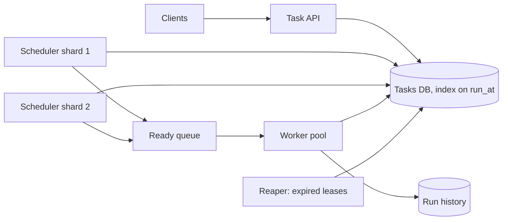

# Distributed Task Scheduler: Full System Design Mock Interview, 9 Steps

> **Prerequisites:** [Previous lesson: Banking Transaction System: Full System Design Mock Interview, 9 Steps](../17-banking-transaction-system/README.md) and the [Interview Framework track](../../21-interview-framework/README.md).
> **Estimated Reading Time:** 15–20 minutes
> **Target Audience:** Engineers practising the full 9-step system design interview on a classic prompt: running jobs at a given time or on a schedule across many machines.

> [!NOTE]
> **In one line:** A distributed task scheduler is **a durable timetable plus a pool of workers**: store when each job should run, claim due jobs safely, and run each at least once.

> [!TIP]
> **The Golden Rule:** Persist schedules durably, let workers claim due tasks with a lease, and design tasks to be idempotent because at-least-once is what you can honestly promise.

---

## Step 1. Clarify the Problem

Open with questions, not boxes. Cron on one machine is easy. The design problem is doing it across many nodes without running a job twice, losing a job, or having one scheduler as a single point of failure.

**Questions to ask the interviewer, and the answer we assume:**

| Question | Assumed answer |
| :--- | :--- |
| Task types? | One-time and recurring (cron) |
| Guarantee? | At-least-once execution |
| Precision? | Start within a few seconds of the due time |
| Priorities and retries? | Yes, with backoff |
| Scale? | 100M scheduled tasks, 10,000 starting per second at peak |

> Say it aloud: *"Before I draw anything, let me confirm the scope and the numbers."* That one sentence earns the first minutes of the interview.

---

## Step 2. Functional and Non-Functional Requirements

**Functional (what the system does):**

- Create, update and cancel one-time and recurring tasks.
- Run each task at its due time on a worker.
- Retry failed tasks with backoff.
- Show task status and history.

**Non-functional (how well it does it):**

| Quality | Target | Why it drives the design |
| :--- | :--- | :--- |
| Reliability | No task lost | A missed job can be a missed payment |
| Timeliness | Within seconds of due | Schedules have meaning |
| Scalability | Millions due at the top of the hour | Spiky by nature |
| Availability | No single scheduler | The scheduler itself must not fail |

---

## Step 3. Scope: In and Out

**In scope:** Task storage, scheduling loop, worker claim, retries, status.

**Out of scope (say it explicitly, then move on):**

- Complex DAG workflows (mention workflow engines).
- Long-running task checkpointing.
- Resource packing.

---

## Step 4. Capacity Estimation

Assumptions: 100M scheduled tasks stored, 10,000 tasks starting per second at peak, 1 KB per task record.

| Quantity | Calculation | Result |
| :--- | :--- | :--- |
| Task storage | `tasks * kb * 1e3 / 1e9` | **100 GB** |
| Workers needed | `start_rate / worker_tps` | **200 workers** |
| Due-time index scans per second | `start_rate / 100` | **100 scans/s (batches of 100)** |

**What the numbers tell you:** 100 GB of task rows fits a sharded database easily. The real constraint is selecting due tasks efficiently: use an index on due time and claim in batches of 100, so 10,000 starts per second is only about 100 batch queries per second.

---

## Step 5. API Design

| Endpoint | Purpose | Notes |
| :--- | :--- | :--- |
| `POST /v1/tasks` | Create | Body: `run_at` or `cron`, `payload`, `retry_policy`. Idempotency key. |
| `DELETE /v1/tasks/{id}` | Cancel | Marks cancelled. |
| `GET /v1/tasks/{id}` | Status | scheduled, running, succeeded, failed. |
| Worker `claim(batch)` | Internal | Atomically leases due tasks. |

Task handlers must be idempotent, because a worker can crash after doing the work but before reporting it.

---

## Step 6. Data Model

| Entity / Store | Key fields | Why this store |
| :--- | :--- | :--- |
| Tasks table (sharded by task id) | `task_id`, `run_at`, `state`, `lease_until`, `attempts`, `payload` | Index on `(state, run_at)` |
| Run history | `task_id`, `attempt`, `status`, `ts` | Append-only |
| Queue to workers | Ready tasks | Optional hand-off buffer |

A short lease on each claimed task lets another worker take it over if the first one dies.

---

## Step 7. High-Level Architecture



**Walk the diagram in this order:** clients store tasks, scheduler shards scan their partitions for due tasks and put them on a queue, workers run them, and a reaper requeues tasks whose lease expired.

---

## Step 8. Deep Dives and Bottlenecks

### 1. Finding due tasks efficiently

Partition tasks across scheduler shards (by task id hash or by time bucket) so each shard scans only its own range with an index on `run_at`. Pull due tasks in small batches and mark them `queued` in the same step. A timing wheel or a sorted set per shard can hold the next few minutes in memory to avoid hitting the database for every task.

### 2. Claims, leases and exactly-once effects

A worker claims a task with a conditional update (`state='queued'` to `running`, set `lease_until`). It extends the lease while working. If the lease expires, the reaper makes the task available again. This gives at-least-once execution, so handlers use an idempotency key (task id plus attempt) when calling external systems.

### 3. Recurring tasks and thundering herds

For cron tasks, after each run compute the next run time and insert it, atomically with marking the run complete. Many tasks share the same due time (midnight), so add random jitter where precision allows and cap per-tenant concurrency so one customer cannot starve others.

---

## Step 9. Trade-offs, Failures and Security

**Trade-offs to state aloud:**

| Decision | Option A | Option B | Pick and why |
| :--- | :--- | :--- | :--- |
| Scheduler topology | Single leader | Sharded schedulers | Sharded: no single point of failure and linear scale |
| Delivery | At-most-once | At-least-once | At-least-once with idempotent handlers |
| Due lookup | Poll the DB | In-memory timing wheel plus DB | Hybrid: memory for the near future, DB for durability |

**Failure modes and mitigations:**

| Failure | What users see | Mitigation |
| :--- | :--- | :--- |
| Worker crash mid-task | Task stuck | Lease expiry and reaper requeue |
| Scheduler shard down | Tasks late | Another instance takes over the shard via lease |
| Midnight spike | Queue backlog | Jitter, autoscale workers, per-tenant limits |

**Security and abuse:** Authenticate and authorise task creation per tenant, validate payload size, isolate tenants' execution, and never let a payload run arbitrary code outside a sandbox.

---

## Runnable Example: Claiming due tasks with a lease

Workers take tasks that are due and not currently leased; a task whose lease expired becomes claimable again.

```python
tasks = [
    {"id": 1, "run_at": 10, "lease": 0, "done": False},
    {"id": 2, "run_at": 20, "lease": 0, "done": False},
    {"id": 3, "run_at": 5,  "lease": 0, "done": False},
]

def claim(now, worker, lease=30, limit=2):
    got = []
    for t in sorted(tasks, key=lambda t: t["run_at"]):
        if t["done"] or t["run_at"] > now or t["lease"] > now:
            continue
        t["lease"] = now + lease
        got.append((worker, t["id"]))
        if len(got) == limit:
            break
    return got

print(claim(12, "w1"))
print(claim(12, "w2"))
print(claim(50, "w2"))
```

Output (produced by running this exact code):

```text
[('w1', 3), ('w1', 1)]
[]
[('w2', 3), ('w2', 1)]
```

Worker 1 takes tasks 3 and 1 (the two that are due), worker 2 finds nothing at the same moment, and later, after the leases expire, worker 2 can claim tasks that were never marked done.

---

## Common Mistakes

- One scheduler process as a single point of failure.
- Scanning the whole table for due tasks.
- Promising exactly-once execution.
- Non-idempotent handlers.
- No lease expiry for crashed workers.

---

## Interview Questions and Answers

<details>
<summary><strong>Q1: How do you avoid running a task twice?</strong></summary>

A conditional claim with a lease means only one worker runs it at a time, but a crash can cause a rerun, so handlers must be idempotent.

</details>

<details>
<summary><strong>Q2: How do you find due tasks fast?</strong></summary>

An index on due time per shard, claim in batches, and keep the next few minutes in memory.

</details>

<details>
<summary><strong>Q3: What happens when a worker dies?</strong></summary>

Its lease expires, a reaper makes the task available again, and another worker retries it.

</details>

<details>
<summary><strong>Q4: How do you handle cron?</strong></summary>

After each run compute the next time and insert it atomically with marking the run complete.

</details>

<details>
<summary><strong>Q5: How do you handle a midnight spike?</strong></summary>

Add jitter, autoscale workers, and apply per-tenant concurrency limits.

</details>

---

## One-Page Cheat Sheet

| Step | What to say or draw |
| :--- | :--- |
| Clarify | One-time and cron, at-least-once, 100M tasks |
| Capacity | 100 GB, 200 workers at 50 tasks/s each |
| API | create, cancel, status, worker claim |
| Data | Tasks with run_at index and lease, history |
| Deep dive | Due lookup, leases, cron and herds |
| Trade-off | Sharded schedulers, at-least-once |

---

## Further Reading

- Google SRE book, chapter on distributed periodic scheduling with cron.
- Temporal and Quartz documentation for production schedulers.

---

## Next

Continue with [Job Queue: Full System Design Mock Interview, All 9 Steps](../19-job-queue/README.md).
