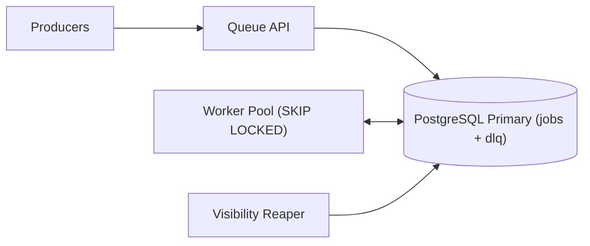
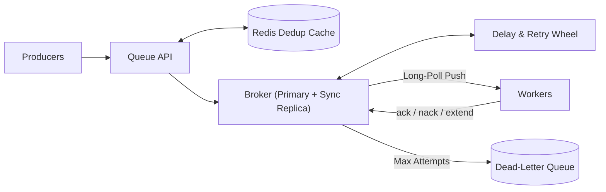
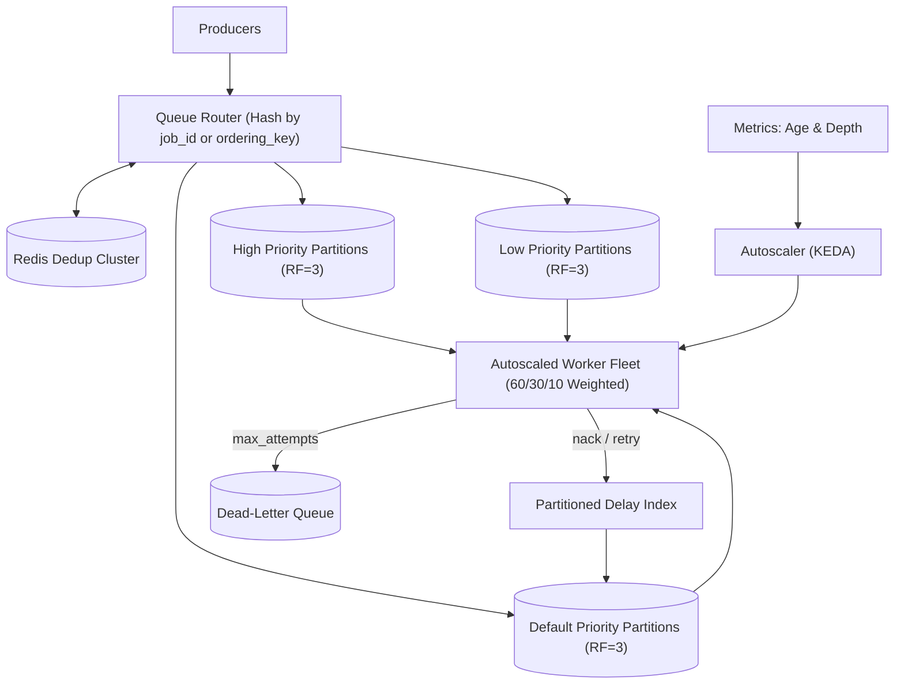
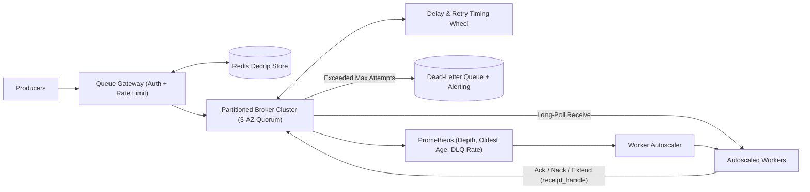
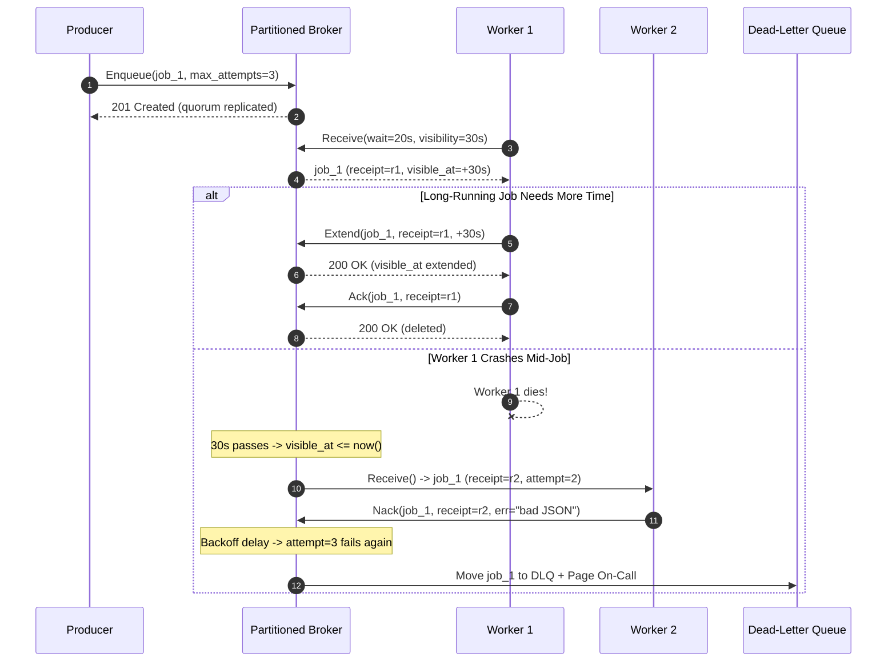

# Job Queue: Full System Design Mock Interview, All 9 Steps

> **Difficulty:** Senior / Staff (L5–L6) — Message Brokers, Visibility Timeouts, Ordering & Backpressure
> **Prerequisites:** [Previous lesson: Distributed Task Scheduler: Full System Design Mock Interview, 9 Steps](../18-distributed-task-scheduler/README.md) and the [Interview Framework track](../../21-interview-framework/README.md).
> **Estimated Reading Time:** 25–30 minutes
> **Target Audience:** Engineers practising the full 9-step system design interview on a classic prompt: running background work reliably from a queue.

> [!NOTE]
> **In one line:** A job queue **decouples producers from workers**: producers enqueue work in milliseconds, workers pull at their own pace with visibility timeouts, and the broker guarantees zero lost jobs, exponential retries, and dead-letter isolation.

> [!TIP]
> **The Golden Rule:** Acknowledge only after work succeeds, isolate poison messages with a max-attempts cap + Dead-Letter Queue (DLQ), offer strict ordering only per key (never globally), and autoscale workers on oldest-job age rather than raw depth alone.

---

## 1. Clarifying Questions, Functional & Non-Functional Requirements

Open with questions, not boxes. Compared to a task scheduler, a job queue focuses on **high-throughput asynchronous buffering**: visibility timeouts, long-polling, per-key FIFO ordering vs. throughput, priority starvation, and preventing poison messages from stalling an entire partition.

> Say it aloud: *"Before I draw anything, let me confirm delivery guarantees, ordering semantics, job duration variance, and peak enqueue rate."*

### Clarifying Questions & Assumed Scope

| Question | Assumed Answer | Architectural Impact |
| :--- | :--- | :--- |
| **Delivery guarantee?** | At-least-once | Visibility timeout + ack-after-success + idempotent workers |
| **Ordering requirement?** | Best-effort by default; strict FIFO optional **per key** | Key-hashed partitions with per-key concurrency = 1 |
| **Priorities & delays?** | 3 priority tiers (`high`, `default`, `low`) + delayed jobs | Weighted fair queuing + delay/retry timing index |
| **Job duration?** | 100 ms to 10 minutes (average 2 s) | Visibility timeout + heartbeat `extend()` API |
| **Scale target?** | 1M jobs/min (~16.7K jobs/s), 1 KB avg payload | Partitioned replicated broker + autoscaled worker fleet |
| **Out of scope?** | Complex multi-step DAGs, cross-region active-active replication | Mention Temporal/Step Functions for DAGs |

### Functional Requirements

1. **Enqueue & Deduplicate:** Producers enqueue jobs with `payload`, `priority`, optional `delay_sec`, and optional `dedup_key`.
2. **Long-Poll Receive & Visibility Timeout:** Workers long-poll for batches of jobs; received jobs become invisible to other workers for `visibility_timeout_sec`.
3. **Ack, Nack & Heartbeat Extend:** Workers call `ack()` on success (deletes/commits job), `nack()` on failure (schedules backoff retry), or `extend()` for long-running jobs.
4. **Dead-Letter Queue (DLQ) & Inspection:** Jobs exceeding `max_attempts` move to a DLQ with error context; operators can inspect queue depth, oldest-message age, and replay DLQ items.

### Non-Functional Requirements

| Quality | Target | Why It Drives the Design |
| :--- | :--- | :--- |
| **Durability** | Zero lost acknowledged enqueues ($RPO = 0$) | Synchronous quorum replication across 3 AZs before `201` |
| **Throughput** | 16.7K+ jobs/s sustained, 50K+ burst | Partitioned storage + batch `enqueue`/`receive`/`ack` |
| **Pickup Latency** | $p_{95} < 500\text{ ms}$ (when workers available) | Long-polling instead of wasteful 100 ms short-polling |
| **Fault Isolation** | Poison jobs never block healthy jobs | Non-blocking per-job retry delay + DLQ after $N$ attempts |

---

## 2. Back-of-the-Envelope Capacity Estimation

Let us size throughput, concurrent worker fleet, network bandwidth, and 7-day retention storage.

### Assumptions

- Sustained enqueue/process rate: $\lambda = 1{,}000{,}000\text{ jobs/min}$
- Average job execution time: $W = 2\text{ s}$
- Average payload + metadata size: $1\text{ KB}$
- Retention period (completed/history + inflight): $7\text{ days}$

### Worked Equations

**1. Sustained & Burst Throughput:**

$$
\lambda_{\text{avg}} = \frac{1{,}000{,}000}{60} \approx 16{,}667\text{ jobs/s} \quad (\text{design for } 3\times\text{ burst} = 50{,}000\text{ jobs/s})
$$

**2. Concurrent Workers Needed (Little's Law $L = \lambda \cdot W$):**

$$
L_{\text{workers}} = 16{,}667\text{ jobs/s} \times 2\text{ s} = 33{,}334\text{ concurrent job slots}
$$

If each worker process runs $20$ concurrent tasks, we need $\approx 1{,}667$ worker pods.

**3. Network Bandwidth (Enqueue + Receive + Ack):**

$$
BW_{\text{in}} = 16{,}667\text{ jobs/s} \times 1\text{ KB} \times 8\text{ bits} \approx 133.3\text{ Mbps} \quad (\text{and } \sim 133\text{ Mbps out to workers})
$$

**4. 7-Day Storage Footprint (with Replication Factor $RF = 3$):**

$$
S_{\text{raw,7d}} = 1{,}000{,}000 \times 60 \times 24 \times 7 \times 1{,}024\text{ B} = 10.32\text{ TB}
$$

$$
S_{\text{replicated,7d}} = 10.32\text{ TB} \times 3 = 30.96\text{ TB across broker nodes}
$$

### Capacity Summary Table

| Metric | Formula / Basis | Result | Architectural Implication |
| :--- | :--- | :--- | :--- |
| **Sustained Rate** | $1\text{M} / 60$ | **16.7K jobs/s** | Partition each queue into 32–64 shards |
| **Concurrent Workers** | $16{,}667 \times 2\text{ s}$ | **33.3K slots** | HPA/KEDA autoscaling on queue age & depth |
| **7-Day Raw Storage** | $10.08\text{B jobs} \times 1\text{ KB}$ | **~10.3 TB** | NVMe-backed broker nodes; ~31 TB with $RF=3$ |
| **Bandwidth (Each Way)** | $16{,}667 \times 8\text{ Kb}$ | **~133 Mbps** | Batching (`receive(max=10)`) cuts RPC overhead 10x |

---

## 3. Core API Contracts & Data Model

### REST / gRPC Queue APIs

| Endpoint | Method | Purpose | Contract & Notes |
| :--- | :--- | :--- | :--- |
| `/v1/queues/{q}/jobs` | `POST` | Enqueue | Body: `{payload, priority, delay_sec, dedup_key, ordering_key}`. Returns `{job_id}`. |
| `/v1/queues/{q}/receive` | `POST` | Long-poll pull | Body: `{max_batch: 10, wait_sec: 20, visibility_sec: 30}`. Returns `[{job_id, receipt_handle, payload}]`. |
| `/v1/jobs/{id}/ack` | `POST` | Complete | Body: `{receipt_handle}`. Deletes/marks job done only if `receipt_handle` matches! |
| `/v1/jobs/{id}/nack` | `POST` | Fail / Retry | Body: `{receipt_handle, error}`. Schedules exponential backoff or moves to DLQ. |
| `/v1/jobs/{id}/extend` | `POST` | Heartbeat | Body: `{receipt_handle, extend_sec: 30}`. Extends `visible_at` for long jobs. |

> **Why `receipt_handle`?** Like a fencing token, each `receive()` generates a unique `receipt_handle` (or `delivery_id`). If Worker A's visibility timeout expires and Worker B receives the job, Worker A's late `ack(old_receipt_handle)` is rejected!

### Core Data Model

```text
+-------------------------------------------------------------------------+
| 1. Partitioned Queue Log / Storage (Sharded by queue_id + partition_id) |
|    Fields: job_id, ordering_key, priority, payload, state,              |
|            receipt_handle, visible_at, attempts, max_attempts           |
+-------------------------------------------------------------------------+
| 2. Delay & Retry Index (Min-Heap / B-Tree ordered by visible_at)        |
|    Holds delayed jobs & backoff retries until visible_at <= now()       |
+-------------------------------------------------------------------------+
| 3. Dedup Cache (Redis / RocksDB with 5-minute to 24-hour TTL)           |
|    Maps (queue_id, dedup_key) -> job_id to drop duplicate enqueues      |
+-------------------------------------------------------------------------+
| 4. Dead-Letter Queue (DLQ)                                              |
|    Stores jobs where attempts >= max_attempts + last_error + stack      |
+-------------------------------------------------------------------------+
```

---

## 4. Stage 1 (100 - 1K Users): Baseline Monolith & Single Database

At 100 to 1,000 users (< 100 jobs/s), a single PostgreSQL database using `SELECT ... FOR UPDATE SKIP LOCKED` (or a single Redis instance with `RPOPLPUSH` / Streams) is fast to build and operationally trivial.

### Component-by-Component Build

1. **Queue API + Worker Monolith:** Producers `INSERT` into `jobs (state='READY', visible_at=now())`.
2. **PostgreSQL `SKIP LOCKED` Queue:** Workers poll `SELECT * FROM jobs WHERE state='READY' AND visible_at <= now() ORDER BY priority DESC, created_at LIMIT 10 FOR UPDATE SKIP LOCKED`, updating `state='IN_FLIGHT'` and `visible_at = now() + 30s`.
3. **Visibility Reaper:** Periodically resets `IN_FLIGHT` rows where `visible_at < now()` back to `READY` (or moves to `dlq_jobs`).



### What Breaks at 10K Users (2,000+ jobs/s)?

- **PostgreSQL Table Bloat & `VACUUM` Cliff:** High-churn `INSERT` + `UPDATE` + `DELETE` on `jobs` creates millions of dead tuples per hour, bloating indexes and causing `autovacuum` to saturate disk I/O.
- **Polling Waste:** 500 workers polling every 100 ms generate 5,000 empty `SELECT` queries/sec even when the queue is idle.

---

## 5. Stage 2 (10K - 100K Users): Caching, Read Replicas & Async Offload

To scale to 100K users (~5,000 jobs/s), we replace the relational table with a dedicated **in-memory/log-structured broker** (Redis Streams / RabbitMQ / SQS-style broker), add **long-polling**, and offload deduplication to Redis.

### Component-by-Component Additions

1. **Broker Nodes (Append-Only Log + In-Memory Ready Buffer):** Eliminates PostgreSQL dead-tuple bloat; writes are sequential disk appends replicated to a standby.
2. **Long-Polling (`wait_sec = 20`):** When a queue is empty, the worker's TCP/gRPC connection parks on the broker; as soon as a producer enqueues a job, the broker wakes the waiting worker immediately (< 5 ms pickup latency, zero empty polling).
3. **Redis Dedup Store:** Checks `(queue_id, dedup_key)` in < 0.5 ms before appending to the broker.
4. **Separate Delay/Retry Wheel:** Delayed and nacked jobs sit in a time-ordered min-heap/timing wheel, never blocking ready jobs at the head of the queue.



### What Breaks at 1M Users (16.7K–50K jobs/s)?

- **Single Broker Node Bottleneck:** One broker primary cannot sustain 50K jobs/s + 31 TB of 7-day replicated storage.
- **No Per-Key Ordering at Scale:** A single queue either serializes everything (killing throughput) or parallelizes everything (breaking per-user ordering).

---

## 6. Stage 3 (1M - 10M+ Users): Sharding, Partitioning & Multi-Region Scale

At 16.7K sustained / 50K burst jobs/s and 31 TB replicated storage, we **partition** queues across a cluster of broker nodes using Raft/ISR quorum replication, add **weighted priority lanes**, and autoscale workers via **KEDA / HPA**.

### Component-by-Component Additions

1. **Partitioned Broker Cluster (32–64 Partitions per Queue, $RF = 3$):**
   - **Standard Queues:** Route jobs round-robin or by `hash(job_id)` for maximum throughput.
   - **Per-Key Ordered Queues:** Route by `hash(ordering_key) % N_partitions` and enforce **1 in-flight job per `ordering_key`** (or per partition) so ordering is preserved without a global bottleneck.
2. **Weighted Fair Priority Queues:** Separate partitions for `high`, `default`, and `low` priorities. Workers poll using weighted ratios (e.g., `60% high / 30% default / 10% low`) so `low` priority jobs are never completely starved during a `high` burst.
3. **Metrics-Driven Autoscaler (Queue Age + Depth):** Monitors `oldest_unacked_job_age_sec` and `ready_depth` per queue to scale worker pods from 50 to 2,000+ automatically.



---

## 7. Final Full Production Architecture & End-to-End Flows

### Complete Production Architecture



### End-to-End Visibility Timeout, Heartbeat Extend & Poison-Message DLQ Flow



---

## 8. Deep-Dive Bottlenecks & Algorithmic Trade-Offs

### 1. Poison Messages & Head-of-Line (HoL) Blocking

If a malformed "poison" job crashes every worker that touches it, retrying it immediately at the head of the queue creates an infinite crash loop that starves healthy jobs.
- **Fix:** Never retry in place at the head of the queue. On `nack()` or visibility timeout expiry, move the job to the **Delay Index** with exponential backoff + jitter:

$$
\text{delay}(k) = \min\left(T_{\max},\; T_{\text{base}} \times 2^{k-1}\right) \times \text{Uniform}(0.5, 1.5)
$$

Once `attempts >= max_attempts`, eject the job to the **DLQ** and fire an alert.

### 2. Per-Key Ordering vs. Global Throughput

- **Global FIFO Ordering:** Requires a single partition and 1 consumer at a time—throughput caps at ~500 jobs/s and one slow job blocks the entire company.
- **Per-Key Ordering (e.g., `user_id` or `order_id`):** Hash `ordering_key` to one of $64$ partitions, and track an in-memory `active_keys` set per partition so at most 1 job per `ordering_key` is in flight concurrently. Different keys in the same partition still run in parallel!

### 3. Autoscaling Signal: Queue Depth vs. Oldest-Job Age

- **Why Queue Depth Alone Fails:** A queue depth of `10,000` jobs means very different things if each job takes `10 ms` (drained in 1 second) vs. `60 s` (needs 10x more workers).
- **Best Practice:** Scale primarily on **`oldest_unacked_job_age_sec`** (Target: $< 10\text{ s}$) combined with `ready_depth / current_processing_rate`.

### Architectural Trade-Offs Summary

| Decision | Option A | Option B | Chosen & Rationale |
| :--- | :--- | :--- | :--- |
| **Delivery Model** | At-most-once (auto-ack on pull) | At-least-once (ack after work) | **At-least-once:** Crashed workers never lose jobs |
| **Worker Pull** | Short-poll every 100 ms | Long-poll (`wait_sec=20`) | **Long-poll:** Eliminates empty-poll CPU/network waste |
| **Ordering** | Global FIFO | Per-key ordering | **Per-key:** Preserves entity order without killing throughput |
| **Priority Queues** | Strict priority (`high` always first) | Weighted fair polling (60/30/10) | **Weighted:** Prevents total starvation of `low` priority jobs |

---

## 9. Failure Modes, Reliability & Backpressure Mitigations

| Failure Mode | Impact | Detection | Mitigation |
| :--- | :--- | :--- | :--- |
| **Downstream Dependency Outage** | Workers fail 100% of jobs, retry storm | Error rate $> 50\%$ | Worker circuit breaker pauses polling (`pause_queue`) + exponential backoff |
| **Slow Producer Flood** | Broker disk/memory fills up | Queue depth $> 80\%$ quota | Return `429 Too Many Requests` (`Retry-After`) per tenant/queue |
| **Worker OOM / Crash** | Jobs stuck in flight | Visibility timeout expires | Broker automatically makes job visible again for healthy workers |
| **Stale `ack` After Timeout** | Double execution or wrong deletion | `receipt_handle` mismatch | Reject stale `ack()` with `409 Conflict`; only latest `receipt_handle` can ack |
| **DLQ Silently Growing** | Failed business workflows unnoticed | `dlq_depth > 0` alert | Alert on-call, provide one-click DLQ redrive CLI after bug fix |

---

## 10. Production War Story & Real-World Reference

**Reference Pattern:** Amazon SQS (*Visibility Timeouts & DLQs*) & RabbitMQ/Kafka consumer group backpressure.

### SEV-1 Incident: The Visibility-Timeout-Too-Short Cascade

- **Symptom:** A video-transcoding queue's throughput dropped to near zero while worker CPU hit 100%, and every video was transcoded 5+ times before landing in the DLQ.
- **Root Cause:** The queue's `visibility_timeout` was hardcoded to `30 seconds`, but 4K video jobs took `90 seconds` to transcode without calling `extend()`. At $t = 30\text{ s}$, the broker assumed Worker 1 had died and handed the same 4K job to Worker 2, then Worker 3, until `max_attempts = 5` was exhausted and the job was dead-lettered—even though Worker 1 was healthy!
- **The Fix:**
  1. Added a background **Heartbeat Extender** thread in the worker SDK that calls `extend(job_id, receipt_handle, +30s)` every `10 seconds` while the job is actively running.
  2. Set `max_attempts` to only count explicit `nack()` or genuine crash expiries, and added a `receipt_handle` check so duplicate completions cannot corrupt state.

---

## 11. Core Component Implementation (4 Languages)

Below is a production-grade **Visibility-Timeout Job Queue with Receipt Handles, Exponential Backoff & DLQ** supporting `enqueue`, `receive`, `ack`, `extend`, and `nack`.

````carousel
```go
package jobqueue

import (
	"errors"
	"fmt"
	"sync"
)

type Job struct {
	ID            string
	Payload       string
	Attempts      int
	MaxAttempts   int
	VisibleAt     int64
	ReceiptHandle string
}

type JobQueue struct {
	mu      sync.Mutex
	ready   []*Job
	inflight map[string]*Job
	dlq     []*Job
	seq     int64
}

func NewJobQueue() *JobQueue {
	return &JobQueue{inflight: make(map[string]*Job)}
}

func (q *JobQueue) Enqueue(id, payload string, maxAttempts int, visibleAt int64) {
	q.mu.Lock()
	defer q.mu.Unlock()
	q.ready = append(q.ready, &Job{ID: id, Payload: payload, MaxAttempts: maxAttempts, VisibleAt: visibleAt})
}

func (q *JobQueue) Receive(now, visibilitySec int64) *Job {
	q.mu.Lock()
	defer q.mu.Unlock()
	// Reclaim expired inflight jobs first
	for id, j := range q.inflight {
		if j.VisibleAt <= now {
			delete(q.inflight, id)
			q.ready = append(q.ready, j)
		}
	}
	for i, j := range q.ready {
		if j.VisibleAt <= now {
			q.ready = append(q.ready[:i], q.ready[i+1:]...)
			q.seq++
			j.Attempts++
			j.ReceiptHandle = fmt.Sprintf("rcpt_%d", q.seq)
			j.VisibleAt = now + visibilitySec
			q.inflight[j.ID] = j
			cp := *j
			return &cp
		}
	}
	return nil
}

func (q *JobQueue) Ack(jobID, receipt string) error {
	q.mu.Lock()
	defer q.mu.Unlock()
	j, ok := q.inflight[jobID]
	if !ok || j.ReceiptHandle != receipt {
		return errors.New("stale receipt_handle or job not in flight")
	}
	delete(q.inflight, jobID)
	return nil
}

func (q *JobQueue) Nack(jobID, receipt string, now int64) error {
	q.mu.Lock()
	defer q.mu.Unlock()
	j, ok := q.inflight[jobID]
	if !ok || j.ReceiptHandle != receipt {
		return errors.New("stale receipt_handle")
	}
	delete(q.inflight, jobID)
	if j.Attempts >= j.MaxAttempts {
		q.dlq = append(q.dlq, j)
		return nil
	}
	j.VisibleAt = now + int64(1<<min(j.Attempts, 6))
	q.ready = append(q.ready, j)
	return nil
}
```
<!-- slide -->
```typescript
interface Job {
  id: string;
  payload: string;
  attempts: number;
  maxAttempts: number;
  visibleAt: number;
  receiptHandle?: string;
}

export class JobQueue {
  private ready: Job[] = [];
  private inflight = new Map<string, Job>();
  public dlq: Job[] = [];
  private seq = 0;

  enqueue(id: string, payload: string, maxAttempts = 3, visibleAt = 0): void {
    this.ready.push({ id, payload, attempts: 0, maxAttempts, visibleAt });
  }

  receive(now: number, visibilitySec = 30): Job | null {
    for (const [id, job] of this.inflight.entries()) {
      if (job.visibleAt <= now) {
        this.inflight.delete(id);
        this.ready.push(job);
      }
    }
    const idx = this.ready.findIndex((j) => j.visibleAt <= now);
    if (idx === -1) return null;

    const [job] = this.ready.splice(idx, 1);
    job.attempts += 1;
    job.receiptHandle = `rcpt_${++this.seq}`;
    job.visibleAt = now + visibilitySec;
    this.inflight.set(job.id, job);
    return { ...job };
  }

  ack(jobId: string, receiptHandle: string): void {
    const job = this.inflight.get(jobId);
    if (!job || job.receiptHandle !== receiptHandle) {
      throw new Error("Stale receiptHandle or job not in flight");
    }
    this.inflight.delete(jobId);
  }

  nack(jobId: string, receiptHandle: string, now: number): void {
    const job = this.inflight.get(jobId);
    if (!job || job.receiptHandle !== receiptHandle) throw new Error("Stale receiptHandle");
    this.inflight.delete(jobId);

    if (job.attempts >= job.maxAttempts) {
      this.dlq.push(job);
    } else {
      job.visibleAt = now + Math.min(64, 2 ** job.attempts);
      this.ready.push(job);
    }
  }
}
```
<!-- slide -->
```python
from dataclasses import dataclass
from typing import Dict, List, Optional

@dataclass
class Job:
    job_id: str
    payload: str
    max_attempts: int = 3
    attempts: int = 0
    visible_at: int = 0
    receipt_handle: str = ""

class JobQueue:
    def __init__(self) -> None:
        self._ready: List[Job] = []
        self._inflight: Dict[str, Job] = {}
        self.dlq: List[Job] = []
        self._seq = 0

    def enqueue(self, job_id: str, payload: str, max_attempts: int = 3, visible_at: int = 0) -> None:
        self._ready.append(Job(job_id=job_id, payload=payload, max_attempts=max_attempts, visible_at=visible_at))

    def receive(self, now: int, visibility_sec: int = 30) -> Optional[Job]:
        for jid in [k for k, j in self._inflight.items() if j.visible_at <= now]:
            self._ready.append(self._inflight.pop(jid))

        for i, job in enumerate(self._ready):
            if job.visible_at <= now:
                self._ready.pop(i)
                self._seq += 1
                job.attempts += 1
                job.receipt_handle = f"rcpt_{self._seq}"
                job.visible_at = now + visibility_sec
                self._inflight[job.job_id] = job
                return Job(**job.__dict__)
        return None

    def ack(self, job_id: str, receipt_handle: str) -> None:
        job = self._inflight.get(job_id)
        if not job or job.receipt_handle != receipt_handle:
            raise PermissionError("Stale receipt_handle or job not in flight")
        del self._inflight[job_id]

    def nack(self, job_id: str, receipt_handle: str, now: int) -> None:
        job = self._inflight.get(job_id)
        if not job or job.receipt_handle != receipt_handle:
            raise PermissionError("Stale receipt_handle")
        del self._inflight[job_id]
        if job.attempts >= job.max_attempts:
            self.dlq.append(job)
        else:
            job.visible_at = now + min(64, 2 ** job.attempts)
            self._ready.append(job)
```
<!-- slide -->
```csharp
using System;
using System.Collections.Generic;

public class QueueJob
{
    public required string Id { get; init; }
    public required string Payload { get; init; }
    public int Attempts { get; set; }
    public int MaxAttempts { get; init; } = 3;
    public long VisibleAt { get; set; }
    public string ReceiptHandle { get; set; } = "";
}

public class JobQueue
{
    private readonly object _lock = new();
    private readonly List<QueueJob> _ready = new();
    private readonly Dictionary<string, QueueJob> _inflight = new();
    public List<QueueJob> Dlq { get; } = new();
    private long _seq;

    public void Enqueue(string id, string payload, int maxAttempts = 3, long visibleAt = 0)
    {
        lock (_lock) _ready.Add(new QueueJob { Id = id, Payload = payload, MaxAttempts = maxAttempts, VisibleAt = visibleAt });
    }

    public QueueJob? Receive(long now, long visibilitySec = 30)
    {
        lock (_lock)
        {
            foreach (var kv in new List<KeyValuePair<string, QueueJob>>(_inflight))
            {
                if (kv.Value.VisibleAt <= now) { _inflight.Remove(kv.Key); _ready.Add(kv.Value); }
            }
            var idx = _ready.FindIndex(j => j.VisibleAt <= now);
            if (idx < 0) return null;

            var job = _ready[idx];
            _ready.RemoveAt(idx);
            job.Attempts++;
            job.ReceiptHandle = $"rcpt_{++_seq}";
            job.VisibleAt = now + visibilitySec;
            _inflight[job.Id] = job;
            return job;
        }
    }

    public void Ack(string jobId, string receiptHandle)
    {
        lock (_lock)
        {
            if (!_inflight.TryGetValue(jobId, out var job) || job.ReceiptHandle != receiptHandle)
                throw new InvalidOperationException("Stale receipt handle.");
            _inflight.Remove(jobId);
        }
    }

    public void Nack(string jobId, string receiptHandle, long now)
    {
        lock (_lock)
        {
            if (!_inflight.TryGetValue(jobId, out var job) || job.ReceiptHandle != receiptHandle)
                throw new InvalidOperationException("Stale receipt handle.");
            _inflight.Remove(jobId);
            if (job.Attempts >= job.MaxAttempts) Dlq.Add(job);
            else { job.VisibleAt = now + Math.Min(64, 1L << job.Attempts); _ready.Add(job); }
        }
    }
}
```
````

---

## 12. Verification, Load Testing & CLI Diagnostics

```bash
# 1. Inspect queue depth, inflight count, and oldest-job age (Kafka / RabbitMQ / SQS)
aws sqs get-queue-attributes \
  --queue-url https://sqs.us-east-1.amazonaws.com/123456/orders-jobs \
  --attribute-names ApproximateNumberOfMessages ApproximateNumberOfMessagesNotVisible

# 2. Check Kafka consumer group lag across all partitions
kafka-consumer-groups.sh --bootstrap-server broker:9092 \
  --describe --group order-workers

# 3. Inspect DLQ depth and sample poison message payload
aws sqs receive-message \
  --queue-url https://sqs.us-east-1.amazonaws.com/123456/orders-jobs-dlq \
  --max-number-of-messages 5

# 4. Redrive DLQ messages back to main queue after deploying a bug fix
aws sqs start-message-move-task \
  --source-arn arn:aws:sqs:us-east-1:123456:orders-jobs-dlq \
  --destination-arn arn:aws:sqs:us-east-1:123456:orders-jobs
```

---

## 13. Common Interview Mistakes & Red Flags

1. **Auto-acknowledging on `receive()`:** If the worker crashes 10 ms later, the job is permanently lost. Always ack *after* work completes.
2. **Retrying immediately without backoff or a cap:** Creates an infinite CPU/network storm against a struggling downstream service.
3. **No Dead-Letter Queue (DLQ):** A single poison message crashes workers forever or blocks a partition indefinitely.
4. **Demanding global strict FIFO ordering:** Collapses throughput to a single consumer thread. Use per-key ordering instead.
5. **Forgetting `extend()` heartbeats for long jobs:** Causes premature visibility timeout expiry and duplicate parallel execution.
6. **Autoscaling solely on queue depth:** Ignores job duration variance; scale on `oldest_unacked_job_age_sec`.

---

## 14. Key Terminology & Glossary

| Key Term | Definition |
| :--- | :--- |
| **Visibility Timeout** | Duration a received job is hidden from other workers while being processed. |
| **Receipt Handle** | Ephemeral fencing token returned on `receive()` required to `ack()`, `nack()`, or `extend()`. |
| **Dead-Letter Queue (DLQ)** | Quarantine queue for jobs that fail `max_attempts` times, preventing head-of-line blocking. |
| **Poison Message** | Malformed or buggy job that deterministically crashes workers on every attempt. |
| **Long Polling** | Holding a `receive()` request open on the broker until a job arrives or `wait_sec` expires. |
| **Per-Key Ordering** | Routing jobs with the same `ordering_key` to one partition with serial per-key execution. |
| **Weighted Fair Queuing** | Polling priority queues in weighted ratios (e.g., 60/30/10) to avoid low-priority starvation. |
| **Backpressure** | Rejecting (`429`) or throttling producers when broker capacity or downstream health degrades. |
| **Oldest-Job Age** | Time elapsed since the oldest unacknowledged ready job was enqueued; key autoscaling signal. |
| **DLQ Redrive** | Operational workflow replaying quarantined DLQ messages back into the primary queue after a fix. |

---

## 15. Interview Follow-Up Questions (12 Q&As)

### Basic Conceptual Questions

<details>
<summary><strong>Q1: How do you guarantee a job is never lost even if a worker crashes mid-execution? [BASIC]</strong></summary>

Replicate the job across a quorum of broker nodes ($RF=3$) before acknowledging `enqueue()`, and only delete the job when the worker sends `ack(receipt_handle)` *after* finishing. If the worker crashes, its visibility timeout expires and the job reappears.

</details>

<details>
<summary><strong>Q2: What is a visibility timeout, and how does it differ from a lease? [BASIC]</strong></summary>

They are conceptually identical: a visibility timeout hides a received job from other workers for $T$ seconds. If the worker does not `ack()` or `extend()` before $T$ expires, the broker makes the job visible again for another worker.

</details>

<details>
<summary><strong>Q3: Why use long-polling instead of short-polling? [BASIC]</strong></summary>

Short-polling every 100 ms wastes 99% of CPU and network bandwidth on empty responses when queues are quiet, or adds artificial delay if you poll less often. Long-polling parks the connection and wakes up immediately when a job is enqueued.

</details>

<details>
<summary><strong>Q4: How do you handle a poison message? [BASIC]</strong></summary>

Track `attempts` per job. On each failure, retry with exponential backoff + jitter in a separate delay index so it never blocks healthy jobs. Once `attempts >= max_attempts`, move it to a Dead-Letter Queue (DLQ) and alert on-call.

</details>

### Scenario-Based Architecture Questions

<details>
<summary><strong>Q5: A job takes 8 minutes to run, but the default visibility timeout is 30 seconds. What do you do? [SCENARIO]</strong></summary>

Keep the 30-second visibility timeout for fast crash detection, and have the worker's SDK run a background heartbeat loop calling `extend(job_id, receipt_handle, +30s)` every 10 seconds while the job is alive.

</details>

<details>
<summary><strong>Q6: A tenant requires strict ordering for all events on a specific `order_id`, without slowing down the whole system. How do you design it? [SCENARIO]</strong></summary>

Partition by `hash(ordering_key) % N_partitions` and track in-flight `ordering_key`s per partition so at most 1 job per `order_id` runs at a time, while thousands of other `order_id`s execute in parallel.

</details>

<details>
<summary><strong>Q7: High-priority jobs are flooding the queue for 2 hours. How do you ensure low-priority jobs don't starve forever? [SCENARIO]</strong></summary>

Use **Weighted Fair Queuing** (e.g., workers pull 60% from `high`, 30% from `default`, 10% from `low`) or reserve a small dedicated worker pool for `low` priority so it always makes forward progress.

</details>

<details>
<summary><strong>Q8: Downstream billing API goes down for 15 minutes. How do you prevent a retry storm? [SCENARIO]</strong></summary>

Use a **Circuit Breaker** in the worker pool: when downstream 5xx/timeouts exceed a threshold, trip the breaker, pause polling from that queue, and let failed jobs back off exponentially with full jitter.

</details>

### Advanced & Tricky Interview Questions

<details>
<summary><strong>Q9: Worker A's visibility timeout expires, Worker B picks up the job, and then Worker A finishes and calls `ack()`. What happens? [TRICKY]</strong></summary>

Worker A's `ack(old_receipt_handle)` is **rejected** because `receive()` issued a new `receipt_handle` to Worker B. However, because Worker A already ran the side effect, job handlers must still be **idempotent**.

</details>

<details>
<summary><strong>Q10: Why is Kafka alone awkward for a general-purpose job queue with per-job retries and delays? [TRICKY]</strong></summary>

Kafka commits offsets sequentially per partition (`offset 105` cannot be committed without implicitly committing `offset 104`). If `job 104` fails and needs a 5-minute retry while `job 105` succeeds, you cannot easily skip `104` without copying `104` to separate retry/delay topics.

</details>

<details>
<summary><strong>Q11: How do you deduplicate jobs if a producer retries `enqueue()` due to a network timeout? [TRICKY]</strong></summary>

Accept an optional `dedup_key` on `enqueue()`. Check a fast Redis dedup cache (`SET dedup:{queue}:{key} job_id NX EX 300`) before writing to the broker; if the key exists, return the original `job_id` without enqueuing a duplicate.

</details>

<details>
<summary><strong>Q12: What is the best metric to drive worker autoscaling? [TRICKY]</strong></summary>

Scale on **`oldest_unacked_job_age_sec`** (SLA breach indicator) combined with `ready_depth / throughput_per_worker`, rather than raw queue depth alone, because job execution times vary from 100 ms to 10 minutes.

</details>

---

## 16. One-Page Master Cheat Sheet

```text
+-----------------------------------------------------------------------------+
|                    JOB QUEUE — MASTER CHEAT SHEET                           |
+-----------------------------------------------------------------------------+
| 1. DELIVERY      : At-least-once | Ack AFTER success | Idempotent handlers  |
| 2. VISIBILITY    : 30s timeout + 10s extend() heartbeat + receipt_handle    |
| 3. POISON GUARD  : Exponential backoff + jitter in Delay Index -> DLQ       |
| 4. ORDERING      : Per-key (hash ordering_key -> partition), NEVER global   |
| 5. PRIORITIES    : Separate queues + Weighted Fair Polling (e.g. 60/30/10)  |
| 6. AUTOSCALING   : Scale on oldest_unacked_job_age_sec + ready_depth        |
| 7. SCALE         : 16.7K jobs/s (50K burst) | 33.3K workers | 31 TB (RF=3)  |
+-----------------------------------------------------------------------------+
```

| Step | Key Decision to State Aloud |
| :--- | :--- |
| **Clarify** | At-least-once, per-key ordering, 3 priorities, delays, 1M jobs/min |
| **Estimate** | 16.7K jobs/s, 33.3K concurrent slots (Little's Law), ~31 TB (7d, RF=3) |
| **Data Model** | Partitioned queue storage, Delay Index, Redis Dedup store, DLQ |
| **Deep Dive** | Visibility timeout + `receipt_handle`, poison message isolation, weighted priorities |
| **Reliability** | 3-AZ quorum broker, circuit-breaker pause on downstream outage, DLQ redrive |

---

## Further Reading

- Amazon SQS Developer Guide, *Visibility Timeout, Long Polling, and Dead-Letter Queues*.
- Apache Kafka & RabbitMQ Documentation on *Consumer Acknowledgements, Partitions, and Retry Topics*.
- Martin Kleppmann, *Designing Data-Intensive Applications*, Chapter 11 (Stream Processing).

---

## Next

Continue with [Web Crawler: Full System Design Mock Interview, All 9 Steps](../20-web-crawler/README.md).
