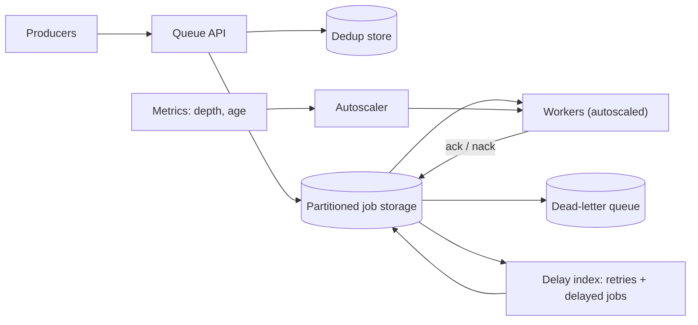

# Job Queue: Full System Design Mock Interview, All 9 Steps

> **Prerequisites:** [Previous lesson: Distributed Task Scheduler: Full System Design Mock Interview, 9 Steps](../18-distributed-task-scheduler/README.md) and the [Interview Framework track](../../21-interview-framework/README.md).
> **Estimated Reading Time:** 15–20 minutes
> **Target Audience:** Engineers practising the full 9-step system design interview on a classic prompt: running background work reliably from a queue.

> [!NOTE]
> **In one line:** A job queue **decouples producers from workers**: producers add jobs quickly, workers pull them at their own pace, and the queue guarantees a job is not lost and is retried on failure.

> [!TIP]
> **The Golden Rule:** Acknowledge only after the work succeeds, retry with backoff and a cap, and send repeatedly failing jobs to a dead-letter queue. Design every job to be idempotent.

---

## Step 1. Clarify the Problem

Open with questions, not boxes. This is simpler than the scheduler but the details matter: visibility timeouts, retries, ordering, priorities and poison messages.

**Questions to ask the interviewer, and the answer we assume:**

| Question | Assumed answer |
| :--- | :--- |
| Delivery? | At-least-once |
| Ordering? | Best effort; strict only per key |
| Priorities? | Two or three levels |
| Delays? | Delayed jobs supported |
| Scale? | 1M jobs per minute, jobs run from 100 ms to 10 minutes |

> Say it aloud: *"Before I draw anything, let me confirm the scope and the numbers."* That one sentence earns the first minutes of the interview.

---

## Step 2. Functional and Non-Functional Requirements

**Functional (what the system does):**

- Enqueue a job with a payload, priority and optional delay.
- Workers pull, process and acknowledge jobs.
- Failed jobs retry with backoff and finally go to a dead-letter queue.
- Inspect queue depth and job status.

**Non-functional (how well it does it):**

| Quality | Target | Why it drives the design |
| :--- | :--- | :--- |
| Durability | No acknowledged job lost | Replicated storage |
| Throughput | Millions per minute | Horizontal scaling by partition |
| Latency | Pickup within seconds | Responsive background work |
| Isolation | A bad job must not block others | Poison messages exist |

---

## Step 3. Scope: In and Out

**In scope:** Enqueue, pull, ack, retries, dead-letter, priorities.

**Out of scope (say it explicitly, then move on):**

- Workflow orchestration.
- Exactly-once processing.
- Cross-region replication.

---

## Step 4. Capacity Estimation

Assumptions: 1M jobs per minute, average job takes 2 seconds, 1 KB payload, retained until done plus 7 days.

| Quantity | Calculation | Result |
| :--- | :--- | :--- |
| Jobs per second | `per_min / 60` | **16.7K jobs/s** |
| Concurrent workers | `jobs_per_second * secs` | **33.3K workers** |
| Storage for a week of history | `per_min * 60 * 24 * days * kb * 1e3 / 1e12` | **10.1 TB** |

**What the numbers tell you:** About 16,700 jobs per second and 33,000 concurrent workers (at 2 seconds per job) show the queue must be partitioned and workers must scale automatically with queue depth. Retention storage is about 10 TB.

---

## Step 5. API Design

| Endpoint | Purpose | Notes |
| :--- | :--- | :--- |
| `POST /v1/queues/{q}/jobs` | Enqueue | Body: payload, priority, delay, dedup key. Returns job id. |
| `POST /v1/queues/{q}/receive` | Pull | Long poll, returns jobs invisible for a timeout. |
| `POST /v1/jobs/{id}/ack` | Acknowledge | Deletes the job. |
| `POST /v1/jobs/{id}/nack` | Fail | Schedules a retry or dead-letters. |
| `POST /v1/jobs/{id}/extend` | Extend visibility | For long jobs. |

A received job becomes invisible for a **visibility timeout**. If the worker does not ack in time, the job reappears for another worker.

---

## Step 6. Data Model

| Entity / Store | Key fields | Why this store |
| :--- | :--- | :--- |
| Partitioned log or queue storage | `job_id`, `payload`, `state`, `visible_at`, `attempts` | Durable, replicated, partitioned by queue and hash |
| Delay index | Jobs ordered by `visible_at` | Delayed and retry scheduling |
| Dead-letter queue | Jobs that exceeded max attempts | Manual inspection |
| Dedup store | Dedup key with TTL | Prevent duplicate enqueue |

Partition by queue plus a hash of the job id for throughput, or by a key when ordering per key is required.

---

## Step 7. High-Level Architecture



**Walk the diagram in this order:** producers enqueue into a partition, workers receive with a visibility timeout and ack on success, failures retry via the delay index, and repeated failures land in the dead-letter queue.

---

## Step 8. Deep Dives and Bottlenecks

### 1. Visibility timeout and acks

Receiving a job hides it from others for a timeout. The worker acks to delete it. If the worker crashes, the timeout expires and the job reappears, which gives at-least-once delivery. For jobs longer than the timeout, the worker extends the visibility periodically (a heartbeat).

### 2. Retries and poison messages

On failure, retry with exponential backoff and jitter, up to a maximum number of attempts, then move the job to a dead-letter queue with the error. Alert on dead-letter depth. A single bad job must not block a partition, so never retry in place at the head of the line.

### 3. Ordering, priority and scaling

Strict ordering is expensive, so offer it only per key by routing the same key to the same partition and processing one job per key at a time. For priorities, use separate queues with weighted consumption so low priority is not starved. Autoscale workers on queue depth and oldest-job age.

---

## Step 9. Trade-offs, Failures and Security

**Trade-offs to state aloud:**

| Decision | Option A | Option B | Pick and why |
| :--- | :--- | :--- | :--- |
| Delivery | At-most-once | At-least-once | At-least-once plus idempotent jobs |
| Ordering | Global | Per key | Per key: global ordering kills throughput |
| Retry | Immediate | Backoff with jitter | Backoff: protects the failing dependency |

**Failure modes and mitigations:**

| Failure | What users see | Mitigation |
| :--- | :--- | :--- |
| Worker crash | Job delayed | Visibility timeout expires, job redelivered |
| Poison job | Retry loop | Max attempts then dead-letter |
| Downstream outage | Retry storm | Backoff, circuit breaker, pause the queue |

**Security and abuse:** Authenticate producers and workers per queue, encrypt payloads at rest, avoid secrets in payloads, and limit payload size.

---

## Runnable Example: Retry with dead-letter queue

A job that keeps failing is retried a few times, then moved to the dead-letter queue instead of blocking the line.

```python
MAX_ATTEMPTS = 3
dead = []

def process(job):
    if job["payload"] == "bad":
        raise ValueError("cannot parse")
    return "ok"

def run(jobs):
    results = []
    for job in jobs:
        job.setdefault("attempts", 0)
        while True:
            job["attempts"] += 1
            try:
                results.append((job["id"], process(job)))
                break
            except Exception as e:
                if job["attempts"] >= MAX_ATTEMPTS:
                    dead.append((job["id"], str(e), job["attempts"]))
                    break
    return results

print(run([{"id": 1, "payload": "good"}, {"id": 2, "payload": "bad"}, {"id": 3, "payload": "good"}]))
print("dead letters:", dead)
```

Output (produced by running this exact code):

```text
[(1, 'ok'), (3, 'ok')]
dead letters: [(2, 'cannot parse', 3)]
```

Jobs 1 and 3 succeed, and job 2 is tried three times and then parked in the dead-letter queue, so it never blocks the others.

---

## Common Mistakes

- Acknowledging before the work is done.
- Retrying immediately forever.
- No dead-letter queue.
- Demanding global ordering.
- Non-idempotent job handlers.

---

## Interview Questions and Answers

<details>
<summary><strong>Q1: How do you guarantee a job is not lost?</strong></summary>

Replicated durable storage and ack-after-success: a job is removed only after the worker confirms it finished.

</details>

<details>
<summary><strong>Q2: What is a visibility timeout?</strong></summary>

The period a received job is hidden from other workers. If no ack arrives in time it reappears for retry.

</details>

<details>
<summary><strong>Q3: How do you handle a poison message?</strong></summary>

Cap the attempts, then move it to a dead-letter queue and alert, so it does not block the queue.

</details>

<details>
<summary><strong>Q4: How do you get ordering?</strong></summary>

Per key: route a key to one partition and process its jobs serially. Avoid global ordering.

</details>

<details>
<summary><strong>Q5: How do you scale workers?</strong></summary>

Autoscale on queue depth and the age of the oldest job.

</details>

---

## One-Page Cheat Sheet

| Step | What to say or draw |
| :--- | :--- |
| Clarify | At-least-once, priorities, delays, 1M/min |
| Capacity | 16.7K jobs/s, ~33K concurrent workers |
| API | enqueue, receive, ack, nack, extend |
| Data | Partitioned storage, delay index, DLQ, dedup |
| Deep dive | Visibility timeout, retries, ordering |
| Trade-off | At-least-once, per-key ordering |

---

## Further Reading

- Amazon SQS developer guide: visibility timeout and dead-letter queues.
- Kafka and RabbitMQ documentation on acknowledgements and consumer groups.

---

## Next

Continue with [Web Crawler: Full System Design Mock Interview, All 9 Steps](../20-web-crawler/README.md).
