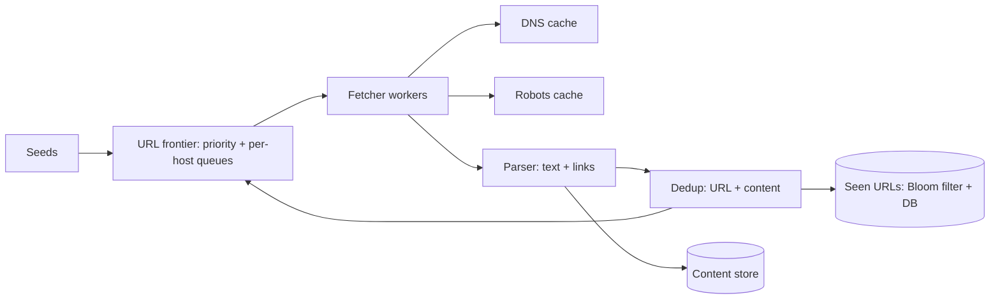

# Web Crawler: Full System Design Mock Interview, All 9 Steps

> **Prerequisites:** [Previous lesson: Job Queue: Full System Design Mock Interview, All 9 Steps](../19-job-queue/README.md) and the [Interview Framework track](../../21-interview-framework/README.md).
> **Estimated Reading Time:** 15–20 minutes
> **Target Audience:** Engineers practising the full 9-step system design interview on a classic prompt: fetching billions of web pages politely and without repeats.

> [!NOTE]
> **In one line:** A web crawler is **a breadth-first traversal of the web with a politeness policy**: a frontier of URLs to visit, fetchers that respect each site's limits, and a way to never fetch the same page twice.

> [!TIP]
> **The Golden Rule:** Split the frontier into per-host queues so politeness is easy, deduplicate URLs and content before fetching and storing, and make every stage restartable.

---

## Step 1. Clarify the Problem

Open with questions, not boxes. Interviewers look for the URL frontier, politeness and robots.txt, deduplication, and handling traps such as infinite calendars.

**Questions to ask the interviewer, and the answer we assume:**

| Question | Assumed answer |
| :--- | :--- |
| Purpose? | Feed a search index with fresh pages |
| Scale? | 1 billion pages per month |
| Content? | HTML only; ignore media |
| Freshness? | Recrawl popular pages more often |
| Rules? | Respect robots.txt and crawl delay |

> Say it aloud: *"Before I draw anything, let me confirm the scope and the numbers."* That one sentence earns the first minutes of the interview.

---

## Step 2. Functional and Non-Functional Requirements

**Functional (what the system does):**

- Start from seed URLs and discover links.
- Fetch pages and extract text and outgoing links.
- Avoid fetching duplicate URLs or duplicate content.
- Recrawl pages on a schedule based on change rate.

**Non-functional (how well it does it):**

| Quality | Target | Why it drives the design |
| :--- | :--- | :--- |
| Politeness | Never overload one host | Avoid bans and be a good citizen |
| Throughput | Hundreds of pages per second | Billions of pages |
| Robustness | Survive malformed HTML and traps | The web is hostile |
| Extensibility | Add new content types | Evolving needs |

---

## Step 3. Scope: In and Out

**In scope:** Frontier, fetchers, parsing, deduplication, recrawl scheduling.

**Out of scope (say it explicitly, then move on):**

- Indexing and ranking.
- JavaScript rendering at scale (mention headless browsers).
- Deep web and login-gated pages.

---

## Step 4. Capacity Estimation

Assumptions: 1 billion pages per month, average page 100 KB, 10 outgoing links per page (new ones are about 20% unseen).

| Quantity | Calculation | Result |
| :--- | :--- | :--- |
| Pages per second | `pages / (days * 86400)` | **386 pages/s** |
| Download bandwidth | `pages_per_second * kb * 8 / 1e6` | **0.309 Gbps** |
| Storage per month | `pages * kb * 1e3 / 1e12` | **100 TB** |
| URLs discovered per month | `pages * links` | **10B URLs** |

**What the numbers tell you:** 386 pages per second is modest, but at 100 KB each it is 0.3 Gbps sustained and 100 TB of raw HTML per month. The URL set reaches 10 billion discovered links, so the seen-URL check must be a space-efficient structure such as a Bloom filter backed by a database.

---

## Step 5. API Design

| Endpoint | Purpose | Notes |
| :--- | :--- | :--- |
| Internal `frontier.next(host)` | Get the next URL for a host | Respects the crawl delay. |
| Internal `fetch(url)` | Download | Timeouts, size limit, redirects limit. |
| Internal `store(page)` | Persist content and links | To object storage and the link queue. |
| `GET /v1/status` | Operations dashboard | Rates, errors, per-host stats. |

A crawler has few external APIs. The important interfaces are internal: frontier, fetcher and storage.

---

## Step 6. Data Model

| Entity / Store | Key fields | Why this store |
| :--- | :--- | :--- |
| URL frontier (priority + per-host queues) | `url`, `priority`, `next_fetch_at`, `host` | Ordered by priority, throttled by host |
| Seen-URL set | Bloom filter plus persistent store of normalised URLs | Fast membership test |
| Content store (object storage) | Raw HTML, keyed by URL hash | Cheap blobs |
| Content fingerprints | SimHash or hash of the text | Near-duplicate detection |
| Robots cache | `host` to rules and crawl delay | Avoid refetching robots.txt |

Normalise URLs (lowercase host, strip fragments, sort query parameters) before the seen check, or the same page appears under many spellings.

---

## Step 7. High-Level Architecture



**Walk the diagram in this order:** seeds go into the frontier, fetchers pull per-host respecting delays, the parser extracts text and links, the dedup stage drops repeats, and new URLs return to the frontier.

---

## Step 8. Deep Dives and Bottlenecks

### 1. The URL frontier and politeness

Two layers: front queues order URLs by priority (PageRank-like score, change rate), and back queues hold one queue per host. A worker takes a host whose `next_fetch_at` has passed, fetches one URL, and sets the next time to now plus the crawl delay. This guarantees at most one request in flight per host and respects `robots.txt`.

### 2. Deduplication

URL level: normalise, then check a Bloom filter (fast, no false negatives) and confirm in a store on a positive. Content level: hash the extracted text for exact duplicates and use SimHash for near-duplicates so mirrors and parameter variants are not stored many times. This saves storage and index work.

### 3. Traps and freshness

Cap the depth and the number of URLs per host, detect repeating path patterns (calendar pages), and set time and size limits. For freshness, record how often a page changed between crawls and recrawl fast-changing, important pages more often with a priority score.

---

## Step 9. Trade-offs, Failures and Security

**Trade-offs to state aloud:**

| Decision | Option A | Option B | Pick and why |
| :--- | :--- | :--- | :--- |
| Seen check | Exact set in a database | Bloom filter first | Bloom filter then database: most checks stay in memory |
| Crawl order | Pure BFS | Priority by importance | Priority: better pages first and better freshness |
| Duplicates | Exact hash only | SimHash too | Both: mirrors differ by tiny details |

**Failure modes and mitigations:**

| Failure | What users see | Mitigation |
| :--- | :--- | :--- |
| Fetcher crash | URLs in flight lost | Lease URLs; unacknowledged ones return to the frontier |
| Slow or hostile host | Workers stuck | Timeouts and size caps, per-host failure backoff |
| Frontier too large for memory | Slow | Disk-backed queues with an in-memory head |

**Security and abuse:** Identify yourself with a user agent and contact, obey robots.txt, avoid private IP ranges (SSRF), limit redirects, and sandbox parsers against malicious input.

---

## Runnable Example: Normalising URLs and a Bloom filter

Two URLs that look different can be the same page; a Bloom filter answers 'seen before?' in constant memory.

```python
from urllib.parse import urlsplit, urlunsplit, parse_qsl, urlencode
import hashlib

def normalise(url):
    p = urlsplit(url)
    query = urlencode(sorted(parse_qsl(p.query)))
    return urlunsplit((p.scheme.lower(), p.netloc.lower(), p.path or "/", query, ""))

class Bloom:
    def __init__(self, bits=1 << 16, k=3):
        self.bits, self.k, self.arr = bits, k, bytearray(bits // 8)

    def _pos(self, s):
        for i in range(self.k):
            h = int(hashlib.sha256(f"{i}:{s}".encode()).hexdigest(), 16)
            yield h % self.bits

    def add(self, s):
        for p in self._pos(s):
            self.arr[p // 8] |= 1 << (p % 8)

    def __contains__(self, s):
        return all(self.arr[p // 8] & (1 << (p % 8)) for p in self._pos(s))

seen = Bloom()
urls = ["HTTP://Example.com/a?b=2&a=1#top", "http://example.com/a?a=1&b=2", "http://example.com/other"]
for u in urls:
    n = normalise(u)
    print(n, "seen" if n in seen else "new")
    seen.add(n)
```

Output (produced by running this exact code):

```text
http://example.com/a?a=1&b=2 new
http://example.com/a?a=1&b=2 seen
http://example.com/other new
```

The first two spellings normalise to the same URL, so the second is recognised as already seen, and the third is new.

---

## Common Mistakes

- Ignoring robots.txt and per-host delay.
- One global queue so one host gets hammered.
- No URL normalisation.
- Following infinite link spaces.
- Storing every duplicate page.

---

## Interview Questions and Answers

<details>
<summary><strong>Q1: How do you stay polite?</strong></summary>

One back queue per host with a next-fetch time based on the crawl delay, a cached robots.txt, and a single in-flight request per host.

</details>

<details>
<summary><strong>Q2: How do you avoid duplicates?</strong></summary>

Normalise URLs and check a Bloom filter plus a store; hash or SimHash the content to detect mirrors.

</details>

<details>
<summary><strong>Q3: How do you prioritise?</strong></summary>

Score pages by importance and change frequency and order the front queues by that score.

</details>

<details>
<summary><strong>Q4: How do you avoid crawler traps?</strong></summary>

Depth and per-host caps, pattern detection, size and time limits.

</details>

<details>
<summary><strong>Q5: How do you scale?</strong></summary>

Partition hosts across crawler nodes by hash, so each host belongs to one node and politeness stays local.

</details>

---

## One-Page Cheat Sheet

| Step | What to say or draw |
| :--- | :--- |
| Clarify | 1B pages/month, HTML only, robots.txt |
| Capacity | 386 pages/s, ~100 TB/month, 10B URLs |
| API | frontier, fetch, store (internal) |
| Data | Frontier, seen set, content store, fingerprints |
| Deep dive | Politeness, dedup, traps and freshness |
| Trade-off | Bloom then DB, priority order |

---

## Further Reading

- Manning, Raghavan and Schutze, *Introduction to Information Retrieval*, chapter 20 on web crawling.
- RFC 9309: Robots Exclusion Protocol.

---

## Next

Continue with [Search Engine: Full System Design Mock Interview, All 9 Steps](../21-search-engine/README.md).
