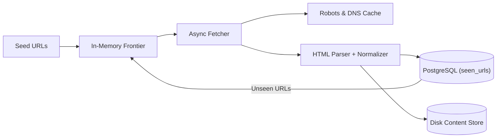
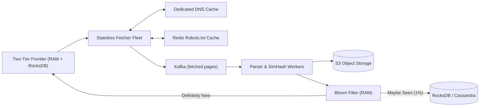
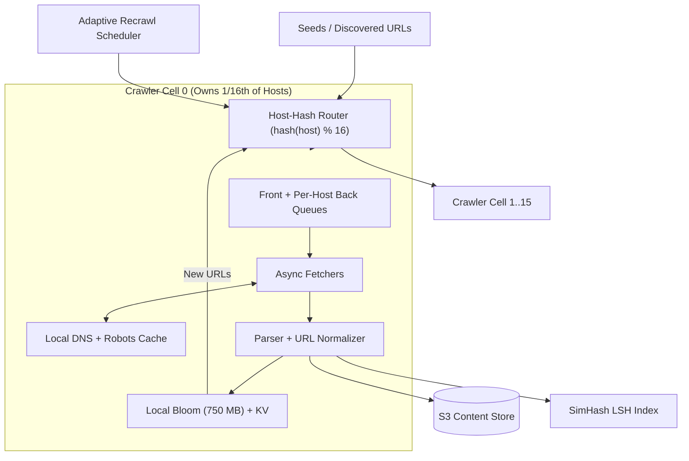
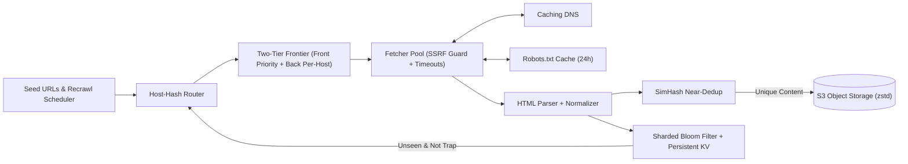
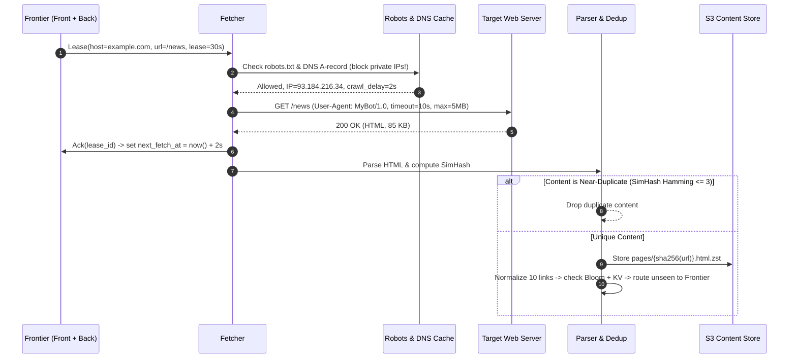

# Web Crawler: Full System Design Mock Interview, All 9 Steps

> **Difficulty:** Senior / Staff (L5–L6) — Distributed BFS, Politeness, Bloom Filters, SimHash & Crawler Traps
> **Prerequisites:** [Previous lesson: Job Queue: Full System Design Mock Interview, All 9 Steps](../19-job-queue/README.md) and the [Interview Framework track](../../21-interview-framework/README.md).
> **Estimated Reading Time:** 25–30 minutes
> **Target Audience:** Engineers practising the full 9-step system design interview on a classic prompt: fetching billions of web pages politely and without repeats.

> [!NOTE]
> **In one line:** A web crawler is **a polite, distributed breadth-first graph traversal**: a two-tier URL frontier (priority + per-host politeness), normalized URL & SimHash content deduplication, and crash-recoverable fetchers.

> [!TIP]
> **The Golden Rule:** Separate **priority** (front queues) from **politeness** (per-host back queues) so one host never gets hammered, deduplicate URLs with a Bloom filter + DB before fetching, deduplicate content with SimHash, and guard against SSRF and infinite crawler traps.

---

## 1. Clarifying Questions, Functional & Non-Functional Requirements

Open with questions, not boxes. A web crawler interview tests graph traversal at internet scale, politeness (`robots.txt` + crawl-delay), URL/content deduplication across 10B+ URLs, DNS caching, and defense against hostile crawler traps (infinite calendars, session IDs, SSRF).

> Say it aloud: *"Before I draw anything, let me confirm the crawl scale, content types, freshness goals, and politeness rules."*

### Clarifying Questions & Assumed Scope

| Question | Assumed Answer | Architectural Impact |
| :--- | :--- | :--- |
| **Primary purpose?** | Feed a web search engine index with fresh HTML pages | Priority by PageRank/importance + recrawl frequency |
| **Scale target?** | 1 billion pages/month (~400 pages/s avg, ~1,000 peak) | ~100 TB/month raw HTML, 10B+ discovered URLs |
| **Content types?** | HTML text & links only (ignore images, video, PDFs) | Content-type header check + 5 MB max response cap |
| **Freshness?** | Recrawl high-churn/popular sites (news) more often | Adaptive recrawl scheduler based on change rate |
| **Politeness & rules?** | Strictly obey `robots.txt` (RFC 9309) & `Crawl-delay` | Per-host back queues + cached `robots.txt` |
| **Out of scope?** | Search indexing/ranking, full JS headless rendering, login-gated web | Mention headless Chrome pool for SPA-heavy domains |

### Functional Requirements

1. **Seed & Discover:** Start from curated seed URLs, fetch HTML, parse outgoing `<a href>` links, and normalize URLs.
2. **Politeness Enforcement:** Obey `robots.txt` directives and enforce at most **1 in-flight request per host** plus `Crawl-delay`.
3. **URL & Content Deduplication:** Never crawl the same normalized URL twice within its freshness window, and detect exact/near-duplicate page content (mirrors).
4. **Adaptive Recrawling:** Track page change frequency and schedule popular/volatile pages more frequently than static archives.

### Non-Functional Requirements

| Quality | Target | Why It Drives the Design |
| :--- | :--- | :--- |
| **Politeness** | $\le 1\text{ req/s}$ (or `Crawl-delay`) per host | Prevents IP bans and DDoS-ing small websites |
| **Throughput** | ~400 pages/s avg, 1,000+ pages/s peak | 1 billion pages/month requires sustained parallel fetching |
| **Robustness** | Survive malformed HTML, slow-loris, infinite traps | The open web is adversarial and messy |
| **Security** | Zero SSRF against internal cloud metadata/VPC IPs | DNS-resolved IP allowlisting before TCP connect |

---

## 2. Back-of-the-Envelope Capacity Estimation

Let us derive QPS, bandwidth, raw storage, and Bloom filter memory for 10B+ URLs.

### Assumptions

- Crawl volume: $N_{\text{pages}} = 1{,}000{,}000{,}000\text{ pages/month}$ ($30\text{ days}$)
- Average HTML page size: $100\text{ KB}$ (uncompressed), $25\text{ KB}$ (zstd/gzip compressed)
- Average outgoing links per page: $10$ links ($\sim 20\%$ are new/unseen URLs)
- Peak-to-average multiplier: $2.5\times$

### Worked Equations

**1. Average & Peak Fetch Rate:**

$$
\lambda_{\text{avg}} = \frac{10^9\text{ pages}}{30 \times 86{,}400\text{ s}} \approx 386\text{ pages/s} \quad \implies \quad \lambda_{\text{peak}} = 386 \times 2.5 \approx 965\text{ pages/s} \approx 1{,}000\text{ pages/s}
$$

**2. Sustained Download Bandwidth:**

$$
BW_{\text{avg}} = 386\text{ pages/s} \times 100\text{ KB} \times 8\text{ bits/B} \approx 308.8\text{ Mbps} \quad (\sim 0.77\text{ Gbps at peak})
$$

**3. Monthly Storage (Raw vs. Compressed):**

$$
S_{\text{raw/mo}} = 10^9 \times 100\text{ KB} = 100\text{ TB/month} \quad \xrightarrow{\text{zstd } 4:1} \quad 25\text{ TB/month in Object Storage (S3)}
$$

**4. Bloom Filter Memory for $n = 10\text{B}$ Seen URLs at False-Positive Rate $p = 0.01$ ($1\%$):**
Using the optimal Bloom filter bit-count formula $m = -\frac{n \ln p}{(\ln 2)^2}$:

$$
m = -\frac{10^{10} \times \ln(0.01)}{(\ln 2)^2} \approx \frac{10^{10} \times 4.605}{0.4805} \approx 9.58 \times 10^{10}\text{ bits} \approx 12\text{ GB of RAM}
$$

With $k = \frac{m}{n} \ln 2 \approx 7$ hash functions, **10 billion URLs fit in just 12 GB of RAM!**

### Capacity Summary Table

| Metric | Formula / Basis | Result | Architectural Implication |
| :--- | :--- | :--- | :--- |
| **Fetch Rate** | $10^9 / 2.592\times 10^6$ | **386/s avg (1K peak)** | ~50–100 async fetcher workers (each handling 20+ hosts) |
| **Peak Bandwidth** | $965 \times 100\text{ KB} \times 8$ | **~0.77 Gbps** | Easily handled by 10 Gbps NICs across fetcher fleet |
| **Storage / Month** | $10^9 \times 100\text{ KB}$ | **100 TB raw (25 TB zstd)** | S3/GCS Object Storage keyed by `sha256(url)` |
| **Seen-URL Bloom Filter** | $10\text{B}$ URLs, $p=1\%$ | **~12 GB RAM** | Partitioned in-memory Bloom filter + RocksDB/KV backing |

---

## 3. Core API Contracts & Data Model

A web crawler's critical interfaces are **internal** between its pipeline stages, plus an operational control plane.

### Internal & Control-Plane Interfaces

| Interface | Caller $\to$ Callee | Contract & Purpose |
| :--- | :--- | :--- |
| `Frontier.LeaseNextHost()` | Fetcher $\to$ Frontier | Returns `(host, url, lease_id)` for a host whose `next_fetch_at <= now()`. |
| `Frontier.Ack(lease_id)` | Fetcher $\to$ Frontier | Marks URL fetched and sets `host.next_fetch_at = now() + crawl_delay`. |
| `Dedup.CheckAndAdd(norm_url)` | Parser $\to$ URL Dedup | Checks Bloom filter; if maybe-present, confirms in KV store. |
| `GET /v1/crawler/stats` | Ops $\to$ Control Plane | Returns crawl rate, frontier depth, 4xx/5xx rates, and trap blocks. |

### Core Data Model

```text
+-------------------------------------------------------------------------+
| 1. URL Frontier (Two-Tier: Front Priority Queues + Back Per-Host Queues)|
|    Front Queues (P0..P3): Ordered by PageRank / change_rate             |
|    Back Queues (1 per host): (host, next_fetch_at, in_flight, url_fifo) |
+-------------------------------------------------------------------------+
| 2. Seen-URL Store (Two-Level: Bloom Filter + Persistent RocksDB/KV)     |
|    Key: sha256(normalized_url) -> {last_crawled_at, etag, change_rate}  |
+-------------------------------------------------------------------------+
| 3. Robots.txt Cache (Redis / Local LRU, 24h TTL)                        |
|    Key: scheme://host:port -> {disallowed_prefixes, crawl_delay_sec}    |
+-------------------------------------------------------------------------+
| 4. Content Store (S3) & SimHash Index (LSH Buckets)                     |
|    S3 Key: pages/{sha256(url)}.html.zst                                 |
|    SimHash: 64-bit fingerprint split into 4x16-bit bands for Hamming<=3 |
+-------------------------------------------------------------------------+
```

---

## 4. Stage 1 (100 - 1K Users): Baseline Monolith & Single Database

For an initial prototype crawling 1–10M pages/month (~5 pages/s), a single crawler node with an in-memory priority queue, local SQLite/PostgreSQL seen-URL table, and local disk storage is clean and debuggable.

### Component-by-Component Build

1. **Seed Loader + Single-Process Frontier:** Holds a Python/Go queue of URLs grouped by `host` with a `next_fetch_at` map.
2. **Async HTTP Fetcher + Local DNS/Robots Cache:** Fetches pages concurrently across different hosts using `asyncio`/goroutines while respecting `Crawl-delay`.
3. **HTML Parser + Normalizer:** Extracts `<a href>` links, resolves relative URLs, lowercases host, strips `#fragment`, and sorts query params.
4. **PostgreSQL `seen_urls` + Local Disk Blob Store:** Checks `INSERT INTO seen_urls ... ON CONFLICT DO NOTHING` before pushing new links to the frontier.



### What Breaks at 10K Scale (100+ pages/s, 1B URLs)?

- **DB `seen_urls` Lookup Bottleneck:** 10 outgoing links/page $\times$ 400 pages/s = **4,000 URL existence checks/sec** against a growing 1B-row B-tree index exceeds RAM and thrashes disk IOPS.
- **Single-Machine Network & DNS Bottleneck:** System `getaddrinfo()` blocks threads and saturates local DNS resolvers.
- **No Crash Recovery:** Losing the single node loses the entire in-memory URL frontier.

---

## 5. Stage 2 (10K - 100K Users): Caching, Read Replicas & Async Offload

To scale to 400+ pages/s and 1B+ discovered URLs, we decouple the **Frontier**, **Fetcher Fleet**, and **Parser/Dedup Pipeline** via durable queues, add a **Bloom filter**, and deploy a **dedicated caching DNS resolver**.

### Component-by-Component Additions

1. **Dedicated Caching DNS Resolver (Unbound / CoreDNS):** Avoids blocking OS `getaddrinfo()` calls and caches `A/AAAA` records across the fetcher fleet.
2. **Two-Tier Disk-Backed Frontier:** Keeps only the head of each host's queue in RAM and spills millions of queued URLs to RocksDB/disk-backed queues.
3. **Bloom Filter + RocksDB/Cassandra `seen_urls`:** 98%+ of already-seen URLs are rejected in RAM in nanoseconds; only ~1% false positives hit the persistent KV store.
4. **Kafka Pipeline (`fetched.pages` $\to$ Parsers $\to$ `discovered.urls`):** Decouples network-bound fetching from CPU-bound HTML parsing and SimHash computation.



### What Breaks at 1M+ Scale (1,000+ pages/s, 10B+ URLs)?

- **Cross-Node Politeness Race:** If multiple Frontier/Fetcher nodes can hold URLs for `example.com`, two fetchers may hit `example.com` simultaneously, violating politeness.
- **Single Bloom Filter RAM Limit & Sync:** A single 12 GB Bloom filter becomes a network hotspot if queried over RPC 10,000 times/sec.

---

## 6. Stage 3 (1M - 10M+ Users): Sharding, Partitioning & Multi-Region Scale

At 1B+ pages/month and 10B+ URLs, we **partition by `hash(host)`** across Crawler Cells so politeness, `robots.txt` caching, and Bloom filters stay **100% local** to one cell.

### Component-by-Component Additions

1. **Host-Consistent Sharding (`hash(host) % N_cells`):** Every URL for `example.com` is routed to the exact same Crawler Cell. That cell owns `example.com`'s back queue, `robots.txt` cache, and politeness timer—zero cross-node coordination needed for politeness!
2. **Sharded Bloom Filters + KV Store:** Each of the $N = 16$ cells holds only $12\text{ GB} / 16 = 750\text{ MB}$ of Bloom filter RAM, making `seen_url` checks local and sub-microsecond.
3. **SimHash LSH Near-Duplicate Index:** Splits 64-bit SimHash fingerprints into four 16-bit bands in a distributed index to detect mirrors/boilerplate pages within Hamming distance $\le 3$.
4. **Adaptive Recrawl Scheduler:** Computes page change-rate (`ETag` / `SimHash` delta) and feeds priority scores back into the Front Queues.



---

## 7. Final Full Production Architecture & End-to-End Flows

### Complete Production Architecture



### End-to-End URL Frontier, Politeness, Fetch & Dedup Sequence



---

## 8. Deep-Dive Bottlenecks & Algorithmic Trade-Offs

### 1. The Mercator Two-Tier URL Frontier (Priority vs. Politeness)

Why can't you use a single priority queue? Because if `cnn.com` has 10,000 high-priority URLs at the top of the heap, 100 workers will pop them simultaneously and DDoS `cnn.com`.
- **Front Queues ($F_0 \dots F_{k-1}$):** Ordered by **priority** (PageRank, freshness score). A selector picks from front queues with bias toward high-priority queues.
- **Back Queues ($B_0 \dots B_{m-1}$, one per active host):** Each back queue holds URLs for a **single host**, paired with a min-heap of `(next_fetch_at, host_queue_id)`. A fetcher pops the host with the smallest `next_fetch_at <= now()`, fetches **1 URL**, and pushes the host back into the heap with `next_fetch_at = now() + max(crawl_delay, 10 * last_rtt)`.

### 2. URL Normalization & Bloom Filter Deduplication

Before checking the Bloom filter, normalize every URL so `HTTP://Example.COM:80/a/../b?y=2&x=1#top` and `http://example.com/b?x=1&y=2` collapse to the exact same canonical string:
- Lowercase `scheme` and `host`; strip default ports (`:80`, `:443`).
- Resolve dot-segments (`/a/../b` $\to$ `/b`) and strip `#fragment`.
- Sort query parameters alphabetically and strip known tracking params (`utm_*`, `fbclid`, `gclid`).

### 3. SimHash for Near-Duplicate Content Detection

Web mirrors and print-friendly pages differ by only a few bytes (e.g., timestamps or ads), defeating exact SHA-256 hashing.
- **SimHash:** Tokenizes extracted visible text into weighted shingles, hashes each to 64 bits, sums $+w$ / $-w$ per bit position, and takes the sign to produce a 64-bit fingerprint.
- **Fast Lookup:** Two documents with Hamming distance $\le 3$ out of 64 bits are near-duplicates. Split the 64-bit SimHash into four 16-bit bands; by the Pigeonhole Principle, any two hashes differing in $\le 3$ bits must match **identically** in at least 1 of the 4 bands!

### Architectural Trade-Offs Summary

| Decision | Option A | Option B | Chosen & Rationale |
| :--- | :--- | :--- | :--- |
| **Seen-URL Check** | Exact DB lookup on every link | Bloom filter in RAM + KV fallback | **Bloom + KV:** Rejects 98%+ repeats in RAM without disk IOPS |
| **Crawl Order** | Pure BFS | Front priority + Back per-host | **Two-Tier Frontier:** High-value pages first + strict host politeness |
| **Content Dedup** | Exact SHA-256 only | Exact hash + 64-bit SimHash | **Both:** Catches mirrors/boilerplate differing only in timestamps |
| **Scale Partitioning** | Random URL sharding | Consistent `hash(host)` sharding | **Host Sharding:** Keeps politeness & `robots.txt` strictly local |

---

## 9. Failure Modes, Reliability & Backpressure Mitigations

| Failure Mode | Impact | Detection | Mitigation |
| :--- | :--- | :--- | :--- |
| **Infinite Crawler Trap** (e.g. `/cal/2099/01/...`) | Frontier fills with junk URLs | Host URL count or depth $> \text{cap}$ | Max depth cap (e.g. 15), max URLs/host, repeating path-segment regex detector |
| **Slow-Loris / 1 GB Tar-Pit** | Fetcher goroutines/connections hang | Read timeout or body $> 5\text{ MB}$ | Strict 5 s connect / 10 s total timeout + streaming 5 MB byte cap |
| **SSRF via Redirect / DNS Rebinding** | Crawler probes `169.254.169.254` or `10.0.0.0/8` | Resolved IP in RFC1918/link-local | Resolve DNS in custom dialer and block private/loopback/metadata CIDRs on every redirect |
| **Fetcher Crash Mid-Crawl** | In-flight URLs dropped | Frontier lease timeout (30 s) | Unacked URLs automatically return to their host's back queue |
| **Host 429 / 503 Rate-Limit** | IP blocked by target site | HTTP 429/503 spike per host | Exponential per-host backoff (`next_fetch_at += 2^k * delay`) |

---

## 10. Production War Story & Real-World Reference

**Reference Pattern:** Manning, Raghavan & Schütze (*Introduction to Information Retrieval*, Ch. 20), Mercator Crawler Architecture, & RFC 9309 (Robots Exclusion Protocol).

### SEV-1 Incident: The Infinite Faceted-Search Trap & SSRF Redirect

- **Symptom:** Crawl throughput on fresh news dropped by 70%, while S3 storage spiked by 40 TB in 12 hours and an internal security scanner flagged probes to AWS metadata (`169.254.169.254`).
- **Root Cause:** Two distinct bugs hit simultaneously:
  1. An e-commerce site had faceted filter URLs (`/shoes?color=red&size=10&sort=asc&page=1...`) generating $10^7$ unique normalized URLs with identical product listings.
  2. A malicious site returned `HTTP 302 Location: http://169.254.169.254/latest/meta-data/`—and the HTTP client followed redirects without re-checking the resolved IP!
- **The Fix:**
  1. Added a **Per-Host URL Budget** + **Path/Query Cardinality Detector** (max 3 query keys per path pattern) and SimHash near-dedup before queuing deeper links.
  2. Implemented a custom **SSRF-Safe Network Dialer** that validates the resolved IP against private/link-local CIDRs on *every* TCP connection, including 3xx redirects.

---

## 11. Core Component Implementation (4 Languages)

Below is a production-grade **URL Normalizer, Bloom Filter & Per-Host Politeness Frontier** demonstrating canonicalization, $O(1)$ membership testing, and per-host `next_fetch_at` scheduling.

````carousel
```go
package crawler

import (
	"crypto/sha256"
	"encoding/binary"
	"net/url"
	"sort"
	"strings"
	"sync"
)

func NormalizeURL(raw string) (string, error) {
	u, err := url.Parse(strings.TrimSpace(raw))
	if err != nil {
		return "", err
	}
	u.Scheme = strings.ToLower(u.Scheme)
	u.Host = strings.ToLower(u.Host)
	u.Fragment = ""
	if u.Path == "" {
		u.Path = "/"
	}
	q := u.Query()
	keys := make([]string, 0, len(q))
	for k := range q {
		keys = append(keys, k)
	}
	sort.Strings(keys)
	ordered := url.Values{}
	for _, k := range keys {
		sort.Strings(q[k])
		ordered[k] = q[k]
	}
	u.RawQuery = ordered.Encode()
	return u.String(), nil
}

type BloomFilter struct {
	bits []byte
	m    uint64
	k    int
}

func NewBloomFilter(m uint64, k int) *BloomFilter {
	return &BloomFilter{bits: make([]byte, (m+7)/8), m: m, k: k}
}

func (b *BloomFilter) AddAndCheck(s string) bool {
	h := sha256.Sum256([]byte(s))
	h1 := binary.BigEndian.Uint64(h[0:8])
	h2 := binary.BigEndian.Uint64(h[8:16])
	seen := true
	for i := 0; i < b.k; i++ {
		pos := (h1 + uint64(i)*h2) % b.m
		if b.bits[pos/8]&(1<<(pos%8)) == 0 {
			seen = false
			b.bits[pos/8] |= 1 << (pos % 8)
		}
	}
	return seen
}

type PoliteFrontier struct {
	mu          sync.Mutex
	hostQueues  map[string][]string
	nextFetchAt map[string]int64
}

func NewPoliteFrontier() *PoliteFrontier {
	return &PoliteFrontier{
		hostQueues:  make(map[string][]string),
		nextFetchAt: make(map[string]int64),
	}
}

func (f *PoliteFrontier) Enqueue(host, normURL string) {
	f.mu.Lock()
	defer f.mu.Unlock()
	f.hostQueues[host] = append(f.hostQueues[host], normURL)
}

func (f *PoliteFrontier) NextReady(now, crawlDelay int64) (string, string, bool) {
	f.mu.Lock()
	defer f.mu.Unlock()
	for host, q := range f.hostQueues {
		if len(q) > 0 && f.nextFetchAt[host] <= now {
			nextURL := q[0]
			f.hostQueues[host] = q[1:]
			f.nextFetchAt[host] = now + crawlDelay
			return host, nextURL, true
		}
	}
	return "", "", false
}
```
<!-- slide -->
```typescript
import { createHash } from "crypto";

export function normalizeUrl(raw: string): string {
  const u = new URL(raw.trim());
  u.protocol = u.protocol.toLowerCase();
  u.hostname = u.hostname.toLowerCase();
  u.hash = "";
  if (!u.pathname) u.pathname = "/";
  const entries = Array.from(u.searchParams.entries()).sort(([a], [b]) => a.localeCompare(b));
  u.search = new URLSearchParams(entries).toString();
  return u.toString();
}

export class BloomFilter {
  private bits: Uint8Array;
  constructor(private m = 1 << 20, private k = 5) {
    this.bits = new Uint8Array(Math.ceil(m / 8));
  }

  addAndCheck(value: string): boolean {
    const buf = createHash("sha256").update(value).digest();
    const h1 = buf.readBigUInt64BE(0);
    const h2 = buf.readBigUInt64BE(8);
    let seen = true;
    for (let i = 0; i < this.k; i++) {
      const pos = Number((h1 + BigInt(i) * h2) % BigInt(this.m));
      const idx = pos >> 3;
      const mask = 1 << (pos & 7);
      if ((this.bits[idx] & mask) === 0) {
        seen = false;
        this.bits[idx] |= mask;
      }
    }
    return seen;
  }
}

export class PoliteFrontier {
  private queues = new Map<string, string[]>();
  private nextFetchAt = new Map<string, number>();

  enqueue(rawUrl: string): void {
    const norm = normalizeUrl(rawUrl);
    const host = new URL(norm).hostname;
    const q = this.queues.get(host) ?? [];
    q.push(norm);
    this.queues.set(host, q);
  }

  nextReady(nowSec: number, crawlDelaySec = 2): string | null {
    for (const [host, q] of this.queues.entries()) {
      if (q.length > 0 && (this.nextFetchAt.get(host) ?? 0) <= nowSec) {
        this.nextFetchAt.set(host, nowSec + crawlDelaySec);
        return q.shift()!;
      }
    }
    return null;
  }
}
```
<!-- slide -->
```python
import hashlib
from collections import defaultdict, deque
from typing import Deque, Dict, Optional
from urllib.parse import parse_qsl, urlencode, urlsplit, urlunsplit

def normalize_url(raw: str) -> str:
    p = urlsplit(raw.strip())
    query = urlencode(sorted(parse_qsl(p.query)))
    return urlunsplit((p.scheme.lower(), p.netloc.lower(), p.path or "/", query, ""))

class BloomFilter:
    def __init__(self, m_bits: int = 1 << 20, k: int = 5) -> None:
        self.m = m_bits
        self.k = k
        self.bits = bytearray((m_bits + 7) // 8)

    def add_and_check(self, value: str) -> bool:
        digest = hashlib.sha256(value.encode()).digest()
        h1 = int.from_bytes(digest[:8], "big")
        h2 = int.from_bytes(digest[8:16], "big")
        seen = True
        for i in range(self.k):
            pos = (h1 + i * h2) % self.m
            if not (self.bits[pos >> 3] & (1 << (pos & 7))):
                seen = False
                self.bits[pos >> 3] |= 1 << (pos & 7)
        return seen

class PoliteFrontier:
    def __init__(self) -> None:
        self._queues: Dict[str, Deque[str]] = defaultdict(deque)
        self._next_fetch: Dict[str, int] = {}

    def enqueue(self, raw_url: str) -> None:
        norm = normalize_url(raw_url)
        host = urlsplit(norm).netloc
        self._queues[host].append(norm)

    def next_ready(self, now_sec: int, crawl_delay: int = 2) -> Optional[str]:
        for host, q in self._queues.items():
            if q and self._next_fetch.get(host, 0) <= now_sec:
                self._next_fetch[host] = now_sec + crawl_delay
                return q.popleft()
        return None
```
<!-- slide -->
```csharp
using System;
using System.Collections.Generic;
using System.Linq;
using System.Security.Cryptography;
using System.Text;

public static class UrlNormalizer
{
    public static string Normalize(string raw)
    {
        var uri = new UriBuilder(raw.Trim()) { Fragment = "" };
        uri.Scheme = uri.Scheme.ToLowerInvariant();
        uri.Host = uri.Host.ToLowerInvariant();
        if (string.IsNullOrEmpty(uri.Path)) uri.Path = "/";
        if (!string.IsNullOrEmpty(uri.Query))
        {
            var pairs = uri.Query.TrimStart('?').Split('&', StringSplitOptions.RemoveEmptyEntries);
            Array.Sort(pairs, StringComparer.Ordinal);
            uri.Query = string.Join("&", pairs);
        }
        return uri.Uri.ToString();
    }
}

public class BloomFilter
{
    private readonly byte[] _bits;
    private readonly ulong _m;
    private readonly int _k;

    public BloomFilter(ulong mBits = 1 << 20, int k = 5) { _m = mBits; _k = k; _bits = new byte[(mBits + 7) / 8]; }

    public bool AddAndCheck(string value)
    {
        var hash = SHA256.HashData(Encoding.UTF8.GetBytes(value));
        var h1 = BitConverter.ToUInt64(hash, 0);
        var h2 = BitConverter.ToUInt64(hash, 8);
        bool seen = true;
        for (int i = 0; i < _k; i++)
        {
            var pos = (h1 + (ulong)i * h2) % _m;
            if ((_bits[pos >> 3] & (1 << (int)(pos & 7))) == 0)
            {
                seen = false;
                _bits[pos >> 3] |= (byte)(1 << (int)(pos & 7));
            }
        }
        return seen;
    }
}
```
````

---

## 12. Verification, Load Testing & CLI Diagnostics

```bash
# 1. Verify robots.txt compliance & crawl-delay parsing for a target domain
curl -s https://example.com/robots.txt | grep -iE "user-agent|disallow|crawl-delay"

# 2. Verify local caching DNS resolver latency & hit rate (Unbound)
unbound-control stats_noreset | grep -E "total.num.queries|total.num.cachehits"

# 3. Check Bloom filter false-positive math for 10B URLs at 12 GB RAM
python3 -c '
import math
n, m_bytes = 10_000_000_000, 12 * 1024**3
m = m_bytes * 8
k = round((m / n) * math.log(2))
fp = (1 - math.exp(-k * n / m)) ** k
print(f"k={k}, theoretical_fp={fp:.4%}")
'

# 4. Inspect per-host politeness violations in fetcher logs (must be 0)
jq 'select(.in_flight_for_host > 1)' /var/log/crawler/fetcher.json
```

---

## 13. Common Interview Mistakes & Red Flags

1. **Using a single global FIFO/priority queue:** Hammers a single domain with hundreds of concurrent requests, getting your crawler IP-banned.
2. **Skipping URL normalization before deduplication:** Crawls the exact same page under dozens of query-param orders, `http`/`https`, or `#fragment` variants.
3. **Putting 10B raw URL strings in a Redis Set:** Costs $> 1\text{ TB}$ of RAM instead of ~12 GB in a Bloom filter + disk KV.
4. **Ignoring `robots.txt` and SSRF protection:** Opens legal/ethical issues and exposes internal cloud metadata (`169.254.169.254`) via malicious 302 redirects.
5. **Using OS `getaddrinfo()` without a caching DNS resolver:** Blocks fetcher threads and overwhelms upstream DNS.
6. **Storing only exact SHA-256 content hashes:** Misses near-duplicate mirrors and dynamically timestamped pages; use SimHash.

---

## 14. Key Terminology & Glossary

| Key Term | Definition |
| :--- | :--- |
| **URL Frontier** | Two-tier queue separating **priority** (front queues) from **politeness** (per-host back queues). |
| **Politeness Policy** | Respecting `robots.txt`, `Crawl-delay`, and limiting to $\le 1$ in-flight request per host. |
| **RFC 9309** | Standard Robots Exclusion Protocol defining `Allow`, `Disallow`, and `User-agent` rules. |
| **URL Normalization** | Canonicalizing scheme, host, dot-segments, fragments, and query parameter order before dedup. |
| **Bloom Filter** | Space-efficient probabilistic set with zero false negatives (~12 GB for 10B URLs at 1% FP). |
| **SimHash** | Locality-sensitive 64-bit fingerprint detecting near-duplicate HTML pages via Hamming distance. |
| **Crawler Trap** | Infinite or combinatorial URL space (calendars, faceted filters) that exhausts crawl budget. |
| **SSRF** | Server-Side Request Forgery; mitigated by blocking private/metadata IPs after DNS resolution. |
| **Host-Consistent Sharding** | Partitioning URLs by `hash(host)` so politeness and `robots.txt` cache stay local to one node. |
| **Adaptive Recrawl** | Adjusting recrawl frequency dynamically based on a page's observed change rate and importance. |

---

## 15. Interview Follow-Up Questions (12 Q&As)

### Basic Conceptual Questions

<details>
<summary><strong>Q1: How do you ensure the crawler stays polite and doesn't DDoS a website? [BASIC]</strong></summary>

Use **per-host back queues** in the URL Frontier. Maintain `next_fetch_at` per host, allow at most 1 in-flight request per host, respect `robots.txt` `Crawl-delay`, and partition URLs by `hash(host)` across crawler nodes so politeness is enforced locally without cross-node races.

</details>

<details>
<summary><strong>Q2: Why use a Bloom filter + persistent KV store instead of just a database for 10 billion seen URLs? [BASIC]</strong></summary>

Checking a 10B-row DB index on every discovered link (4,000+ checks/sec) destroys disk IOPS. A Bloom filter fits 10B URLs in ~12 GB of RAM and rejects 98%+ of already-seen URLs in nanoseconds with zero false negatives; only ~1% false positives hit the persistent KV store.

</details>

<details>
<summary><strong>Q3: Why is URL normalization critical before checking if a URL was seen? [BASIC]</strong></summary>

Without normalization, `http://Example.com/a?b=2&a=1#top` and `http://example.com/a?a=1&b=2` look like two different strings, causing duplicate crawls and wasted storage.

</details>

<details>
<summary><strong>Q4: What happens if a fetcher worker crashes while downloading a URL? [BASIC]</strong></summary>

The Frontier issues a short lease (e.g., 30 s) when handing a URL to a fetcher. If the fetcher crashes and fails to `Ack()`, the lease expires and the URL is returned to its host queue.

</details>

### Scenario-Based Architecture Questions

<details>
<summary><strong>Q5: How do you prioritize important pages (like breaking news) over obscure blogs without starving either? [SCENARIO]</strong></summary>

Use the **Mercator two-tier frontier**: Front queues ($F_0 \dots F_{k-1}$) group URLs by PageRank and change frequency, and a biased selector pulls more frequently from higher-priority front queues into the per-host back queues while still giving lower-priority queues a non-zero share.

</details>

<details>
<summary><strong>Q6: You encounter a website with an infinite calendar (`/events/2099/12/31/...`). How do you stop wasting crawl budget? [SCENARIO]</strong></summary>

Enforce a max URL depth (e.g., 15 hops from seed), a per-host URL budget, and a repeating path-segment / high-cardinality query-parameter detector, plus SimHash near-duplicate detection to stop following links from boilerplate trap pages.

</details>

<details>
<summary><strong>Q7: DNS resolution is slowing down your fetchers. How do you optimize it? [SCENARIO]</strong></summary>

Deploy a dedicated **local caching DNS resolver** (like Unbound/CoreDNS) per crawler cell instead of blocking OS `getaddrinfo()` calls, and cache `A/AAAA` records respecting TTLs.

</details>

<details>
<summary><strong>Q8: How do you detect that two different URLs serve nearly identical HTML (mirrors or print views)? [SCENARIO]</strong></summary>

Compute a **64-bit SimHash** over the extracted visible text (ignoring HTML boilerplate) and query a 4-band LSH index for any existing page within Hamming distance $\le 3$.

</details>

### Advanced & Tricky Interview Questions

<details>
<summary><strong>Q9: A malicious site returns `HTTP 302 Location: http://169.254.169.254/latest/meta-data/`. How do you prevent SSRF? [TRICKY]</strong></summary>

Never trust URL strings alone. Implement a custom network dialer that resolves DNS and verifies the target IP is **not** in loopback (`127.0.0.0/8`), private (`10.0.0.0/8`, `172.16.0.0/12`, `192.168.0.0/16`), or link-local/metadata (`169.254.0.0/16`) ranges *before* opening the TCP socket—on the initial request and every redirect hop.

</details>

<details>
<summary><strong>Q10: Why can't a Bloom filter alone be used to delete or expire old URLs for recrawling? [TRICKY]</strong></summary>

Standard Bloom filters do not support deletion (clearing a bit might break other hashed items). To support recrawling, either store `last_crawled_at` in the persistent KV store and schedule recrawls from the **Adaptive Recrawl Scheduler** directly, or rotate generational Bloom filters.

</details>

<details>
<summary><strong>Q11: How do you crawl JavaScript-heavy Single Page Applications (SPAs) without blowing up CPU cost? [TRICKY]</strong></summary>

Keep 95%+ of crawls on fast raw-HTTP fetchers. Route only domains detected as empty-shell SPAs (or high-value domains) to a separate, rate-limited **Headless Browser (Playwright/Chromium) Rendering Pool**.

</details>

<details>
<summary><strong>Q12: How do you scale the crawler from 400 pages/s to 40,000 pages/s? [TRICKY]</strong></summary>

Because every component—Frontier, Fetchers, DNS/Robots Cache, Bloom Filter, and KV Store—is partitioned by **`hash(host) % N_cells`**, scaling 100x is simply adding more stateless/sharded Crawler Cells and expanding the consistent-hash ring.

</details>

---

## 16. One-Page Master Cheat Sheet

```text
+-----------------------------------------------------------------------------+
|                    WEB CRAWLER — MASTER CHEAT SHEET                         |
+-----------------------------------------------------------------------------+
| 1. FRONTIER      : Mercator 2-tier: Front (Priority) + Back (Per-Host)      |
| 2. POLITENESS    : <=1 in-flight/host | robots.txt (RFC 9309) | Crawl-delay |
| 3. URL DEDUP     : Normalize URL -> Bloom Filter (12GB for 10B) -> KV Store |
| 4. CONTENT DEDUP : SHA-256 (exact) + 64-bit SimHash (Hamming <= 3 mirrors)  |
| 5. TRAPS & SSRF  : Depth/host caps | 5MB/10s cap | Block private IPs on 302 |
| 6. SCALE         : Partition by hash(host) % N_cells -> 100% local state    |
| 7. CAPACITY      : 1B pages/mo = 386/s avg (1K peak) | 25 TB/mo zstd in S3  |
+-----------------------------------------------------------------------------+
```

| Step | Key Decision to State Aloud |
| :--- | :--- |
| **Clarify** | 1B pages/mo, HTML only, `robots.txt` politeness, adaptive freshness |
| **Estimate** | 386 pages/s avg, 100 TB raw (25 TB zstd)/mo, ~12 GB Bloom filter for 10B URLs |
| **Data Model** | Two-tier Frontier, Bloom+KV seen set, Robots cache, S3 content, SimHash LSH |
| **Deep Dive** | Front/Back Frontier, URL normalization, SimHash 4-band LSH, SSRF dialer guard |
| **Reliability** | Host-consistent sharding, lease-based frontier recovery, trap & slow-loris caps |

---

## Further Reading

- Christopher D. Manning, Prabhakar Raghavan, & Hinrich Schütze, *Introduction to Information Retrieval*, Chapter 20 (Web Crawling and Indexes).
- RFC 9309: *Robots Exclusion Protocol*.
- Allan Heydon & Marc Najork, *Mercator: A Scalable, Extensible Web Crawler*.

---

## Next

Continue with [Search Engine: Full System Design Mock Interview, All 9 Steps](../21-search-engine/README.md).
