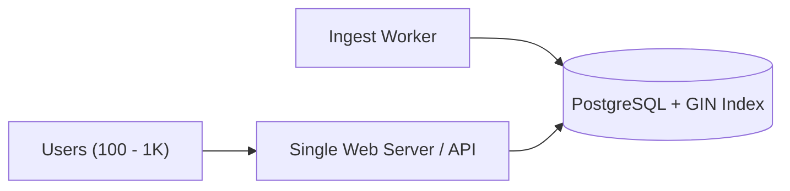
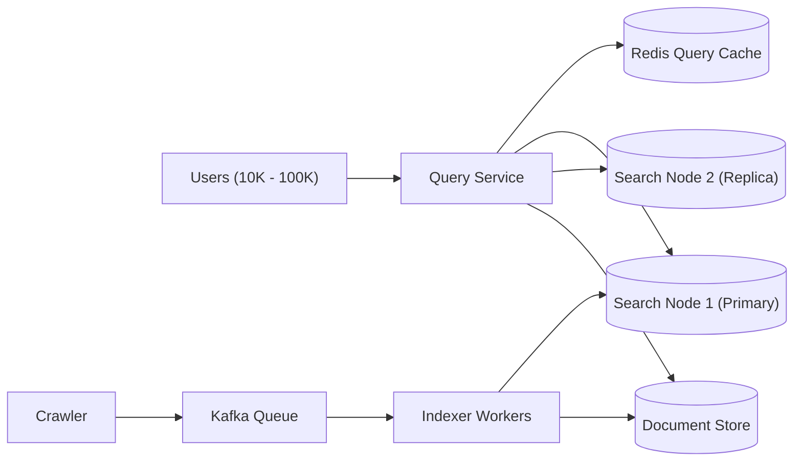
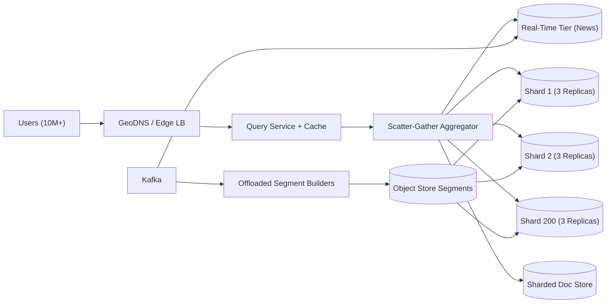
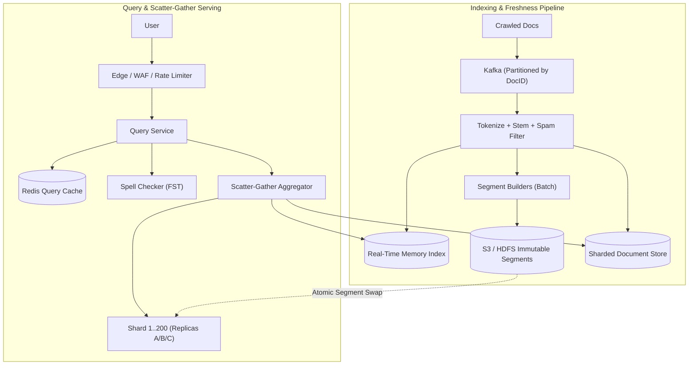
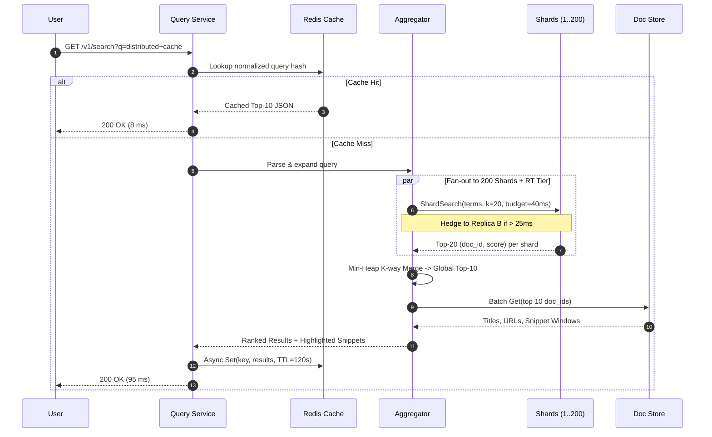

# Search Engine: Full System Design Mock Interview, All 9 Steps

> **Difficulty:** Hard (Senior / Staff)
> **Prerequisites:** [Previous lesson: Web Crawler: Full System Design Mock Interview, All 9 Steps](../20-web-crawler/README.md) and the [Interview Framework track](../../21-interview-framework/README.md).
> **Estimated Reading Time:** 25–30 minutes
> **Target Audience:** Engineers practising the full 9-step system design interview on a classic prompt: indexing billions of documents and answering text queries in under 200 ms.

> [!NOTE]
> **In one line:** A search engine is **an inverted index plus a ranking function**: index time builds a compressed, document-sharded map from terms to posting lists, and query time fans out in parallel, intersects lists, scores with BM25 + quality signals, and merges top-k results.

> [!TIP]
> **The Golden Rule:** Do the expensive work at index time. Partition the inverted index by **document** (not by term), fan out queries to every shard in parallel with hedged requests and strict time budgets, and accept eventual freshness via a small real-time tier.

---

## 1. Clarifying Questions, Functional & Non-Functional Requirements

Open with questions, not boxes. After the web crawler, the core challenge is turning 10 billion raw pages into an index that answers arbitrary keyword and phrase queries in under 200 ms at p99.

### Clarifying Questions & Assumed Answers

| Question | Assumed Answer | Architectural Impact |
| :--- | :--- | :--- |
| **Query types?** | Keyword (`AND`/`OR`), exact phrase (`"cat food"`), basic filters (lang, site) | Requires positional inverted index (term positions stored in posting lists) |
| **Corpus size?** | 10 billion documents, avg 5 KB extracted text | ~50 TB raw text; must shard across hundreds of nodes |
| **Freshness SLA?** | Breaking news within 2–5 minutes; general web within hours | Requires two-tier architecture: real-time delta index + batch static segments |
| **Result features?** | Top-10 ranked URLs, highlighted snippets, spelling suggestions; no personalization | Needs separate Document Store for snippet generation and fast Spell/Suggest index |
| **Read/Write scale?** | 50,000 QPS read; ~1,000–5,000 docs/sec indexed continuously | Read-heavy fan-out; index builds must not block query serving |

> Say it aloud: *"Before I draw anything, let me confirm the scope, corpus size, freshness SLA, and latency budget."*

### Functional Requirements

1. **Continuous Indexing:** Ingest crawled documents, tokenize, stem, compute static quality signals, and update the searchable index.
2. **Ranked Retrieval:** Accept keyword and phrase queries, intersect posting lists, score matches (BM25 + link authority), and return top-k results.
3. **Snippet Generation:** Extract and highlight query terms around matching positions in the document text.
4. **Spelling & Query Correction:** Detect likely typos (edit distance / phonetic / query-log co-occurrence) and suggest `"Did you mean..."`.

### Non-Functional Requirements

| Quality Attribute | Target | Why It Drives the Design |
| :--- | :--- | :--- |
| **Query Latency** | p50 < 50 ms, p99 < 200 ms | Interactive search; tail latency across 200 shards requires hedging & timeouts |
| **Availability** | 99.99% (graceful degradation) | Partial shard failure must still return best-effort top results |
| **Scalability** | 10B+ docs, 50K QPS | Document-partitioned sharding + memory-mapped / RAM-resident indexes |
| **Freshness** | < 5 min (news), < 24h (web) | LSM-style immutable segments + real-time memory buffer |

### Explicit Scope Boundaries

- **In Scope:** Indexing pipeline, document-sharded inverted index, scatter-gather query path, BM25 + static rank fusion, snippet store, query caching.
- **Out of Scope:** Web crawling & politeness (covered in Lesson 20), deep-learning re-ranking transformers (L2R), ad auctions, user personalization.

---

## 2. Back-of-the-Envelope Capacity Estimation

Let us derive storage, shard count, memory, and network fan-out from first principles.

### Assumptions
- Corpus: $N = 10 \times 10^9$ documents.
- Average extracted text per document: $S_{\text{doc}} = 5\text{ KB}$.
- Compressed inverted index overhead: roughly $0.5\times$ raw text size (with Variable-Byte / PForDelta compression), plus $0.5\times$ for positional data and forward/feature vectors $\implies \text{total index} \approx 1.0\times$ raw text.
- Replication factor: $R = 3$ for availability and read throughput.
- Read traffic: $Q = 50{,}000\text{ QPS}$ (peak $2.5\times = 125{,}000\text{ QPS}$).
- Cache hit rate on popular/head queries: $H = 35\%$.

### Worked Equations

**1. Total Raw Corpus & Index Size:**
$$S_{\text{corpus}} = 10^{10}\text{ docs} \times 5{,}000\text{ bytes/doc} = 5 \times 10^{13}\text{ bytes} = 50\text{ TB}$$

With compression and positional posting lists, the total inverted index is ~50 TB. Storing raw/compressed document text for snippet generation adds another ~20 TB (compressed with Zstandard at ~2.5:1):
$$S_{\text{docstore}} = \frac{50\text{ TB}}{2.5} = 20\text{ TB}$$

**2. Shard Count & Cluster Sizing:**
If each index shard holds $50\text{M}$ documents (~250 GB of index data, fitting comfortably on fast NVMe + OS page cache / RAM):
$$N_{\text{shards}} = \frac{10 \times 10^9}{50 \times 10^6} = 200\text{ shards}$$

With $R = 3$ replicas per shard:
$$N_{\text{machines}} = 200 \times 3 = 600\text{ index servers}$$

**3. Query Fan-Out & Internal RPC Load:**
After a 35% query cache hit rate, $65\%$ of queries hit the index shards:
$$Q_{\text{miss}} = 50{,}000 \times (1 - 0.35) = 32{,}500\text{ QPS}$$

Each miss fans out to all 200 shards:
$$Q_{\text{shard\_total}} = 32{,}500 \times 200 = 6{,}500{,}000\text{ shard RPCs/sec}$$

Across 600 index machines, each machine handles:
$$Q_{\text{per\_node}} = \frac{6{,}500{,}000}{600} \approx 10{,}833\text{ shard queries/sec}$$

**4. Network Bandwidth (Aggregator Ingress/Egress):**
If each shard returns top-$k=20$ `(doc_id, score)` pairs (16 bytes each = 320 bytes + 80 bytes overhead = 400 bytes per shard response):
$$BW_{\text{agg}} = 6{,}500{,}000\text{ resp/s} \times 400\text{ bytes} = 2.6\text{ GB/s} \approx 20.8\text{ Gbps}$$

### Capacity Summary Table

| Metric | Formula / Derivation | Result |
| :--- | :--- | :--- |
| **Raw Text Corpus** | $10^{10} \times 5\text{ KB}$ | **50 TB** |
| **Compressed Inverted Index** | $\approx 1.0 \times \text{raw text}$ | **50 TB** |
| **Compressed Document Store** | $50\text{ TB} / 2.5\text{ (Zstd)}$ | **20 TB** |
| **Shard Count (50M docs/shard)** | $10^{10} / 5 \times 10^7$ | **200 shards** |
| **Total Index Nodes ($R=3$)** | $200 \times 3$ | **600 servers** |
| **Shard Fan-Out RPCs/s (after 35% cache)** | $32{,}500 \times 200$ | **6.5M RPCs/sec** |
| **Aggregator Network Bandwidth** | $6.5\text{M} \times 400\text{ B}$ | **~20.8 Gbps** |

---

## 3. Core API Contracts & Data Model

### Public & Internal APIs

| Endpoint / RPC | Direction | Contract & Notes |
| :--- | :--- | :--- |
| `GET /v1/search?q=cat+food&page=1&size=10` | Client $\to$ Query Service | Returns `results[]` (`url`, `title`, `snippet`, `score`), `total_estimate`, `did_you_mean`, `took_ms`. **Never compute exact totals.** |
| `GET /v1/suggest?q=caht` | Client $\to$ Spell/Suggest | Returns top corrections using edit distance + query log frequency. |
| `POST /internal/v1/index` | Crawler $\to$ Ingest | Accepts `{doc_id, url, title, body, lang, pagerank, crawled_at}`. Returns `202 Accepted`. |
| `gRPC ShardService.Search(terms, k, deadline_ms)` | Aggregator $\to$ Shard | Returns top-$k$ `(doc_id, score)` pairs within strict `deadline_ms` (e.g., 40 ms). |

### Data Model & Storage Engines

| Entity / Store | Schema / Key Structure | Storage Engine & Rationale |
| :--- | :--- | :--- |
| **Inverted Index (per shard)** | `term_id -> PostingList[(doc_id_delta, tf, [pos_deltas])]` | Custom immutable LSM segments (Lucene-style `.tim`/`.doc`/`.pos` files) `mmap`'d in OS page cache |
| **Term Dictionary (FST)** | `term_string -> (df, posting_file_offset)` | Finite State Transducer (FST) pinned in RAM; $O(\text{len(term)})$ lookup |
| **Document Store** | `doc_id -> {url, title, compressed_body}` | Sharded KV / RocksDB or Columnar blocks on NVMe; fetched **only** for final top-10 results |
| **Feature / Forward Store** | `doc_id -> {pagerank, spam_score, length_norm}` | Dense fixed-width array in RAM/mmap for $O(1)$ scoring during intersection |
| **Query Cache** | `hash(normalized_query + page) -> serialized_response` | Redis / Memcached cluster; TTL 60–300s |

---

## 4. Stage 1 (100 - 1K Users): Baseline Monolith & Single Database

At 100–1,000 users (< 100K documents, < 10 QPS), you do not need 600 servers or custom FSTs. Start simple and build component by component.

### Component-by-Component Build
1. **PostgreSQL with GIN Full-Text Index (`tsvector`):** Store documents in a `documents` table and create a `GIN` inverted index on `to_tsvector('english', title || ' ' || body)`.
2. **Monolithic Search API:** A single stateless backend parses the query (`plainto_tsquery`), runs `ts_rank_cd` in Postgres, generates snippets with `ts_headline`, and returns JSON.
3. **Background Worker Thread:** Polls a `crawl_queue` table and upserts parsed documents into `documents`.



### What Breaks at 10K Users & 10M Documents?
- **GIN Index Write Amplification:** Updating a `GIN` index on a 10M-row table causes heavy random I/O and vacuum bloat, stalling concurrent queries.
- **Snippet Generation CPU:** `ts_headline` re-tokenizes raw text on the DB CPU for every matched row, saturating Postgres cores.
- **No Horizontal Sharding:** A single Postgres instance cannot hold 50 TB or handle 1,000+ QPS of multi-term intersections.

---

## 5. Stage 2 (10K - 100K Users): Caching, Read Replicas & Async Offload

At 10K–100K users (10M–100M documents, 500–2,000 QPS), we separate indexing from serving, introduce a dedicated inverted index engine, and add caching.

### Component-by-Component Additions
1. **Dedicated Search Engine Nodes (e.g., Lucene / OpenSearch):** Replace Postgres `GIN` with immutable segment-based inverted indexes. Segments are written sequentially and merged in the background.
2. **Kafka Ingestion Queue:** Decouples the crawler from the indexing pipeline so crawl bursts do not overwhelm indexers.
3. **Query Cache (Redis):** Caches normalized queries (`"weather tokyo"`), absorbing 30–40% of head traffic.
4. **Separate Document Store:** Move raw text out of the index nodes into a KV store so index RAM is reserved strictly for posting lists and FSTs.



### What Breaks at 1M+ Users & 10B Documents?
- **Single-Shard Memory Limit:** One node cannot hold 10B documents (50 TB). We must partition documents across 200+ shards.
- **Tail Latency Amplification:** Fanning out to 200 shards means if any 1 shard has a 99th-percentile GC pause or disk stall, the entire query stalls.
- **Global Index Rebuild Bottleneck:** Re-indexing or merging giant segments on serving nodes causes CPU spikes that hurt p99 query latency.

---

## 6. Stage 3 (1M - 10M+ Users): Sharding, Partitioning & Multi-Region Scale

At 1M–10M+ users (10B documents, 50K+ QPS), we move to **Document-Partitioned Sharding**, **Scatter-Gather Aggregators**, **Hedged Requests**, and **Two-Tier Freshness**.

### Component-by-Component Additions
1. **Document-Partitioned Shards (200 Shards $\times$ 3 Replicas):** Documents are hashed (`hash(url) % 200`) to a shard. Every shard is a self-contained search engine for its 50M docs.
2. **Stateless Scatter-Gather Aggregators:** Parse queries, rewrite synonyms/spellings, fan out gRPC calls to all 200 shards in parallel, and merge top-$k$ via a min-heap.
3. **Hedged Requests & Time Budgets:** If a shard replica does not respond within `p95` (e.g., 25 ms), the aggregator sends a hedged request to a second replica and takes the fastest response. At 120 ms, it drops stragglers and returns best-effort results.
4. **Offloaded Segment Builders + Real-Time Tier:** Heavy segment merging happens on dedicated builder nodes (MapReduce/Spark or Flink), which push immutable segments to S3/HDFS; serving shards pull and `mmap` them atomically. A small in-memory **Real-Time Tier** indexes breaking news in < 60 seconds.



---

## 7. Final Full Production Architecture & End-to-End Flows

### Complete Production Architecture



### End-to-End Query Sequence Diagram



---

## 8. Deep-Dive Bottlenecks & Algorithmic Trade-Offs

### 1. Document Partitioning vs. Term Partitioning

| Dimension | Document Partitioning (Chosen) | Term Partitioning |
| :--- | :--- | :--- |
| **How it works** | Shard holds all terms for $\frac{1}{N}$ of documents | Shard holds full posting list for $\frac{1}{N}$ of terms |
| **Query execution** | Fan out to all 200 shards; local intersection | Route only to shards owning query terms; cross-shard list transfer |
| **Load balance** | Uniform (hashed by doc ID) | Severely skewed (hot terms like `"the"`, `"iphone"` melt 1 shard) |
| **Phrase / AND queries** | Fast local intersection + skip pointers | Huge network bandwidth shipping multi-MB posting lists |
| **Availability** | Losing 1 shard drops 0.5% of corpus | Losing 1 shard breaks every query containing its terms |

### 2. Posting List Compression & Intersection Speed
Storing raw 64-bit `doc_id`s wastes memory. Because posting lists are sorted (`[102, 105, 119, 140]`), we store **delta gaps** (`[102, 3, 14, 21]`) and compress blocks of 128 integers using **PForDelta** or **SIMD-BP128**.
- **Galloping (Exponential) Search & Skip Pointers:** When intersecting a rare term (`"k8s"`, 50K docs) with a common term (`"error"`, 500M docs), we never scan all 500M entries. We iterate `"k8s"` and use skip pointers / galloping binary search on `"error"` in $O(|A| \log \frac{|B|}{|A|})$ time.
- **Block-Max WAND (Weak AND):** For `OR` queries, Block-Max WAND tracks the maximum possible BM25 score per 128-doc block and skips entire blocks that cannot beat the current $k$-th best score in the heap.

### 3. BM25 + Static Authority Ranking
Text relevance alone fails on the web (keyword stuffing). We combine **BM25** with static quality signals (PageRank, domain trust, freshness):

$$\text{BM25}(D, Q) = \sum_{i=1}^{n} \text{IDF}(q_i) \cdot \frac{f(q_i, D) \cdot (k_1 + 1)}{f(q_i, D) + k_1 \cdot \left(1 - b + b \cdot \frac{|D|}{\text{avgdl}}\right)}$$

$$\text{FinalScore}(D, Q) = w_1 \cdot \text{BM25}(D, Q) + w_2 \cdot \log(1 + \text{PageRank}(D)) + w_3 \cdot \text{Freshness}(D)$$

Where $k_1 \approx 1.2$, $b \approx 0.75$, and $\text{IDF}(q_i)$ is precomputed at segment build time.

---

## 9. Failure Modes, Reliability & Backpressure Mitigations

### Tail Latency Amplification Math
If 200 shards each have a $p99 = 100\text{ ms}$ (meaning $1\%$ of requests take $> 100\text{ ms}$), the probability that **at least one** of the 200 shards is slow on a single query is:
$$P(\text{slow query}) = 1 - (0.99)^{200} = 1 - 0.134 = 86.6\%$$
Without mitigation, **86.6% of all user searches would hit tail latency!**

### Concrete Mitigations

| Failure / Bottleneck | Impact Without Mitigation | Engineering Mitigation |
| :--- | :--- | :--- |
| **Straggler Shard (GC / Disk)** | 86.6% of queries exceed 100 ms | **Hedged Requests:** Send backup RPC to Replica B after 25 ms; **Time Budget:** Drop stragglers at 80 ms and return partial results (`"partial": true`) |
| **Hot Query Stampede** | Sudden celebrity/news spike melts shards | **Singleflight / Request Coalescing** at Query Cache so 10,000 identical misses trigger only 1 fan-out |
| **Corrupt Index Build** | Wrong/empty search results | **Blue-Green Atomic Swap:** Validate new segments against golden canary queries before `mmap` swap; instant rollback |
| **Query of Death (Wildcard/Long)** | Regex or 50-term phrase query OOMs shard | Reject leading wildcards (`*foo`), cap max query terms to 16, enforce per-shard CPU cancellation token |
| **Doc Store Saturation** | Snippet fetching blocks aggregator | Fetch snippets **only** for the final top-10 `doc_id`s (not top-20 from all 200 shards) |

---

## 10. Production War Story & Real-World Reference

### The "Tail at Scale" & Segment Merge Storm (Google / Elasticsearch Pattern)
In large-scale Lucene/Elasticsearch deployments, a classic **SEV-1** occurs when background segment merging runs on the same nodes serving live queries during peak traffic.
- **Root Cause:** Heavy disk compaction saturates NVMe I/O queues and triggers Stop-The-World JVM GC pauses on 5–10% of shard nodes. Because every query fans out to all 200 shards, a 5% slow-node rate causes $1 - 0.95^{200} = 99.996\%$ of user queries to time out, triggering client retries that create a 5x traffic retry storm.
- **Fix:**
  1. **Decouple Segment Building:** Build and merge large segments offline on dedicated batch workers, then ship immutable files to serving nodes.
  2. **Hedged Requests + Circuit Breakers:** Dean & Barroso (*The Tail at Scale*, Google) showed that sending a hedged request after the 95th-percentile delay (e.g., 25 ms) cuts 99.9th-percentile latency by over 80% while adding only ~5% extra load.

---

## 11. Core Component Implementation (4 Languages)

Below is a production-grade **Document-Sharded Inverted Index with BM25 Scoring & Top-K Min-Heap Merge** in Go, TypeScript, Python, and C#.

````carousel
```go
package main

import (
	"container/heap"
	"fmt"
	"math"
	"strings"
)

type Posting struct {
	DocID int
	TF    int
}

type SearchShard struct {
	index   map[string][]Posting
	docLens map[int]int
	avgDL   float64
	numDocs int
}

func NewSearchShard(docs map[int]string) *SearchShard {
	s := &SearchShard{
		index:   make(map[string][]Posting),
		docLens: make(map[int]int),
		numDocs: len(docs),
	}
	totalLen := 0
	for docID, text := range docs {
		tokens := strings.Fields(strings.ToLower(text))
		s.docLens[docID] = len(tokens)
		totalLen += len(tokens)
		tfMap := make(map[string]int)
		for _, tok := range tokens {
			tfMap[tok]++
		}
		for term, tf := range tfMap {
			s.index[term] = append(s.index[term], Posting{DocID: docID, TF: tf})
		}
	}
	if s.numDocs > 0 {
		s.avgDL = float64(totalLen) / float64(s.numDocs)
	}
	return s
}

type ScoredDoc struct {
	DocID int
	Score float64
}

type MinHeap []ScoredDoc

func (h MinHeap) Len() int           { return len(h) }
func (h MinHeap) Less(i, j int) bool { return h[i].Score < h[j].Score }
func (h MinHeap) Swap(i, j int)      { h[i], h[j] = h[j], h[i] }
func (h *MinHeap) Push(x any)        { *h = append(*h, x.(ScoredDoc)) }
func (h *MinHeap) Pop() any {
	old := *h
	n := len(old)
	item := old[n-1]
	*h = old[:n-1]
	return item
}

func (s *SearchShard) SearchBM25(query string, k int) []ScoredDoc {
	terms := strings.Fields(strings.ToLower(query))
	scores := make(map[int]float64)
	k1, b := 1.2, 0.75

	for _, term := range terms {
		postings := s.index[term]
		df := float64(len(postings))
		if df == 0 {
			continue
		}
		idf := math.Log((float64(s.numDocs)-df+0.5)/(df+0.5) + 1.0)
		for _, p := range postings {
			dl := float64(s.docLens[p.DocID])
			tf := float64(p.TF)
			num := tf * (k1 + 1.0)
			den := tf + k1*(1.0-b+b*(dl/s.avgDL))
			scores[p.DocID] += idf * (num / den)
		}
	}

	h := &MinHeap{}
	heap.Init(h)
	for docID, score := range scores {
		heap.Push(h, ScoredDoc{DocID: docID, Score: score})
		if h.Len() > k {
			heap.Pop(h)
		}
	}
	res := make([]ScoredDoc, h.Len())
	for i := len(res) - 1; i >= 0; i-- {
		res[i] = heap.Pop(h).(ScoredDoc)
	}
	return res
}

func main() {
	shard := NewSearchShard(map[int]string{
		1: "distributed cache and inverted index",
		2: "inverted index sharded by document",
		3: "cat food and pet care",
	})
	fmt.Printf("Top-2 results: %+v\n", shard.SearchBM25("inverted index", 2))
}
```
<!-- slide -->
```typescript
interface Posting {
  docId: number;
  tf: number;
}

interface ScoredDoc {
  docId: number;
  score: number;
}

class SearchShard {
  private index = new Map<string, Posting[]>();
  private docLens = new Map<number, number>();
  private avgDL = 0;
  private numDocs = 0;

  constructor(docs: Record<number, string>) {
    let totalLen = 0;
    const entries = Object.entries(docs);
    this.numDocs = entries.length;

    for (const [idStr, text] of entries) {
      const docId = Number(idStr);
      const tokens = text.toLowerCase().split(/\s+/).filter(Boolean);
      this.docLens.set(docId, tokens.length);
      totalLen += tokens.length;

      const tfMap = new Map<string, number>();
      for (const tok of tokens) {
        tfMap.set(tok, (tfMap.get(tok) ?? 0) + 1);
      }
      for (const [term, tf] of tfMap.entries()) {
        const list = this.index.get(term) ?? [];
        list.push({ docId, tf });
        this.index.set(term, list);
      }
    }
    this.avgDL = this.numDocs > 0 ? totalLen / this.numDocs : 0;
  }

  searchBM25(query: string, k: number): ScoredDoc[] {
    const terms = query.toLowerCase().split(/\s+/).filter(Boolean);
    const scores = new Map<number, number>();
    const k1 = 1.2;
    const b = 0.75;

    for (const term of terms) {
      const postings = this.index.get(term) ?? [];
      const df = postings.length;
      if (df === 0) continue;

      const idf = Math.log((this.numDocs - df + 0.5) / (df + 0.5) + 1.0);
      for (const p of postings) {
        const dl = this.docLens.get(p.docId) ?? 0;
        const num = p.tf * (k1 + 1.0);
        const den = p.tf + k1 * (1.0 - b + b * (dl / this.avgDL));
        scores.set(p.docId, (scores.get(p.docId) ?? 0) + idf * (num / den));
      }
    }

    return Array.from(scores.entries())
      .map(([docId, score]) => ({ docId, score }))
      .sort((a, b) => b.score - a.score)
      .slice(0, k);
  }
}

const shard = new SearchShard({
  1: "distributed cache and inverted index",
  2: "inverted index sharded by document",
  3: "cat food and pet care",
});
console.log(shard.searchBM25("inverted index", 2));
```
<!-- slide -->
```python
import heapq
import math
from collections import Counter, defaultdict

class SearchShard:
    def __init__(self, docs: dict[int, str]) -> None:
        self.index: dict[str, list[tuple[int, int]]] = defaultdict(list)
        self.doc_lens: dict[int, int] = {}
        self.num_docs = len(docs)
        total_len = 0

        for doc_id, text in docs.items():
            tokens = text.lower().split()
            self.doc_lens[doc_id] = len(tokens)
            total_len += len(tokens)
            for term, tf in Counter(tokens).items():
                self.index[term].append((doc_id, tf))

        self.avg_dl = total_len / self.num_docs if self.num_docs else 0.0

    def search_bm25(self, query: str, k: int = 10) -> list[tuple[int, float]]:
        terms = query.lower().split()
        scores: dict[int, float] = defaultdict(float)
        k1, b = 1.2, 0.75

        for term in terms:
            postings = self.index.get(term, [])
            df = len(postings)
            if df == 0:
                continue
            idf = math.log((self.num_docs - df + 0.5) / (df + 0.5) + 1.0)
            for doc_id, tf in postings:
                dl = self.doc_lens[doc_id]
                num = tf * (k1 + 1.0)
                den = tf + k1 * (1.0 - b + b * (dl / self.avg_dl))
                scores[doc_id] += idf * (num / den)

        top_k = heapq.nlargest(k, scores.items(), key=lambda item: item[1])
        return top_k

if __name__ == "__main__":
    shard = SearchShard({
        1: "distributed cache and inverted index",
        2: "inverted index sharded by document",
        3: "cat food and pet care",
    })
    print(shard.search_bm25("inverted index", k=2))
```
<!-- slide -->
```csharp
using System;
using System.Collections.Generic;
using System.Linq;

public record Posting(int DocId, int Tf);
public record ScoredDoc(int DocId, double Score);

public class SearchShard
{
    private readonly Dictionary<string, List<Posting>> _index = new();
    private readonly Dictionary<int, int> _docLens = new();
    private readonly double _avgDl;
    private readonly int _numDocs;

    public SearchShard(Dictionary<int, string> docs)
    {
        _numDocs = docs.Count;
        long totalLen = 0;

        foreach (var (docId, text) in docs)
        {
            var tokens = text.ToLowerInvariant().Split(' ', StringSplitOptions.RemoveEmptyEntries);
            _docLens[docId] = tokens.Length;
            totalLen += tokens.Length;

            foreach (var grp in tokens.GroupBy(t => t))
            {
                if (!_index.TryGetValue(grp.Key, out var list))
                {
                    list = new List<Posting>();
                    _index[grp.Key] = list;
                }
                list.Add(new Posting(docId, grp.Count()));
            }
        }
        _avgDl = _numDocs > 0 ? (double)totalLen / _numDocs : 0.0;
    }

    public List<ScoredDoc> SearchBm25(string query, int k)
    {
        var terms = query.ToLowerInvariant().Split(' ', StringSplitOptions.RemoveEmptyEntries);
        var scores = new Dictionary<int, double>();
        const double k1 = 1.2, b = 0.75;

        foreach (var term in terms)
        {
            if (!_index.TryGetValue(term, out var postings) || postings.Count == 0)
                continue;

            double df = postings.Count;
            double idf = Math.Log((_numDocs - df + 0.5) / (df + 0.5) + 1.0);

            foreach (var p in postings)
            {
                double dl = _docLens[p.DocId];
                double num = p.Tf * (k1 + 1.0);
                double den = p.Tf + k1 * (1.0 - b + b * (dl / _avgDl));
                scores[p.DocId] = scores.GetValueOrDefault(p.DocId) + idf * (num / den);
            }
        }

        return scores
            .Select(kv => new ScoredDoc(kv.Key, kv.Value))
            .OrderByDescending(x => x.Score)
            .Take(k)
            .ToList();
    }
}
```
````

---

## 12. Verification, Load Testing & CLI Diagnostics

```bash
# 1. Inspect shard distribution, segment count, and heap pressure (OpenSearch/Elasticsearch)
curl -s "http://localhost:9200/_cat/shards?v&h=index,shard,prirep,state,docs,store,node"
curl -s "http://localhost:9200/_cat/nodes?v&h=name,heap.percent,ram.percent,cpu,load_1m"

# 2. Profile a slow query to see per-shard rewrite, intersect, and BM25 scoring breakdown
curl -s -XGET "http://localhost:9200/web_docs/_search" -H "Content-Type: application/json" -d '{
  "profile": true,
  "query": { "match": { "body": "distributed cache" } }
}' | jq '.profile.shards[0].searches[0].query'

# 3. Verify OS page cache hit rate (mmap'd inverted index segments)
vmtouch -v /var/lib/search/shards/shard_042/segments/

# 4. Load test scatter-gather tail latency (p50, p95, p99) at 5,000 QPS
hey -n 100000 -c 200 -q 25 "http://search-gateway.internal/v1/search?q=system+design"
```

---

## 13. Common Interview Mistakes & Red Flags

- **Scanning documents at query time:** Suggesting `LIKE '%term%'` or regex scans instead of an inverted index.
- **Term-partitioned sharding:** Sharding by term creates massive cross-shard network traffic for `AND` queries and melts the shard holding common words.
- **Waiting for all 200 shards:** Failing to address tail latency amplification ($1 - 0.99^{200} = 86.6\%$) via hedged requests and time budgets.
- **Computing exact result counts:** Running full-corpus counts instead of returning an estimate (`"about 1,420,000 results"`).
- **Storing full document bodies inside the inverted index RAM:** Bloats heap/page cache and evicts hot posting lists.
- **Ignoring segment immutability:** Mutating posting lists in place instead of using append-only LSM segments + background compaction.

---

## 14. Key Terminology & Glossary

| Key Term | Definition |
| :--- | :--- |
| **Inverted Index** | A data structure mapping each normalized term to a sorted list of document IDs (posting list) containing it. |
| **Posting List** | Sorted list of `(doc_id, term_frequency, positions)` entries for a single term, delta-encoded and compressed. |
| **FST (Finite State Transducer)** | Memory-compact prefix graph mapping terms to posting-list file offsets in $O(\text{len(term)})$ time. |
| **BM25** | Probabilistic relevance scoring formula balancing term frequency saturation ($k_1$) and document length normalization ($b$). |
| **Scatter-Gather** | Query pattern where an aggregator fans out a query to all $N$ shards in parallel and merges their top-$k$ results. |
| **Hedged Request** | Sending a duplicate RPC to a secondary replica after a short delay (e.g., p95) to crush tail latency. |
| **Galloping Search** | Exponential-jump binary search used to intersect a short posting list with a massive posting list. |
| **Block-Max WAND** | Early-termination algorithm that skips entire 128-doc blocks whose upper-bound score cannot enter top-$k$. |
| **LSM Segment** | Immutable index file written sequentially and merged asynchronously in the background. |
| **Document Store** | Separate KV/columnar store holding compressed document text solely for snippet highlighting. |

---

## 15. Interview Follow-Up Questions (12 Q&As)

### Basic Conceptual Questions

<details>
<summary><strong>Q1: How does an inverted index work, and what is inside a posting list? [BASIC]</strong></summary>

An inverted index maps every normalized term (lowercased, stemmed) to a sorted list of document IDs containing that term. Each entry in the posting list stores `(doc_id_delta, term_frequency, [word_positions])`. Word positions enable exact phrase queries (`"cat food"` checks if `pos(food) == pos(cat) + 1`).

</details>

<details>
<summary><strong>Q2: Why do we shard by document instead of by term? [BASIC]</strong></summary>

With document partitioning, every shard is a complete search engine for $\frac{1}{N}$ of the corpus. `AND` and phrase intersections happen locally on each shard without shipping megabytes of posting lists over the network, load is evenly distributed, and losing a shard only degrades recall by $\frac{1}{N}$ instead of breaking all queries containing that shard's terms.

</details>

<details>
<summary><strong>Q3: Why separate the Document Store from the Inverted Index? [BASIC]</strong></summary>

The inverted index must live in RAM or OS page cache for sub-50 ms intersections. Raw/compressed document text for snippets is 20+ TB and is only needed for the final **10** winning documents. Keeping it in a separate NVMe-backed KV store preserves index memory for posting lists.

</details>

<details>
<summary><strong>Q4: Why do search engines return approximate result counts? [BASIC]</strong></summary>

To return an exact count, every shard would have to exhaustively intersect all posting lists and disable early-termination optimizations like Block-Max WAND. Estimating from posting-list lengths and sample hit ratios saves 50–80% of query CPU.

</details>

### Scenario-Based Architecture Questions

<details>
<summary><strong>Q5: How do you keep search results fresh within 2 minutes for breaking news without hurting query p99? [SCENARIO]</strong></summary>

Use a **two-tier index**: (1) a small, in-memory **Real-Time Tier** (ring buffer / micro-segments) that ingests news within seconds, and (2) the massive **Static Segment Tier** built offline by batch workers. The aggregator queries both in parallel and merges results.

</details>

<details>
<summary><strong>Q6: A single celebrity news event causes 100K QPS for the exact same query. How do you prevent shard meltdowns? [SCENARIO]</strong></summary>

Combine a **Redis Query Cache** (with short TTL like 30–60s) with **Request Coalescing (Singleflight)** in the Query Service. Only 1 of the 100K concurrent cache misses fans out to the 200 shards; the other 99,999 wait on the in-flight promise.

</details>

<details>
<summary><strong>Q7: How do you handle pagination for `page=500` without blowing up aggregator memory? [SCENARIO]</strong></summary>

Deep pagination (`offset = 5000`) forces every shard to return 5,010 results to the aggregator ($200 \times 5{,}010 = 1\text{M}$ items). Mitigate by capping `max_result_window` (e.g., 1,000) or using **`search_after` cursor tokens** `(last_score, last_doc_id)` so shards only return `size=10` items past the cursor.

</details>

<details>
<summary><strong>Q8: How do you deploy an updated ranking model or analyzer change across 200 shards safely? [SCENARIO]</strong></summary>

Build the new immutable segments offline, run automated relevance/latency canary checks against a shadow replica pool, and perform a rolling **atomic `mmap` swap** per replica set—keeping the previous segment pinned for instant rollback.

</details>

### Advanced & Tricky Interview Questions

<details>
<summary><strong>Q9: Why does tail latency explode at 200 shards, and how do hedged requests fix it mathematically? [TRICKY]</strong></summary>

If each shard has $p99 = 100\text{ ms}$, the probability all 200 shards finish under 100 ms is $0.99^{200} = 13.4\%$, meaning $86.6\%$ of queries are slow. If we hedge at $p95$ (say 25 ms) to a second independent replica, the chance *both* replicas are slow drops from $0.01$ to $0.01^2 = 0.0001$, pushing $(0.9999)^{200} = 98.0\%$ fast queries at only ~5% extra RPC cost.

</details>

<details>
<summary><strong>Q10: How do you prevent IDF skew across document-partitioned shards? [TRICKY]</strong></summary>

If a shard only has 50M docs, a rare term might happen to appear 50 times in Shard 1 and 0 times in Shard 2, skewing local BM25 scores when the aggregator merges them. Fix this by periodically broadcasting **global document frequencies (`global_df`)** from a coordinator, or using a two-phase distributed query for rare-term-heavy queries.

</details>

<details>
<summary><strong>Q11: How do you support access-controlled (private/tenant) documents in a multi-tenant search engine? [TRICKY]</strong></summary>

Store ACL tokens (`group_12`, `user_99`) as an indexed bitset/posting list on every document, and inject an `AND (acl IN user_groups)` filter clause at the **shard query parser** level before scoring. Never filter ACLs after merging top-10 at the aggregator, or authorized users get fewer than 10 results (and unauthorized snippets leak).

</details>

<details>
<summary><strong>Q12: How does PForDelta compression work, and why is it faster than reading uncompressed 32-bit doc IDs? [TRICKY]</strong></summary>

Posting lists are sorted, so delta gaps are small integers. PForDelta packs 128 deltas into fixed bit-widths (e.g., 5 bits/int) with a small exception table for outliers. This shrinks posting lists by 4–8x, allowing more of the index to stay in L3 CPU cache / RAM and enabling SIMD vectorized decoding at billions of ints/sec.

</details>

---

## 16. One-Page Master Cheat Sheet

```text
+-----------------------------------------------------------------------------+
|                    SEARCH ENGINE ARCHITECTURE CHEAT SHEET                   |
+-----------------------------------------------------------------------------+
| SCALE:     10B docs | 50 TB text | 200 shards x 3 replicas = 600 servers    |
| LATENCY:   p99 < 200 ms | 50K QPS -> 35% Cache Hit -> 6.5M Shard RPCs/sec   |
+-----------------------------------------------------------------------------+
| CORE FLOW:                                                                  |
|  1. Ingest: Crawler -> Kafka -> Tokenize/Stem -> Batch Segments + RT Tier   |
|  2. Query:  User -> Cache (Singleflight) -> Aggregator -> 200 Shards (gRPC) |
|  3. Merge:  Min-Heap Top-10 -> Batch Fetch Snippets from Doc Store -> 200   |
+-----------------------------------------------------------------------------+
| GOLDEN RULES:                                                               |
|  * Shard by DOCUMENT (not term) for local intersections & fault isolation.  |
|  * Pin FST + hot posting lists in RAM/mmap; keep raw text in Doc Store.     |
|  * Crush tail latency (1 - 0.99^200 = 86.6%) with Hedged Requests + Budget. |
|  * Rank with BM25 + PageRank/Freshness; skip blocks with Block-Max WAND.    |
+-----------------------------------------------------------------------------+
```

| Step | Key Decision | Target Number |
| :--- | :--- | :--- |
| **Clarify** | 10B docs, keyword + phrase, no exact counts | p99 < 200 ms |
| **Capacity** | 50 TB index, 20 TB doc store, 200 shards | 600 servers |
| **Sharding** | Document-partitioned + 3x replication | 50M docs/shard |
| **Tail Latency** | Hedge at 25 ms, hard budget at 80 ms | 98%+ fast queries |
| **Freshness** | In-memory Real-Time Tier + S3 immutable segments | < 5 min news SLA |

---

## Further Reading

- Manning, Raghavan and Schutze, *Introduction to Information Retrieval*, chapters 1 to 6.
- Jeff Dean & Luiz André Barroso, *The Tail at Scale* (Communications of the ACM, 2013).
- Elasticsearch and Apache Lucene documentation on immutable segments, FSTs, Block-Max WAND, and BM25.

---

## Next

Continue with [Typeahead / Autocomplete: Full System Design Mock Interview, 9 Steps](../22-typeahead-autocomplete/README.md).
