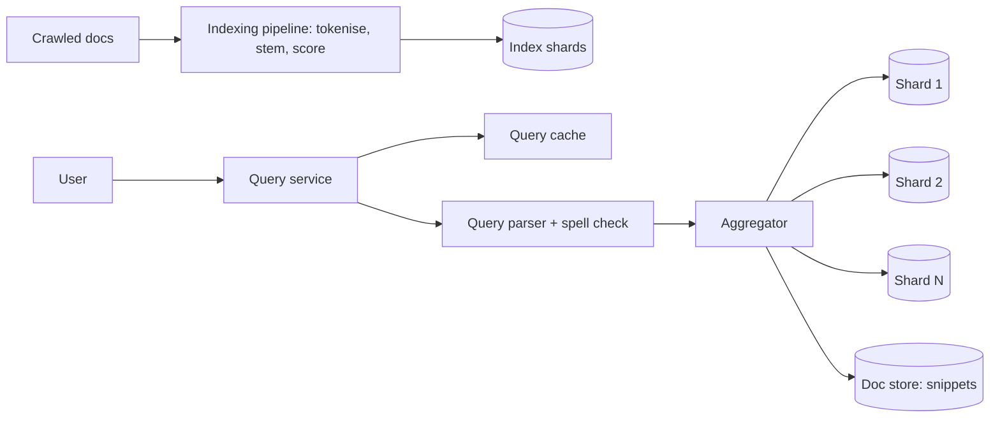

# Search Engine: Full System Design Mock Interview, All 9 Steps

> **Prerequisites:** [Previous lesson: Web Crawler: Full System Design Mock Interview, All 9 Steps](../20-web-crawler/README.md) and the [Interview Framework track](../../21-interview-framework/README.md).
> **Estimated Reading Time:** 15–20 minutes
> **Target Audience:** Engineers practising the full 9-step system design interview on a classic prompt: indexing documents and answering text queries in milliseconds.

> [!NOTE]
> **In one line:** A search engine is **an inverted index plus a ranking function**: index time builds a map from words to the documents containing them, and query time intersects those lists and scores the results.

> [!TIP]
> **The Golden Rule:** Do the expensive work at index time. Shard the index by document, query every shard in parallel, and merge the top results, accepting that results are eventually fresh.

---

## Step 1. Clarify the Problem

Open with questions, not boxes. After the crawler, the design question is how to turn billions of pages into an index that answers a query in under 200 ms.

**Questions to ask the interviewer, and the answer we assume:**

| Question | Assumed answer |
| :--- | :--- |
| Query types? | Keyword and phrase queries, ranked |
| Corpus? | 10 billion documents |
| Freshness? | New pages searchable within minutes for news, hours otherwise |
| Features? | Snippets and spelling suggestions, no personalisation |
| Scale? | 50K queries per second |

> Say it aloud: *"Before I draw anything, let me confirm the scope and the numbers."* That one sentence earns the first minutes of the interview.

---

## Step 2. Functional and Non-Functional Requirements

**Functional (what the system does):**

- Index documents continuously.
- Return ranked results for a text query with snippets.
- Support phrases and filters.
- Suggest spelling corrections.

**Non-functional (how well it does it):**

| Quality | Target | Why it drives the design |
| :--- | :--- | :--- |
| Latency | p99 under 200 ms | Interactive search |
| Relevance | Good ranking | The product |
| Scalability | Billions of documents | The web is huge |
| Freshness | Minutes to hours | Fresh content matters |

---

## Step 3. Scope: In and Out

**In scope:** Indexing pipeline, sharded inverted index, query path, ranking basics.

**Out of scope (say it explicitly, then move on):**

- Crawling (previous lesson).
- ML ranking models.
- Ads.

---

## Step 4. Capacity Estimation

Assumptions: 10 billion documents, average 5 KB of text, 50K queries per second, index size about 1x the text.

| Quantity | Calculation | Result |
| :--- | :--- | :--- |
| Text corpus size | `docs * kb * 1e3 / 1e12` | **50 TB** |
| Index shards | `docs / shard_docs` | **200 shards** |
| Query fan-out per second | `qps * index_shards` | **10M shard queries/s** |
| Index machines with replicas | `index_shards * replicas` | **600 machines** |

**What the numbers tell you:** 50 TB of text (so each 50M-document shard holds about 250 GB) and about 200 shards, times 3 replicas, means roughly 600 index servers. Every query fans out to all 200 shards, so 50K queries per second becomes 10M shard queries per second; this is why shards are served from memory and results are cached.

---

## Step 5. API Design

| Endpoint | Purpose | Notes |
| :--- | :--- | :--- |
| `GET /v1/search?q=&page=` | Query | Returns ranked results, snippets, total estimate. |
| `GET /v1/suggest?q=` | Spelling and completion | From a separate small index. |
| Internal `index(doc)` | Add a document | Through the indexing pipeline. |
| Internal `shard.search(terms)` | Per-shard query | Returns top-k with scores. |

Return a result count as an estimate, not an exact total. Counting exactly is expensive and nobody needs it.

---

## Step 6. Data Model

| Entity / Store | Key fields | Why this store |
| :--- | :--- | :--- |
| Inverted index (per shard) | `term` to posting list of `(doc_id, positions, tf)` | Compressed, memory-mapped |
| Document store | `doc_id` to title, URL, text for snippets | Fetch only for the final top results |
| Forward/feature data | Link-based score, quality, language | Used by ranking |
| Query cache | Normalised query to results | Popular queries repeat |

Posting lists are sorted by doc id and compressed (delta encoding), so intersections are merge scans and memory use stays low.

---

## Step 7. High-Level Architecture



**Walk the diagram in this order:** documents flow through an indexing pipeline into shards; a query is parsed, fanned out to every shard, each returns its top results, and the aggregator merges, ranks and builds snippets.

---

## Step 8. Deep Dives and Bottlenecks

### 1. The inverted index

For each term store a sorted list of the documents containing it, with term frequency and positions. A query for `cat food` intersects the two lists (walking both sorted lists), then scores each match. Phrase queries check positions. Stop words and stemming reduce size and match variants.

### 2. Sharding and the query path

Partition documents across shards (document partitioning) so each shard holds a full index for its subset. The aggregator sends the query to all shards in parallel, each returns its top k, and the aggregator merges. Use replicas for throughput and tail latency (send to two and take the first), and a time budget that drops a straggling shard rather than waiting.

### 3. Ranking and freshness

Score with BM25 (term frequency, inverse document frequency, length normalisation) combined with link-based importance and quality signals. For freshness, keep a small real-time index for new documents merged into results, and periodically merge it into the large static index in the background.

---

## Step 9. Trade-offs, Failures and Security

**Trade-offs to state aloud:**

| Decision | Option A | Option B | Pick and why |
| :--- | :--- | :--- | :--- |
| Index partition | By document | By term | By document: balanced load, simple fan-out |
| Freshness | Rebuild all | Small real-time index plus periodic merge | Real-time tier plus merge |
| Tail latency | Wait for all shards | Hedged requests and time budget | Hedge and budget |

**Failure modes and mitigations:**

| Failure | What users see | Mitigation |
| :--- | :--- | :--- |
| Shard slow or down | Partial results | Replica takes over; time budget returns best-effort results |
| Hot query | Cache stampede | Cache results with request coalescing |
| Bad index build | Wrong results | Build, validate and swap atomically |

**Security and abuse:** Sanitise queries, rate-limit per client to deter scraping, filter spam and malicious content at index time, and make sure private documents never enter a public index.

---

## Runnable Example: Inverted index with an AND query

This builds a tiny inverted index and answers an AND query by intersecting sorted posting lists.

```python
docs = {
    1: "the cat sat on the mat",
    2: "the dog chased the cat",
    3: "dogs and cats are pets",
}

index = {}
for did, text in docs.items():
    for word in sorted(set(text.split())):
        index.setdefault(word, []).append(did)

def and_query(*terms):
    lists = [index.get(t, []) for t in terms]
    result = set(lists[0])
    for l in lists[1:]:
        result &= set(l)
    return sorted(result)

print(index["cat"], index["the"])
print(and_query("the", "cat"))
print(and_query("dog", "cat"))
```

Output (produced by running this exact code):

```text
[1, 2] [1, 2]
[1, 2]
[2]
```

`the` and `cat` both appear in documents 1 and 2, and `dog` plus `cat` only in document 2. Notice that `dogs` and `cats` in document 3 do not match without stemming, which is why real engines stem words.

---

## Common Mistakes

- Scanning documents at query time.
- Term-partitioned index with huge cross-shard lists.
- Waiting for the slowest shard.
- Computing exact result counts.
- Ignoring stemming and tokenisation.

---

## Interview Questions and Answers

<details>
<summary><strong>Q1: How does an inverted index work?</strong></summary>

It maps each term to the sorted list of documents containing it; a query intersects the lists of its terms and scores the matches.

</details>

<details>
<summary><strong>Q2: How do you shard it?</strong></summary>

By document: each shard indexes a subset fully, queries fan out to all shards in parallel, and the aggregator merges their top-k.

</details>

<details>
<summary><strong>Q3: How do you control tail latency?</strong></summary>

Replicas, hedged requests, a per-query time budget, and caching popular queries.

</details>

<details>
<summary><strong>Q4: How do you rank?</strong></summary>

BM25 for text relevance combined with link and quality signals, then a learned model on top results if needed.

</details>

<details>
<summary><strong>Q5: How do you keep results fresh?</strong></summary>

A small real-time index for recent documents, merged into the main index periodically.

</details>

---

## One-Page Cheat Sheet

| Step | What to say or draw |
| :--- | :--- |
| Clarify | 10B docs, 50K QPS, keyword queries |
| Capacity | ~50 TB text, ~200 shards, ~600 servers |
| API | search, suggest, internal index and shard search |
| Data | Sharded inverted index, doc store, caches |
| Deep dive | Inverted index, fan-out, BM25, freshness |
| Trade-off | Document partitioning, hedged requests |

---

## Further Reading

- Manning, Raghavan and Schutze, *Introduction to Information Retrieval*, chapters 1 to 6.
- Elasticsearch and Lucene documentation on segments and BM25.

---

## Next

Continue with [Typeahead / Autocomplete: Full System Design Mock Interview, 9 Steps](../22-typeahead-autocomplete/README.md).
