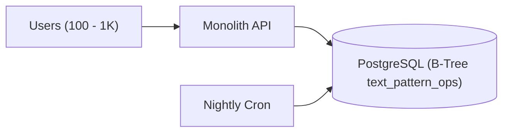
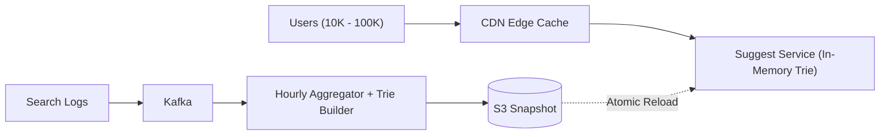
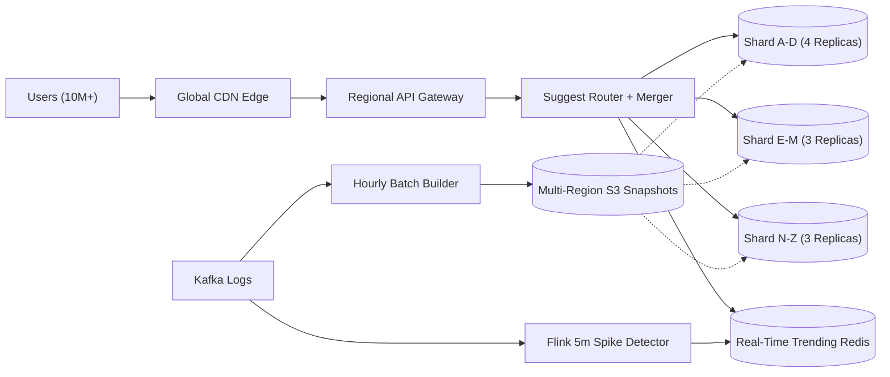
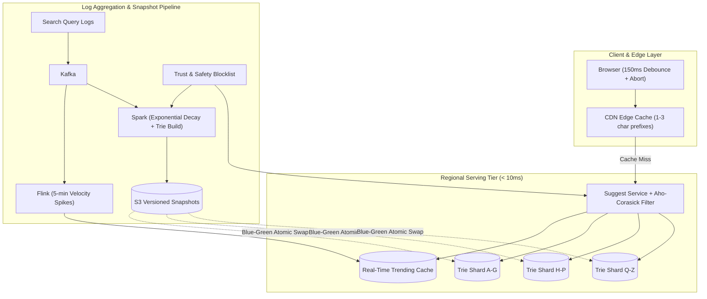
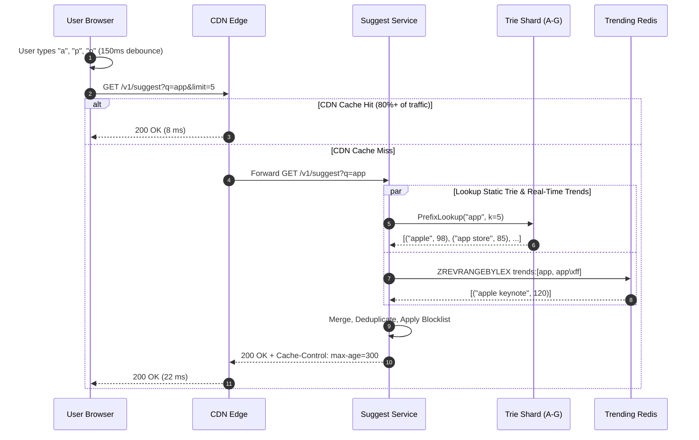

# Typeahead / Autocomplete: Full System Design Mock Interview, 9 Steps

> **Difficulty:** Medium–Hard (Senior / Staff)
> **Prerequisites:** [Previous lesson: Search Engine: Full System Design Mock Interview, All 9 Steps](../21-search-engine/README.md) and the [Interview Framework track](../../21-interview-framework/README.md).
> **Estimated Reading Time:** 25–30 minutes
> **Target Audience:** Engineers practising the full 9-step system design interview on a classic prompt: returning top-k query completions on every keystroke in single-digit milliseconds.

> [!NOTE]
> **In one line:** Typeahead is **a read-heavy prefix lookup under an ultra-tight latency budget (< 50 ms p99)**: precompute the top-k completions at every trie node offline from weighted query logs, pin the immutable snapshot in RAM, and cache short prefixes at the CDN edge.

> [!TIP]
> **The Golden Rule:** Never query a database or traverse a subtree on a keystroke. Precompute top-k per prefix, debounce/cancel stale requests on the client, and serve read-only snapshots from memory + edge cache.

---

## 1. Clarifying Questions, Functional & Non-Functional Requirements

Open with questions, not boxes. Typeahead is fundamentally a **latency and hot-key caching problem**: users type faster than disk I/O can respond, and 80% of requests hit 1–3 character prefixes.

### Clarifying Questions & Assumed Answers

| Question | Assumed Answer | Architectural Impact |
| :--- | :--- | :--- |
| **Source of suggestions?** | Global popular past search queries | Aggregated from search logs; no complex document index needed |
| **How many suggestions?** | Top 5 completions per prefix | Fixed small $k=5$ allows precomputing `top_k` directly on every trie node |
| **Languages & matching?** | English prefix match initially (lowercase ASCII/UTF-8) | Simplifies normalization; fuzzy/typo matching handled as a secondary fallback |
| **Personalization?** | Out of scope for MVP (global popularity + recency) | Enables aggressive CDN & shared RAM caching across all users |
| **Scale & traffic?** | 1B searches/day; ~5 debounced keystrokes/search; 100M unique queries | ~58K avg QPS, ~250K–500K peak QPS (or up to 10M raw keystrokes without debounce) |

> Say it aloud: *"Before I draw anything, let me confirm whether suggestions are global or personalized, how many suggestions we return, and whether client debouncing is in place."*

### Functional Requirements

1. **Prefix Lookup:** Given a typed prefix (e.g., `"app"`), return the top 5 most relevant/popular completed queries.
2. **Popularity & Trend Updates:** Continuously refresh rankings so breaking news and seasonal queries surface within 15–60 minutes.
3. **Content Filtering:** Exclude profanity, PII, hate speech, and sensitive queries via a deterministic blocklist.
4. **Client Responsiveness:** Debounce keystrokes and cancel in-flight stale requests so results never flicker out of order.

### Non-Functional Requirements

| Quality Attribute | Target | Why It Drives the Design |
| :--- | :--- | :--- |
| **Latency** | p99 < 50 ms end-to-end (< 10 ms server-side) | Must feel instantaneous between keystrokes (~150 ms human typing gap) |
| **Availability** | 99.99% | Entry point to search; must degrade gracefully (skip suggestions if down) |
| **Freshness** | Trending terms within 15–60 minutes | Batch trie rebuilds + small real-time hot-trend overlay |
| **Throughput** | 300K+ peak QPS (debounced) | Requires CDN edge caching + in-memory prefix shards |

### Explicit Scope Boundaries

- **In Scope:** Prefix-to-top-k trie/FST data structure, offline log aggregation with time decay, atomic snapshot deployment, CDN/edge caching, blocklist filtering.
- **Out of Scope:** Full web search ranking, per-user personalized history, ML semantic query rewriting.

---

## 2. Back-of-the-Envelope Capacity Estimation

Let us derive QPS, log ingestion volume, and in-memory trie footprint from first principles.

### Assumptions
- Daily completed searches: $1 \times 10^9$ searches/day.
- Average query length: $20$ characters.
- Client-side debouncing (150 ms) reduces 20 keystrokes to ~5 API requests per search.
- Peak-to-average multiplier: $4\times$.
- Unique normalized queries retained in the trie: $U = 100 \times 10^6$ (100M).
- Average query string size: $30\text{ bytes}$ (plus 8-byte score + metadata $\approx 50\text{ bytes}$).
- Top-$k = 5$ suggestions stored per prefix node.

### Worked Equations

**1. Average & Peak Typeahead QPS:**
$$Q_{\text{avg}} = \frac{10^9 \text{ searches/day} \times 5 \text{ req/search}}{86{,}400 \text{ s/day}} \approx 57{,}870 \text{ req/s}$$
$$Q_{\text{peak}} = 57{,}870 \times 4 \approx 231{,}480 \text{ req/s}$$

*(Note: Without client debouncing, 20 keystrokes/search yields $231\text{K}$ avg and $\sim 1\text{M}$ peak QPS; CDN caching for 1–3 char prefixes absorbs 70–85% of this.)*

**2. Daily Raw Query Log Volume:**
$$V_{\text{logs/day}} = 10^9 \text{ queries} \times 50 \text{ bytes} = 50 \text{ GB/day}$$

**3. In-Memory Trie / Prefix Store Size:**
For $100\text{M}$ unique queries of avg length $20$ chars, assuming ~50% prefix sharing in a compressed radix trie (Patricia trie / FST), there are roughly $10^9$ nodes.
If we store top-5 `(query_id_int32, score_float32)` pairs (8 bytes each $\times 5 = 40\text{ bytes}$) plus node pointers (~24 bytes) at active nodes (and cap prefix depth at 50 chars):
$$S_{\text{naive\_trie}} \approx 10^9 \text{ nodes} \times 64 \text{ bytes} = 64 \text{ GB}$$

Using a **String-Interned Radix Trie** (storing integer `query_id`s rather than repeated strings, and pruning nodes below a minimum frequency threshold, e.g., top 20M queries):
$$S_{\text{compact\_trie}} \approx 15\text{–}20 \text{ GB}$$
This fits easily on **1–2 high-memory servers** or across **4–8 sharded nodes** with full replication.

### Capacity Summary Table

| Metric | Formula / Derivation | Result |
| :--- | :--- | :--- |
| **Average Typeahead QPS** | $(10^9 \times 5) / 86{,}400$ | **~58K req/s** |
| **Peak Typeahead QPS** | $58\text{K} \times 4$ | **~232K req/s** |
| **Origin QPS (after 80% CDN hit)** | $232\text{K} \times 0.20$ | **~46K req/s** |
| **Daily Search Log Volume** | $10^9 \times 50\text{ bytes}$ | **50 GB/day** |
| **Compact In-Memory Trie** | 20M–100M queries (interned IDs) | **15–64 GB** |

---

## 3. Core API Contracts & Data Model

### Public & Internal APIs

| Endpoint | Method & Params | Contract & Caching Headers |
| :--- | :--- | :--- |
| `GET /v1/suggest?q=app&limit=5` | Client $\to$ CDN $\to$ Suggest Service | Returns `{"prefix": "app", "suggestions": [{"text": "apple", "score": 98.2}, ...]}`. Sets `Cache-Control: public, max-age=300, stale-while-revalidate=60`. |
| `POST /internal/v1/logs/search` | Search Service $\to$ Kafka | Batched async fire-and-forget: `[{"query": "apple", "ts": 1732540000}]`. |
| `PUT /internal/v1/blocklist` | Trust & Safety $\to$ Builder/API | Adds/removes banned terms/regexes; triggers immediate serve-time filter reload. |

### Data Model & Storage Engines

| Entity / Store | Key / Structure | Storage Engine & Rationale |
| :--- | :--- | :--- |
| **Prefix Trie Snapshot** | `prefix -> [(query_id, score), ...]` | Read-only memory-mapped Radix Trie / FST (`mmap`); $O(L)$ lookup with zero lock contention |
| **Query String Table** | `query_id (uint32) -> UTF-8 string` | Dense flat array in RAM; avoids duplicating `"apple store"` across 11 trie nodes |
| **Raw Query Log Stream** | `(normalized_query, timestamp)` | Kafka topic partitioned by `hash(query)` |
| **Aggregated Frequency Table** | `query -> decayed_score` | RocksDB / Parquet on S3 updated by hourly Flink/Spark jobs |
| **Blocklist Filter** | Exact terms + Aho-Corasick substring matcher | In-memory automaton reloaded via ZooKeeper/etcd every 60s |

---

## 4. Stage 1 (100 - 1K Users): Baseline Monolith & Single Database

At 100–1,000 users (< 5 QPS, < 50K unique queries), you do not need a distributed trie or Kafka.

### Component-by-Component Build
1. **PostgreSQL with Trigram / Prefix Index (`text_pattern_ops`):** Store popular queries in a `popular_queries(query TEXT PRIMARY KEY, count BIGINT)` table with a B-Tree index using `text_pattern_ops`.
2. **Monolithic API:** Queries `SELECT query, count FROM popular_queries WHERE query LIKE 'app%' ORDER BY count DESC LIMIT 5`.
3. **Periodic Cron Job:** Aggregates yesterday's `search_logs` table once a night and upserts into `popular_queries`.



### What Breaks at 10K Users & 10M Queries?
- **`ORDER BY count DESC` Filesort Bottleneck:** A B-Tree index on `query` finds all rows starting with `'a'` (millions of rows!), then must scan and sort all of them by `count` on every single keystroke.
- **Connection Pool Exhaustion:** Keystroke traffic is 5–10x higher than search traffic; DB connections saturate rapidly.
- **No Edge Caching:** Every user typing `'a'`, `'ap'`, `'app'` hits the origin database repeatedly.

---

## 5. Stage 2 (10K - 100K Users): Caching, Read Replicas & Async Offload

At 10K–100K users (10M queries, 5K–20K QPS), we eliminate database `LIKE` queries entirely and move to an **in-memory Trie** with **CDN caching**.

### Component-by-Component Additions
1. **In-Memory Trie Service:** Replace Postgres `LIKE` with a dedicated stateless service holding a precomputed Trie where every node caches its top-5 completions.
2. **CDN / Edge Cache:** Cache `GET /v1/suggest?q=...` at Cloudflare/Fastly for 1–3 character prefixes (e.g., `a`–`zzz`), absorbing > 80% of origin traffic.
3. **Kafka + Hourly Aggregation Worker:** Decouples search logging from serving; a batch worker computes decayed counts and builds a serialized trie file.
4. **Client Debounce + `AbortController`:** Browser waits 150 ms after typing stops and aborts any older in-flight HTTP request.



### What Breaks at 1M+ Users & 100M+ Queries?
- **Single-Node RAM Ceiling:** A 100M-query trie with top-5 lists exceeds 30–64 GB, making single-node snapshots slow to serialize, transfer, and load.
- **1-Hour Freshness Lag:** Breaking news (e.g., an earthquake or product launch) takes up to an hour to appear in suggestions.
- **Hot Prefix Skew:** Even with CDN misses, short prefixes (`"s"`, `"st"`) hit the origin far more than `"xylop"`.

---

## 6. Stage 3 (1M - 10M+ Users): Sharding, Partitioning & Multi-Region Scale

At 1M–10M+ users (100M+ queries, 250K+ peak QPS), we shard the trie by **prefix range**, add **multi-region deployment**, and introduce a **Real-Time Trending Overlay**.

### Component-by-Component Additions
1. **Prefix-Range Sharding (with Adaptive Replication):** Shard the trie by prefix ranges (`a–c`, `d–g`, ..., `0–9`) using a lightweight routing table (Zookeeper/etcd). Shards holding hot prefixes (`s`, `c`, `a`) get more read replicas.
2. **Real-Time Trending Layer (Flink + Redis):** A streaming job computes 5-minute tumbling/sliding window velocity spikes. The Suggest Service queries both the static Trie shard and the small Real-Time Redis sorted set, merging top-5 in < 1 ms.
3. **Multi-Region Active-Active Serving:** Replicate immutable trie snapshots to S3 buckets in `us-east`, `eu-west`, `ap-south` so edge cache misses stay within the nearest region (< 20 ms RTT).
4. **Two-Layer Blocklist:** Filter banned terms during offline Trie build *and* run an in-memory Aho-Corasick filter at serve time for emergency takedowns within seconds.



---

## 7. Final Full Production Architecture & End-to-End Flows

### Complete Production Architecture



### End-to-End Keystroke Sequence Diagram



---

## 8. Deep-Dive Bottlenecks & Algorithmic Trade-Offs

### 1. Trie Node Top-K Precomputation vs. Subtree Traversal
If you only store terminal flags at trie nodes, looking up `"a"` requires traversing millions of descendant nodes and sorting them—taking hundreds of milliseconds.
- **Solution:** Store `top_k` (`k = 5`) directly at **every** node during the offline build.
- **Complexity:** Read latency drops from $O(N_{\text{subtree}})$ to $O(L)$ where $L = \text{len(prefix)} \le 50$.
- **Memory Optimization:** Instead of storing full UTF-8 strings in every node's `top_k` array, store a 32-bit `query_id` integer pointing into a single flat string table, and compress single-child chains using a **Radix Trie (Patricia Trie)** or **Finite State Transducer (FST)**.

### 2. Exponential Recency Decay Formula
Raw cumulative counts favor queries from last year over today's trends. Apply exponential time decay during aggregation:

$$S(q, t) = \sum_{e \in \text{events}(q)} e^{-\lambda (t - t_e)}$$

Where $\lambda = \frac{\ln(2)}{T_{1/2}}$ sets a half-life $T_{1/2}$ (e.g., 7 days). A search performed 7 days ago contributes $0.5\times$ weight; 14 days ago contributes $0.25\times$; today's searches contribute $1.0\times$.

### 3. Prefix Sharding Skew
Sharding naively by first letter (`a`–`z` across 26 shards) fails because `'s'` has ~10x more queries than `'x'` or `'z'`.
- **Solution:** **Range-based dynamic sharding** using a prefix-to-shard map computed from query volume (e.g., `sa–sh` on Shard 12, `si–sz` on Shard 13, `x–z` combined on Shard 25). Since the routing table has < 1,000 ranges (< 50 KB), every Suggest Service holds it in RAM.

---

## 9. Failure Modes, Reliability & Backpressure Mitigations

| Failure Mode | User Impact | Engineering Mitigation |
| :--- | :--- | :--- |
| **Snapshot Build Corrupt / Fails** | Stale or missing suggestions | Validate new trie against golden prefixes (`"a"`, `"google"`, `"weather"`) + min node count check; keep serving previous `mmap` snapshot on failure |
| **Trie Shard Crash** | Missing completions for range | 3x replication per shard + circuit breaker; fallback to truncated prefix (`"appl"` $\to$ `"app"`) or empty `[]` within 20 ms |
| **Offensive / PII Suggestion** | Severe brand/legal risk | Dual-layer blocklist: (1) strip during offline build, (2) in-memory Aho-Corasick filter at serve time for instant emergency suppression |
| **Keystroke Storm (No Debounce)** | Origin & CDN overload | Client 150 ms debounce + `AbortController`; Edge rate limiting per IP; skip suggestions for `len(q) == 0` or `len(q) > 50` |
| **Out-of-Order Responses** | UI dropdown flickers backward | Client tags requests with monotonic sequence ID or cancels prior `fetch` via `AbortController` |

---

## 10. Production War Story & Real-World Reference

### The "Offensive Autocomplete" & Out-of-Order Flicker Incidents
Large search engines (Google, Amazon, Bing) have faced two classic production failures in autocomplete:
1. **Coordinated Log Poisoning (Brand/Safety SEV-1):** Attackers or botnets flooded search logs with malicious or defamatory queries paired with a benign prefix (`"company_x is..."`), causing the hourly aggregator to promote the toxic completion into the top-5 within 60 minutes.
   - **Fix:** Added **distinct-user / IP-hyperloglog counting** (one botnet IP searching 100K times counts as 1 user, not 100K) plus an **emergency serve-time blocklist** pushed via etcd in < 5 seconds without waiting for a full trie rebuild.
2. **Stale Network Response Flicker:** On 3G mobile networks, request `"ap"` (slow path) arrived *after* `"app"` (cached), overwriting `"apple"` suggestions with `"apricot"`.
   - **Fix:** Enforce client-side `AbortController` + monotonic request IDs so late responses are silently discarded.

---

## 11. Core Component Implementation (4 Languages)

Below is a production-ready **Memory-Compact Top-K Radix/Prefix Trie with Blocklist Filtering** in Go, TypeScript, Python, and C#.

````carousel
```go
package main

import (
	"fmt"
	"sort"
	"strings"
)

type Suggestion struct {
	Query string
	Score float64
}

type TrieNode struct {
	Children map[rune]*TrieNode
	TopK     []Suggestion
}

type TypeaheadTrie struct {
	Root      *TrieNode
	K         int
	Blocklist []string
}

func NewTypeaheadTrie(k int, blocklist []string) *TypeaheadTrie {
	return &TypeaheadTrie{
		Root:      &TrieNode{Children: make(map[rune]*TrieNode)},
		K:         k,
		Blocklist: blocklist,
	}
}

func (t *TypeaheadTrie) isBlocked(q string) bool {
	lower := strings.ToLower(q)
	for _, bad := range t.Blocklist {
		if strings.Contains(lower, bad) {
			return true
		}
	}
	return false
}

func (t *TypeaheadTrie) Insert(query string, score float64) {
	if t.isBlocked(query) {
		return
	}
	norm := strings.ToLower(strings.TrimSpace(query))
	node := t.Root
	for _, ch := range norm {
		if node.Children[ch] == nil {
			node.Children[ch] = &TrieNode{Children: make(map[rune]*TrieNode)}
		}
		node = node.Children[ch]
		t.updateTopK(node, Suggestion{Query: norm, Score: score})
	}
}

func (t *TypeaheadTrie) updateTopK(node *TrieNode, item Suggestion) {
	for i, existing := range node.TopK {
		if existing.Query == item.Query {
			node.TopK[i].Score = item.Score
			sort.Slice(node.TopK, func(a, b int) bool { return node.TopK[a].Score > node.TopK[b].Score })
			return
		}
	}
	node.TopK = append(node.TopK, item)
	sort.Slice(node.TopK, func(a, b int) bool { return node.TopK[a].Score > node.TopK[b].Score })
	if len(node.TopK) > t.K {
		node.TopK = node.TopK[:t.K]
	}
}

func (t *TypeaheadTrie) Suggest(prefix string) []Suggestion {
	norm := strings.ToLower(strings.TrimSpace(prefix))
	node := t.Root
	for _, ch := range norm {
		next, ok := node.Children[ch]
		if !ok {
			return nil
		}
		node = next
	}
	return node.TopK
}

func main() {
	trie := NewTypeaheadTrie(3, []string{"malware"})
	trie.Insert("apple", 95)
	trie.Insert("app store", 80)
	trie.Insert("apple music", 70)
	trie.Insert("application", 40)
	trie.Insert("apple malware", 999) // Blocked

	fmt.Printf("Prefix 'app': %+v\n", trie.Suggest("app"))
}
```
<!-- slide -->
```typescript
interface Suggestion {
  query: string;
  score: number;
}

class TrieNode {
  children = new Map<string, TrieNode>();
  topK: Suggestion[] = [];
}

class TypeaheadTrie {
  private root = new TrieNode();

  constructor(
    private readonly k: number = 5,
    private readonly blocklist: string[] = []
  ) {}

  private isBlocked(query: string): boolean {
    const lower = query.toLowerCase();
    return this.blocklist.some((bad) => lower.includes(bad));
  }

  insert(query: string, score: number): void {
    if (this.isBlocked(query)) return;
    const norm = query.trim().toLowerCase();
    let node = this.root;

    for (const ch of norm) {
      let next = node.children.get(ch);
      if (!next) {
        next = new TrieNode();
        node.children.set(ch, next);
      }
      node = next;
      this.updateTopK(node, { query: norm, score });
    }
  }

  private updateTopK(node: TrieNode, item: Suggestion): void {
    const idx = node.topK.findIndex((s) => s.query === item.query);
    if (idx >= 0) {
      node.topK[idx].score = item.score;
    } else {
      node.topK.push(item);
    }
    node.topK.sort((a, b) => b.score - a.score);
    if (node.topK.length > this.k) {
      node.topK.length = this.k;
    }
  }

  suggest(prefix: string): Suggestion[] {
    const norm = prefix.trim().toLowerCase();
    let node: TrieNode | undefined = this.root;
    for (const ch of norm) {
      node = node.children.get(ch);
      if (!node) return [];
    }
    return node.topK;
  }
}

const trie = new TypeaheadTrie(3, ["malware"]);
trie.insert("apple", 95);
trie.insert("app store", 80);
trie.insert("apple music", 70);
trie.insert("application", 40);
trie.insert("apple malware", 999);
console.log(trie.suggest("app"));
```
<!-- slide -->
```python
class TrieNode:
    __slots__ = ("children", "top_k")

    def __init__(self) -> None:
        self.children: dict[str, TrieNode] = {}
        self.top_k: list[tuple[float, str]] = []


class TypeaheadTrie:
    def __init__(self, k: int = 5, blocklist: list[str] | None = None) -> None:
        self.root = TrieNode()
        self.k = k
        self.blocklist = [b.lower() for b in (blocklist or [])]

    def _is_blocked(self, query: str) -> bool:
        lower = query.lower()
        return any(bad in lower for bad in self.blocklist)

    def insert(self, query: str, score: float) -> None:
        if self._is_blocked(query):
            return
        norm = query.strip().lower()
        node = self.root
        for ch in norm:
            if ch not in node.children:
                node.children[ch] = TrieNode()
            node = node.children[ch]
            self._update_top_k(node, norm, score)

    def _update_top_k(self, node: TrieNode, query: str, score: float) -> None:
        filtered = [(s, q) for s, q in node.top_k if q != query]
        filtered.append((score, query))
        filtered.sort(reverse=True)
        node.top_k = filtered[: self.k]

    def suggest(self, prefix: str) -> list[tuple[str, float]]:
        norm = prefix.strip().lower()
        node = self.root
        for ch in norm:
            if ch not in node.children:
                return []
            node = node.children[ch]
        return [(q, s) for s, q in node.top_k]


if __name__ == "__main__":
    trie = TypeaheadTrie(k=3, blocklist=["malware"])
    trie.insert("apple", 95)
    trie.insert("app store", 80)
    trie.insert("apple music", 70)
    trie.insert("application", 40)
    trie.insert("apple malware", 999)
    print(trie.suggest("app"))
```
<!-- slide -->
```csharp
using System;
using System.Collections.Generic;
using System.Linq;

public record Suggestion(string Query, double Score);

public class TrieNode
{
    public Dictionary<char, TrieNode> Children { get; } = new();
    public List<Suggestion> TopK { get; set; } = new();
}

public class TypeaheadTrie
{
    private readonly TrieNode _root = new();
    private readonly int _k;
    private readonly List<string> _blocklist;

    public TypeaheadTrie(int k = 5, IEnumerable<string>? blocklist = null)
    {
        _k = k;
        _blocklist = blocklist?.Select(b => b.ToLowerInvariant()).ToList() ?? new List<string>();
    }

    private bool IsBlocked(string query)
    {
        var lower = query.ToLowerInvariant();
        return _blocklist.Any(bad => lower.Contains(bad));
    }

    public void Insert(string query, double score)
    {
        if (IsBlocked(query)) return;
        var norm = query.Trim().ToLowerInvariant();
        var node = _root;

        foreach (char ch in norm)
        {
            if (!node.Children.TryGetValue(ch, out var next))
            {
                next = new TrieNode();
                node.Children[ch] = next;
            }
            node = next;
            node.TopK = node.TopK
                .Where(s => s.Query != norm)
                .Append(new Suggestion(norm, score))
                .OrderByDescending(s => s.Score)
                .Take(_k)
                .ToList();
        }
    }

    public List<Suggestion> Suggest(string prefix)
    {
        var norm = prefix.Trim().ToLowerInvariant();
        var node = _root;
        foreach (char ch in norm)
        {
            if (!node.Children.TryGetValue(ch, out var next))
                return new List<Suggestion>();
            node = next;
        }
        return node.TopK;
    }
}
```
````

---

## 12. Verification, Load Testing & CLI Diagnostics

```bash
# 1. Verify CDN cache hit headers and response latency for hot 2-char prefixes
curl -sI "https://api.example.com/v1/suggest?q=ap&limit=5" | grep -iE "cache-control|x-cache|age"

# 2. Benchmark single-digit millisecond origin latency at 10,000 QPS
wrk -t8 -c256 -d30s --latency "http://suggest-service.internal:8080/v1/suggest?q=app&limit=5"

# 3. Validate atomic trie snapshot size and memory-map resident pages
ls -lh /var/lib/typeahead/snapshots/trie_20261125_14.fst
vmtouch -v /var/lib/typeahead/snapshots/trie_20261125_14.fst

# 4. Smoke-test blocklist enforcement against newly added banned terms
curl -s "http://suggest-service.internal:8080/v1/suggest?q=apple%20mal" | jq '.suggestions'
```

---

## 13. Common Interview Mistakes & Red Flags

- **Running `SELECT ... LIKE 'app%'` on every keystroke:** Kills the database with filesorts and connection exhaustion.
- **Forgetting client-side debouncing & cancellation:** Causes 4x unnecessary QPS and visual UI flickering when slow responses arrive out of order.
- **Updating the live Trie in place on every search:** Introduces read/write lock contention and tail latency spikes. Always use immutable snapshots + atomic swap.
- **Storing full strings inside every node's `top_k` list:** Multiplies memory usage by 10–20x instead of interning `query_id` integers.
- **Ignoring prefix sharding skew:** Assuming 26 alphabetical shards (`a`–`z`) are balanced when `'s'` has 10x the traffic of `'x'`.
- **Omitting a blocklist / safety filter:** Leaving the system vulnerable to profanity, PII leaks, or botnet log poisoning.

---

## 14. Key Terminology & Glossary

| Key Term | Definition |
| :--- | :--- |
| **Trie (Prefix Tree)** | Tree data structure where each edge represents a character and paths from root represent prefixes. |
| **Radix Trie (Patricia Trie)** | Space-optimized trie that compresses single-child chains into a single edge. |
| **FST (Finite State Transducer)** | Compact directed acyclic graph sharing both prefixes and suffixes, ideal for static dictionaries. |
| **Top-K Precomputation** | Caching the $k$ highest-scoring descendant queries at every trie node for $O(L)$ lookups. |
| **Debouncing** | Client-side delay (e.g., 150 ms) that suppresses intermediate keystroke requests until typing pauses. |
| **Exponential Time Decay** | Weighting historical query counts by $e^{-\lambda \Delta t}$ so recent trends outrank stale popularity. |
| **Atomic Snapshot Swap** | Loading a new immutable trie in memory/mmap and flipping a pointer, avoiding read locks. |
| **Aho-Corasick Automaton** | Multi-pattern string-matching algorithm used to filter thousands of blocklisted substrings in $O(n)$ time. |
| **String Interning** | Replacing repeated query strings with 32-bit integer IDs pointing to a single flat string table. |
| **HyperLogLog (HLL)** | Probabilistic cardinality estimator used to count unique users per query and defeat botnet log poisoning. |

---

## 15. Interview Follow-Up Questions (12 Q&As)

### Basic Conceptual Questions

<details>
<summary><strong>Q1: Why store top-k suggestions at every trie node instead of traversing the subtree at query time? [BASIC]</strong></summary>

For short prefixes like `"a"` or `"s"`, the subtree contains tens of millions of nodes. Traversing and sorting them on every keystroke takes hundreds of milliseconds. Precomputing `top_k` at each node makes lookup $O(\text{len(prefix)})$, trading offline build time and RAM for sub-5 ms reads.

</details>

<details>
<summary><strong>Q2: How do you reduce QPS before requests even hit your backend? [BASIC]</strong></summary>

Three layers: (1) **Client debouncing** (wait 100–200 ms after typing pauses) + `AbortController` to cancel stale requests; (2) **Browser caching** via `Cache-Control: max-age=300`; (3) **CDN Edge caching** for short 1–3 character prefixes, which absorb 70–85% of total traffic.

</details>

<details>
<summary><strong>Q3: Why use immutable snapshots instead of updating the trie in real time? [BASIC]</strong></summary>

Mutating a shared trie under 50K+ concurrent reads/sec requires read/write locks or fine-grained locking, which causes tail-latency jitter and potential deadlocks. Immutable snapshots allow lock-free reads and atomic pointer/symlink swaps.

</details>

<details>
<summary><strong>Q4: How do you handle ranking so old popular queries don't drown out new trends? [BASIC]</strong></summary>

Apply **exponential time decay** ($e^{-\lambda \Delta t}$) to query log counts during aggregation, and pair the hourly static trie with a small **5-minute real-time trending cache** merged at serve time.

</details>

### Scenario-Based Architecture Questions

<details>
<summary><strong>Q5: How do you handle multi-language or Unicode (emoji, CJK) prefixes? [SCENARIO]</strong></summary>

Normalize inputs using Unicode **NFKC**, lowercase with locale awareness, and tokenize at UTF-8 codepoint or byte boundaries (using a byte-level Radix Trie/FST). For CJK languages where users type phonetic Pinyin/Romaji, map phonetic prefixes to target characters in the index.

</details>

<details>
<summary><strong>Q6: A botnet spams 500,000 searches for an offensive phrase to poison your autocomplete. How do you stop it? [SCENARIO]</strong></summary>

First, deduplicate log counts by **unique user/IP** (using HyperLogLog or per-IP caps) during aggregation so one botnet cannot inflate scores. Second, maintain a real-time **serve-time Aho-Corasick blocklist** pushed via etcd in < 5 seconds for immediate suppression.

</details>

<details>
<summary><strong>Q7: How do you support mild typo tolerance (e.g., "aple" -> "apple") without blowing up latency? [SCENARIO]</strong></summary>

Only trigger fuzzy matching when exact prefix lookup returns fewer than $k$ results. Use a **SymSpell** (Symmetric Delete) index or Levenshtein Automaton (edit distance $\le 1$) over the top 1M most popular queries in RAM, keeping fallback latency under 10 ms.

</details>

<details>
<summary><strong>Q8: Your trie grows to 150 GB and no longer fits on a single machine. How do you shard it? [SCENARIO]</strong></summary>

Shard by **balanced prefix ranges** (`aa–am`, `an–az`, ..., `0–9`) computed from historical query distribution rather than equal alphabetical splits. Keep the tiny (< 50 KB) range-to-shard routing table in RAM on the Suggest Router, and allocate more replicas to hot short-prefix shards.

</details>

### Advanced & Tricky Interview Questions

<details>
<summary><strong>Q9: How would you add personalized suggestions (user's past searches) without breaking CDN caching? [TRICKY]</strong></summary>

Keep the CDN-cached global endpoint **purely unpersonalized**. Store the user's recent 50–100 searches locally in `localStorage` (or a tiny per-user Redis hash fetched once on page load) and merge + rank personal history with global CDN suggestions **client-side** in the browser.

</details>

<details>
<summary><strong>Q10: How do you prevent memory bloat when storing top-5 completions on 500 million trie nodes? [TRICKY]</strong></summary>

Three techniques: (1) **String interning**—store 4-byte `query_id` ints instead of 30-byte strings; (2) **Radix compression**—collapse single-child paths into one edge; (3) **Prune long tails**—only precompute `top_k` for prefixes up to length 25 and queries appearing $\ge 5$ times, falling back to subtree scan for rare deep prefixes.

</details>

<details>
<summary><strong>Q11: What happens when a user types `"apple i"` (space + second word) vs `"iphone"`? [TRICKY]</strong></summary>

A standard full-query trie handles `"apple i"` naturally because spaces are just characters in the trie (`"apple iphone"`). However, for multi-word *suffix* completion (e.g., `"best restaurants in san fran"`), cap trie depth at 30–40 characters and optionally fall back to a **last-2-words N-gram** trie.

</details>

<details>
<summary><strong>Q12: How do you do zero-downtime deployment of a 20 GB `mmap` trie snapshot across 50 servers? [TRICKY]</strong></summary>

Stage the new `.fst` snapshot on local NVMe from S3, pre-warm the OS page cache (`vmtouch -t` or sequential read), run automated canary prefix checks, and atomically swap the file descriptor/pointer in the Suggest Service. Keep the old snapshot `mmap`'d for 60 seconds until in-flight requests drain.

</details>

---

## 16. One-Page Master Cheat Sheet

```text
+-----------------------------------------------------------------------------+
|                TYPEAHEAD / AUTOCOMPLETE ARCHITECTURE CHEAT SHEET            |
+-----------------------------------------------------------------------------+
| SCALE:     1B searches/day | 58K avg / 232K peak QPS | 100M unique queries  |
| LATENCY:   p99 < 50 ms end-to-end (< 10 ms server-side)                     |
+-----------------------------------------------------------------------------+
| CORE FLOW:                                                                  |
|  1. Client:  150 ms Debounce + AbortController -> Browser Cache             |
|  2. Edge:    CDN caches 1-3 char prefixes (absorbs 80%+ traffic)            |
|  3. Origin:  Suggest Service -> Prefix-Sharded Radix Trie + Real-Time Redis |
|  4. Offline: Kafka Logs -> Spark (Exp Decay) -> S3 Snapshot -> Atomic Swap  |
+-----------------------------------------------------------------------------+
| GOLDEN RULES:                                                               |
|  * Precompute top-k at every trie node for O(len(prefix)) reads.            |
|  * Intern strings (uint32 IDs) + Radix compression to fit in RAM.           |
|  * Merge 5-min Flink trending layer for breaking news freshness.            |
|  * Dual-layer blocklist (build-time + serve-time Aho-Corasick) + HLL anti-bot|
+-----------------------------------------------------------------------------+
```

| Step | Key Decision | Target Number |
| :--- | :--- | :--- |
| **Clarify** | Top-5 global suggestions, debounced keystrokes | p99 < 50 ms |
| **Capacity** | 58K avg / 232K peak QPS, 80% CDN hit | 15–64 GB RAM |
| **Data Structure** | String-interned Radix Trie / FST | $O(L)$ lookup |
| **Freshness** | Exponential decay ($T_{1/2}=7\text{d}$) + 5-min Flink trends | < 5 min trends |
| **Safety** | HLL unique-user count + Aho-Corasick filter | < 5s takedown |

---

## Further Reading

- Alex Xu, *System Design Interview*, chapter on search autocomplete.
- Lucene's `FST` and suggester documentation.

---

## Next

Continue with [Hotel Booking System: Full System Design Mock Interview, All 9 Steps](../23-hotel-booking-system/README.md).
