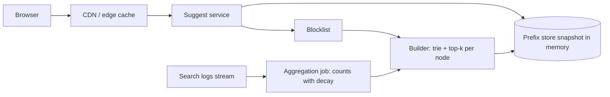

# Typeahead / Autocomplete: Full System Design Mock Interview, 9 Steps

> **Prerequisites:** [Previous lesson: Search Engine: Full System Design Mock Interview, All 9 Steps](../21-search-engine/README.md) and the [Interview Framework track](../../21-interview-framework/README.md).
> **Estimated Reading Time:** 15–20 minutes
> **Target Audience:** Engineers practising the full 9-step system design interview on a classic prompt: suggesting completions as the user types, in a few milliseconds.

> [!NOTE]
> **In one line:** Typeahead is **a prefix lookup that must return the top few suggestions in single-digit milliseconds**, so the best answers are precomputed per prefix and served from memory.

> [!TIP]
> **The Golden Rule:** Store the top-k suggestions at every node of a trie (or per prefix key), update them offline from query logs, and cache aggressively at the edge.

---

## Step 1. Clarify the Problem

Open with questions, not boxes. This is a latency problem: the user types faster than a database can answer, so the answers must already be waiting.

**Questions to ask the interviewer, and the answer we assume:**

| Question | Assumed answer |
| :--- | :--- |
| Source of suggestions? | Popular past queries |
| How many suggestions? | Top 5 |
| Languages? | Start with one |
| Personalisation? | Out of scope |
| Scale? | 10 million queries per second at peak |

> Say it aloud: *"Before I draw anything, let me confirm the scope and the numbers."* That one sentence earns the first minutes of the interview.

---

## Step 2. Functional and Non-Functional Requirements

**Functional (what the system does):**

- Return the top 5 completions for a typed prefix.
- Update suggestions as query popularity changes.
- Filter inappropriate suggestions.
- Handle typos mildly (optional).

**Non-functional (how well it does it):**

| Quality | Target | Why it drives the design |
| :--- | :--- | :--- |
| Latency | p99 under 50 ms end to end | Must keep up with typing |
| Availability | 99.99% | Search entry point |
| Freshness | Trending terms within an hour | News and events |
| Throughput | Millions of requests per second | A request per keystroke |

---

## Step 3. Scope: In and Out

**In scope:** Prefix to top-k lookup, offline aggregation, caching, filtering.

**Out of scope (say it explicitly, then move on):**

- Full search results.
- Personal history.
- ML-based query understanding.

---

## Step 4. Capacity Estimation

Assumptions: 1B searches per day, an average query of 20 characters, requests sent after each keystroke (debounced to about 5 per search), 100M unique queries kept.

| Quantity | Calculation | Result |
| :--- | :--- | :--- |
| Typeahead requests per second | `searches * requests_per_search / 86400` | **57.9K req/s** |
| Query log storage | `unique * bytes_ / 1e9` | **5 GB** |
| Suggestion data per prefix set | `unique * 20 * k * 8 / 1e9` | **80 GB (upper bound)** |

**What the numbers tell you:** About 58K requests per second on average is large but easy to cache, since short prefixes repeat enormously. 100M unique queries at 50 bytes is only about 5 GB, and the full prefix-to-top-5 table is tens of gigabytes: it fits in memory across a few nodes.

---

## Step 5. API Design

| Endpoint | Purpose | Notes |
| :--- | :--- | :--- |
| `GET /v1/suggest?q=app&limit=5` | Suggestions | Cacheable; returns ranked strings. |
| Internal `POST /v1/logs` | Record a completed search | Async, batched. |

Send the request only after a short pause (debounce about 100 to 200 ms) and cancel stale requests on the client. Cache control headers let the browser and CDN reuse results.

---

## Step 6. Data Model

| Entity / Store | Key fields | Why this store |
| :--- | :--- | :--- |
| Prefix store (in memory, sharded by prefix) | `prefix` to top-5 `(query, score)` | Precomputed, read-only snapshots |
| Query log (stream) | `query`, `ts` | Input to aggregation |
| Aggregated counts | `query` to weighted count | Built offline, with recency decay |
| Blocklist | Banned terms | Filtered at build and serve time |

A trie node can hold its top-k list directly, so a lookup is one walk down the prefix with no subtree traversal.

---

## Step 7. High-Level Architecture



**Walk the diagram in this order:** the browser asks the edge, which usually answers from cache; misses go to the suggest service, which reads a precomputed snapshot built offline from search logs.

---

## Step 8. Deep Dives and Bottlenecks

### 1. Top-k at every trie node

Build a trie of popular queries. At each node store the best 5 completions below it, ranked by score. Lookup walks one node per character and returns the stored list, so cost is O(length of prefix) with no subtree search. The cost moves to build time and memory, which is the right trade for a read-heavy workload.

### 2. Keeping it fresh

Aggregate the query log in windows, weight recent queries higher (exponential decay), and rebuild the trie periodically (hourly or daily), then swap the new snapshot in atomically. For trending terms, add a small real-time layer that is merged with the snapshot at query time.

### 3. Latency and scale

Cache the top few thousand shortest prefixes at the CDN, since they dominate traffic. Shard the store by prefix range, replicate for availability, and keep all of it in memory. Short prefixes are hot, so replicate those shards more.

---

## Step 9. Trade-offs, Failures and Security

**Trade-offs to state aloud:**

| Decision | Option A | Option B | Pick and why |
| :--- | :--- | :--- | :--- |
| Structure | Trie with top-k per node | Database LIKE query | Trie: constant-time reads, precomputed ranking |
| Update | Real-time per query | Periodic rebuild plus small hot layer | Rebuild plus hot layer: stable and fresh enough |
| Ranking | Pure frequency | Frequency with recency decay | Decay: surfaces trends |

**Failure modes and mitigations:**

| Failure | What users see | Mitigation |
| :--- | :--- | :--- |
| Snapshot build fails | Stale suggestions | Keep serving the previous snapshot; alert |
| Shard down | Missing prefixes | Replicas and fallback to a coarser prefix |
| Offensive suggestion | Brand risk | Blocklist applied at build and serve time |

**Security and abuse:** Filter offensive, private and personal-data terms, never suggest queries that identify individuals, rate-limit scraping of the suggestion API, and avoid logging full queries with identifiers.

---

## Runnable Example: A trie with top-k per node

Each node keeps its best completions, so a lookup just walks the prefix.

```python
from collections import defaultdict

queries = {"apple": 90, "app store": 70, "apple music": 50, "application": 20, "banana": 80}

class Node:
    def __init__(self):
        self.children = defaultdict(Node)
        self.top = []

root = Node()
K = 3
for q, score in queries.items():
    node = root
    for ch in q:
        node = node.children[ch]
        node.top.append((score, q))
        node.top = sorted(node.top, reverse=True)[:K]

def suggest(prefix):
    node = root
    for ch in prefix:
        if ch not in node.children:
            return []
        node = node.children[ch]
    return [q for _, q in node.top]

print(suggest("app"))
print(suggest("b"))
print(suggest("zzz"))
```

Output (produced by running this exact code):

```text
['apple', 'app store', 'apple music']
['banana']
[]
```

The prefix `app` returns the three highest scoring queries below it, `b` returns the only match, and an unknown prefix returns nothing, all without scanning the full list of queries.

---

## Common Mistakes

- Running a LIKE query per keystroke.
- No debounce or cancellation on the client.
- Rebuilding the trie on every search.
- No blocklist.
- Not caching short prefixes.

---

## Interview Questions and Answers

<details>
<summary><strong>Q1: How do you get single-digit millisecond answers?</strong></summary>

Precompute top-k per prefix, hold it in memory, and cache the shortest, hottest prefixes at the CDN.

</details>

<details>
<summary><strong>Q2: How do you update suggestions?</strong></summary>

Aggregate logs with recency decay, rebuild snapshots periodically and swap atomically, with a small real-time layer for trends.

</details>

<details>
<summary><strong>Q3: Why store top-k at each node?</strong></summary>

A lookup then needs no traversal of the subtree. It trades memory and build time for fast reads.

</details>

<details>
<summary><strong>Q4: How do you shard the trie?</strong></summary>

By prefix range, with replicas, and more replicas for hot short prefixes.

</details>

<details>
<summary><strong>Q5: How do you reduce request volume?</strong></summary>

Client debounce, request cancellation, browser and CDN caching, and skipping very short prefixes if needed.

</details>

---

## One-Page Cheat Sheet

| Step | What to say or draw |
| :--- | :--- |
| Clarify | Top 5, popular queries, 10M QPS peak |
| Capacity | 58K req/s average, tens of GB in memory |
| API | suggest?q= (cacheable), log |
| Data | Prefix to top-k snapshot, query log, blocklist |
| Deep dive | Top-k trie, offline build, caching |
| Trade-off | Memory for latency, periodic rebuild |

---

## Further Reading

- Alex Xu, *System Design Interview*, chapter on search autocomplete.
- Lucene's `FST` and suggester documentation.

---

## Next

Continue with [Hotel Booking System: Full System Design Mock Interview, All 9 Steps](../23-hotel-booking-system/README.md).
