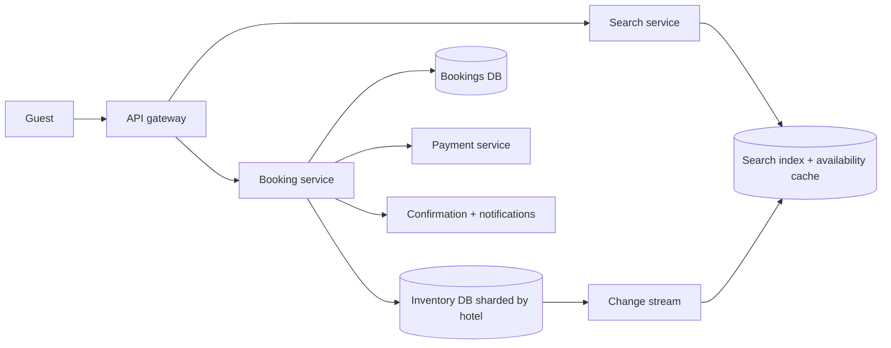

# Hotel Booking System: Full System Design Mock Interview, All 9 Steps

> **Prerequisites:** [Previous lesson: Typeahead / Autocomplete: Full System Design Mock Interview, 9 Steps](../22-typeahead-autocomplete/README.md) and the [Interview Framework track](../../21-interview-framework/README.md).
> **Estimated Reading Time:** 15–20 minutes
> **Target Audience:** Engineers practising the full 9-step system design interview on a classic prompt: search and reservations for hotel rooms with date ranges.

> [!NOTE]
> **In one line:** Hotel booking is **inventory over time**: availability is a count per room type per night, and a reservation must decrement every night of the stay atomically.

> [!TIP]
> **The Golden Rule:** Model inventory as rows per room type per date, reserve all nights in one transaction with a conditional update, and serve search from a cached, slightly stale view.

---

## Step 1. Clarify the Problem

Open with questions, not boxes. Unlike seats, rooms are fungible within a type, and stays span multiple nights. That changes the data model and the overbooking policy.

**Questions to ask the interviewer, and the answer we assume:**

| Question | Assumed answer |
| :--- | :--- |
| Inventory unit? | Room type per hotel per night |
| Overbooking? | A small controlled amount allowed |
| Payment? | Pay at booking or at the hotel |
| Cancellation? | Free until 48 hours before |
| Scale? | 1M hotels, 5,000 bookings per second at peak, search 100x |

> Say it aloud: *"Before I draw anything, let me confirm the scope and the numbers."* That one sentence earns the first minutes of the interview.

---

## Step 2. Functional and Non-Functional Requirements

**Functional (what the system does):**

- Search hotels by city, dates and guests.
- View room types and prices.
- Book a room type for a date range.
- Cancel or modify a booking.

**Non-functional (how well it does it):**

| Quality | Target | Why it drives the design |
| :--- | :--- | :--- |
| Correctness | No unintended overbooking | Walking guests is costly |
| Search latency | Under 500 ms | Conversion |
| Availability | 99.9% | Revenue |
| Consistency | Strong at booking, eventual in search | Different needs |

---

## Step 3. Scope: In and Out

**In scope:** Search, availability calendar, booking transaction, cancellation.

**Out of scope (say it explicitly, then move on):**

- Pricing optimisation.
- Channel manager sync with hotel systems.
- Reviews.

---

## Step 4. Capacity Estimation

Assumptions: 1M hotels, 5 room types each, 365 nights of inventory, 5,000 bookings per second at peak, search is 100x bookings.

| Quantity | Calculation | Result |
| :--- | :--- | :--- |
| Inventory rows | `hotels * types * nights` | **1.8B rows** |
| Inventory storage | `hotels * types * nights * 50 / 1e9` | **91.2 GB** |
| Search QPS at peak | `bookings * search_ratio` | **500K queries/s** |

**What the numbers tell you:** 1.8 billion inventory rows at about 50 bytes is under 100 GB, which is small. Search at 500,000 queries per second dwarfs the 5,000 bookings per second, so search is served from a separate index and cache while bookings hit the strongly consistent inventory database.

---

## Step 5. API Design

| Endpoint | Purpose | Notes |
| :--- | :--- | :--- |
| `GET /v1/hotels?city=&checkin=&checkout=&guests=` | Search | From the search index with cached availability. |
| `GET /v1/hotels/{id}/rooms?dates` | Rooms and prices | Checks inventory. |
| `POST /v1/bookings` | Reserve | Idempotency key, room type, dates, payment. |
| `DELETE /v1/bookings/{id}` | Cancel | Releases the nights. |

A booking holds the room type, not a specific room number. The hotel assigns the room at check-in, which keeps inventory simple.

---

## Step 6. Data Model

| Entity / Store | Key fields | Why this store |
| :--- | :--- | :--- |
| Inventory (sharded by hotel) | `hotel_id`, `room_type`, `date`, `total`, `reserved` | Strong consistency, conditional updates |
| Bookings | `booking_id`, `guest`, `hotel`, `type`, `checkin`, `checkout`, `state` | Relational |
| Search index | Hotel attributes, location, price range, cached availability | Fast filtered queries |
| Price calendar | `hotel`, `type`, `date`, `price` | Read-heavy |

One row per room type per night makes a multi-night booking a multi-row conditional update inside one shard (all of a hotel's rows live together).

---

## Step 7. High-Level Architecture



**Walk the diagram in this order:** search reads the index and cache; booking runs a transaction on the hotel's inventory shard, takes payment, writes the booking, and a change stream refreshes the search index.

---

## Step 8. Deep Dives and Bottlenecks

### 1. Reserving a date range atomically

In one transaction on the hotel's shard: for each night in the stay, `UPDATE inventory SET reserved = reserved + 1 WHERE hotel=? AND type=? AND date=? AND reserved < total + overbook`, and require that every update affected a row; otherwise roll back. Sharding by hotel keeps all nights together so no distributed transaction is needed.

### 2. Search with availability

Search must be fast across a million hotels, so it uses a search index with geo filters and a cached availability summary (for example a bitmap of available nights per room type). The summary can be slightly stale. The booking transaction is the final authority, and the UI says 'last room' only when it knows.

### 3. Overbooking and cancellations

Hotels overbook slightly because some guests cancel. Model it as a policy parameter (`overbook`) per hotel and room type. Cancellation decrements `reserved` for each night. Handle the payment step with a hold: reserve, authorise payment, confirm, and release on failure or timeout.

---

## Step 9. Trade-offs, Failures and Security

**Trade-offs to state aloud:**

| Decision | Option A | Option B | Pick and why |
| :--- | :--- | :--- | :--- |
| Inventory granularity | Specific room | Room type | Room type: fungible rooms, simpler model |
| Search freshness | Always exact | Cached and slightly stale | Cached with final check at booking |
| Sharding | By date | By hotel | By hotel: a stay's nights stay together |

**Failure modes and mitigations:**

| Failure | What users see | Mitigation |
| :--- | :--- | :--- |
| Payment failure | Reserved nights stuck | Release reservation on failure or hold timeout |
| Stale search | Room shown but sold out | Booking step rejects, UI suggests alternatives |
| Shard down | Hotel unbookable | Replica failover |

**Security and abuse:** Validate dates and guest counts server-side, tokenise payment details, authorise access to bookings by guest, and rate-limit searches to stop scraping and price-monitoring bots.

---

## Runnable Example: Reserving a date range all or nothing

Three nights are reserved together; if any night is sold out, none are taken.

```python
inventory = {"2026-12-01": [2, 1], "2026-12-02": [2, 2], "2026-12-03": [2, 0]}  # [total, reserved]

def book(nights):
    snapshot = {d: list(v) for d, v in inventory.items()}
    for d in nights:
        total, reserved = inventory[d]
        if reserved >= total:
            inventory.clear()
            inventory.update(snapshot)
            return f"sold out on {d}, nothing reserved"
        inventory[d][1] += 1
    return "booked"

print(book(["2026-12-01", "2026-12-02", "2026-12-03"]))
print(inventory)
print(book(["2026-12-01", "2026-12-03"]))
print(inventory)
```

Output (produced by running this exact code):

```text
sold out on 2026-12-02, nothing reserved
{'2026-12-01': [2, 1], '2026-12-02': [2, 2], '2026-12-03': [2, 0]}
booked
{'2026-12-01': [2, 2], '2026-12-02': [2, 2], '2026-12-03': [2, 1]}
```

The first attempt fails because 2 December is full and rolls back the earlier night; the second attempt avoids the full night and both nights are reserved.

---

## Common Mistakes

- Reserving nights one at a time without a transaction.
- Searching the inventory database directly.
- Ignoring overbooking and cancellation policy.
- Sharding by date so a stay spans shards.
- Trusting client-side availability.

---

## Interview Questions and Answers

<details>
<summary><strong>Q1: How do you model availability?</strong></summary>

One inventory row per hotel, room type and night with total and reserved counts, updated with conditional writes.

</details>

<details>
<summary><strong>Q2: How do you book multiple nights safely?</strong></summary>

One transaction updating every night on the hotel's shard, failing and rolling back if any night is unavailable.

</details>

<details>
<summary><strong>Q3: How do you make search fast?</strong></summary>

A search index with geo filters and cached availability summaries, fed by a change stream from inventory.

</details>

<details>
<summary><strong>Q4: What about overbooking?</strong></summary>

A per-hotel parameter allowing reserved to exceed total by a small margin, tuned from cancellation rates.

</details>

<details>
<summary><strong>Q5: What if payment fails?</strong></summary>

Release the reserved nights through a compensating step or a hold that expires.

</details>

---

## One-Page Cheat Sheet

| Step | What to say or draw |
| :--- | :--- |
| Clarify | Room type per night, overbook, 5K bookings/s |
| Capacity | 1.8B inventory rows (<100 GB), 500K searches/s |
| API | search, rooms, book, cancel |
| Data | Inventory by hotel and night, bookings, search index |
| Deep dive | Atomic range reservation, search freshness, overbooking |
| Trade-off | Shard by hotel, room type granularity |

---

## Further Reading

- Booking.com and Expedia engineering blogs on availability search.
- Martin Kleppmann, *Designing Data-Intensive Applications*, chapter 7.

---

## Next

Continue with [Inventory Management System: Full System Design Mock Interview, 9 Steps](../24-inventory-management-system/README.md).
