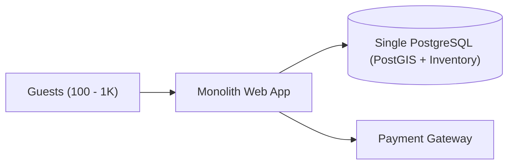
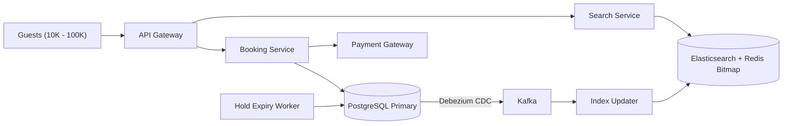
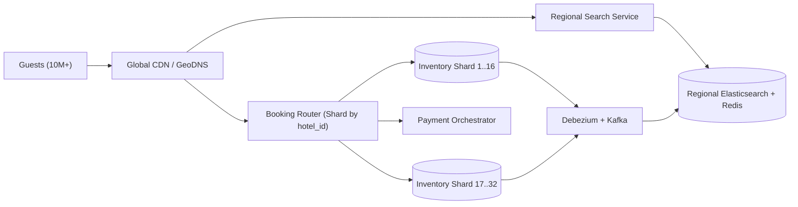
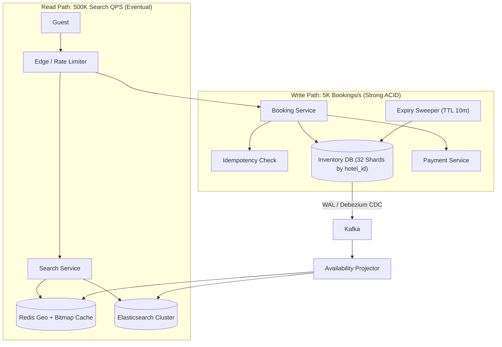
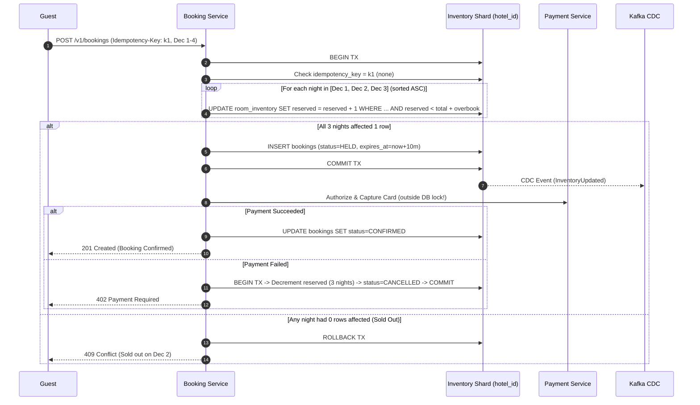

# Hotel Booking System: Full System Design Mock Interview, All 9 Steps

> **Difficulty:** Hard (Senior / Staff)
> **Prerequisites:** [Previous lesson: Typeahead / Autocomplete: Full System Design Mock Interview, 9 Steps](../22-typeahead-autocomplete/README.md) and the [Interview Framework track](../../21-interview-framework/README.md).
> **Estimated Reading Time:** 25–30 minutes
> **Target Audience:** Engineers practising the full 9-step system design interview on a classic prompt: high-throughput hotel search paired with strongly consistent multi-night room reservations.

> [!NOTE]
> **In one line:** Hotel booking is **inventory over time with asymmetric read/write consistency**: search serves 500K QPS from an eventually consistent geo-index + availability cache, while booking runs an ACID multi-night conditional update on a hotel-sharded database.

> [!TIP]
> **The Golden Rule:** Model inventory as `(hotel_id, room_type_id, date)` rows—never specific room numbers—shard by `hotel_id` so every night of a stay lives on one shard, and reserve all nights atomically before charging payment.

---

## 1. Clarifying Questions, Functional & Non-Functional Requirements

Open with questions, not boxes. Unlike concert tickets or airline seats, hotel rooms within a category (e.g., *King Deluxe*) are **fungible**, and reservations span **contiguous date ranges** (e.g., Dec 1–4). That single insight shapes the entire schema and sharding strategy.

### Clarifying Questions & Assumed Answers

| Question | Assumed Answer | Architectural Impact |
| :--- | :--- | :--- |
| **Inventory granularity?** | Room type per hotel per night (e.g., 10 King rooms) | Fungible counts (`total`, `reserved`) instead of tracking room #402 |
| **Overbooking policy?** | Controlled per-hotel/type overbooking allowed (e.g., +5–10%) | Conditional update checks `reserved < total + overbook_limit` |
| **Payment timing?** | Authorize/capture at booking (or pay-at-hotel hold) | Two-step Saga/Hold pattern: reserve inventory with TTL, then charge payment |
| **Cancellations?** | Free cancellation up to 48 hours before check-in | Must atomically decrement `reserved` for all nights of the stay |
| **Scale & read/write ratio?** | 1M hotels, 5 room types avg; 5,000 bookings/s peak; 100:1 search-to-book | 500K search QPS vs 5K write TPS $\implies$ strict CQRS separation |

> Say it aloud: *"Before I draw anything, let me confirm whether we track room types or physical room numbers, whether overbooking is allowed, and the search-to-booking ratio."*

### Functional Requirements

1. **Hotel Search:** Search by destination/geo-bounding-box, check-in/check-out dates, guest count, price, and amenities.
2. **Room & Rate Inspection:** View available room types, nightly pricing, and cancellation policies for a specific hotel.
3. **Atomic Multi-Night Reservation:** Book a room type across `[checkin, checkout)` with idempotency and payment authorization.
4. **Cancellation & Modification:** Cancel an existing booking and release all reserved nights back to inventory.

### Non-Functional Requirements

| Quality Attribute | Target | Why It Drives the Design |
| :--- | :--- | :--- |
| **Correctness (Zero Unintended Oversell)** | Strong ACID consistency on `POST /bookings` | Walking a guest at check-in destroys trust and incurs SLA penalties |
| **Search Latency** | p99 < 400 ms | Directly impacts booking conversion |
| **Availability** | 99.95% (Bookings), 99.99% (Search) | Revenue-critical checkout path |
| **Consistency Model** | Strong at booking; eventual (< 5s) in search | Cannot run 500K QPS of multi-night joins against the transactional DB |

### Explicit Scope Boundaries

- **In Scope:** Geo + availability search, hotel-sharded inventory DB, multi-night atomic reservation, payment hold/release saga, dynamic overbooking parameter.
- **Out of Scope:** ML dynamic pricing models, external PMS/channel-manager EDI integrations, guest reviews & photos CDN.

---

## 2. Back-of-the-Envelope Capacity Estimation

Let us derive inventory row count, storage footprint, and search vs. write QPS.

### Assumptions
- Total hotels: $H = 1 \times 10^6$ (1 million).
- Average room types per hotel: $T = 5$.
- Bookable horizon: $D = 365$ nights ahead.
- Average inventory row size (with indexes): $100\text{ bytes}$.
- Peak booking rate: $5{,}000\text{ bookings/sec}$ (average stay = $3\text{ nights}$).
- Search-to-booking ratio: $100:1$.

### Worked Equations

**1. Total Inventory Rows & Storage:**
$$N_{\text{rows}} = 10^6 \text{ hotels} \times 5 \text{ types} \times 365 \text{ nights} = 1.825 \times 10^9 \text{ rows}$$
$$S_{\text{inventory}} = 1.825 \times 10^9 \times 100 \text{ bytes} = 182.5 \text{ GB}$$

At < 200 GB, the entire active inventory dataset easily fits across a modest **16-to-32 shard PostgreSQL/MySQL cluster** with hot dates pinned in buffer pool RAM!

**2. Booking Write Load (Row Updates/sec):**
Each booking updates an average of 3 nights (plus 1 row insert into `bookings`):
$$W_{\text{rows/sec}} = 5{,}000 \text{ bookings/s} \times 3 \text{ nights} = 15{,}000 \text{ inventory updates/s}$$

Across 32 shards, each shard handles only $\sim 470\text{ row updates/sec}$—well within NVMe PostgreSQL/MySQL limits.

**3. Peak Search QPS:**
$$Q_{\text{search}} = 5{,}000 \times 100 = 500{,}000 \text{ searches/sec}$$

Assuming 70% of searches are absorbed by CDN/Redis/Edge caching (popular cities + common weekend dates), origin search nodes handle $150{,}000\text{ QPS}$.

**4. Bookings Table Growth (5 Years):**
Assuming avg $2{,}000\text{ bookings/sec}$ over 24h ($\sim 172.8\text{M/day}$? Let's say avg $500\text{ bookings/sec} \approx 43.2\text{M bookings/day}$ at $500\text{ bytes/row}$):
$$S_{\text{bookings/year}} = 43.2 \times 10^6 \times 365 \times 500 \text{ B} \approx 7.88 \text{ TB/year}$$

### Capacity Summary Table

| Metric | Formula / Derivation | Result |
| :--- | :--- | :--- |
| **Active Inventory Rows** | $10^6 \times 5 \times 365$ | **1.825B rows** |
| **Inventory DB Size (with B-Tree)** | $1.825\text{B} \times 100\text{ B}$ | **~182.5 GB** |
| **Peak Booking TPS** | Given peak | **5,000 bookings/s** |
| **Peak Inventory Row Updates/s** | $5{,}000 \times 3\text{ nights}$ | **15,000 updates/s** |
| **Peak Search QPS** | $5{,}000 \times 100$ | **500,000 QPS** |
| **Annual Bookings Ledger** | $500\text{/s avg} \times 86{,}400 \times 365 \times 500\text{ B}$ | **~7.9 TB/year** |

---

## 3. Core API Contracts & Data Model

### Public APIs

| Endpoint | Purpose | Request / Response & Idempotency |
| :--- | :--- | :--- |
| `GET /v1/hotels/search?city=paris&checkin=2026-12-01&checkout=2026-12-04&guests=2` | Search available hotels | Queries Search Index + Availability Bitmap Cache. Returns `hotels[]` with starting price & `"last 2 rooms"` badge. |
| `GET /v1/hotels/{hotel_id}/rooms?checkin=...&checkout=...` | Room types & exact price | Queries Inventory DB read replica (or short-TTL cache) for exact room-type counts & nightly rates. |
| `POST /v1/bookings` | Create reservation | Requires `Idempotency-Key` header. Body: `{hotel_id, room_type_id, checkin, checkout, payment_token}`. Returns `201 Created` or `409 Conflict` (sold out). |
| `DELETE /v1/bookings/{booking_id}` | Cancel reservation | Idempotent cancellation; releases `reserved` counts and triggers refund. |

### Relational & Search Data Model

```sql
-- Sharded by hotel_id so all nights of a hotel live on ONE shard
CREATE TABLE room_inventory (
    hotel_id       BIGINT NOT NULL,
    room_type_id   INT NOT NULL,
    stay_date      DATE NOT NULL,
    total_rooms    SMALLINT NOT NULL,
    reserved_rooms SMALLINT NOT NULL DEFAULT 0,
    overbook_limit SMALLINT NOT NULL DEFAULT 0,
    version        INT NOT NULL DEFAULT 0,
    PRIMARY KEY (hotel_id, room_type_id, stay_date)
);

CREATE TABLE bookings (
    booking_id     UUID PRIMARY KEY,
    idempotency_key VARCHAR(64) UNIQUE NOT NULL,
    guest_id       BIGINT NOT NULL,
    hotel_id       BIGINT NOT NULL,
    room_type_id   INT NOT NULL,
    checkin_date   DATE NOT NULL,
    checkout_date  DATE NOT NULL,
    status         VARCHAR(20) NOT NULL, -- HELD, CONFIRMED, CANCELLED, EXPIRED
    expires_at     TIMESTAMPTZ,
    created_at     TIMESTAMPTZ NOT NULL DEFAULT NOW()
);
```

| Store | Key Fields | Engine & Rationale |
| :--- | :--- | :--- |
| **Inventory DB** | `(hotel_id, room_type_id, stay_date)` | Sharded PostgreSQL/MySQL; ACID transactions + conditional updates |
| **Search Index** | `hotel_id`, `geo_point`, `amenities`, `avail_bitmap_365d` | Elasticsearch/OpenSearch; fast geo + filter + availability bitmask |
| **Availability Cache** | `hotel_id:room_type_id -> 365-bit availability mask` | Redis Cluster; sub-millisecond read for search result hydration |

---

## 4. Stage 1 (100 - 1K Users): Baseline Monolith & Single Database

At 100–1,000 users (< 10 QPS, < 5,000 hotels), a single transactional database handles both search and booking cleanly.

### Component-by-Component Build
1. **Single Monolith API:** Serves search, room details, and booking endpoints.
2. **Single PostgreSQL Instance:** Holds `hotels`, `room_inventory`, and `bookings`. Search uses PostGIS (`ST_DWithin`) joined with `room_inventory` where `reserved_rooms < total_rooms`.
3. **Synchronous Payment Call:** Inside or right after the DB hold, calls Stripe/Adyen synchronously.



### What Breaks at 10K Users & 100K Hotels?
- **Search Queries Lock/Starve Bookings:** `GROUP BY hotel_id HAVING MIN(total - reserved) > 0` across 365-day date ranges scans millions of inventory rows on every search, saturating DB CPU and causing booking transactions to time out.
- **Holding DB Locks Across Payment HTTP Calls:** If a transaction locks inventory rows while waiting 2 seconds for Stripe, connection pools exhaust and deadlocks spike on popular hotels.

---

## 5. Stage 2 (10K - 100K Users): Caching, Read Replicas & Async Offload

At 10K–100K users (50K search QPS, 500 bookings/s), we decouple **Search** from **Inventory** (CQRS) and introduce **Two-Phase Hold-then-Pay**.

### Component-by-Component Additions
1. **Dedicated Search Index (Elasticsearch):** Move geo-filtering and hotel attribute queries out of PostgreSQL into Elasticsearch.
2. **CDC + Availability Bitmap Cache (Redis):** Debezium streams `room_inventory` changes from Postgres WAL into Redis/Elasticsearch so search knows which hotels have 0 rooms without hitting Postgres.
3. **Hold-with-TTL Pattern (No Locks During Payment):**
   - Step A: Fast (< 10 ms) DB transaction increments `reserved_rooms` and inserts `bookings(status='HELD', expires_at=now+10m)`.
   - Step B: Call Payment Gateway *outside* any DB transaction/lock.
   - Step C: On success, `UPDATE bookings SET status='CONFIRMED'`. On failure/timeout, an expiry worker releases the held nights.



### What Breaks at 1M+ Users & 1M Hotels?
- **Single-Primary Write Bottleneck:** 15,000 inventory row updates/sec plus 1.8B rows exceeds a single Postgres primary's write IOPS and replication lag budget.
- **Flash-Sale / Event Contention:** A major concert or conference in one city causes 1,000 users to compete for the same 50 hotels simultaneously.

---

## 6. Stage 3 (1M - 10M+ Users): Sharding, Partitioning & Multi-Region Scale

At 1M–10M+ users (1M hotels, 500K search QPS, 5K peak bookings/s), we shard the Inventory DB by `hotel_id` and scale Search globally.

### Component-by-Component Additions
1. **Inventory Sharding by `hotel_id` (32 Shards):** Shard key is `hash(hotel_id) % 32`. Because a stay is always at **one hotel**, all nights `[checkin, checkout)` of a booking reside on the **exact same shard**, eliminating distributed 2PC transactions!
2. **Idempotency & Row-Ordering:** Require `Idempotency-Key` on `POST /v1/bookings` (stored on the same `hotel_id` shard) to prevent double-charging on mobile network retries. Sort multi-night updates by `stay_date ASC` to guarantee zero deadlocks.
3. **Multi-Region Search & Edge Caching:** Geo-replicated Elasticsearch clusters and Redis availability caches in US, EU, and APAC serve 500K QPS locally with < 2s CDC replication lag.



---

## 7. Final Full Production Architecture & End-to-End Flows

### Complete Production Architecture



### End-to-End Multi-Night Booking Sequence Diagram



---

## 8. Deep-Dive Bottlenecks & Algorithmic Trade-Offs

### 1. Sharding by `hotel_id` vs. Sharding by `date`
- **Sharding by `date` (Bad):** A 5-night stay (`Dec 28 – Jan 2`) spans 5 different shards, forcing slow Two-Phase Commit (2PC) or complex distributed Sagas across shards.
- **Sharding by `hotel_id` (Chosen):** Every night for a hotel lives on **one shard**. Multi-night atomic reservation is a single local ACID transaction.
- **Hot Hotel Mitigation:** A mega-resort (5,000 rooms) has high concurrency on one `hotel_id`, but its 5 room types + 365 dates are separate rows. Sorting updates by `(room_type_id, stay_date)` prevents deadlocks, and optimistic concurrency (`version`) or `SELECT FOR UPDATE` handles contention cleanly.

### 2. Fast Multi-Night Availability Search via Bitmasks
How does Elasticsearch/Redis check if a hotel has $\ge 1$ room free for **all** nights from `Dec 1` to `Dec 10` across 1M hotels?
- Store a **365-bit integer (or 46-byte bitmask)** per `(hotel_id, room_type_id)` where bit `i = 1` means `reserved < total + overbook` on day `i`.
- A 10-night query builds a query bitmask `Q_mask` with bits `[335..344]` set to `1`.
- Availability check is a single CPU bitwise operation: `(avail_mask & Q_mask) == Q_mask`—taking nanoseconds per hotel!

### 3. Dynamic Overbooking Math
Hotels overbook because historical no-show/cancellation rates are non-zero (often 5–12%). If a hotel has $N=100$ rooms and historical cancellation probability $p=0.08$, the probability of walking a guest if we sell $100 + k$ rooms follows a Binomial distribution, capped by business risk tolerance (e.g., $P(\text{walk}) < 0.01$). We model this as a simple per-hotel-type integer `overbook_limit` updated daily by an analytics job.

---

## 9. Failure Modes, Reliability & Backpressure Mitigations

| Failure Mode | User Impact | Engineering Mitigation |
| :--- | :--- | :--- |
| **User Crashes Mid-Payment** | Held rooms stuck forever (phantom sold-out) | **10-min `expires_at` Hold TTL:** Background sweeper releases expired `HELD` bookings and decrements `reserved_rooms` atomically |
| **Stale Search Cache Shows Sold-Out Room** | Guest clicks "Book" and gets error | Booking transaction is the **sole source of truth**; returns `409 Conflict` and UI shows alternative dates/nearby hotels |
| **Mobile Retry During Timeout** | Double-booking & double-charging | Mandatory `Idempotency-Key` stored in `bookings` table on the same shard; retries return original `201`/`409` result |
| **Deadlock on Concurrent Multi-Night Bookings** | Transaction aborts under load | Always acquire row locks in **canonical sorted order** (`stay_date ASC`, `room_type_id ASC`) |
| **CDC Lag Spike (> 30s)** | Search shows stale availability | Fall back to direct read-replica check on `GET /hotels/{id}/rooms` (the room-selection page) |

---

## 10. Production War Story & Real-World Reference

### The "Phantom Lock & Retry Storm" During Holiday Flash Sales
A major OTA (Online Travel Agency) experienced a **SEV-1** during a Black Friday hotel sale:
- **Root Cause:** The booking service opened a PostgreSQL transaction, executed `SELECT ... FOR UPDATE` on `room_inventory` rows, and then called the external payment gateway **inside** the open transaction. When the payment gateway slowed down from 300 ms to 8 seconds, Postgres row locks were held for 8+ seconds, exhausting the 200-connection pool across shards and causing a 10x retry storm.
- **Fix:**
  1. **Short-Lived Hold Transaction:** Increment `reserved_rooms` and commit `status='HELD'` in < 10 ms *before* calling the payment gateway.
  2. **Async Expiry Sweeper:** Release unconfirmed `HELD` rows after 10 minutes.
  3. **Idempotency Keys:** Prevented retries from creating duplicate holds.

---

## 11. Core Component Implementation (4 Languages)

Below is a production-pattern **Atomic Multi-Night Reservation & Rollback Engine** with canonical date sorting, overbooking limits, and idempotency in Go, TypeScript, Python, and C#.

````carousel
```go
package main

import (
	"errors"
	"fmt"
	"sort"
	"sync"
)

type NightInventory struct {
	Total    int
	Reserved int
	Overbook int
}

type BookingEngine struct {
	mu          sync.Mutex
	inventory   map[string]*NightInventory // key: "hotel:roomType:date"
	idempotency map[string]string          // key -> bookingID
}

func NewBookingEngine() *BookingEngine {
	return &BookingEngine{
		inventory:   make(map[string]*NightInventory),
		idempotency: make(map[string]string),
	}
}

func (b *BookingEngine) Reserve(idemKey, hotelID, roomType string, nights []string) (string, error) {
	b.mu.Lock()
	defer b.mu.Unlock()

	if existing, ok := b.idempotency[idemKey]; ok {
		return existing, nil
	}

	// Canonical sort prevents deadlocks in multi-row locking
	sortedNights := append([]string(nil), nights...)
	sort.Strings(sortedNights)

	keys := make([]string, 0, len(sortedNights))
	for _, d := range sortedNights {
		k := fmt.Sprintf("%s:%s:%s", hotelID, roomType, d)
		inv, ok := b.inventory[k]
		if !ok || inv.Reserved >= inv.Total+inv.Overbook {
			return "", errors.New("sold out on " + d)
		}
		keys = append(keys, k)
	}

	for _, k := range keys {
		b.inventory[k].Reserved++
	}
	bookingID := "bk_" + idemKey
	b.idempotency[idemKey] = bookingID
	return bookingID, nil
}

func main() {
	eng := NewBookingEngine()
	eng.inventory["h1:king:2026-12-01"] = &NightInventory{Total: 2, Reserved: 1, Overbook: 0}
	eng.inventory["h1:king:2026-12-02"] = &NightInventory{Total: 2, Reserved: 2, Overbook: 0}
	eng.inventory["h1:king:2026-12-03"] = &NightInventory{Total: 2, Reserved: 0, Overbook: 0}

	fmt.Println(eng.Reserve("req-1", "h1", "king", []string{"2026-12-01", "2026-12-02"}))
	fmt.Println(eng.Reserve("req-2", "h1", "king", []string{"2026-12-03", "2026-12-01"}))
}
```
<!-- slide -->
```typescript
interface NightInventory {
  total: number;
  reserved: number;
  overbook: number;
}

class BookingEngine {
  private inventory = new Map<string, NightInventory>();
  private idempotency = new Map<string, string>();

  seed(hotelId: string, roomType: string, date: string, inv: NightInventory): void {
    this.inventory.set(`${hotelId}:${roomType}:${date}`, inv);
  }

  reserve(idemKey: string, hotelId: string, roomType: string, nights: string[]): string {
    const existing = this.idempotency.get(idemKey);
    if (existing) return existing;

    // Canonical sort prevents deadlocks when locking rows
    const sortedNights = [...nights].sort();
    const keys: string[] = [];

    for (const date of sortedNights) {
      const key = `${hotelId}:${roomType}:${date}`;
      const inv = this.inventory.get(key);
      if (!inv || inv.reserved >= inv.total + inv.overbook) {
        throw new Error(`Sold out on ${date}; transaction rolled back`);
      }
      keys.push(key);
    }

    for (const key of keys) {
      this.inventory.get(key)!.reserved += 1;
    }

    const bookingId = `bk_${idemKey}`;
    this.idempotency.set(idemKey, bookingId);
    return bookingId;
  }
}

const engine = new BookingEngine();
engine.seed("h1", "king", "2026-12-01", { total: 2, reserved: 1, overbook: 0 });
engine.seed("h1", "king", "2026-12-02", { total: 2, reserved: 2, overbook: 0 });
engine.seed("h1", "king", "2026-12-03", { total: 2, reserved: 0, overbook: 0 });

try {
  console.log(engine.reserve("req-1", "h1", "king", ["2026-12-01", "2026-12-02"]));
} catch (e) {
  console.log((e as Error).message);
}
console.log("Booked:", engine.reserve("req-2", "h1", "king", ["2026-12-03", "2026-12-01"]));
```
<!-- slide -->
```python
from dataclasses import dataclass

@dataclass
class NightInventory:
    total: int
    reserved: int
    overbook: int = 0

class BookingEngine:
    def __init__(self) -> None:
        self.inventory: dict[tuple[str, str, str], NightInventory] = {}
        self.idempotency: dict[str, str] = {}

    def reserve(self, idem_key: str, hotel_id: str, room_type: str, nights: list[str]) -> str:
        if idem_key in self.idempotency:
            return self.idempotency[idem_key]

        # Canonical sort avoids row-lock deadlocks in SQL transactions
        keys = [(hotel_id, room_type, d) for d in sorted(nights)]
        for k in keys:
            inv = self.inventory.get(k)
            if not inv or inv.reserved >= inv.total + inv.overbook:
                raise ValueError(f"Sold out on {k[2]}; nothing reserved")

        for k in keys:
            self.inventory[k].reserved += 1

        booking_id = f"bk_{idem_key}"
        self.idempotency[idem_key] = booking_id
        return booking_id

if __name__ == "__main__":
    eng = BookingEngine()
    eng.inventory[("h1", "king", "2026-12-01")] = NightInventory(2, 1)
    eng.inventory[("h1", "king", "2026-12-02")] = NightInventory(2, 2)
    eng.inventory[("h1", "king", "2026-12-03")] = NightInventory(2, 0)

    for req_id, stay in [("r1", ["2026-12-01", "2026-12-02"]), ("r2", ["2026-12-03", "2026-12-01"])]:
        try:
            print("Booked:", eng.reserve(req_id, "h1", "king", stay))
        except ValueError as exc:
            print("Rejected:", exc)
```
<!-- slide -->
```csharp
using System;
using System.Collections.Generic;
using System.Linq;

public class NightInventory
{
    public int Total { get; set; }
    public int Reserved { get; set; }
    public int Overbook { get; set; }
}

public class BookingEngine
{
    private readonly Dictionary<string, NightInventory> _inventory = new();
    private readonly Dictionary<string, string> _idempotency = new();

    public void Seed(string hotelId, string roomType, string date, NightInventory inv) =>
        _inventory[$"{hotelId}:{roomType}:{date}"] = inv;

    public string Reserve(string idemKey, string hotelId, string roomType, IEnumerable<string> nights)
    {
        if (_idempotency.TryGetValue(idemKey, out var existing))
            return existing;

        var keys = nights.OrderBy(d => d, StringComparer.Ordinal)
                         .Select(d => $"{hotelId}:{roomType}:{d}")
                         .ToList();

        foreach (var k in keys)
        {
            if (!_inventory.TryGetValue(k, out var inv) || inv.Reserved >= inv.Total + inv.Overbook)
                throw new InvalidOperationException($"Sold out for {k}; rolled back");
        }

        foreach (var k in keys)
            _inventory[k].Reserved++;

        var bookingId = $"bk_{idemKey}";
        _idempotency[idemKey] = bookingId;
        return bookingId;
    }
}
```
````

---

## 12. Verification, Load Testing & CLI Diagnostics

```bash
# 1. Verify atomic multi-night conditional SQL update (PostgreSQL)
psql "$DB_SHARD_01" -c "
BEGIN;
UPDATE room_inventory SET reserved_rooms = reserved_rooms + 1
WHERE hotel_id = 1042 AND room_type_id = 2 AND stay_date IN ('2026-12-01','2026-12-02','2026-12-03')
  AND reserved_rooms < total_rooms + overbook_limit;
-- Verify row_count == 3 in application before COMMIT!
ROLLBACK;
"

# 2. Check for row-lock contention or deadlocks on hot hotel shards
psql "$DB_SHARD_01" -c "SELECT pid, wait_event_type, wait_event, state, query FROM pg_stat_activity WHERE wait_event_type = 'Lock';"

# 3. Verify idempotency under concurrent duplicate POST /v1/bookings requests
seq 1 20 | xargs -P20 -I{} curl -s -o /dev/null -w "%{http_code}\n" \
  -H "Idempotency-Key: test-key-999" -X POST "http://booking-api.internal/v1/bookings"
```

---

## 13. Common Interview Mistakes & Red Flags

- **Reserving specific room numbers (#402) at booking time:** Causes artificial fragmentation (room 402 free Mon–Tue, room 405 free Wed–Thu) when rooms of the same type are fungible.
- **Holding DB locks while calling Stripe/Adyen:** Exhausts connection pools and causes cascading outages when payment gateways hiccup.
- **Sharding inventory by `date` instead of `hotel_id`:** Forces cross-shard 2PC transactions for every multi-night stay.
- **Querying the transactional inventory DB for search:** 500K QPS of date-range joins will melt the primary DB.
- **Forgetting idempotency keys:** Mobile retries create duplicate bookings and double charges.
- **Updating nights in unsorted order:** Concurrent bookings for overlapping dates can deadlock unless dates are locked in canonical ascending order.

---

## 14. Key Terminology & Glossary

| Key Term | Definition |
| :--- | :--- |
| **Fungible Inventory** | Treating rooms of the same category (e.g., *King Standard*) as interchangeable counts until physical check-in. |
| **Overbooking Limit** | Controlled buffer (`overbook_limit`) allowing `reserved` to slightly exceed `total` based on historical cancellation rates. |
| **CQRS** | Command Query Responsibility Segregation: separating high-QPS Search reads (Elasticsearch/Redis) from ACID Booking writes. |
| **Availability Bitmask** | A 365-bit integer per room type where each bit indicates availability on day $i$, enabling nanosecond bitwise range checks. |
| **Two-Phase Hold-then-Pay** | Reserving inventory in a short DB transaction (`HELD` + TTL) *before* calling the external payment gateway. |
| **Idempotency Key** | Client-generated unique token ensuring retried `POST /bookings` requests execute at most once. |
| **Debezium CDC** | Change Data Capture reading Postgres WAL logs to stream inventory updates to Kafka/Search asynchronously. |
| **Canonical Lock Ordering** | Sorting `(room_type_id, stay_date)` ascending before acquiring row locks to eliminate deadlocks. |

---

## 15. Interview Follow-Up Questions (12 Q&As)

### Basic Conceptual Questions

<details>
<summary><strong>Q1: Why model inventory by room type per night instead of physical room numbers? [BASIC]</strong></summary>

Rooms within a type are fungible. If you assign room #101 for Mon–Tue and #102 for Wed–Thu, a guest wanting Mon–Thu appears blocked even though a room is free every night. Assigning specific rooms at check-in avoids fragmentation and keeps inventory to simple integer counters.

</details>

<details>
<summary><strong>Q2: How do you reserve a 5-night stay atomically without overselling? [BASIC]</strong></summary>

Shard inventory by `hotel_id` so all 5 nights reside on one database shard. Run a single ACID transaction updating all 5 rows with `WHERE reserved_rooms < total_rooms + overbook_limit`. Assert that `affected_rows == 5`; otherwise `ROLLBACK`.

</details>

<details>
<summary><strong>Q3: Why can't search query the inventory database directly? [BASIC]</strong></summary>

Search receives ~500K QPS (100x bookings) and requires geo-bounding-box filters plus multi-night availability joins across 1M hotels. Running that against the transactional Postgres shards would starve write locks and destroy booking latency.

</details>

<details>
<summary><strong>Q4: How do you handle overbooking safely? [BASIC]</strong></summary>

Add an `overbook_limit` column per `(hotel_id, room_type_id, stay_date)` tuned from historical cancellation/no-show rates, and check `reserved_rooms < total_rooms + overbook_limit` in the conditional `UPDATE`.

</details>

### Scenario-Based Architecture Questions

<details>
<summary><strong>Q5: What happens if a user's payment takes 5 seconds or fails after rooms are reserved? [SCENARIO]</strong></summary>

Never hold DB locks during payment. Commit a short-lived `HELD` reservation with `expires_at = now() + 10 min` first, release DB connections, then call Payment. If payment fails, run a compensating transaction to decrement `reserved_rooms`; if the user's browser crashes, an expiry sweeper releases it after 10 minutes.

</details>

<details>
<summary><strong>Q6: A concert is announced in London, and 50,000 users try to book the same 10 hotels simultaneously. How does your system survive? [SCENARIO]</strong></summary>

First, CDN + Redis absorbs search spikes. Second, on the hot hotel's shard, sort multi-night updates by `stay_date ASC` to prevent deadlocks, use short < 10 ms transactions, and apply a per-hotel rate limiter / virtual waiting room at the Booking Service if lock wait queues exceed threshold.

</details>

<details>
<summary><strong>Q7: How do you handle a guest modifying their stay from Dec 1–3 to Dec 2–5 atomically? [SCENARIO]</strong></summary>

In one transaction on the hotel's shard: decrement `reserved_rooms` on the dropped night (`Dec 1`), conditionally increment `reserved_rooms` on the newly added nights (`Dec 4`, `Dec 5`), and update the `bookings` row. If `Dec 4` or `Dec 5` is sold out, roll back so the guest keeps their original Dec 1–3 booking.

</details>

<details>
<summary><strong>Q8: How do you keep search availability fresh without hammering Elasticsearch with 15,000 updates/sec? [SCENARIO]</strong></summary>

Only emit a CDC update to Elasticsearch when a `(hotel_id, room_type_id, stay_date)` **crosses the zero-availability boundary** (e.g., `available` goes from `1 -> 0` or `0 -> 1`). Going from 15 rooms to 14 rooms does not change whether the hotel is bookable in search!

</details>

### Advanced & Tricky Interview Questions

<details>
<summary><strong>Q9: How do you prevent deadlocks when two concurrent transactions book overlapping dates for the same hotel? [TRICKY]</strong></summary>

If Transaction A updates `[Dec 1, Dec 2]` and Transaction B updates `[Dec 2, Dec 1]`, they can deadlock. Always sort the `stay_date` list in **strictly ascending order** before issuing `UPDATE` or `SELECT ... FOR UPDATE` statements, guaranteeing a global lock-acquisition hierarchy.

</details>

<details>
<summary><strong>Q10: What if a hotel wants to sell a "Suite" that can also be split into two "Standard" rooms (connecting rooms)? [TRICKY]</strong></summary>

Model composite inventory using a **component-level lock**: a Suite reservation atomically decrements both the Suite virtual row and the two underlying Standard room rows in the same hotel-shard transaction, using canonical `(room_type_id, stay_date)` lock ordering.

</details>

<details>
<summary><strong>Q11: How do you handle timezones for `stay_date` and `48-hour free cancellation` across global hotels? [TRICKY]</strong></summary>

Store `stay_date` as a pure calendar `DATE` (no timezone—hotel nights are always in the property's local time). Store `free_cancel_deadline` as a UTC `TIMESTAMPTZ` computed at booking time using the hotel's IANA timezone (e.g., `Europe/Paris` 15:00 check-in minus 48 hours).

</details>

<details>
<summary><strong>Q12: What if a user books 2 rooms of the same type in one order, and only 1 room is left on night 2? [TRICKY]</strong></summary>

The conditional SQL update checks `WHERE reserved_rooms + :qty <= total_rooms + overbook_limit` and increments by `:qty` (`reserved_rooms = reserved_rooms + 2`). If night 2 only has 1 room left, `affected_rows` is `< total_nights`, triggering a full `ROLLBACK` and `409 Conflict`.

</details>

---

## 16. One-Page Master Cheat Sheet

```text
+-----------------------------------------------------------------------------+
|                  HOTEL BOOKING SYSTEM ARCHITECTURE CHEAT SHEET              |
+-----------------------------------------------------------------------------+
| SCALE:     1M hotels | 1.8B inventory rows (~182 GB) | 32 Shards by hotel_id|
| TRAFFIC:   500K Search QPS (Eventual) | 5K Bookings/s (Strong ACID)         |
+-----------------------------------------------------------------------------+
| CORE FLOW:                                                                  |
|  1. Search:  Guest -> CDN -> Search Service -> ES Geo + 365-bit Redis Mask  |
|  2. Hold:    Booking Service -> Hotel Shard TX (Sort dates ASC, +1, TTL 10m)|
|  3. Pay:     Call Payment Gateway OUTSIDE DB lock -> Confirm or Rollback    |
|  4. Sync:    Debezium CDC -> Kafka -> Update Search only on 0<->1 boundary  |
+-----------------------------------------------------------------------------+
| GOLDEN RULES:                                                               |
|  * Model fungible room_type per night, never physical room numbers.         |
|  * Shard by hotel_id so all nights of a stay live on ONE shard (no 2PC).    |
|  * Never hold DB locks during external Payment HTTP calls.                  |
|  * Require Idempotency-Key + sort dates ASC to prevent double-book/deadlock.|
+-----------------------------------------------------------------------------+
```

| Step | Key Decision | Target Number |
| :--- | :--- | :--- |
| **Clarify** | Room type/night, controlled overbooking | 5K bookings/s, 500K search QPS |
| **Capacity** | 1.825B rows, ~182.5 GB, 32 shards | ~470 row updates/s/shard |
| **Sharding** | Hash by `hotel_id` (single-shard ACID) | 0 cross-shard 2PC |
| **Search** | Elasticsearch + 365-bit availability mask | p99 < 400 ms |
| **Reliability** | 10-min Hold TTL + Idempotency-Key + CDC | Zero unintended oversell |

---

## Further Reading

- Booking.com and Expedia engineering blogs on availability search.
- Martin Kleppmann, *Designing Data-Intensive Applications*, chapter 7 (Transactions & Write Skew).

---

## Next

Continue with [Inventory Management System: Full System Design Mock Interview, 9 Steps](../24-inventory-management-system/README.md).
