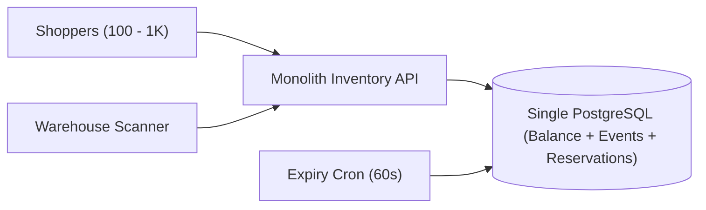
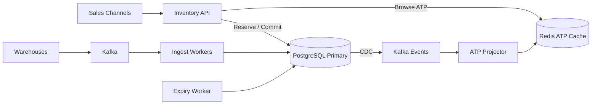
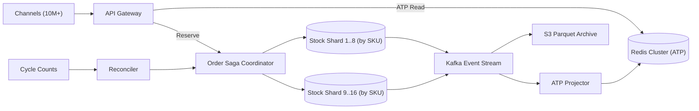
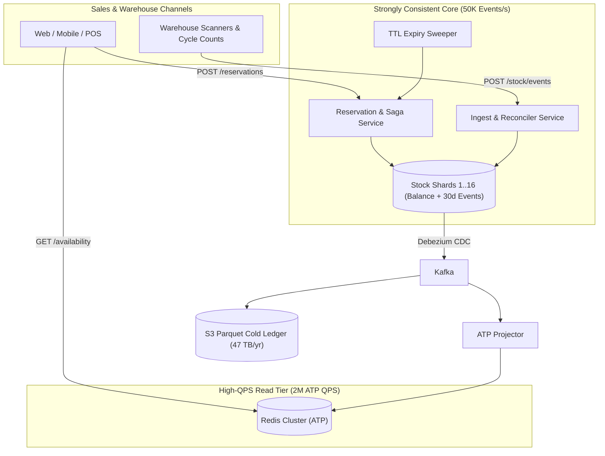

# Inventory Management System: Full System Design Mock Interview, All 9 Steps

> **Difficulty:** Hard (Senior / Staff)
> **Prerequisites:** [Previous lesson: Hotel Booking System: Full System Design Mock Interview, All 9 Steps](../23-hotel-booking-system/README.md) and the [Interview Framework track](../../21-interview-framework/README.md).
> **Estimated Reading Time:** 25–30 minutes
> **Target Audience:** Engineers practising the full 9-step system design interview on a classic prompt: tracking real-time stock across hundreds of warehouses and sales channels without overselling or losing auditability.

> [!NOTE]
> **In one line:** An inventory system is **an append-only ledger of stock movements paired with strongly consistent reservation counters**: `available_to_promise = on_hand - reserved`, updated atomically via conditional writes and reconciled against physical cycle counts.

> [!TIP]
> **The Golden Rule:** Never mutate a stock count in place without recording an immutable event. Reserve stock with an expiration TTL before order capture, split flash-sale hot SKUs into bucketed sub-counters, and treat physical cycle counts as adjustment events.

---

## 1. Clarifying Questions, Functional & Non-Functional Requirements

Open with questions, not boxes. In e-commerce and omnichannel retail, the two fatal bugs are **overselling** (promising stock you don't have) and **phantom stock** (system says 5 in stock, shelf has 0).

### Clarifying Questions & Assumed Answers

| Question | Assumed Answer | Architectural Impact |
| :--- | :--- | :--- |
| **Sales channels?** | Website, mobile app, physical POS, third-party marketplaces | Needs high-QPS cached availability reads + single authoritative reservation core |
| **Locations?** | 500 warehouses and retail stores | Stock is tracked per `(sku, location_id)` |
| **Stock operations?** | Receive, reserve, commit/ship, release/cancel, return, cycle-count adjust | Event-sourced ledger + materialized `(on_hand, reserved)` balance row |
| **Consistency?** | Zero overselling on checkout; slight staleness (< 2s) OK on browse pages | CQRS: cached Available-to-Promise (ATP) for browse; ACID conditional update for reserve |
| **Scale & flash sales?** | 10M SKUs, 500 locations (~5% density = 250M rows), 50K events/s peak | Must shard by `sku` and handle single-SKU flash-sale row contention |

> Say it aloud: *"Before I draw anything, let me confirm the consistency requirements at browse vs. checkout, the number of SKUs and warehouses, and whether we need to handle flash-sale hot SKUs."*

### Functional Requirements

1. **Stock Ledger & Movements:** Record receipts, shipments, returns, transfers, and physical adjustments as idempotent events.
2. **Timed Reservations:** Atomically reserve stock for multi-line orders with an expiration TTL (e.g., 15 minutes) to prevent abandoned carts from locking inventory.
3. **Commit & Release:** Deduct `on_hand` when an order ships (`commit`), or decrement `reserved` on cancellation/timeout (`release`).
4. **Available-to-Promise (ATP) Reads:** Serve fast aggregate availability per SKU (or per region) to product detail pages (PDPs) and marketplaces.
5. **Physical Reconciliation:** Ingest warehouse cycle counts and generate reasoned adjustment events when physical stock drifts from system stock.

### Non-Functional Requirements

| Quality Attribute | Target | Why It Drives the Design |
| :--- | :--- | :--- |
| **Correctness & Auditability** | Zero oversell; 100% immutable audit trail | Financial compliance, Sarbanes-Oxley / ERP reconciliation |
| **Read Latency (ATP)** | p99 < 30 ms | Product pages & search listings |
| **Reserve Latency** | p99 < 80 ms | Checkout conversion |
| **Write Throughput** | 50,000 stock events/s peak | Peak Black Friday / flash-sale bursts |

### Explicit Scope Boundaries

- **In Scope:** Append-only stock event log, materialized `(on_hand, reserved)` balance, expiring reservations, hot-SKU bucketing, ATP read cache, cycle-count reconciliation.
- **Out of Scope:** ML demand forecasting, warehouse robotics/picking routes, supplier procurement & invoicing.

---

## 2. Back-of-the-Envelope Capacity Estimation

Let us derive active stock rows, daily event log growth, and peak flash-sale contention.

### Assumptions
- SKUs: $10 \times 10^6$ (10M).
- Locations: $500$ warehouses/stores.
- Sparsity/Density: Each SKU is stocked in $\sim 5\%$ of locations ($25$ locations avg).
- Stock balance row size: $120\text{ bytes}$ (with indexes).
- Peak stock event rate: $50{,}000\text{ events/sec}$ (average = $20\%$ of peak = $10{,}000\text{ events/sec}$).
- Event payload size: $150\text{ bytes}$.
- Browse-to-reserve read ratio: $40:1$ ($\sim 400\text{K–}2\text{M}$ ATP reads/sec at peak).

### Worked Equations

**1. Active `(sku, location_id)` Balance Rows & Storage:**
$$N_{\text{stock}} = 10^7 \text{ SKUs} \times 500 \text{ locations} \times 0.05 = 2.5 \times 10^8 \text{ rows}$$
$$S_{\text{stock}} = 2.5 \times 10^8 \times 120 \text{ bytes} = 30 \text{ GB}$$

Only **30 GB**! The entire active balance table fits in RAM across a modest 8-to-16 shard PostgreSQL cluster.

**2. Append-Only Event Log Growth:**
At $10{,}000\text{ events/sec}$ average:
$$V_{\text{events/day}} = 10{,}000 \times 86{,}400 \times 150 \text{ bytes} \approx 129.6 \text{ GB/day}$$
$$V_{\text{events/year}} = 129.6 \text{ GB/day} \times 365 \approx 47.3 \text{ TB/year}$$

Because the event log grows at ~47 TB/year, we **cannot** keep all historical events in hot Postgres SSDs—we keep 7–30 days hot and tier older partitions to Parquet/S3 or ClickHouse.

**3. Flash-Sale Hot-SKU Contention:**
If 10,000 users/sec click "Buy" on a single limited-edition sneaker SKU stocked in 1 warehouse, a single Postgres row can only sustain ~500–1,000 serialized row-lock updates/sec before lock queues collapse latency. Splitting that row into $B = 20$ buckets reduces per-row contention to $500\text{ updates/sec/bucket}$.

### Capacity Summary Table

| Metric | Formula / Derivation | Result |
| :--- | :--- | :--- |
| **Active Stock Balance Rows** | $10\text{M} \times 500 \times 0.05$ | **250M rows** |
| **Hot Stock Table Size** | $250\text{M} \times 120\text{ B}$ | **30 GB** |
| **Average Event Ingestion** | $20\%$ of $50\text{K/s}$ | **10,000 events/s** |
| **Daily Event Log Volume** | $10\text{K} \times 86{,}400 \times 150\text{ B}$ | **~130 GB/day** |
| **Annual Event Archive** | $130\text{ GB} \times 365$ | **~47.3 TB/year** |

---

## 3. Core API Contracts & Data Model

### Public & Internal APIs

| Endpoint | Purpose | Contract & Idempotency |
| :--- | :--- | :--- |
| `GET /v1/availability?sku=SKU123&region=us-east` | Browse ATP count | Reads Redis ATP cache; returns `{sku, available: 42, updated_at}`. |
| `POST /v1/reservations` | Reserve for order | Requires `Idempotency-Key`. Body: `{order_id, ttl_sec: 900, lines: [{sku, location_id, qty}]}`. Returns `reservation_id` or `409 Conflict`. |
| `POST /v1/reservations/{id}/commit` | Ship / deduct stock | Atomically decrements `on_hand` & `reserved`, appends `SHIP` event. |
| `POST /v1/reservations/{id}/release` | Cancel / expire | Decrements `reserved`, appends `RELEASE` event. |
| `POST /v1/stock/events` | Receive / return / adjust | Idempotent by `event_id`; updates `on_hand` and appends to `stock_events`. |

### Relational & Event Schema

```sql
-- Sharded by sku so all locations/buckets for a SKU live on one shard
CREATE TABLE stock_balance (
    sku         VARCHAR(64) NOT NULL,
    location_id INT NOT NULL,
    bucket_id   SMALLINT NOT NULL DEFAULT 0, -- 0 for normal SKUs; 0..19 for hot SKUs
    on_hand     INT NOT NULL CHECK (on_hand >= 0),
    reserved    INT NOT NULL DEFAULT 0 CHECK (reserved >= 0),
    version     BIGINT NOT NULL DEFAULT 0,
    PRIMARY KEY (sku, location_id, bucket_id)
);

-- Partitioned by day/month; tiered to S3 after 30 days
CREATE TABLE stock_events (
    event_id    UUID NOT NULL,
    sku         VARCHAR(64) NOT NULL,
    location_id INT NOT NULL,
    event_type  VARCHAR(20) NOT NULL, -- RECEIVE, RESERVE, COMMIT, RELEASE, ADJUST
    delta_on_hand  INT NOT NULL DEFAULT 0,
    delta_reserved INT NOT NULL DEFAULT 0,
    reason_code VARCHAR(64),
    created_at  TIMESTAMPTZ NOT NULL DEFAULT NOW(),
    PRIMARY KEY (sku, created_at, event_id)
);
```

---

## 4. Stage 1 (100 - 1K Users): Baseline Monolith & Single Database

At 100–1,000 users (< 10 orders/s, 1 warehouse, 10K SKUs), a single relational database handles everything cleanly.

### Component-by-Component Build
1. **Monolith E-Commerce API:** Handles product display, cart checkout, and warehouse updates.
2. **Single PostgreSQL Database:** Holds `stock_balance`, `stock_events`, and `reservations`. Every reservation runs inside one `BEGIN ... COMMIT` transaction updating `stock_balance` and inserting into `stock_events` + `reservations`.
3. **Cron Sweeper:** Runs every 60 seconds to expire `reservations WHERE expires_at < NOW() AND status = 'ACTIVE'`.



### What Breaks at 10K Users & 500 Warehouses?
- **Product Page Reads Starve Checkout Writes:** Every product page view runs `SELECT SUM(on_hand - reserved) FROM stock_balance WHERE sku = ?`, saturating Postgres read IOPS.
- **No Multi-Channel Isolation:** Marketplace sync jobs polling 10M SKUs overwhelm the transactional database.

---

## 5. Stage 2 (10K - 100K Users): Caching, Read Replicas & Async Offload

At 10K–100K users (100K ATP reads/s, 5K events/s), we separate read projections from the transactional write core.

### Component-by-Component Additions
1. **ATP Read Cache (Redis):** Debezium CDC streams `stock_balance` changes to Kafka; a Projector sums `on_hand - reserved` per SKU and updates Redis (`ATP:SKU123 = 42`). Product pages never touch Postgres.
2. **Idempotent Event Ingestion:** Warehouse scanners publish `RECEIVE`/`ADJUST` events to Kafka so warehouse bursts don't drop packets if the DB momentarily spikes.
3. **Dedicated Expiry Workers (Redis ZSET / Delay Queue):** Track reservation expirations in a sorted set (`ZADD exp_queue <expires_ts> <res_id>`) instead of full-table scans on `reservations`.



### What Breaks at 1M+ Users & Flash Sales?
- **Single-Primary Write Limit:** 50,000 events/s and 47 TB/year of event logs cannot live on one Postgres primary.
- **Hot-SKU Row Lock Contention:** A single flash-sale sneaker row (`sku='SNEAKER-99'`) serializes all checkout transactions onto one lock, causing 99% timeout failures.
- **Multi-Line Order Deadlocks:** An order containing `[SKU-A, SKU-B]` vs `[SKU-B, SKU-A]` deadlocks or spans shards.

---

## 6. Stage 3 (1M - 10M+ Users): Sharding, Partitioning & Multi-Region Scale

At 1M–10M+ users (250M stock rows, 50K events/s, flash sales), we shard by `sku`, introduce **Bucketed Hot Counters**, and use **Orchestrated Sagas** for multi-SKU orders.

### Component-by-Component Additions
1. **Sharding by `sku` (16 Shards):** `hash(sku) % 16` keeps all warehouse rows and buckets for a SKU on one shard.
2. **Bucketed Counters for Hot SKUs:** Flag flash-sale SKUs (`bucket_count = 20`). A reservation picks a random bucket `rand(0, 19)` (or falls back across buckets if one is empty), multiplying write throughput by 20x!
3. **Multi-SKU Saga Coordinator:** If an order has 3 SKUs on 3 different shards, a Saga reserves each SKU in **sorted `sku` order**; if SKU #3 is out of stock, it executes compensating `release` calls on SKU #1 and #2.
4. **Cold Event Archival:** Daily partitions of `stock_events` older than 30 days are exported to Parquet on S3 for audit queries and deleted via `DROP TABLE partition`.



---

## 7. Final Full Production Architecture & End-to-End Flows

### Complete Production Architecture



### End-to-End Reserve, Commit & Expiry Sequence Diagram

```mermaid
sequenceDiagram
  autonumber
  participant C as Checkout Service
  participant SAGA as Reservation Service
  participant SH as Stock Shard (by SKU)
  participant EXP as Expiry Queue
  participant K as Kafka CDC

  C->>SAGA: POST /v1/reservations (IdemKey, SKU-A x2, TTL=15m)
  SAGA->>SH: BEGIN TX
  Note over SAGA,SH: Pick random bucket if hot SKU; lock row
  SAGA->>SH: UPDATE stock_balance SET reserved = reserved + 2 WHERE on_hand - reserved >= 2
  alt Enough Stock Available
    SAGA->>SH: INSERT stock_events (RESERVE, +2 reserved)
    SAGA->>SH: INSERT reservations (ACTIVE, expires_at=now+15m)
    SAGA->>SH: COMMIT TX
    SAGA->>EXP: Schedule expiry check at +15m
    SH-->>K: CDC -> Update Redis ATP Cache
    SAGA-->>C: 201 Created (reservation_id)
    Note over C,SAGA: Payment succeeds -> Commit
    C->>SAGA: POST /v1/reservations/{id}/commit
    SAGA->>SH: BEGIN TX -> on_hand -= 2, reserved -= 2, INSERT event(SHIP) -> COMMIT
    SAGA-->>C: 200 OK (Committed)
  else Insufficient Stock
    SAGA->>SH: ROLLBACK TX
    SAGA-->>C: 409 Conflict (Out of Stock)
  end
```

---

## 8. Deep-Dive Bottlenecks & Algorithmic Trade-Offs

### 1. Event Sourcing + Materialized Balance vs. Pure Event Replay
- **Pure Event Replay:** Computing `on_hand` by summing `stock_events` on every checkout is $O(N_{\text{events}})$ and unusable at scale.
- **Mutable Counter Only:** Updating `on_hand` without an event log loses all auditability—impossible to answer *"Why did 40 units vanish on Tuesday?"*
- **Hybrid (Chosen):** Update the materialized `stock_balance` row **and** append to `stock_events` in the **same local ACID transaction**. You get $O(1)$ conditional updates *and* a 100% lossless audit trail.

### 2. Hot-SKU Bucketed Counters (Flash Sales)
For a normal SKU, `bucket_id = 0` holds all 1,000 units. For a flash-sale SKU (`10,000` units at `10,000` req/s), split into $B = 20$ rows (`bucket_id = 0..19`, 500 units each):
- **Reserve:** Hash `request_id % 20` to pick a bucket. If that bucket has `< qty`, probe `(b + 1) % 20` (linear probing across buckets, up to 3 retries) before returning `409 Out of Stock`.
- **Display (ATP):** The ATP Projector sums `SUM(on_hand - reserved)` across all 20 buckets into a single Redis key.

### 3. Warehouse Cycle-Count Reconciliation
Physical reality drifts from software (damaged goods, theft, mis-scans). Never run `UPDATE stock_balance SET on_hand = 48`. Instead, the Reconciler computes `delta = physical_count - system_on_hand` and emits an explicit `ADJUST` event with `reason_code = 'CYCLE_COUNT_SHRINKAGE'` and `approver_id`, preserving the full ledger.

---

## 9. Failure Modes, Reliability & Backpressure Mitigations

| Failure Mode | User / Business Impact | Engineering Mitigation |
| :--- | :--- | :--- |
| **Abandoned Carts Hold Stock** | Phantom out-of-stock while items sit in carts | **15-min Reservation TTL:** Expiry workers release `ACTIVE` reservations past `expires_at` |
| **Stale Redis ATP Cache** | Browse shows "In Stock", checkout fails | Conditional `UPDATE ... WHERE on_hand - reserved >= qty` is the **sole authority**; returns `409` cleanly |
| **Duplicate Warehouse Event** | Double-counting received shipments | Unique `(sku, created_at, event_id)` / idempotency table deduplicates retried scanner events |
| **Multi-SKU Partial Failure** | 2 of 3 items reserved, 3rd out of stock | **Saga Rollback:** Immediately issue `release` for items 1 & 2 (with async retry queue if a shard blips) |
| **Bucket Fragmentation on Hot SKU** | User wants 3 units, 3 buckets each have 1 unit | **Bucket Rebalancer:** Background job consolidates tail units into `bucket_id = 0` when remaining stock drops below 5% |

---

## 10. Production War Story & Real-World Reference

### The "Flash-Sale Row Lock Pileup" (Shopify / E-Commerce Pattern)
During a major celebrity sneaker drop, 80,000 concurrent shoppers hit checkout for a single SKU:
- **Root Cause:** Every checkout request executed `UPDATE stock_balance SET reserved = reserved + 1 WHERE sku = 'DROP-01'`. Because PostgreSQL acquires an exclusive row-level lock per `UPDATE`, 80,000 transactions queued behind a single row lock, pushing transaction wait time past the 5-second timeout and crashing the API thread pool.
- **Fix:**
  1. **Bucketed Sub-Counters:** Split hot SKUs into 20–50 buckets so lock contention drops by 20–50x.
  2. **Pre-Checkout Queue / Token Bucket:** Shed excess traffic at the edge once remaining stock hits 0 (fast-fail from Redis ATP cache when `available == 0` for > 5 seconds).

---

## 11. Core Component Implementation (4 Languages)

Below is a production-pattern **Bucketed Inventory Ledger with Timed Reservations, Commit, and Audit Verification** in Go, TypeScript, Python, and C#.

````carousel
```go
package main

import (
	"errors"
	"fmt"
	"math/rand"
	"sync"
	"time"
)

type StockEvent struct {
	EventID   string
	Type      string // RECEIVE, RESERVE, COMMIT, RELEASE
	BucketID  int
	DeltaHand int
	DeltaRes  int
	Timestamp time.Time
}

type Bucket struct {
	OnHand   int
	Reserved int
}

type InventorySKU struct {
	mu      sync.Mutex
	Buckets []Bucket
	Events  []StockEvent
}

func NewInventorySKU(numBuckets, initialStock int) *InventorySKU {
	buckets := make([]Bucket, numBuckets)
	perBucket := initialStock / numBuckets
	rem := initialStock % numBuckets
	for i := range buckets {
		buckets[i].OnHand = perBucket
		if i < rem {
			buckets[i].OnHand++
		}
	}
	return &InventorySKU{Buckets: buckets}
}

func (s *InventorySKU) Reserve(eventID string, qty int) (int, error) {
	s.mu.Lock()
	defer s.mu.Unlock()

	n := len(s.Buckets)
	start := rand.Intn(n)
	for i := 0; i < n; i++ {
		b := (start + i) % n
		avail := s.Buckets[b].OnHand - s.Buckets[b].Reserved
		if avail >= qty {
			s.Buckets[b].Reserved += qty
			s.Events = append(s.Events, StockEvent{
				EventID: eventID, Type: "RESERVE", BucketID: b, DeltaRes: qty, Timestamp: time.Now(),
			})
			return b, nil
		}
	}
	return -1, errors.New("insufficient stock across all buckets")
}

func (s *InventorySKU) Commit(eventID string, bucketID, qty int) error {
	s.mu.Lock()
	defer s.mu.Unlock()

	if s.Buckets[bucketID].Reserved < qty {
		return errors.New("invalid commit quantity")
	}
	s.Buckets[bucketID].Reserved -= qty
	s.Buckets[bucketID].OnHand -= qty
	s.Events = append(s.Events, StockEvent{
		EventID: eventID, Type: "COMMIT", BucketID: bucketID, DeltaHand: -qty, DeltaRes: -qty, Timestamp: time.Now(),
	})
	return nil
}

func main() {
	sku := NewInventorySKU(4, 10)
	b, err := sku.Reserve("ev-1", 3)
	fmt.Println("Reserved bucket:", b, "err:", err)
	_ = sku.Commit("ev-2", b, 3)
	fmt.Println("Buckets:", sku.Buckets)
}
```
<!-- slide -->
```typescript
interface StockEvent {
  eventId: string;
  type: "RECEIVE" | "RESERVE" | "COMMIT" | "RELEASE";
  bucketId: number;
  deltaOnHand: number;
  deltaReserved: number;
}

interface Bucket {
  onHand: number;
  reserved: number;
}

class InventorySKU {
  private buckets: Bucket[];
  public events: StockEvent[] = [];

  constructor(numBuckets: number, initialStock: number) {
    const base = Math.floor(initialStock / numBuckets);
    const rem = initialStock % numBuckets;
    this.buckets = Array.from({ length: numBuckets }, (_, i) => ({
      onHand: base + (i < rem ? 1 : 0),
      reserved: 0,
    }));
  }

  reserve(eventId: string, qty: number): number {
    const n = this.buckets.length;
    const start = Math.floor(Math.random() * n);
    for (let i = 0; i < n; i++) {
      const b = (start + i) % n;
      const avail = this.buckets[b].onHand - this.buckets[b].reserved;
      if (avail >= qty) {
        this.buckets[b].reserved += qty;
        this.events.push({
          eventId,
          type: "RESERVE",
          bucketId: b,
          deltaOnHand: 0,
          deltaReserved: qty,
        });
        return b;
      }
    }
    throw new Error("Insufficient stock across all buckets");
  }

  commit(eventId: string, bucketId: number, qty: number): void {
    const bucket = this.buckets[bucketId];
    if (!bucket || bucket.reserved < qty) {
      throw new Error("Invalid commit");
    }
    bucket.reserved -= qty;
    bucket.onHand -= qty;
    this.events.push({
      eventId,
      type: "COMMIT",
      bucketId,
      deltaOnHand: -qty,
      deltaReserved: -qty,
    });
  }

  availableToPromise(): number {
    return this.buckets.reduce((sum, b) => sum + (b.onHand - b.reserved), 0);
  }
}

const sku = new InventorySKU(4, 10);
const bucket = sku.reserve("ev-1", 3);
sku.commit("ev-2", bucket, 3);
console.log("ATP:", sku.availableToPromise(), "Events:", sku.events.length);
```
<!-- slide -->
```python
import random
from dataclasses import dataclass

@dataclass
class StockEvent:
    event_id: str
    event_type: str
    bucket_id: int
    delta_on_hand: int
    delta_reserved: int

class InventorySKU:
    def __init__(self, num_buckets: int, initial_stock: int) -> None:
        base, rem = divmod(initial_stock, num_buckets)
        self.buckets = [[base + (1 if i < rem else 0), 0] for i in range(num_buckets)]
        self.events: list[StockEvent] = []

    def reserve(self, event_id: str, qty: int) -> int:
        n = len(self.buckets)
        start = random.randrange(n)
        for i in range(n):
            b = (start + i) % n
            on_hand, reserved = self.buckets[b]
            if on_hand - reserved >= qty:
                self.buckets[b][1] += qty
                self.events.append(StockEvent(event_id, "RESERVE", b, 0, qty))
                return b
        raise ValueError("Insufficient stock across all buckets")

    def commit(self, event_id: str, bucket_id: int, qty: int) -> None:
        if self.buckets[bucket_id][1] < qty:
            raise ValueError("Invalid commit quantity")
        self.buckets[bucket_id][1] -= qty
        self.buckets[bucket_id][0] -= qty
        self.events.append(StockEvent(event_id, "COMMIT", bucket_id, -qty, -qty))

    def available_to_promise(self) -> int:
        return sum(on_hand - reserved for on_hand, reserved in self.buckets)

if __name__ == "__main__":
    sku = InventorySKU(num_buckets=4, initial_stock=10)
    b = sku.reserve("ev-1", 3)
    sku.commit("ev-2", b, 3)
    print("ATP:", sku.available_to_promise(), "Buckets:", sku.buckets)
```
<!-- slide -->
```csharp
using System;
using System.Collections.Generic;
using System.Linq;

public record StockEvent(string EventId, string Type, int BucketId, int DeltaOnHand, int DeltaReserved);

public class Bucket
{
    public int OnHand { get; set; }
    public int Reserved { get; set; }
}

public class InventorySku
{
    private readonly List<Bucket> _buckets;
    private readonly List<StockEvent> _events = new();
    private readonly Random _rng = new();

    public InventorySku(int numBuckets, int initialStock)
    {
        int baseQty = initialStock / numBuckets;
        int rem = initialStock % numBuckets;
        _buckets = Enumerable.Range(0, numBuckets)
            .Select(i => new Bucket { OnHand = baseQty + (i < rem ? 1 : 0), Reserved = 0 })
            .ToList();
    }

    public int Reserve(string eventId, int qty)
    {
        int n = _buckets.Count;
        int start = _rng.Next(n);
        for (int i = 0; i < n; i++)
        {
            int b = (start + i) % n;
            if (_buckets[b].OnHand - _buckets[b].Reserved >= qty)
            {
                _buckets[b].Reserved += qty;
                _events.Add(new StockEvent(eventId, "RESERVE", b, 0, qty));
                return b;
            }
        }
        throw new InvalidOperationException("Insufficient stock across all buckets");
    }

    public void Commit(string eventId, int bucketId, int qty)
    {
        if (_buckets[bucketId].Reserved < qty)
            throw new InvalidOperationException("Invalid commit quantity");

        _buckets[bucketId].Reserved -= qty;
        _buckets[bucketId].OnHand -= qty;
        _events.Add(new StockEvent(eventId, "COMMIT", bucketId, -qty, -qty));
    }

    public int AvailableToPromise() => _buckets.Sum(b => b.OnHand - b.Reserved);
}
```
````

---

## 12. Verification, Load Testing & CLI Diagnostics

```bash
# 1. Verify zero-oversell invariant across all shards (must return 0 rows)
psql "$DB_SHARD_01" -c "SELECT sku, location_id, on_hand, reserved FROM stock_balance WHERE reserved > on_hand OR on_hand < 0;"

# 2. Reconcile materialized stock_balance against the append-only stock_events ledger
psql "$DB_SHARD_01" -c "
SELECT b.sku, b.on_hand, COALESCE(SUM(e.delta_on_hand), 0) AS ledger_on_hand
FROM stock_balance b
LEFT JOIN stock_events e ON b.sku = e.sku AND b.location_id = e.location_id
WHERE b.sku = 'SNEAKER-99'
GROUP BY b.sku, b.on_hand;"

# 3. Inspect Redis ATP cache lag vs Kafka CDC consumer lag
kafka-consumer-groups.sh --bootstrap-server kafka:9092 --describe --group atp-projector

# 4. Stress-test flash-sale reservation concurrency (100 concurrent buyers for 20 units)
seq 1 100 | xargs -P100 -I{} curl -s -o /dev/null -w "%{http_code}\n" \
  -H "Idempotency-Key: flash-{}" -X POST "http://inventory.internal/v1/reservations" \
  -d '{"sku":"SNEAKER-99","qty":1}' | sort | uniq -c
```

---

## 13. Common Interview Mistakes & Red Flags

- **Mutating `on_hand` without an event log:** Makes auditing, debugging shrinkage, and rebuilding state impossible.
- **No reservation TTL / expiry:** Abandoned carts permanently lock stock until manual intervention.
- **Single row for flash-sale SKUs:** Serializes thousands of concurrent checkouts behind one row lock.
- **Using the Redis ATP cache as the checkout authority:** Race conditions between cache read and DB write guarantee overselling.
- **Silent overwrites during physical cycle counts:** Destroys financial auditability; always emit an explicit `ADJUST` event with a reason code.
- **Forgetting multi-line order atomicity:** Reserving SKU A and failing on SKU B without a compensating release leaks reserved inventory.

---

## 14. Key Terminology & Glossary

| Key Term | Definition |
| :--- | :--- |
| **On-Hand (`on_hand`)** | Physical units currently sitting in the warehouse/store according to the ledger. |
| **Reserved (`reserved`)** | Units temporarily locked for active checkouts or unshipped orders. |
| **Available-to-Promise (ATP)** | `on_hand - reserved`: units actually available for new orders. |
| **Event Sourcing (Hybrid)** | Appending every stock mutation to an immutable log while maintaining a materialized balance row in the same TX. |
| **Bucketed Counters** | Splitting one hot SKU's stock across $B$ sub-rows (`bucket_id`) to parallelize row locks during flash sales. |
| **Cycle Count** | Periodic physical counting of a subset of warehouse bins to detect and adjust inventory drift. |
| **Reservation TTL** | Automatic expiration window (e.g., 15 min) after which unconfirmed cart holds are released. |
| **Compensating Transaction** | A Saga step (`release`) that undoes an earlier reservation when a downstream SKU or payment fails. |

---

## 15. Interview Follow-Up Questions (12 Q&As)

### Basic Conceptual Questions

<details>
<summary><strong>Q1: What is the difference between `on_hand`, `reserved`, and `available_to_promise`? [BASIC]</strong></summary>

`on_hand` is physical stock in the warehouse. `reserved` is stock currently held by active carts or confirmed unshipped orders. `available_to_promise` (ATP) is `on_hand - reserved`, which is what sales channels can sell.

</details>

<details>
<summary><strong>Q2: Why keep both an append-only `stock_events` log and a `stock_balance` table? [BASIC]</strong></summary>

The `stock_balance` row gives $O(1)$ conditional updates (`WHERE on_hand - reserved >= qty`), while `stock_events` provides an immutable audit trail for finance, shrinkage investigation, and state reconstruction—updated together in one ACID transaction.

</details>

<details>
<summary><strong>Q3: How do you prevent abandoned carts from locking inventory forever? [BASIC]</strong></summary>

Attach an `expires_at` timestamp (e.g., 15 minutes) to every `RESERVE` state. Schedule an expiry check in a Redis ZSET or delay queue; when it fires, if the reservation is still `ACTIVE`, atomically decrement `reserved` and append a `RELEASE` event.

</details>

<details>
<summary><strong>Q4: Why can't product detail pages query `stock_balance` directly? [BASIC]</strong></summary>

Browse traffic is 40–100x higher than checkout traffic. Projecting `SUM(on_hand - reserved)` via Debezium CDC into a Redis ATP cache absorbs millions of reads/sec while keeping Postgres dedicated to strongly consistent reservations.

</details>

### Scenario-Based Architecture Questions

<details>
<summary><strong>Q5: How do you handle a flash sale where 50,000 users try to buy the same SKU in 1 second? [SCENARIO]</strong></summary>

Split the hot SKU's `stock_balance` row into $B = 20\text{–}50$ `bucket_id` sub-rows, distributing stock evenly. Checkout picks a random bucket and probes neighbors if needed, multiplying write throughput by $B\times$. Combine with edge rate-limiting / fast-fail once Redis ATP hits `0`.

</details>

<details>
<summary><strong>Q6: A customer orders 3 different SKUs on 3 different database shards, and SKU #3 is out of stock. What happens? [SCENARIO]</strong></summary>

Use an orchestrated **Saga** (or 2PC if latency allows, though Sagas scale better). Reserve SKUs in deterministic sorted `sku` order. When SKU #3 fails with `409 Conflict`, the Saga immediately issues compensating `release` calls for SKU #1 and SKU #2, backed by a durable retry queue.

</details>

<details>
<summary><strong>Q7: How do you handle physical warehouse shrinkage (e.g., 5 units damaged by a forklift)? [SCENARIO]</strong></summary>

Never overwrite `on_hand` silently. The warehouse system submits an idempotent `POST /v1/stock/events` with `type=ADJUST`, `delta_on_hand=-5`, `reason_code=DAMAGED`, and `operator_id`. If `on_hand - 5 < reserved`, trigger an operations alert to re-source the affected order from another warehouse.

</details>

<details>
<summary><strong>Q8: How do you store 47 TB/year of `stock_events` without slowing down live reservations? [SCENARIO]</strong></summary>

Time-partition `stock_events` by day or week. Keep only the most recent 14–30 days in PostgreSQL; stream all events via Kafka to S3 Parquet (queryable via Athena/Trino/ClickHouse), and drop old Postgres partitions instantaneously with `DROP TABLE`.

</details>

### Advanced & Tricky Interview Questions

<details>
<summary><strong>Q9: On a bucketed hot SKU, what if 10 buckets each have 1 unit left, and a customer orders 3 units? [TRICKY]</strong></summary>

A single-bucket probe fails even though 10 units exist globally! Fix this by either: (1) allowing a multi-bucket reservation within the same `sku` shard (since all buckets of a SKU live on **one** shard, one ACID transaction can draw 1 unit from 3 buckets), or (2) running a background consolidator when total stock drops below 5%.

</details>

<details>
<summary><strong>Q10: How do you prevent an expired reservation from being committed after the expiry worker already released it? [TRICKY]</strong></summary>

Use an atomic state transition on the `reservations` table: `UPDATE reservations SET status = 'COMMITTED' WHERE reservation_id = ? AND status = 'ACTIVE' AND expires_at > NOW()`. Similarly, the expiry worker runs `WHERE status = 'ACTIVE' AND expires_at <= NOW()` to set `status = 'EXPIRED'`. Only the winner of that row lock mutates `stock_balance`.

</details>

<details>
<summary><strong>Q11: How do you allocate which of the 500 warehouses fulfills an order? [TRICKY]</strong></summary>

Run a **Fulfillment Sourcing Optimizer** before calling `POST /v1/reservations`: filter warehouses with `ATP >= qty` (from the Redis per-location ATP cache), rank by shipping distance/cost to the customer's zip code and split-shipment minimization, then attempt reservation at the top-ranked warehouse (falling back to #2 on `409`).

</details>

<details>
<summary><strong>Q12: A third-party marketplace (e.g., Amazon) polls your inventory every 5 minutes and has a 5-minute sync lag. How do you avoid overselling on that channel? [TRICKY]</strong></summary>

Apply **Safety Stock / Channel Buffers**: publish `MAX(0, ATP - safety_buffer)` to slow-syncing external marketplaces when stock drops below a threshold (e.g., if `ATP < 5`, publish `0` to third-party channels while reserving the last 5 units exclusively for your own strongly consistent checkout).

</details>

---

## 16. One-Page Master Cheat Sheet

```text
+-----------------------------------------------------------------------------+
|               INVENTORY MANAGEMENT SYSTEM ARCHITECTURE CHEAT SHEET          |
+-----------------------------------------------------------------------------+
| SCALE:     10M SKUs | 500 locations | 250M rows (30 GB) | 47 TB/yr events   |
| TRAFFIC:   50K stock events/s peak | 400K-2M ATP reads/s (Redis cache)      |
+-----------------------------------------------------------------------------+
| CORE EQUATION:  available_to_promise (ATP) = on_hand - reserved             |
| CORE FLOW:                                                                  |
|  1. Browse:  Channels -> Redis ATP Cache (CDC-updated, eventual < 2s)       |
|  2. Reserve: Checkout -> Saga -> SKU Shard TX (+reserved, +event, TTL 15m)  |
|  3. Commit:  Shipment -> SKU Shard TX (-on_hand, -reserved, +SHIP event)    |
|  4. Hot SKU: Split into 20-50 buckets on same shard; linear-probe buckets   |
+-----------------------------------------------------------------------------+
| GOLDEN RULES:                                                               |
|  * Hybrid Event Sourcing: update balance row + append event in ONE TX.      |
|  * Always attach TTL to reservations; guard commit vs expiry with status CAS|
|  * Never overwrite counts silently; cycle counts emit ADJUST events.        |
+-----------------------------------------------------------------------------+
```

| Step | Key Decision | Target Number |
| :--- | :--- | :--- |
| **Clarify** | Zero oversell, 500 locations, full audit | 50K events/s peak |
| **Capacity** | 250M balance rows (30 GB), 130 GB/day log | 16 shards by `sku` |
| **Hot SKUs** | 20–50 `bucket_id` sub-rows per hot SKU | 20–50x write scale |
| **Reads** | Debezium CDC $\to$ Kafka $\to$ Redis ATP | p99 < 30 ms |
| **Retention** | 30d events in Postgres $\to$ S3 Parquet | 47 TB/year cold |

---

## Further Reading

- Martin Fowler, *Event Sourcing*.
- Shopify engineering blog, *Building a resilient inventory system for flash sales*.

---

## Next

Continue with [Logging and Monitoring Platform: Full System Design Mock Interview](../25-logging-and-monitoring-platform/README.md).
