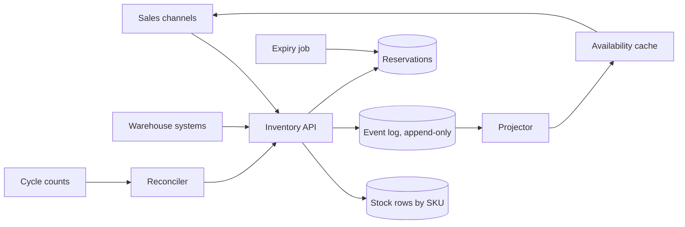

# Inventory Management System: Full System Design Mock Interview, 9 Steps

> **Prerequisites:** [Previous lesson: Hotel Booking System: Full System Design Mock Interview, All 9 Steps](../23-hotel-booking-system/README.md) and the [Interview Framework track](../../21-interview-framework/README.md).
> **Estimated Reading Time:** 15–20 minutes
> **Target Audience:** Engineers practising the full 9-step system design interview on a classic prompt: tracking stock across warehouses and channels without overselling.

> [!NOTE]
> **In one line:** An inventory system is **a ledger of stock movements** with reservations: on-hand quantity changes by recorded events, and available-to-promise is on-hand minus reserved.

> [!TIP]
> **The Golden Rule:** Record every stock change as an event, derive quantities from the events, reserve before selling, and reconcile with physical counts. Never update a number without leaving a trail.

---

## Step 1. Clarify the Problem

Open with questions, not boxes. Overselling and phantom stock are the two enemies. The design is a small, strongly consistent core with fast read replicas for the channels.

**Questions to ask the interviewer, and the answer we assume:**

| Question | Assumed answer |
| :--- | :--- |
| Channels? | Website, stores, marketplaces |
| Locations? | 500 warehouses and stores |
| Operations? | Receive, reserve, pick, ship, return, adjust |
| Consistency? | No overselling on the website |
| Scale? | 10M SKUs, 50K stock events per second at peak |

> Say it aloud: *"Before I draw anything, let me confirm the scope and the numbers."* That one sentence earns the first minutes of the interview.

---

## Step 2. Functional and Non-Functional Requirements

**Functional (what the system does):**

- Track on-hand and reserved stock per SKU per location.
- Reserve stock for an order and release it on cancellation or timeout.
- Record receipts, shipments, returns and adjustments.
- Show available-to-promise to sales channels.

**Non-functional (how well it does it):**

| Quality | Target | Why it drives the design |
| :--- | :--- | :--- |
| Correctness | No oversell, full audit trail | Customer trust and finance |
| Latency | Availability read under 50 ms | Product pages and checkout |
| Throughput | Tens of thousands of events per second | Sales and warehouse events |
| Reconciliation | Detect and fix drift | Physical reality differs |

---

## Step 3. Scope: In and Out

**In scope:** Stock events, reservations, available-to-promise, reconciliation.

**Out of scope (say it explicitly, then move on):**

- Demand forecasting.
- Warehouse robotics.
- Procurement.

---

## Step 4. Capacity Estimation

Assumptions: 10M SKUs across 500 locations, 50K stock events per second at peak, 100 bytes per event.

| Quantity | Calculation | Result |
| :--- | :--- | :--- |
| Stock rows (5% density) | `skus * locations * density` | **250M rows** |
| Event volume per day at 20% of peak | `events * 0.2 * 86400 * bytes_ / 1e9` | **86.4 GB/day** |
| Event storage per year | `events * 0.2 * 86400 * 365 * bytes_ / 1e12` | **31.5 TB/year** |

**What the numbers tell you:** 250M stock rows is moderate. The event log grows by about 86 GB a day, so it is partitioned by time and old partitions go to cheap storage. The hot data is the current stock row, which is what must be strongly consistent.

---

## Step 5. API Design

| Endpoint | Purpose | Notes |
| :--- | :--- | :--- |
| `POST /v1/stock/events` | Record receipt, adjust, return | Idempotent by event id. |
| `POST /v1/reservations` | Reserve for an order | Atomic across lines; returns reservation id with expiry. |
| `POST /v1/reservations/{id}/commit` | Convert to shipment | Deducts on-hand. |
| `GET /v1/availability?sku=` | Available to promise | Cached read. |

Reservations expire so abandoned carts do not lock stock forever.

---

## Step 6. Data Model

| Entity / Store | Key fields | Why this store |
| :--- | :--- | :--- |
| Stock (sharded by SKU) | `sku`, `location`, `on_hand`, `reserved`, `version` | Strong consistency row |
| Stock events (append-only) | `event_id`, `sku`, `location`, `delta`, `type`, `ts` | Audit trail, source for rebuilds |
| Reservations | `reservation_id`, lines, `expires_at`, `state` | Timed locks on stock |
| Availability cache | `sku` to available total | Fast channel reads |

available = on_hand - reserved. Both change only through events, and a rebuild job can recompute on_hand from the event log.

---

## Step 7. High-Level Architecture



**Walk the diagram in this order:** events from warehouses and channels enter the API, which updates the stock row and the log atomically, projects availability into a cache for channels, and a reconciler compares with physical counts.

---

## Step 8. Deep Dives and Bottlenecks

### 1. Event sourcing for stock

Every change is an event with a delta (receive +100, ship -1, adjust -3). The stock row is a materialised total updated in the same transaction as the event append. If the row is ever wrong, replaying the log rebuilds it. The log answers audit questions such as why the count changed.

### 2. Reservations and oversell protection

Reserve with a conditional update `reserved = reserved + n WHERE on_hand - reserved >= n`, across all lines of the order in one transaction on the SKU's shard (or a saga for multi-shard orders). Reservations carry an expiry. On commit, on_hand and reserved both decrease; on expiry or cancel, reserved decreases.

### 3. Hot SKUs and reconciliation

A flash-sale SKU is one hot row. Split its stock into several buckets (for example 10 sub-rows) and reserve from a random bucket, summing for display. Regularly reconcile against physical cycle counts: a mismatch creates an adjustment event with a reason, never a silent overwrite.

---

## Step 9. Trade-offs, Failures and Security

**Trade-offs to state aloud:**

| Decision | Option A | Option B | Pick and why |
| :--- | :--- | :--- | :--- |
| Quantity storage | Mutable number only | Event log plus derived total | Log plus total: audit and rebuild |
| Hot SKU | One row | Bucketed counters | Buckets for flash sales |
| Channel reads | Direct DB | Projected cache | Cache: absorbs read load, small staleness |

**Failure modes and mitigations:**

| Failure | What users see | Mitigation |
| :--- | :--- | :--- |
| Cache stale | Oversell attempt | Reservation is the authority and rejects it |
| Lost event | Wrong count | Idempotent event ids and reconciliation |
| Expired reservations not released | Phantom stock | Expiry job and alerting |

**Security and abuse:** Restrict who can create adjustments, require reasons and approvals for large ones, log every change, and authenticate warehouse systems and channels separately.

---

## Runnable Example: Reserve with an availability check

A reservation succeeds only if enough stock is available, and the totals stay consistent with the event log.

```python
stock = {"on_hand": 5, "reserved": 0}
events = []

def reserve(n):
    if stock["on_hand"] - stock["reserved"] < n:
        return False
    stock["reserved"] += n
    events.append(("reserve", n))
    return True

def commit(n):
    stock["reserved"] -= n
    stock["on_hand"] -= n
    events.append(("ship", n))

print(reserve(3), reserve(3), reserve(2))
commit(3)
print(stock)
print("on_hand from events:", 5 + sum(-n for t, n in events if t == "ship"))
```

Output (produced by running this exact code):

```text
True False True
{'on_hand': 2, 'reserved': 2}
on_hand from events: 2
```

Two units are still reservable after the first three, the second request for three is refused, and recomputing on-hand from the shipment events gives the same number as the stored row.

---

## Common Mistakes

- Decrementing a single number with no history.
- Selling without reserving.
- No expiry on reservations.
- Silent overwrites on count mismatch.
- One row for a flash-sale SKU.

---

## Interview Questions and Answers

<details>
<summary><strong>Q1: How do you prevent overselling?</strong></summary>

Reserve with a conditional update on available stock before accepting the order, with expiring reservations.

</details>

<details>
<summary><strong>Q2: Why an event log?</strong></summary>

It is the audit trail and lets you rebuild and reconcile quantities.

</details>

<details>
<summary><strong>Q3: How do you handle hot SKUs?</strong></summary>

Split the counter into buckets and reserve from one at random, summing for display.

</details>

<details>
<summary><strong>Q4: How do you keep channels fast?</strong></summary>

Project availability into a cache from the event stream; reservations are the final check.

</details>

<details>
<summary><strong>Q5: What if counts drift?</strong></summary>

Cycle counts feed a reconciler that records adjustment events with reasons.

</details>

---

## One-Page Cheat Sheet

| Step | What to say or draw |
| :--- | :--- |
| Clarify | Channels, 500 locations, no oversell |
| Capacity | 250M stock rows, ~86 GB/day of events |
| API | stock events, reserve, commit, availability |
| Data | Stock rows, event log, reservations, cache |
| Deep dive | Event sourcing, reservations, hot SKUs, reconcile |
| Trade-off | Log plus total, bucketed counters |

---

## Further Reading

- Martin Fowler, *Event Sourcing*.
- Shopify engineering blog, *Building a resilient inventory system for flash sales*.

---

## Next

Continue with [Logging and Monitoring Platform: Full System Design Mock Interview](../25-logging-and-monitoring-platform/README.md).
